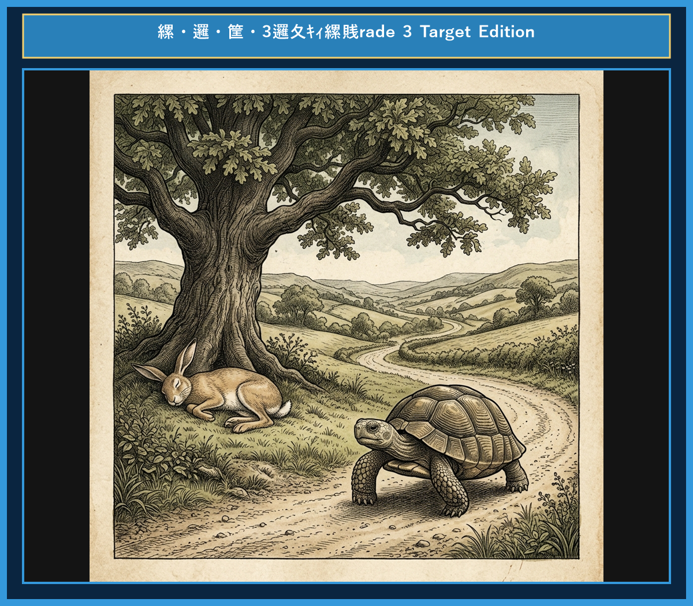

# Chapter 1: The Tortoise and the Hare (ウサギとカメ)

<!-- 電子書籍 Page Break & Image Header -->

  

<!-- Video Learning Link Start -->

  <a href="https://youtu.be/mock_tortoise_and_hare_ch01" style="color: #0969da; font-weight: bold; text-decoration: none; font-size: 1.05em; display: inline-block;">
    🎬 【動画で聴く・シャドーイング】ネイティブ朗読＆カラオケ字幕付き動画（YouTube）▶
  </a>
  

    ※ タップするとYouTubeが開き、発音に合わせて光るカラオケ字幕で学習できます。
  

<!-- Video Learning Link End -->

## 1. Benchmark Level: Eiken Grade 4 (英検4級レベル本文)
*Read in ~1 to 1.5 minutes. Baseline vocabulary and basic syntax.*

A proud hare always laughed at a slow tortoise. "You walk so slowly! Look at me. I am the fastest animal in the forest," the hare said.

The tortoise smiled and answered, "Let's have a race today. I can run faster than you think."

The hare laughed loudly. "That is impossible! But okay, let's run."

The race started. The hare ran very fast. Soon, he was far ahead of the tortoise. He looked back and saw no one. "The tortoise is too slow. I have a lot of time. I will take a short nap under this big tree," said the hare. He sat down and fell asleep.

Meanwhile, the tortoise kept walking. He did not stop. He walked step by step.

When the hare woke up, the sun was going down. He ran quickly to the finish line. However, the tortoise was already there!

Slow and steady wins the race.

---

## 2. Target Level: Eiken Grade 3 (英検3級レベル本文)
*Read in ~2 to 3 minutes. Upgraded vocabulary, sophisticated sentence structures, and idioms.*

Once upon a time, a proud hare was always boasting about his speed to the other animals. He especially enjoyed making fun of a slow tortoise. "Nobody can beat me because I am the fastest runner in these woods!" he cried.

To his surprise, the quiet tortoise replied calmly, "I accept your challenge. Let's race to the top of the hill."

The hare laughed out loud, believing that victory was already his. As soon as the signal was given, the hare dashed forward and left the tortoise far behind.

After running for a while, the hare stopped to look back. The tortoise was moving so slowly that he was barely visible in the distance. "I have plenty of time before he catches up," thought the hare. "I think I will rest under this shady tree." He lay down on the soft grass and soon fell into a deep sleep.

While the hare was sleeping, the tortoise continued to walk steadily without stopping.

When the hare finally opened his eyes, he saw that the sun was setting. He sprinted toward the finish line as fast as he could. However, the tortoise had already crossed the line and won the race.

Persistence and hard work will always bring success in the end.

---

## 3. Classic Original English Text (イソップ寓話 クラシック原文)
*Townsend / Jacobs Edition (Public Domain)*

A Hare was one day making fun of the short feet and slow pace of the Tortoise, who retorted: "Though you be swift as the wind, I will beat you in a race." The Hare, believing her assertion to be simply impossible, agreed to the proposal; and they agreed that the Fox should choose the course and fix the goal. On the day appointed for the race the two started together. The Tortoise never for a moment stopped, but went on with a slow but steady pace straight to the end of the course. The Hare, lying down by the wayside, fell asleep. At last waking up, and moving as fast as he could, he saw the Tortoise had reached the goal, and was comfortably resting after her fatigue.

Slow and steady wins the race.

---

### 🏛️ 【英検2級レベルで読み解く！クラシック原文の重要構文・英文法ノート】
1. **1. 分詞構文（Participle Clause: 付帯状況・理由）**
   - **原文**: *"The Hare, believing her assertion to be simply impossible, agreed to the proposal..."*
   - **解説**: 「〜と信じ込んでいたので」という理由を表す分詞構文。英検2級の長文読解・ライティングの最頻出構文です。
1. **2. 古典的仮定法現在（Subjunctive Mood）**
   - **原文**: *"Though you be swift as the wind, I will beat you in a race."*
   - **解説**: 譲歩節 `Though` の中で原形 `be` を用いる古典的な仮定法現在（現代英語の `Though you are...`）。格調高い古典の響きを持ちます。
1. **3. 過去分詞の後置修飾（Postpositive Participle）**
   - **原文**: *"On the day appointed for the race the two started together."*
   - **解説**: `appointed`（定められた・指定された）が直前の名詞 `the day` を後ろから修飾する構文です。

### 📜 【クラシック原文の重要語彙・古風表現（Classic Antique Vocabulary）】
- **retort** [動] 2級 **（機転を利かせて）言い返す、反論する**（現代の reply sharp/wittily に相当）
- **assertion** [名] 2級/準1級 **主張、断言**（動詞 assert の名詞形。2級長文定番）
- **wayside** [名] 2級 **道端、沿道**（by the wayside（道端に、途中で））
- **fatigue** [名] 2級 **（心身の）極度の疲労、疲れ**（tiredness の上位フォーマル語）

---

## 4. Japanese Translation (日本語訳)

ある日、野ウサギがカメの足の短さと歩みの遅さを馬鹿にして笑いました。するとカメは言い返しました。「あなたが風のように速くても、かけっこなら私の方が勝ちますよ。」
ウサギはそんな主張は到底不可能だと信じ込んで、その提案に同意しました。そして、キツネにコースを選んでもらい、ゴールを決めてもらうことにしました。
レースの当日、二匹は一緒にスタートしました。カメは一瞬たりとも立ち止まらず、遅くとも着実な歩みで、まっすぐコースの終わりへと進み続けました。一方のウサギは、道端に横になって眠り込んでしまいました。
やがて目を覚ましたウサギは、できる限りの速さで駆け抜けましたが、カメがすでにゴールに到達し、走った後の疲れを癒やして心地よく休んでいるのを目にするのでした。

**教訓**: 遅くとも着実な者が、最後にはレースに勝つ。

---

## 5. Recite & Compare (そらんじたいキーフレーズ対比表)
*Memorize these contrastive expressions to elevate speaking, writing, and reading fluency.*

| Context / Scene | Grade 4 (Baseline) | Grade 3 (Target / Recite) | Nuance & Exam Value |
|---|---|---|---|
| **自慢・からかい** | *always laughed at a slow tortoise* | *was boasting about his speed / making fun of...* | 単純な `laugh at` から、英検3級ライティングで役立つ表現 `boast about` や熟語 `make fun of` への強化。 |
| **挑戦を受ける** | *I can run faster than you think.* | *I accept your challenge.* | 「相手の挑戦を受諾する」という公式・フォーマルな動詞 `accept` の正しいコロケーション。 |
| **相手を引き離す** | *was far ahead of the tortoise* | *left the tortoise far behind* | `be ahead of`（〜より前にいる）から、能動的な表現 `leave A far behind`（Aを遠く置き去りにする）へのレベルアップ。 |
| **追いつく** | *The tortoise is too slow.* | *before he catches up* | 英検3級リスニング・読解の超頻出熟語 `catch up (with)`（〜に追いつく）の定着。 |
| **全力疾走** | *ran quickly to the finish line* | *sprinted toward the finish line as fast as he could* | 速度を表す動詞 `sprint` および同等比較 `as ~ as one can` の重要構文。 |
| **教訓（Moral）** | *Slow and steady wins the race.* | *Persistence and hard work will always bring success in the end.* | 定番のことわざに加え、英検3級の英作文・面接で理由付けに使える抽象名詞 `Persistence`（継続力・粘り強さ）の活用。 |

---

## 6. Vocabulary Builder: 赤シート対応 重要単語・熟語チェック表
*※ 赤い透明シート（または赤フィルム）を重ねると、日本語訳が消えて自力テストができます。*

| No. | 見出し語 / イディオム | 品詞 / レベル | 日本語の意味（赤シートで消える） | 本文での使われ方・コロケーション |
|:---:|---|:---:|---|---|
| **01** | **proud** | [形] 4級 | 誇り高い、傲慢な | *a proud hare (自惚れたウサギ)* |
| **02** | **boast (about...)** | [動] 3級 | 〜を自慢する、誇る | *was always boasting about his speed* |
| **03** | **make fun of...** | [熟] 3級 | 〜をからかう、嘲笑する | *making fun of a slow tortoise* |
| **04** | **challenge** | [名/動] 3級 | 挑戦、課題 / 挑む | *I accept your challenge.* |
| **05** | **accept** | [動] 3級 | 受け入れる、受諾する | *accept the proposal (提案を受諾する)* |
| **06** | **dash** | [動] 3級 | 勢いよく走る、突進する | *dashed forward (前方へ駆け出した)* |
| **07** | **leave ~ behind** | [熟] 3級 | 〜を置き去りにする | *left the tortoise far behind* |
| **08** | **visible** | [形] 準2級 | 目に見える、視認できる | *was barely visible in the distance* |
| **09** | **catch up (with...)** | [熟] 3級 | 〜に追いつく | *before he catches up* |
| **10** | **slumber** | [名/動] 準2級 | 深い眠り / 眠る | *fell into a profound slumber* |
| **11** | **sprint** | [動] 3級 | 全力疾走する | *sprinted toward the finish line* |
| **12** | **persistence** | [名] 準2級/2級 | 粘り強さ、不屈の継続 | *persistence and hard work will bring success* |
### 【出題傾向・文法解説ノート】

### 【出題頻出語彙・熟語ノート】
- **boast (about...)** [動] （〜について）自慢する（英検3級〜準2級頻出。*boast about one's success* など）
- **make fun of...** [熟] 〜をからかう（3級定番熟語。同義表現：*laugh at*, *tease*）
- **accept** [動] （提案・挑戦などを）受け入れる、承諾する（3級ライティング・会話文頻出）
- **dash** [動] 勢いよく駆け出す、突進する（*run* より躍動感のある描写動詞）
- **catch up (with...)** [熟] （〜に）追いつく（3級長文・リスニングで必ず問われる重要フレーズ）
- **sprint** [動] 全力疾走する（*run fast* の上位語表現）
- **persistence** [名] 粘り強さ、継続、根気（動詞 *persist* の名詞形。英作文の結論部で強力な説得力を発揮する語彙）

### 【文法・構文ポイント】
1. **so ~ that ... 構文（〜すぎて…できない / 非常に〜なので…）**
   - 3級本文: *"The tortoise was moving so slowly that he was barely visible in the distance."*
   - ポイント: 英検3級・準2級で必須の重要構文。`so + 副詞/形容詞 + that` の関係をしっかり把握しましょう。
2. **同等比較 + 助動詞 `as ~ as one can`（できる限り〜）**
   - 3級本文: *"He sprinted toward the finish line as fast as he could."*
   - ポイント: `as fast as possible` と同義の表現で、面接や作文で非常に好まれる基本構文です。
