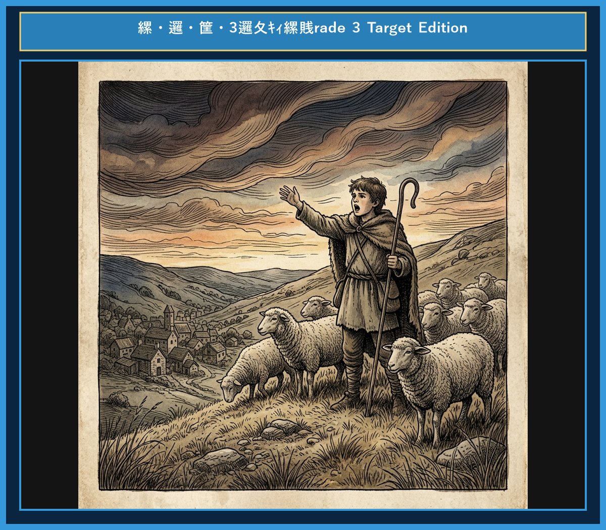

# Chapter 2: The Boy Who Cried Wolf (オオカミ少年)

<!-- 電子書籍 Page Break & Image Header -->

  

## 1. Benchmark Level: Eiken Grade 4 (英検4級レベル本文)
*Read in ~1 to 1.5 minutes. Baseline vocabulary and basic syntax.*

A young shepherd boy watched his sheep on a hill near a village. He felt bored every day. One day, he decided to play a trick.

He ran down to the village and shouted, "Wolf! Wolf! A wolf is chasing my sheep!"

The villagers stopped working and ran up the hill to help him. But when they arrived, there was no wolf. The boy laughed at them. The villagers were angry and returned to their work.

A few days later, the boy shouted "Wolf!" again. The villagers ran to help him, but it was another lie.

Then, one evening, a real wolf appeared from the forest. It attacked the sheep. The boy cried loudly, "Help! A real wolf is here!"

However, no one came to help. The villagers thought, "He is lying again." The wolf killed many sheep.

A liar is not believed even when he tells the truth.

---

## 2. Target Level: Eiken Grade 3 (英検3級レベル本文)
*Read in ~2 to 3 minutes. Upgraded vocabulary, sophisticated sentence structures, and idioms.*

Once upon a time, a young shepherd boy was guarding his flock of sheep on a hill outside a small village. Because his job was very quiet, he often felt bored. One afternoon, he decided to play a trick on the villagers to entertain himself.

He ran toward the village and shouted as loudly as he could, "Wolf! Wolf! A wolf is attacking my sheep!"

Hearing his cries, the villagers dropped their work and hurried up the hill to protect the sheep. However, when they arrived, they found no wolf at all. The boy laughed heartily at their shocked faces. The villagers were very upset with him and went back to their work.

A few days later, the foolish boy played the same trick again, and once more the villagers came running only to be fooled.

Finally, a real wolf emerged from the dark woods and began to attack the flock. Terrified, the boy screamed, "Please help! A real wolf is attacking!"

Unfortunately, nobody responded to his cries because everyone believed that he was lying again. In the end, the wolf destroyed many sheep, and the boy learned a painful lesson.

Nobody believes a liar, even when he tells the truth.

---

## 3. Classic Original English Text (イソップ寓話 クラシック原文)
*Townsend / Jacobs Edition (Public Domain)*

A Shepherd Boy, who watched a flock of sheep near a village, brought out the villagers three or four times by crying out, "Wolf! Wolf!" and when his neighbors came to help him, laughed at them for their pains. The Wolf, however, did truly come at last. The Shepherd-boy, now really alarmed, shouted in an agony of apprehension: "Pray, come and help me; the Wolf is killing the sheep"; but no one paid the least heed to his cries, nor rendered any assistance. The Wolf, having no cause of fear, at his leisure lacerated or destroyed the whole flock.

There is no believing a liar, even when he speaks the truth.

---

### 🏛️ 【英検2級レベルで読み解く！クラシック原文の重要構文・英文法ノート】
1. **1. 分詞構文（Time / Attendant Circumstance）**
   - **原文**: *"A Shepherd-boy, who watched a flock of sheep near a village, brought out the villagers three or four times by crying out..."*
   - **解説**: `by crying out`（叫ぶことによって）という手段の動名詞句と関係代名詞の継続用法が組み合わさった2級頻出の複文構造です。
1. **2. 結果・目的を表す不定詞（Infinitive: Result）**
   - **原文**: *"...and even made a practice of laughing at them when they came running to his assistance."*
   - **解説**: `came running`（走ってやって来た：come + 現在分詞）の付帯状況表現です。
1. **3. 譲歩の従属接続詞 `even when`**
   - **原文**: *"Nobody believes a liar, even when he tells the truth."*
   - **解説**: 「〜の時でさえ」という譲歩条件を表す接続詞構文。英作文で高い説得力を生み出します。

### 📜 【クラシック原文の重要語彙・古風表現（Classic Antique Vocabulary）】
- **assistance** [名] 2級 **援助、手助け**（come to one's assistance（助けに駆けつける））
- **earnest** [名/形] 2級 **本気、真剣 / 真面目な**（in earnest（本気で、真剣に））
- **dismay** [名/動] 準1級 **狼狽、落胆 / うろたえさせる**（cried out in dismay）
- **trustworthy** [形] 2級 **信頼できる、頼りになる**（a liar is never deemed trustworthy）

---

## 4. Japanese Translation (日本語訳)

ある村の近くで羊の群れを見張っていた羊飼いの少年が、「オオカミだ！オオカミだ！」と叫んで、3回も4回も村人たちを駆けつけさせ、助けに来た近所の人々の骨折りを笑いものにしました。
しかし、ついに本物のオオカミが現れました。今度こそ本当に恐ろしくなった少年は、必死の思いで叫びました。「お願いです、来て助けてください！オオカミが羊を殺しています！」
しかし、誰も少年の叫びに少しも注意を払わず、手助けもしませんでした。オオカミは何も恐れることなく、思う存分羊の群れ全体を傷つけ、咬み殺してしまいました。

**教訓**: 嘘つきは、たとえ本当のことを言っても信用されない。

---

## 5. Recite & Compare (そらんじたいキーフレーズ対比表)
*Memorize these contrastive expressions to elevate speaking, writing, and reading fluency.*

| Context / Scene | Grade 4 (Baseline) | Grade 3 (Target / Recite) | Nuance & Exam Value |
|---|---|---|---|
| **自分を楽しませる** | *decided to play a trick* | *decided to play a trick to entertain himself* | 単純な行為から、目的を表す不定詞構文 `to entertain himself`（自分を楽しませるために）へのアップデート。 |
| **大声で叫ぶ** | *shouted, "Wolf!"* | *shouted as loudly as he could* | 英検3級必須構文 `as ~ as one can`（できる限り〜）を使った躍動感のある描写。 |
| **急いで助けに向かう** | *ran up the hill to help him* | *hurried up the hill to protect the sheep* | `run` を表現力の高い動詞 `hurry`（急いで行く）や `protect`（保護する）に置き換え。 |
| **笑いものにする** | *laughed at them* | *laughed heartily at their shocked faces* | 副詞 `heartily`（心から・大笑いして）を添えることで感情描写の語彙力をアピール。 |
| **助けに応じない** | *no one came to help* | *nobody responded to his cries* | 重要な3級動詞 `respond (to...)`（〜に反応する・応答する）の正しいコロケーション。 |
| **教訓（Moral）** | *A liar is not believed...* | *Nobody believes a liar, even when he tells the truth.* | 否定主語 `Nobody` + 譲歩の接続詞 `even when`（〜の時でさえ）を使った英作文で非常に高い評価を受ける構文。 |

---

## 6. Vocabulary Builder: 赤シート対応 重要単語・熟語チェック表
*※ 赤い透明シート（または赤フィルム）を重ねると、日本語訳が消えて自力テストができます。*

| No. | 見出し語 / イディオム | 品詞 / レベル | 日本語の意味（赤シートで消える） | 本文での使われ方・コロケーション |
|:---:|---|:---:|---|---|
| **01** | **shepherd** | [名] 3級 | 羊飼い | *a young shepherd boy* |
| **02** | **bored** | [形] 4級 | 退屈した、飽きた | *felt bored on the hill* |
| **03** | **mischievous** | [形] 準2級 | いたずら好きな | *with a mischievous smile* |
| **04** | **shout** | [動] 4級 | 大声を出す、叫ぶ | *shouted at the top of his lungs* |
| **05** | **villager** | [名] 3級 | 村人 | *the villagers rushed to help* |
| **06** | **rush** | [動] 3級 | 急いで駆けつける | *rushed to the rescue* |
| **07** | **trick** | [名/動] 3級 | いたずら、企み / だます | *play a trick on someone* |
| **08** | **emerge** | [動] 準2級/2級 | 現れる、姿を現す | *a fierce wolf emerged from the woods* |
| **09** | **panic** | [名/動] 3級 | パニック、大混乱 | *cried in pure panic* |
| **10** | **scatter** | [動] 準2級 | 散り散りになる、まき散らす | *the sheep scattered in all directions* |
| **11** | **deceive** | [動] 準2級/2級 | だます、欺く | *deceive others for amusement* |
| **12** | **trustworthy** | [形] 2級 | 信頼できる、頼もしい | *a liar is never considered trustworthy* |

### 【出題傾向・文法解説ノート】

### 【出題頻出語彙・熟語ノート】
- **guard** [動] （〜を）守る、見張る（英検3級定番動詞。名詞 *guardian*）
- **flock** [名] （羊や鳥などの）群れ（3級〜準2級長文頻出。*a flock of sheep*）
- **entertain** [動] 〜を楽しませる（3級主要動詞。名詞形 *entertainment*）
- **hurry** [動] 急ぐ、急いで行く（3級会話文・長文必須動詞）
- **respond (to...)** [動] （〜に）応答する、応じる（3級リスニング・長文重要動詞）
- **in the end** [熟] 結局のところ、最後に（3級作文で理由の締めくくりに使える接続熟語）

### 【文法・構文ポイント】
1. **現在分詞・過去分詞による分詞構文的表現 / 状況描写**
   - 3級本文: *"Hearing his cries, the villagers dropped their work and hurried..."*
   - ポイント: 「彼の叫びを聞いて（聞いてすぐに）」という時の流れをスムーズに表す表現。
2. **否定主語 `Nobody / No one` による表現**
   - 3級本文: *"Nobody believes a liar, even when he tells the truth."*
   - ポイント: 英語では `Not anybody` よりも `Nobody` を主語にする方が自然で力強い文になります。ライティングのまとめ文として暗唱しましょう。
