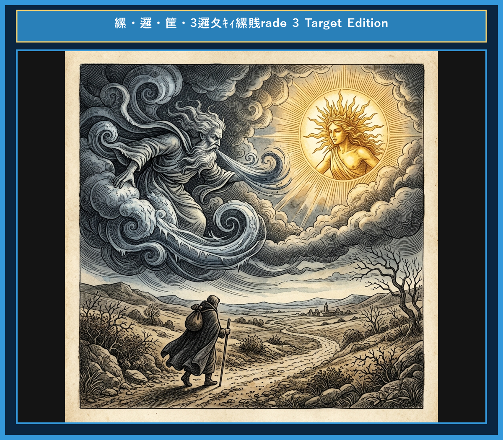

# Chapter 3: The North Wind and the Sun (北風と太陽)

<!-- 電子書籍 Page Break & Image Header -->

  

## 1. Benchmark Level: Eiken Grade 4 (英検4級レベル本文)
*Read in ~1 to 1.5 minutes. Baseline vocabulary and basic syntax.*

The North Wind and the Sun were arguing about who was stronger. Just then, they saw a traveler walking down the road. He was wearing a warm coat.

"Look," said the Wind. "Let's see who can take off his coat first."

The Wind blew hard. Cold air rushed across the land. But the harder he blew, the more tightly the man held his coat. Finally, the Wind stopped blowing because he was tired.

Next, it was the Sun's turn. The Sun smiled and began to shine brightly. Soon, the day became very warm. The traveler felt hot, took off his coat, and sat under a tree to rest.

Kindness is stronger than anger.

---

## 2. Target Level: Eiken Grade 3 (英検3級レベル本文)
*Read in ~2 to 3 minutes. Upgraded vocabulary, sophisticated sentence structures, and idioms.*

Once upon a time, a fierce argument arose between the North Wind and the Sun over which of them was stronger. While they were arguing, they noticed a traveler walking along a country road, wrapped in a heavy cloak.

"I have an idea," proposed the Wind. "The one who can force that traveler to take off his cloak shall be the winner."

The Wind began to blow as hard as he could. Icy air rushed across the field. However, the harder he blew, the more tightly the traveler wrapped the cloak around his body. In the end, the Wind gave up in despair.

Then, the Sun stepped forward and shone warmly upon the earth. Within a few minutes, the traveler felt so hot that he could no longer bear his heavy cloak. He happily took it off and sat down under a shady tree.

Gentleness and warm words can accomplish more than force.

---

## 3. Classic Original English Text (イソップ寓話 クラシック原文)
*Townsend / Jacobs Edition (Public Domain)*

The North Wind and the Sun had a contest to decide which was the stronger. To settle the matter, they agreed to test their strength upon a traveler who was walking down the road wrapped in a warm cloak. Whichever of them could make him take his cloak off first was to be accounted the victor.

The North Wind blew with all his might, but the harder he blew, the more closely did the traveler wrap his cloak around him, till at last the North Wind gave up the attempt in despair.

Then the Sun shone out warmly, and immediately the traveler took off his cloak.

Persuasion is better than force.

---

### 🏛️ 【英検2級レベルで読み解く！クラシック原文の重要構文・英文法ノート】
1. **1. 比較級 + 比較級（The + 比較級 ..., the + 比較級 ... 構文）**
   - **原文**: *"The harder the Wind blew, the more closely did the Traveler wrap his cloak around him."*
   - **解説**: 「〜すればするほど、ますます…」を表す英検2級・準1級の最重要構文。後半に倒置（`did the Traveler wrap`）が起きています。
1. **2. 形式主語構文・合意の受動態**
   - **原文**: *"It was agreed between them that whichever first made the traveler take off his cloak should be held the stronger."*
   - **解説**: `whichever first made...`（どちらが先に〜させようとも）という複合関係代名詞節と使役動詞 `make + O + 原形不定詞` の融合。
1. **3. 比較を表す上級形容詞 `superior to`**
   - **原文**: *"Persuasion is often superior to force."*
   - **解説**: ラテン比較（*superior to* = 〜より優れている）。*than* ではなく *to* を取る重要文法ポイントです。

### 📜 【クラシック原文の重要語彙・古風表現（Classic Antique Vocabulary）】
- **dispute** [名/動] 2級 **論争、口論 / 争う**（a dispute arose between A and B）
- **cloak** [名] 準2級/2級 **外套、マント**（wrap one's cloak tightly）
- **persuasion** [名] 2級 **説得、説得力**（動詞 persuade の名詞形）
- **superior to** [熟] 2級 **〜より優れている**（反意語: inferior to）

---

## 4. Japanese Translation (日本語訳)

北風と太陽が、どちらが強いかを決める勝負をしました。決着をつけるため、二者は暖かいマントを羽織って道を歩いている旅人で力を試すことに同意しました。旅人のマントを先に脱がせることができた方が勝ちということになりました。

北風はありったけの力で吹き立てましたが、激しく吹けば吹くほど、旅人はマントを一層きつく身に巻きつけ、ついに北風は絶望して断念しました。

次に太陽が温かく照りつけると、旅人はすぐにマントを脱ぎ捨てました。

**教訓**: 説得（優しさ）は、力づく（強情）よりも効果的である。

---

## 5. Recite & Compare (そらんじたいキーフレーズ対比表)
*Memorize these contrastive expressions to elevate speaking, writing, and reading fluency.*

| Context / Scene | Grade 4 (Baseline) | Grade 3 (Target / Recite) | Nuance & Exam Value |
|---|---|---|---|
| **議論・対立の発生** | *were arguing about who was stronger* | *a fierce argument arose between A and B over...* | 単純な `arguing` から、抽象名詞 `argument` や前置詞 `over` を用いた本格的な文構造への発展。 |
| **提案する** | *said, "Let's see..."* | *proposed, "The one who can..."* | 会話動詞 `propose`（提案する）と関係代名詞 `The one who...`（〜する人）の高度な組み合わせ。 |
| **全力で吹きつける** | *blew hard* | *blew as hard as he could* | 限界まで行うことを意味する `as ~ as one can` 構文の徹底活用。 |
| **〜に耐えられない** | *felt hot, took off...* | *felt so hot that he could no longer bear...* | 英検3級最重要構文 `so ~ that ...` と動詞 `bear`（耐える）の連携。 |
| **達成する** | *is stronger than...* | *can accomplish more than force* | 面接やライティングで「成果を上げる」と言いたい時に効く上級動詞 `accomplish`。 |

---

## 6. Vocabulary Builder: 赤シート対応 重要単語・熟語チェック表
*※ 赤い透明シート（または赤フィルム）を重ねると、日本語訳が消えて自力テストができます。*

| No. | 見出し語 / イディオム | 品詞 / レベル | 日本語の意味（赤シートで消える） | 本文での使われ方・コロケーション |
|:---:|---|:---:|---|---|
| **01** | **dispute** | [名/動] 準2級/2級 | 論争、争い / 言い争う | *a fierce dispute arose* |
| **02** | **claim** | [動] 3級 | 主張する、言い張る | *claimed to be stronger* |
| **03** | **traveler** | [名] 3級 | 旅人、旅行者 | *a lone traveler walking along the road* |
| **04** | **cloak** | [名] 準2級 | マント、外套 | *wrapped tightly in a heavy cloak* |
| **05** | **fierce** | [形] 準2級 | 猛烈な、激しい | *blew a fierce and icy blast* |
| **06** | **howl** | [動] 3級 | （風が）うなる、吠える | *the howling wind tore at his clothes* |
| **07** | **clutch** | [動] 準2級 | ぐっと掴む、しっかり握る | *clutched his garment even tighter* |
| **08** | **radiant** | [形] 2級/準1級 | 輝くばかりの、光を放つ | *beamed with radiant warmth* |
| **09** | **gentle** | [形] 4級 | 優しい、穏やかな | *with gentle and steady rays* |
| **10** | **perspiration** | [名] 2級/準1級 | 汗、発汗 | *dripping with warm perspiration* |
| **11** | **unfasten** | [動] 準2級 | 外す、脱ぐ | *gladly unfastened his heavy cloak* |
| **12** | **persuasion** | [名] 2級 | 説得、説得力 | *persuasion is often superior to force* |

### 【出題傾向・文法解説ノート】

### 【出題頻出語彙・熟語ノート】
- **argument** [名] 議論、口論（動詞 *argue*。英検3級主要名詞）
- **propose** [動] （〜を）提案する（ライティングで意見を述べる際の必須動詞）
- **wrap** [動] （〜を）包む、巻きつける（3級長文・リスニング頻出）
- **give up (in despair)** [熟] （絶望して）あきらめる（3級最重要熟語）
- **bear** [動] 〜に耐える、我慢する（*cannot bear to ~* などの形で出題）
- **accomplish** [動] 〜を成し遂げる、達成する（3級〜準2級頻出動詞）

### 【文法・構文ポイント】
1. **[The + 比較級 ..., the + 比較級 ...]（〜すればするほど、益々…する）**
   - 3級本文: *"The harder he blew, the more tightly the traveler wrapped the cloak..."*
   - ポイント: 読解問題で差がつく比較構文。規則変化（*harder*）と副詞（*more tightly*）の組み合わせをチェック！
2. **関係代名詞 `The one who ...`（〜する者）**
   - 3級本文: *"The one who can force that traveler to take off his cloak shall be the winner."*
   - ポイント: 人を表す代名詞 `The one` と関係代名詞 `who` の先行詞関係。ライティングの主語として非常にスマートです。
