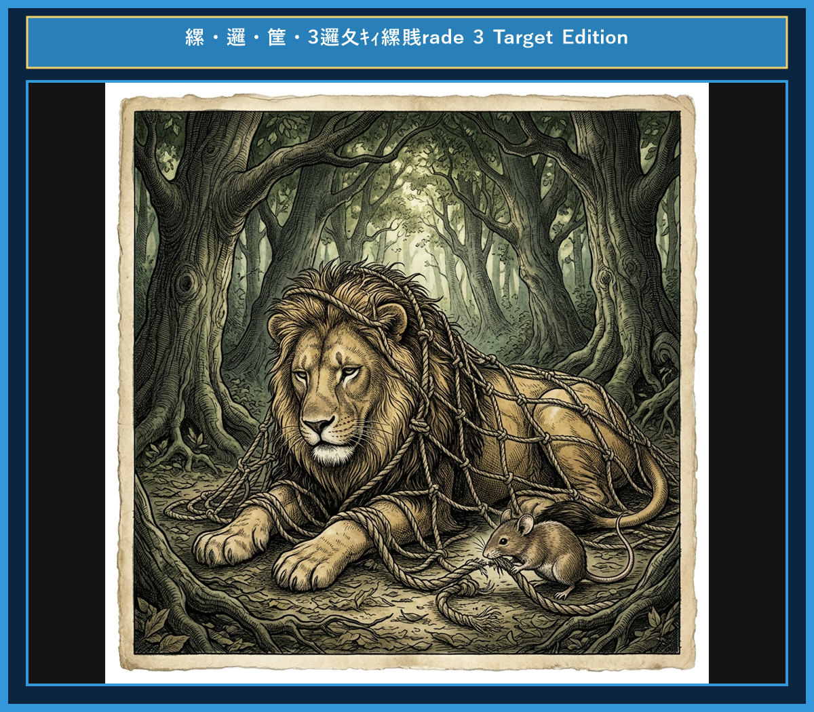

# Chapter 4: The Lion and the Mouse (ライオンとネズミ)

<!-- 電子書籍 Page Break & Image Header -->

  

## 1. Benchmark Level: Eiken Grade 4 (英検4級レベル本文)
*Read in ~1 to 1.5 minutes. Baseline vocabulary and basic syntax.*

A big lion was sleeping under a tree. Suddenly, a little mouse ran over his face. The lion woke up and caught the mouse with his big paw.

"Please don't eat me!" squeaked the mouse. "If you let me go, I will help you someday."

The lion laughed. "How can a little mouse help a big lion?" But he was kind and let the mouse go free.

A few weeks later, some hunters caught the lion in a heavy net. The lion roared loudly because he could not move.

The mouse heard the roar and ran to the lion. He used his sharp teeth to chew the ropes. Soon, the lion was free.

"Thank you," said the lion.

Even a small friend can be a great help.

---

## 2. Target Level: Eiken Grade 3 (英検3級レベル本文)
*Read in ~2 to 3 minutes. Upgraded vocabulary, sophisticated sentence structures, and idioms.*

Once upon a time, a mighty lion was sleeping peacefully under a shaded tree. Suddenly, a tiny mouse ran across his nose and woke him up. Furious at being disturbed, the lion caught the creature under his huge paw.

"Please spare my life!" begged the mouse. "If you set me free, I promise to return your kindness in the future."

The lion laughed out loud, wondering how such a tiny creature could ever assist the king of beasts. However, feeling generous, he decided to let the mouse go.

A few weeks later, the lion was caught in a hunter's strong net. Unable to break free, he roared in anger and distress.

Hearing the familiar sound, the little mouse rushed to the scene. He quickly began to chew through the thick ropes with his sharp teeth. Before long, the net fell apart, and the lion was rescued.

"You laughed at me before, but now you see that even a mouse can help a lion," smiled the little mouse.

Little friends may prove to be great friends.

---

## 3. Classic Original English Text (イソップ寓話 クラシック原文)
*Townsend / Jacobs Edition (Public Domain)*

A Lion was awakened from sleep by a Mouse running over his face. Rising up angrily, he caught him and was about to kill him, when the Mouse piteously entreated, saying: "If you would only spare my life, I would be sure to repay your kindness." The Lion laughed and let him go. It happened shortly after this that the Lion was caught by some hunters, who bound him by strong ropes to the ground. The Mouse, recognizing his roar, came and gnawed the rope with his teeth, and set him free, exclaiming: "You ridiculed the idea of my ever being able to help you, not expecting to receive from me any requital of your favor; now you know that it is possible for even Mice to confer benefits upon Lions."

Little friends may prove great friends.

---

### 🏛️ 【英検2級レベルで読み解く！クラシック原文の重要構文・英文法ノート】
1. **1. 分詞構文（Participle Clause: 付帯状況・理由）**
   - **原文**: *"The Hare, believing her assertion to be simply impossible, agreed to the proposal..."*
   - **解説**: 「〜と信じ込んでいたので」という理由を表す分詞構文。英検2級の長文読解・ライティングの最頻出構文です。
1. **2. 古典的仮定法現在（Subjunctive Mood）**
   - **原文**: *"Though you be swift as the wind, I will beat you in a race."*
   - **解説**: 譲歩節 `Though` の中で原形 `be` を用いる古典的な仮定法現在（現代英語の `Though you are...`）。格調高い古典の響きを持ちます。
1. **3. 過去分詞の後置修飾（Postpositive Participle）**
   - **原文**: *"On the day appointed for the race the two started together."*
   - **解説**: `appointed`（定められた・指定された）が直前の名詞 `the day` を後ろから修飾する構文です。

### 📜 【クラシック原文の重要語彙・古風表現（Classic Antique Vocabulary）】
- **retort** [動] 2級 **（機転を利かせて）言い返す、反論する**（現代の reply sharp/wittily に相当）
- **assertion** [名] 2級/準1級 **主張、断言**（動詞 assert の名詞形。2級長文定番）
- **wayside** [名] 2級 **道端、沿道**（by the wayside（道端に、途中で））
- **fatigue** [名] 2級 **（心身の）極度の疲労、疲れ**（tiredness の上位フォーマル語）

---

## 4. Japanese Translation (日本語訳)

あるライオンが、顔の上を走ったネズミによって眠りを破られました。怒って起き上がったライオンはネズミを捕まえ、殺そうとしましたが、ネズミは哀れっぽく命乞いをしました。「どうか私の命をお助けくだされば、必ずこのご恩をお返しいたします。」ライオンは笑ってネズミを逃がしてやりました。

それからまもなくして、ライオンは狩人たちに捕らわれ、強い縄で地面に縛りつけられてしまいました。その咆哮に気づいたネズミがやってきて、歯で縄をかみ切り、ライオンを自由にしてあげました。そして叫びました。「以前、私がお役に立つなんて無理だと笑い、恩返しなど期待していらっしゃいませんでしたね。でも今、ネズミでさえライオンのお役に立てることがお分かりいただけたでしょう。」

**教訓**: 小さな友も、大いに頼りになる友となり得る。

---

## 5. Recite & Compare (そらんじたいキーフレーズ対比表)
*Memorize these contrastive expressions to elevate speaking, writing, and reading fluency.*

| Context / Scene | Grade 4 (Baseline) | Grade 3 (Target / Recite) | Nuance & Exam Value |
|---|---|---|---|
| **命乞いをする** | *Please don't eat me!* | *Please spare my life!* | 直訳的口語から、英検3級長文・面接で高得点が取れる重要動詞 `spare`（〜の命を助ける）の活用。 |
| **恩返しを約束する** | *I will help you someday.* | *I promise to return your kindness...* | 動詞 `promise` + 不定詞句、および熟語 `return one's kindness`（恩返しする）のスマートな組み合わせ。 |
| **解放する** | *let the mouse go free* | *set me free* | 定番熟語 `set A free`（Aを自由にする・解放する）のマスター。 |
| **脱出できない** | *could not move* | *Unable to break free* | `could not` を分詞構文 `Unable to ~` に書き換える高度な記述力。 |
| **救出される** | *the lion was free* | *the lion was rescued* | 受動態 `was rescued`（救出された）を使った語彙力の表現。 |
| **教訓（Moral）** | *Even a small friend can be a help.* | *Little friends may prove to be great friends.* | 動詞 `prove to be...`（〜であることが分かる）を使いこなす名言フレーズ。 |

---

## 6. Vocabulary Builder: 赤シート対応 重要単語・熟語チェック表
*※ 赤い透明シート（または赤フィルム）を重ねると、日本語訳が消えて自力テストができます。*

| No. | 見出し語 / イディオム | 品詞 / レベル | 日本語の意味（赤シートで消える） | 本文での使われ方・コロケーション |
|:---:|---|:---:|---|---|
| **01** | **majestic** | [形] 準2級 | 威厳のある、雄大な | *the majestic king of beasts* |
| **02** | **disturb** | [動] 3級 | 邪魔する、乱す | *disturbed his peaceful slumber* |
| **03** | **beg** | [動] 3級 | 懇願する、頼み込む | *begged desperately for mercy* |
| **04** | **spare** | [動] 準2級 | （命を）助ける、惜しむ | *spared the tiny creature's life* |
| **05** | **trap** | [動/名] 3級 | 罠にかける / 罠 | *trapped helplessly in a sturdy net* |
| **06** | **roar** | [動/名] 3級 | 咆哮する、大声で吠える | *roared in utter frustration* |
| **07** | **gnaw** | [動] 準2級/2級 | かじる、噛み切る | *gnawed through the thick rope* |
| **08** | **fiber** | [名] 準2級 | 繊維、ロープの紐 | *severed the binding fibers* |
| **09** | **gratitude** | [名] 2級 | 感謝の気持ち | *bowed in profound gratitude* |
| **10** | **insignificant** | [形] 2級/準1級 | 取るに足らない、ちっぽけな | *no friend is too insignificant to help* |
| **11** | **repay** | [動] 3級 | 恩返しする、返済する | *repay a noble act of kindness* |
| **12** | **compassion** | [名] 2級 | 慈悲、思いやり | *compassion yields unexpected rewards* |

### 【出題傾向・文法解説ノート】

### 【出題頻出語彙・熟語ノート】
- **mighty** [形] 力強い、巨大な（英検3級〜準2級頻出形容詞）
- **disturb** [動] 〜を邪魔する、動揺させる（3級主要動詞。*sorry to disturb you* など）
- **spare** [动] （命などを）助ける、惜しむ（*spare one's life* で超頻出）
- **rescue** [動] 〜を救出する、助け出す（リスニング・読解必須動詞）
- **distress** [名] 苦痛、困窮（3級〜準2級表現）
- **prove (to be...)** [動] （〜であることが）証明される、判明する（3級・準2級構文動詞）

### 【文法・構文ポイント】
1. **[Unable to + 動詞原形]（〜することができず）の分詞構文省略形**
   - 3級本文: *"Unable to break free, he roared in anger..."*
   - ポイント: `Being unable to...` の `Being` が省略された形。作文で書けると一目置かれます。
2. **[promise + to + 動詞原形]（〜することを約束する）**
   - 3級本文: *"I promise to return your kindness in the future."*
   - ポイント: `promise` は目的語に That節だけでなく `to 不定詞` を取る代表的動詞です。
