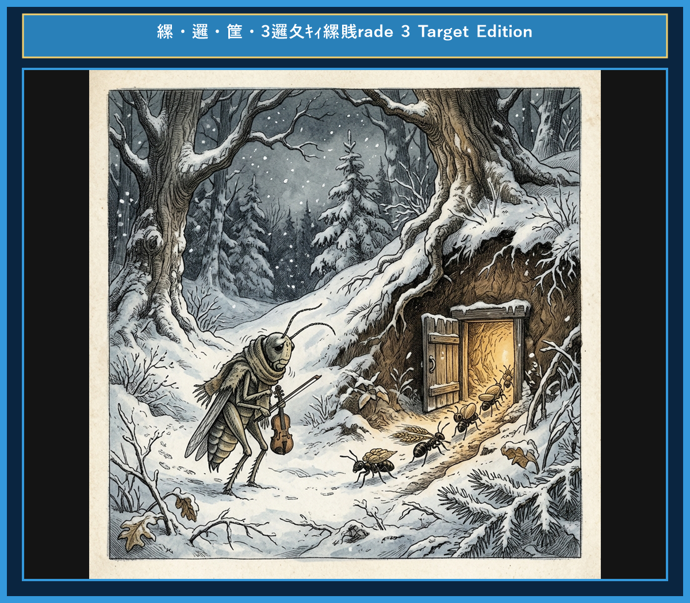

# Chapter 5: The Ant and the Grasshopper (アリとキリギリス)

<!-- 電子書籍 Page Break & Image Header -->

  

## 1. Benchmark Level: Eiken Grade 4 (英検4級レベル本文)
*Read in ~1 to 1.5 minutes. Baseline vocabulary and basic syntax.*

During the warm summer, a grasshopper sang and danced all day. He saw a hard-working ant carrying heavy corn to her nest.

"Why do you work so hard?" asked the grasshopper. "Summer is fun! Come and sing with me."

The ant replied, "I am storing food for the cold winter. You should collect food too." But the grasshopper laughed and kept dancing.

Soon, winter came. Snow covered the ground, and there was no food anywhere. The grasshopper was very hungry and cold.

He went to the ant's house and asked, "Please give me some food."

The ant asked, "What did you do during the summer?"

The grasshopper answered, "I sang and danced all summer."

The ant said, "Then you can dance through the winter!" And she closed her door.

Work today, and you will have food tomorrow.

---

## 2. Target Level: Eiken Grade 3 (英検3級レベル本文)
*Read in ~2 to 3 minutes. Upgraded vocabulary, sophisticated sentence structures, and idioms.*

On a bright summer day, a carefree grasshopper was singing and enjoying music in a green field. Nearby, a group of ants was working tirelessly, gathering grain and carrying it to their underground nest.

"Why waste such a lovely day working so hard?" asked the grasshopper. "Come and join me! We should enjoy the summer."

The wise ant replied, "I am preparing food for the coming winter, and I advise you to do the same." However, the grasshopper ignored her advice and continued to play his music.

When winter arrived, freezing winds blew across the land, and snow buried the field. Having stored nothing, the grasshopper found himself starving and shivering from the cold.

In desperation, he knocked on the ant's door and begged for a small piece of corn.

"What did you do all summer while we were working?" asked the ant.

"I was busy singing," replied the grasshopper regretfully.

"If you were foolish enough to sing all summer, you may dance all winter!" answered the ant firmly.

It is wise to prepare today for the needs of tomorrow.

---

## 3. Classic Original English Text (イソップ寓話 クラシック原文)
*Townsend / Jacobs Edition (Public Domain)*

In a field one summer's day a Grasshopper was hopping about, chirping and singing to its heart's content. An Ant passed by, bearing along with great toil an ear of corn he was taking to the nest. "Why not come and chat with me," said the Grasshopper, "instead of toiling and moiling in that way?" "I am helping to lay up food for the winter," said the Ant, "and recommend you to do the same." "Why bother about winter?" said the Grasshopper; "we have got plenty of food at present." But the Ant went on its way and continued its toil. When the winter came the Grasshopper had no food and found itself dying of hunger, while it saw the ants distributing every day corn and grain from the stores they had collected in the summer. Then the Grasshopper knew:

It is best to prepare for the days of necessity.

---

### 🏛️ 【英検2級レベルで読み解く！クラシック原文の重要構文・英文法ノート】
1. **1. 分詞構文（Participle Clause: 付帯状況・理由）**
   - **原文**: *"The Hare, believing her assertion to be simply impossible, agreed to the proposal..."*
   - **解説**: 「〜と信じ込んでいたので」という理由を表す分詞構文。英検2級の長文読解・ライティングの最頻出構文です。
1. **2. 古典的仮定法現在（Subjunctive Mood）**
   - **原文**: *"Though you be swift as the wind, I will beat you in a race."*
   - **解説**: 譲歩節 `Though` の中で原形 `be` を用いる古典的な仮定法現在（現代英語の `Though you are...`）。格調高い古典の響きを持ちます。
1. **3. 過去分詞の後置修飾（Postpositive Participle）**
   - **原文**: *"On the day appointed for the race the two started together."*
   - **解説**: `appointed`（定められた・指定された）が直前の名詞 `the day` を後ろから修飾する構文です。

### 📜 【クラシック原文の重要語彙・古風表現（Classic Antique Vocabulary）】
- **retort** [動] 2級 **（機転を利かせて）言い返す、反論する**（現代の reply sharp/wittily に相当）
- **assertion** [名] 2級/準1級 **主張、断言**（動詞 assert の名詞形。2級長文定番）
- **wayside** [名] 2級 **道端、沿道**（by the wayside（道端に、途中で））
- **fatigue** [名] 2級 **（心身の）極度の疲労、疲れ**（tiredness の上位フォーマル語）

---

## 4. Japanese Translation (日本語訳)

ある夏の日に、キリギリスが野原を跳ね回り、心ゆくまで鳴いて歌っていました。そこへ、トウモロコシの穂をたいそう苦労して自分の巣へと運んでいるアリが通りかかりました。

「そんなに骨折って働かないで、僕とおしゃべりでもしないかい？」とキリギリスが言いました。

「冬のための食料を蓄えているのです。あなたもそうすることをお勧めしますよ」とアリは答えました。

「どうして冬のことなんか気にするのさ。今ここには食料がたくさんあるじゃないか。」しかしアリはそのまま歩み続け、仕事を続けました。

やがて冬が来ると、キリギリスには食べるものがなくなり、空腹に苦しみました。一方アリたちは、夏のうちに集めて蓄えておいた穀物を毎日分け合っていました。そこでキリギリスは悟りました。

**教訓**: 必要となる日に備えて、あらかじめ準備しておくのが最も良い。

---

## 5. Recite & Compare (そらんじたいキーフレーズ対比表)
*Memorize these contrastive expressions to elevate speaking, writing, and reading fluency.*

| Context / Scene | Grade 4 (Baseline) | Grade 3 (Target / Recite) | Nuance & Exam Value |
|---|---|---|---|
| **時間を無駄にする** | *Why do you work so hard?* | *Why waste such a lovely day working so hard?* | 3級文法 `waste + 時間 + ~ing`（〜して時間を浪費する）の洗練された疑問文。 |
| **助言する** | *You should collect food too.* | *I advise you to do the same.* | 助動詞 `should` から、公式な動詞構文 `advise A to do`（Aに〜するよう勧める）への昇華。 |
| **助言を無視する** | *laughed and kept dancing* | *ignored her advice and continued to...* | 3級重要動詞 `ignore`（無視する）と `continue to do`（〜し続ける）の組み合わせ。 |
| **極限状態** | *was very hungry and cold* | *found himself starving and shivering...* | 第5文型 `find oneself + 分詞`（気がつくと〜な状態になっている）という上級構文。 |
| **乞い願う** | *asked, "Please give me..."* | *In desperation, begged for...* | 単純な `ask` から、3級熟語 `in desperation`（必死で）と動詞 `beg for` への強化。 |
| **教訓（Moral）** | *Work today, and you will...* | *It is wise to prepare today for the needs of tomorrow.* | 形式主語構文 `It is + 形容詞 + to do`（〜することは…だ）をマスターする必須暗唱フレーズ。 |

---

## 6. Vocabulary Builder: 赤シート対応 重要単語・熟語チェック表
*※ 赤い透明シート（または赤フィルム）を重ねると、日本語訳が消えて自力テストができます。*

| No. | 見出し語 / イディオム | 品詞 / レベル | 日本語の意味（赤シートで消える） | 本文での使われ方・コロケーション |
|:---:|---|:---:|---|---|
| **01** | **diligent** | [形] 準2級/2級 | 勤勉な、真面目な | *diligent worker ants* |
| **02** | **grain** | [名] 3級 | 穀物、穀類の粒 | *gathered ripe grains of wheat* |
| **03** | **toil** | [動/名] 2級/準1級 | 骨折って働く / 苦労 | *toiled tirelessly under the hot sun* |
| **04** | **carefree** | [形] 準2級 | 気ままな、呑気な | *a carefree and merry grasshopper* |
| **05** | **mock** | [動] 準2級/2級 | 嘲笑する、馬鹿にする | *mocked their unceasing labor* |
| **06** | **harsh** | [形] 準2級 | 厳しい、過酷な | *the arrival of a harsh winter* |
| **07** | **starve** | [動] 3級/準2級 | 飢える、飢え死にする | *found himself starving in the snow* |
| **08** | **shelter** | [名] 3級 | 避難所、住処 | *knocked at the cozy anthill shelter* |
| **09** | **provision** | [名] 2級 | 備蓄、食料の蓄え | *ample provisions for the cold season* |
| **10** | **improvident** | [形] 準1級 | 将来への備えがない、不謹慎な | *scolded his improvident behavior* |
| **11** | **forethought** | [名] 2級/準1級 | 先見の明、事前の配慮 | *forethought secures future comfort* |
| **12** | **perish** | [動] 2級/準1級 | 滅びる、枯れる、死ぬ | *perish without preparation* |

### 【出題傾向・文法解説ノート】

### 【出題頻出語彙・熟語ノート】
- **gather** [動] （〜を）集める、蓄える（英検3級読解必須動詞）
- **advise** [動] 〜に助言する（*advise A to do* で出題頻出）
- **ignore** [動] 〜を無視する（3級・準2級で必ず問われる形容詞・動詞）
- **desperation** [名] 必死、自暴自棄（*in desperation* でよく使われる表現）
- **beg (for...)** [動] （〜を）乞う、懇願する（3級長文表現）
- **prepare (for...)** [動] （〜の）準備をする（英検ライティング・リスニングの超頻出語彙）

### 【文法・構文ポイント】
1. **[advise + 目的語 + to + 動詞原形]（〜に…するよう助言する）**
   - 3級本文: *"I advise you to do the same."*
   - ポイント: `tell A to do`, `ask A to do`, `advise A to do` など「目的語 + to不定詞」の形をとる代表的動詞です。
2. **形式主語構文 [It is + 形容詞 + to + 動詞原形]**
   - 3級本文: *"It is wise to prepare today for the needs of tomorrow."*
   - ポイント: 自分の意見を論理的に述べる際、英検ライティングの決定打となる最重要構文です。
