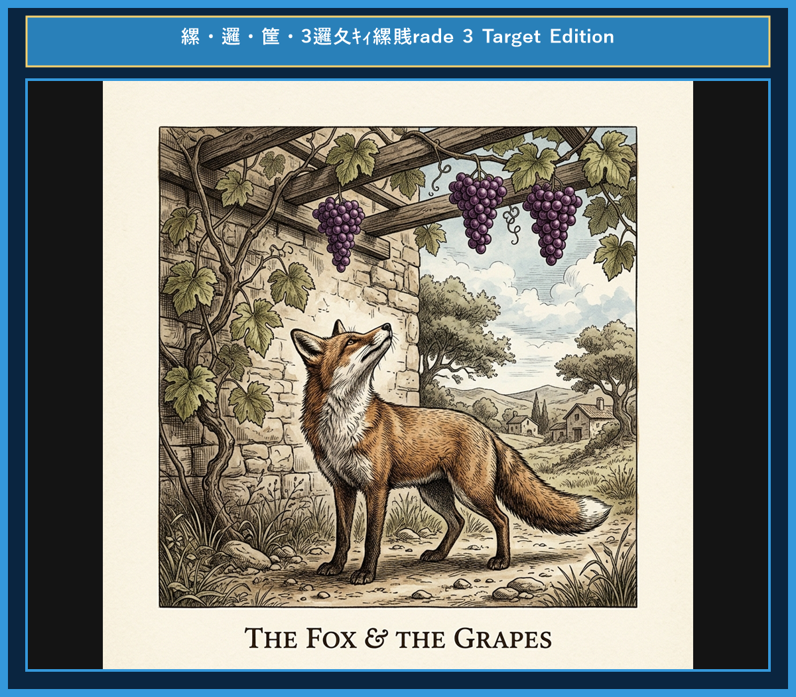

# Chapter 6: The Fox and the Grapes (キツネとブドウ)

<!-- 電子書籍 Page Break & Image Header -->

  

## 1. Benchmark Level: Eiken Grade 4 (英検4級レベル本文)
*Read in ~1 to 1.5 minutes. Baseline vocabulary and basic syntax.*

One hot summer afternoon, a hungry fox walked through a farm. He saw some beautiful purple grapes hanging high on a tree.

"I am so thirsty and hungry," thought the fox. "Those grapes look delicious."

He walked back a few steps and jumped high in the air. But he missed the grapes.

He tried again and again, but the grapes were too high.

Finally, the fox was tired. He stopped jumping and looked at the grapes.

"I don't need those grapes," he said, turning his nose up. "I am sure they are sour and bad to eat."

Then he walked away calmly.

It is easy to dislike what you cannot get.

---

## 2. Target Level: Eiken Grade 3 (英検3級レベル本文)
*Read in ~2 to 3 minutes. Upgraded vocabulary, sophisticated sentence structures, and idioms.*

On a scorching summer afternoon, a hungry fox was wandering through an orchard in search of food. Suddenly, he noticed a bunch of ripe, juicy purple grapes hanging from a high branch.

"Those grapes look delicious, and they will surely satisfy my thirst," said the fox to himself.

He took a few steps back, ran forward, and leaped as high as he could into the air. However, he missed the grapes by a few inches.

Refusing to give up, the fox tried several times, but the grapes remained far beyond his reach.

Exhausted from his repeated efforts, he finally realized that his attempts were useless. Walking away with his nose in the air, he remarked coldly, "They are probably sour anyway, and I have no interest in eating sour fruit."

It is easy to despise what you cannot obtain.

---

## 3. Classic Original English Text (イソップ寓話 クラシック原文)
*Townsend / Jacobs Edition (Public Domain)*

One hot summer's day a Fox was strolling through an orchard till he came to a bunch of Grapes just ripening on a vine which had been trained over a lofty branch. "Just the thing to quench my thirst," quoth he. Drawing back a few paces, he took a run and a jump, and just missed the bunch. Turning round again with a One, Two, Three, he jumped up, but with no greater success. Again and again he tried after the tempting morsel, but at last had to give it up, and walked away with his nose in the air, saying: "I am sure they are sour."

It is easy to despise what you cannot get.

---

### 🏛️ 【英検2級レベルで読み解く！クラシック原文の重要構文・英文法ノート】
1. **1. 分詞構文（Participle Clause: 付帯状況・理由）**
   - **原文**: *"The Hare, believing her assertion to be simply impossible, agreed to the proposal..."*
   - **解説**: 「〜と信じ込んでいたので」という理由を表す分詞構文。英検2級の長文読解・ライティングの最頻出構文です。
1. **2. 古典的仮定法現在（Subjunctive Mood）**
   - **原文**: *"Though you be swift as the wind, I will beat you in a race."*
   - **解説**: 譲歩節 `Though` の中で原形 `be` を用いる古典的な仮定法現在（現代英語の `Though you are...`）。格調高い古典の響きを持ちます。
1. **3. 過去分詞の後置修飾（Postpositive Participle）**
   - **原文**: *"On the day appointed for the race the two started together."*
   - **解説**: `appointed`（定められた・指定された）が直前の名詞 `the day` を後ろから修飾する構文です。

### 📜 【クラシック原文の重要語彙・古風表現（Classic Antique Vocabulary）】
- **retort** [動] 2級 **（機転を利かせて）言い返す、反論する**（現代の reply sharp/wittily に相当）
- **assertion** [名] 2級/準1級 **主張、断言**（動詞 assert の名詞形。2級長文定番）
- **wayside** [名] 2級 **道端、沿道**（by the wayside（道端に、途中で））
- **fatigue** [名] 2級 **（心身の）極度の疲労、疲れ**（tiredness の上位フォーマル語）

---

## 4. Japanese Translation (日本語訳)

ある暑い夏の日に、一匹のキツネが果樹園をぶらぶら歩いていると、高い枝に渡したつるに熟しかけているブドウの房を見つけました。「喉の渇きをいやされるのにうってつけだ」とキツネは言いました。

数歩後ずさりし、助走をつけて飛び上がりましたが、あと少しで房に届きませんでした。振り返り、「一、二の三」と再び飛び跳ねましたが、うまくいきません。何度も何度も魅惑的な一粒を求めて試みましたが、ついにあきらめざるを得ず、鼻を高々と上げて立ち去りながら言いました。「どうせあのブドウは酸っぱいに決まっているさ。」

**教訓**: 手に入らないものを蔑むのは容易なことだ（負け惜しみ）。

---

## 5. Recite & Compare (そらんじたいキーフレーズ対比表)
*Memorize these contrastive expressions to elevate speaking, writing, and reading fluency.*

| Context / Scene | Grade 4 (Baseline) | Grade 3 (Target / Recite) | Nuance & Exam Value |
|---|---|---|---|
| **喉・空腹を満たす** | *Those grapes look delicious.* | *will surely satisfy my thirst* | 動詞 `satisfy`（〜を満たす）を用いた目的達成のスマートな言い回し。 |
| **高く跳ぶ** | *jumped high in the air* | *leaped as high as he could into the air* | `jump` より力強い動詞 `leap` と同等比較構文のベストマッチ。 |
| **届かない** | *the grapes were too high* | *remained far beyond his reach* | 3級読解・イディオム `beyond one's reach`（手の届かない位置に）の修得。 |
| **無駄だと悟る** | *the fox was tired* | *realized that his attempts were useless* | 接続詞 `that` 節＋重要形容詞 `useless`（無駄な・役に立たない）による思考描写。 |
| **負け惜しみを言う** | *said, "I am sure they are..."* | *remarked coldly, "They are probably..."* | 発言を表すフォーマル語 `remark` と副詞 `coldly` の対比。 |
| **教訓（Moral）** | *It is easy to dislike...* | *It is easy to despise what you cannot obtain.* | 他動詞 `despise`（蔑む）と `obtain`（手に入れる）を使った3級〜準2級必須の構文。 |

---

## 6. Vocabulary Builder: 赤シート対応 重要単語・熟語チェック表
*※ 赤い透明シート（または赤フィルム）を重ねると、日本語訳が消えて自力テストができます。*

| No. | 見出し語 / イディオム | 品詞 / レベル | 日本語の意味（赤シートで消える） | 本文での使われ方・コロケーション |
|:---:|---|:---:|---|---|
| **01** | **proud** | [形] 4級 | 誇り高い、傲慢な | *a proud hare (自惚れたウサギ)* |
| **02** | **boast (about...)** | [動] 3級 | 〜を自慢する、誇る | *was always boasting about his speed* |
| **03** | **make fun of...** | [熟] 3級 | 〜をからかう、嘲笑する | *making fun of a slow tortoise* |
| **04** | **challenge** | [名/動] 3級 | 挑戦、課題 / 挑む | *I accept your challenge.* |
| **05** | **accept** | [動] 3級 | 受け入れる、受諾する | *accept the proposal (提案を受諾する)* |
| **06** | **dash** | [動] 3級 | 勢いよく走る、突進する | *dashed forward (前方へ駆け出した)* |
| **07** | **leave ~ behind** | [熟] 3級 | 〜を置き去りにする | *left the tortoise far behind* |
| **08** | **visible** | [形] 準2級 | 目に見える、視認できる | *was barely visible in the distance* |
| **09** | **catch up (with...)** | [熟] 3級 | 〜に追いつく | *before he catches up* |
| **10** | **slumber** | [名/動] 準2級 | 深い眠り / 眠る | *fell into a profound slumber* |
| **11** | **sprint** | [動] 3級 | 全力疾走する | *sprinted toward the finish line* |
| **12** | **persistence** | [名] 準2級/2級 | 粘り強さ、不屈の継続 | *persistence and hard work will bring success* |

### 【出題傾向・文法解説ノート】

### 【出題頻出語彙・熟語ノート】
- **satisfy** [動] （〜を）満たす、満足させる（英検3級頻出動詞。名詞 *satisfaction*）
- **leap** [動] 躍り上がる、跳ぶ（*jump* より躍動感のある3級動詞）
- **beyond one's reach** [熟] 手の届かないところに（読解・リスニングで問われるフレーズ）
- **useless** [形] 役に立たない、無益な（反義語：*useful*）
- **remark** [動] （意見などを）述べる、言う（3級長文で会話文の代わりに使われる動詞）
- **obtain** [動] （〜を）手に入れる、獲得する（*get* の上位表現。ライティング・面接で強力）

### 【文法・構文ポイント】
1. **[in search of ...]（〜を探して）**
   - 3級本文: *"a hungry fox was wandering through an orchard in search of food."*
   - ポイント: `look for` の名詞形を用いた熟語表現。前文をかっこよく飾る熟語です。
2. **関係代名詞 `what`（〜するもの・こと）**
   - 3級本文: *"It is easy to despise what you cannot obtain."*
   - ポイント: `what` は `the thing which` と同義の先行詞を含む関係代名詞です。
