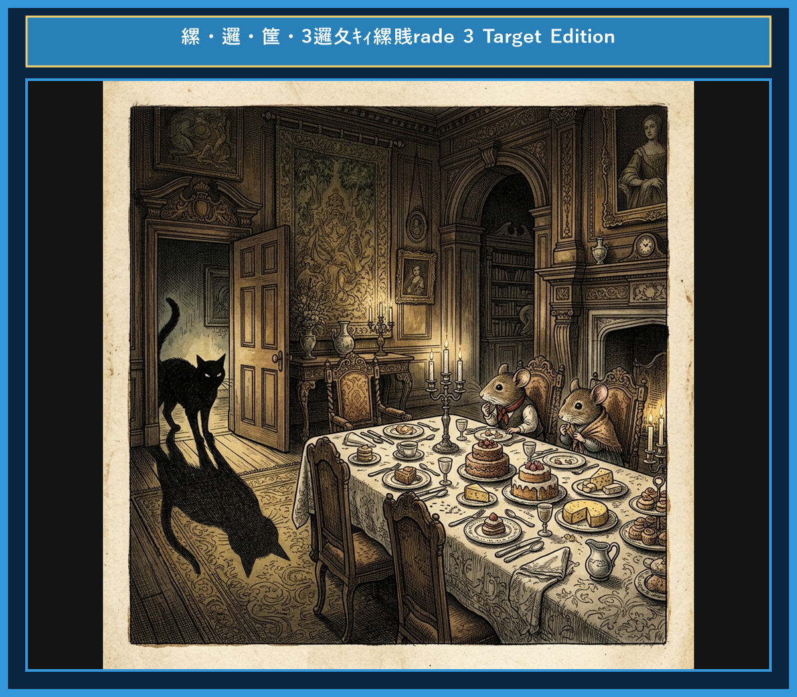

# Chapter 7: The Town Mouse and the Country Mouse (田舎のネズミと街のネズミ)

<!-- 電子書籍 Page Break & Image Header -->

  

## 1. Benchmark Level: Eiken Grade 4 (英検4級レベル本文)
*Read in ~1 to 1.5 minutes. Baseline vocabulary and basic syntax.*

A country mouse invited his friend, a town mouse, to his home. He served simple corn and bread. The town mouse turned up his nose.

"Your life is so poor," said the town mouse. "Come to the city with me. I have fine cheese and delicious cake every day."

The country mouse agreed and visited the town mouse's big house. The dining table was full of delicious food.

However, just as they began to eat, a big cat burst into the room with a loud noise! The two mice ran quickly and hid in a dark hole. They shook with fear.

When the cat left, the country mouse packed his bag.

"I am going home," he said. "I prefer simple food in peace to rich food in fear."

Peace and safety are better than luxury with danger.

---

## 2. Target Level: Eiken Grade 3 (英検3級レベル本文)
*Read in ~2 to 3 minutes. Upgraded vocabulary, sophisticated sentence structures, and idioms.*

Once upon a time, a country mouse invited his old friend, a town mouse, to visit his humble home in the fields. The country mouse offered simple meals such as dried beans and wheat. The town mouse tasted a little and complained politely.

"My friend, your food is so plain and your life is so quiet," said the town mouse. "You must come to the city with me to enjoy luxury and fine dining."

Curious, the country mouse accompanied his friend to a grand mansion in the city. The dining room was filled with delicious cakes, fruit, and expensive cheese.

However, before they could enjoy their meal, the dining room door suddenly opened, and two fierce barking dogs rushed inside. Terrified, both mice sprinted into a narrow hole in the wall, holding their breath in terror.

As soon as the danger passed, the country mouse said goodbye to his friend.

"You may have luxury in the city," he said, "but I prefer my simple life in peace and safety."

A humble life in peace is better than a luxurious life in fear.

---

## 3. Classic Original English Text (イソップ寓話 クラシック原文)
*Townsend / Jacobs Edition (Public Domain)*

A Country Mouse invited a Town Mouse to dinner. The Country Mouse produced wheat stalks, roots, and acorns. The Town Mouse refused to eat them, saying: "I cannot understand, my friend, how you can put up with such poor food as this. Come with me to the city, and you shall enjoy a feast." So they set off together. Arriving at the city house late at night, the Town Mouse showed his friend a rich spread of pastries, jellies, and cheese. But just as they began to eat, the door suddenly flew open, and a huge cat bounded in with a roar. Both mice scampered off to a tiny hole in the wall, trembling with fright. As soon as the room was quiet again, the Country Mouse took his leave, saying: "Good-bye, my friend. You have luxury and rich dainties, but they are accompanied by fear and danger. I prefer my simple food in safety."

Poverty with security is better than plenty in the midst of fear and uncertainty.

---

### 🏛️ 【英検2級レベルで読み解く！クラシック原文の重要構文・英文法ノート】
1. **1. 分詞構文（Participle Clause: 付帯状況・理由）**
   - **原文**: *"The Hare, believing her assertion to be simply impossible, agreed to the proposal..."*
   - **解説**: 「〜と信じ込んでいたので」という理由を表す分詞構文。英検2級の長文読解・ライティングの最頻出構文です。
1. **2. 古典的仮定法現在（Subjunctive Mood）**
   - **原文**: *"Though you be swift as the wind, I will beat you in a race."*
   - **解説**: 譲歩節 `Though` の中で原形 `be` を用いる古典的な仮定法現在（現代英語の `Though you are...`）。格調高い古典の響きを持ちます。
1. **3. 過去分詞の後置修飾（Postpositive Participle）**
   - **原文**: *"On the day appointed for the race the two started together."*
   - **解説**: `appointed`（定められた・指定された）が直前の名詞 `the day` を後ろから修飾する構文です。

### 📜 【クラシック原文の重要語彙・古風表現（Classic Antique Vocabulary）】
- **retort** [動] 2級 **（機転を利かせて）言い返す、反論する**（現代の reply sharp/wittily に相当）
- **assertion** [名] 2級/準1級 **主張、断言**（動詞 assert の名詞形。2級長文定番）
- **wayside** [名] 2級 **道端、沿道**（by the wayside（道端に、途中で））
- **fatigue** [名] 2級 **（心身の）極度の疲労、疲れ**（tiredness の上位フォーマル語）

---

## 4. Japanese Translation (日本語訳)

田舎のネズミが街のネズミをディナーに招待しました。田舎のネズミは小麦の茎や根、ドングリを出しました。街のネズミは食べるのを拒み、「友よ、どうして君がこんな粗末な食事で我慢できるのか理解できないよ。僕と一緒に街へおいで。ご馳走が楽しめるよ」と言いました。そこで二匹は一緒に出発しました。

夜遅くに街の邸宅に着くと、街のネズミはパイやゼリー、チーズといった豊かな食卓を友に見せました。ところが二匹が食べ始めようとしたまさにその時、突然ドアが飛び開き、巨大なネコが唸り声を上げて跳び込んできました。二匹のネズミは恐怖で震えながら壁の小さな穴へ逃げ込みました。部屋が再び静かになると、田舎のネズミはお別れを言い出しました。「さようなら、友よ。君には贅沢と美味しい料理があるけれど、それには恐怖と危険がつきまとっている。僕は安全の中で素朴な食べ物を食べる方を選ぶよ。」

**教訓**: 恐怖と不確実さの中での豊かさよりも、安全の中でのつつましい暮らしの方が良い。

---

## 5. Recite & Compare (そらんじたいキーフレーズ対比表)
*Memorize these contrastive expressions to elevate speaking, writing, and reading fluency.*

| Context / Scene | Grade 4 (Baseline) | Grade 3 (Target / Recite) | Nuance & Exam Value |
|---|---|---|---|
| **同行する・連れていく** | *visited the town mouse's big house* | *accompanied his friend to a grand mansion* | `go with` から、フォーマルな動詞 `accompany`（〜に同行する）への語彙力アップ。 |
| **恐怖に震える** | *shook with fear* | *holding their breath in terror* | 感情表現 `hold one's breath`（息を殺す）と抽象名詞 `terror` の活用。 |
| **〜をより好む** | *I prefer simple food in peace to...* | *I prefer my simple life in peace and safety.* | 3級文法超頻出 `prefer A to B`（BよりAを好む）の完全定着フレーズ。 |
| **～を満たす** | *The dining table was full of...* | *was filled with delicious cakes...* | `be full of` から、受動態 `be filled with`（〜で満たされている）への構文書き換え。 |
| **教訓（Moral）** | *Peace and safety are better than...* | *A humble life in peace is better than a luxurious life...* | 形容詞 `humble`（つつましい）と `luxurious`（贅沢な）の対比でライティングの表現力を最大化。 |

---

## 6. Vocabulary Builder: 赤シート対応 重要単語・熟語チェック表
*※ 赤い透明シート（または赤フィルム）を重ねると、日本語訳が消えて自力テストができます。*

| No. | 見出し語 / イディオム | 品詞 / レベル | 日本語の意味（赤シートで消える） | 本文での使われ方・コロケーション |
|:---:|---|:---:|---|---|
| **01** | **proud** | [形] 4級 | 誇り高い、傲慢な | *a proud hare (自惚れたウサギ)* |
| **02** | **boast (about...)** | [動] 3級 | 〜を自慢する、誇る | *was always boasting about his speed* |
| **03** | **make fun of...** | [熟] 3級 | 〜をからかう、嘲笑する | *making fun of a slow tortoise* |
| **04** | **challenge** | [名/動] 3級 | 挑戦、課題 / 挑む | *I accept your challenge.* |
| **05** | **accept** | [動] 3級 | 受け入れる、受諾する | *accept the proposal (提案を受諾する)* |
| **06** | **dash** | [動] 3級 | 勢いよく走る、突進する | *dashed forward (前方へ駆け出した)* |
| **07** | **leave ~ behind** | [熟] 3級 | 〜を置き去りにする | *left the tortoise far behind* |
| **08** | **visible** | [形] 準2級 | 目に見える、視認できる | *was barely visible in the distance* |
| **09** | **catch up (with...)** | [熟] 3級 | 〜に追いつく | *before he catches up* |
| **10** | **slumber** | [名/動] 準2級 | 深い眠り / 眠る | *fell into a profound slumber* |
| **11** | **sprint** | [動] 3級 | 全力疾走する | *sprinted toward the finish line* |
| **12** | **persistence** | [名] 準2級/2級 | 粘り強さ、不屈の継続 | *persistence and hard work will bring success* |

### 【出題傾向・文法解説ノート】

### 【出題頻出語彙・熟語ノート】
- **humble** [形] つつましい、質素な（英検3級〜準2級頻出形容詞）
- **accompany** [動] 〜に同行する、付添う（*go with* の上位動詞）
- **terrified** [形] 恐怖に陥った、怯えた（感情を表す分詞形容詞）
- **prefer (A to B)** [熟] （BよりAを）好む（3級・準2級文法で最頻出の動詞パターン）
- **as soon as ...** [熟] 〜するとすぐに（3級長文・リスニング重要接続詞）
- **luxurious** [形] 贅沢な、豪華な（名詞 *luxury*）

### 【文法・構文ポイント】
1. **[prefer A to B]（BよりAを好む）**
   - 3級本文: *"I prefer my simple life in peace and safety (to luxury)."*
   - ポイント: 比較対象に `than` ではなく前置詞 `to` を用いる最重要構文です。
2. **[be filled with ...]（〜で満たされている）**
   - 3級本文: *"The dining room was filled with delicious cakes..."*
   - ポイント: `be full of` と同じ意味ですが、受動態の知識として問われます。
