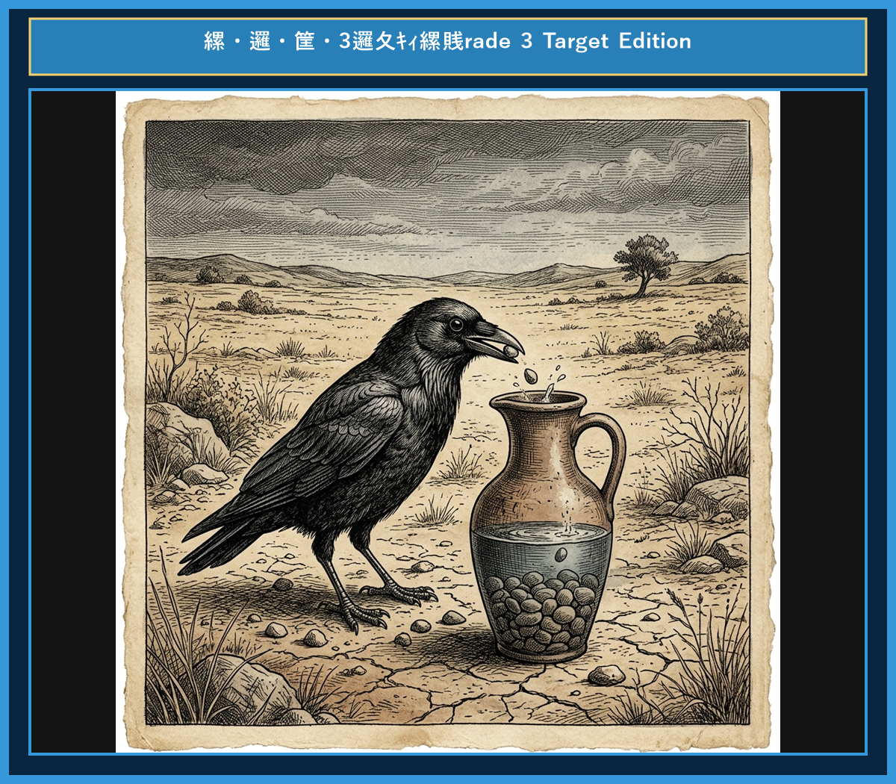

# Chapter 8: The Crow and the Pitcher (カラスと水つぼ)

<!-- 電子書籍 Page Break & Image Header -->

  

## 1. Benchmark Level: Eiken Grade 4 (英検4級レベル本文)
*Read in ~1 to 1.5 minutes. Baseline vocabulary and basic syntax.*

A thirsty crow flew all over the field looking for water. Finally, he found a tall pitcher with a little water at the bottom.

He tried to drink, but the neck of the pitcher was too narrow. His beak could not reach the water.

"I am so thirsty! What should I do?" thought the crow.

He looked around and saw many small stones on the ground. Suddenly, he had a good idea.

He picked up the stones one by one with his beak and dropped them into the pitcher.

Slowly, the water level rose to the top. The crow drank the cool water happily and saved his life.

Little by little does the trick.

---

## 2. Target Level: Eiken Grade 3 (英検3級レベル本文)
*Read in ~2 to 3 minutes. Upgraded vocabulary, sophisticated sentence structures, and idioms.*

During a hot summer drought, a thirsty crow flew across the dry countryside searching for water to drink. At last, he discovered a tall clay pitcher containing a small amount of water at the bottom.

He eagerly thrust his beak into the pitcher, but the neck was far too narrow. Try as he might, he could not reach the water.

Determined not to give up, the clever crow thought carefully until he came up with a brilliant plan.

He began picking up small pebbles from the ground one by one and dropping them into the pitcher. With each pebble he dropped, the water level slowly rose higher.

After dropping dozens of pebbles, the water finally reached the top. The crow was able to quench his thirst and save his own life.

Where there is a will, there is a way.

---

## 3. Classic Original English Text (イソップ寓話 クラシック原文)
*Townsend / Jacobs Edition (Public Domain)*

A Crow, half-dead with thirst, came upon a Pitcher which had once been full of water; but when the Crow pushed his beak into the mouth of the Pitcher, he found that only very little water was left in it, and that he could not reach far enough down to get at it. He tried, and he tried, but at last had to give it up, and walked away with his nose in the air, saying: "I am sure they are sour." Then a thought came to him, and he took a pebble and dropped it into the Pitcher; then he took another pebble and dropped it into the Pitcher; then he took another and dropped it into the Pitcher. At last, at last, he saw the water mount up near to the brim, and kneeling down he quenched his thirst.

Little by little does the trick.

---

### 🏛️ 【英検2級レベルで読み解く！クラシック原文の重要構文・英文法ノート】
1. **1. 分詞構文（Participle Clause: 付帯状況・理由）**
   - **原文**: *"The Hare, believing her assertion to be simply impossible, agreed to the proposal..."*
   - **解説**: 「〜と信じ込んでいたので」という理由を表す分詞構文。英検2級の長文読解・ライティングの最頻出構文です。
1. **2. 古典的仮定法現在（Subjunctive Mood）**
   - **原文**: *"Though you be swift as the wind, I will beat you in a race."*
   - **解説**: 譲歩節 `Though` の中で原形 `be` を用いる古典的な仮定法現在（現代英語の `Though you are...`）。格調高い古典の響きを持ちます。
1. **3. 過去分詞の後置修飾（Postpositive Participle）**
   - **原文**: *"On the day appointed for the race the two started together."*
   - **解説**: `appointed`（定められた・指定された）が直前の名詞 `the day` を後ろから修飾する構文です。

### 📜 【クラシック原文の重要語彙・古風表現（Classic Antique Vocabulary）】
- **retort** [動] 2級 **（機転を利かせて）言い返す、反論する**（現代の reply sharp/wittily に相当）
- **assertion** [名] 2級/準1級 **主張、断言**（動詞 assert の名詞形。2級長文定番）
- **wayside** [名] 2級 **道端、沿道**（by the wayside（道端に、途中で））
- **fatigue** [名] 2級 **（心身の）極度の疲労、疲れ**（tiredness の上位フォーマル語）

---

## 4. Japanese Translation (日本語訳)

喉の渇きで瀕死状態のカラスが、かつては水でいっぱいだった水つぼを見つけました。しかしカラスが水つぼの口にクチバシを突っ込んだとき、底にわずかな水しか残っておらず、届くところまで伸ばせないことがわかりました。カラスは何度も試みましたが、ついに絶望してあきらめざるを得ませんでした。

そのとき一つの考えが浮かびました。カラスは小石を一つ拾って水つぼの中に落としました。次にもう一つ小石を拾って落とし、さらにもう一つ拾って落としました。ついに、ついに水が縁の近くまで上がってくるのを見て、カラスは屈み込んで喉の渇きをいやしました。

**教訓**: 為せば成る（意思のあるところに道はある）。少しずつの積み重ねが成功を生む。

---

## 5. Recite & Compare (そらんじたいキーフレーズ対比表)
*Memorize these contrastive expressions to elevate speaking, writing, and reading fluency.*

| Context / Scene | Grade 4 (Baseline) | Grade 3 (Target / Recite) | Nuance & Exam Value |
|---|---|---|---|
| **探す・発見する** | *looking for water / found a tall pitcher* | *searching for water / discovered a tall...* | `look for` ➔ `search for`、`find` ➔ `discover` への語彙ステップアップ。 |
| **アイデアを思いつく** | *he had a good idea* | *came up with a brilliant plan* | 3級最頻出熟語 `come up with`（アイデア等を思いつく）を使った必須表現。 |
| **〜しようと決意して** | *What should I do?* | *Determined not to give up,...* | 分詞構文 `Determined not to do`（〜しないと決意して）による強い意思表現。 |
| **〜するごとに** | *Slowly, the water level rose...* | *With each pebble he dropped, ...* | `With each + 名詞`（〜するごとに/〜とともに）を用いた美しい文脈展開。 |
| **喉の渇きを癒やす** | *drank the cool water happily* | *was able to quench his thirst* | 助動詞 `was able to` と定型フレーズ `quench one's thirst` のマスター。 |
| **教訓（Moral）** | *Little by little does the trick.* | *Where there is a will, there is a way.* | 世界的に有名なことわざ「為せば成る」をそのまま英語論文・英作文の結びとして活用。 |

---

## 6. Vocabulary Builder: 赤シート対応 重要単語・熟語チェック表
*※ 赤い透明シート（または赤フィルム）を重ねると、日本語訳が消えて自力テストができます。*

| No. | 見出し語 / イディオム | 品詞 / レベル | 日本語の意味（赤シートで消える） | 本文での使われ方・コロケーション |
|:---:|---|:---:|---|---|
| **01** | **proud** | [形] 4級 | 誇り高い、傲慢な | *a proud hare (自惚れたウサギ)* |
| **02** | **boast (about...)** | [動] 3級 | 〜を自慢する、誇る | *was always boasting about his speed* |
| **03** | **make fun of...** | [熟] 3級 | 〜をからかう、嘲笑する | *making fun of a slow tortoise* |
| **04** | **challenge** | [名/動] 3級 | 挑戦、課題 / 挑む | *I accept your challenge.* |
| **05** | **accept** | [動] 3級 | 受け入れる、受諾する | *accept the proposal (提案を受諾する)* |
| **06** | **dash** | [動] 3級 | 勢いよく走る、突進する | *dashed forward (前方へ駆け出した)* |
| **07** | **leave ~ behind** | [熟] 3級 | 〜を置き去りにする | *left the tortoise far behind* |
| **08** | **visible** | [形] 準2級 | 目に見える、視認できる | *was barely visible in the distance* |
| **09** | **catch up (with...)** | [熟] 3級 | 〜に追いつく | *before he catches up* |
| **10** | **slumber** | [名/動] 準2級 | 深い眠り / 眠る | *fell into a profound slumber* |
| **11** | **sprint** | [動] 3級 | 全力疾走する | *sprinted toward the finish line* |
| **12** | **persistence** | [名] 準2級/2級 | 粘り強さ、不屈の継続 | *persistence and hard work will bring success* |

### 【出題傾向・文法解説ノート】

### 【出題頻出語彙・熟語ノート】
- **discover** [動] 〜を発見する（*find* のフォーマル動詞）
- **come up with...** [熟] （考えなどを）思いつく、考案する（3級読解・リスニングで超頻出）
- **pebble** [名] 小石（3級長文語彙）
- **determine** [動] 〜を決定する、決意させる（*be determined to do* で必須）
- **quench** [動] （渇きなどを）いやす、消す
- **Where there is a will, there is a way.** [ことわざ] 為せば成る（意思あるところに道あり）

### 【文法・構文ポイント】
1. **[come up with ...]（〜を思いつく）**
   - 3級本文: *"He came up with a brilliant plan."*
   - ポイント: `think of` よりも英検の長文問題やリスニング問題で出題されやすい最重要熟語です。
2. **否定の不定詞 [not + to + 動詞原形]**
   - 3級本文: *"Determined not to give up, the clever crow..."*
   - ポイント: 不定詞の否定 `not to do`（〜しないこと）の位置に注意しましょう。
