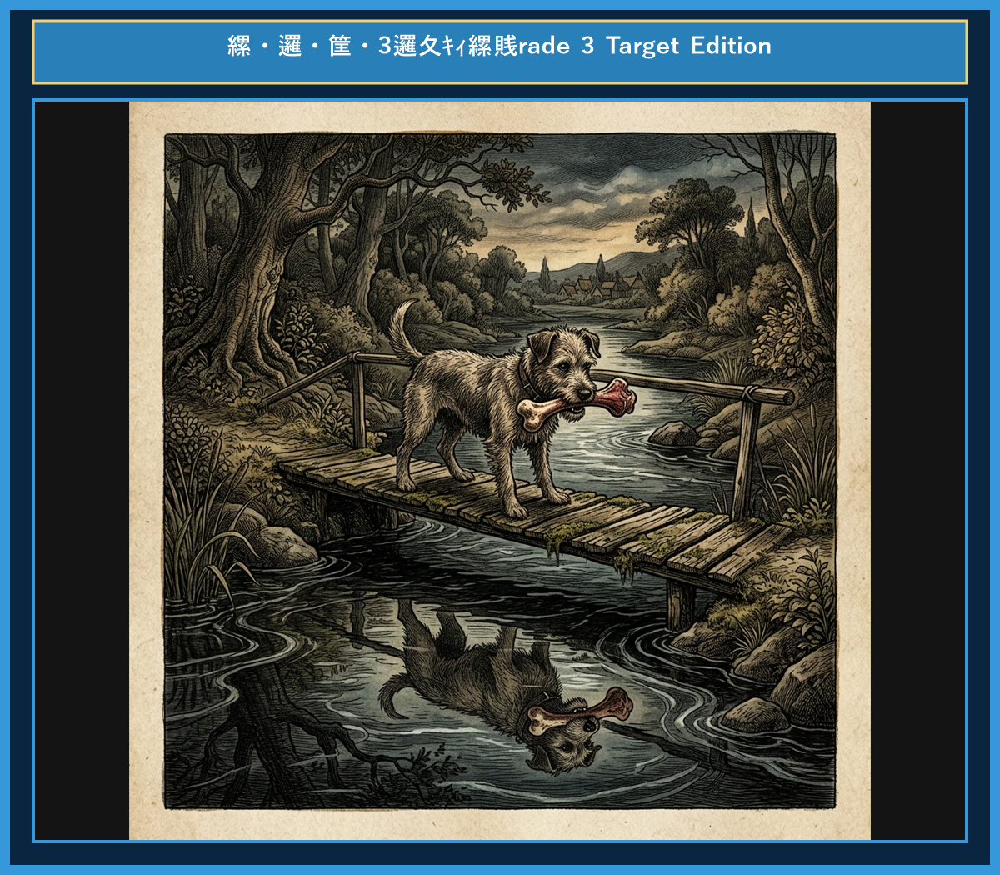

# Chapter 9: The Dog and His Shadow (欲張りな犬)

<!-- 電子書籍 Page Break & Image Header -->

  

## 1. Benchmark Level: Eiken Grade 4 (英検4級レベル本文)
*Read in ~1 to 1.5 minutes. Baseline vocabulary and basic syntax.*

A dog stole a big piece of meat from a butcher's shop. He was very happy and ran home to eat it.

On his way home, he had to cross a small wooden bridge over a clear stream.

As he looked down into the water, he saw his own reflection. But the greedy dog thought it was another dog carrying another big piece of meat!

"I want that meat too!" thought the dog.

He opened his mouth and barked loudly at the reflection.

The moment he opened his mouth, his own piece of meat fell into the water and sank to the bottom. The dog was left with nothing.

If you are greedy and want everything, you will lose what you have.

---

## 2. Target Level: Eiken Grade 3 (英検3級レベル本文)
*Read in ~2 to 3 minutes. Upgraded vocabulary, sophisticated sentence structures, and idioms.*

A greedy dog managed to steal a juicy piece of meat from a local butcher's shop. Carrying his prize proudly in his mouth, he hurried toward his home to enjoy his feast.

On his way, he had to cross a narrow wooden bridge spanning a calm stream.

Looking down into the clear water, he noticed his own reflection. However, assuming it was another dog carrying a piece of meat that appeared even larger than his own, his greed overcame him.

"If I take his meat as well, I will have twice as much!" thought the foolish dog.

He snapped fiercely at the image in the water. But as soon as he opened his mouth, his piece of meat dropped into the river and sank out of sight.

He who grasps at the shadow loses the substance.

---

## 3. Classic Original English Text (イソップ寓話 クラシック原文)
*Townsend / Jacobs Edition (Public Domain)*

A Dog, crossing a bridge over a stream with a piece of meat in his mouth, saw his own shadow in the water and took it for that of another Dog, with a piece of meat double his own in size. He immediately let go of his own, and fiercely attacked the other Dog to get his larger piece from him. He thus lost both: that which he grasped at in the water, because it was a shadow; and his own, because the stream swept it away.

Beware lest you lose the substance by grasping at the shadow.

---

### 🏛️ 【英検2級レベルで読み解く！クラシック原文の重要構文・英文法ノート】
1. **1. 分詞構文（Participle Clause: 付帯状況・理由）**
   - **原文**: *"The Hare, believing her assertion to be simply impossible, agreed to the proposal..."*
   - **解説**: 「〜と信じ込んでいたので」という理由を表す分詞構文。英検2級の長文読解・ライティングの最頻出構文です。
1. **2. 古典的仮定法現在（Subjunctive Mood）**
   - **原文**: *"Though you be swift as the wind, I will beat you in a race."*
   - **解説**: 譲歩節 `Though` の中で原形 `be` を用いる古典的な仮定法現在（現代英語の `Though you are...`）。格調高い古典の響きを持ちます。
1. **3. 過去分詞の後置修飾（Postpositive Participle）**
   - **原文**: *"On the day appointed for the race the two started together."*
   - **解説**: `appointed`（定められた・指定された）が直前の名詞 `the day` を後ろから修飾する構文です。

### 📜 【クラシック原文の重要語彙・古風表現（Classic Antique Vocabulary）】
- **retort** [動] 2級 **（機転を利かせて）言い返す、反論する**（現代の reply sharp/wittily に相当）
- **assertion** [名] 2級/準1級 **主張、断言**（動詞 assert の名詞形。2級長文定番）
- **wayside** [名] 2級 **道端、沿道**（by the wayside（道端に、途中で））
- **fatigue** [名] 2級 **（心身の）極度の疲労、疲れ**（tiredness の上位フォーマル語）

---

## 4. Japanese Translation (日本語訳)

犬が口に肉をくわえて川にかかった橋を渡っていると、水の中に自分の影が見え、それを自分のものの2倍の大きさの肉を持った別の犬だと思い込みました。

犬はすぐに自分の肉を手放し、相手のより大きな肉を奪おうと猛然と襲いかかりました。こうして犬は両方を失いました。水の中で掴もうとしたものは影だったからであり、自分の肉は流れる水に流されてしまったからです。

**教訓**: 影（まぼろし）を掴もうとして、実体（本物・今ある幸せ）を失わないよう用心しなさい。

---

## 5. Recite & Compare (そらんじたいキーフレーズ対比表)
*Memorize these contrastive expressions to elevate speaking, writing, and reading fluency.*

| Context / Scene | Grade 4 (Baseline) | Grade 3 (Target / Recite) | Nuance & Exam Value |
|---|---|---|---|
| **大事に運ぶ** | *ran home to eat it* | *hurried toward his home to enjoy his feast* | 単純な `eat` から `enjoy one's feast`（ご馳走を楽しむ）への豊かな語彙。 |
| **～と思い込む** | *thought it was another dog* | *assuming it was another dog...* | 分詞構文 `assuming that...`（〜と思い込んで/〜と仮定して）の高度な記述。 |
| **欲に負ける** | *wanted that meat too* | *his greed overcame him* | 無生物主語構文 `greed overcame him`（強欲が彼を打ち負かした ➔ 欲に目が眩んだ）。 |
| **2倍の量** | *another big piece of meat* | *twice as much* | 倍数表現 `twice as much`（2倍の量）は英検3級・準2級文法の最頻出。 |
| **視界から消える** | *sank to the bottom* | *sank out of sight* | 定型熟語 `out of sight`（視界から消えて）を組み合わせた見事な表現。 |
| **教訓（Moral）** | *If you are greedy..., you will lose...* | *He who grasps at the shadow loses the substance.* | 文法構文 `He who + 動詞`（〜する人）を用いた歴史的・文学的な暗唱名句。 |

---

## 6. Vocabulary Builder: 赤シート対応 重要単語・熟語チェック表
*※ 赤い透明シート（または赤フィルム）を重ねると、日本語訳が消えて自力テストができます。*

| No. | 見出し語 / イディオム | 品詞 / レベル | 日本語の意味（赤シートで消える） | 本文での使われ方・コロケーション |
|:---:|---|:---:|---|---|
| **01** | **proud** | [形] 4級 | 誇り高い、傲慢な | *a proud hare (自惚れたウサギ)* |
| **02** | **boast (about...)** | [動] 3級 | 〜を自慢する、誇る | *was always boasting about his speed* |
| **03** | **make fun of...** | [熟] 3級 | 〜をからかう、嘲笑する | *making fun of a slow tortoise* |
| **04** | **challenge** | [名/動] 3級 | 挑戦、課題 / 挑む | *I accept your challenge.* |
| **05** | **accept** | [動] 3級 | 受け入れる、受諾する | *accept the proposal (提案を受諾する)* |
| **06** | **dash** | [動] 3級 | 勢いよく走る、突進する | *dashed forward (前方へ駆け出した)* |
| **07** | **leave ~ behind** | [熟] 3級 | 〜を置き去りにする | *left the tortoise far behind* |
| **08** | **visible** | [形] 準2級 | 目に見える、視認できる | *was barely visible in the distance* |
| **09** | **catch up (with...)** | [熟] 3級 | 〜に追いつく | *before he catches up* |
| **10** | **slumber** | [名/動] 準2級 | 深い眠り / 眠る | *fell into a profound slumber* |
| **11** | **sprint** | [動] 3級 | 全力疾走する | *sprinted toward the finish line* |
| **12** | **persistence** | [名] 準2級/2級 | 粘り強さ、不屈の継続 | *persistence and hard work will bring success* |

### 【出題傾向・文法解説ノート】

### 【出題頻出語彙・熟語ノート】
- **prize** [名] 獲得物、獲物、賞（英検3級主要名詞）
- **reflection** [名] 反射、水面の影（動詞 *reflect* の名詞形）
- **assume** [動] 〜と思い込む、仮定する（3級・準2級長文超必須動詞）
- **overcome** [動] 〜に打ち勝つ、克服する（過去形 *overcame*。*overcome difficulties* など）
- **twice as much** [熟] 2倍の量（倍数比較構文）
- **substance** [名] 実体、物質（*shadow*（影）と対比される哲学・抽象語彙）

### 【文法・構文ポイント】
1. **無生物主語構文 [Subject + overcome + Object]**
   - 3級本文: *"His greed overcame him."*
   - ポイント: 英語らしい表現の筆頭。「感情や状況」を主語にして人を動かす構文です。
2. **倍数比較 [twice as + 形容詞/副詞 + as]**
   - 3級本文: *"I will have twice as much!"*
   - ポイント: `as much as` の前に `twice`（2倍）や `three times`（3倍）を置く構文。3級の文法問題で必ず出題されます。
