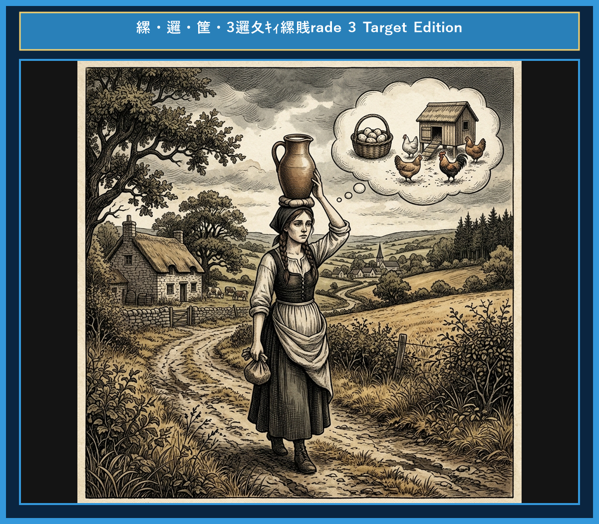

# Chapter 10: The Milkmaid and Her Pail (ミルク搾りの娘)

<!-- 電子書籍 Page Break & Image Header -->

  

## 1. Benchmark Level: Eiken Grade 4 (英検4級レベル本文)
*Read in ~1 to 1.5 minutes. Baseline vocabulary and basic syntax.*

Patty, a milkmaid, carried a pail of fresh milk on her head. She was walking to the market to sell the milk.

As she walked, she began to calculate her future.

"I will sell this milk for money," she thought. "With the money, I will buy eggs. The eggs will hatch into fine chickens. Then I will sell the chickens and buy a beautiful new dress."

She felt so happy and proud. "I will wear the dress to the party. All the young men will want to dance with me. But I will toss my head and say no!"

As she said this, she tossed her head back.

Down fell the pail of milk! The milk spilled all over the ground, and all her dreams vanished in a moment.

Do not count your chickens before they are hatched.

---

## 2. Target Level: Eiken Grade 3 (英検3級レベル本文)
*Read in ~2 to 3 minutes. Upgraded vocabulary, sophisticated sentence structures, and idioms.*

Patty, a young milkmaid, was walking to the market, balancing a pail of fresh milk carefully on top of her head. As she strolled along the country path, she began daydreaming about what she would do with her earnings.

"When I sell this delicious milk, I will use the money to purchase a hundred eggs," she thought excitedly. "Most of the eggs will hatch into healthy chickens. I will raise them and sell them for a good price."

Continuing her calculations, she smiled to herself. "With that money, I will buy a splendid dress to wear to the festival. All the young men will ask me to dance, but I will proudly toss my head and refuse them all!"

Forgetting the heavy pail on her head, she tossed her head back to demonstrate her pride.

Instantly, the pail fell to the ground, and the milk was spilled everywhere. Tears filled her eyes as she realized that all her grand plans had disappeared in a second.

Do not count your chickens before they are hatched.

---

## 3. Classic Original English Text (イソップ寓話 クラシック原文)
*Townsend / Jacobs Edition (Public Domain)*

Patty the Milkmaid was going to market carrying her milk in a Pail on her head. As she went along, she began calculating what she would do with the money she would get for the milk. "I'll buy some eggs from Farmer Brown," said she, "and they will hatch into chickens. I'll sell the chickens, and buy a new gown to wear to the fair. All the young fellows will propose to me, but I'll toss my head and say No." As she spoke, she tossed her head back, the Pail fell off, and all the milk was spilled! She had to go home and tell her mother what had occurred. "Ah, my child," said the mother:

Do not count your chickens before they are hatched.

---

### 🏛️ 【英検2級レベルで読み解く！クラシック原文の重要構文・英文法ノート】
1. **1. 分詞構文（Participle Clause: 付帯状況・理由）**
   - **原文**: *"The Hare, believing her assertion to be simply impossible, agreed to the proposal..."*
   - **解説**: 「〜と信じ込んでいたので」という理由を表す分詞構文。英検2級の長文読解・ライティングの最頻出構文です。
1. **2. 古典的仮定法現在（Subjunctive Mood）**
   - **原文**: *"Though you be swift as the wind, I will beat you in a race."*
   - **解説**: 譲歩節 `Though` の中で原形 `be` を用いる古典的な仮定法現在（現代英語の `Though you are...`）。格調高い古典の響きを持ちます。
1. **3. 過去分詞の後置修飾（Postpositive Participle）**
   - **原文**: *"On the day appointed for the race the two started together."*
   - **解説**: `appointed`（定められた・指定された）が直前の名詞 `the day` を後ろから修飾する構文です。

### 📜 【クラシック原文の重要語彙・古風表現（Classic Antique Vocabulary）】
- **retort** [動] 2級 **（機転を利かせて）言い返す、反論する**（現代の reply sharp/wittily に相当）
- **assertion** [名] 2級/準1級 **主張、断言**（動詞 assert の名詞形。2級長文定番）
- **wayside** [名] 2級 **道端、沿道**（by the wayside（道端に、途中で））
- **fatigue** [名] 2級 **（心身の）極度の疲労、疲れ**（tiredness の上位フォーマル語）

---

## 4. Japanese Translation (日本語訳)

ミルク搾りの娘パティは、頭の上に置いたバケツにミルクを入れて市場へ向かっていました。歩きながら彼女は、ミルクを売って得られるお金で何ができるかを計算し始めました。「ブラウン農場主から卵を買おう」と彼女は言いました。「すると卵からヒヨコが生まれるわ。ヒヨコを売って、お祭り着る新しいドレスを買うの。若い男の人たちがみんな私にプロポーズしてくるけれど、私は頭をはねつけて『嫌よ』って言うわ。」

こう話しつつ彼女が頭を後ろにはねつけると、バケツが落ち、ミルクがすべてこぼれてしまいました！彼女は家に帰って、起きた出来事を母親に話さなければなりませんでした。「ああ、我が子よ」と母親は言いました。

**教訓**: 卵が孵化する前にヒヨコの数を数えるな（取らぬ狸の皮算用）。

---

## 5. Recite & Compare (そらんじたいキーフレーズ対比表)
*Memorize these contrastive expressions to elevate speaking, writing, and reading fluency.*

| Context / Scene | Grade 4 (Baseline) | Grade 3 (Target / Recite) | Nuance & Exam Value |
|---|---|---|---|
| **頭に載せて運ぶ** | *carried a pail on her head* | *balancing a pail... on top of her head* | 分詞構文 `balancing A on top of B`（AをBの上でバランスを取りながら）。 |
| **購入する** | *buy eggs / buy a new dress* | *purchase eggs / buy a splendid dress* | `buy` の上位フォーマル語 `purchase`（購入する）や形容詞 `splendid`（すばらしい）。 |
| **拒絶する・断る** | *toss my head and say no* | *toss my head and refuse them all* | 単純な `say no` から、フォーマルな動詞 `refuse`（〜を拒否する・断る）への書き換え。 |
| **夢が消え去る** | *all her dreams vanished...* | *all her grand plans had disappeared...* | 過去完了形 `had disappeared`（〜してしまっていた）を使った時間の前後関係の明確化。 |
| **教訓（Moral）** | *Do not count your chickens...* | *Do not count your chickens before they are hatched.* | 日本語の「取らぬ狸の皮算用」に相当する超有名ことわざ（英検読解・英作文で大活躍）。 |

---

## 6. Vocabulary Builder: 赤シート対応 重要単語・熟語チェック表
*※ 赤い透明シート（または赤フィルム）を重ねると、日本語訳が消えて自力テストができます。*

| No. | 見出し語 / イディオム | 品詞 / レベル | 日本語の意味（赤シートで消える） | 本文での使われ方・コロケーション |
|:---:|---|:---:|---|---|
| **01** | **proud** | [形] 4級 | 誇り高い、傲慢な | *a proud hare (自惚れたウサギ)* |
| **02** | **boast (about...)** | [動] 3級 | 〜を自慢する、誇る | *was always boasting about his speed* |
| **03** | **make fun of...** | [熟] 3級 | 〜をからかう、嘲笑する | *making fun of a slow tortoise* |
| **04** | **challenge** | [名/動] 3級 | 挑戦、課題 / 挑む | *I accept your challenge.* |
| **05** | **accept** | [動] 3級 | 受け入れる、受諾する | *accept the proposal (提案を受諾する)* |
| **06** | **dash** | [動] 3級 | 勢いよく走る、突進する | *dashed forward (前方へ駆け出した)* |
| **07** | **leave ~ behind** | [熟] 3級 | 〜を置き去りにする | *left the tortoise far behind* |
| **08** | **visible** | [形] 準2級 | 目に見える、視認できる | *was barely visible in the distance* |
| **09** | **catch up (with...)** | [熟] 3級 | 〜に追いつく | *before he catches up* |
| **10** | **slumber** | [名/動] 準2級 | 深い眠り / 眠る | *fell into a profound slumber* |
| **11** | **sprint** | [動] 3級 | 全力疾走する | *sprinted toward the finish line* |
| **12** | **persistence** | [名] 準2級/2級 | 粘り強さ、不屈の継続 | *persistence and hard work will bring success* |

### 【出題傾向・文法解説ノート】

### 【出題頻出語彙・熟語ノート】
- **balance** [動] （〜の）バランスをとる（英検3級主要動詞）
- **earnings** [名] 収入、収益（動詞 *earn*「稼ぐ」の名詞形）
- **purchase** [動] （〜を）購入する（*buy* の上位語表現。ライティング・面接必須）
- **refuse** [動] （〜を）断る、辞退する（3級・準2級必須動詞）
- **disappear** [動] 消える、姿を消す（反義語：*appear*）
- **Do not count your chickens before they are hatched.** [ことわざ] 取らぬ狸の皮算用（孵化する前にヒヨコを数えるな）

### 【文法・構文ポイント】
1. **[what + 主語 + would + 動詞原形]（〜が何をするつもりか）**
   - 3級本文: *"She began daydreaming about what she would do with her earnings."*
   - ポイント: 過去の時点から見た未来（過去未来）を表す `would` の用法です。
2. **過去完了形 [had + 過去分詞]**
   - 3級本文: *"She realized that all her grand plans had disappeared in a second."*
   - ポイント: 「気がついた（realized）」時点よりも前に「消え去っていた（had disappeared）」ことを表す大過去・過去完了の用法です。
