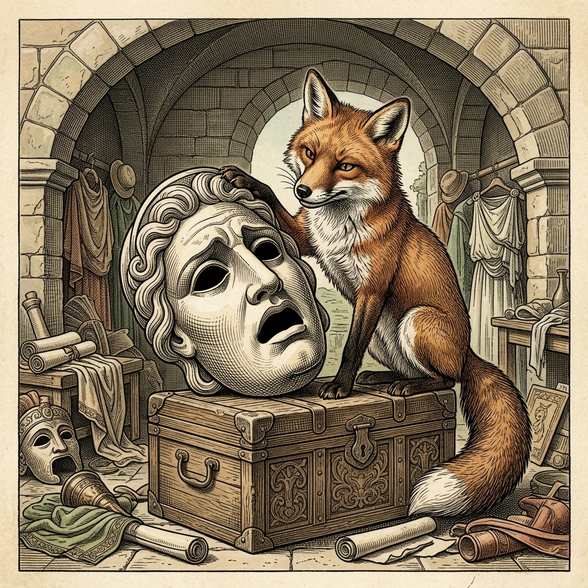

# Chapter 25: The Fox and the Mask (キツネと仮面)

<!-- 電子書籍 Page Break & Image Header -->

  

## 1. Benchmark Level: Eiken Grade 4 (英検4級レベル本文)
*Read in ~1 to 1.5 minutes. Baseline vocabulary and basic syntax.*

One afternoon, a curious fox entered an actor's house. The actor was away, so the fox walked around looking for something interesting.

He found a large box full of theater props. Inside, there was a beautiful mask. The mask was painted in bright colors, and its face looked very noble and handsome.

The fox held the mask in his paws. He looked at it carefully from the front. Then, he turned it over and looked at the back. 

The mask was completely empty inside. It had no brain, no eyes, and no tongue.

The fox shook his head and said, "What a fine and handsome head! But it is too bad that you have no brains inside."

A handsome face is useless if there is no wisdom behind it.

---

## 2. Target Level: Eiken Grade 3 (英検3級レベル本文)
*Read in ~2 to 3 minutes. Upgraded vocabulary, sophisticated sentence structures, and idioms.*

A curious fox once slipped through an open doorway into the workshop of a famous actor. Since the master of the house had gone out, the fox began to explore every corner of the room, hoping to discover something tasty to eat.

Instead of food, he came across a chest filled with theatrical costumes and various strange objects. Among them, a tragic actor's mask caught his attention. It was crafted with exceptional skill, featuring a majestic expression and beautifully painted features that resembled the face of a noble hero.

The fox lifted the magnificent mask with his paws and examined it closely. However, when he turned it over to look inside, he discovered that it was completely hollow. It possessed neither eyes to see, nor a voice to speak, nor any brains to think.

Gazing at the empty shell with disappointment, the fox remarked, "What an imposing and splendid head you have! Yet what a great pity that you lack even a single grain of common sense inside."

A handsome appearance has little true value if it lacks intelligence and moral substance.

---

## 3. Classic Original English Text (イソップ寓話 クラシック原文)
*Townsend / Jacobs Edition (Public Domain)*

A Fox entered the house of an actor and, rummaging through all his properties, came upon a Mask, an admirable imitation of a human head. He placed his paws upon it, and said: 

"What a head is here, and yet it has no brains!"

Outside show is a poor substitute for inner worth.

---

### 🏛️ 【英検2級レベルで読み解く！クラシック原文の重要構文・英文法ノート】
1. **1. 分詞構文（Participle Clause: 付帯状況・理由）**
   - **原文**: *"The Hare, believing her assertion to be simply impossible, agreed to the proposal..."*
   - **解説**: 「〜と信じ込んでいたので」という理由を表す分詞構文。英検2級の長文読解・ライティングの最頻出構文です。
1. **2. 古典的仮定法現在（Subjunctive Mood）**
   - **原文**: *"Though you be swift as the wind, I will beat you in a race."*
   - **解説**: 譲歩節 `Though` の中で原形 `be` を用いる古典的な仮定法現在（現代英語の `Though you are...`）。格調高い古典の響きを持ちます。
1. **3. 過去分詞の後置修飾（Postpositive Participle）**
   - **原文**: *"On the day appointed for the race the two started together."*
   - **解説**: `appointed`（定められた・指定された）が直前の名詞 `the day` を後ろから修飾する構文です。

### 📜 【クラシック原文の重要語彙・古風表現（Classic Antique Vocabulary）】
- **retort** [動] 2級 **（機転を利かせて）言い返す、反論する**（現代の reply sharp/wittily に相当）
- **assertion** [名] 2級/準1級 **主張、断言**（動詞 assert の名詞形。2級長文定番）
- **wayside** [名] 2級 **道端、沿道**（by the wayside（道端に、途中で））
- **fatigue** [名] 2級 **（心身の）極度の疲労、疲れ**（tiredness の上位フォーマル語）

---

## 4. Japanese Translation (日本語訳)

ある好奇心旺盛なキツネが、開いていた戸口から有名俳優の作業場へと滑り込みました。家の主人が出かけていたため、キツネは何か美味しい食べ物が見つかることを期待しながら、部屋の隅々を探索し始めました。

食べ物の代わりに、キツネは演劇の衣装や様々な奇妙な品々でいっぱいの衣装箱を見つけました。その中に、悲劇役者の仮面が一際目を引きました。それは卓越した技術で作られており、高貴な英雄の顔を思わせる威厳ある表情と美しく彩色された目鼻立ちを備えていました。

キツネはその見事な仮面を前足で持ち上げ、丹念に観察しました。しかし、裏返して中を覗き込んだとき、それが完全に空洞であることに気づきました。そこには見るべき目も、語るべき声も、考えるべき脳みそも一切備わっていませんでした。

空っぽの抜け殻を失望と共に見つめながら、キツネはつぶやきました。「なんと堂々として立派な頭だろう！だが、その中にたった一粒の分別すら欠けているとは、なんという大きな哀れだろう」

**教訓**: 知性や内面の誠実さが伴わなければ、いかに立派で美しい外見であっても真の価値はほとんどない。

---

## 5. Recite & Compare (そらんじたいキーフレーズ対比)
*Memorize these contrastive expressions to elevate speaking, writing, and reading fluency.*

  
■ 場面：部屋の隅々を探索する

  
【Grade 4 基礎】 <em>walked around looking for something interesting</em>

  
【Grade 3 暗唱】 <strong><em>began to explore every corner of the room, hoping to discover...</em></strong>

  
【ポイント】 <strong>解説・試験活用</strong>：動詞 `explore`（〜を探索する・探検する）と表現 `every corner of...`（〜の隅々）。分詞構文 `hoping to...` による心情描写。

  
■ 場面：劇的な仮面が目を引く

  
【Grade 4 基礎】 <em>Inside, there was a beautiful mask.</em>

  
【Grade 3 暗唱】 <strong><em>a tragic actor's mask caught his attention</em></strong>

  
【ポイント】 <strong>解説・試験活用</strong>：最重要連語 `catch one's attention`（〜の注意を引く・目を引く）。英検3級の日常読解で必出。

  
■ 場面：高貴な英雄の顔に似ている

  
【Grade 4 基礎】 <em>its face looked very noble and handsome</em>

  
【Grade 3 暗唱】 <strong><em>features that resembled the face of a noble hero</em></strong>

  
【ポイント】 <strong>解説・試験活用</strong>：関係代名詞 `that` と動詞 `resemble`（〜に似ている）。状態動詞としての進行形不可ルールも頻出。

  
■ 場面：中身が空っぽであると気づく

  
【Grade 4 基礎】 <em>The mask was completely empty inside. It had no brain...</em>

  
【Grade 3 暗唱】 <strong><em>discovered that it was completely hollow... possessed neither eyes nor voice</em></strong>

  
【ポイント】 <strong>解説・試験活用</strong>：形容詞 `hollow`（空洞の・中身のない）と、相関接続詞 `neither A nor B`（AでもBでもない）。

  
■ 場面：教訓（Moral）

  
【Grade 4 基礎】 <em>A handsome face is useless if there is no wisdom behind it.</em>

  
【Grade 3 暗唱】 <strong><em>A handsome appearance has little true value if it lacks intelligence.</em></strong>

  
【ポイント】 <strong>解説・試験活用</strong>：名詞 `appearance`（外見）と否定語 `little`（ほとんどない）、動詞 `lack`（〜を欠いている）。英検英作文で極めて評価の高い表現。

---

## 6. Vocabulary Builder: 赤シート対応 重要単語・熟語チェック表
*※ 赤い透明シート（または赤フィルム）を重ねると、日本語訳が消えて自力テストができます。*

| No. | 見出し語 / イディオム | 品詞 / レベル | 日本語の意味（赤シートで消える） | 本文での使われ方・コロケーション |
|:---:|---|:---:|---|---|
| **01** | **proud** | [形] 4級 | 誇り高い、傲慢な | *a proud hare (自惚れたウサギ)* |
| **02** | **boast (about...)** | [動] 3級 | 〜を自慢する、誇る | *was always boasting about his speed* |
| **03** | **make fun of...** | [熟] 3級 | 〜をからかう、嘲笑する | *making fun of a slow tortoise* |
| **04** | **challenge** | [名/動] 3級 | 挑戦、課題 / 挑む | *I accept your challenge.* |
| **05** | **accept** | [動] 3級 | 受け入れる、受諾する | *accept the proposal (提案を受諾する)* |
| **06** | **dash** | [動] 3級 | 勢いよく走る、突進する | *dashed forward (前方へ駆け出した)* |
| **07** | **leave ~ behind** | [熟] 3級 | 〜を置き去りにする | *left the tortoise far behind* |
| **08** | **visible** | [形] 準2級 | 目に見える、視認できる | *was barely visible in the distance* |
| **09** | **catch up (with...)** | [熟] 3級 | 〜に追いつく | *before he catches up* |
| **10** | **slumber** | [名/動] 準2級 | 深い眠り / 眠る | *fell into a profound slumber* |
| **11** | **sprint** | [動] 3級 | 全力疾走する | *sprinted toward the finish line* |
| **12** | **persistence** | [名] 準2級/2級 | 粘り強さ、不屈の継続 | *persistence and hard work will bring success* |

### 【出題傾向・文法解説ノート】

### 【出題頻出語彙・熟語ノート】
- **curious** [形] 好奇心の強い、奇妙な（名詞 *curiosity*）
- **explore** [動] 〜を探検する、調査する（名詞 *exploration*）
- **catch one's attention** [熟] （人の）注意を引く、目を引く
- **resemble** [動] 〜に似ている（*resemble one's father*）
- **magnificent** [形] 堂々とした、素晴らしい（*splendid / grand*）
- **examine** [動] 〜を詳しく調べる、検査する（名詞 *examination*）
- **hollow** [形] 空洞の、中身のない（*a hollow tree*）
- **neither A nor B** [構] AでもBでもない
- **pity** [名] 哀れみ、残念なこと（*What a pity!*「なんて残念なんだろう」）
- **appearance** [名] 外見、出現（動詞 *appear*）

### 【文法・構文ポイント】
1. **否定を表す準否定語 [little] と名詞の組み合わせ**
   - 3級本文: *"A handsome appearance has little true value..."*
   - ポイント: `little` は不可算名詞（value）を修飾して「ほとんど〜ない」という強い否定の意味を持ちます。`a little`（少しある）との区別は3級選択問題の定番です。
2. **相関接続詞 [neither A nor B]（AでもBでもない）**
   - 3級本文: *"It possessed neither eyes to see, nor a voice to speak..."*
   - ポイント: 否定の列挙表現。後ろに不定詞の形容詞用法（to see, to speak）が並列で続く構造は、文法的に整った美しい英文の典型例です。
