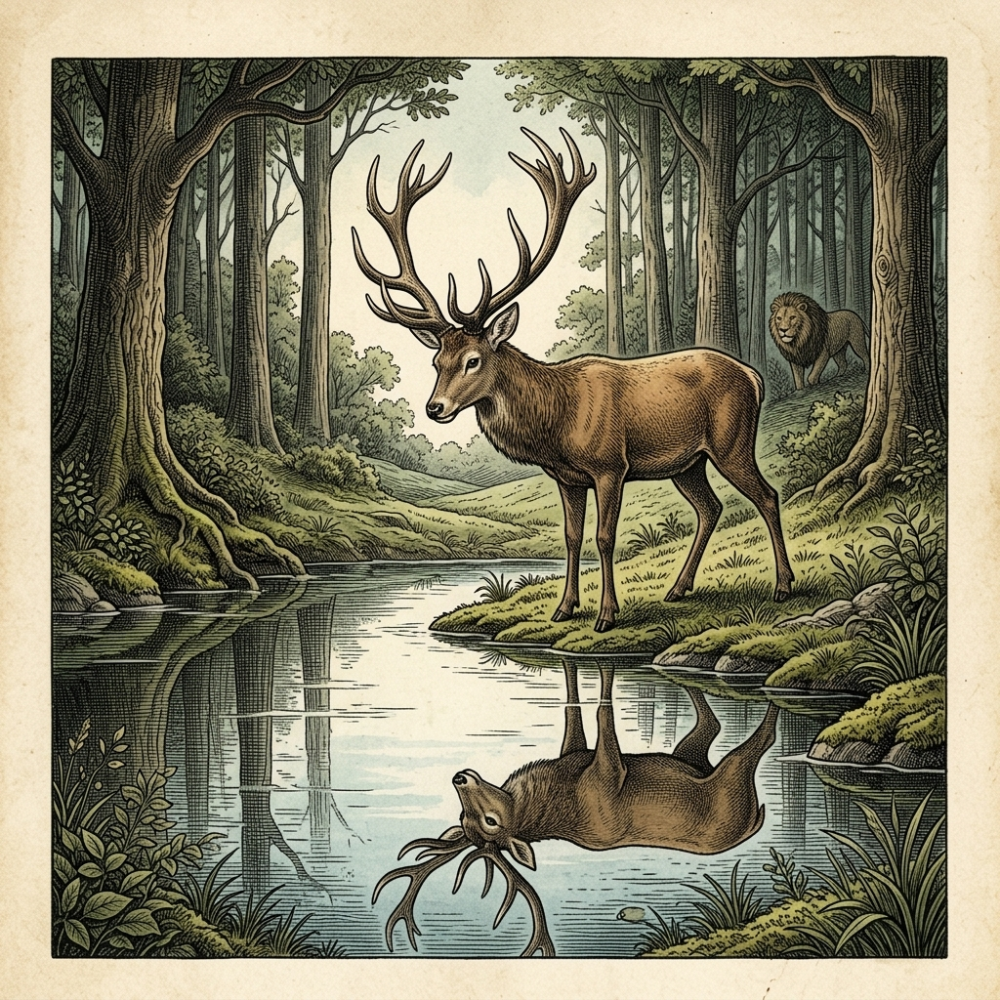

# Chapter 26: The Stag at the Pool (鹿と池の影)

<!-- 電子書籍 Page Break & Image Header -->

  

## 1. Benchmark Level: Eiken Grade 4 (英検4級レベル本文)
*Read in ~1 to 1.5 minutes. Baseline vocabulary and basic syntax.*

A handsome stag came to a clear pool to drink cool water. As he drank, he saw his reflection in the water.

He looked at his large, magnificent antlers. "How beautiful my horns are!" he said proudly. "They look like a royal crown."

Then, he looked down at his long, thin legs. He felt ashamed. "My legs are so skinny and ugly," he sighed. "Why are they so weak?"

Suddenly, a hunter with a pack of hounds came into the meadow. The stag was frightened and began to run.

His slender legs carried him across the open plain with great speed. He quickly left the dogs far behind.

However, he ran into a dense forest. His large antlers got caught in the low branches of the trees. He could not move at all.

As the hounds ran toward him, the stag cried, "How foolish I was! The ugly legs saved me, but the beautiful horns destroyed me!"

Useful things are better than pretty decorations.

---

## 2. Target Level: Eiken Grade 3 (英検3級レベル本文)
*Read in ~2 to 3 minutes. Upgraded vocabulary, sophisticated sentence structures, and idioms.*

A graceful stag stepped toward the edge of a crystal-clear spring to quench his thirst. While gazing into the tranquil surface, he noticed his own reflection for the first time.

He admired his magnificent antlers, which spread out majestically like the branches of an oak tree. Filled with excessive vanity, he praised their extraordinary elegance. However, when he shifted his gaze toward his slender legs, he felt deeply disappointed. "How wretched and frail my legs appear!" he grumbled bitterly. "They are far too thin to match my splendid crown."

At that very instant, the distant baying of hounds echoed through the valley. A skilled hunter had spotted him and immediately launched a pursuit.

Instinctively, the stag bounded across the open plain, leaving his pursuers far behind thanks to the remarkable speed of his agile legs. Yet, as he plunged into a thick forest to seek shelter, his wide antlers became firmly entangled in the tangled boughs of the trees.

Struggling desperately in vain as the hounds rapidly closed in, the stag lamented, "Alas! How foolish I was to despise the humble legs that could have preserved my life, while taking excessive pride in the ornamental horns that have caused my destruction!"

We frequently undervalue what is truly beneficial and praise what ultimately brings about our downfall.

---

## 3. Classic Original English Text (イソップ寓話 クラシック原文)
*Townsend / Jacobs Edition (Public Domain)*

A Stag quenched his thirst at a clear lake, and gazed upon his reflection in the water. He greatly admired the size and variety of his horns, but felt much displeased with the spindly weakness of his legs. 

While he was still contemplating his form, a Lion sprang upon him. The Stag fled over the plain and outran him, for the strength of stags lies in their legs, but of the lion in his heart. The Stag kept ahead until he reached a dense wood, where his antlers became entangled in the overhanging branches. He could not free himself, and the Lion quickly overtook him. 

When on the point of death, the Stag cried: "Woe is me! What an ungrateful wretch I am! Those feet which I despised would have saved me, while the horns on which I prided myself have brought about my ruin."

We often despise what is most useful, and prize that which brings our doom.

---

### 🏛️ 【英検2級レベルで読み解く！クラシック原文の重要構文・英文法ノート】
1. **1. 分詞構文（Participle Clause: 付帯状況・理由）**
   - **原文**: *"The Hare, believing her assertion to be simply impossible, agreed to the proposal..."*
   - **解説**: 「〜と信じ込んでいたので」という理由を表す分詞構文。英検2級の長文読解・ライティングの最頻出構文です。
1. **2. 古典的仮定法現在（Subjunctive Mood）**
   - **原文**: *"Though you be swift as the wind, I will beat you in a race."*
   - **解説**: 譲歩節 `Though` の中で原形 `be` を用いる古典的な仮定法現在（現代英語の `Though you are...`）。格調高い古典の響きを持ちます。
1. **3. 過去分詞の後置修飾（Postpositive Participle）**
   - **原文**: *"On the day appointed for the race the two started together."*
   - **解説**: `appointed`（定められた・指定された）が直前の名詞 `the day` を後ろから修飾する構文です。

### 📜 【クラシック原文の重要語彙・古風表現（Classic Antique Vocabulary）】
- **retort** [動] 2級 **（機転を利かせて）言い返す、反論する**（現代の reply sharp/wittily に相当）
- **assertion** [名] 2級/準1級 **主張、断言**（動詞 assert の名詞形。2級長文定番）
- **wayside** [名] 2級 **道端、沿道**（by the wayside（道端に、途中で））
- **fatigue** [名] 2級 **（心身の）極度の疲労、疲れ**（tiredness の上位フォーマル語）

---

## 4. Japanese Translation (日本語訳)

優雅なオスの鹿が、喉の渇きを癒すために水晶のように澄んだ泉の端へと歩み寄りました。静かな水面を見つめているうちに、彼は初めてそこに映る自分自身の姿に気づきました。

彼は、カシの木の枝のように堂々と広がる見事な枝角に見とれました。過剰なうぬぼれに満たされた彼は、その並外れた優美さを称賛しました。しかし、細い足へと視線を移すと、深い失望を覚えました。「私の足はなんとみすぼらしく、ひ弱に見えることか！」彼は苦々しく不満を漏らしました。「私の立派な王冠に釣り合うには、あまりにも細すぎる」

まさにその瞬間、谷間に猟犬たちの遠吠えが響き渡りました。熟練の猟師が彼を発見し、即座に追跡を開始したのです。

本能的に鹿は広々とした平原を駆け巡り、しなやかな足の驚異的な速さのおかげで、追手たちをはるか後方に引き離しました。しかし、身を隠そうと鬱蒼とした森の中へ飛び込んだとき、彼の広い枝角が木々の絡み合った枝にしっかりと引っかかってしまいました。

猟犬たちが急接近する中、必死にもがいたものの脱出できず、鹿は嘆き悲しみました。「ああ！命を救ってくれたはずの謙虚な足を蔑み、破滅の原因となった飾り物の角に過剰な誇りを抱いていたとは、私はなんと愚かだったことか！」

**教訓**: 私たちは真に有益なものを過小評価し、最終的に自らの身を滅ぼすものを褒めそやしてしまいがちである。

---

## 5. Recite & Compare (そらんじたいキーフレーズ対比)
*Memorize these contrastive expressions to elevate speaking, writing, and reading fluency.*

  
■ 場面：喉の渇きを癒すために水辺へ向かう

  
【Grade 4 基礎】 <em>came to a clear pool to drink cool water</em>

  
【Grade 3 暗唱】 <strong><em>stepped toward the edge of a crystal-clear spring to quench his thirst</em></strong>

  
【ポイント】 <strong>解説・試験活用</strong>：重要連語 `quench one's thirst`（喉の渇きを潤す・癒す）と複合形容詞 `crystal-clear`（水晶のように澄んだ）。

  
■ 場面：足の速さのおかげで追手を置き去りにする

  
【Grade 4 基礎】 <em>carried him across the open plain... left the dogs far behind</em>

  
【Grade 3 暗唱】 <strong><em>leaving his pursuers far behind thanks to the remarkable speed...</em></strong>

  
【ポイント】 <strong>解説・試験活用</strong>：最重要表現 `thanks to...`（〜のおかげで）と分詞構文 `leaving his pursuers far behind`。

  
■ 場面：角が木の枝にしっかりと絡まる

  
【Grade 4 基礎】 <em>His large antlers got caught in the low branches...</em>

  
【Grade 3 暗唱】 <strong><em>antlers became firmly entangled in the tangled boughs of the trees</em></strong>

  
【ポイント】 <strong>解説・試験活用</strong>：受動表現 `become entangled in...` と副詞 `firmly`（固く・しっかりと）、名詞 `bough`（大枝）。

  
■ 場面：自慢の角を誇り、役立つ足を蔑む

  
【Grade 4 基礎】 <em>The ugly legs saved me, but the beautiful horns destroyed me!</em>

  
【Grade 3 暗唱】 <strong><em>despise the humble legs that could have preserved my life, while taking excessive pride...</em></strong>

  
【ポイント】 <strong>解説・試験活用</strong>：動詞 `despise`（〜を軽蔑する・蔑む）、熟語 `take pride in...`（〜を誇りに思う）、仮定法過去完了的含意 `could have preserved`。

  
■ 場面：教訓（Moral）

  
【Grade 4 基礎】 <em>Useful things are better than pretty decorations.</em>

  
【Grade 3 暗唱】 <strong><em>We frequently undervalue what is truly beneficial and praise what brings about our downfall.</em></strong>

  
【ポイント】 <strong>解説・試験活用</strong>：関係代名詞 `what`（〜すること・もの）、動詞 `undervalue`（過小評価する）、熟語 `bring about...`（〜をもたらす）。

---

## 6. Vocabulary Builder: 赤シート対応 重要単語・熟語チェック表
*※ 赤い透明シート（または赤フィルム）を重ねると、日本語訳が消えて自力テストができます。*

| No. | 見出し語 / イディオム | 品詞 / レベル | 日本語の意味（赤シートで消える） | 本文での使われ方・コロケーション |
|:---:|---|:---:|---|---|
| **01** | **proud** | [形] 4級 | 誇り高い、傲慢な | *a proud hare (自惚れたウサギ)* |
| **02** | **boast (about...)** | [動] 3級 | 〜を自慢する、誇る | *was always boasting about his speed* |
| **03** | **make fun of...** | [熟] 3級 | 〜をからかう、嘲笑する | *making fun of a slow tortoise* |
| **04** | **challenge** | [名/動] 3級 | 挑戦、課題 / 挑む | *I accept your challenge.* |
| **05** | **accept** | [動] 3級 | 受け入れる、受諾する | *accept the proposal (提案を受諾する)* |
| **06** | **dash** | [動] 3級 | 勢いよく走る、突進する | *dashed forward (前方へ駆け出した)* |
| **07** | **leave ~ behind** | [熟] 3級 | 〜を置き去りにする | *left the tortoise far behind* |
| **08** | **visible** | [形] 準2級 | 目に見える、視認できる | *was barely visible in the distance* |
| **09** | **catch up (with...)** | [熟] 3級 | 〜に追いつく | *before he catches up* |
| **10** | **slumber** | [名/動] 準2級 | 深い眠り / 眠る | *fell into a profound slumber* |
| **11** | **sprint** | [動] 3級 | 全力疾走する | *sprinted toward the finish line* |
| **12** | **persistence** | [名] 準2級/2級 | 粘り強さ、不屈の継続 | *persistence and hard work will bring success* |

### 【出題傾向・文法解説ノート】

### 【出題頻出語彙・熟語ノート】
- **quench** [動] （渇き・欲望）を癒す、鎮める（*quench one's thirst*）
- **reflection** [名] 反射、映像、反映（動詞 *reflect*）
- **excessive** [形] 過度の、過剰な（副詞 *excessively*）
- **grumble** [動] 不平を言う、不満を鳴らす（*complain* の類語）
- **instinctively** [副] 本能的に、直感的に（名詞 *instinct*）
- **pursuit** [名] 追跡、追求（動詞 *pursue*）
- **thanks to** [熟] 〜のおかげで（*because of* の前向きな表現）
- **despise** [動] 〜を蔑む、軽蔑する（*look down on*）
- **beneficial** [形] 有益な、役立つ（名詞 *benefit*）
- **bring about** [熟] 〜を引き起こす、もたらす（*cause* の重要熟語）

### 【文法・構文ポイント】
1. **関係代名詞 [what]（〜するもの・こと）**
   - 3級本文: *"We frequently undervalue what is truly beneficial..."*
   - ポイント: 先行詞を含んだ関係代名詞 `what`（= the thing which）。主語や目的語の位置で「〜するもの・こと」という意味のまとまりを作ります。
2. **原因・理由を表す前置詞句 [thanks to ...] と分詞の継続用法**
   - 3級本文: *"...leaving his pursuers far behind thanks to the remarkable speed..."*
   - ポイント: 「Aのおかげで」を表す `thanks to`。分詞構文 `leaving...` と組み合わせることで、原因と結果を流れるように表現します。
