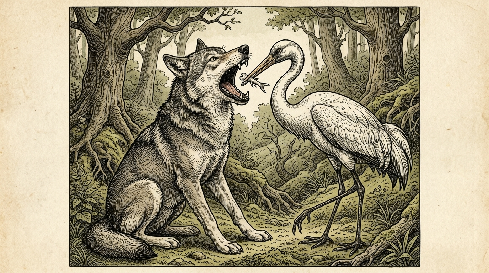

# Chapter 31: The Wolf and the Crane (オオカミとツル)

<!-- 電子書籍 Page Break & Image Header -->

  

## 1. Benchmark Level: Eiken Grade 4 (英検4級レベル本文)
*Read in ~1 to 1.5 minutes. Baseline vocabulary and basic syntax.*

A greedy wolf was eating meat very quickly. Suddenly, a small bone got stuck in his throat.

The wolf felt terrible pain. He could not swallow, and he could not breathe easily. He ran around the forest and asked many animals for help.

"Please pull out this bone!" he cried. "I will give a great reward to anyone who saves my life!"

No animal wanted to help him because everyone knew the wolf was dangerous. But a crane with a long neck and a sharp beak heard his promise. The crane felt pity for the wolf.

The crane told the wolf to open his huge mouth wide. She carefully put her long beak deep into his throat. With one quick pull, she removed the bone.

The wolf was relieved. But as he turned to walk away, the crane said, "Wait! What about my reward?"

The wolf grinned and showed his sharp teeth. "You put your head inside a wolf's jaws and took it out safely. Isn't that enough reward for you?"

The crane realized her mistake.

---

## 2. Target Level: Eiken Grade 3 (英検3級レベル本文)
*Read in ~1.5 to 2 minutes. Features relative clauses, passive voice, and dependent clauses.*

A greedy wolf, who was devouring an animal in a hurry, swallowed a sharp bone that became firmly lodged in his throat.

Because he could neither eat nor breathe comfortably, the wolf suffered intense pain. Desperate for relief, he wandered through the woods, begging every creature he met for assistance. He promised that he would provide a handsome reward to anyone who could remove the bone.

Most animals immediately refused because they were terrified of his fierce nature. However, a crane with a remarkably long neck was persuaded by his tempting offer. Taking pity on the suffering beast, she agreed to perform the dangerous task.

The wolf lay on his side and opened his terrible jaws as wide as possible. The crane courageously inserted her long beak into his mouth and skillfully extracted the bone. 

When the pain ceased, the wolf stood up and prepared to leave. The crane promptly stepped forward and reminded him of his promise. "Sir, you promised a reward for saving your life. Where is it?"

The wolf chuckled unkindly and bared his sharp teeth. "Ungrateful creature! You were allowed to withdraw your head from my jaws without harm. Is that not sufficient reward from a hungry wolf?"

The crane learned that serving a wicked creature brings no gratitude.

---

## 3. Classic Original English Text (イソップ寓話クラシック原文)
*Perry 156: Translated by George Fyler Townsend (1867)*

A Wolf had got a bone stuck in his throat, and in the greatest agony ran up and down, beseeching every animal he met to relieve him, at the same time hinting at a very handsome reward to the one who should succeed. 

A Crane, moved by his entreaties and promises of reward, ventured her long neck down the Wolf's throat, and drew out the bone. 

She then modestly asked for the promised reward. 

To this, the Wolf, grinning and showing his teeth, replied: "Be content with what you have got, my friend. Is it not a sufficient reward for you that you have had your head inside a Wolf's mouth, and have brought it out again safe and sound?"

---

### 🏛️ 【英検2級レベルで読み解く！クラシック原文の重要構文・英文法ノート】
1. **1. 分詞構文（Participle Clause: 付帯状況・理由）**
   - **原文**: *"The Hare, believing her assertion to be simply impossible, agreed to the proposal..."*
   - **解説**: 「〜と信じ込んでいたので」という理由を表す分詞構文。英検2級の長文読解・ライティングの最頻出構文です。
1. **2. 古典的仮定法現在（Subjunctive Mood）**
   - **原文**: *"Though you be swift as the wind, I will beat you in a race."*
   - **解説**: 譲歩節 `Though` の中で原形 `be` を用いる古典的な仮定法現在（現代英語の `Though you are...`）。格調高い古典の響きを持ちます。
1. **3. 過去分詞の後置修飾（Postpositive Participle）**
   - **原文**: *"On the day appointed for the race the two started together."*
   - **解説**: `appointed`（定められた・指定された）が直前の名詞 `the day` を後ろから修飾する構文です。

### 📜 【クラシック原文の重要語彙・古風表現（Classic Antique Vocabulary）】
- **retort** [動] 2級 **（機転を利かせて）言い返す、反論する**（現代の reply sharp/wittily に相当）
- **assertion** [名] 2級/準1級 **主張、断言**（動詞 assert の名詞形。2級長文定番）
- **wayside** [名] 2級 **道端、沿道**（by the wayside（道端に、途中で））
- **fatigue** [名] 2級 **（心身の）極度の疲労、疲れ**（tiredness の上位フォーマル語）

---

## 4. Japanese Translation & Moral (日本語訳と教訓)

### 【日本語全訳：英検3級レベル本文】
欲張りなオオカミが急いで獲物をむさぼり食っていたところ、鋭い骨を飲み込んでしまい、それが喉にしっかりと引っかかってしまいました。

快適に食べることも息をすることもできず、オオカミは激しい痛みに苦しみました。苦痛から逃れたい一心で、彼は森の中をうろつき回り、出会うあらゆる生き物に助けを懇願しました。そして、その骨を取り除いてくれた者には誰にでも、素晴らしい報酬を与えると約束しました。

オオカミの凶暴な性質を恐れていたため、ほとんどの動物はすぐに断りました。しかし、際立って長い首を持つツルが、彼の魅力的な申し出に心を動かされました。苦しんでいる獣を哀れに思った彼女は、その危険な役目を引き受けることに同意しました。

オオカミは横たわり、恐ろしい顎（あご）をできる限り大きく開けました。ツルは勇気を奮い起こして長い嘴（くちばし）を彼の口の奥深くへと入れ、器用に骨を引き抜きました。

痛みが消えると、オオカミは立ち上がり、立ち去ろうとしました。ツルはすかさず前に進み出て、約束を思い出させました。「あなた、命を助けた報酬を約束してくれましたよね。それはどこにあるのですか？」

オオカミは意地悪そうにくすくす笑い、鋭い牙を剥き出しにしました。「恩知らずなやつめ！ お前は私の顎の中から無傷で頭を引き抜くことを許されたのだぞ。飢えたオオカミから得た見返りとして、それだけで十分ではないというのか？」

ツルは、悪意ある者に仕えても感謝など得られないという教訓を学んだのでした。

### 【教訓（Moral）】
**Expect no reward from the wicked.**  
（悪人に施しをしても見返りを期待してはならない。悪人に関わって無事だったこと自体が最大の幸運である。）

---

## 5. Recite & Compare: そらんじたいキーフレーズ対比カード

  
フレーズ 1：喉に骨が刺さった状況の表現

  
4級A small bone got stuck in his throat.

  
3級A sharp bone became firmly lodged in his throat.

  
<strong>解説：</strong>4級の「got stuck（挟まった・詰まった）」を、3級では「firmly lodged（しっかりと固定された・めり込んだ）」という状態を表す受動的表現へブラッシュアップしています。

  
フレーズ 2：助けを求める切実な行動

  
4級He ran around the forest and asked many animals for help.

  
3級Desperate for relief, he wandered through the woods, begging every creature he met for assistance.

  
<strong>解説：</strong>分詞構文的な形容詞句「Desperate for relief（救いを切望して）」や、「ask for help」を一段上の「beg for assistance」に置き換えることで、感情の高まりを生き生きと描いています。

  
フレーズ 3：危険な行為への同意

  
4級The crane felt pity for the wolf and decided to help.

  
3級Taking pity on the suffering beast, she agreed to perform the dangerous task.

  
<strong>解説：</strong>「Taking pity on ~（〜を哀れに思って）」という分詞構文や、「perform the dangerous task（危険な任務を実行する）」という英検3級長文で好まれる成句を活用しています。

  
フレーズ 4：オオカミの冷酷な反論

  
4級Isn't that enough reward for you?

  
3級Is that not sufficient reward from a hungry wolf?

  
<strong>解説：</strong>日常的な「enough」を、フォーマルな文脈で頻出する「sufficient（十分な）」へと洗練させています。

---

## 6. Key Vocabulary & Exam Notes (英検3級 重要語彙・文法・面接対策)

### 1. 英検3級 必須ボキャブラリー
* **devour** [動] むさぼり食う、がつがつ食べる
* **lodge** [動] （狭い場所に）引っかかる、留まる
* **desperate** [形] 必死の、絶望的な、喉から手が出るほど求めている
* **assistance** [名] 援助、手助け（*help* よりフォーマル）
* **handsome** [形] （容姿だけでなく）多額の、気前の良い（*a handsome reward* で「多額の報酬」）
* **persuade** [動] 説得する、促す
* **extract** [動] 引き抜く、抽出する（*pull out* の格調高い語）
* **sufficient** [形] 十分な（= *enough*）

### 2. 文法・構文のチェックポイント
* **neither A nor B**: 「AもBも〜ない」
  * *Because he could neither eat nor breathe comfortably...*（快適に食べることも息をすることもできなかったため……）
  * 3級長文やライティングで文を簡潔にまとめるための強力な相関接続詞です。
* **be allowed to do**: 「〜することを許される（許可の受動態）」
  * *You were allowed to withdraw your head without harm.*（お前は無傷で頭を引っ込めることを許されたのだ。）
  * 「オオカミが情けをかけてやって生かしておいた」という傲慢な立場を受動態で見事に表現しています。

### 3. スピーキング（面接）＆ライティング活用ヒント
英検3級のライティングや面接で「親切にすることの大切さ」や「人との付き合い方」を述べる際、次のような表現が役立ちます：
* *We should always be kind, but we must choose who we trust.*（常に親切であるべきだが、誰を信頼するかは慎重に選ばなければならない。）
* *A good deed brings no return if the other person is dishonest.*（相手が不誠実であれば、善行も見返りをもたらさない。）
