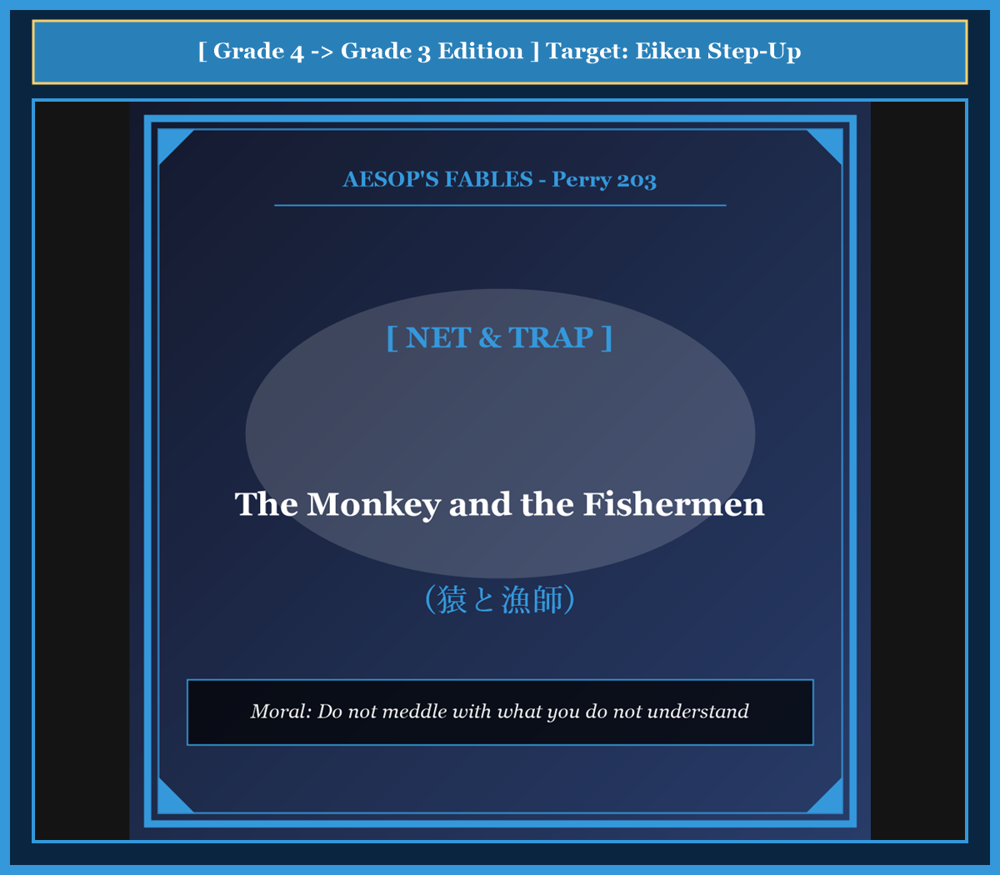

# Chapter 37: The Monkey and the Fishermen (猿と漁師)

<!-- 電子書籍 Page Break & Image Header -->

  

## 1. Benchmark Level: Eiken Grade 4 (英検4級レベル本文)
*Read in ~1 to 1.5 minutes. Baseline vocabulary and basic syntax.*

A curious monkey lived in a tall tree near a broad river.

One sunny afternoon, some fishermen came to the riverbank. The monkey watched them from a high branch. The fishermen threw their large nets into the water. After waiting a little while, they pulled the nets back. The nets were full of splashing fish.

"That looks so easy and fun!" thought the foolish monkey. "I am very smart, so I can catch fish just like those men."

Around noon, the fishermen put their nets on the shore and went to a small hut to eat lunch.

As soon as they were gone, the monkey climbed down from his tree. He ran to the nets. He wanted to imitate the fishermen.

The monkey picked up a heavy net. But he did not know how to hold it or how to throw it. The net was large and tangled.

When he tried to cast it into the water, the net fell over his own body. He struggled to escape, but the strong cords wrapped tightly around his hands, legs, and neck.

He slipped off the riverbank and fell into the deep water, completely wrapped in the net.

As he was sinking, the monkey gasped, "I deserve this! I knew nothing about fishing, yet I tried to do the work of skilled men."

---

## 2. Target Level: Eiken Grade 3 (英検3級レベル本文)
*Read in ~1.5 to 2 minutes. Features relative clauses, passive voice, and dependent clauses.*

An inquisitive monkey, who perched upon the high boughs of a tree beside a flowing river, observed several fishermen casting their nets into the water.

He watched with fascinated eyes as the men skillfully flung the broad mesh and retrieved abundant catches of glistening fish. Because monkeys are natural mimics, he foolishly assumed that the art of fishing required no special practice or intelligence. "What an effortless craft," the conceited creature whispered to himself. "I can perform that task with equal skill."

At midday, the fishermen laid their wet nets along the grassy shore and retired to a neighboring cottage to have their meal.

Seizing this favorable opportunity, the monkey descended swiftly from his perch. He approached the equipment and resolved to display his supposed talent. He lifted the heavy cords and attempted to duplicate the exact motions he had observed.

However, lacking experience and coordination, he became completely confused by the intricate cords. As he swung the bulky mesh clumsily, the net enveloped his own head and limbs instead of spreading across the water.

The more violently the monkey struggled to free himself, the more tightly the wet knots bound his body. Stumbling blindly along the slippery bank, he fell into the rushing current.

Weighted down by the heavy mesh, the drowning monkey sighed in bitter remorse. "Alas, I am rightly punished for my absurd conceit! Without possessing the slightest skill, why did I meddle in a craft that belonged entirely to experienced men?"

---

## 3. Classic Original English Text (イソップ寓話クラシック原文)
*Perry 203: Translated by George Fyler Townsend (1867)*

A Monkey, seated on a lofty tree, saw some Fishermen casting their nets into a river, and narrowly watched their proceedings. 

The Fishermen after a while gave up fishing, and on going home to dinner, left their nets upon the bank. 

The Monkey, who is the most imitative of animals, descended from the treetop, and endeavoured to do as they had done. Having handled the net, he threw it from him; but it became entangled around him, and he rolled into the river. 

Being in the act of drowning, he said to himself: "This is a just reward for my foolishness; for what business had I, who knew nothing of the matter, to try and fish with nets?"

---

### 🏛️ 【英検2級レベルで読み解く！クラシック原文の重要構文・英文法ノート】
1. **1. 分詞構文（Participle Clause: 付帯状況・理由）**
   - **原文**: *"The Hare, believing her assertion to be simply impossible, agreed to the proposal..."*
   - **解説**: 「〜と信じ込んでいたので」という理由を表す分詞構文。英検2級の長文読解・ライティングの最頻出構文です。
1. **2. 古典的仮定法現在（Subjunctive Mood）**
   - **原文**: *"Though you be swift as the wind, I will beat you in a race."*
   - **解説**: 譲歩節 `Though` の中で原形 `be` を用いる古典的な仮定法現在（現代英語の `Though you are...`）。格調高い古典の響きを持ちます。
1. **3. 過去分詞の後置修飾（Postpositive Participle）**
   - **原文**: *"On the day appointed for the race the two started together."*
   - **解説**: `appointed`（定められた・指定された）が直前の名詞 `the day` を後ろから修飾する構文です。

### 📜 【クラシック原文の重要語彙・古風表現（Classic Antique Vocabulary）】
- **retort** [動] 2級 **（機転を利かせて）言い返す、反論する**（現代の reply sharp/wittily に相当）
- **assertion** [名] 2級/準1級 **主張、断言**（動詞 assert の名詞形。2級長文定番）
- **wayside** [名] 2級 **道端、沿道**（by the wayside（道端に、途中で））
- **fatigue** [名] 2級 **（心身の）極度の疲労、疲れ**（tiredness の上位フォーマル語）

---

## 4. Japanese Translation & Moral (日本語訳と教訓)

### 【日本語全訳：英検3級レベル本文】
流れる川のほとりにある木の高い枝に止まっていた好奇心旺盛な猿が、数人の漁師が水中に網を投げ入れている様子を観察していました。

男たちが器用に広い網を投げ、光り輝く魚をたくさん引き上げる様子を、猿は魅了された目で見つめていました。猿は生まれつき真似をするのが得意な動物であるため、漁の技術には何の特別な訓練も知恵も必要ないと思い込んでしまいました。「何とたやすい技だろう」と自惚れた生き物は独り言をつぶやきました。「自分にも彼らと同じ腕前でその仕事ができるはずだ。」

真昼になり、漁師たちは濡れた網を草の生えた岸辺に置き、食事をとるために近くの小屋へと引き上げました。

この絶好の好機を捉えて、猿は止まり木から素早く降りてきました。彼は道具に近づき、自分の自負する才能を披露しようと決意しました。彼は重い網の縄を持ち上げ、観察した通りの動作を正確に再現しようと試みました。

しかし、経験も身のこなしの器用さも欠いていたため、彼は複雑に入り組んだ縄にすっかり混乱してしまいました。かさばる網をぎこちなく振り回した拍子に、網は水面に広がるどころか、彼自身の頭や手足を包み込んでしまいました。

猿が身悶えして逃れようと暴れれば暴れるほど、濡れた結び目はより固く彼の体を締めつけました。滑りやすい土手を盲目同然によろめき歩くうちに、彼は急流の中へと転落してしまいました。

重い網の重みで沈んでいきながら、溺れゆく猿は激しい後悔の溜息をもらしました。「ああ、己のばかげた自惚れゆえに、当然の報いを受けてしまった！ 少しの技術も持ち合わせていないのに、なぜ完全に熟練者たちの領域である技術に軽々しく手を出してしまったのだろうか。」

### 【教訓（Moral）】
**Do not meddle with what you do not understand.**  
（自分が理解していない専門領域に軽々しく介入してはならない。他人の仕事を表面だけ真似る浅知恵は、身の破滅を招く。）

---

## 5. Recite & Compare: そらんじたいキーフレーズ対比カード

  
フレーズ 1：真似をしようとする浅はかな心理

  
4級"That looks so easy!" thought the foolish monkey.

  
3級He foolishly assumed that the art of fishing required no special practice or intelligence.

  
<strong>解説：</strong>動詞「assume that ~（〜だと思い込む・決めつける）」を用いた思考の描写で、猿の過信を論理的に表現しています。

  
フレーズ 2：好機と見て行動に移す

  
4級As soon as they were gone, the monkey climbed down.

  
3級Seizing this favorable opportunity, the monkey descended swiftly from his perch.

  
<strong>解説：</strong>分詞構文「Seizing this favorable opportunity（この好機を捉えて）」という格調高いフレーズにより、文章のスピード感と品格を高めています。

  
フレーズ 3：もがけばもがくほど絡まる網

  
4級He struggled, but the cords wrapped tightly around his body.

  
3級The more violently the monkey struggled, the more tightly the wet knots bound his body.

  
<strong>解説：</strong>英検3級・準2級で頻出する「The + 比較級 ..., the + 比較級 ...（〜すればするほど、ますます…）」の比例構文を活用しています。

  
フレーズ 4：身の程知らずへの後悔の叫び

  
4級I knew nothing about fishing, yet I tried to do it.

  
3級Without possessing the slightest skill, why did I meddle in a craft that belonged entirely to experienced men?

  
<strong>解説：</strong>前置詞句「Without possessing ~」と関係代名詞「that belonged to ~」を重ね、自嘲的な反語で物語を締めくくっています。

---

## 6. Key Vocabulary & Exam Notes (英検3級 重要語彙・文法・面接対策)

### 1. 英検3級 必須ボキャブラリー
* **inquisitive** [形] 好奇心が強い、詮索好きな
* **retrieve** [動] 回収する、引き上げる
* **mimic** [名] まねをする人・動物 / [動] まねる
* **conceited** [形] 自惚れた、思い上がった
* **intricate** [形] 複雑な、入り組んだ
* **envelop** [動] 包み込む、覆い隠す
* **meddle** [動] （余計なおせっかいで）干渉する、手を出す
* **remorse** [名] 深い後悔、自責の念

### 2. 文法・構文のチェックポイント
* **The + 比較級 ..., the + 比較級 ...**: 「〜すればするほど、ますます…」
  * *The more violently he struggled, the more tightly the knots bound him.*（彼が激しくもがけばもがくほど、結び目はより固く彼を縛りつけた。）
  * 読解問題の選択肢や英作文で表現力を飛躍させる重要構文です。
* **seize an opportunity**: 「機会を捉える・チャンスをつかむ」
  * 面接やライティングで積極的な行動を述べる際の定型フレーズです。

### 3. スピーキング（面接）＆ライティング活用ヒント
「専門知識の重要性」や「準備の大切さ」を論じる際に応用できます：
* *We must respect professionals and avoid interfering without proper training.*（私たちは専門家を尊重し、適切な訓練なしに口出しすることを避けるべきである。）
* *Tasks that look easy often require years of hard practice.*（簡単そうに見える仕事ほど、何年もの厳しい練習を必要としていることが多い。）
