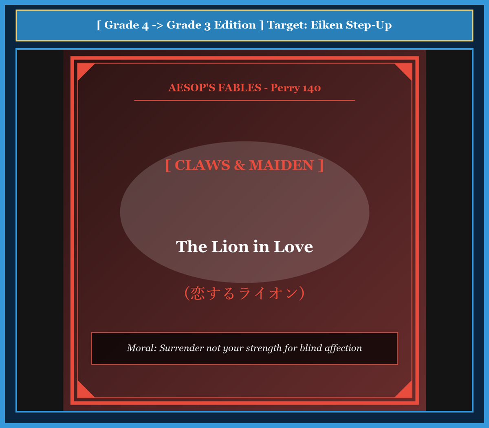

# Chapter 38: The Lion in Love (恋するライオン)

<!-- 電子書籍 Page Break & Image Header -->

  

## 1. Benchmark Level: Eiken Grade 4 (英検4級レベル本文)
*Read in ~1 to 1.5 minutes. Baseline vocabulary and basic syntax.*

A powerful lion fell deeply in love with a woodcutter's beautiful daughter.

The lion went to the woodcutter's cottage and said, "I want to marry your daughter. Give her to me, or I will destroy your house and eat your animals!"

The woodcutter was terrified. He could not refuse the mighty beast, but he certainly did not want his daughter to marry a wild animal.

He thought quickly and came up with a clever plan.

"Great King of Beasts," the woodcutter said politely, "we are honored by your proposal. But my daughter is very gentle and timid. She is afraid of your sharp teeth and your long claws. If you pull out your teeth and cut off your claws, she will gladly marry you."

The lion was so blind with love that he agreed immediately.

He went to a doctor and had all his sharp teeth pulled out. Then he had his powerful claws trimmed down completely.

He returned to the cottage, harmless and toothless, and smiled at the father. "Now give me your daughter!"

The woodcutter smiled coldly. Seeing that the lion was completely defenseless, he picked up a heavy club and drove the foolish beast away into the forest.

---

## 2. Target Level: Eiken Grade 3 (英検3級レベル本文)
*Read in ~1.5 to 2 minutes. Features relative clauses, passive voice, and dependent clauses.*

A formidable lion, whose roar struck terror into the hearts of all forest creatures, fell desperately in love with the daughter of a humble woodcutter.

Overcome by his intense passion, the king of beasts visited the humble cottage and demanded the maiden's hand in marriage. The poor father was confronted with an agonized dilemma: he dared not decline the demand of such a ferocious predator, yet he could not bear the thought of surrendering his cherished child to a savage beast.

Exercising his wits, the shrewd woodcutter formulated a cunning scheme to neutralize the threat.

"My lord," he answered with apparent humility, "my family would be deeply flattered by such an alliance. However, my tender daughter is exceedingly sensitive. She faints with dread whenever she beholds your formidable fangs, and she trembles at the sight of your razor-sharp claws. If you truly wish to win her affection, you must consent to having your teeth extracted and your claws removed."

Blinded by infatuation, the foolish monarch did not pause to consider the consequences. He readily consented to the humiliating surgery, allowing his primary weapons to be completely stripped away.

When the mutilation was accomplished, the toothless and clawless lion returned triumphantly to the cottage to claim his bride.

Observing that the once-terrible beast was now entirely disarmed and helpless, the woodcutter seized a stout cudgel. Without the slightest fear, he fell upon the defenseless lion, beating him soundly until the miserable creature fled in disgrace back into the wilderness.

---

## 3. Classic Original English Text (イソップ寓話クラシック原文)
*Perry 140: Translated by George Fyler Townsend (1867)*

A Lion demanded the daughter of a woodcutter in marriage. 

The Father, unwilling to grant, and yet afraid to refuse his request, hit upon this expedient to rid himself of his importunities. 

He told the Lion that he was very willing to make him his son-in-law, but that he could not do so unless he would consent to have his teeth drawn and his claws trimmed, as the young girl was terribly afraid of both. 

The Lion was so madly in love that he was easily prevailed upon to consent. 

When he had done this, and came again to the woodman, the latter, no longer having any fear of him, set upon him with a club and drove him away.

---

### 🏛️ 【英検2級レベルで読み解く！クラシック原文の重要構文・英文法ノート】
1. **1. 分詞構文（Participle Clause: 付帯状況・理由）**
   - **原文**: *"The Hare, believing her assertion to be simply impossible, agreed to the proposal..."*
   - **解説**: 「〜と信じ込んでいたので」という理由を表す分詞構文。英検2級の長文読解・ライティングの最頻出構文です。
1. **2. 古典的仮定法現在（Subjunctive Mood）**
   - **原文**: *"Though you be swift as the wind, I will beat you in a race."*
   - **解説**: 譲歩節 `Though` の中で原形 `be` を用いる古典的な仮定法現在（現代英語の `Though you are...`）。格調高い古典の響きを持ちます。
1. **3. 過去分詞の後置修飾（Postpositive Participle）**
   - **原文**: *"On the day appointed for the race the two started together."*
   - **解説**: `appointed`（定められた・指定された）が直前の名詞 `the day` を後ろから修飾する構文です。

### 📜 【クラシック原文の重要語彙・古風表現（Classic Antique Vocabulary）】
- **retort** [動] 2級 **（機転を利かせて）言い返す、反論する**（現代の reply sharp/wittily に相当）
- **assertion** [名] 2級/準1級 **主張、断言**（動詞 assert の名詞形。2級長文定番）
- **wayside** [名] 2級 **道端、沿道**（by the wayside（道端に、途中で））
- **fatigue** [名] 2級 **（心身の）極度の疲労、疲れ**（tiredness の上位フォーマル語）

---

## 4. Japanese Translation & Moral (日本語訳と教訓)

### 【日本語全訳：英検3級レベル本文】
その咆哮が森のあらゆる生き物の心に恐怖を植え付けていた恐るべきライオンが、慎ましい木こりの娘に激しい恋に落ちました。

燃え盛る情熱に圧倒された百獣の王は木こりの質素な小屋を訪れ、乙女への求婚を迫りました。哀れな父親は苦渋のジレンマに直面しました。これほど凶暴な捕食者の要求を断る勇気はありませんでしたが、大切に育てた我が子を野獣に引き渡すなど到底耐えられなかったからです。

知恵を絞り、抜け目のない木こりは脅威を無力化するための巧妙な計画を思いつきました。

「我が主よ」と彼はうわべだけの謙遜さで答えました。「私の家族は、このようなご縁をいただけるなら深く光栄に存じます。しかし、私の繊細な娘はひどく怖がりなのです。あなたの恐ろしい牙を目にするたびに恐怖で気を失い、カミソリのように鋭い爪を見ては震え上がってしまいます。もし本当に娘の心をつかみたいとお望みなら、歯を抜き、爪を切り落とすことにご同意いただかなければなりません。」

盲目的な熱情に目を奪われた愚かな君主は、その結果について立ち止まって考えることすらしませんでした。彼はその屈辱的な手術に快く同意し、自らの最大の武器を完全に奪い去られることを許してしまったのです。

処置が終わると、歯も爪も失ったライオンは、花嫁を迎えようと意気揚々と小屋へ戻ってきました。

かつて恐れられた獣がいまや完全に武装解除され無力であるのを見て取った木こりは、太いこん棒を手に取りました。木こりは少しの恐れも抱くことなく無防備なライオンに襲いかかり、哀れな獣がほうほうの体で荒野へと逃げ帰るまで徹底的に打ち据えたのでした。

### 【教訓（Moral）】
**Surrender not your strength for blind affection.**  
（盲目的な情熱のために自らの防壁や強みを放棄してはならない。自らを無力化してしまえば、相手の意のままに蹂躙されるだけである。）

---

## 5. Recite & Compare: そらんじたいキーフレーズ対比カード

  
フレーズ 1：求婚を断れないジレンマ

  
4級The woodcutter was terrified. He could not refuse the mighty beast.

  
3級He dared not decline the demand of such a ferocious predator.

  
<strong>解説：</strong>助動詞「dare not do（あえて〜する勇気がない）」と、「ferocious predator（凶暴な捕食者）」という表現で、父親の緊迫した心理を見事に表しています。

  
フレーズ 2：愛に目がくらんだ承諾

  
4級The lion was so blind with love that he agreed immediately.

  
3級Blinded by infatuation, the foolish monarch did not pause to consider the consequences.

  
<strong>解説：</strong>分詞構文「Blinded by ~」に加え、「not pause to consider the consequences（結果を考慮するために立ち止まることすらしない）」という定型表現が思考停止を的確に伝えます。

  
フレーズ 3：武器を完全に奪われた状態

  
4級He had all his sharp teeth pulled out and his claws trimmed down.

  
3級He allowed his primary weapons to be completely stripped away.

  
<strong>解説：</strong>使役動詞「allow + 目的語 + to be 過去分詞（〜が…されるのを許す）」を用いた受動態で、自発的に弱点を作ってしまった愚行を浮き彫りにしています。

  
フレーズ 4：無防備になった敵への反撃

  
4級Seeing that the lion was completely defenseless, he drove the beast away.

  
3級Observing that the once-terrible beast was now entirely disarmed, the woodcutter fell upon the defenseless lion.

  
<strong>解説：</strong>「disarmed（武装解除された）」や「fall upon（襲いかかる）」という文学的表現により、情勢の完全な逆転を描写しています。

---

## 6. Key Vocabulary & Exam Notes (英検3級 重要語彙・文法・面接対策)

### 1. 英検3級 必須ボキャブラリー
* **formidable** [形] 手ごわい、恐ろしい
* **passion** [名] 情熱、強い感情
* **dilemma** [名] 板挟み、窮地
* **predator** [名] 捕食者、天敵
* **humility** [名] 謙遜、卑下
* **affection** [名] 愛情、好意
* **infatuation** [名] 盲目的な夢中、のぼせ上がり
* **defenseless** [形] 無防備な、抵抗できない

### 2. 文法・構文のチェックポイント
* **dare not do**: 「あえて〜する勇気がない」
  * 主語の強い恐怖や躊躇を簡潔かつ重厚に表現する助動詞用法です。
* **fall upon / set upon**: 「〜に襲いかかる、攻撃を仕掛ける」
  * 物語展開で反撃や奇襲を述べる頻出句動詞です。

### 3. スピーキング（面接）＆ライティング活用ヒント
「感情に流されない判断力」を述べる際に効果的です：
* *Strong emotions like anger or infatuation can blind our rational thinking.*（怒りや盲目的な熱情のような強い感情は、私たちの合理的な思考を曇らせることがある。）
* *It is dangerous to compromise core principles for short-term desires.*（短期的な欲望のために自らの根幹となる原則を妥協するのは危険である。）
