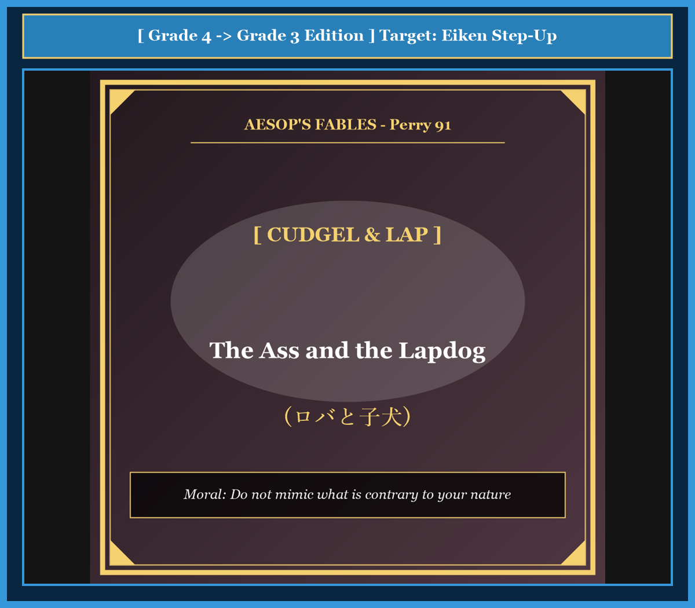

# Chapter 40: The Ass and the Lapdog (ロバと子犬)

<!-- 電子書籍 Page Break & Image Header -->

  

## 1. Benchmark Level: Eiken Grade 4 (英検4級レベル本文)
*Read in ~1 to 1.5 minutes. Baseline vocabulary and basic syntax.*

A man had a donkey and a small lapdog.

The donkey worked hard every single day. He carried heavy sacks of grain, turned the heavy millstone, and carried wood from the forest. He slept in a cold, dusty barn and ate only dry straw.

On the other hand, the little dog did no work at all. When the master sat down to eat, the little dog ran to him, wagged his tail, and jumped onto the master's lap. The master smiled, stroked the dog's soft fur, and fed him delicious bits of meat from his own plate.

The donkey watched this through the window and felt very jealous.

"It is not fair," thought the donkey. "I work hard all day, but my master never pets me. The dog only wags his tail and jumps on his lap, and he gets rich food and love. If I do the same thing, the master will love me too!"

The next day, the donkey broke out of the barn. He ran straight into the house and entered the dining room.

He brayed loudly and ran toward the master. With a clumsy leap, the huge donkey put his heavy hooves right onto the master's knees! He tried to lick the master's face with his big, wet tongue.

The table broke, dishes smashed on the floor, and the master screamed in terror.

Hearing the loud noise, the servants rushed into the room with heavy sticks. They beat the foolish donkey soundly and dragged him back to the barn.

Bruised and aching, the donkey groaned, "Why did I try to act like a lapdog? Hard work is my true nature, not playful affection."

---

## 2. Target Level: Eiken Grade 3 (英検3級レベル本文)
*Read in ~1.5 to 2 minutes. Features relative clauses, passive voice, and dependent clauses.*

A country gentleman owned both a sturdy donkey and a pampered lapdog.

The donkey was subjected to constant toil from dawn till dusk. He was required to haul heavy sacks of grain to the mill and drag heavy timber from the distant woods. At night, he was confined to a dreary stable, nourished with nothing better than dry chaff and stale water.

In sharp contrast, the pet dog enjoyed an utterly carefree life of luxury. Whenever the master returned home, the playful dog would frisk about his feet, wagging his tail enthusiastically and jumping into his lap. Delighted by these affectionate gestures, the master would caress the animal fondly and reward him with choice morsels from the dining table.

Observing this partiality from afar, the envious donkey grew resentful of his lowly station. "How unjust my destiny is!" he grumbled to himself. "Although I exhaust myself through endless drudgery, I receive neither praise nor comfort. Meanwhile, this idle puppy is showered with affection simply because he frisks and fawns. Surely, if I adopt the same charming manners, our master will cherish me with equal devotion."

Acting upon this absurd logic, the donkey slipped out of his paddock the following afternoon and trotted boldly into the parlor.

Bellowing a deafening bray of welcome, the clumsy beast charged toward the armchair where his master sat. With immense clumsy enthusiasm, he reared up on his hind legs and planted his heavy, muddy hooves squarely upon his master's chest, attempting to lick the terrified gentleman's cheeks.

The master, nearly crushed under the overwhelming weight, shrieked in horror. Tables were overturned, fine porcelain was shattered into fragments, and complete chaos engulfed the room.

Alerted by the desperate cries, the household servants burst through the door, armed with stout clubs. Without hesitation, they fell upon the intruder and administered a severe thrashing until the battered creature was dragged back to his stall.

Nursing his sore ribs, the humiliated donkey reflected upon his folly: "I have earned this bitter punishment. Nature intended me to carry heavy burdens with patient dignity, not to mimic the playful antics of a spoiled lapdog."

---

## 3. Classic Original English Text (イソップ寓話クラシック原文)
*Perry 91: Translated by George Fyler Townsend (1867)*

A Man had a Donkey and a Maltese Lapdog, a very great beauty. The Donkey was conditioned only to carry burdens, but the Dog had every advantage. 

The Donkey, seeing how much the Dog was petted, determined to try if he could not win his Master's favor by imitating him. 

One day, having broken his halter, he ran into his Master's house, and began to gambol about in the room, breaking the furniture. 

He then ran up to his Master, and put his fore-feet upon his shoulders, and licked his face with his tongue, just as he had seen the Dog do. 

The Master cried out with fear, and the servants running in with sticks, beat the Donkey till he was nearly dead, and then turned him out into his stable. 

The Donkey, groaning with his bruises, said: "What a fool I was to imitate a Lapdog, when I was only born to carry burdens!"

---

### 🏛️ 【英検2級レベルで読み解く！クラシック原文の重要構文・英文法ノート】
1. **1. 分詞構文（Participle Clause: 付帯状況・理由）**
   - **原文**: *"The Hare, believing her assertion to be simply impossible, agreed to the proposal..."*
   - **解説**: 「〜と信じ込んでいたので」という理由を表す分詞構文。英検2級の長文読解・ライティングの最頻出構文です。
1. **2. 古典的仮定法現在（Subjunctive Mood）**
   - **原文**: *"Though you be swift as the wind, I will beat you in a race."*
   - **解説**: 譲歩節 `Though` の中で原形 `be` を用いる古典的な仮定法現在（現代英語の `Though you are...`）。格調高い古典の響きを持ちます。
1. **3. 過去分詞の後置修飾（Postpositive Participle）**
   - **原文**: *"On the day appointed for the race the two started together."*
   - **解説**: `appointed`（定められた・指定された）が直前の名詞 `the day` を後ろから修飾する構文です。

### 📜 【クラシック原文の重要語彙・古風表現（Classic Antique Vocabulary）】
- **retort** [動] 2級 **（機転を利かせて）言い返す、反論する**（現代の reply sharp/wittily に相当）
- **assertion** [名] 2級/準1級 **主張、断言**（動詞 assert の名詞形。2級長文定番）
- **wayside** [名] 2級 **道端、沿道**（by the wayside（道端に、途中で））
- **fatigue** [名] 2級 **（心身の）極度の疲労、疲れ**（tiredness の上位フォーマル語）

---

## 4. Japanese Translation & Moral (日本語訳と教訓)

### 【日本語全訳：英検3級レベル本文】
ある田舎の紳士が、頑丈なロバと甘やかされた愛玩用の小犬を飼っていました。

ロバは夜明けから日暮れまで絶え間ない重労働を課されていました。重い穀物の袋を粉挽き場まで運び、遠い森から重い材木を引きずってくることが義務付けられていました。夜になると陰気な馬小屋に閉じ込められ、乾燥したわらと濁った水以外には何も与えられませんでした。

これとは際立った対照的に、ペットの犬は贅沢で完全に気楽な生活を享受していました。主人が帰宅するたびに、その陽気な犬は足元で戯れ、熱心に尾を振り、主人の膝の上へと飛び乗りました。その愛らしい仕草に喜んだ主人は、犬を愛情を込めて撫で、食卓から上等な肉の切れ端をご褒美として与えるのでした。

遠くからこの不公平な贔屓（ひいき）を眺めていた嫉妬深いロバは、自らの卑しい境遇に憤りを募らせました。「私の運命は何と不公平なことか！」とロバは愚痴をこぼしました。「終わりのない苦役で自分をすり減らしているのに、褒め言葉も慰めも得られない。その一方で、あの怠惰な子犬は、ただ戯れて媚びを売るだけで溢れんばかりの愛情を注がれている。もし私が同じ魅力的な振る舞いを身につければ、間違いなく主人も同じ愛情をもって私を大切にしてくれるはずだ。」

この愚かな論理に基づいて行動し、ロバは翌日の午後、放牧場を抜け出して応接間へと堂々と足を踏み入れました。

歓迎の耳をつんざくような鳴き声を上げながら、その不器用な獣は主人が座っていた安楽椅子へと突進しました。巨大でぎこちない熱情を抱いて後ろ足で立ち上がり、重く泥だらけの蹄（ひづめ）を主人の胸元にまともに載せ、怯える紳士の頬を舐めようとしました。

圧倒的な重さの下で押しつぶされそうになった主人は、恐怖のあまり悲鳴を上げました。テーブルはひっくり返り、上質な磁器は粉々に砕け散り、部屋全体が完全な大混乱に包まれました。

必死の叫び声に気づいた召使いたちが、太い棍棒を手にしてドアを破って突入してきました。彼らは躊躇することなくその侵入者に襲いかかり、痛めつけられた哀れなロバを馬小屋へと引きずり戻すまで、容赦のない殴打を浴びせました。

痛む脇腹をさすりながら、屈辱にまみれたロバは自らの愚行を省みました。「私はこの苦い罰を受けて当然だ。天は私を、甘やかされた小犬のおどけた仕草を真似るためではなく、辛抱強い尊厳をもって重荷を運ぶために創られたのだから。」

### 【教訓（Moral）】
**Do not mimic what is contrary to your nature.**  
（自らの天分や適性に反する振る舞いを軽々しく真似てはならない。不器用な追従や無理なおべっかは、好意を得るどころか手酷い制裁と破滅を招く。）

---

## 5. Recite & Compare: そらんじたいキーフレーズ対比カード

  
フレーズ 1：過酷な使役と恵まれた暮らしの対比

  
4級The donkey worked hard, but the little dog did no work at all.

  
3級The donkey was subjected to constant toil, whereas the pet dog enjoyed a carefree life of luxury.

  
<strong>解説：</strong>「be subjected to ~（〜を余儀なくされる・課される）」という受動態成句と「in sharp contrast / whereas」により、2頭の置かれた環境の違いを鮮烈に提示しています。

  
フレーズ 2：歪んだ嫉妬と間違った決意

  
4級If I do the same thing, the master will love me too!

  
3級If I adopt the same charming manners, our master will cherish me with equal devotion.

  
<strong>解説：</strong>「adopt ~（〜を取り入れる・採用する）」や「cherish O with devotion（深い愛情で大切にする）」というフォーマル語彙を用いることで、知的な皮肉を込めています。

  
フレーズ 3：突進と混乱の大惨事

  
4級The table broke, dishes smashed, and the master screamed.

  
3級Tables were overturned, porcelain was shattered into fragments, and complete chaos engulfed the room.

  
<strong>解説：</strong>受動態の連続描写（overturned, shattered into fragments, engulfed）により、部屋が一瞬で破壊されていくパニック状態を臨場感たっぷりに描写しています。

  
フレーズ 4：自分の天分への反省と気づき

  
4級Hard work is my true nature, not playful affection.

  
3級Nature intended me to carry heavy burdens with patient dignity, not to mimic the antics of a lapdog.

  
<strong>解説：</strong>「Nature intended O to do（天はOが〜するように定めた）」という格調高い主語構文が、イソップ寓話の深い倫理観を表現しています。

---

## 6. Key Vocabulary & Exam Notes (英検3級 重要語彙・文法・面接対策)

### 1. 英検3級 必須ボキャブラリー
* **pampered** [形] 甘やかされた、大事にされた
* **subject to** [熟語] 〜を受けさせる、〜にさらす
* **in sharp contrast** [熟語] 際立った対照をなして
* **frisk** [動] 跳ね回る、じゃれつく
* **morsel** [名] （食べ物の）一口、少量のごちそう
* **drudgery** [名] 退屈な苦役、辛い労働
* **chaos** [名] 大混乱、無秩序
* **dignity** [名] 尊厳、気品、威厳

### 2. 文法・構文のチェックポイント
* **be subjected to ~**: 「〜にさらされる、〜を受ける」
  * 厳しい環境や使役を表す際の重要表現です。
* **Nature intended A to do**: 「天・自然はAが〜するように意図した（Aの天分である）」
  * 英語特有の無生物主語構文で、物事の本来あるべき姿を堂々と述べる名文句です。

### 3. スピーキング（面接）＆ライティング活用ヒント
「自分らしさ（個性の尊重）」や「他者との比較の無意味さ」について論じる際に最適です：
* *Everyone has different talents, so we should not copy others blindly.*（人それぞれ異なる才能があるのだから、他人の真似を盲目的にすべきではない。）
* *Finding satisfaction in our own strengths is the key to true happiness.*（自分自身の強みに満足を見出すことこそが、真の幸福への鍵である。）
