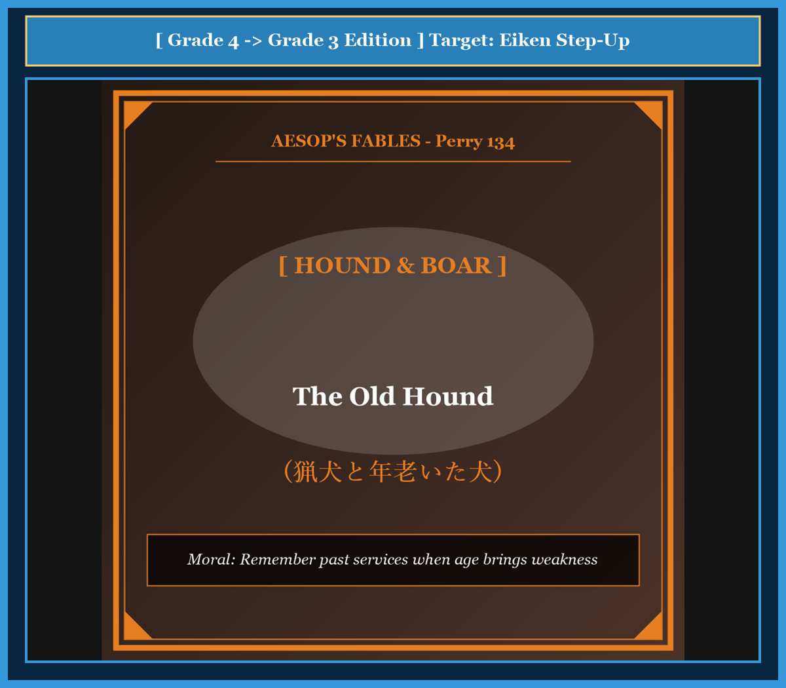

# Chapter 41: The Old Hound (猟犬と年老いた犬)

<!-- 電子書籍 Page Break & Image Header -->

  

## 1. Benchmark Level: Eiken Grade 4 (英検4級レベル本文)
*Read in ~1 to 1.5 minutes. Short and simple sentences.*

A hunter had a faithful hound. When the dog was young, he was very strong and fast. He caught many wild animals for his master. The hunter loved the dog very much.

Many years passed. The hound became old and weak. His legs were slow, and his teeth were not sharp. But he still loved to hunt with his master in the forest.

One day, the hunter and the hound went into the deep woods. They saw a big, dangerous wild boar. The hunter fired, but the boar ran away. The old hound ran after it bravely.

The hound caught the boar by its ear. He held it with all his strength. But his old teeth were too weak. The ear slipped from his mouth, and the wild boar escaped into the bushes.

The hunter ran up. He was very angry because he lost the prize. He raised his heavy whip and began to beat the poor old dog.

The old hound looked up at his master with sad, tearful eyes. "Master," said the hound, "please do not beat me. My heart is still brave, but my body is old. Remember the days when I caught many beasts for you, and do not punish me for my weak old age."

---

## 2. Target Level: Eiken Grade 3 (英検3級レベル本文)
*Read in ~1.5 to 2 minutes. Compound sentences, conjunctions, and rich expressions.*

A hunter kept a courageous hound that had served him loyally for many years. In his youth, the hound was famous for his incredible speed and powerful jaws, and he never allowed any wild beast to escape.

However, as time went by, the faithful hound grew old and infirm. His limbs lost their youthful agility, and his teeth became blunt and loose. Even though he could no longer run as fast as before, his spirit remained as brave as ever, and he still accompanied his master on every hunt.

One morning, the hunter encountered a ferocious wild boar in the dense forest. The hunter signaled his dog to attack, and the old hound dashed forward without hesitation. With great determination, he seized the monstrous beast by the ear.

The hound struggled desperately to hold the thrashing beast until his master arrived. Unfortunately, his decayed teeth gave way, and the boar broke free and vanished into the thick undergrowth.

When the hunter arrived and discovered that his quarry had escaped, he flew into a violent rage. Instead of showing gratitude for the dog's courage, he raised his heavy stick and began to strike the defenseless animal.

The bruised hound looked up at his master with sorrowful eyes and spoke gently: "Do not strike me, master, for it is not my courage that has failed, but only my physical strength. You should remember the countless victories of my youth rather than despise me for the natural infirmities of my old age."

---

## 3. Classic Original English Text (イソップ寓話クラシック原文)
*Perry 134: Translated by George Fyler Townsend (1867)*

A Hound who in the days of his youth and strength had never yielded to any beast of the forest, encountered in his old age a boar in the chace. 

He seized him boldly by the ear, but could not retain his hold because of the decay of his teeth, so that the boar escaped. 

His master, quickly coming up, was very much disappointed, and fiercely abused the dog. 

The Hound looked up and said: "It was not my fault, master, my spirit was as good as ever, but I could not help my infirmities. I rather deserve to be praised for what I have been, than to be scolded for what I am."

---

### 🏛️ 【英検2級レベルで読み解く！クラシック原文の重要構文・英文法ノート】
1. **1. 分詞構文（Participle Clause: 付帯状況・理由）**
   - **原文**: *"The Hare, believing her assertion to be simply impossible, agreed to the proposal..."*
   - **解説**: 「〜と信じ込んでいたので」という理由を表す分詞構文。英検2級の長文読解・ライティングの最頻出構文です。
1. **2. 古典的仮定法現在（Subjunctive Mood）**
   - **原文**: *"Though you be swift as the wind, I will beat you in a race."*
   - **解説**: 譲歩節 `Though` の中で原形 `be` を用いる古典的な仮定法現在（現代英語の `Though you are...`）。格調高い古典の響きを持ちます。
1. **3. 過去分詞の後置修飾（Postpositive Participle）**
   - **原文**: *"On the day appointed for the race the two started together."*
   - **解説**: `appointed`（定められた・指定された）が直前の名詞 `the day` を後ろから修飾する構文です。

### 📜 【クラシック原文の重要語彙・古風表現（Classic Antique Vocabulary）】
- **retort** [動] 2級 **（機転を利かせて）言い返す、反論する**（現代の reply sharp/wittily に相当）
- **assertion** [名] 2級/準1級 **主張、断言**（動詞 assert の名詞形。2級長文定番）
- **wayside** [名] 2級 **道端、沿道**（by the wayside（道端に、途中で））
- **fatigue** [名] 2級 **（心身の）極度の疲労、疲れ**（tiredness の上位フォーマル語）

---

## 4. Japanese Translation & Moral (日本語訳と教訓)

### 【日本語全訳：英検3級レベル本文】
ある猟師が、何年もの間忠実に仕えてくれた勇敢な猟犬を飼っていました。若い頃、その猟犬は信じられないほどの走力と力強い顎の力で知られており、どんな野獣も決して逃がしませんでした。

しかし時が経つにつれて、この忠実な猟犬は年老いて体が弱くなっていきました。四肢は若き日の俊敏さを失い、歯はすり減ってグラついていました。以前のように速く走ることはできなくなっていましたが、心は変わらず勇敢なままであり、今でも主人のすべての狩りに付き添っていました。

ある朝、猟師は深い森の中で凶暴なイノシシに出遭いました。猟師が攻撃の合図を出すと、老いた猟犬はためらうことなく前へ駆け出しました。強い決意をもって、彼はその巨大な野獣の耳にかじりつきました。

猟犬は主人が駆けつけるまで、暴れ回る野獣を押さえ込もうと必死に踏ん張りました。しかし不運にも、弱った歯が耐えきれず、イノシシは逃げ出して鬱蒼とした藪の奥へと姿を消してしまいました。

猟師が追いつき獲物が逃げてしまったことを知ると、彼は激しい怒りに駆られました。犬の勇気に感謝するどころか、重い杖を振り上げ、無防備な老犬を容赦なく叩き始めたのです。

傷だらけの猟犬は悲しげな瞳で主人を見上げ、静かに語りかけました。「ご主人様、どうか私を打たないでください。衰えたのは私の勇気ではなく、ただ肉体の力なのです。老いて衰えた姿を軽蔑するのではなく、若い頃にあなたのために収めた数え切れない勝利の功績をどうか思い出してください。」

### 【教訓（Moral）】
**Respect past loyalty when old age brings weakness.**  
（老いて衰えた者を切り捨てるのではなく、かつて捧げてくれた献身と功績に敬意を払いなさい。過去の貢献を忘れ、年老いた弱さだけを責めるのは人間の最も醜い冷酷さである。）

---

## 5. Recite & Compare: そらんじたいキーフレーズ対比カード

  
フレーズ 1：若き日の比類なき強さと俊敏さ

  
4級When the dog was young, he was very strong and fast.

  
3級In his youth, the hound was famous for his incredible speed and powerful jaws.

  
<strong>解説：</strong>3級では「In his youth（若い頃に）」「be famous for ~（〜で有名である）」を用いて具体的に描写します。

  
フレーズ 2：体は衰えても心は勇敢なまま

  
4級His legs were slow, but he still loved to hunt with his master.

  
3級Even though he could no longer run fast, his spirit remained as brave as ever.

  
<strong>解説：</strong>譲歩の接続詞「Even though（〜にもかかわらず）」と「as brave as ever（相変わらず勇敢な）」を組み合わせた3級頻出の表現です。

  
フレーズ 3：歯が弱く獲物が逃げてしまう

  
4級His teeth were too weak, and the wild boar escaped.

  
3級Unfortunately, his decayed teeth gave way, and the boar broke free.

  
<strong>解説：</strong>「give way（崩れる・持ちこたえられなくなる）」「break free（逃げ出す）」は物語展開で極めて有用な熟語です。

  
フレーズ 4：老いた弱さではなく過去の功績を思い出して

  
4級Remember the days when I caught many beasts, and do not punish me.

  
3級You should remember the victories of my youth rather than despise me for my old age.

  
<strong>解説：</strong>「A rather than B（BというよりむしろA）」を用いて、対比の主張を鮮やかに表現しています。

---

## 6. Key Vocabulary & Exam Notes (英検3級 重要語彙・文法・面接対策)

### 1. 英検3級 必須ボキャブラリー
* **hound** [名] 猟犬
* **infirm** [形] （高齢などで）虚弱な、衰弱した
* **hesitation** [名] ためらい、躊躇（*without hesitation*）
* **determination** [名] 決意、決断力
* **quarry** [名] （狩りの）獲物、追及物
* **gratitude** [名] 感謝の念（*show gratitude*）
* **despise** [動] 〜を軽蔑する、見下す
* **infirmity** [名] 衰弱、持病、虚弱

### 2. 文法・構文のチェックポイント
* **Even though + S + V**:
  * 「〜であるけれども」。*although* や *though* よりも事実を強く対比させる接続詞です。
* **rather than ~**:
  * 「〜ではなく、〜よりもむしろ」。面接や英作文で対比的な意見を述べる際に必須の成句です。

### 3. スピーキング（面接）＆ライティング活用ヒント
「高齢化社会」「長年の貢献への評価」を語る際の模範フレーズ：
* *Society should always show gratitude to senior citizens for their lifelong contributions.*（社会は高齢者の生涯にわたる貢献に対して常に感謝を示すべきである。）
* *We must not judge workers merely by their current speed, but honor their wisdom and dedication.*（労働者を現在のスピードだけで評価するのではなく、その知恵と献身を重んじなければならない。）
