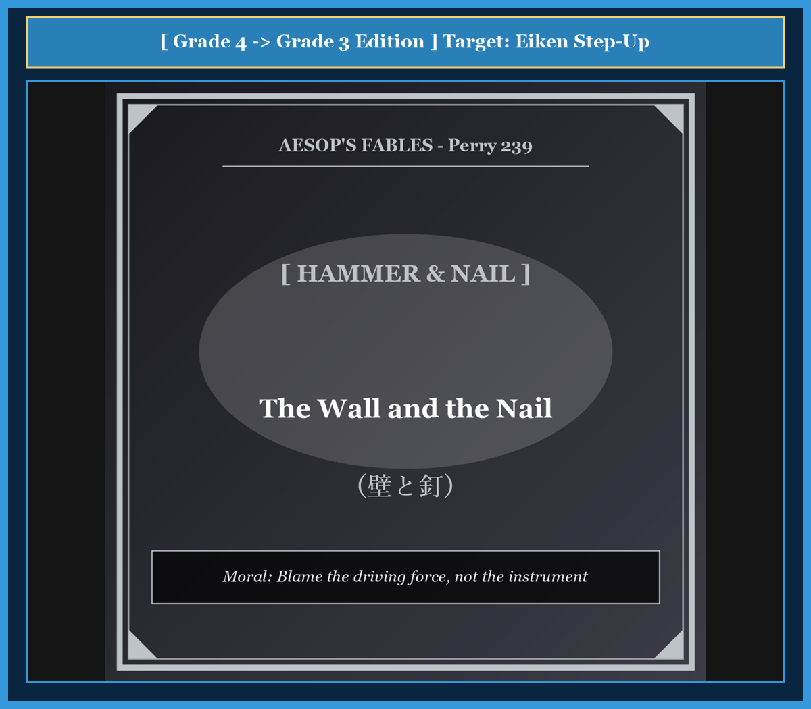

# Chapter 42: The Wall and the Nail (壁と釘)

<!-- 電子書籍 Page Break & Image Header -->

  

## 1. Benchmark Level: Eiken Grade 4 (英検4級レベル本文)
*Read in ~1 to 1.5 minutes. Short and simple sentences.*

There was a strong white wall in an old house. The wall was peaceful and stood quietly for many years.

One afternoon, a carpenter entered the room. He carried a sharp iron nail and a heavy hammer. He wanted to hang a picture on the wall.

The carpenter placed the nail against the wall and hit it hard. The sharp nail cut into the wall. The wall felt great pain and began to crack.

The wall cried out angrily to the nail. "Why are you piercing me?" asked the wall. "I have never hurt you! Why do you break my smooth surface and give me so much pain?"

The poor nail trembled from the blows. He replied in a sad voice: "Do not blame me, good wall. I do not want to hurt you. Look behind me! It is the heavy hammer that drives me into your body with all its power."

---

## 2. Target Level: Eiken Grade 3 (英検3級レベル本文)
*Read in ~1.5 to 2 minutes. Compound sentences, conjunctions, and rich expressions.*

Inside a newly renovated cottage, a smooth plaster wall stood proud and undisturbed. For a long time, nothing disturbed its pristine surface, and it enjoyed complete tranquility.

However, one morning, a homeowner decided to hang a heavy mirror. Armed with a sharp steel nail and an iron hammer, the man approached the wall and positioned the metal point against the smooth plaster.

With several forceful blows, the heavy hammer drove the sharp nail deep into the masonry. As the metal pierced the plaster, fine cracks spread across the white surface, causing the wall acute distress.

Unable to endure the pain, the wall cried out indignantly: "Why are you tearing through my body so mercilessly? I have always treated you with kindness and done you no harm! Why do you wound me so cruelly?"

The vibrating nail, suffering under the repeated impacts of the hammer, groaned in response: "Do not direct your anger at me, friend. I have no personal malice against you, nor do I pierce you of my own free will. Blame the heavy hammer that strikes my head from behind with irresistible force!"

---

## 3. Classic Original English Text (イソップ寓話クラシック原文)
*Perry 239: Translated by George Fyler Townsend (1867)*

A Wall, violently driven with a Nail, exclaimed: "Why do you tear me down, who have done you no injury?" 

The Nail replied: "It is not I who am to blame, but he who with great violence drives me on behind."

---

### 🏛️ 【英検2級レベルで読み解く！クラシック原文の重要構文・英文法ノート】
1. **1. 分詞構文（Participle Clause: 付帯状況・理由）**
   - **原文**: *"The Hare, believing her assertion to be simply impossible, agreed to the proposal..."*
   - **解説**: 「〜と信じ込んでいたので」という理由を表す分詞構文。英検2級の長文読解・ライティングの最頻出構文です。
1. **2. 古典的仮定法現在（Subjunctive Mood）**
   - **原文**: *"Though you be swift as the wind, I will beat you in a race."*
   - **解説**: 譲歩節 `Though` の中で原形 `be` を用いる古典的な仮定法現在（現代英語の `Though you are...`）。格調高い古典の響きを持ちます。
1. **3. 過去分詞の後置修飾（Postpositive Participle）**
   - **原文**: *"On the day appointed for the race the two started together."*
   - **解説**: `appointed`（定められた・指定された）が直前の名詞 `the day` を後ろから修飾する構文です。

### 📜 【クラシック原文の重要語彙・古風表現（Classic Antique Vocabulary）】
- **retort** [動] 2級 **（機転を利かせて）言い返す、反論する**（現代の reply sharp/wittily に相当）
- **assertion** [名] 2級/準1級 **主張、断言**（動詞 assert の名詞形。2級長文定番）
- **wayside** [名] 2級 **道端、沿道**（by the wayside（道端に、途中で））
- **fatigue** [名] 2級 **（心身の）極度の疲労、疲れ**（tiredness の上位フォーマル語）

---

## 4. Japanese Translation & Moral (日本語訳と教訓)

### 【日本語全訳：英検3級レベル本文】
新しく改築された山小屋の内部で、滑らかな漆喰の壁が誇らしげに静かに立っていました。長い間、その美しい表面を乱すものは何もなく、壁は完全な静けさを享受していました。

しかしある朝、家の主人が重い鏡を壁に掛けようと決意しました。鋭い鉄の釘と鉄の金槌を手にして、男は壁に近づき、滑らかな漆喰に金属の先端をあてがいました。

力強い数回の打撃によって、重い金槌は鋭い釘を石造りの壁の奥深くへと打ち込みました。金属が漆喰を貫くにつれて白い壁面に細かいひび割れが走り、壁は激しい苦痛に襲われました。

痛みに耐えかねた壁は、怒りを込めて叫びました。「なぜお前はこれほど容赦なく私の体を裂くのか？ 私はお前に害を加えたことなど一度もない！ なぜそのように残酷に私を傷つけるのか？」

金槌の度重なる衝撃にさらされ震える釘は、苦痛のうめき声を上げて答えました。「友よ、怒りを私に向けないでくれ。私にはお前に対する個人的な悪意など何もなく、自分の自由意志でお前を貫いているのでもない。抗えない力をもって、背後から私の頭を打ち据えている重い金槌こそを責めてくれ！」

### 【教訓（Moral）】
**Blame the driving power, not the helpless instrument.**  
（被害をもたらした手先の道具を責めるのではなく、背後でその力を振るっている真の元凶を見据えなさい。不当な圧力や命令によって動かされている実行役だけを責めても、根本的な問題は決して解決しない。）

---

## 5. Recite & Compare: そらんじたいキーフレーズ対比カード

  
フレーズ 1：滑らかな壁面を傷つけない穏やかな日々

  
4級The wall was peaceful and stood quietly for many years.

  
3級Nothing disturbed its pristine surface, and it enjoyed complete tranquility.

  
<strong>解説：</strong>「pristine（元のままの、汚れていない）」「tranquility（静寂・平穏）」を用いて情景をより豊かに表現しています。

  
フレーズ 2：何も悪いことをしていないのに何故傷つけるのか

  
4級Why are you piercing me? I have never hurt you!

  
3級Why are you tearing through my body when I have done you no harm?

  
<strong>解説：</strong>「tear through（〜を引き裂く）」「do someone no harm（人に害を加えない）」は英作文で極めて有用な定型表現です。

  
フレーズ 3：自分の意志でやっているのではないという弁明

  
4級I do not want to hurt you. Look behind me!

  
3級I have no malice against you, nor do I pierce you of my own free will.

  
<strong>解説：</strong>「of one's own free will（自らの自由意志で）」は、責任の所在を明確にする頻出成句です。

  
フレーズ 4：背後から打ち据える真の力を責めよ

  
4級It is the heavy hammer that drives me into your body with all its power.

  
3級Blame the heavy hammer that strikes my head from behind with irresistible force!

  
<strong>解説：</strong>命令文「Blame A that ~」と「irresistible force（抗えない力）」の組み合わせで教訓を強調しています。

---

## 6. Key Vocabulary & Exam Notes (英検3級 重要語彙・文法・面接対策)

### 1. 英検3級 必須ボキャブラリー
* **renovate** [動] 〜を修復する、改築する
* **pristine** [形] 初期状態の、損なわれていない、清潔な
* **tranquility** [名] 静けさ、平穏
* **indignantly** [副] 憤慨して、怒りを込めて
* **malice** [名] 悪意、敵意（*have no malice against ~*）
* **free will** [名] 自由意志（*of one's own free will*）
* **irresistible** [形] 抵抗できない、圧倒的な

### 2. 文法・構文のチェックポイント
* **nor + 助動詞 + S**:
  * 「〜もまた…ない」。否定文の後に続けて「さらに〜もない」と追加する洗練された構文です。
* **do someone harm [good]**:
  * 「（人）に害[益]を与える」。第4文型（SVOO）の重要イディオムです。

### 3. スピーキング（面接）＆ライティング活用ヒント
「責任の所在」「本質的な原因の追及」を論述する際のフレーズ：
* *When addressing environmental damage, we should regulate the corporations behind it rather than blaming consumers.*（環境被害に対処する際、消費者を責めるのではなく背後にある企業を規制すべきである。）
* *Do not punish the messenger; look at the policies that created the problem.*（メッセンジャーを処罰してはならない。問題を生み出した根本の政策を見るべきである。）
