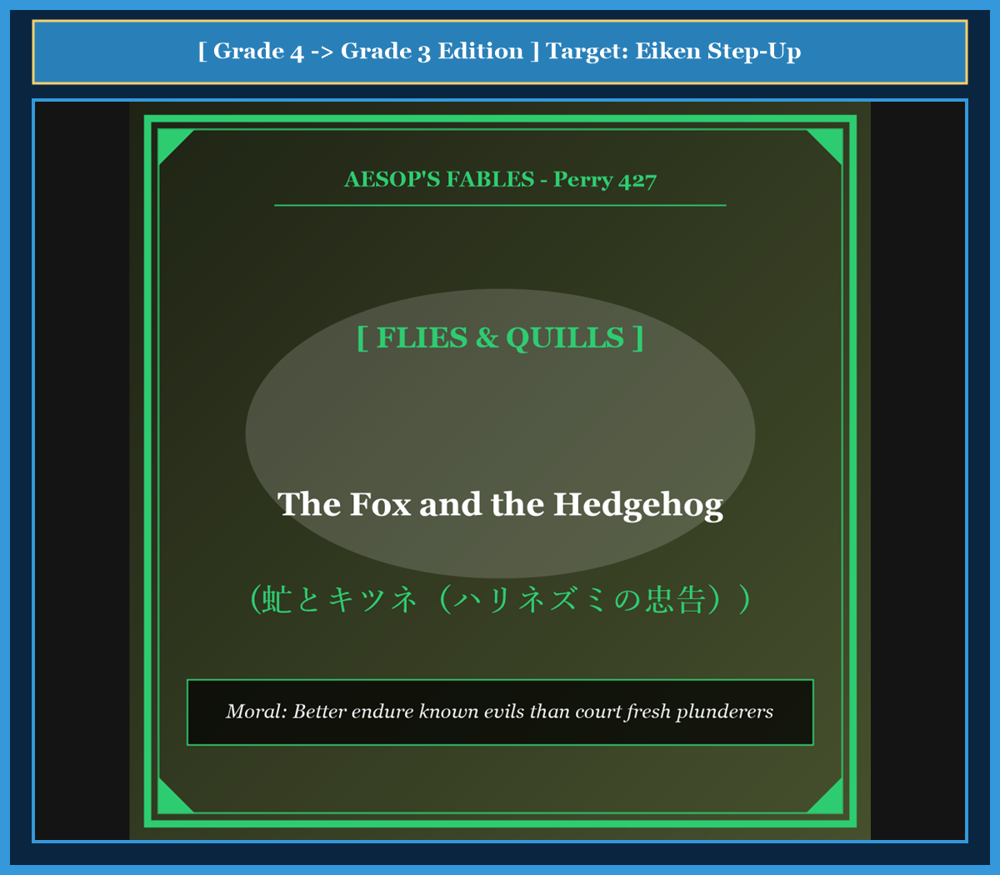

# Chapter 43: The Fox and the Hedgehog (虻とキツネ)

<!-- 電子書籍 Page Break & Image Header -->

  

## 1. Benchmark Level: Eiken Grade 4 (英検4級レベル本文)
*Read in ~1 to 1.5 minutes. Short and simple sentences.*

A fox was crossing a fast river. The current was very strong, and it pushed the fox into a deep ditch. The fox hurt his leg and could not move.

Soon, a large cloud of hungry flies found the fox. The flies settled on his head, back, and ears. They drank his blood, and the poor fox suffered greatly. But he could not shake them off.

A kind hedgehog walked by the ditch. He saw the poor fox covered with flies. The hedgehog felt sorry for him.

"Friend fox," said the hedgehog, "you are in terrible pain. Shall I use my sharp quills to drive away all these greedy flies for you?"

"No, please do not touch them!" cried the fox quickly.

The hedgehog was surprised. "Why do you want these painful flies to stay?" he asked.

The fox answered: "These flies are already full of my blood. They do not bite me hard now. But if you drive them away, a fresh swarm of starving flies will come and drink every last drop of my blood!"

---

## 2. Target Level: Eiken Grade 3 (英検3級レベル本文)
*Read in ~1.5 to 2 minutes. Compound sentences, conjunctions, and rich expressions.*

While attempting to cross a rapid river, an unfortunate fox was swept away by the fierce current and washed into a steep, muddy ravine. Bruised and exhausted from the ordeal, the fox lay completely helpless on the bank, unable to climb back up.

Before long, a swarm of blood-sucking horseflies discovered the defenseless animal. They descended upon his wounds in vast numbers and began to torment him mercilessly. Because the fox was too weak to flick his tail or shake his fur, he had to endure their painful bites in silence.

Presently, a benevolent hedgehog came wandering past the ravine. Seeing the fox in such acute misery, the hedgehog felt deep sympathy and offered his assistance.

"Good neighbor," whispered the hedgehog, "you are suffering terribly from this plague of pests. If you wish, I can easily deploy my sharp quills and drive these tormentors away."

"I beg you, do not disturb them!" the fox exclaimed with great urgency.

The bewildered hedgehog asked: "Why on earth would you refuse my help when these creatures are torturing you?"

"Because," the fox explained prudently, "these flies are already gorged on my blood, so they sting only lightly. If you chase them away, a new swarm of famished flies will take their place and drain the few drops of life that remain within me."

---

## 3. Classic Original English Text (イソップ寓話クラシック原文)
*Perry 427: Translated by George Fyler Townsend (1867)*

A Fox swimming across a rapid river was carried by the force of the current into a deep ravine, where he lay for a long time unable to get out, and sorely tormented by a swarm of horseflies that fastened on him. 

A Hedgehog wandering by, took pity on him, and asked if he should drive away the flies that were sucking his blood. 

The Fox replied: "Do not, I pray you, brush away these flies." 

"Why not?" asked the Hedgehog. 

"Because," replied the Fox, "these flies are now full of blood and bite me but little; but if you drive them away, others, who are hungry, will come and drink up all the blood I have left."

---

### 🏛️ 【英検2級レベルで読み解く！クラシック原文の重要構文・英文法ノート】
1. **1. 分詞構文（Participle Clause: 付帯状況・理由）**
   - **原文**: *"The Hare, believing her assertion to be simply impossible, agreed to the proposal..."*
   - **解説**: 「〜と信じ込んでいたので」という理由を表す分詞構文。英検2級の長文読解・ライティングの最頻出構文です。
1. **2. 古典的仮定法現在（Subjunctive Mood）**
   - **原文**: *"Though you be swift as the wind, I will beat you in a race."*
   - **解説**: 譲歩節 `Though` の中で原形 `be` を用いる古典的な仮定法現在（現代英語の `Though you are...`）。格調高い古典の響きを持ちます。
1. **3. 過去分詞の後置修飾（Postpositive Participle）**
   - **原文**: *"On the day appointed for the race the two started together."*
   - **解説**: `appointed`（定められた・指定された）が直前の名詞 `the day` を後ろから修飾する構文です。

### 📜 【クラシック原文の重要語彙・古風表現（Classic Antique Vocabulary）】
- **retort** [動] 2級 **（機転を利かせて）言い返す、反論する**（現代の reply sharp/wittily に相当）
- **assertion** [名] 2級/準1級 **主張、断言**（動詞 assert の名詞形。2級長文定番）
- **wayside** [名] 2級 **道端、沿道**（by the wayside（道端に、途中で））
- **fatigue** [名] 2級 **（心身の）極度の疲労、疲れ**（tiredness の上位フォーマル語）

---

## 4. Japanese Translation & Moral (日本語訳と教訓)

### 【日本語全訳：英検3級レベル本文】
流れの速い川を渡ろうとしていたある不運なキツネが、激しい急流に押し流され、険しい泥の峡谷へと打ち上げられてしまいました。その過酷な試練によって傷だらけになり疲れ果てたキツネは、斜面を這い上がることもできず、土手の上で完全に無力な状態で横たわっていました。

まもなく、血を吸うアブの大群が無防備なキツネを発見しました。アブたちは無数に傷口へと群がり、容赦なくキツネを苦しめ始めました。キツネは衰弱しすぎて尻尾を振ることも毛皮を震わせることもできなかったため、その痛烈な咬み傷をじっと耐えるしかありませんでした。

やがて、親切なハリネズミが峡谷のそばを通りかかりました。キツネの深刻な苦痛を目の当たりにしたハリネズミは深い同情を寄せ、救いの手を差し伸べました。

「キツネさん」とハリネズミは囁きました。「あなたはこの害虫の群れにひどく苦しめられていますね。もし望むなら、私の鋭い針を使って、この厄介者たちを簡単に追い払ってあげましょう。」

「お願いだから、彼らには触れないでくれ！」とキツネは切迫した声で叫びました。

困惑したハリネズミは尋ねました。「これほど苦しめられているのに、一体なぜ私の助けを拒むのですか？」

「なぜなら」とキツネは慎重に説明しました。「このアブたちはすでに私の血で満腹になっており、今は軽く刺してくるだけだからだ。もしお前が彼らを追い払ってしまえば、飢え切った新しいアブの大群がやってきて、私の中に残された命の血の最後の一滴まで吸い尽くしてしまうだろう。」

### 【教訓（Moral）】
**Better endure known evils than court fresh plunderers.**  
（すでに行き渡った既知の害悪を耐え忍ぶほうが、飢えた新たな略奪者を呼び寄せるよりもはるかに賢明である。性急に体制や役人を入れ替えても、より強欲な新たな搾取者がやってくれば、残された富をすべて奪い去られることになる。）

---

## 5. Recite & Compare: そらんじたいキーフレーズ対比カード

  
フレーズ 1：急流に流されて動けなくなる苦境

  
4級The current pushed the fox into a ditch, and he could not move.

  
3級The fox was swept away by the fierce current and lay completely helpless.

  
<strong>解説：</strong>受動態「be swept away by ~（〜に押し流される）」と「lie helpless（無力な状態で横たわる）」が自然なストーリーテリングを作ります。

  
フレーズ 2：針を使って害虫を追い払いましょうか？

  
4級Shall I use my sharp quills to drive away all these flies?

  
3級If you wish, I can easily deploy my sharp quills and drive these tormentors away.

  
<strong>解説：</strong>「If you wish（望むのであれば）」という控えめで丁寧な申し出と、「drive away（追い払う）」の使い分けです。

  
フレーズ 3：すでに満腹だからこれ以上深く刺さない

  
4級These flies are already full of my blood. They do not bite hard.

  
3級These flies are already gorged on my blood, so they sting only lightly.

  
<strong>解説：</strong>「gorged on ~（〜で満腹になった）」と「sting lightly（軽く刺す）」という的確な語彙を用いています。

  
フレーズ 4：新しい飢えた群れが最後の一滴まで吸い尽くす

  
4級A fresh swarm of starving flies will drink every last drop of blood.

  
3級A new swarm of famished flies will take their place and drain the few drops that remain.

  
<strong>解説：</strong>「take one's place（〜の後釜に座る・代わりになる）」「drain（吸い尽くす・空にする）」は3級の頻出重要フレーズです。

---

## 6. Key Vocabulary & Exam Notes (英検3級 重要語彙・文法・面接対策)

### 1. 英検3級 必須ボキャブラリー
* **ravine** [名] 峡谷、深い谷
* **ordeal** [名] 厳しい試練、過酷な体験
* **torment** [動] 〜を苦しめる、いじめる [名] 苦痛
* **hedgehog** [名] ハリネズミ
* **quill** [名] （ハリネズミやヤマアラシの）針、トゲ
* **gorged** [形] 満腹になった、たらふく食った
* **famished** [形] 飢え切った、腹ペコの
* **drain** [動] 〜を流出させる、吸い尽くす

### 2. 文法・構文のチェックポイント
* **take one's place**: 「〜の代わりになる、〜の後任となる」
  * 代替や世代交代を論じる日常会話・ビジネス・長文読解で極めて重要なイディオムです。
* **Why on earth ~ ?**: 「一体全体なぜ〜なのか？」
  * 疑問詞を強調する表現で、驚きや不審を表す口語・リスニングの頻出表現です。

### 3. スピーキング（面接）＆ライティング活用ヒント
「性急な組織改革の是非」「税制や制度の安定性」を論じる際の論理フレーズ：
* *Radical political changes often bring inexperienced leaders who cause greater damage than the previous administration.*（急激な政治変革は、前の政権よりも大きな損害をもたらす未熟な指導者を呼び寄せることが多い。）
* *Stability in taxation is preferable to frequent changes that invite fresh financial burdens.*（新たな財政負担を招く頻繁な税制変更よりも、制度の安定性のほうが望ましい。）
