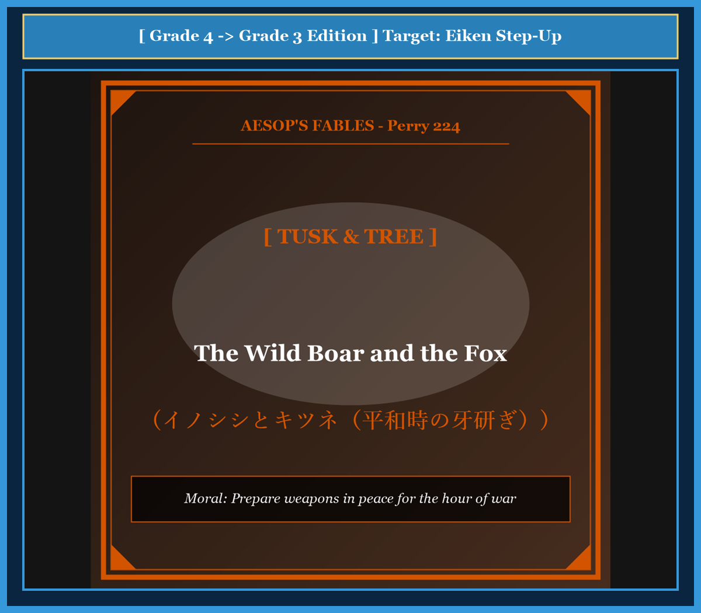

# Chapter 44: The Wild Boar and the Fox (イノシシとキツネ)

<!-- 電子書籍 Page Break & Image Header -->

  

## 1. Benchmark Level: Eiken Grade 4 (英検4級レベル本文)
*Read in ~1 to 1.5 minutes. Short and simple sentences.*

A wild boar stood under a big oak tree in the forest. The day was sunny and quiet. There was no sound of danger anywhere.

The boar was rubbing his long, sharp tusks against the rough bark of the tree. He rubbed them back and forth with great care. He wanted to make his tusks as sharp as knives.

A sly fox walked past the tree. He stopped and watched the boar. The fox laughed and made a funny face.

"Why are you working so hard?" asked the fox. "The forest is peaceful today. There are no hunters with guns, and no hungry hounds are chasing you. Why do you waste your energy sharpening your teeth?"

The wild boar did not stop his work. He looked at the fox and said: "I have a good reason for this. When danger comes, there will be no time to sharpen my tusks. I must be ready to fight at a moment's notice!"

---

## 2. Target Level: Eiken Grade 3 (英検3級レベル本文)
*Read in ~1.5 to 2 minutes. Compound sentences, conjunctions, and rich expressions.*

On a calm summer morning, a massive wild boar stood beside an ancient oak tree in a quiet clearing. The surrounding woods were serene, and not a single predator was in sight.

Despite the peaceful atmosphere, the boar was diligently whetting his formidable tusks against the tree's sturdy trunk. He ground each curved tooth methodically, ensuring that their points were razor-sharp and ready for combat.

A witty fox happened to stroll by and noticed the boar's intensive labor. Finding the behavior peculiar, the fox tilted his head and mocked the serious beast.

"My dear friend," chuckled the fox, "why are you exhausting yourself on such a lovely day? There is neither a hunter's arrow nor a barking hound within miles of this meadow. What is the point of sharpening your weapons when there is no enemy to fight?"

The boar paused momentarily and delivered a wise reply: "I do not sharpen my tusks out of paranoia, but out of foresight. When an adversary ambushes me in the dark woods, I will have no leisure to prepare my weapons. It is too late to sharpen one's tusks when the battle has already begun."

---

## 3. Classic Original English Text (イソップ寓話クラシック原文)
*Perry 224: Translated by George Fyler Townsend (1867)*

A Wild Boar stood under a tree and rubbed his tusks against the trunk. 

A Fox passing by asked him why he thus whetted his teeth when there was no danger in sight from either hunter or hound. 

"I do it advisedly," said the Boar; "for it would never do to have to sharpen my weapons just at the time I ought to be using them to defend myself."

---

### 🏛️ 【英検2級レベルで読み解く！クラシック原文の重要構文・英文法ノート】
1. **1. 分詞構文（Participle Clause: 付帯状況・理由）**
   - **原文**: *"The Hare, believing her assertion to be simply impossible, agreed to the proposal..."*
   - **解説**: 「〜と信じ込んでいたので」という理由を表す分詞構文。英検2級の長文読解・ライティングの最頻出構文です。
1. **2. 古典的仮定法現在（Subjunctive Mood）**
   - **原文**: *"Though you be swift as the wind, I will beat you in a race."*
   - **解説**: 譲歩節 `Though` の中で原形 `be` を用いる古典的な仮定法現在（現代英語の `Though you are...`）。格調高い古典の響きを持ちます。
1. **3. 過去分詞の後置修飾（Postpositive Participle）**
   - **原文**: *"On the day appointed for the race the two started together."*
   - **解説**: `appointed`（定められた・指定された）が直前の名詞 `the day` を後ろから修飾する構文です。

### 📜 【クラシック原文の重要語彙・古風表現（Classic Antique Vocabulary）】
- **retort** [動] 2級 **（機転を利かせて）言い返す、反論する**（現代の reply sharp/wittily に相当）
- **assertion** [名] 2級/準1級 **主張、断言**（動詞 assert の名詞形。2級長文定番）
- **wayside** [名] 2級 **道端、沿道**（by the wayside（道端に、途中で））
- **fatigue** [名] 2級 **（心身の）極度の疲労、疲れ**（tiredness の上位フォーマル語）

---

## 4. Japanese Translation & Moral (日本語訳と教訓)

### 【日本語全訳：英検3級レベル本文】
穏やかな夏の朝、巨大なイノシシが静かな空き地にある古い樫の木のそばに立っていました。周囲の森は穏やかで、敵となる捕食者の姿はどこにも見当たりませんでした。

平和な雰囲気にもかかわらず、イノシシは頑丈な木の幹にその手強い牙を熱心に擦りつけて研ぎ澄ましていました。その先端がカミソリのように鋭く戦闘に即応できるよう、彼は左右の湾曲した牙を入念に磨いていたのです。

機転の利くキツネが通りかかり、イノシシの真剣な労働に気づきました。その行動を奇妙に感じたキツネは、首を傾げて真面目な野獣を冷やかしました。

「親愛なる友よ」とキツネはくすくす笑いました。「なぜこんな素晴らしい日に自分を疲れさせているんだい？ この野原から何マイルの範囲にも、猟師の矢も吠える猟犬もいないというのに。戦うべき敵がいない平時に、なぜ武器を研ぎ澄ます必要があるんだ？」

イノシシはほんの一瞬手を止め、賢明な答えを返しました。「私は被害妄想から牙を研いでいるのではない。先を見通す洞察力（先見の明）から研いでいるのだ。暗い森で敵が不意に襲いかかってきたとき、武器を準備している暇などないのだから。戦いがすでに始まってから牙を研ぎ始めるのでは、遅すぎるのだ。」

### 【教訓（Moral）】
**Prepare weapons in peace for the hour of war.**  
（平和な時こそ有事に備えて武器を研いでおきなさい。危機が目前に迫ってから準備を始めても手遅れであり、平時の地道な備えこそが、いざという時に身を守る最大の盾となる。）

---

## 5. Recite & Compare: そらんじたいキーフレーズ対比カード

  
フレーズ 1：平和な雰囲気の中で牙を研ぐイノシシ

  
4級The day was quiet, but the boar was rubbing his long tusks.

  
3級Despite the peaceful atmosphere, the boar was diligently whetting his formidable tusks.

  
<strong>解説：</strong>「Despite ~（〜にもかかわらず）」と「diligently whet ~（〜を入念に研ぐ）」を用いた洗練された表現です。

  
フレーズ 2：戦うべき敵がいないのになぜ疲れることをするのか

  
4級Why do you waste your energy sharpening your teeth?

  
3級What is the point of sharpening your weapons when there is no enemy to fight?

  
<strong>解説：</strong>「What is the point of -ing?（〜することに何の意味があるのか？）」は議論やディベートで必須の構文です。

  
フレーズ 3：恐怖からではなく先見の明から備える

  
4級I have a good reason for this. I must be ready to fight!

  
3級I do not sharpen my tusks out of paranoia, but out of foresight.

  
<strong>解説：</strong>「not out of A, but out of B（Aからではなく、Bという理由から）」のコントラスト構文です。

  
フレーズ 4：戦いが始まってから準備しても手遅れ

  
4級When danger comes, there will be no time to sharpen my tusks.

  
3級It is too late to sharpen one's tusks when the battle has already begun.

  
<strong>解説：</strong>格言構文「It is too late to do ~ when ...（…の時には〜しても手遅れだ）」の典型例です。

---

## 6. Key Vocabulary & Exam Notes (英検3級 重要語彙・文法・面接対策)

### 1. 英検3級 必須ボキャブラリー
* **whet** [動] （刃物を）研ぐ、研磨する
* **formidable** [形] 手強い、恐るべき
* **peculiar** [形] 奇妙な、独特の
* **mock** [動] 〜を冷やかす、からかう
* **meadow** [名] 牧草地、草原
* **paranoia** [名] 被害妄想、過度の疑心暗鬼
* **foresight** [名] 先見の明、洞察力
* **ambush** [動] 〜を待ち伏せして襲う [名] 待ち伏せ

### 2. 文法・構文のチェックポイント
* **What is the point of doing ~?**:
  * 「〜して何の意味があるのか？」。面接の質疑応答や反論で極めて使いやすい重要表現です。
* **neither A nor B**:
  * 「AもBも〜ない」。*There is neither hunter nor hound.* のように2つの要素を同時に否定します。

### 3. スピーキング（面接）＆ライティング活用ヒント
「防災」「日頃の健康管理・危機管理」を論述する際の模範フレーズ：
* *Disaster prevention drills are essential because it is too late to plan an evacuation when an earthquake strikes.*（地震が起きてから避難計画を立てても遅すぎるため、防災訓練は不可欠である。）
* *Regular exercise maintains health so that the body is prepared against unexpected illnesses.*（予期せぬ病気に備えて体が即応できるよう、定期的な運動で健康を維持すべきである。）
