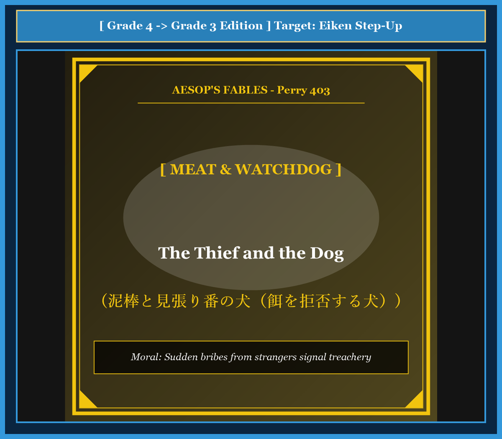

# Chapter 46: The Thief and the Dog (泥棒と見張り番の犬)

<!-- 電子書籍 Page Break & Image Header -->

  

## 1. Benchmark Level: Eiken Grade 4 (英検4級レベル本文)
*Read in ~1 to 1.5 minutes. Short and simple sentences.*

A wealthy farmer had a faithful watchdog. Every night, the dog guarded the front gate of the farm. He kept his ears open and watched for danger.

One dark midnight, a thief came to rob the house. The thief walked quietly across the yard. But the watchful dog heard the footsteps and began to bark loudly.

The thief was afraid that the farmer would wake up. He reached into his bag and took out a large piece of delicious meat. He threw the meat to the dog to make him quiet.

"Here, good dog," whispered the thief. "Eat this tasty food and stop barking."

The faithful dog did not touch the food. Instead, he barked even louder.

"Before you threw this meat," said the dog, "I only suspected that you were a bad man. But now that you try to bribe me, I am certain you are a thief! I will bark until my master wakes up and catches you!"

---

## 2. Target Level: Eiken Grade 3 (英検3級レベル本文)
*Read in ~1.5 to 2 minutes. Compound sentences, conjunctions, and rich expressions.*

A vigilant watchdog guarded a spacious country estate. The dog took immense pride in his duty, never slumbering while his master's family slept soundly inside the dark residence.

In the dead of night, a cunning burglar sneaked over the garden wall, intending to plunder the family's valuables. However, as soon as the intruder's boots touched the gravel path, the alert hound detected the subtle vibration and emitted a thunderous series of warnings.

Panic-stricken that the clamor would arouse the household, the burglar swiftly retrieved a succulent cut of roasted meat from his knapsack. He tossed the savory bribe toward the hound, hoping to silence the creature's frantic barks.

"Hush, noble beast," the thief coaxed in a hushed tone. "Accept this delicious feast and permit me to pass unhindered."

The steadfast hound backed away from the treat and glared at the stranger with fierce indignation.

"At first," growled the dog, "I was merely suspicious of your stealthy movements in the shadows. But now that you attempt to bribe me into betraying my master's trust, I am thoroughly convinced of your villainy! I will not cease barking until the entire household is awake and you are delivered to justice!"

---

## 3. Classic Original English Text (イソップ寓話クラシック原文)
*Perry 403: Translated by George Fyler Townsend (1867)*

A Thief coming to rob a house would have fed the Dog who barked at him, that he might not awaken the family. He tossed him a crust of bread. 

The Dog said: "I had indeed some suspicion that you were a rogue; but since you try to bribe me with a crust of bread, I am sure of it; and I will not cease barking until I have roused the whole house."

---

### 🏛️ 【英検2級レベルで読み解く！クラシック原文の重要構文・英文法ノート】
1. **1. 分詞構文（Participle Clause: 付帯状況・理由）**
   - **原文**: *"The Hare, believing her assertion to be simply impossible, agreed to the proposal..."*
   - **解説**: 「〜と信じ込んでいたので」という理由を表す分詞構文。英検2級の長文読解・ライティングの最頻出構文です。
1. **2. 古典的仮定法現在（Subjunctive Mood）**
   - **原文**: *"Though you be swift as the wind, I will beat you in a race."*
   - **解説**: 譲歩節 `Though` の中で原形 `be` を用いる古典的な仮定法現在（現代英語の `Though you are...`）。格調高い古典の響きを持ちます。
1. **3. 過去分詞の後置修飾（Postpositive Participle）**
   - **原文**: *"On the day appointed for the race the two started together."*
   - **解説**: `appointed`（定められた・指定された）が直前の名詞 `the day` を後ろから修飾する構文です。

### 📜 【クラシック原文の重要語彙・古風表現（Classic Antique Vocabulary）】
- **retort** [動] 2級 **（機転を利かせて）言い返す、反論する**（現代の reply sharp/wittily に相当）
- **assertion** [名] 2級/準1級 **主張、断言**（動詞 assert の名詞形。2級長文定番）
- **wayside** [名] 2級 **道端、沿道**（by the wayside（道端に、途中で））
- **fatigue** [名] 2級 **（心身の）極度の疲労、疲れ**（tiredness の上位フォーマル語）

---

## 4. Japanese Translation & Moral (日本語訳と教訓)

### 【日本語全訳：英検3級レベル本文】
油断のない1頭の見張り番の犬が、広大な田舎の邸宅を警護していました。その犬は自らの職務に大きな誇りを持っており、主人の家族が暗い屋敷の中で安らかに眠っている間、決して居眠りすることはありませんでした。

夜の静寂の中、狡猾な泥棒が家族の貴重品を略奪しようと企て、庭の塀を忍び越えて侵入してきました。しかし、侵入者のブーツが砂利道に触れた瞬間、敏感な猟犬はその微かな振動を察知し、雷鳴のような警告の吠え声を轟かせました。

その騒動が一家を起こしてしまうのではないかと恐怖に駆られた泥棒は、背負い袋から香ばしいロースト肉の塊を素早く取り出しました。犬の必死の吠え声を鎮めようと、泥棒はその旨そうな賄賂を犬に向かって投げ与えたのです。

「静かにしろ、いい犬だ」と泥棒は押し殺した声で宥めました。「この美味しいご馳走を受け取って、邪魔をせずに通してくれ。」

忠誠心あふれる番犬はその餌から身を引き、激しい怒りをもって見知らぬ男を睨み据えました。

「最初は」と犬は低く唸りました。「暗闇の中で忍び寄るお前の不審な動きを怪しんでいたにすぎなかった。しかし、私の主人の信頼を裏切らせようと賄賂で私を買収しようとした今、お前が悪党であることは完全に確信へと変わった！ 家中の者が目を覚まし、お前が正義の手へと引き渡されるまで、私は吠えるのを決してやめないぞ！」

### 【教訓（Moral）】
**Sudden bribes from strangers signal treachery.**  
（見知らぬ者からの唐突な施しや甘い誘惑には、必ず裏の悪意と罠が潜んでいる。職務や忠誠を放棄させるための賄賂に決して乗ってはならず、不自然な好意こそ最大の警戒シグナルと心得よ。）

---

## 5. Recite & Compare: そらんじたいキーフレーズ対比カード

  
フレーズ 1：家族が眠る間決して居眠りしない忠誠心

  
4級The dog guarded the gate and watched for danger every night.

  
3級The dog took pride in his duty, never slumbering while the family slept soundly.

  
<strong>解説：</strong>「take pride in ~（〜に誇りを持つ）」「never slumbering while...（…する間決して眠らない）」という品格ある描写です。

  
フレーズ 2：犬を黙らせようと肉を投げ与える泥棒

  
4級He threw the meat to the dog to make him quiet.

  
3級He tossed the savory bribe toward the hound, hoping to silence his frantic barks.

  
<strong>解説：</strong>「savory bribe（旨そうな賄賂）」と分詞構文「hoping to silence ~」で犯人の心理を表現しています。

  
フレーズ 3：買収しようとしたことで悪党だと確信

  
4級Now that you try to bribe me, I am certain you are a thief!

  
3級Now that you attempt to bribe me into betraying my master, I am convinced of your villainy!

  
<strong>解説：</strong>「Now that + S + V（今や〜なのだから）」と「bribe A into -ing（Aを買収して〜させる）」のハイレベル構文です。

  
フレーズ 4：全員が起きるまで吠えるのをやめない

  
4級I will bark until my master wakes up and catches you!

  
3級I will not cease barking until the household is awake and you are delivered to justice!

  
<strong>解説：</strong>「cease -ing（〜するのをやめる）」「be delivered to justice（法の裁き・正義に引き渡される）」という格調高い表現です。

---

## 6. Key Vocabulary & Exam Notes (英検3級 重要語彙・文法・面接対策)

### 1. 英検3級 必須ボキャブラリー
* **vigilant** [形] 油断のない、警戒を怠らない
* **slumber** [動] まどろむ、眠る [名] 睡眠
* **intruder** [名] 侵入者、不審者
* **savory** [形] 風味豊かな、食欲をそそる
* **bribe** [名] 賄賂 [動] 〜を買収する
* **steadfast** [形] 確固たる、忠実な
* **villainy** [名] 悪事、極悪非道
* **justice** [名] 正義、司法（*be delivered to justice*）

### 2. 文法・構文のチェックポイント
* **Now that + S + V**:
  * 「今や〜である以上は、〜となったからには」。理由や新たな状況を受けて結論を導く頻出接続詞です。
* **bribe someone into -ing**:
  * 「（人）を買収して〜させる」。*persuade / force someone into -ing* と同様の使役的構文です。

### 3. スピーキング（面接）＆ライティング活用ヒント
「公務員の倫理」「サイバーセキュリティ・甘い話への警戒」を論じる際のフレーズ：
* *Public officials must strictly reject gifts because unexpected favors often conceal unethical motives.*（不自然な好意には不当な動機が潜んでいることが多いため、公務員は贈り物を厳格に拒否しなければならない。）
* *Internet users should be wary of suspicious free offers that aim to compromise personal data.*（個人情報の詐取を目的とした疑わしい無料オファーに対し、ネット利用者は警戒すべきである。）
