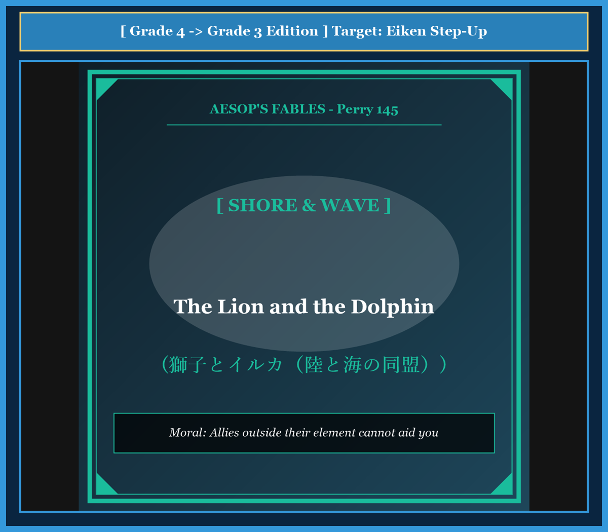

# Chapter 47: The Lion and the Dolphin (獅子とイルカ)

<!-- 電子書籍 Page Break & Image Header -->

  

## 1. Benchmark Level: Eiken Grade 4 (英検4級レベル本文)
*Read in ~1 to 1.5 minutes. Short and simple sentences.*

A lion was walking along the sandy seashore. The blue waves rolled softly on the beach.

Suddenly, a dolphin popped his head out of the sea. The lion looked at the beautiful creature and had an idea.

"Hello, king of the ocean!" roared the lion. "I am the king of all land beasts, and you rule the deep sea. Let us make a promise to be best friends and help each other in battle."

The dolphin was pleased and agreed to the alliance.

A few days later, a huge, angry wild bull attacked the lion on the beach. The bull had sharp horns, and the fight was very hard. The lion was losing and cried out: "Help me, my friend dolphin! Swim here and fight this bull!"

The dolphin swam to the shallow water and tried to jump onto the sand. But he had no legs, so he could not leave the sea. The bull hit the lion hard and ran away.

The bruised lion was furious. "You are a false friend and a traitor!" shouted the lion.

"Do not blame me," answered the dolphin sadly. "Blame Mother Nature. She made me powerful in the sea, but gave me no feet to walk upon the land."

---

## 2. Target Level: Eiken Grade 3 (英検3級レベル本文)
*Read in ~1.5 to 2 minutes. Compound sentences, conjunctions, and rich expressions.*

While wandering along a sandy coastline, a majestic lion observed a dolphin leaping gracefully from the rolling azure waves. Recognizing the creature's nobility, the monarch of the land conceived an ambitious diplomatic proposal.

Approaching the water's edge, the lion addressed the sea creature: "Noble sovereign, you hold dominion over the vast ocean, just as I reign supreme over the terrestrial beasts. It is only fitting that the two most magnificent rulers on earth form a sacred alliance to defend one another against all adversaries."

Flattered by the royal proposal, the dolphin readily consented, and the two monarchs sealed their mutual pact with solemn oaths.

Not long afterward, the lion engaged in a mortal struggle against a ferocious wild bull right beside the surf. The bull fought with tremendous ferocity, driving his sharp horns toward the lion's throat. Finding himself overwhelmed, the lion turned toward the ocean and roared desperately for reinforcements.

The dolphin was deeply eager to honor his commitment. He dashed through the waves toward the shore with all his speed. However, as soon as his fins struck the sandy beach, he was immobilized by gravity. Despite his best efforts, he could not cross the barrier of sand to assist his beleaguered ally.

After the bull finally withdrew, the battered lion limped toward the surf and accused the dolphin of treachery: "You pledged eternal brotherhood, yet you abandoned me in my hour of greatest peril!"

The dolphin responded with dignified sorrow: "Direct your reproach toward Nature, not toward me. While she crowned me sovereign of the ocean deep, she denied me the physical capacity to set foot upon the earth."

---

## 3. Classic Original English Text (イソップ寓話クラシック原文)
*Perry 145: Translated by George Fyler Townsend (1867)*

A Lion, roaming on the seashore, saw a Dolphin lift up its head out of the water, and suggested that they should form a mutual alliance, saying that they were the two best fit to be friends, since one was the king of beasts and the other was the king of the fishes. 

The Dolphin gladly consented. 

Not long after, the Lion had a fierce battle with a wild Bull, and called on the Dolphin to help him. 

The Dolphin, though quite willing, was unable to come to the shore, so the Lion accused him of being a traitor. 

The Dolphin said: "Do not blame me, but blame Nature, who made me king of the sea, but gave me no power on the land."

---

### 🏛️ 【英検2級レベルで読み解く！クラシック原文の重要構文・英文法ノート】
1. **1. 分詞構文（Participle Clause: 付帯状況・理由）**
   - **原文**: *"The Hare, believing her assertion to be simply impossible, agreed to the proposal..."*
   - **解説**: 「〜と信じ込んでいたので」という理由を表す分詞構文。英検2級の長文読解・ライティングの最頻出構文です。
1. **2. 古典的仮定法現在（Subjunctive Mood）**
   - **原文**: *"Though you be swift as the wind, I will beat you in a race."*
   - **解説**: 譲歩節 `Though` の中で原形 `be` を用いる古典的な仮定法現在（現代英語の `Though you are...`）。格調高い古典の響きを持ちます。
1. **3. 過去分詞の後置修飾（Postpositive Participle）**
   - **原文**: *"On the day appointed for the race the two started together."*
   - **解説**: `appointed`（定められた・指定された）が直前の名詞 `the day` を後ろから修飾する構文です。

### 📜 【クラシック原文の重要語彙・古風表現（Classic Antique Vocabulary）】
- **retort** [動] 2級 **（機転を利かせて）言い返す、反論する**（現代の reply sharp/wittily に相当）
- **assertion** [名] 2級/準1級 **主張、断言**（動詞 assert の名詞形。2級長文定番）
- **wayside** [名] 2級 **道端、沿道**（by the wayside（道端に、途中で））
- **fatigue** [名] 2級 **（心身の）極度の疲労、疲れ**（tiredness の上位フォーマル語）

---

## 4. Japanese Translation & Moral (日本語訳と教訓)

### 【日本語全訳：英検3級レベル本文】
砂浜の海岸線を散策していた威厳あるライオンが、青い波間から優雅に跳び上がるイルカを目撃しました。その生き物の気品を認めた陸の王者ライオンは、野心的な外交提案を思いつきました。

水際へと近づいたライオンは、その海の生き物に語りかけました。「高貴なる君主よ、私が陸の獣たちの上に君臨しているように、あなたも広大な海原を支配している。地球上で最も偉大な2人の支配者が神聖な同盟を結び、あらゆる敵に対して互いを守り合うことこそ、最も相応しいはずだ。」

王の提案に誇らしく思ったイルカは喜んで同意し、2人の君主は厳粛な誓いをもって相互協定を結びました。

それから間もなく、ライオンは波打ち際のすぐそばで凶暴な野牛と命懸けの死闘を繰り広げることになりました。野牛は凄まじい獰猛さで戦い、その鋭い角をライオンの喉元へと突き立てようとしました。圧倒されたライオンは海の方を振り返り、必死に救援を求めて咆哮しました。

イルカは自らの誓いを果たそうと強く望みました。彼は全速力で波をかき分け海岸へと突進しました。しかし、ヒレが砂浜に触れた瞬間、彼は重力によって身動きが取れなくなってしまったのです。どれほど全力を尽くしても、砂の境界線を越えて窮地に陥った同盟者を助けに行くことはできませんでした。

野牛がようやく立ち去った後、傷だらけのライオンは波打ち際へと足を引きずりながら近づき、イルカを裏切り者だと非難しました。「永遠の兄弟の契りを交わしておきながら、私が最大の危機に瀕した時に見殺しにするとは何事だ！」

イルカは威厳ある悲しみをもって答えました。「私を責めるのではなく、大自然を責めてください。自然は私を深海の君主として戴冠させましたが、地上に足を踏み入れる肉体的な能力を与えてはくださらなかったのです。」

### 【教訓（Moral）】
**Allies outside their element cannot aid you.**  
（活動領域（領分）がまったく異なる者と同盟を結んでも、いざという危機に互いを救うことはできない。同盟や提携を結ぶ際は、相手の善意や名声だけでなく、自らの領域で実質的な支援を実行できる能力があるかを冷静に見極めなければならない。）

---

## 5. Recite & Compare: そらんじたいキーフレーズ対比カード

  
フレーズ 1：陸と海の王者が結ぶ相互防衛の同盟

  
4級I rule the land, and you rule the sea. Let us make a promise to help each other.

  
3級You hold dominion over the ocean, just as I reign supreme over terrestrial beasts; let us form an alliance.

  
<strong>解説：</strong>「hold dominion over ~（〜を統治する）」「reign supreme（最高位に君臨する）」という格調高い外交英語の対比です。

  
フレーズ 2：助けたいと願うが砂の境界を越えられない

  
4級The dolphin had no legs, so he could not leave the sea.

  
3級Despite his best efforts, he could not cross the barrier of sand to assist his ally.

  
<strong>解説：</strong>「Despite one's best efforts（最善の努力にもかかわらず）」は頻出の論理展開フレーズです。

  
フレーズ 3：最大の危機において裏切られたという非難

  
4級You are a false friend and a traitor!

  
3級You pledged eternal brotherhood, yet you abandoned me in my hour of greatest peril!

  
<strong>解説：</strong>「pledge ~（〜を誓約する）」「in one's hour of greatest peril（最大の危機の時に）」はドラマチックな対話表現です。

  
フレーズ 4：海では王でも陸上の能力を持たない運命

  
4級Nature made me powerful in the sea, but gave me no feet on land.

  
3級She crowned me sovereign of the ocean, but denied me the capacity to set foot upon earth.

  
<strong>解説：</strong>動詞「deny someone the capacity to do（人に〜する能力を与えない・拒む）」を用いた知的な弁明です。

---

## 6. Key Vocabulary & Exam Notes (英検3級 重要語彙・文法・面接対策)

### 1. 英検3級 必須ボキャブラリー
* **dominion** [名] 支配権、統治（*hold dominion over ~*）
* **terrestrial** [形] 陸上の、地球の
* **adversary** [名] 敵、対抗者
* **reinforcement** [名] 援軍、増援部隊
* **beleaguered** [形] 窮地に陥った、包囲された
* **treachery** [名] 裏切り、背信行為
* **peril** [名] 危険、危機（*in peril*）
* **reproach** [名] 非難、叱責 [動] 〜を咎める

### 2. 文法・構文のチェックポイント
* **just as S + V, so S + V**:
  * 「ちょうど〜であるように、…である」。比喩や対比を美しく展開する伝統的構文です。
* **set foot upon [on] ~**:
  * 「〜に足を踏み入れる」。文学作品や旅行・探検の文脈で極めて頻出のイディオムです。

### 3. スピーキング（面接）＆ライティング活用ヒント
「国家間の軍事同盟」「企業間の異業種アライアンス」を論じる際のフレーズ：
* *Strategic partnerships are futile if partners lack the logistical capacity to operate in the relevant environment.*（パートナーが該当環境で運用するロジスティクス能力を欠いている場合、戦略的提携は無益である。）
* *International treaties must account for geographical and technical limitations of each member state.*（国際条約は各加盟国の地理的・技術的制約を考慮しなければならない。）
