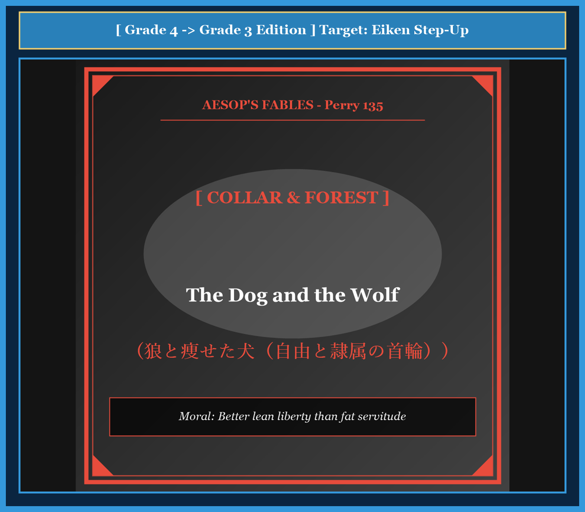

# Chapter 48: The Dog and the Wolf (狼と痩せた犬)

<!-- 電子書籍 Page Break & Image Header -->

  

## 1. Benchmark Level: Eiken Grade 4 (英検4級レベル本文)
*Read in ~1 to 1.5 minutes. Short and simple sentences.*

It was a cold winter night. A skinny, hungry wolf was walking along a dark road. He had not eaten for many days.

Suddenly, the wolf met a house dog. The dog was big, fat, and had smooth, shiny fur. He looked very healthy and happy.

"Hello," said the wolf politely. "How do you get so much food? Your coat is beautiful, and you look very strong. My life in the cold forest is so hard."

"My life is very easy," replied the dog with a smile. "I only guard my master's house at night and keep out thieves. In return, my master gives me delicious meat, bread, and bones from his table."

"That sounds wonderful!" cried the wolf. "I want to work with you!"

They walked together toward the town. As they trotted under a street lamp, the wolf looked closely at the dog's neck. The fur around the dog's neck was rubbed away, and the red skin was bare.

"What happened to your neck?" asked the wolf.

"Oh, that is nothing," answered the dog carelessly. "It is just the mark of the heavy iron collar. My master ties me to a post during the day so I do not bite the guests."

The wolf stopped walking immediately. "You are chained?" whispered the wolf in horror. "Then keep all your fine meat and bones! I would rather be hungry and free than be fat in a heavy golden chain!"

---

## 2. Target Level: Eiken Grade 3 (英検3級レベル本文)
*Read in ~1.5 to 2 minutes. Compound sentences, conjunctions, and rich expressions.*

During the depth of a freezing winter, an emaciated wolf was prowling through the outskirts of a rural village, shivering from the arctic wind and nearly perishing from starvation.

By chance, the wolf crossed paths with a well-fed mastiff. The domestic hound possessed a sleek, glossy coat and robust musculature, radiating the unmistakable glow of prosperity and contentment.

"Good evening, cousin," the famished wolf murmured respectfully. "I cannot help admiring your magnificent condition. While I struggle every day to find a single scrap of meat in the frozen woods, you thrive in absolute abundance."

The mastiff wagged his tail pleasantly. "You can easily enjoy the same comfortable life if you abandon your wild roaming. If you enter my master's service, your only obligation will be to guard the homestead at night and bark at suspicious strangers. In exchange, the household will shower you with succulent scraps, roasted fowl, and warm bedding."

Tempted by the prospect of an effortless existence, the wolf eagerly accompanied the dog toward the estate. However, as they trotted beneath the moonlight, the wolf noticed a strange ring around the dog's neck, where the glossy fur was worn down to the raw flesh.

"What is that curious blemish on your throat?" inquired the wolf with sudden suspicion.

"Oh, it is a trifling matter," the dog dismissed casually. "It is merely the chafe of the leather collar to which my master fastens an iron chain during the daytime, so that I do not disturb the household."

The wolf halted in his tracks, horrified by the revelation. "You mean you are not permitted to run wherever you please?"

"Not during the day," the dog admitted, "but what does that matter when the banquet is so plentiful?"

"It matters everything!" declared the wolf proudly. "Enjoy your pampered feast, my friend, but I shall return to the wilderness. I would infinitely prefer to starve in glorious liberty than grow fat as a subjugated slave."

---

## 3. Classic Original English Text (イソップ寓話クラシック原文)
*Perry 135: Translated by George Fyler Townsend (1867)*

A gaunt Wolf was almost dead with hunger when he met a House-dog, who happened to be passing by. 

"Where do you get all this food to make you so fat and sleek?" said the Wolf. 

"I guard the house at night," replied the Dog, "and drive away thieves." 

"I should like that," said the Wolf, "for it is hard work to find food in the woods." 

"Then come with me," said the Dog. 

As they were jogging along together, the Wolf noticed a mark on the Dog's neck, and asked what made it. 

"Oh, nothing," replied the Dog, "it is only the collar by which I am tied up at night." 

"Then good-bye to you," said the Wolf, "for I would rather starve free, than be a fat slave."

---

### 🏛️ 【英検2級レベルで読み解く！クラシック原文の重要構文・英文法ノート】
1. **1. 分詞構文（Participle Clause: 付帯状況・理由）**
   - **原文**: *"The Hare, believing her assertion to be simply impossible, agreed to the proposal..."*
   - **解説**: 「〜と信じ込んでいたので」という理由を表す分詞構文。英検2級の長文読解・ライティングの最頻出構文です。
1. **2. 古典的仮定法現在（Subjunctive Mood）**
   - **原文**: *"Though you be swift as the wind, I will beat you in a race."*
   - **解説**: 譲歩節 `Though` の中で原形 `be` を用いる古典的な仮定法現在（現代英語の `Though you are...`）。格調高い古典の響きを持ちます。
1. **3. 過去分詞の後置修飾（Postpositive Participle）**
   - **原文**: *"On the day appointed for the race the two started together."*
   - **解説**: `appointed`（定められた・指定された）が直前の名詞 `the day` を後ろから修飾する構文です。

### 📜 【クラシック原文の重要語彙・古風表現（Classic Antique Vocabulary）】
- **retort** [動] 2級 **（機転を利かせて）言い返す、反論する**（現代の reply sharp/wittily に相当）
- **assertion** [名] 2級/準1級 **主張、断言**（動詞 assert の名詞形。2級長文定番）
- **wayside** [名] 2級 **道端、沿道**（by the wayside（道端に、途中で））
- **fatigue** [名] 2級 **（心身の）極度の疲労、疲れ**（tiredness の上位フォーマル語）

---

## 4. Japanese Translation & Moral (日本語訳と教訓)

### 【日本語全訳：英検3級レベル本文】
凍てつく冬のどん底で、骨と皮ばかりに痩せ細った狼が、北極のような冷たい風に震え飢え死にしそうになりながら、田舎の村の郊外をうろついていました。

偶然にも、狼はたっぷりと餌を与えられた番犬（マスティフ）と出くわしました。この飼い犬は滑らかで光沢のある毛並みと頑丈な筋肉を持ち、繁栄と満足のまぎれもない輝きを放っていました。

「今晩は、従兄弟殿」と飢えた狼は敬意を込めて呟きました。「あなたの素晴らしい体格に感嘆せずにはいられません。私が凍りついた森で一片の肉を探すために毎日苦闘している一方で、あなたは完全な豊かさの中で暮らしているのですね。」

番犬は嬉しそうに尾を振りました。「荒野の放浪をやめれば、あなたもこの快適な生活を簡単に手に入れられますよ。私の主人のもとで仕えるなら、あなたの唯一の義務は夜に屋敷を見張り、怪しい見知らぬ者に吠えることだけです。その見返りに、一家はあなたにジューシーなご馳走の残り物やローストチキン、温かい寝床を惜しみなく与えてくれますよ。」

努力のいらない安楽な生活の見通しに魅了された狼は、喜んで犬について屋敷へと向かいました。しかし、月明かりの下を歩いているとき、狼は犬の首の周りに奇妙な輪があり、光沢ある毛が擦り切れて生々しい皮膚が露出していることに気づきました。

「お前の喉にあるその奇妙な傷跡は何だい？」と狼は突然の不審を抱いて尋ねました。

「ああ、そんなのは些細なことですよ」と犬は何気なく受け流しました。「昼間、家の人たちを邪魔しないように主人が鉄の鎖をつなぐ革の首輪で、少し擦れているだけです。」

狼はその衝撃の事実に愕然とし、ピタリと立ち止まりました。「つまり、お前は自分の行きたいところへ自由に走ることを許されていないというのか？」

「昼の間はね」と犬は認めました。「でも、これほど贅沢な食事がたっぷりあるのに、それが何だというのです？」

「それがすべてだ！」と狼は誇り高く宣言しました。「親友よ、その甘やかされたご馳走を存分に楽しむがいい。だが私は荒野へ戻る。鎖につながれた隷属の奴隷として肥え太るくらいなら、私は誇り高き自由の中で飢え死にするほうを無限に選ぶ！」

### 【教訓（Moral）】
**Better lean liberty than fat servitude.**  
（飽食の首輪に繋がれた奴隷として生きるより、たとえ飢えようとも自由の荒野を生きるほうが尊い。どれほど贅沢な物質的豊かさや安楽を提供されようとも、自由と尊厳を差し出す対価として見合うものなど存在しない。）

---

## 5. Recite & Compare: そらんじたいキーフレーズ対比カード

  
フレーズ 1：飢餓の狼と贅沢に肥えた飼い犬の遭遇

  
4級A skinny wolf met a big, fat house dog on a winter night.

  
3級An emaciated wolf crossed paths with a well-fed mastiff possessing a sleek coat.

  
<strong>解説：</strong>「emaciated（痩せ細った）」「cross paths with ~（〜と出くわす）」を用いた格調高い書き出しです。

  
フレーズ 2：首輪の擦れ跡という隷属の印

  
4級The fur around the dog's neck was rubbed away by the heavy collar.

  
3級It is merely the chafe of the leather collar to which my master fastens an iron chain.

  
<strong>解説：</strong>関係代名詞「to which S + V」を用いた複文で、首輪の拘束理由を説明しています。

  
フレーズ 3：自由に走ることが許されていない衝撃

  
4級You are chained? whispered the wolf in horror.

  
3級The wolf halted in his tracks: You mean you are not permitted to run wherever you please?

  
<strong>解説：</strong>「halt in one's tracks（その場で立ちすくむ）」「wherever you please（好きな場所どこへでも）」は感情豊かな定型表現です。

  
フレーズ 4：隷属の飽食よりも自由の飢餓を選ぶ宣言

  
4級I would rather be hungry and free than be fat in a heavy chain!

  
3級I would infinitely prefer to starve in glorious liberty than grow fat as a subjugated slave.

  
<strong>解説：</strong>「would prefer to A than B（BするよりAしたい）」「subjugated slave（従属させられた奴隷）」という不朽の格言構文です。

---

## 6. Key Vocabulary & Exam Notes (英検3級 重要語彙・文法・面接対策)

### 1. 英検3級 必須ボキャブラリー
* **emaciated** [形] （飢えや病気で）やつれた、骨と皮ばかりの
* **mastiff** [名] マスティフ（大型の番犬）
* **prosperity** [名] 繁栄、富、富裕
* **obligation** [名] 義務、責務
* **chafe** [名] 擦れ、摩擦による傷 [動] 〜を擦りむく
* **halt** [動] 立ち止まる、停止する（*halt in one's tracks*）
* **infinitely** [副] 無限に、はるかに
* **subjugate** [動] 〜を従属させる、征服する

### 2. 文法・構文のチェックポイント
* **would prefer to do A rather than do B**:
  * 「BするよりもむしろAしたい」。*would rather do A than B* と同様に、強い価値観の優先順位を表します。
* **wherever you please**:
  * 「あなたの好きな所ならどこへでも」。*whatever / whenever you please* と応用が利く上品な口語表現です。

### 3. スピーキング（面接）＆ライティング活用ヒント
「個人の自由と生活保障のバランス」「独立性と安定性の選択」を語る際のフレーズ：
* *Financial subsidies must not be traded for the erosion of fundamental democratic freedoms.*（財政的補助金の対価として、基本的民主主義の自由を侵食させてはならない。）
* *Many creative professionals prefer the uncertainty of freelancing over the secure subordination of corporate employment.*（多くのクリエイティブ専門職は、企業雇用の安定した従属よりも、フリーランスの不確実な自由を好む。）
