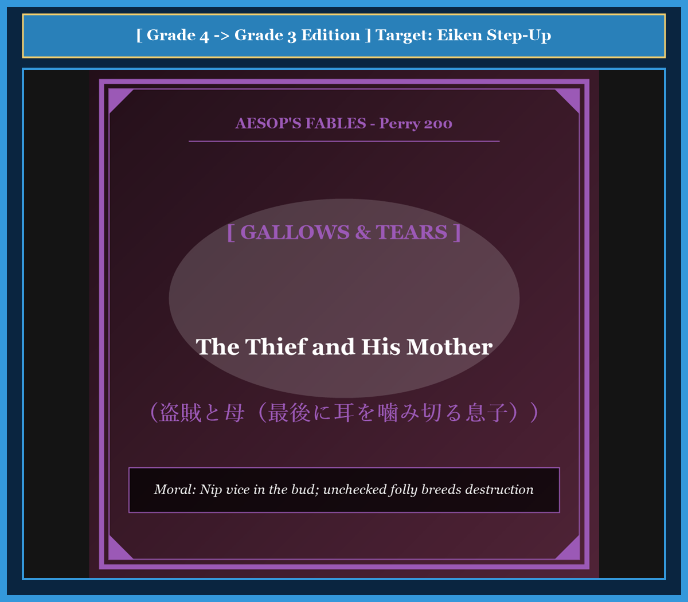

# Chapter 49: The Thief and His Mother (盗賊と母)

<!-- 電子書籍 Page Break & Image Header -->

  

## 1. Benchmark Level: Eiken Grade 4 (英検4級レベル本文)
*Read in ~1 to 1.5 minutes. Short and simple sentences.*

A young boy went to school in a small village. One day, he stole a reading book from his classmate. He brought the stolen book home to his mother.

His mother did not scold him. She smiled and said, "What a clever boy you are!" She praised his bad action.

When the boy grew older, he stole a warm winter coat and brought it home. His mother was very happy and praised him again.

The boy became a man, and he became a dangerous thief. He broke into big houses and stole gold and silver. But one day, the town guards caught him red-handed. The judge sentenced him to death.

As guards led the young man to the gallows, a large crowd followed. His mother wept loudly and tore her hair in grief.

The thief saw his mother and asked the guards: "Please let me whisper one last secret into my mother's ear."

The guards allowed it. When the mother brought her ear close to his lips, the thief suddenly bit her ear hard. The mother cried out in great pain. "You are an evil, ungrateful son!" she screamed.

The young man replied with bitter tears: "Mother, if you had scolded me when I stole that first little book, I would not be dying here today!"

---

## 2. Target Level: Eiken Grade 3 (英検3級レベル本文)
*Read in ~1.5 to 2 minutes. Compound sentences, conjunctions, and rich expressions.*

In a modest village, a young boy attended the local school. One afternoon, he stole a textbook belonging to one of his classmates and carried it home in secret.

Instead of reprimanding the child for his dishonesty, his foolish mother praised his cunning and rewarded him with sweets. Delighted by her approval, the boy soon stole a neighbor's woolen cloak, and once again, his mother celebrated his petty theft rather than punishing him.

As the years passed, the boy matured into an incorrigible criminal. Encouraged by his mother's lifelong indulgence, he graduated from petty thievery to armed robbery, breaking into wealthy estates to steal jewels and gold. Eventually, his luck ran out, and he was apprehended in the act by the royal constables.

Found guilty of heinous crimes, the thief was condemned to be executed on the public gallows. A massive crowd gathered to witness the grim spectacle, among whom was his mother, weeping copiously and beating her chest in sorrow.

Observing his mother among the spectators, the condemned man requested permission to whisper a final farewell into her ear. The guards granted the request, and the grieving woman rushed forward to embrace her doomed child.

However, the moment her ear came within reach, the thief clamped his teeth onto her earlobe and bit it clean off.

As the horrified woman shrieked in agony, the son declared before the shocked onlookers: "Do not pity this woman! If she had disciplined me when I brought home that stolen schoolbook in my childhood, I would have grown into an honest citizen instead of standing upon this scaffold today."

---

## 3. Classic Original English Text (イソップ寓話クラシック原文)
*Perry 200: Translated by George Fyler Townsend (1867)*

A Boy stole a lesson-book of one of his schoolfellows and took it home to his Mother. 

She not only abstained from beating him, but encouraged him. 

He next stole a cloak and brought it to her, and she yet more highly praised him. 

The Boy, growing to be a man, began to steal things of much greater value. At last he was caught in the very act, and having his hands bound behind him, was led away to the place of public execution. 

His Mother followed in the crowd and bewailed her bad luck. The Thief said he desired to say something to his Mother in her ear, and when she came close to him, he quickly seized her ear with his teeth and bit it off. 

The Mother upbraided him as an unnatural child, whereon he replied: "Ah! if you had beaten me when I first stole and brought to you that lesson-book, I should not have come to this, nor have been thus led to a disgraceful death."

---

### 🏛️ 【英検2級レベルで読み解く！クラシック原文の重要構文・英文法ノート】
1. **1. 分詞構文（Participle Clause: 付帯状況・理由）**
   - **原文**: *"The Hare, believing her assertion to be simply impossible, agreed to the proposal..."*
   - **解説**: 「〜と信じ込んでいたので」という理由を表す分詞構文。英検2級の長文読解・ライティングの最頻出構文です。
1. **2. 古典的仮定法現在（Subjunctive Mood）**
   - **原文**: *"Though you be swift as the wind, I will beat you in a race."*
   - **解説**: 譲歩節 `Though` の中で原形 `be` を用いる古典的な仮定法現在（現代英語の `Though you are...`）。格調高い古典の響きを持ちます。
1. **3. 過去分詞の後置修飾（Postpositive Participle）**
   - **原文**: *"On the day appointed for the race the two started together."*
   - **解説**: `appointed`（定められた・指定された）が直前の名詞 `the day` を後ろから修飾する構文です。

### 📜 【クラシック原文の重要語彙・古風表現（Classic Antique Vocabulary）】
- **retort** [動] 2級 **（機転を利かせて）言い返す、反論する**（現代の reply sharp/wittily に相当）
- **assertion** [名] 2級/準1級 **主張、断言**（動詞 assert の名詞形。2級長文定番）
- **wayside** [名] 2級 **道端、沿道**（by the wayside（道端に、途中で））
- **fatigue** [名] 2級 **（心身の）極度の疲労、疲れ**（tiredness の上位フォーマル語）

---

## 4. Japanese Translation & Moral (日本語訳と教訓)

### 【日本語全訳：英検3級レベル本文】
ある質素な村で、幼い少年が地元の学校に通っていました。ある日の午後、彼はクラスメートの教科書を盗み、誰にも見つからないように家に持ち帰りました。

不正を働いた我が子を叱るどころか、愚かな母親はその悪知恵を褒めそやし、お菓子をご褒美として与えました。母親の承認に気を良くした少年は、やがて隣人のウールの外套を盗み、母親はまたしても少年を罰するどころか、その軽犯罪を称賛したのです。

年月が経つにつれ、少年は救いようのない犯罪者へと成長していきました。母親の生涯にわたる甘やかしに煽られ、彼は小遣い稼ぎの万引きから武装強盗へとエスカレートし、富裕層の屋敷に押し入っては宝石や金銀を強奪しました。しかしついに運は尽き、彼は現行犯で王室の警吏たちに取り押さえられました。

凶悪な罪で有罪判決を受けた盗賊は、広場の絞首刑台で処刑されることが宣告されました。その陰惨な見せ場を目撃するために大群衆が集まり、その中には涙を流して激しく泣き崩れ、悲嘆に暮れて胸を叩く母親の姿もありました。

見物人の中に母親の姿を認めた死刑囚は、母親の耳元で最後の別れの言葉を囁く許可を願い出ました。護衛たちはその要請を聞き入れ、悲嘆に暮れる母親は処刑を待つ我が子を抱きしめようと前に駆け寄りました。

しかし、母親の耳が口元に近づいたその瞬間、盗賊はその耳たぶに歯を突き立て、一気に噛みちぎってしまったのです。

恐怖に駆られた母親が激痛に叫び声を上げる中、息子は呆然とする見物人たちの前で言い放ちました。「この女に同情してはならない！ 私が子供の頃に盗んだ教科書を持ち帰った時、もしこの女が厳しく私を躾けてくれていたなら、私は今日この絞首台に立つような真似はせず、誠実な市民として生きられたはずなのだ！」

### 【教訓（Moral）】
**Nip vice in the bud; unchecked folly breeds destruction.**  
（悪の芽は小さなうちに摘み取らなければならない。子供の初期の過ちを甘やかし、叱責と躾を怠る親の盲愛こそが、やがて取り返しのつかない破滅と大罪を育てる真の共犯者である。）

---

## 5. Recite & Compare: そらんじたいキーフレーズ対比カード

  
フレーズ 1：叱るどころか悪事を褒めて育てた愚行

  
4級His mother did not scold him. She praised his bad action.

  
3級Instead of reprimanding the child, his mother praised his cunning and rewarded him.

  
<strong>解説：</strong>「Instead of -ing（〜する代わりに）」と「reprimand（叱責する）」の組み合わせで教育の過ちを浮き彫りにします。

  
フレーズ 2：小悪から凶悪強盗へのエスカレーション

  
4級The boy became a man, and he became a dangerous thief.

  
3級Encouraged by her indulgence, he graduated from petty thievery to armed robbery.

  
<strong>解説：</strong>「graduate from A to B（AからBへと進む・悪化する）」は比喩的表現として英作文で高評価を得られます。

  
フレーズ 3：耳元に別れを告げると見せかけて耳を噛み切る

  
4級When the mother brought her ear close, the thief suddenly bit her ear hard.

  
3級The moment her ear came within reach, the thief clamped his teeth onto her earlobe and bit it clean off.

  
<strong>解説：</strong>接続詞「The moment S + V（〜した瞬間に）」と「bite something clean off（綺麗に噛みちぎる）」の迫真描写です。

  
フレーズ 4：最初の盗みを叱ってくれていたなら死なずに済んだ

  
4級If you had scolded me when I stole the book, I would not be dying today!

  
3級If she had disciplined me in my childhood, I would have grown into an honest citizen.

  
<strong>解説：</strong>仮定法過去完了「If + S + had p.p., S + would have p.p.」の王道構文です。

---

## 6. Key Vocabulary & Exam Notes (英検3級 重要語彙・文法・面接対策)

### 1. 英検3級 必須ボキャブラリー
* **reprimand** [動] 〜を叱責する、戒める [名] 叱責
* **cunning** [名] 悪知恵、狡猾さ [形] ずる賢い
* **incorrigible** [形] 救いようのない、矯正できない
* **indulgence** [名] 甘やかし、放縦、寛容
* **apprehend** [動] （犯人を）逮捕する、取り押さえる
* **scaffold** [名] （処刑用の）絞首台、足場
* **spectator** [名] 見物人、観客
* **discipline** [動] 〜を躾ける、訓練する [名] 規律、躾

### 2. 文法・構文のチェックポイント
* **仮定法過去完了 (If + S + had p.p., S + would have p.p.)**:
  * 過去の事実と反対の仮定と後悔を表す、英検3級〜準2級の最頻出重要文法です。
* **The moment + S + V**:
  * 「〜した瞬間に」。*as soon as* よりも切迫した同時性を表します。

### 3. スピーキング（面接）＆ライティング活用ヒント
「幼児教育」「家庭での躾と親の責任」を論じる際のフレーズ：
* *Parents bear the primary responsibility for correcting unethical behavior before it becomes habit.*（親は、不正な行動が習慣化する前にそれを正す第一の責任を負っている。）
* *Early childhood discipline is essential to nurture moral integrity in future citizens.*（将来の市民に道徳的誠実さを育むためには、幼児期の適切な躾が不可欠である。）
