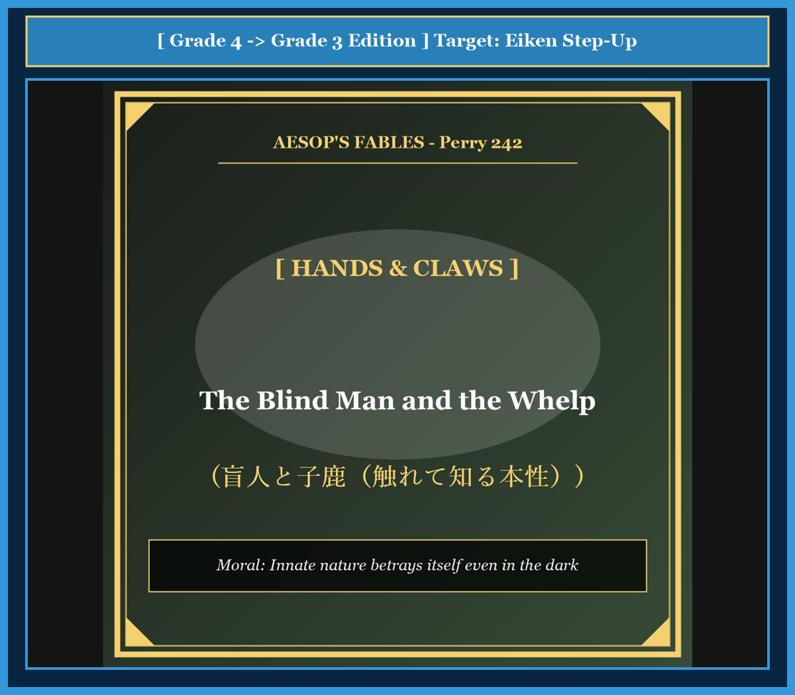

# Chapter 50: The Blind Man and the Whelp (盲人と子狼)

<!-- 電子書籍 Page Break & Image Header -->

  

## 1. Benchmark Level: Eiken Grade 4 (英検4級レベル本文)
*Read in ~1 to 1.5 minutes. Short and simple sentences.*

In a quiet village, there lived an old blind man. Although he could not see with his eyes, his hands were very sensitive. He could tell what kind of animal he touched just by feeling its fur and shape.

One day, some young hunters caught a very young animal in the forest. It was a baby wolf, called a whelp. The hunters brought the little beast to the blind man to test his special skill.

"Grandfather," said the hunters with a laugh, "tell us what creature this is using only your hands."

The blind man gently touched the animal. He felt its soft ears, its sharp little teeth, and its small paws with pointed claws. The baby animal growled softly in his hands.

The old man stroked its fur for a long time. Finally, he gave the little creature back to the hunters.

"I cannot see its color," said the wise blind man, "and I am not sure if it is a young wolf or a young fox. But I know one thing for certain: it is not an animal that should ever be trusted near a flock of sheep!"

---

## 2. Target Level: Eiken Grade 3 (英検3級レベル本文)
*Read in ~1.5 to 2 minutes. Compound sentences, conjunctions, and rich expressions.*

In an ancient rural hamlet, there resided an elderly blind man who possessed an extraordinary sense of touch. Deprived of physical sight since childhood, he had developed an uncanny ability to identify any living creature simply by stroking its contours with his sensitive fingertips.

One afternoon, a group of mischievous young hunters captured a newly born predator in the surrounding hills. It was the young cub of a ferocious wolf. Curious to test whether the old man's famous intuition was genuine or merely a myth, they placed the squirming whelp onto the blind man's lap.

"Esteemed elder," the youths challenged him playfully, "distinguish this specimen using only the touch of your palms."

The blind man closed his eyes and began his delicate examination. His experienced fingers traced the animal's sharp snout, the restless tension in its lean limbs, and the concealed curves of its predatory talons. As his hand brushed near its mouth, the infant creature snapped instinctively with razor-sharp milk teeth.

After pondering in silence for several moments, the venerable man gently set the beast aside and delivered his verdict.

"Whether this creature is the offspring of a wolf or the cub of a fox, I cannot state with absolute certainty," the old man declared calmly. "However, one fundamental truth is unmistakable: this animal possesses an innate predatory instinct, and it should never be admitted into a sheepfold under any circumstances."

---

## 3. Classic Original English Text (イソップ寓話クラシック原文)
*Perry 242: Translated by George Fyler Townsend (1867)*

A Blind Man was accustomed to distinguish different animals by touching them with his hands. 

The whelp of a Wolf was once brought to him, that he might feel it and say what it was. 

He felt it all over, and being in doubt, said: "I know not whether it be the child of a wolf or the child of a fox, but one thing I know well, that it is not a fit beast to be admitted into a sheepfold."

---

### 🏛️ 【英検2級レベルで読み解く！クラシック原文の重要構文・英文法ノート】
1. **1. 分詞構文（Participle Clause: 付帯状況・理由）**
   - **原文**: *"The Hare, believing her assertion to be simply impossible, agreed to the proposal..."*
   - **解説**: 「〜と信じ込んでいたので」という理由を表す分詞構文。英検2級の長文読解・ライティングの最頻出構文です。
1. **2. 古典的仮定法現在（Subjunctive Mood）**
   - **原文**: *"Though you be swift as the wind, I will beat you in a race."*
   - **解説**: 譲歩節 `Though` の中で原形 `be` を用いる古典的な仮定法現在（現代英語の `Though you are...`）。格調高い古典の響きを持ちます。
1. **3. 過去分詞の後置修飾（Postpositive Participle）**
   - **原文**: *"On the day appointed for the race the two started together."*
   - **解説**: `appointed`（定められた・指定された）が直前の名詞 `the day` を後ろから修飾する構文です。

### 📜 【クラシック原文の重要語彙・古風表現（Classic Antique Vocabulary）】
- **retort** [動] 2級 **（機転を利かせて）言い返す、反論する**（現代の reply sharp/wittily に相当）
- **assertion** [名] 2級/準1級 **主張、断言**（動詞 assert の名詞形。2級長文定番）
- **wayside** [名] 2級 **道端、沿道**（by the wayside（道端に、途中で））
- **fatigue** [名] 2級 **（心身の）極度の疲労、疲れ**（tiredness の上位フォーマル語）

---

## 4. Japanese Translation & Moral (日本語訳と教訓)

### 【日本語全訳：英検3級レベル本文】
ある古代の鄙びた村に、並外れた触覚を持つ年老いた盲人が住んでいました。幼少期から視力を奪われていたため、彼は繊細な指先でその輪郭を撫でるだけで、あらゆる生き物を言い当てることができるという驚くべき能力を発達させていました。

ある日の午後、いたずら好きな若い猟師たちが、周囲の丘陵で生まれたばかりの捕食者の幼獣を捕らえました。それは凶暴なオオカミの子供（子狼）でした。老人の名高い直感が本物なのか、それとも単なる作り話なのかを試してやろうと、猟師たちは身をよじる子獣を盲人の膝の上に置きました。

「長老様」と若者たちは面白半分に挑みかけました。「手のひらの感触だけで、この生き物の正体を言い当ててみてください。」

盲人は目を閉じ、入念な触診を始めました。経験豊かな指先が、動物の鋭い鼻先、引き締まった四肢の落ち着きのない緊張、そして隠された捕食者の鉤爪のカーブを辿っていきました。手が口元に触れると、その幼獣は鋭い乳歯で本能的に噛みつこうとしました。

静寂の中でしばらく考え込んだ後、この尊敬すべき老人は静かにその野獣を脇に置き、自らの判定を下しました。

「この生き物がオオカミの子なのか、それともキツネの子なのかは、確信を持って言い切ることはできない」と老人は穏やかに宣言しました。「しかし、一つの根本的な真実は絶対に間違いようがない。この動物は生まれながらの捕食者の本能を宿しており、いかなる事情があろうとも、決して羊の囲いの中に入れてはならないものだ。」

### 【教訓（Moral）】
**Innate nature betrays itself even in the dark.**  
（生来の本質や悪性は、どれほど幼く小さくとも、触れれば隠すことができない。表面的な外見や色合いを誤魔化すことはできても、内に宿る本能的な危険性を見抜く洞察力を持たねばならない。）

---

## 5. Recite & Compare: そらんじたいキーフレーズ対比カード

  
フレーズ 1：触れるだけで生き物の正体を見抜く能力

  
4級He could tell what animal he touched just by feeling its fur and shape.

  
3級He had an uncanny ability to identify any living creature simply by stroking its contours.

  
<strong>解説：</strong>「uncanny ability（超人的な・不思議な能力）」「stroke one's contours（輪郭を撫でる）」という格調高い表現です。

  
フレーズ 2：隠された捕食者の爪と本能的な噛みつき

  
4級The baby animal growled softly, and he felt its small sharp paws.

  
3級His fingers traced its sharp claws, and the infant creature snapped instinctively.

  
<strong>解説：</strong>「trace ~（〜を辿る）」「snap instinctively（本能的に噛みつこうとする）」による質感豊かな描写です。

  
フレーズ 3：オオカミかキツネかは分からぬが確かな真実

  
4級I am not sure if it is a wolf or a fox, but I know one thing for certain.

  
3級Whether this is the offspring of a wolf or a fox, one fundamental truth is unmistakable.

  
<strong>解説：</strong>「Whether A or B（AであれBであれ）」を用いた論理構文です。

  
フレーズ 4：決して羊の群れに入れてはならない危険な本性

  
4級It is not an animal that should ever be trusted near a flock of sheep!

  
3級This animal possesses a predatory instinct and should never be admitted into a sheepfold.

  
<strong>解説：</strong>「predatory instinct（捕食者の本能）」「be admitted into ~（〜への立ち入りを許される）」の組み合わせです。

---

## 6. Key Vocabulary & Exam Notes (英検3級 重要語彙・文法・面接対策)

### 1. 英検3級 必須ボキャブラリー
* **deprived of** [熟語] 〜を奪われた（*deprived of sight*）
* **uncanny** [形] 異様な、驚くべき、超人的な
* **whelp** [名] （狼・犬・狐などの）子、幼獣
* **squirm** [動] 身をよじる、もがく
* **snout** [名] （動物の突き出た）鼻先、口吻
* **instinctively** [副] 本能的に、直感的に
* **offspring** [名] 子、子孫（単複同形）
* **sheepfold** [名] 羊の囲い、羊小屋

### 2. 文法・構文のチェックポイント
* **Whether A or B, S + V**:
  * 「AであろうとBであろうと…」。譲歩を表す副詞節を導く重要接続詞です。
* **admit A into B**:
  * 「AをBに入れることを許可する」。受動態 *be admitted into ~* は大学入試や英検でも頻出です。

### 3. スピーキング（面接）＆ライティング活用ヒント
「人物評価の本質」「リスク管理における本質の洞察」を論じる際のフレーズ：
* *Surface credentials should not distract recruiters from assessing an applicant's core ethical character.*（表面的な資格や肩書きに惑わされず、応募者の根本的な道徳的品性を評価しなければならない。）
* *Prudent risk managers look beyond polished marketing to evaluate underlying financial viability.*（賢明なリスク管理者は、磨き上げられたマーケティングの奥にある根本的な財務健全性を評価する。）
