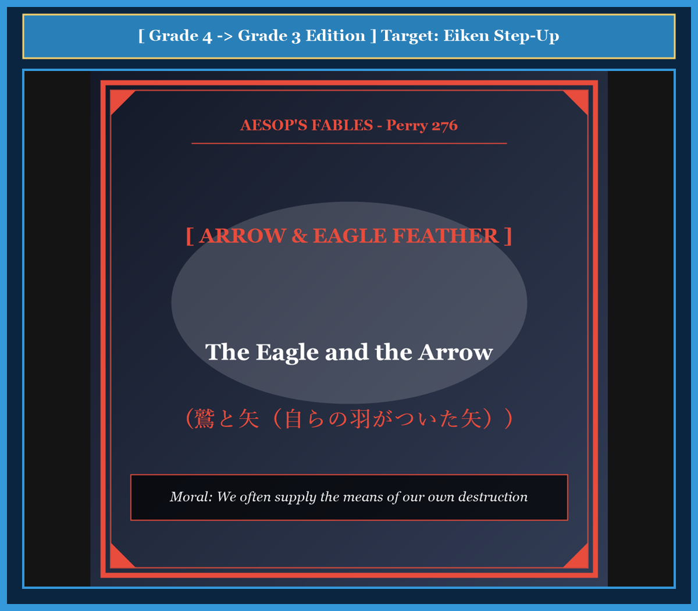

# Chapter 51: The Eagle and the Arrow (鷲と矢)

<!-- 電子書籍 Page Break & Image Header -->

  

## 1. Benchmark Level: Eiken Grade 4 (英検4級レベル本文)
*Read in ~1.5 to 2 minutes. Simple vocabulary and basic syntax.*

A proud eagle lived high on a tall mountain cliff. Every morning, he looked down at the green valley. He had strong wings and very sharp eyes. He could see small rabbits moving in the grass from far away.

One sunny afternoon, the eagle flew down and sat on a high rock. He wanted to catch a hare for dinner. He looked around carefully. He did not hear a hunter walking quietly in the bushes below.

The hunter saw the big eagle on the rock. He put a sharp wooden arrow on his bow. He pulled the bowstring back with all his strength and let the arrow fly.

Whiz! The arrow flew through the air and hit the eagle right in his side. The eagle felt terrible pain. He lost his balance and fell off the rock. He landed on the dusty ground, breathing weakly.

As the dying eagle looked down at his wound, he saw the back of the arrow. The feathers on the arrow were smooth and brown. He knew those feathers very well. They were his own feathers! A few days ago, he had dropped them from his wing into the forest.

The eagle closed his eyes in great sadness. He whispered with his last breath: "How painful this is! I gave my own feathers to the earth, and now humans have used them on an arrow to kill me."

---

## 2. Target Level: Eiken Grade 3 (英検3級レベル本文)
*Read in ~2 to 2.5 minutes. Richer vocabulary and natural sentence flow.*

A majestic eagle made his home on the highest cliff of a rugged mountain. Every morning, he surveyed the vast valley below because he possessed extraordinary eyesight. From high above the clouds, he could easily spot small animals that were hiding among the green bushes.

One calm afternoon, the eagle descended and perched upon a solitary boulder. He was waiting patiently to catch a hare for his evening meal. While he was concentrating on the grassy fields, an experienced hunter approached silently through the thick forest.

The hunter instantly recognized the great bird and prepared his weapon. Taking a sharp wooden arrow, he fitted it to his bowstring. He pulled the bow with great power and released the arrow toward the cliff.

The arrow soared swiftly through the air and pierced deep into the eagle's body. Overcome by sudden shock and intense pain, the monarch of the skies lost his balance and tumbled down to the rocky earth below.

As he lay dying on the ground, the eagle glanced down at the fatal shaft sticking out of his breast. To his astonishment and horror, he noticed the feathers that guided the arrow through the air. They were unmistakable brown flight feathers that had fallen from his own wings during his last molt.

Tears welled in the dying eagle's eyes as he spoke his final words: "It is a double sorrow to lose my life, but it is far more bitter to know that my own feathers provided the very wings that brought death to my heart."

---

## 3. Classic Original English Text (イソップ寓話クラシック原文)
*Translated by George Fyler Townsend (1867)*

An Eagle sat on a high rock, looking for hares. A hunter shot an arrow at him and hit him. As the Eagle fell dying, he looked at the arrow and saw that its feathers were plucked from an eagle's own wing. "Alas," he cried, "it is a double grief to me that I must die by an arrow feathered with my own plumage!"

---

### 🏛️ 【英検2級レベルで読み解く！クラシック原文の重要構文・英文法ノート】
1. **1. 分詞構文（Participle Clause: 付帯状況・理由）**
   - **原文**: *"The Hare, believing her assertion to be simply impossible, agreed to the proposal..."*
   - **解説**: 「〜と信じ込んでいたので」という理由を表す分詞構文。英検2級の長文読解・ライティングの最頻出構文です。
1. **2. 古典的仮定法現在（Subjunctive Mood）**
   - **原文**: *"Though you be swift as the wind, I will beat you in a race."*
   - **解説**: 譲歩節 `Though` の中で原形 `be` を用いる古典的な仮定法現在（現代英語の `Though you are...`）。格調高い古典の響きを持ちます。
1. **3. 過去分詞の後置修飾（Postpositive Participle）**
   - **原文**: *"On the day appointed for the race the two started together."*
   - **解説**: `appointed`（定められた・指定された）が直前の名詞 `the day` を後ろから修飾する構文です。

### 📜 【クラシック原文の重要語彙・古風表現（Classic Antique Vocabulary）】
- **retort** [動] 2級 **（機転を利かせて）言い返す、反論する**（現代の reply sharp/wittily に相当）
- **assertion** [名] 2級/準1級 **主張、断言**（動詞 assert の名詞形。2級長文定番）
- **wayside** [名] 2級 **道端、沿道**（by the wayside（道端に、途中で））
- **fatigue** [名] 2級 **（心身の）極度の疲労、疲れ**（tiredness の上位フォーマル語）

---

## 4. Japanese Translation & Moral (日本語訳と教訓)

### 【日本語全訳：英検3級レベル本文】
威風堂々たるワシが、険しい山の最も高い崖の上に巣を作っていました。並外れた視力を持っていたため、彼は毎朝、眼下に広がる広大な谷を見渡していました。雲のはるか上空からでも、緑の茂みの中に隠れている小さな動物たちを容易に見つけることができたのです。

ある穏やかな午後、ワシは舞い降りて、一本の孤立した巨岩の上に止まりました。夕食のための野ウサギを捕まえようと、じっと辛抱強く待っていたのです。草むらに全神経を集中させていたため、彼は経験豊富な狩人が鬱蒼とした森の中を音もなく近づいてきていることに気づきませんでした。

狩人は即座にその大きな鳥の姿を認め、武器を構えました。鋭い木の矢を手に取り、弓の弦へと番えました。彼は怪力で弓を引き絞り、崖に向かって矢を解き放ちました。

矢は空を素早く切り裂き、ワシの胴体深くへと突き刺さりました。突然の衝撃と激痛に圧倒され、空の王者はバランスを崩し、眼下の岩だらけの地面へと転落してしまいました。

地面に横たわり死にかけていたワシは、自らの胸から突き出ている致命的な矢の柄を見下ろしました。驚愕と恐怖の中で、彼は矢が空中を飛ぶのを誘導していた羽根に目を留めました。それは、彼が前回の換羽期に自らの翼から抜け落ちた、紛れもない彼自身の茶色い風切羽だったのです。

息絶えゆくワシの目に涙が浮かび、彼は最後の言葉を絞り出しました。「命を失うことだけでも深い悲しみだが、自分自身の羽が、自らの心臓に死をもたらす矢に翼を与えていたと知ることは、遥かに耐えがたい苦痛である。」

### 【教訓（Moral）】
**We often supply the means of our own destruction.**  
（人間はしばしば、自らが提供した技術・武器・情報によって、皮肉にも自らを破滅へと追い込む道具を作り出してしまう。）

---

## 5. Recite & Compare: そらんじたいキーフレーズ対比カード

  
フレーズ 1：雲の上から獲物を見つけ出す視力

  
4級He had strong wings and very sharp eyes.

  
3級Because he possessed extraordinary eyesight, he could easily spot small animals.

  
<strong>解説：</strong>3級必須の接続詞「because」と知覚動詞「spot（見つけ出す）」による複文構成です。

  
フレーズ 2：獲物に集中している間に敵が接近する

  
4級He did not hear a hunter walking quietly below.

  
3級While he was concentrating on the fields, an experienced hunter approached silently.

  
<strong>解説：</strong>「While + 過去進行形」を用いて、背景の動作と新たな出来事の対比を鮮やかに表現しています。

  
フレーズ 3：自らの翼から落ちた羽根だと気づく

  
4級They were his own feathers that he had dropped from his wing.

  
3級He noticed the feathers that had fallen from his own wings during his last molt.

  
<strong>解説：</strong>関係代名詞「that」と過去完了形「had fallen」を組み合わせた3級合格の必修構文です。

  
フレーズ 4：自らの羽が自らに死をもたらした悲哀

  
4級Humans have used my own feathers to kill me.

  
3級My own feathers provided the very wings that brought death to my heart.

  
<strong>解説：</strong>強調の「the very + 名詞（まさにその〜）」と関係代名詞「that」を用いた名文句です。

---

## 6. Key Vocabulary & Exam Notes (英検3級 重要語彙・文法・面接対策)

### 1. 英検3級 必須ボキャブラリー
* **survey** [動] 〜を見渡す、調査する
* **extraordinary** [形] 並外れた、異常な（*extraordinary eyesight*）
* **spot** [動] 〜を見つけ出す、発見する
* **descend** [動] 降りる、舞い降りる（⇔ *ascend* 登る）
* **solitary** [形] 孤立した、孤独な
* **boulder** [名] 大きな岩、丸石
* **pierce** [動] 〜を突き刺す、貫通する
* **plumage** [名] 羽毛、羽（集合的）

### 2. 文法・構文のチェックポイント
* **While + 過去進行形**:
  * 「〜している間に…が起こった」。時間の幅を持つ背景行動を表す重要構文です。
* **the very + 名詞**:
  * 「まさにその〜」。関係代名詞節の先行詞を強く強調する表現です。

### 3. スピーキング（面接）＆ライティング活用ヒント
* 自らの情報提供や不用意な発言が後で自分を苦しめるリスクについて、*We must be cautious not to provide tools for our own ruin.* と論述できます。

