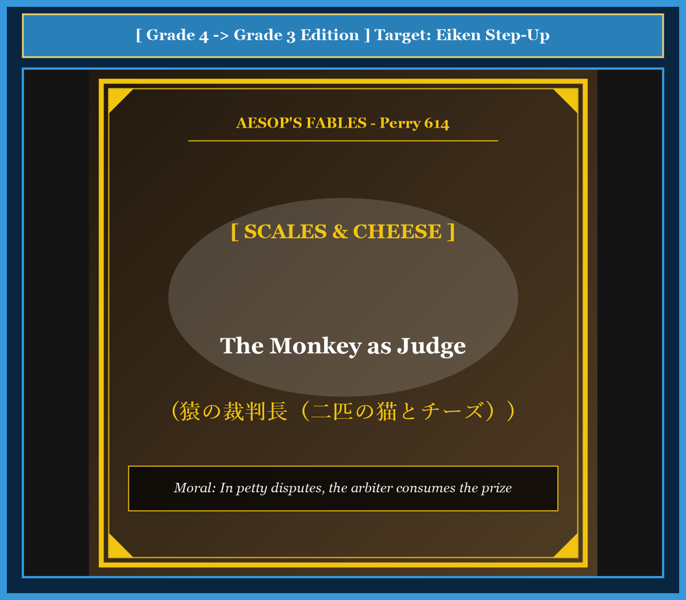

# Chapter 52: The Monkey as Judge (猿の裁判長)

<!-- 電子書籍 Page Break & Image Header -->

  

## 1. Benchmark Level: Eiken Grade 4 (英検4級レベル本文)
*Read in ~1.5 to 2 minutes. Simple vocabulary and basic syntax.*

Two hungry cats were walking down a country road together. Suddenly, they found a big piece of yellow cheese on the grass. Both cats shouted with joy and ran to grab it.

However, a big quarrel began between them. "I saw the cheese first!" cried the black cat. "No, I picked it up with my paws first!" argued the white cat. They could not agree on how to divide the cheese fairly.

Just then, a clever monkey walked past them. The monkey smiled and said: "Do not fight, my friends. I am an honest judge. I can divide your cheese into two equal pieces." The two simple cats were very glad and gave him the cheese.

The monkey brought out a pair of wooden scales. He broke the cheese into two pieces and put one on each side. The right side went down because it was slightly heavier.

"Look, this piece is too big," said the monkey. He quickly bit off a large chunk and chewed it happily. Now the left side was heavier! So the monkey took a big bite out of the left piece.

He kept biting from side to side for a long time. The cats watched their delicious cheese become smaller and smaller. Finally, only two tiny crumbs were left on the scales.

"Please stop!" cried the frightened cats. "Give us what is left! We are satisfied now."

"No," replied the smiling monkey. "Justice requires hard work. These last two crumbs belong to me as my fee for judging your case." With that, the monkey swallowed the rest of the cheese and ran away.

---

## 2. Target Level: Eiken Grade 3 (英検3級レベル本文)
*Read in ~2 to 2.5 minutes. Richer vocabulary and natural sentence flow.*

Two hungry cats were wandering along a quiet village path when they discovered a delicious piece of rich cheese. At first, both animals were delighted by their wonderful good fortune, but a bitter dispute soon arose between them.

Neither cat was willing to share the cheese equally. The black cat insisted that he had spotted the treasure first, while the white cat claimed that his claws had touched it before anyone else. Unable to resolve their disagreement peacefully, they decided to find an impartial judge.

At that moment, a cunning monkey appeared from behind an oak tree. Observing their predicament, the monkey offered his services with a polite bow. "Please do not worry, neighbors. I have served as a judge for many years, and I can ensure that justice is served between you." Relieved by his words, the two naive cats entrusted their cheese to the monkey.

The monkey immediately produced a pair of balance scales. He divided the cheese into two irregular pieces and placed one on each pan. Because the right piece was heavier, the balance tilted downward.

"This will never do," muttered the monkey thoughtfully. "We must make both sides completely equal." He took a generous bite from the larger piece, but now the other side was heavier. Therefore, the monkey took another bite from the second piece.

Back and forth the process continued while the anxious cats watched their treasure dwindle to almost nothing. Realizing their mistake, they begged the arbiter to stop. "Please give us whatever remains! We will settle the dispute ourselves!"

"That is impossible," chuckled the greedy monkey as he placed the remaining morsels into his mouth. "An honorable magistrate must always receive compensation for his professional services." Having consumed the entire cheese, the monkey bounded up into the trees, leaving the two foolish cats hungry and empty-handed.

---

## 3. Classic Original English Text (イソップ寓話クラシック原文)
*Translated by George Fyler Townsend (1867)*

Two Cats found a piece of cheese and could not agree on dividing it. They went to a Monkey to arbitrate. The Monkey brought a balance scale and broke the cheese into two pieces. One was heavier, so he bit a piece off it. Then the other side was heavier, so he bit a piece off that. He kept eating from each side until the Cats pleaded: "Give us what is left!" The Monkey said: "The rest is my fee for judging," and devoured it all.

---

### 🏛️ 【英検2級レベルで読み解く！クラシック原文の重要構文・英文法ノート】
1. **1. 分詞構文（Participle Clause: 付帯状況・理由）**
   - **原文**: *"The Hare, believing her assertion to be simply impossible, agreed to the proposal..."*
   - **解説**: 「〜と信じ込んでいたので」という理由を表す分詞構文。英検2級の長文読解・ライティングの最頻出構文です。
1. **2. 古典的仮定法現在（Subjunctive Mood）**
   - **原文**: *"Though you be swift as the wind, I will beat you in a race."*
   - **解説**: 譲歩節 `Though` の中で原形 `be` を用いる古典的な仮定法現在（現代英語の `Though you are...`）。格調高い古典の響きを持ちます。
1. **3. 過去分詞の後置修飾（Postpositive Participle）**
   - **原文**: *"On the day appointed for the race the two started together."*
   - **解説**: `appointed`（定められた・指定された）が直前の名詞 `the day` を後ろから修飾する構文です。

### 📜 【クラシック原文の重要語彙・古風表現（Classic Antique Vocabulary）】
- **retort** [動] 2級 **（機転を利かせて）言い返す、反論する**（現代の reply sharp/wittily に相当）
- **assertion** [名] 2級/準1級 **主張、断言**（動詞 assert の名詞形。2級長文定番）
- **wayside** [名] 2級 **道端、沿道**（by the wayside（道端に、途中で））
- **fatigue** [名] 2級 **（心身の）極度の疲労、疲れ**（tiredness の上位フォーマル語）

---

## 4. Japanese Translation & Moral (日本語訳と教訓)

### 【日本語全訳：英検3級レベル本文】
二匹の飢えた猫が静かな村の小道を歩いていたところ、濃厚で美味しそうな一切れのチーズを発見しました。最初、二匹とも自らの素晴らしい幸運に大喜びしましたが、すぐに激しい口論が二匹の間に巻き起こりました。

どちらの猫も、チーズを公平に分け合う意志がありませんでした。黒猫は自分が最初に宝物を見つけたと主張し、白猫は他の誰よりも早く自分の爪がそれに触れたと言い張りました。平和的に不一致を解決することができなかった二匹は、公平な裁判官を探すことに決めました。

その瞬間、狡猾な猿がカシの木の後ろから姿を現しました。二匹の窮状を観察した猿は、丁寧なお辞儀とともに自らの調停サービスを申し出ました。「ご近所さん、心配には及びませんよ。私は長年裁判官を務めており、あなた方の間で正義が執行されるよう保証できます。」その言葉に安堵した世間知らずの二匹の猫は、自分たちのチーズを猿に預けてしまいました。

猿は即座に天秤ばかりを取り出しました。彼はチーズを不揃いな二つに割り、それぞれの皿の上に置きました。右の破片の方が重かったため、天秤は右へと傾きました。

「これではいけませんな」と猿は思慮深そうにつぶやきました。「両方を完全に等しくせねばなりません。」彼は大きな方の破片から惜しげもなく一口かじり取りましたが、今度はもう一方の皿の方が重くなりました。そのため、猿は二つ目の破片からももう一口かじり取りました。

不安がる猫たちが自分たちの宝物がほとんどゼロにまで縮んでいくのを見守る中、この往復プロセスは延々と続きました。過ちに気づいた猫たちは、調停をやめるよう懇願しました。「お願いです、残っているものを返してください！ あとは自分たちで争いを解決しますから！」

「それは不可能ですな」と貪欲な猿は残りの破片を口の中に放り込みながら笑いました。「名誉ある治安判事は、その専門的職務に対して常に報酬を受け取る権利があるのです。」チーズをすべて平らげると、猿は木々の上へと跳び去り、二匹の愚かな猫たちを飢えと徒手空拳のまま置き去りにしました。

### 【教訓（Moral）】
**In petty disputes, the arbiter consumes the prize.**  
（些細な私利私欲の争いで第三者に安易な調停を求めると、仲裁者に手数料として全てを巻き上げられ、当事者双方が共倒れになる。）

---

## 5. Recite & Compare: そらんじたいキーフレーズ対比カード

  
フレーズ 1：平和的に解決できず裁判官を探す

  
4級They could not agree on how to divide the cheese fairly.

  
3級Unable to resolve their disagreement peacefully, they decided to find an impartial judge.

  
<strong>解説：</strong>分詞構文的な「Unable to...」と形容詞「impartial（偏らない、公平な）」を用いた洗練表現です。

  
フレーズ 2：不揃いな二つに割って天秤に載せる

  
4級He broke the cheese into two pieces and put one on each side.

  
3級He divided the cheese into two irregular pieces and placed one on each pan.

  
<strong>解説：</strong>「divide A into B」と天秤の皿を表す「pan」を使った具体的な英語表現です。

  
フレーズ 3：宝物がほとんどゼロに縮んでいく

  
4級The cats watched their delicious cheese become smaller and smaller.

  
3級The anxious cats watched their treasure dwindle to almost nothing.

  
<strong>解説：</strong>知覚動詞「watch + O + 原形」と「dwindle（次第に減少する）」の組み合わせです。

  
フレーズ 4：調停の手数料としてすべて平らげる

  
4級These last crumbs belong to me as my fee for judging your case.

  
3級A magistrate must always receive compensation for his professional services.

  
<strong>解説：</strong>社会・法律用語「magistrate（治安判事）」「compensation（報酬・補償）」を用いた高度な文体です。

---

## 6. Key Vocabulary & Exam Notes (英検3級 重要語彙・文法・面接対策)

### 1. 英検3級 必須ボキャブラリー
* **dispute** [名] 紛争、論争、口論
* **impartial** [形] 偏らない、公平な（*impartial judge*）
* **predicament** [名] 窮状、苦境
* **irregular** [形] 不揃いな、不規則な
* **dwindle** [動] だんだん小さくなる、衰退する
* **arbiter** [名] 仲裁人、調停者
* **magistrate** [名] 裁判官、治安判事
* **compensation** [名] 報酬、埋め合わせ、補償金

### 2. 文法・構文のチェックポイント
* **Neither + 単数名詞 + was willing to ...**:
  * 「どちらの〜も…しようとしなかった」。2者を同時に否定する重要構文です。
* **watch + O + 原形動詞**:
  * 知覚動詞の構文。「Oが〜するのを見守る、眺める」。

### 3. スピーキング（面接）＆ライティング活用ヒント
* 無用な訴訟や社内対立のリスクを論じる際、*Excessive litigation often benefits only external arbiters while bankrupting both parties.* と展開できます。

