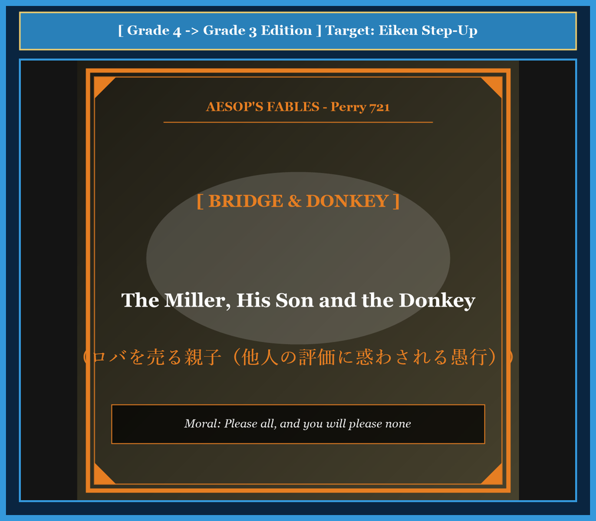

# Chapter 53: The Miller, His Son and the Donkey (ロバを売る親子)

<!-- 電子書籍 Page Break & Image Header -->

  

## 1. Benchmark Level: Eiken Grade 4 (英検4級レベル本文)
*Read in ~1.5 to 2 minutes. Simple vocabulary and basic syntax.*

An old miller and his young son were walking to a market town. They were taking their gray donkey with them to sell him. Because they wanted to keep the animal fresh and clean, they both walked on foot.

Soon, they met a group of young women near a well. "Look at those silly fools!" one woman laughed loudly. "Why are they walking in the hot dust when they have a donkey to ride?"

The old miller did not like being laughed at. He quickly told his son to climb onto the donkey's back while he walked beside them.

A little later, they passed three old men resting under a tree. "What an impolite world we live in!" one old man shouted angrily. "Look at that lazy boy riding in comfort while his poor old father must walk on tired legs!"

The boy felt deeply ashamed. He climbed down immediately and told his father to ride. The miller sat on the donkey, and the boy walked behind.

Further down the road, they met some farmers returning from the fields. "You selfish old man!" the farmers called out. "Why do you make that young child run in the heat while you sit like a king?"

The miller wanted to please everyone. So he pulled his son up onto the donkey, and they both rode together.

As they entered the town, the townspeople began to point and yell: "What cruel monsters! Two heavy people riding on one small donkey! You should carry the poor beast instead!"

The confused miller and his son got off. They tied the donkey's legs to a strong wooden pole. Raising the pole onto their shoulders, they carried the heavy donkey across a bridge.

The townspeople burst into roaring laughter at the strange sight. The frightened donkey struggled, broke the ropes, fell into the swift river, and drowned.

The sad miller walked home with nothing.

---

## 2. Target Level: Eiken Grade 3 (英検3級レベル本文)
*Read in ~2 to 2.5 minutes. Richer vocabulary and natural sentence flow.*

An elderly miller and his youthful son set out early one morning to sell their donkey at a busy market town. In order to preserve the animal's strength and keep its coat clean, the father and son chose to walk patiently beside the beast.

As they proceeded along the dusty highway, they passed a group of young girls who were drawing water from a village well. "What preposterous fools those travelers are!" exclaimed one girl with a mocking laugh. "Why should they trudge through the summer heat when their donkey carries no load at all?"

Sensitive to public criticism, the miller instructed his son to mount the donkey while he continued to walk on foot.

Before long, they encountered an assemblage of elders who were engaged in serious conversation. One of the old men frowned severely and criticized the travelers: "Look at the deplorable lack of respect among youth today! That healthy boy lounges lazily on the animal, while his aged father is forced to endure the exhaustion of the road."

Blushing with embarrassment, the boy quickly dismounted and insisted that his father take his place. The miller climbed onto the saddle, feeling satisfied that they had corrected their behavior.

However, their satisfaction was short-lived. A group of women carrying heavy baskets soon crossed their path. "What a callous and selfish parent!" they cried indignantly. "You comfortably ride ahead while your little son struggles to keep pace with your footsteps!"

Desperate to avoid further disapproval, the miller hoisted his son up behind him so that both could ride together.

Yet when they approached the town gates, the citizens shouted in moral outrage: "Have you no mercy for that exhausted creature? You are far better suited to carry the beast than the beast is to carry you!"

Thoroughly bewildered by the conflicting opinions of strangers, the father and son dismounted once more. Finding a stout timber, they tied the donkey's legs securely to the pole and lifted the struggling animal onto their shoulders.

When the townsfolk witnessed this absurd spectacle on the municipal bridge, they erupted in uncontrollable hilarity. Startled by the commotion, the donkey kicked violently, snapped the binding cords, plunged into the deep river, and tragically drowned.

The miller returned home empty-handed, having learned that he who attempts to please everybody pleases nobody.

---

## 3. Classic Original English Text (イソップ寓話クラシック原文)
*Translated by George Fyler Townsend (1867)*

A Miller and his Son were leading their Donkey to market. A passerby said: "Why walk when you have a beast to ride?" So the Miller put his Son on the Donkey. Another criticized the boy for riding while his old father walked, so the Miller took his place. A third cried shame that the poor donkey carried the heavy man, so both rode. A fourth called them cruel to overload the animal, so they tied the donkey's feet to a pole and carried him. As they crossed a bridge, the crowd laughed, the donkey kicked, broke loose, fell into the river, and drowned.

---

### 🏛️ 【英検2級レベルで読み解く！クラシック原文の重要構文・英文法ノート】
1. **1. 分詞構文（Participle Clause: 付帯状況・理由）**
   - **原文**: *"The Hare, believing her assertion to be simply impossible, agreed to the proposal..."*
   - **解説**: 「〜と信じ込んでいたので」という理由を表す分詞構文。英検2級の長文読解・ライティングの最頻出構文です。
1. **2. 古典的仮定法現在（Subjunctive Mood）**
   - **原文**: *"Though you be swift as the wind, I will beat you in a race."*
   - **解説**: 譲歩節 `Though` の中で原形 `be` を用いる古典的な仮定法現在（現代英語の `Though you are...`）。格調高い古典の響きを持ちます。
1. **3. 過去分詞の後置修飾（Postpositive Participle）**
   - **原文**: *"On the day appointed for the race the two started together."*
   - **解説**: `appointed`（定められた・指定された）が直前の名詞 `the day` を後ろから修飾する構文です。

### 📜 【クラシック原文の重要語彙・古風表現（Classic Antique Vocabulary）】
- **retort** [動] 2級 **（機転を利かせて）言い返す、反論する**（現代の reply sharp/wittily に相当）
- **assertion** [名] 2級/準1級 **主張、断言**（動詞 assert の名詞形。2級長文定番）
- **wayside** [名] 2級 **道端、沿道**（by the wayside（道端に、途中で））
- **fatigue** [名] 2級 **（心身の）極度の疲労、疲れ**（tiredness の上位フォーマル語）

---

## 4. Japanese Translation & Moral (日本語訳と教訓)

### 【日本語全訳：英検3級レベル本文】
年老いた粉屋とその幼い息子が、ある朝早く、賑やかな市場の町でロバを売るために出発しました。動物の体力を温存し、その毛並みを清潔に保つために、父と子は獣の隣を辛抱強く歩くことを選んだのです。

埃っぽい街道を進んでいくと、村の井戸から水を汲んでいた少女たちの一団のそばを通りかかりました。「あの旅人たちはなんて突拍子もない愚か者なんでしょう！」一人の少女が嘲笑とともに叫びました。「ロバが何の荷物も運んでいないのに、なぜ夏の暑さの中をとぼとぼ歩いているのかしら？」

世間の批判に敏感だった粉屋は、自らは徒歩を続けながら、息子にロバに乗るよう指示しました。

まもなく、真剣な会話を交わしていた長老たちの一団に出くわしました。一人の老人が厳しく眉をひそめ、旅人たちを非難しました。「最近の若者の嘆かわしい敬意の欠如を見てみろ！ あの健康な少年が動物の上でだらしなくくつろぎ、老いた父親が過酷な道の疲労に耐えることを強いられているではないか。」

恥ずかしさで顔を赤らめながら、少年は素早くロバから降り、父親が代わりに座るよう主張しました。粉屋は鞍の上に跨り、自分たちの行動を正したことに満足感を覚えました。

しかし、彼らの満足は長続きしませんでした。重い籠を運んでいた女性たちの一団がすぐに彼らの進路を横切りました。「なんて冷酷で利己的な親でしょう！」彼女たちは憤慨して叫びました。「小さな息子があなたの足取りについていくのに必死になっているというのに、自分だけ優雅にロバに乗っているなんて！」

これ以上の非難を避けることに必死になった粉屋は、二人で一緒に乗れるよう、自分の後ろへと息子を引き上げました。

しかし町の門に近づくと、市民たちが道徳的憤りを込めて叫びました。「あの疲れ果てた動物への慈悲はないのか！ お前たちがその獣を背負う方が、その獣がお前たちを背負うよりも遥かに似つかわしいぞ！」

見知らぬ人々の矛盾した意見に完全に混乱した父と子は、再びロバから降りました。頑丈な材木を見つけると、彼らはロバの足を棒にしっかりと縛り付け、もがく動物を自分たちの肩の上へと持ち上げました。

町の橋の上でこの不条理な光景を目撃した町民たちは、抑えきれない大爆笑を巻き起こしました。騒音に驚いたロバが激しく暴れ、縛られていた紐を引きちぎり、深い川の中へと転落して悲劇的にも溺死してしまいました。

全ての人を喜ばせようとする者は誰をも喜ばせることができないという教訓を骨身に刻み、粉屋は手ぶらで家へと帰っていきました。

### 【教訓（Moral）】
**Please all, and you will please none.**  
（万人の意見や評価に振り回されて全員を満足させようとする者は、自らの判断の軸を失い、誰をも満足させられずに破滅する。）

---

## 5. Recite & Compare: そらんじたいキーフレーズ対比カード

  
フレーズ 1：批判を気にして息子をロバに乗せる

  
4級He quickly told his son to climb onto the donkey's back.

  
3級Sensitive to public criticism, the miller instructed his son to mount the donkey.

  
<strong>解説：</strong>形容詞句「Sensitive to public criticism（世評に過敏な）」を用いた格調高い導入です。

  
フレーズ 2：不評を恐れて二人で同時に乗る

  
4級He pulled his son up onto the donkey, and they both rode together.

  
3級Desperate to avoid further disapproval, the miller hoisted his son up behind him.

  
<strong>解説：</strong>「Desperate to avoid disapproval（不興を買うことを避けるのに必死で）」という心理描写です。

  
フレーズ 3：矛盾する意見に完全に困惑する

  
4級The confused miller and his son got off.

  
3級Thoroughly bewildered by the conflicting opinions of strangers, they dismounted once more.

  
<strong>解説：</strong>分詞形容詞「bewildered」と「conflicting opinions（相反する意見）」の連語です。

  
フレーズ 4：万人に阿る者は誰をも喜ばせられない

  
4級The sad miller walked home with nothing.

  
3級He who attempts to please everybody pleases nobody.

  
<strong>解説：</strong>英語圏で最も有名な普遍の格言「He who attempts to please everybody pleases nobody.」です。

---

## 6. Key Vocabulary & Exam Notes (英検3級 重要語彙・文法・面接対策)

### 1. 英検3級 必須ボキャブラリー
* **preposterous** [形] 不合理な、常軌を逸した、ばかげた
* **trudge** [動] 重い足取りでとぼとぼ歩く
* **deplorable** [形] 嘆かわしい、哀れな、ひどい
* **callous** [形] 冷酷な、無神経な
* **disapproval** [名] 不賛成、非難、不興
* **bewildered** [形] 途方に暮れた、当惑した
* **hilarity** [名] 大笑い、陽気な騒ぎ
* **drown** [動] 溺れ死ぬ、溺死する

### 2. 文法・構文のチェックポイント
* **He who + 動詞**:
  * 「〜する人は（誰でも）」。ことわざや教訓で頻出する関係代名詞の古典的表現です。
* **In order to + 原形動詞**:
  * 「〜するために」。明確な目的を示す重要熟語です。

### 3. スピーキング（面接）＆ライティング活用ヒント
* 他人の目や同調圧力に囚われない主体的な意思決定について、*Leaders who attempt to satisfy every conflicting demand inevitably undermine their organizational vision.* と主張できます。

