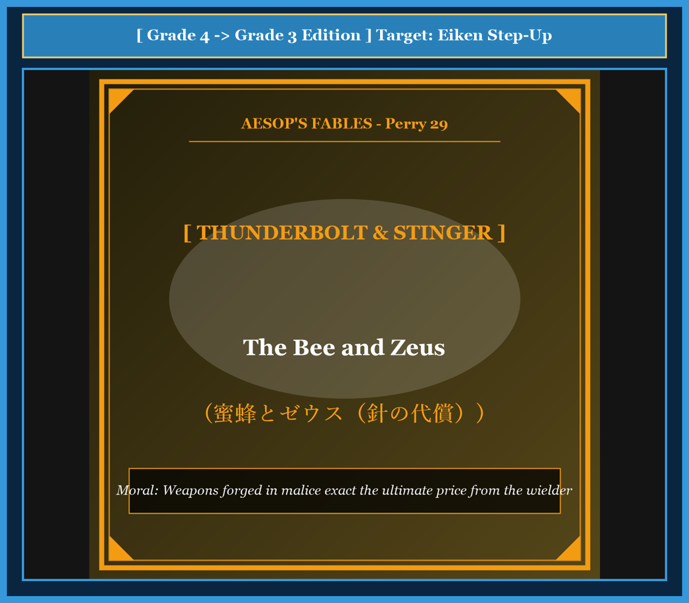

# Chapter 54: The Bee and Zeus (蜜蜂とゼウス)

<!-- 電子書籍 Page Break & Image Header -->

  

## 1. Benchmark Level: Eiken Grade 4 (英検4級レベル本文)
*Read in ~1.5 to 2 minutes. Simple vocabulary and basic syntax.*

A little queen bee lived in a big wooden beehive. Her worker bees made sweet golden honey every day. Many animals and humans loved honey, so they often came to steal it.

The queen bee was very angry. She wanted a strong weapon to protect her honey. She decided to fly to Mount Olympus to speak with Zeus, the king of the gods.

When she arrived, she gave Zeus a bowl of fresh, sweet honey. Zeus tasted the honey and was very pleased. He said: "Thank you for this delicious gift, little bee. I will grant you one wish. What do you want?"

The bee answered with hate in her heart: "Great Zeus, please give me a sharp needle with poison. Whenever a human or animal tries to touch my honey, I want to sting them and kill them instantly!"

Zeus was very sad and angry to hear such a cruel wish. He loved humans and did not want them to die. However, because he was a king, he could not break his promise.

So Zeus said: "I will give you a sharp stinger as you requested. But listen to my law: when you sting someone, the stinger will stay stuck in their flesh. When you pull away, your body will break, and you will die immediately. Your weapon will take your own life."

The queen bee flew back to earth with regret.

---

## 2. Target Level: Eiken Grade 3 (英検3級レベル本文)
*Read in ~2 to 2.5 minutes. Richer vocabulary and natural sentence flow.*

A queen bee ruled over a flourishing colony inside a hollow oak tree. Throughout the spring and summer, her industrious workers gathered nectar and produced combs of pure, golden honey. However, because both humans and wild beasts frequently plundered the hive, the queen grew bitter and resentful.

Desiring a lethal weapon to defend her property, the bee undertook a long pilgrimage to Mount Olympus. Upon reaching the celestial palace, she presented a comb of freshly harvested honey to Zeus, the supreme king of the gods.

Delighted by the sweet offering, Zeus praised the bee's craftsmanship and made a solemn vow: "In return for this marvelous gift, I promise to grant whatever request you formulate."

Seizing the opportunity, the bee revealed the dark malice in her heart. "Almighty Zeus," she petitioned, "endow my body with a venomous needle. Whenever an intruder attempts to approach my honeycombs, I wish to inflict a fatal sting so that they will perish on the spot."

Zeus was deeply displeased by this spiteful prayer because he cherished mortal mankind. Nevertheless, because he had sworn a divine oath, he could not revoke his word.

Instead, Zeus pronounced a just condition: "Your request shall be granted, and you shall possess a sharp stinger. However, whenever you discharge your venom into an enemy, your barbed weapon shall remain embedded in the wound. As you attempt to withdraw, your vital organs shall tear away, and you shall forfeit your own life. The very instrument of your malice shall seal your destruction."

---

## 3. Classic Original English Text (イソップ寓話クラシック原文)
*Translated by George Fyler Townsend (1867)*

A Bee went to Mount Olympus to offer fresh honey to Zeus. Zeus was pleased and promised her whatever she asked. The Bee requested a stinger so that she might kill anyone who tried to take her honey. Zeus was displeased with her malicious wish, yet kept his promise; but he decreed that whenever she stung someone, the stinger should remain in the wound, and she should lose her life.

---

### 🏛️ 【英検2級レベルで読み解く！クラシック原文の重要構文・英文法ノート】
1. **1. 分詞構文（Participle Clause: 付帯状況・理由）**
   - **原文**: *"The Hare, believing her assertion to be simply impossible, agreed to the proposal..."*
   - **解説**: 「〜と信じ込んでいたので」という理由を表す分詞構文。英検2級の長文読解・ライティングの最頻出構文です。
1. **2. 古典的仮定法現在（Subjunctive Mood）**
   - **原文**: *"Though you be swift as the wind, I will beat you in a race."*
   - **解説**: 譲歩節 `Though` の中で原形 `be` を用いる古典的な仮定法現在（現代英語の `Though you are...`）。格調高い古典の響きを持ちます。
1. **3. 過去分詞の後置修飾（Postpositive Participle）**
   - **原文**: *"On the day appointed for the race the two started together."*
   - **解説**: `appointed`（定められた・指定された）が直前の名詞 `the day` を後ろから修飾する構文です。

### 📜 【クラシック原文の重要語彙・古風表現（Classic Antique Vocabulary）】
- **retort** [動] 2級 **（機転を利かせて）言い返す、反論する**（現代の reply sharp/wittily に相当）
- **assertion** [名] 2級/準1級 **主張、断言**（動詞 assert の名詞形。2級長文定番）
- **wayside** [名] 2級 **道端、沿道**（by the wayside（道端に、途中で））
- **fatigue** [名] 2級 **（心身の）極度の疲労、疲れ**（tiredness の上位フォーマル語）

---

## 4. Japanese Translation & Moral (日本語訳と教訓)

### 【日本語全訳：英検3級レベル本文】
女王蜂がうろのあるカシの木の内部で、繁栄するコロニーを統率していました。春から夏にかけて、彼女の勤勉な働き蜂たちは蜜を集め、純粋な黄金の蜂蜜の巣房を作り上げました。しかしながら、人間も野獣もしばしば巣を略奪したため、女王蜂は次第に苦々しさと怨恨を募らせていきました。

自らの財産を防衛するための致死的な武器を渇望した蜂は、オリュンポス山への長い巡礼の旅に出ました。天上の宮殿に到着すると、彼女は神々の最高権力者であるゼウスに、収穫したばかりの蜂蜜の巣を献上しました。

甘い贈り物に喜んだゼウスは、蜂の職人芸を称賛し、厳粛な誓いを立てました。「この素晴らしい贈り物に報いるため、お前が述べるいかなる願いも叶えてやると約束しよう。」

この好機を捉えた蜂は、その心に潜む暗い悪意を露わにしました。「全能のゼウスよ」と彼女は嘆願しました。「私の体に有毒な針をお授けください。侵入者が私の巣房に近づこうと試みたときにはいつでも、致命的な一刺しを浴びせ、その場で絶命させたいのでございます。」

死すべき人間たちを慈しんでいたゼウスは、この悪意に満ちた祈りに深く不快感を覚えました。それにもかかわらず、神聖な誓いを立ててしまっていたため、自らの言葉を取り消すことはできませんでした。

その代わり、ゼウスは公正な条件を言い渡しました。「お前の願いは叶えられ、お前は鋭い針を手に入れるだろう。しかしながら、お前が敵に毒を放つときにはいつでも、その逆棘のある武器は傷口の中に埋め込まれたまま残るであろう。お前が飛び去ろうと試みるとき、お前の内臓は引き裂かれ、お前は自らの命を失うことになる。お前の悪意のまさにその道具こそが、お前自身の破滅を決定づけるのだ。」

### 【教訓（Moral）】
**Weapons forged in malice exact the ultimate price from the wielder.**  
（他者を害し殺傷するために願った悪意の武器は、必ずその所有者自身に最大の代償を請求し、自らを破滅へと導く。）

---

## 5. Recite & Compare: そらんじたいキーフレーズ対比カード

  
フレーズ 1：略奪に苦しみ怨恨を募らせる

  
4級Many animals loved honey, so they often came to steal it.

  
3級Because intruders frequently plundered the hive, the queen grew bitter and resentful.

  
<strong>解説：</strong>3級最頻出の動詞「plunder（略奪する）」と形容詞「bitter and resentful」の表現です。

  
フレーズ 2：いかなる願いも叶えるという厳粛な誓約

  
4級I will grant you one wish. What do you want?

  
3級I promise to grant whatever request you formulate.

  
<strong>解説：</strong>複合関係代名詞「whatever（いかなる〜でも）」を用いた格調高い約束の表現です。

  
フレーズ 3：他者をその場で絶命させたいという悪意

  
4級I want to sting them and kill them instantly!

  
3級I wish to inflict a fatal sting so that they will perish on the spot.

  
<strong>解説：</strong>「inflict a fatal sting（致命的な一刺しを加える）」と目的の「so that ... will」の構文です。

  
フレーズ 4：悪意の道具が己の命を奪うという神託

  
4級When you pull away, your body will break, and you will die.

  
3級The very instrument of your malice shall seal your destruction.

  
<strong>解説：</strong>格言的な名文「The very instrument of your malice shall seal your destruction.」です。

---

## 6. Key Vocabulary & Exam Notes (英検3級 重要語彙・文法・面接対策)

### 1. 英検3級 必須ボキャブラリー
* **industrious** [形] 勤勉な、よく働く
* **plunder** [動] 〜を略奪する、奪う
* **pilgrimage** [名] 巡礼の旅、長旅
* **solemn** [形] 厳粛な、荘重な（*solemn vow*）
* **formulate** [動] 〜を述べる、明確に表現する
* **intruder** [名] 侵入者、邪魔者
* **inflict** [動] （損害・打撃を）加える、負わせる
* **perish** [動] 死ぬ、滅びる（文語）

### 2. 文法・構文のチェックポイント
* **so that + S + will/may ...**:
  * 「Sが〜できるように」。目的を表す副詞節を導く重要接続詞です。
* **inflict + 損害 + on ...**:
  * 「〜に損害や苦痛を与える」。社会・論述問題で頻出のコロケーションです。

### 3. スピーキング（面接）＆ライティング活用ヒント
* 他害的な兵器開発やサイバー攻撃のブーメラン効果について、*Malicious offensive tools inevitably expose the attacker to self-destruction.* と論証できます。

