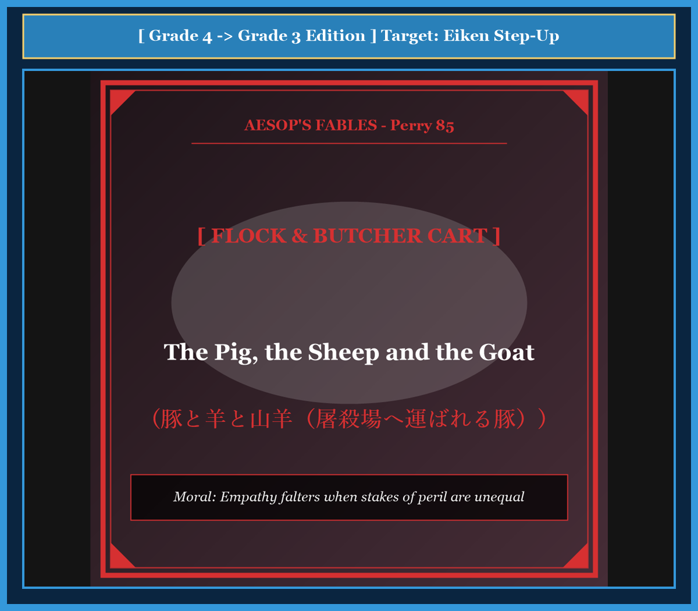

# Chapter 55: The Pig, the Sheep and the Goat (豚と羊と山羊)

<!-- 電子書籍 Page Break & Image Header -->

  

## 1. Benchmark Level: Eiken Grade 4 (英検4級レベル本文)
*Read in ~1.5 to 2 minutes. Simple vocabulary and basic syntax.*

On a warm green farm, a pig, a sheep, and a goat lived together in the same grassy field. They ate grass, rested in the shade, and were peaceful neighbors.

One morning, the farmer walked into the meadow. He walked past the sheep and the goat. Suddenly, he grabbed the fat young pig by his hind legs!

The pig became terrified. He began to kick violently. He squealed and screamed with all his might: "Weee! Weee! Help me!" His loud cries could be heard all across the valley.

The farmer held the pig tightly and carried him toward a wooden cart.

The sheep and the goat watched the pig struggle. They shook their heads and felt annoyed by the loud noise.

"Why are you making such a terrible noise, pig?" said the sheep calmly. "The farmer catches us all the time. He takes our warm wool every summer, but we never scream like babies."

"That is true," added the goat. "The farmer catches me every morning to take my milk. I never kick or cry. You should learn to be quiet and brave like us."

The pig looked at them with tears in his eyes as the farmer carried him away. He gasped: "You foolish animals! You do not understand anything! When the farmer catches you, he only wants your wool or your milk. But when he catches me, he does not want wool or milk. He wants my bacon! He is going to kill me!"

The sheep and the goat fell completely silent.

---

## 2. Target Level: Eiken Grade 3 (英検3級レベル本文)
*Read in ~2 to 2.5 minutes. Richer vocabulary and natural sentence flow.*

In a quiet pastoral meadow, a young pig, a gentle sheep, and a horned goat shared the same pasture in apparent harmony. They grazed upon the sweet clover and enjoyed the peaceful life of domestic livestock.

One crisp morning, the shepherd entered the enclosure carrying a sturdy hemp sack. Ignoring the sheep and the goat, he lunged forward and seized the plump pig by his hind leg.

Instantly, the pig erupted in wild terror. He thrashed against the shepherd's grasp, squealing at the top of his lungs with piercing screams that echoed across the surrounding hills.

The shepherd dragged the captive beast firmly toward the butcher's wagon.

Observing this chaotic scene, the sheep and the goat felt irritated by the pig's undignified behavior. They approached the fence and criticized their companion for his lack of composure.

"What a shameful display of cowardice!" bleated the sheep condescendingly. "The shepherd captures us regularly, shearing my heavy fleece every spring, yet I never disturb the peace with hysterical shrieks."

"Indeed," agreed the goat with self-righteous pride. "The master corners me twice daily to milk me, and I submit quietly without resistance. Why can you not endure a routine capture with patient dignity?"

The doomed pig turned his sorrowful gaze toward his naive companions and offered a chilling clarification: "How easy it is for you to preach composure when your lives are never at risk! When the shepherd captures you, he seeks merely your renewable fleece or your morning milk. But when he seizes me, he seeks neither wool nor dairy—he demands my lifeblood! You risk only a haircut, but I face the butcher's knife!"

Hearing these words, the sheep and goat fell into horrified silence, recognizing their moral blindness.

---

## 3. Classic Original English Text (イソップ寓話クラシック原文)
*Translated by George Fyler Townsend (1867)*

A Pig, a Sheep, and a Goat were kept in the same meadow. One day the shepherd seized the Pig, which began to squeal and struggle furiously. The Sheep and Goat rebuked him: "The shepherd takes us constantly, and we never make such an outcry." The Pig replied: "Your capture and mine are very different matters: he wants you for your wool and milk, but he takes me for my life."

---

### 🏛️ 【英検2級レベルで読み解く！クラシック原文の重要構文・英文法ノート】
1. **1. 分詞構文（Participle Clause: 付帯状況・理由）**
   - **原文**: *"The Hare, believing her assertion to be simply impossible, agreed to the proposal..."*
   - **解説**: 「〜と信じ込んでいたので」という理由を表す分詞構文。英検2級の長文読解・ライティングの最頻出構文です。
1. **2. 古典的仮定法現在（Subjunctive Mood）**
   - **原文**: *"Though you be swift as the wind, I will beat you in a race."*
   - **解説**: 譲歩節 `Though` の中で原形 `be` を用いる古典的な仮定法現在（現代英語の `Though you are...`）。格調高い古典の響きを持ちます。
1. **3. 過去分詞の後置修飾（Postpositive Participle）**
   - **原文**: *"On the day appointed for the race the two started together."*
   - **解説**: `appointed`（定められた・指定された）が直前の名詞 `the day` を後ろから修飾する構文です。

### 📜 【クラシック原文の重要語彙・古風表現（Classic Antique Vocabulary）】
- **retort** [動] 2級 **（機転を利かせて）言い返す、反論する**（現代の reply sharp/wittily に相当）
- **assertion** [名] 2級/準1級 **主張、断言**（動詞 assert の名詞形。2級長文定番）
- **wayside** [名] 2級 **道端、沿道**（by the wayside（道端に、途中で））
- **fatigue** [名] 2級 **（心身の）極度の疲労、疲れ**（tiredness の上位フォーマル語）

---

## 4. Japanese Translation & Moral (日本語訳と教訓)

### 【日本語全訳：英検3級レベル本文】
静かな牧歌的な草地で、若い豚、穏やかな羊、そして角のある山羊が、外見上は何の不和もなく同じ放牧地を共有していました。彼らは甘いクローバーを食み、家畜としての平和な生活を楽しんでいました。

ある爽やかな朝、羊飼いが頑丈な麻袋を抱えて囲い地の中に入ってきました。羊と山羊には目もくれず、彼は前へと踏み出し、丸々と太った豚の後ろ足を掴みました。

瞬時にして、豚は猛烈な恐怖を爆発させました。彼は羊飼いの拘束に激しく抵抗し、周囲の丘にこだまするほどの甲高い金切り声で、喉も張り裂けんばかりに悲鳴を上げました。

羊飼いは捕らえた獣を、肉屋の荷車へとしっかりと引きずっていきました。

この混沌とした光景を目撃した羊と山羊は、豚の威厳のない振る舞いに苛立ちを覚えました。彼らは柵に歩み寄り、落ち着きのなさを理由に仲間を非難しました。

「なんて恥知らずな臆病の見世物でしょう！」と羊が見下すように鳴きました。「羊飼いは私たちを定期的に捕まえ、毎年春に私の重い羊毛を刈り取りますが、私がヒステリックな叫び声で平穏を乱したことなど一度もありませんよ。」

「その通りだ」と山羊も独善的な誇りをもって同意しました。「主人は私から乳を搾るために一日に二度私を追い詰めるが、私は抵抗することなく静かに服従している。なぜ君はもっと辛抱強い威厳をもって、日常的な捕獲に耐えることができないのかね？」

破滅を宣告された豚は、世間知らずな仲間たちへと悲哀に満ちた視線を向け、背筋も凍るような明確化を告げました。「自分たちの生命が微塵も脅かされていないときに、冷静さを説教することがどれほど容易であることか！ 羊飼いがあなた方を捕まえるとき、彼が求めているのは再生可能な羊毛か、朝のミルクに過ぎない。しかし彼が私を掴むとき、彼が求めているのは毛でも乳でもない——彼は私の命の血を要求しているのだ！ あなた方が失うリスクは散髪に過ぎないが、私が直面しているのは肉屋の包丁なのだ！」

この言葉を聞いた羊と山羊は、自らの道徳的盲目を思い知り、恐怖の沈黙へと沈んでいきました。

### 【教訓（Moral）】
**Empathy falters when stakes of peril are unequal.**  
（自らの失うリスクが極小である者が、命の危険に直面している他者の恐怖や叫びを『取り乱している』と傲慢に批判してはならない。）

---

## 5. Recite & Compare: そらんじたいキーフレーズ対比カード

  
フレーズ 1：平和な牧場で外見上は調和して暮らす

  
4級A pig, a sheep, and a goat lived together in the field.

  
3級They shared the pasture in apparent harmony, enjoying peaceful life.

  
<strong>解説：</strong>「in apparent harmony（外見上は調和して）」という深みのある導入表現です。

  
フレーズ 2：取り乱した臆病な振る舞いを非難する

  
4級The sheep and the goat watched the pig struggle and felt annoyed.

  
3級The sheep and goat criticized their companion for his lack of composure.

  
<strong>解説：</strong>名詞「composure（冷静さ、落ち着き）」と「lack of composure」の重要フレーズです。

  
フレーズ 3：生命の危険がない時の説教の容易さ

  
4級You do not understand anything! He wants to kill me!

  
3級How easy it is for you to preach composure when your lives are never at risk!

  
<strong>解説：</strong>感嘆文「How easy it is to...」と条件節「when your lives are never at risk」の構文です。

  
フレーズ 4：散髪のリスクと包丁のリスクの圧倒的な差

  
4級He only wants your wool, but he wants my life.

  
3級You risk only a haircut, but I face the butcher's knife!

  
<strong>解説：</strong>「risk only a haircut」と「face the butcher's knife」という鮮烈なコントラストです。

---

## 6. Key Vocabulary & Exam Notes (英検3級 重要語彙・文法・面接対策)

### 1. 英検3級 必須ボキャブラリー
* **pastoral** [形] 牧歌的な、羊飼いの
* **enclosure** [名] 囲い地、構内
* **composure** [名] 落ち着き、沈着、平静（*keep one's composure*）
* **condescendingly** [副] 見下すように、恩着せがましく
* **self-righteous** [形] 独善的な、自分だけが正しいと思っている
* **renewable** [形] 再生可能な（*renewable resource*）
* **butcher** [名] 肉屋、屠殺業者
* **blindness** [名] 盲目、無知（*moral blindness*）

### 2. 文法・構文のチェックポイント
* **How + 形容詞 + it is + for 人 + to do**:
  * 感嘆文。「〜にとって…することはなんと〜なことか！」感情を強く訴える表現です。
* **at risk**:
  * イディオム。「危険にさらされて」。*lives at risk*（危機に瀕した命）。

### 3. スピーキング（面接）＆ライティング活用ヒント
* 特権階級と弱者の立場の断絶について、*Those who face no existential threat must not preach patience to marginalized groups facing annihilation.* と論評できます。

