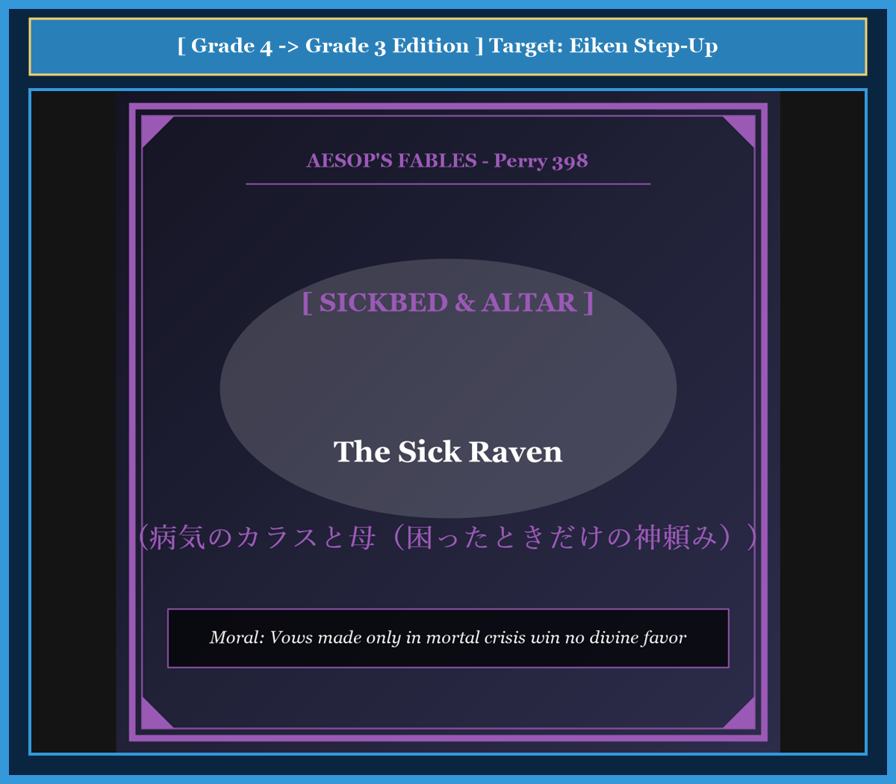

# Chapter 56: The Sick Raven (病気のカラスと母)

<!-- 電子書籍 Page Break & Image Header -->

  

## 1. Benchmark Level: Eiken Grade 4 (英検4級レベル本文)
*Read in ~1.5 to 2 minutes. Simple vocabulary and basic syntax.*

A black raven lived in an old tall pine tree. He had lived a bad life. Whenever he saw humans offering bread and meat to the gods on stone altars, he flew down and stole the food. He never cared about the gods.

One cold winter, the raven became terribly sick. His feathers fell out, his eyes grew cloudy, and his throat was burning. He could not stand up on his branch. He felt that death was near.

His mother sat beside him on the nest, weeping softly.

The sick raven looked at his mother and whispered: "Mother, please help me! Fly quickly to the sacred temples in the city. Pray to Apollo and the great gods for my recovery. Promise them that if I live, I will offer a grand sacrifice on their altars!"

The mother raven looked at her dying son with deep sorrow. She shook her head sadly and replied:

"My dear son, which of the gods do you think will listen to my prayers? Is there a single altar in the whole country from which you have not stolen sacred food? You have insulted every god during your healthy years. How can we expect them to show mercy now that you are dying?"

The sick raven had no answer. He closed his eyes in deep regret.

---

## 2. Target Level: Eiken Grade 3 (英検3級レベル本文)
*Read in ~2 to 2.5 minutes. Richer vocabulary and natural sentence flow.*

A wild raven perched upon the gnarled branch of an ancient pine tree, suffering from an acute and debilitating illness. Throughout his youthful days, the reckless scavenger had lived an unprincipled existence. Whenever pious villagers placed roasted meats and honeyed cakes upon the sacred altars of the gods, the raven would swoop down audacity and steal the consecrated offerings.

Now, afflicted by violent fevers and failing strength, the bird lay trembling in his nest. Sensing that his life was rapidly slipping away, he called out to his mother, who was perched beside him in mourning.

"Dearest mother," the stricken bird pleaded in agony, "I implore you to fly immediately to the sacred sanctuaries of Apollo and the Olympian gods! Prostrate yourself before their shrines and petition for my physical restoration. Promise them that if they spare my life, I will dedicate a magnificent sacrifice to honor their names!"

The mother raven gazed down upon her wretched offspring with tears of profound grief. She sighed mournfully and delivered a piercing reality check:

"Alas, my foolish child, upon which deity can you possibly call for salvation? Can you name a single celestial patron whose sacred precinct you have not desecrated, or from whose holy altar you have not purloined consecrated flesh? You systematically mocked the gods throughout your prosperous health. It is preposterous to expect divine compassion now that you face the threshold of mortality."

Stricken by the truth of her indictment, the dying bird remained silent as darkness enveloped his sight.

---

## 3. Classic Original English Text (イソップ寓話クラシック原文)
*Translated by George Fyler Townsend (1867)*

A Raven was taken very ill and expected to die. He said to his Mother: "Pray to the gods for my recovery, and promise them a sacrifice." The Mother replied: "Alas, my son, which of the gods will have pity on you? For is there any god from whose altar you have not stolen offerings?"

---

### 🏛️ 【英検2級レベルで読み解く！クラシック原文の重要構文・英文法ノート】
1. **1. 分詞構文（Participle Clause: 付帯状況・理由）**
   - **原文**: *"The Hare, believing her assertion to be simply impossible, agreed to the proposal..."*
   - **解説**: 「〜と信じ込んでいたので」という理由を表す分詞構文。英検2級の長文読解・ライティングの最頻出構文です。
1. **2. 古典的仮定法現在（Subjunctive Mood）**
   - **原文**: *"Though you be swift as the wind, I will beat you in a race."*
   - **解説**: 譲歩節 `Though` の中で原形 `be` を用いる古典的な仮定法現在（現代英語の `Though you are...`）。格調高い古典の響きを持ちます。
1. **3. 過去分詞の後置修飾（Postpositive Participle）**
   - **原文**: *"On the day appointed for the race the two started together."*
   - **解説**: `appointed`（定められた・指定された）が直前の名詞 `the day` を後ろから修飾する構文です。

### 📜 【クラシック原文の重要語彙・古風表現（Classic Antique Vocabulary）】
- **retort** [動] 2級 **（機転を利かせて）言い返す、反論する**（現代の reply sharp/wittily に相当）
- **assertion** [名] 2級/準1級 **主張、断言**（動詞 assert の名詞形。2級長文定番）
- **wayside** [名] 2級 **道端、沿道**（by the wayside（道端に、途中で））
- **fatigue** [名] 2級 **（心身の）極度の疲労、疲れ**（tiredness の上位フォーマル語）

---

## 4. Japanese Translation & Moral (日本語訳と教訓)

### 【日本語全訳：英検3級レベル本文】
野生のカラスが古代のマツの木の節くれだった枝の上で、急性の衰弱性の病気に苦しんでいました。若き日々を通じて、この無謀な腐肉食者は節操のない自堕落な生活を送っていました。信心深い村人たちが神々の神聖な祭壇の上に焼き肉や蜂蜜のケーキを供えるたびに、カラスは厚かましくも急降下し、奉納された捧げ物を盗み去っていたのです。

今や激しい高熱と衰えゆく体力に苛まれ、その鳥は巣の中で震えながら横たわっていました。自らの生命が急速に失われつつあるのを感じ取り、彼は喪に服すように隣に止まっていた母親に向かって声を絞り出しました。

「愛するお母さん」と打ちのめされた鳥は苦悶の中で懇願しました。「お願いだから今すぐアポロンやオリュンポスの神々の神聖な神殿へと飛んでいってほしい！ 神殿の前にひれ伏し、私の肉体的回復を請い求めてください。もし私の命を助けてくださるならば、神々の名を称える壮大な生贄を捧げると約束してください！」

母ガラスは深い悲しみの涙を浮かべながら、哀れなわが子を見つめました。彼女は嘆かわしそうにため息をつき、痛烈な現実を突きつけました。

「ああ、私の愚かな子よ、いったいどの神にあなたが救済を求めることができるというのですか？ あなたが冒涜しなかった神聖な境内を持つ天の守護神、あるいはあなたがその清らかな祭壇から捧げ物の肉をかすめ取らなかった神が、一人でもいるというのですか？ あなたは健康で栄えていた間、神々を組織的に侮辱し続けてきました。死の淵に直面した今になって神の慈悲を期待するなど、言語道断な思い上がりです。」

母親の告発の正しさに打ちのめされ、死にゆく鳥は沈黙したまま、視界を闇に包まれていきました。

### 【教訓（Moral）】
**Vows made only in mortal crisis win no divine favor.**  
（平時において道徳や信義を蔑ろにし、私利私欲のために神仏や他者を冒涜してきた者が、自らが死の危機に瀕した時だけ慌てて立てる誓言や神頼みは、誰の心にも届かず空しく消え去る。）

---

## 5. Recite & Compare: そらんじたいキーフレーズ対比カード

  
フレーズ 1：神聖な祭壇から捧げ物をかすめ取る

  
4級He flew down and stole the food from stone altars.

  
3級The raven would swoop down with audacity and steal the consecrated offerings.

  
<strong>解説：</strong>「swoop down（急降下する）」と「consecrated offerings（神聖な捧げ物）」の表現です。

  
フレーズ 2：生命を助けてくれるなら生贄を捧げると約束する

  
4級Promise them that if I live, I will offer a sacrifice.

  
3級Promise them that if they spare my life, I will dedicate a magnificent sacrifice.

  
<strong>解説：</strong>条件節「if they spare my life」と「dedicate a sacrifice」を用いた本格構文です。

  
フレーズ 3：一度も盗みを働かなかった祭壇がどこにあるのか

  
4級Which god has not had his food stolen by you?

  
3級Can you name a single celestial patron whose holy altar you have not purloined?

  
<strong>解説：</strong>関係代名詞の所有格「whose」を用いた、3級から準2級への最重要ステップアップ構文です。

  
フレーズ 4：危機においてのみ慈悲を期待する不条理

  
4級How can we expect them to show mercy now that you are dying?

  
3級It is preposterous to expect divine compassion now that you face mortality.

  
<strong>解説：</strong>接続詞「now that（今や〜なのだから）」と「preposterous（常軌を逸した）」の組み合わせです。

---

## 6. Key Vocabulary & Exam Notes (英検3級 重要語彙・文法・面接対策)

### 1. 英検3級 必須ボキャブラリー
* **debilitating** [形] 衰弱させる、衰えさせる
* **scavenger** [名] 腐肉食動物、清掃動物
* **consecrated** [形] 神聖化された、奉納された
* **sanctuary** [名] 聖域、神殿、避難所
* **prostrate** [動] ひれ伏す、平伏する
* **desecrate** [動] 〜を冒涜する、神聖を汚す
* **purloin** [動] 〜を盗む、くすねる（*steal* の文語）
* **mortality** [名] 死すべき運命、死亡率

### 2. 文法・構文のチェックポイント
* **whose + 名詞**:
  * 関係代名詞の所有格。「〜の…であるところの」。先行詞の人や神の所有関係を説明します。
* **now that + S + V**:
  * 接続詞句。「今や〜である以上は、〜なのだから」。原因・理由を強調する表現です。

### 3. スピーキング（面接）＆ライティング活用ヒント
* 平時の信頼構築と非常時の協力について、*One cannot expect institutional support during crises if one has systematically violated organizational trust during prosperity.* と論述できます。

