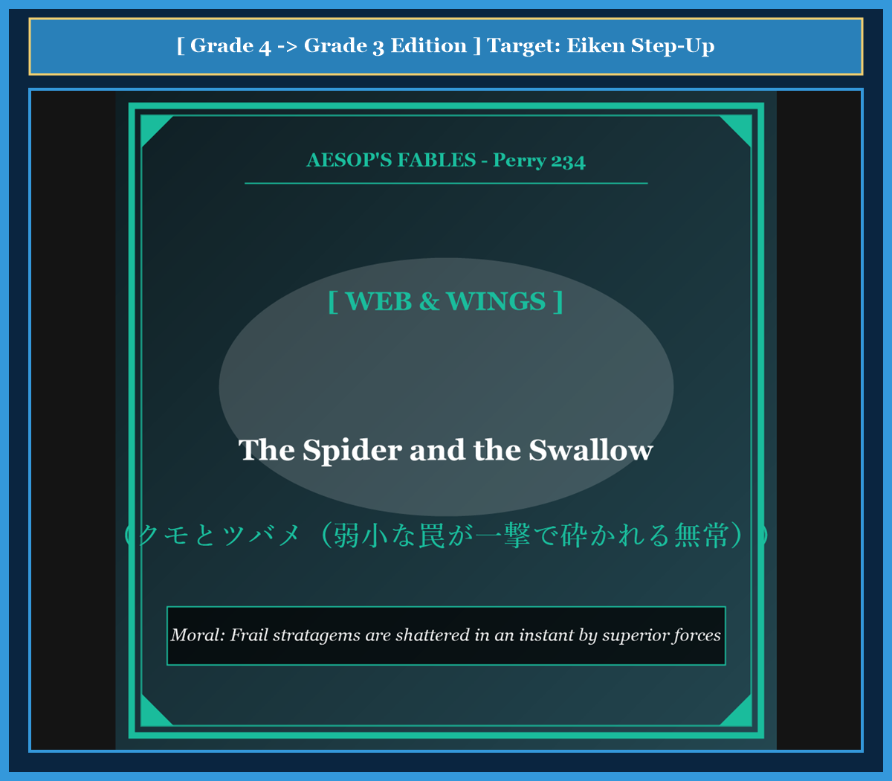

# Chapter 57: The Spider and the Swallow (クモとツバメ)

<!-- 電子書籍 Page Break & Image Header -->

  

## 1. Benchmark Level: Eiken Grade 4 (英検4級レベル本文)
*Read in ~1.5 to 2 minutes. Simple vocabulary and basic syntax.*

A proud black spider lived under the roof of a stone house. She was very proud of her shiny silk web. Every morning, small flies and mosquitoes flew into her sticky threads. The spider wrapped them up and ate them.

One summer day, a fast swallow flew into the garden. The swallow had long blue wings. She flew through the air like an arrow, catching flies with her open beak.

The spider watched the swallow from her corner. She felt very jealous. "That bird is stealing my flies!" thought the spider. "I am a master hunter. My web is strong. I will catch that bird and eat her!"

The foolish spider worked all afternoon. She spun a large web across the open window where the swallow often flew. She smiled and waited in the middle of her net.

Soon, the swallow came flying back toward the window at top speed.

Whoosh! The swallow did not even see the spider's web. She flew right through it. The tiny silk threads snapped instantly like thin dust.

The swallow did not even slow down. But the broken web and the spider stuck to her feathers. The swallow carried the web and the helpless spider high up into the clouds.

As the wind blew her away, the dying spider cried: "I was so proud of catching tiny flies that I forgot how weak I am against a giant bird!"

---

## 2. Target Level: Eiken Grade 3 (英検3級レベル本文)
*Read in ~2 to 2.5 minutes. Richer vocabulary and natural sentence flow.*

A spider had established her residence beneath the eaves of an ancient courtyard. Possessing an abundant supply of sticky silk, she constructed intricate geometric webs that were exceptionally effective at capturing small insects. Day after day, she gorged herself on gnats and flies, which fostered a dangerous sense of supreme arrogance.

During midsummer, an agile swallow began frequenting the courtyard. Endowed with aerodynamic wings and incredible speed, the migratory bird soared gracefully through the atmosphere, effortlessly capturing insects mid-flight.

Watching this aerial master from her corner, the spider was consumed by bitter envy. "That creature dares to deplete my private hunting grounds," she grumbled indignantly. "Humans praise the swallow, but my engineering skills are superior. I shall construct a net so formidable that it will ensnare the intruder herself."

Driven by megalomaniacal ambition, the spider labored tirelessly for hours, spinning an expansive web across the courtyard gateway where the bird routinely passed. Confident in the tensile strength of her creation, the arachnid stationed herself proudly in the center.

Presently, the swallow returned, diving toward the archway with tremendous velocity.

In a fraction of a second, the collision occurred. Far from arresting the avian raptor, the fragile silk filaments disintegrated instantly upon impact. The swallow did not even register the trivial obstruction. However, the ruptured web, along with the spider herself, adhered to the bird's tail feathers.

Carried miles into the stratosphere by the unstoppable momentum of the swallow, the battered spider acknowledged her fatal delusion: "Woe is me! In my petty vanity over trapping helpless flies, I foolishly imagined my frail apparatus could withstand the sovereign forces of the sky!"

---

## 3. Classic Original English Text (イソップ寓話クラシック原文)
*Translated by George Fyler Townsend (1867)*

A Spider watched a Swallow catching flies in the air and felt bitter jealousy. Thinking she could trap the bird, the Spider spun a web across a courtyard where the Swallow flew. The Swallow swept past at full speed, tore right through the frail web without feeling it, and carried off the web and the Spider together.

---

### 🏛️ 【英検2級レベルで読み解く！クラシック原文の重要構文・英文法ノート】
1. **1. 分詞構文（Participle Clause: 付帯状況・理由）**
   - **原文**: *"The Hare, believing her assertion to be simply impossible, agreed to the proposal..."*
   - **解説**: 「〜と信じ込んでいたので」という理由を表す分詞構文。英検2級の長文読解・ライティングの最頻出構文です。
1. **2. 古典的仮定法現在（Subjunctive Mood）**
   - **原文**: *"Though you be swift as the wind, I will beat you in a race."*
   - **解説**: 譲歩節 `Though` の中で原形 `be` を用いる古典的な仮定法現在（現代英語の `Though you are...`）。格調高い古典の響きを持ちます。
1. **3. 過去分詞の後置修飾（Postpositive Participle）**
   - **原文**: *"On the day appointed for the race the two started together."*
   - **解説**: `appointed`（定められた・指定された）が直前の名詞 `the day` を後ろから修飾する構文です。

### 📜 【クラシック原文の重要語彙・古風表現（Classic Antique Vocabulary）】
- **retort** [動] 2級 **（機転を利かせて）言い返す、反論する**（現代の reply sharp/wittily に相当）
- **assertion** [名] 2級/準1級 **主張、断言**（動詞 assert の名詞形。2級長文定番）
- **wayside** [名] 2級 **道端、沿道**（by the wayside（道端に、途中で））
- **fatigue** [名] 2級 **（心身の）極度の疲労、疲れ**（tiredness の上位フォーマル語）

---

## 4. Japanese Translation & Moral (日本語訳と教訓)

### 【日本語全訳：英検3級レベル本文】
あるクモが、古い中庭の軒下に居を構えていました。粘着性のある糸を豊富に備えていた彼女は、小さな昆虫を捕らえるのに極めて効果的な、複雑で幾何学的な網を構築していました。来る日も来る日も、彼女はブヨやハエを満腹になるまで貪り食い、それが彼女の中に絶対的な傲慢という危険な感覚を育てていきました。

真夏の間、敏捷なツバメがその中庭を頻繁に訪れるようになりました。空気力学的な翼と信じられないスピードを授かったこの渡り鳥は、大気の中を優雅に飛翔し、飛んでいる昆虫をいとも簡単に捕獲していました。

自らの巣の片隅からこの空の達人を観察しながら、クモは激しい嫉妬に苛まれました。「あの生き物は、あつかましくも私の私的な狩場を食い荒らしている」と彼女は憤慨して愚痴をこぼしました。「人間たちはツバメを賞賛するが、私の工学技術の方が遥かに優れている。あの侵入者自身を罠にかけるほどの恐るべき網を構築してやるわ。」

誇大妄想的な野心に駆られたクモは、鳥が日常的に通過する中庭の通路を横切るように広大な網を張り巡らせ、何時間も休みなく働き続けました。自らの作品の引っ張り強度に自信を深めたクモは、その中央に誇らしげに陣取りました。

やがてツバメが戻り、凄まじい速度をもってアーチ型の通路へと急降下してきました。

ほんの一瞬のうちに衝突が起こりました。鳥類の捕食者を拘束するどころか、脆い絹の繊維は衝撃の瞬間に粉々に分解してしまいました。ツバメはその些細な障害物に気づきさえしませんでした。しかしながら、破断した網は、クモ自身とともに鳥の尾羽へと付着してしまったのです。

ツバメの止められない勢いによって成層圏（上空）へ何マイルも連れ去られながら、打ちのめされたクモは自らの致命的な妄想を認めました。「ああ、何と浅ましいことか！ 無力なハエを捕まえた些細な虚栄心に目を奪われ、私は自らの脆弱な仕掛けが、空の主権的な力に対抗できるなどと愚かにも妄想してしまったのだ！」

### 【教訓（Moral）】
**Frail stratagems are shattered in an instant by superior forces.**  
（弱小な者が小手先の罠や策略に過信し、自らの能力を遥かに超える巨大な実力者に戦いを挑めば、仕掛けた罠ごと一撃で粉砕され連れ去られる。）

---

## 5. Recite & Compare: そらんじたいキーフレーズ対比カード

  
フレーズ 1：小虫を捕獲して危険な傲慢を育てる

  
4級Small flies flew into her sticky threads and she ate them.

  
3級She gorged herself on flies, which fostered a dangerous sense of supreme arrogance.

  
<strong>解説：</strong>関係代名詞の非制限用法「, which」を用いた原因結果の表現です。

  
フレーズ 2：鳥自身を罠にかける恐るべき網を張る

  
4級I will catch that bird and eat her!

  
3級I shall construct a net so formidable that it will ensnare the intruder herself.

  
<strong>解説：</strong>「so ... that構文」を用いた意図・強度の強調表現です。

  
フレーズ 3：衝突の瞬間に脆い繊維が粉々になる

  
4級The tiny silk threads snapped instantly like dust.

  
3級The fragile silk filaments disintegrated instantly upon impact.

  
<strong>解説：</strong>「filaments（極細の糸）」と「disintegrate（分解する、崩壊する）」のアカデミックな動詞です。

  
フレーズ 4：脆弱な仕掛けが巨大な力に対抗できるという妄想

  
4級I forgot how weak I am against a giant bird!

  
3級I foolishly imagined my frail apparatus could withstand the sovereign forces of the sky!

  
<strong>解説：</strong>「frail apparatus（脆弱な仕掛け）」と「withstand（〜に耐える）」の重要表現です。

---

## 6. Key Vocabulary & Exam Notes (英検3級 重要語彙・文法・面接対策)

### 1. 英検3級 必須ボキャブラリー
* **intricate** [形] 入り組んだ、複雑な（*intricate design*）
* **arrogance** [名] 傲慢、尊大（*supreme arrogance*）
* **aerodynamic** [形] 空気力学的な、流線型の
* **deplete** [動] 〜を激減させる、枯渇させる
* **ensnare** [動] 〜を罠にかける、陥れる
* **filament** [名] 細い糸、フィラメント
* **disintegrate** [動] 崩壊する、粉々になる
* **withstand** [動] 〜に耐える、抵抗する

### 2. 文法・構文のチェックポイント
* **so + 形容詞 + that + S + V**:
  * 「非常に〜なので…である」。程度や結果を表す頻出構文です。
* **upon + 名詞**:
  * 「〜の瞬間に、〜するとすぐに」。*upon impact*（衝突の瞬間に）。

### 3. スピーキング（面接）＆ライティング活用ヒント
* 中小の競合企業が大企業やグローバルな市場の力学に無謀に立ち向かうリスクについて、*Frail market stratagems inevitably disintegrate when confronted by macro-industrial forces.* と論証できます。

