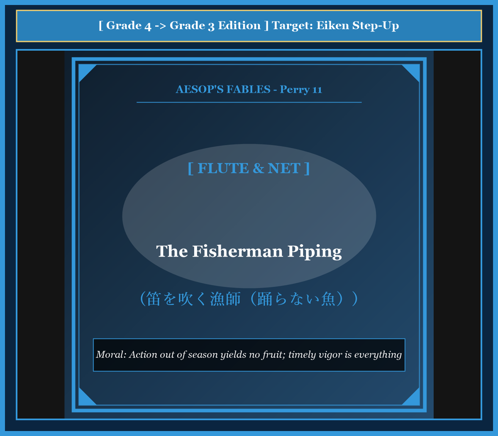

# Chapter 58: The Fisherman Piping (笛を吹く漁師)

<!-- 電子書籍 Page Break & Image Header -->

  

## 1. Benchmark Level: Eiken Grade 4 (英検4級レベル本文)
*Read in ~1.5 to 2 minutes. Simple vocabulary and basic syntax.*

A young fisherman lived in a small house near the blue sea. He loved music very much. He played a small wooden flute beautifully every evening. He was also a fisherman who caught fish to sell at the village market.

One morning, he had a strange idea. "Fish love dancing," he thought. "If I play my sweet music, they will hear it and jump out of the water onto the sand. Then I will not need to pull heavy wet nets all day!"

So he took his flute and a wicker basket to the seashore. He stood on a high rock above the clear blue water.

He put the flute to his lips and began to play. He played merry tunes, soft songs, and lively dance music. He played for hours under the warm sun, tapping his feet.

However, not a single fish jumped onto the shore. The ocean remained calm, and the fish swam peacefully deep in the water, ignoring his songs.

The fisherman grew tired and angry. He put his flute away into his pocket. He picked up his large, heavy net and cast it far into the waves. In a few minutes, he pulled the net back. It was filled with dozens of flapping, jumping fish!

He dumped the fish out onto the dry sand. The fish began to flip and bounce desperately in the air.

The fisherman looked at them and laughed bitterly: "You foolish creatures! When I played music for you, you refused to dance. But now that I have stopped playing, you dance with all your might!"

---

## 2. Target Level: Eiken Grade 3 (英検3級レベル本文)
*Read in ~2 to 2.5 minutes. Richer vocabulary and natural sentence flow.*

A coastal fisherman who was renowned throughout his village as a talented piper journeyed to the rocky seashore one morning. Carrying both his musical pipe and his fishing gear, he conceived an eccentric experiment.

Having heard ancient myths that marine creatures were charmed by acoustic harmonies, he believed he could entice the fish to beach themselves voluntarily. "Why should I exhaust my strength casting and hauling heavy nets," he mused, "when I can simply charm them into leaping into my basket?"

Perching upon a rocky promontory overlooking the azure tide, the fisherman placed the instrument to his lips. He played lively pastoral melodies, followed by festive dance tunes that echoed across the waves. For hours he performed under the blazing sun, watching the transparent water with eager anticipation.

Yet the ocean remained utterly indifferent. The fish swam languidly through the kelp forests below, completely oblivious to his musical serenades.

Frustrated by his total failure, the piper finally recognized the futility of his approach. Relinquishing his instrument, he gathered his heavy casting net, hurled it into the surf, and hauled it ashore with practiced vigor. The mesh teemed with an abundant harvest of gasping, thrashing fish.

As he emptied the catch onto the dry gravel, the fish flopped frantically beneath the sun, leaping and convulsing in desperate bids for survival.

Observing their chaotic spasms, the fisherman addressed them with sarcastic irony: "What contrary and unreasonable creatures you are! When I piped delightful tunes to invite your merriment, you stubbornly refused to dance. Yet now that the music has ceased, you perform the most energetic dance of your lives!"

---

## 3. Classic Original English Text (イソップ寓話クラシック原文)
*Translated by George Fyler Townsend (1867)*

A Fisherman who was also a flute player took his pipes and nets to the seashore. Standing on a rock, he played beautiful tunes, hoping the fish would be charmed by his music and jump out onto the shore. When not a single fish appeared, he put down his pipe, cast his net, and hauled in a great catch. Throwing the flopping fish onto the sand, he said: "O foolish creatures, you would not dance when I piped, but now that I have stopped, you dance merrily!"

---

### 🏛️ 【英検2級レベルで読み解く！クラシック原文の重要構文・英文法ノート】
1. **1. 分詞構文（Participle Clause: 付帯状況・理由）**
   - **原文**: *"The Hare, believing her assertion to be simply impossible, agreed to the proposal..."*
   - **解説**: 「〜と信じ込んでいたので」という理由を表す分詞構文。英検2級の長文読解・ライティングの最頻出構文です。
1. **2. 古典的仮定法現在（Subjunctive Mood）**
   - **原文**: *"Though you be swift as the wind, I will beat you in a race."*
   - **解説**: 譲歩節 `Though` の中で原形 `be` を用いる古典的な仮定法現在（現代英語の `Though you are...`）。格調高い古典の響きを持ちます。
1. **3. 過去分詞の後置修飾（Postpositive Participle）**
   - **原文**: *"On the day appointed for the race the two started together."*
   - **解説**: `appointed`（定められた・指定された）が直前の名詞 `the day` を後ろから修飾する構文です。

### 📜 【クラシック原文の重要語彙・古風表現（Classic Antique Vocabulary）】
- **retort** [動] 2級 **（機転を利かせて）言い返す、反論する**（現代の reply sharp/wittily に相当）
- **assertion** [名] 2級/準1級 **主張、断言**（動詞 assert の名詞形。2級長文定番）
- **wayside** [名] 2級 **道端、沿道**（by the wayside（道端に、途中で））
- **fatigue** [名] 2級 **（心身の）極度の疲労、疲れ**（tiredness の上位フォーマル語）

---

## 4. Japanese Translation & Moral (日本語訳と教訓)

### 【日本語全訳：英検3級レベル本文】
才能豊かな笛吹きとして村中で知られていた沿岸の漁師が、ある朝、岩だらけの海岸へと出かけました。楽器の笛と漁具の両方を携えて、彼は奇妙な実験を思いついたのです。

海の生き物たちは音響的なハーモニー（美しい音楽）に魅了されるという古代の神話を聞いていた彼は、魚たちを誘惑して自発的に浜辺へと飛び上がらせることができると信じ込んでいました。「甘美な音楽でカゴの中へと魚たちを飛び込ませることができるというのに、なぜ重い網を投げて引き揚げることに体力を消耗させねばならないのか」と彼は思案したのです。

青い潮を見下ろす岩がちの岬の上に腰掛け、漁師は楽器を唇に当てました。彼は陽気な牧歌的メロディを奏で、続いて波間にこだまする華やかなダンス曲を演奏しました。熱い太陽の下で何時間も演奏を続け、彼は熱心な期待をもって透明な水面を見つめていました。

しかしながら、大洋は完全に無関心なままでした。魚たちは下の昆布の森を物憂げに泳ぎ回り、彼の音楽的セレナーデにまったく気づきもしませんでした。

完全な失敗に苛立った笛吹きは、ついに自らの手法の無益さを認めました。楽器を手放すと、彼は重い投網をかき集めて波打ち際へと投げ込み、熟練した力強さでそれを岸へと引き揚げました。網の目は、あえぎ暴れる魚たちの豊饒な収穫で満ち溢れていました。

乾いた砂利の上に獲物をぶちまけると、魚たちは太陽の下で必死にのたうち回り、生存をかけた捨て身の試みとして飛び跳ね、痙攣しました。

彼らの混沌とした痙攣を観察しながら、漁師は皮肉な皮肉を込めて彼らに語りかけました。「なんと天邪鬼（あまのじゃく）で理不尽な生き物たちだろう！ 私がお前たちの歓喜を誘うために素晴らしい曲を奏でていたときには、お前たちは頑として踊ることを拒んだ。それなのに音楽が終わった今になって、お前たちは生涯で最も精力的なダンスを披露しているではないか！」

### 【教訓（Moral）】
**Action out of season yields no fruit; timely vigor is everything.**  
（時機を逸した行動は何の意味も持たない。求められている時に動かず、手遅れになってから慌てて跳ね回っても、もはや何の成果も得られず破滅を免れない。）

---

## 5. Recite & Compare: そらんじたいキーフレーズ対比カード

  
フレーズ 1：音楽で魚を飛び上がらせる奇妙な思いつき

  
4級If I play my sweet music, they will jump out of the water.

  
3級He believed he could entice the fish to beach themselves voluntarily.

  
<strong>解説：</strong>動詞「entice（誘惑する）」と「beach themselves（自ら浜に乗り上げる）」の洗練表現です。

  
フレーズ 2：音楽のセレナーデに完全に気づかない魚たち

  
4級The fish swam peacefully deep in the water, ignoring his songs.

  
3級The fish swam languidly below, completely oblivious to his musical serenades.

  
<strong>解説：</strong>「oblivious to ...（〜に完全に気づいていない）」を用いた格調高い客観描写です。

  
フレーズ 3：手法の無益さを悟り網を放り投げる

  
4級The fisherman grew tired. He picked up his net and cast it.

  
3級Recognizing the futility of his approach, he hurled his casting net into the surf.

  
<strong>解説：</strong>分詞構文「Recognizing the futility of...（手法の無益さを認識して）」の重要構文です。

  
フレーズ 4：演奏中は踊らず、終わってから踊り出す皮肉

  
4級When I played, you refused to dance. Now that I stopped, you dance!

  
3級When I piped to invite your merriment, you refused. Yet now that the music ceased, you dance!

  
<strong>解説：</strong>対比の接続詞「when」と「now that」を呼応させた修辞的クライマックスです。

---

## 6. Key Vocabulary & Exam Notes (英検3級 重要語彙・文法・面接対策)

### 1. 英検3級 必須ボキャブラリー
* **eccentric** [形] 風変わりな、奇妙な
* **entice** [動] 〜を誘惑する、おびき寄せる
* **promontory** [名] 岬、突き出た崖
* **languidly** [副] 物憂げに、だるそうに
* **oblivious** [形] 気づいていない、忘れている（*oblivious to*）
* **futility** [名] 無益、無駄、効果のないこと
* **contrary** [形] 天邪鬼な、正反対の
* **cease** [動] 終わる、やむ、中止する

### 2. 文法・構文のチェックポイント
* **entice + O + to do**:
  * 「Oを誘惑して〜させる」。*persuade* や *encourage* の誘惑版として重要です。
* **Recognizing + 名詞, S + V**:
  * 分詞構文（時・理由）。「〜を認識して、Sは…した」。

### 3. スピーキング（面接）＆ライティング活用ヒント
* タイミングを逃した投資や危機対応の遅れについて、*Delayed compliance that occurs after catastrophic failure resembles the fish dancing only after the net has landed.* と比喩的に展開できます。

