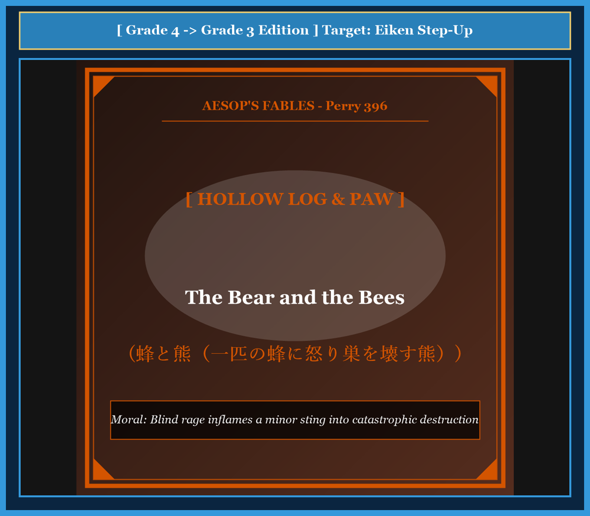

# Chapter 59: The Bear and the Bees (蜂と熊)

<!-- 電子書籍 Page Break & Image Header -->

  

## 1. Benchmark Level: Eiken Grade 4 (英検4級レベル本文)
*Read in ~1.5 to 2 minutes. Simple vocabulary and basic syntax.*

A big brown bear was walking through a quiet green forest. He was hungry and looking for sweet wild berries.

As he walked past an old hollow log, a small worker bee flew out. The bee was nervous because the bear was so close. The bee buzzed angrily and stung the bear right on the tip of his nose!

Ouch! The bear felt a sharp, burning pain on his nose. He rubbed his face with his paw, but the pain did not go away.

Instead of walking away calmly, the bear lost his temper completely. He roared in fury. He opened his big mouth and showed his sharp teeth.

"You tiny bug!" shouted the angry bear. "How dare you sting my royal nose! I will smash your home to pieces!"

The bear jumped on the hollow log. He used his giant claws and heavy weight to tear the wood apart. He smashed the honeycomb and broke the entrance.

Immediately, thousands of angry bees poured out of the log like a black cloud. They were furious that their home was destroyed.

The bees attacked the bear from all sides. They stung him in his ears, on his eyelids, around his mouth, and on his neck.

The screaming bear ran blindly through the forest, jumping into bushes and rolling in the dirt. He barely reached a deep river and jumped into the water to save his life.

Lying in the cold water with hundreds of painful stings, the miserable bear cried: "How foolish I was! Because of one tiny sting, I became mad with anger, and now my whole body is on fire!"

---

## 2. Target Level: Eiken Grade 3 (英検3級レベル本文)
*Read in ~2 to 2.5 minutes. Richer vocabulary and natural sentence flow.*

A massive brown bear was foraging for nourishment through a dense pine forest. As he brushed past a fallen, hollow timber, an agitated honeybee emerged from the darkness. Perceiving the colossal mammal as a hostile threat to the hive, the bee darted forward and planted a painful sting directly on the tip of the bear's sensitive nose.

Afflicted by the sharp sting, the bear was seized by an uncontrollable paroxysm of rage. Rather than ignoring the minor inconvenience and continuing his journey, he allowed wounded pride to overpower his rational judgment.

Growling with savage indignation, the bear launched a ferocious assault upon the hollow log. With his formidable claws and immense physical strength, he began tearing the rotting bark to splinters, intent on annihilating the entire nest.

However, his violent vandalism triggered an immediate catastrophe. Aroused by the destruction of their sanctuary, the entire colony—tens of thousands of aggressive defenders—surged out of the shattered log like an ominous storm cloud.

Before the bear could retreat, the furious swarm engulfed his massive head. The insects stung him mercilessly in his nostrils, across his tender eyelids, inside his ears, and upon every unprotected patch of skin.

Howling in excruciating agony, the frantic beast galloped blindly through the forest, crashing through brambles and thrashing against trees. He finally plunged into the freezing waters of a mountain stream, submerging his swollen head beneath the surface to escape total extermination.

Exhausted, battered, and covered in hundreds of throbbing welts, the chastened bear lamented his catastrophic error: "What utter madness! In seeking reckless vengeance for a single insignificant prick, I provoked an entire army and brought overwhelming torment upon myself."

---

## 3. Classic Original English Text (イソップ寓話クラシック原文)
*Translated by George Fyler Townsend (1867)*

A Bear was stung by a single bee that flew out of a hollow tree. Enraged by the pain, the Bear attacked the hive with claws and teeth, tearing it apart. Thereupon the whole swarm poured out and attacked him, stinging him mercilessly about the eyes, ears, and nose. The Bear barely escaped with his life, lamenting that a moment's rage over one tiny sting had brought him hundreds of painful wounds.

---

### 🏛️ 【英検2級レベルで読み解く！クラシック原文の重要構文・英文法ノート】
1. **1. 分詞構文（Participle Clause: 付帯状況・理由）**
   - **原文**: *"The Hare, believing her assertion to be simply impossible, agreed to the proposal..."*
   - **解説**: 「〜と信じ込んでいたので」という理由を表す分詞構文。英検2級の長文読解・ライティングの最頻出構文です。
1. **2. 古典的仮定法現在（Subjunctive Mood）**
   - **原文**: *"Though you be swift as the wind, I will beat you in a race."*
   - **解説**: 譲歩節 `Though` の中で原形 `be` を用いる古典的な仮定法現在（現代英語の `Though you are...`）。格調高い古典の響きを持ちます。
1. **3. 過去分詞の後置修飾（Postpositive Participle）**
   - **原文**: *"On the day appointed for the race the two started together."*
   - **解説**: `appointed`（定められた・指定された）が直前の名詞 `the day` を後ろから修飾する構文です。

### 📜 【クラシック原文の重要語彙・古風表現（Classic Antique Vocabulary）】
- **retort** [動] 2級 **（機転を利かせて）言い返す、反論する**（現代の reply sharp/wittily に相当）
- **assertion** [名] 2級/準1級 **主張、断言**（動詞 assert の名詞形。2級長文定番）
- **wayside** [名] 2級 **道端、沿道**（by the wayside（道端に、途中で））
- **fatigue** [名] 2級 **（心身の）極度の疲労、疲れ**（tiredness の上位フォーマル語）

---

## 4. Japanese Translation & Moral (日本語訳と教訓)

### 【日本語全訳：英検3級レベル本文】
巨大なヒグマが鬱蒼としたマツの森の中を、食料を求めて徘徊していました。彼が倒れてうろのできた材木のそばをかすめて通り過ぎたとき、興奮した一匹のミツバチが暗闇から飛び出してきました。その巨大な哺乳類を巣に対する敵対的な脅威と認識した蜂は、前へと突進し、クマの敏感な鼻の頭に直接、痛烈な一刺しを浴びせました。

鋭い痛みに苛まれ、クマは制御不能な激怒の発作に襲われました。些細な不快感を無視して旅を続けるどころか、彼は傷つけられたプライドによって理性的判断を圧倒させてしまったのです。

獰猛な憤怒とともに唸り声を上げながら、クマはうろのある丸太に対する激しい急襲を開始しました。その恐るべき爪と巨大な物理的怪力をもって、彼は巣全体を壊滅させようと意図し、腐りかけた樹皮を木っ端微塵に引き裂き始めました。

しかしながら、彼の暴力的な破壊行為は即座の破滅を引き起こしました。聖域の破壊によって怒り狂ったコロニー全体（何万匹もの攻撃的な防衛軍）が、不吉な嵐の雲のように粉々になった丸太から押し寄せてきたのです。

クマが退却する暇もなく、猛り狂った大群がその巨大な頭部を包み込みました。昆虫たちは彼の鼻孔、繊細なまぶた、耳の内部、そしてあらゆる保護されていない皮膚の隙間を容赦なく刺し続けました。

耐え難い苦痛のあまり遠吠えを上げながら、狂乱した獣は森の中を盲目的に疾走し、野ばらの茂みを突き破り、木々に体を激突させました。彼は最終的に山あいの小川の凍てつく水の中へと飛び込み、完全な殺戮から逃れるために腫れ上がった頭部を水面下へと沈めました。

疲労困憊し、打ちのめされ、何百もの疼く腫れ物に覆われながら、懲らしめられたクマは自らの破滅的な過ちを嘆きました。「なんという純然たる狂気だろう！ たった一刺しの些細な傷に対する見境なき復讐を求めたばかりに、私は軍隊全体を挑発し、自らに圧倒的な苦痛を招き寄せてしまったのだ。」

### 【教訓（Moral）】
**Blind rage inflames a minor sting into catastrophic destruction.**  
（一時の些細な痛手や侮辱に対して理性を失って激怒し、過剰な報復を仕掛ける者は、相手の組織全体を敵に回して何百倍もの壊滅的打撃を自らに招く。）

---

## 5. Recite & Compare: そらんじたいキーフレーズ対比カード

  
フレーズ 1：些細な不快感を無視できず理性を失う

  
4級Instead of walking away calmly, the bear lost his temper.

  
3級Rather than ignoring the minor inconvenience, he allowed wounded pride to overpower his judgment.

  
<strong>解説：</strong>「Rather than + 動名詞」と「overpower rational judgment」を用いた高度な心理描写です。

  
フレーズ 2：巣全体を壊滅させようと暴力を振るう

  
4級He used his giant claws to tear the wood apart.

  
3級With his formidable claws, he began tearing bark to splinters, intent on annihilating the nest.

  
<strong>解説：</strong>「tear A to splinters（Aを粉々に引き裂く）」と「intent on + 動名詞（〜を企図して）」の表現です。

  
フレーズ 3：何万匹もの防衛軍が嵐のように湧き出す

  
4級Thousands of angry bees poured out of the log like a cloud.

  
3級Tens of thousands of defenders surged out of the shattered log like an ominous storm cloud.

  
<strong>解説：</strong>比喩表現「surged out ... like an ominous storm cloud」の迫力ある英文です。

  
フレーズ 4：一匹の蜂への復讐が軍隊全体を挑発した

  
4級Because of one tiny sting, my whole body is on fire!

  
3級In seeking reckless vengeance for a single prick, I provoked an entire army.

  
<strong>解説：</strong>「seeking reckless vengeance（見境のない復讐を求めて）」という決定的な教訓フレーズです。

---

## 6. Key Vocabulary & Exam Notes (英検3級 重要語彙・文法・面接対策)

### 1. 英検3級 必須ボキャブラリー
* **agitated** [形] 動揺した、興奮した
* **paroxysm** [名] （感情・病気の）激発、発作（*paroxysm of rage*）
* **vandalism** [名] 器物破損、蛮行
* **annihilate** [動] 〜を全滅させる、壊滅させる
* **ominous** [形] 不吉な、険悪な
* **excruciating** [形] 耐え難い、極痛の（*excruciating pain*）
* **chastened** [形] 懲らしめられた、反省した
* **vengeance** [名] 復讐、報復（*revenge* の重い語）

### 2. 文法・構文のチェックポイント
* **Rather than + 動名詞 ..., S + V**:
  * 「〜するのではなくむしろ…した」。対照的な選択肢を比較する重要構文です。
* **intent on + 動名詞 / 名詞**:
  * 「〜に専念して、〜を目論んで」。強い意志や執念を表します。

### 3. スピーキング（面接）＆ライティング活用ヒント
* 些細な挑発に対する過剰反応の自滅リスクについて、*Emotional overreaction to minor slights frequently triggers disproportionate institutional blowback.* と論証できます。

