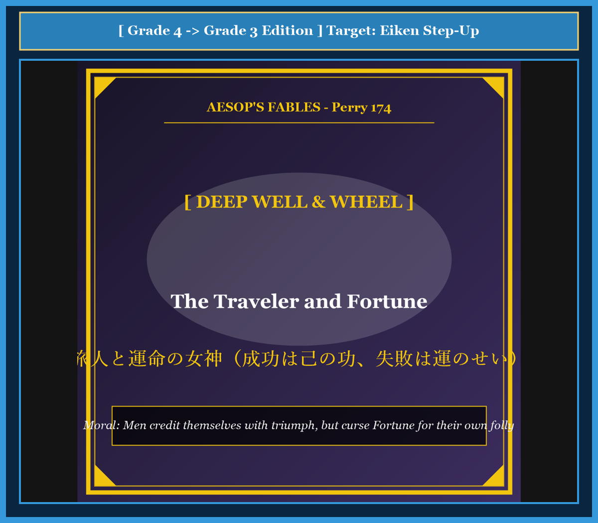

# Chapter 60: The Traveler and Fortune (旅人と運命の女神)

<!-- 電子書籍 Page Break & Image Header -->

  

## 1. Benchmark Level: Eiken Grade 4 (英検4級レベル本文)
*Read in ~1.5 to 2 minutes. Simple vocabulary and basic syntax.*

A tired traveler was walking along a lonely mountain road. He had been walking for many days under the hot sun. His boots were worn out, and his legs felt like heavy stones.

Near the road, he found an old stone well. The well was very deep, and the stone walls were broken and slippery.

The foolish traveler sat down right on the edge of the well. He closed his eyes and immediately fell into a deep sleep. His head leaned over the dark hole. If he moved even one inch in his sleep, he would fall into the water and die!

Just at that dangerous moment, the goddess Fortune appeared in the air. She wore a bright golden robe and had wings like light.

Fortune looked at the sleeping man and tapped him gently on his shoulder.

"Wake up, my friend!" whispered the goddess softly.

The traveler woke up with a start. He looked down into the dark abyss and jumped backward in terror.

The goddess Fortune smiled calmly and said to him:

"You should thank me for waking you. But remember this lesson: if you had fallen into that deep well and drowned, your friends and family would not blame your own foolish laziness. Instead, they would point their fingers at me and cry: 'Oh, cruel Fortune! Bad luck killed him!' Humans always take credit for their good luck, but they always blame Fortune for their own stupid mistakes."

With those wise words, the goddess vanished into the clouds.

---

## 2. Target Level: Eiken Grade 3 (英検3級レベル本文)
*Read in ~2 to 2.5 minutes. Richer vocabulary and natural sentence flow.*

A weary traveler had journeyed for many exhausting days across an arid and desolate plateau. His provisions were nearly depleted, his garments were stained with road dust, and his limbs trembled with profound fatigue.

Stumbling upon an ancient stone cistern situated beside the road, the exhausted wayfarer sought immediate repose. The well was perilous: its brick rim had partially collapsed, and the dark shaft descended vertically into cold, bottomless water.

Disregarding all rudimentary instincts of self-preservation, the reckless traveler sat down directly on the precipitous ledge and drifted into an unconscious slumber. His torso swayed precarious above the abyss; the slightest inadvertent movement would cause him to plunge headlong to his doom.

At that critical juncture, the personification of Fortune materialized before the sleeping mortal, enveloped in radiant celestial splendor.

Approaching the brink with graceful footsteps, the goddess shook the traveler's shoulder and summoned him back to consciousness: "Awake, heedless mortal, and retreat from this lethal precipice!"

The traveler gasped in horror as he recognized that he had been slumbering inches from absolute catastrophe.

Before the trembling wanderer could utter an apology, Fortune addressed him with piercing philosophical clarity:

"Recognize your deliverance, foolish traveler. Yet reflect upon human hypocrisy: had you plummeted into that aqueous chasm, your acquaintances would never have attributed the disaster to your own gross negligence. Invariably, they would have reviled Fortune, lamenting that ill luck had claimed an innocent victim. Mortals perpetually ascribe their successes to personal genius, yet stubbornly blame Fortune for the inevitable consequences of their own folly."

---

## 3. Classic Original English Text (イソップ寓話クラシック原文)
*Translated by George Fyler Townsend (1867)*

A tired Traveler lay down and fell asleep right at the slippery edge of a deep well. Fortune appeared beside him, woke him, and said: "Rise, my friend, and depart. For if you had fallen into the well, men would not have blamed your own reckless carelessness, but would have cursed Fortune for your death!"

---

### 🏛️ 【英検2級レベルで読み解く！クラシック原文の重要構文・英文法ノート】
1. **1. 分詞構文（Participle Clause: 付帯状況・理由）**
   - **原文**: *"The Hare, believing her assertion to be simply impossible, agreed to the proposal..."*
   - **解説**: 「〜と信じ込んでいたので」という理由を表す分詞構文。英検2級の長文読解・ライティングの最頻出構文です。
1. **2. 古典的仮定法現在（Subjunctive Mood）**
   - **原文**: *"Though you be swift as the wind, I will beat you in a race."*
   - **解説**: 譲歩節 `Though` の中で原形 `be` を用いる古典的な仮定法現在（現代英語の `Though you are...`）。格調高い古典の響きを持ちます。
1. **3. 過去分詞の後置修飾（Postpositive Participle）**
   - **原文**: *"On the day appointed for the race the two started together."*
   - **解説**: `appointed`（定められた・指定された）が直前の名詞 `the day` を後ろから修飾する構文です。

### 📜 【クラシック原文の重要語彙・古風表現（Classic Antique Vocabulary）】
- **retort** [動] 2級 **（機転を利かせて）言い返す、反論する**（現代の reply sharp/wittily に相当）
- **assertion** [名] 2級/準1級 **主張、断言**（動詞 assert の名詞形。2級長文定番）
- **wayside** [名] 2級 **道端、沿道**（by the wayside（道端に、途中で））
- **fatigue** [名] 2級 **（心身の）極度の疲労、疲れ**（tiredness の上位フォーマル語）

---

## 4. Japanese Translation & Moral (日本語訳と教訓)

### 【日本語全訳：英検3級レベル本文】
疲労困憊した旅人が、乾燥して荒涼とした高原を何日も過酷な旅を続けていました。彼の食料はほぼ枯渇し、衣服は街道の埃で汚れ、その手足は深い疲労のために震えていました。

街道のそばに位置していた古い石造りの貯水井戸に偶然出くわした疲れた旅人は、即座の休息を求めました。その井戸は危険極まりないものでした。レンガの縁は部分的に崩壊し、暗い立て坑が冷たく底知れない水の中へと垂直に降下していたのです。

自己保存の初歩的な本能をすべて無視して、無謀な旅人は切り立った崖のような井戸の縁に直接腰を下ろし、無意識の眠りへと落ちていきました。彼の胴体は深淵の上で不安定に揺れ動いていました。眠りの中でのほんのわずかな不注意な身動き一つが、彼を自らの破滅へと真っ逆さまに転落させる状況だったのです。

その危機的な瞬間、輝かしい天上の光彩に包まれながら、運命の女神フォーチュンの擬人化された姿が、眠れる定命の人間の前に出現しました。

優雅な足取りで縁へと近づいた女神は、旅人の肩を揺さぶり、彼を意識へと呼び戻しました。「目を覚ましなさい、軽率な定命の者よ。そしてこの致死的な断崖から退きなさい！」

旅人は、自分が絶対的な大惨事からわずか数インチのところで眠りこけていたことを認識し、恐怖のあまり息を呑みました。

震える放浪者が謝罪を口にする間もなく、運命の女神は鋭い哲学的明晰さをもって彼に語りかけました。

「自らが救われたことを認識しなさい、愚かな旅人よ。そして人間の偽善を省みるのです。もしあなたがその水底の裂け目へと急落していたなら、あなたの知人たちは決してその惨事をあなた自身の甚だしい過失に帰することはなかったでしょう。彼らは決まって運命を罵倒し、悪運が無実の犠牲者を奪ったと嘆いたはずです。人間は自らの成功を常に個人の才能に帰属させるくせに、自らの愚行の不可避の結末については、頑固に運命のせいにするものなのですから。」

### 【教訓（Moral）】
**Men credit themselves with triumph, but curse Fortune for their own folly.**  
（人間は自らの成功や幸運を『自分の実力と才能』の賜物だと誇る一方で、自らの怠慢や過失による失敗については『運が悪かった、運命のいたずらだ』と責任転嫁する身勝手な生き物である。）

---

## 5. Recite & Compare: そらんじたいキーフレーズ対比カード

  
フレーズ 1：自己保存の本能を無視して井戸の縁で眠る

  
4級He sat down on the edge of the well and fell asleep.

  
3級Disregarding all instincts of self-preservation, he drifted into slumber on the ledge.

  
<strong>解説：</strong>分詞構文「Disregarding all instincts of self-preservation」による高度な導入です。

  
フレーズ 2：不注意なわずかな動きが転落死を招く

  
4級If he moved even one inch, he would fall and die.

  
3級The slightest inadvertent movement would cause him to plunge to his doom.

  
<strong>解説：</strong>仮定法的なニュアンスを持つ主語「The slightest inadvertent movement」を用いた無生物主語構文です。

  
フレーズ 3：過失を顧みず運命のせいにする人間の偽善

  
4級They would not blame your laziness, but would cry: 'Bad luck killed him!'

  
3級They would never have attributed disaster to negligence, but would have reviled Fortune.

  
<strong>解説：</strong>仮定法過去完了「would have attributed A to B（AをBのせいにしただろう）」の重要構文です。

  
フレーズ 4：成功は己の功、失敗は運のせいにする身勝手さ

  
4級Humans take credit for good luck, but blame Fortune for stupid mistakes.

  
3級Mortals ascribe successes to personal genius, yet blame Fortune for their own folly.

  
<strong>解説：</strong>格言の対比構造「ascribe A to B, yet blame C for D」を用いた最高格式の結びです。

---

## 6. Key Vocabulary & Exam Notes (英検3級 重要語彙・文法・面接対策)

### 1. 英検3級 必須ボキャブラリー
* **arid** [形] 乾燥した、不毛の（*arid climate*）
* **cistern** [名] 貯水槽、井戸
* **precipitous** [形] 険しい、切り立った、急な
* **inadvertent** [形] うっかりした、不注意な、偶然の
* **plunge** [動] 突っ込む、急落する、身を投げる
* **negligence** [名] 怠慢、過失（*gross negligence* = 重過失）
* **ascribe** [動] 〜を（…のせいに）帰する（*ascribe A to B*）
* **folly** [名] 愚行、愚かさ

### 2. 文法・構文のチェックポイント
* **ascribe + A + to + B**:
  * 「AをBの成果・原因とみなす」。学術・評論で *attribute A to B* と並ぶ最重要動詞です。
* **The slightest + 名詞 + would ...**:
  * 無生物主語による仮定表現。「ほんのわずかな〜でも…だろう」。

### 3. スピーキング（面接）＆ライティング活用ヒント
* 自己帰属バイアス（成功は内因、失敗は外因に帰する心理）について、*Behavioral psychologists note that individuals routinely exhibit self-serving bias, ascribing victories to merit while blaming fortune for negligence.* と論述できます。

