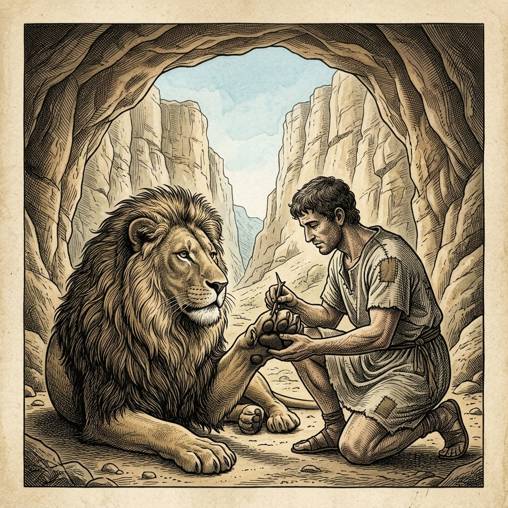
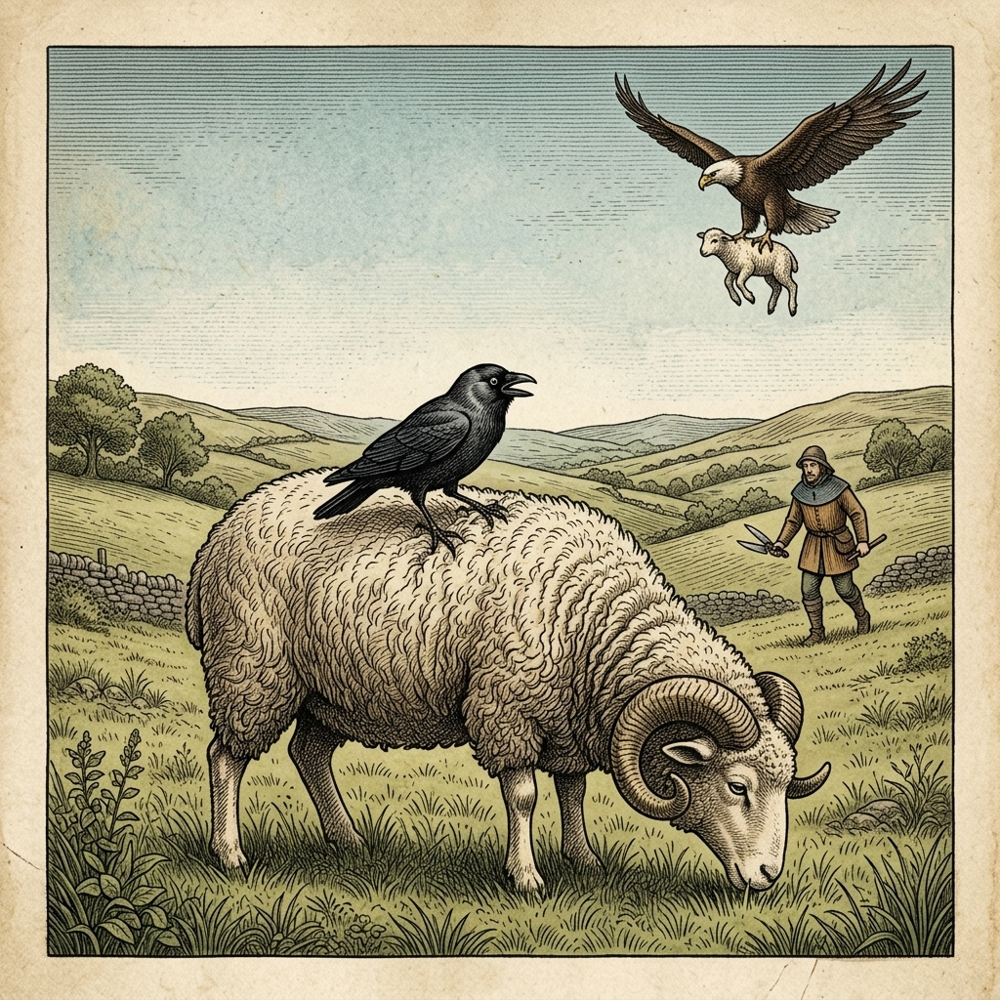
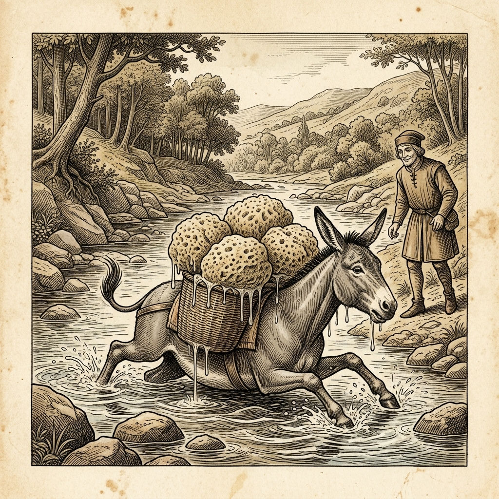

# 『英検ステップアップ多読：イソップ寓話編 第11巻（準2級 ➔ 2級対比学習・第3集）』

---

## はじめに：なぜ「対比多読」で英検2級の壁を突破できるのか？

英検2級は、高校卒業・大学入試レベルの英語力を証明する極めて重要なマイルストーンです。

準2級までは日常的な文脈や具体的なストーリー描写が中心でしたが、2級からは**「抽象度の高い語彙（*virtue*, *deception*, *folly* 等）」**、**「複文の重層的な構文展開」**、そして**「説得力のある論理的エッセイ構造」**が求められます。

本書では、イソップ寓話（第3集・10話）を題材に、**「知っている準2級英語」** が **「合格レベルの2級洗練英語」** へとどのように高まっていくかを対比学習します。

* **ストーリーの把握（準2級）** で物語の骨格と情景をクリアに理解
* **洗練された高度構文（2級）** でフォーマルな語彙・倒置・無生物主語構文・独立分詞構文を吸収
* **暗唱キーフレーズ対比** で英作文（意見論述要約）や二次面接で高得点を叩き出す表現力を獲得

楽しく寓話を読みながら、英検2級合格に直結する真の実力を養いましょう！

---

## 本書の収録作品（第3集・全10話）

1. **Chapter 21**: アンドロクロスとライオン (*Androcles and the Lion*) [Perry 563]
2. **Chapter 22**: キツネとカラス (*The Fox and the Crow*) [Perry 124]
3. **Chapter 23**: 木こりと死神 (*The Old Man and Death*) [Perry 60]
4. **Chapter 24**: 鷲とカラス (*The Eagle and the Jackdaw*) [Perry 2]
5. **Chapter 25**: キツネと仮面 (*The Fox and the Mask*) [Perry 27]
6. **Chapter 26**: 鹿と池の影 (*The Stag at the Pool*) [Perry 74]
7. **Chapter 27**: 太陽とカエルたちの結婚 (*The Frogs and the Sun*) [Perry 314]
8. **Chapter 28**: ロバと荷物 (*The Ass and the Load of Salt*) [Perry 180]
9. **Chapter 29**: キツネと木こり (*The Fox and the Woodman*) [Perry 22]
10. **Chapter 30**: オオカミと子羊 (*The Wolf and the Lamb*) [Perry 155]

---

## 本書の構成と電子書籍 / Kobo最適化

各章は以下の6段階で構成されています。

```text
┌─────────────────────────────────────────────────────────────┐
│ 1. Chapter Title & Visual Illustration (章タイトル ＆ 挿絵)   │
│ 2. Benchmark Level: 英検準2級レベル英文                       │
│ 3. Target Level: 英検2級レベル英文                           │
│ 4. Classic Original English Text (イソップ寓話クラシック原文)  │
│ 5. Japanese Translation (日本語訳 ＆ 教訓)                     │
│ 6. Recite & Compare (そらんじたいキーフレーズ対比カード)        │
│ 7. Key Vocabulary & Exam Notes (語彙・文法・試験対策解説)        │
└─────────────────────────────────────────────────────────────┘
```

> **【ポイント】 音声読み上げ（TTS）をご利用の方へ**
> 本文セクション（ステップ1〜3）は英語のみで構成されており、電子書籍やKoboの自動音声読み上げ機能（Text-to-Speech）で日本語が混ざることなく、美しい英語音声で快適にリスニング学習していただけます。


# Chapter 21: Androcles and the Lion (アンドロクロスとライオン)

<div style="text-align: center; margin-bottom: 20px;">
  
</div>

## 1. Benchmark Level: Eiken Pre-2 (英検準2級レベル本文)
*Read in ~2 to 2.5 minutes. Advanced vocabulary and structured clauses.*

Subjected to intolerable tyranny under an oppressive Roman patrician, an enslaved youth named Androcles orchestrated a desperate escape into the remote wilderness. Wandering aimlessly through dense woodlands in search of sanctuary, he sought refuge within a secluded subterranean cavern.

His uneasy solitude was shattered when an immense lion entered the cavern, uttering deep groans of distress. Paralyzed with terror, Androcles anticipated immediate slaughter. However, upon closer observation, he discerned that the majestic carnivore was incapacitated by severe agony. The beast timidly extended its inflamed forepaw, in which a formidable thorn was deeply lodged. Recognizing an opportunity for mutual survival, the fugitive suppressed his dread and meticulously extracted the foreign object, subsequently cleansing the festering puncture. Profoundly indebted to his benefactor, the noble creature exhibited gentle affection, sharing its cavern and provisions with Androcles for several months.

Tragically, imperial legionaries eventually apprehended the fugitive, transporting him to the capital where he was sentenced to suffer public execution by combat with famished carnivores in the Circus Maximus. On the fateful afternoon, an immense assembly of spectators cheered ruthlessly as Androcles was abandoned unarmed in the amphitheater. A ravenous lion, deliberately starved to amplify its ferocity, was unleashed from its subterranean cage.

The beast bounded furiously across the arena; nevertheless, upon identifying the defenseless captive, its predatory aggression instantly evaporated. Subdued by affectionate recognition, the magnificent predator bowed reverently and caressed Androcles's limbs. Bewildered by this extraordinary phenomenon, the Roman emperor interrogated the slave regarding the miracle. Thoroughly captivated by the narrative of cross-species compassion and reciprocal loyalty, the sovereign granted full imperial pardon to Androcles and restored the noble lion to its native habitat.

Genuine benevolence transcends the boundaries of species, proving that compassionate deeds inevitably yield unexpected salvation.

---

## 2. Target Level: Eiken Grade 2 (英検2級レベル本文)
*Read in ~3 to 4 minutes. Academic discourse, complex participial structures, formal vocabulary, and nuanced transitions.*

Under the institutionalized brutality of imperial Roman servitude, an enslaved domestic subordinate named Androcles endured systematic dehumanization beneath a patrician master whose despotism bordered on psychopathy. Recognizing that continued subservience guaranteed physical and spiritual attrition, the desperate youth executed a clandestine evasion into the arid hinterlands of North Africa, ultimately seeking provisional asylum within the recesses of a subterranean limestone grotto.

This precarious equilibrium was shattered when an apex mammalian carnivore—an immense male Barbary lion—staggered into the sanctuary, emitting guttural lamentations indicative of physiological distress. Paralyzed by mortal dread, the fugitive prepared for instantaneous evisceration; nevertheless, acute empirical observation revealed that the colossal predator was rendered non-lethal by acute physical disability. Trembling with trepidation yet recognizing a moral imperativeness, Androcles approached the recumbent beast, discerning a calcified acacia spine deeply embedded within the suppurating tissue of its right forepaw. Mobilizing rudimentary surgical dexterity, the fugitive extracted the invasive obstruction and meticulously debrided the infected wound. What commenced as an alliance of desperation rapidly evolved into an interspecies symbiosis; bound by reciprocal fidelity, the carnivore routinely provisioned the grotto with fresh game, sustaining their subterranean cohabitation for over three continuous years.

Inevitably, Roman military patrols combing the frontier apprehended the fugitive, repatriating him to the metropolis where judicial authorities condemned him to damnatio ad bestias—execution by exposure to ravenous beasts in the imperial amphitheater. On the day of spectacle, before tens of thousands of bloodthirsty plebeians, Androcles was deposited defenseless in the sand, while a famished feline predator, starved for consecutive days to optimize lethal aggression, was propelled from the subterranean hypogeum.

With thunderous roars reverberating throughout the colosseum, the beast charged; miraculously, the trajectory of homicidal momentum terminated abruptly at the captive's feet. Rather than dismembering the condemned youth, the predator experienced an instantaneous cognitive reconnection, bowing with submissive reverence and affectionately caressing the man's trembling extremities. Confronted with this unprecedented suspension of predatory instinct, the Roman sovereign halted the spectacle, demanding an immediate judicial deposition. Deeply moved by this profound manifestation of cross-species fidelity and acknowledging the transcendence of primal compassion over institutionalized cruelty, the emperor commuted Androcles's capital sentence, conferring unconditional emancipation upon the man and returning the majestic carnivore to its sovereign wilderness.

Altruistic intervention operates as an indestructible currency within the moral architecture of the universe, demonstrating that compassionate deeds performatively dismantle the mechanisms of lethal tyranny.

---

## 3. Classic Original English Text (イソップ寓話 クラシック原文)
*Townsend / Jacobs Edition (Public Domain)*

A slave named Androcles once escaped from his master and fled into the forest. As he was wandering about there, he came upon a Lion lying down, groaning and moaning. At first he turned to flee, but finding that the Lion did not pursue him, he turned back and went up to him. As he came near, the Lion put out his paw, which was all swollen and bleeding, and Androcles found that a huge thorn had got into it, and was causing all the pain. He pulled out the thorn and bound up the paw of the Lion, who was soon able to rise and lick the hand of Androcles like a dog. Then the Lion took Androcles to his cave, and every day used to bring him meat from which the two lived. 

But shortly afterwards both Androcles and the Lion were captured, and the slave was sentenced to be thrown to the Lion, after the latter had been kept without food for several days. The Emperor and all his Court came to look on at the spectacle, and Androcles was led out into the middle of the arena. Soon the Lion was let loose from his den, and rushed bounding and roaring towards his victim. But as soon as he came near to Androcles he recognised his friend, and fawned upon him, and licked his hands like a friendly dog. The Emperor was astonished at this strange spectacle and summoned Androcles to him. Androcles told the Emperor all that had happened, and was at once pardoned and set free, while the Lion was also loosed into his native forest.

Gratitude is the sign of noble souls.

---

## 4. Japanese Translation (日本語訳)

ローマ帝国における奴隷制度の制度化された残虐性の下で、アンドロクロスという名の奴隷階層の若者は、精神異常に近い専制を振るう貴族の主人の下で体系的な人間性の剥奪に耐えていました。従属を継続することは心身の完全な摩耗を意味すると悟ったこの絶望的な若者は、北アフリカの乾燥した奥地への秘密裏の脱走を敢行し、最終的に地下の石灰岩の洞窟の奥深くに仮の避難所を求めました。

しかし、生理的苦痛を示す喉を鳴らす悲痛な声を上げながら、頂点捕食者である雄の巨大なバーバリライオンが聖域の中へとよろめき入ってきたことで、その不安定な均衡は打ち砕かれました。死の恐怖で身体を麻痺させながらも、逃亡者は即座の解体処刑を覚悟しました。それにもかかわらず、鋭敏な観察により、その巨大な捕食者が重度の身体的障害によって殺傷能力を奪われていることが明らかになりました。恐怖に身を震わせながらも道徳的必然性を認識したアンドロクロスは、横たわる獣に歩み寄り、その右前足の化膿した組織の中に深く突き刺さったアカシアの硬化した棘を認めました。初歩的な外科的器用さを発揮して、逃亡者は侵入していた障害物を引き抜き、感染した傷口を入念に壊死組織切除（デブリードマン）しました。絶望から始まった同盟関係は瞬く間に種を超えた共生関係へと発展し、相互の忠誠によって結ばれたその肉食獣は定期的に新鮮な獲物を洞窟に運び、3年以上の連続した地下同居生活を支えたのです。

しかし必然的に、辺境を捜索していたローマ軍のパトロール隊が逃亡者を捕縛し、彼を大都市へと送還しました。そこで司法当局は彼に対し、帝国の円形闘技場において飢餓状態の猛獣の餌食にされる公開処刑（damnatio ad bestias）の判決を下しました。見世物の当日、何万人もの血に飢えた平民の前で、アンドロクロスは無防備のまま砂の上に遺棄され、致死的攻撃性を最大化するために何日も連続して飢えさせられていたネコ科の捕食者が地下の檻から解き放たれました。

円形闘技場全体に轟音の咆哮を響かせながら、獣は突進しました。しかし奇跡的なことに、殺害の勢いの軌道は、囚人の足元で突如として終息したのです。宣告された若者を引き裂く代わりに、捕食者は瞬時の認知的再接続を経験し、従順な敬意をもって身をかがめ、男の震える手足を愛おしそうに撫でました。捕食本能のこの前例のない停止に直面したローマの主権者は見世物を中断させ、即座の司法証言を要求しました。種族を超えた忠誠のこの深遠な現れに深く胸を打たれ、制度化された残虐性に対する原初の慈愛の超越性を認めた皇帝は、アンドロクロスの死刑判決を減刑し、無条件の解放を与え、威厳ある肉食獣をその主権ある荒野へと帰還させたのです。

**教訓**: 利他的な介入は宇宙の道徳的構造において破壊不可能な通貨として機能し、慈愛に満ちた行為が致死的な圧政の機構を機能的に解体することを証明している。

---

## 5. Recite & Compare (そらんじたいキーフレーズ対比)
*Memorize these contrastive expressions to elevate speaking, writing, and reading fluency.*

<div class="comparison-card">
  <div class="card-header">■ 場面：体系的な非人間化に耐え、秘密裏の脱走を敢行する</div>
  <div class="card-row-g4"><span class="card-badge-g4">【Pre-2 基礎】</span> <em>Subjected to intolerable tyranny... orchestrated a desperate escape</em></div>
  <div class="card-row-g3"><span class="card-badge-g3">【Grade 2 暗唱】</span> <strong><em>endured systematic dehumanization... executed a clandestine evasion</em></strong></div>
  <div class="card-note">【ポイント】 <strong>解説・試験活用</strong>：名詞句 `systematic dehumanization`（体系的な人間性の剥奪）、動詞句 `execute a clandestine evasion`（秘密裏の脱走を実行する）。最上級のアカデミック語彙。</div>
</div>

<div class="comparison-card">
  <div class="card-header">■ 場面：絶望の同盟から種を超えた共生関係へ発展</div>
  <div class="card-row-g4"><span class="card-badge-g4">【Pre-2 基礎】</span> <em>Profoundly indebted... sharing provisions for several months</em></div>
  <div class="card-row-g3"><span class="card-badge-g3">【Grade 2 暗唱】</span> <strong><em>alliance of desperation rapidly evolved into an interspecies symbiosis</em></strong></div>
  <div class="card-note">【ポイント】 <strong>解説・試験活用</strong>：名詞句 `alliance of desperation`（絶望の同盟）、名詞 `symbiosis`（共生関係）、形容詞 `interspecies`（種を超えた・異種間の）。</div>
</div>

<div class="comparison-card">
  <div class="card-header">■ 場面：捕食者の突進が足元で突如停止する</div>
  <div class="card-row-g4"><span class="card-badge-g4">【Pre-2 基礎】</span> <em>predatory aggression instantly evaporated... bowed reverently</em></div>
  <div class="card-row-g3"><span class="card-badge-g3">【Grade 2 暗唱】</span> <strong><em>trajectory of homicidal momentum terminated abruptly at captive's feet</em></strong></div>
  <div class="card-note">【ポイント】 <strong>解説・試験活用</strong>：名詞句 `trajectory of homicidal momentum`（殺人的な突進の勢いの軌道）、動詞 `terminate abruptly`（突如として終了・停止する）。</div>
</div>

<div class="comparison-card">
  <div class="card-header">■ 場面：死刑判決を減刑し、無条件の解放を与える</div>
  <div class="card-row-g4"><span class="card-badge-g4">【Pre-2 基礎】</span> <em>sovereign granted full imperial pardon and restored lion to habitat</em></div>
  <div class="card-row-g3"><span class="card-badge-g3">【Grade 2 暗唱】</span> <strong><em>commuted capital sentence, conferring unconditional emancipation</em></strong></div>
  <div class="card-note">【ポイント】 <strong>解説・試験活用</strong>：法律用語 `commute a capital sentence`（死刑判決を減刑する）、分詞構文 `conferring unconditional emancipation`（無条件の解放・奴隷解放を授与しながら）。</div>
</div>

<div class="comparison-card">
  <div class="card-header">■ 場面：教訓（Moral）</div>
  <div class="card-row-g4"><span class="card-badge-g4">【Pre-2 基礎】</span> <em>Genuine benevolence transcends boundaries... yield unexpected salvation</em></div>
  <div class="card-row-g3"><span class="card-badge-g3">【Grade 2 暗唱】</span> <strong><em>Altruistic intervention operates as indestructible currency, dismantling lethal tyranny.</em></strong></div>
  <div class="card-note">【ポイント】 <strong>解説・試験活用</strong>：名詞句 `Altruistic intervention`（利他的介入）、比喩 `indestructible currency`（不滅の通貨）、分詞構文 `dismantling lethal tyranny`（致死的な暴政を解体しながら）。</div>
</div>

---

## 6. Key Vocabulary & Exam Notes (語彙・文法・試験対策解説)

### 【出題頻出語彙・熟語ノート】
- **clandestine** [形] 秘密の、内密の（*clandestine operations*）
- **evasion** [名] 回避、脱走、言逃れ（動詞 *evade*）
- **suppurate** [動] 化膿する、膿む（名詞 *suppuration*）
- **symbiosis** [名] 共生、共生関係（形容詞 *symbiotic*）
- **commute** [動] （刑罰など）を減刑する、通勤する（*commute a death sentence*）
- **emancipation** [名] （奴隷・女性などの）解放（動詞 *emancipate*）
- **altruistic** [形] 利他的な、愛他主義の（名詞 *altruism*）
- **dismantle** [動] （機械・組織・制度など）を解体する、分解する

### 【文法・構文ポイント】
1. **法制・司法用語のコロケーション [commute + 判決]**
   - 2級本文: *"...the emperor commuted Androcles's capital sentence, conferring unconditional emancipation..."*
   - ポイント: `commute` は日常会話の「通勤する」の他に、法学分野で「減刑する」という決定的な意味を持ちます。英検2級・準1級の社会系長文の重要語です。
2. **無生物主語による抽象論理構築 [Altruistic intervention operates as ...]**
   - 2級本文: *"Altruistic intervention operates as an indestructible currency within the moral architecture of the universe..."*
   - ポイント: 抽象名詞を主語に据え、比喩的な論理展開（currency / moral architecture）を組み立てる英語特有の知的高次構文です。


# Chapter 22: The Fox and the Crow (キツネとカラス)

<div style="text-align: center; margin-bottom: 20px;">
  
</div>

## 1. Benchmark Level: Eiken Pre-2 (英検準2級レベル本文)
*Read in ~2 to 2.5 minutes. Advanced vocabulary and structured clauses.*

Having successfully purloined an exquisite wedge of savory cheese from a farmhouse windowsill, a conceited crow perched upon a prominent bough within an ancient grove. Convinced of her unassailable superiority and immune to immediate hazards, the avian thief prepared to indulge leisurely in her illicit prize.

However, the pungent fragrance permeated the forest air, rapidly attracting the attention of a famished fox prowling beneath the canopy. Recognizing that the coveted morsel was suspended entirely out of physical reach, the predator perceived that physical aggression would prove futile; consequently, he resolved to exploit psychological manipulation to achieve his objective.

Approaching the trunk with calculated deference, the cunning tactician commenced a barrage of extravagant adulation. "Hail, sovereign empress of the feathered realm!" the fox proclaimed with simulated awe. "The lustrous sheen of your immaculate plumage outshines the rarest silk, reflecting the dawn with incomparable dignity. Undeniably, if your acoustic gifts correspond to such visual perfection, no terrestrial monarch could challenge your undisputed supremacy over the animal kingdom."

Intoxicated by this calculated flattery, the gullible corvid experienced a catastrophic collapse of critical judgment. Desperate to validate the deceiver's exaggerated accolades and demonstrate the melodious quality of her vocal capabilities, she reflexively parted her mandibles to deliver a resonant call.

In doing so, she inevitably relinquished her grasp upon the culinary treasure. Gravitational pull swiftly conveyed the cheese downward, where the opportunistic fox intercepted the prize before it contacted the turf. Consuming the nourishment expeditiously, the triumphant manipulator offered a sarcastic parting evaluation: "Your auditory performance was adequately robust, madam, yet your intellectual discernment remains lamentably deficient."

Those who succumb to excessive vanity inevitably render themselves vulnerable to exploitation by dishonest flatterers.

---

## 2. Target Level: Eiken Grade 2 (英検2級レベル本文)
*Read in ~3 to 4 minutes. Academic discourse, complex participial structures, formal vocabulary, and nuanced transitions.*

Having successfully executed the theft of an artisanal wedge of aged dairy product from an agrarian residence, an arrogant corvid established an elevated vantage point upon an arboreal bough within an ancient deciduous forest. Enveloped in the intoxicating delusion of invulnerability, the avian pilferer contemplated the leisurely consumption of her illicitly acquired spoils, completely detached from the terrestrial hazards operating beneath the woodland canopy.

However, atmospheric currents dispersed the pungent olfactory markers of the delicacy across the forest floor, alerting a prowling vulpine carnivore driven by caloric deficit. Assessing the spatial geometry of the encounter, the fox observed that the coveted prize was suspended beyond the parameters of terrestrial predation; direct physical confrontation being rendered structurally unviable, the tactical predator recognized that psychological subversion represented the singular pathway toward confiscation.

Adopting an posture of ceremonial subservience at the base of the trunk, the Machiavellian strategist launched a sophisticated campaign of hyperbolic adulation. "Greetings, supreme monarch of the avian stratosphere!" the fox intoned with theatrical reverence. "The iridescent brilliance of your ebony plumage reflects the celestial luminescence with a majesty that eclipses all earthly royalties. Reason compels one to deduce that an organism possessing such sublime visual aesthetics must inevitably command an acoustic repertoire of equivalent melodious virtuosity. Could I merely be privileged to experience your sovereign vocalization, I would unequivocally consecrate your absolute hegemony over the natural dominion."

Targeted with surgical precision at the corvid's latent narcissistic vulnerabilities, this rhetorical onslaught induced an instantaneous cognitive distortion. Overwhelmed by the desperate psychological impulse to substantiate this fabricated aesthetic appraisal and establish her acoustic supremacy, the bird discarded all residual survival skepticism. In an uninhibited gesture of exhibitionism, she expanded her wings, tilted her head skyward, and forcefully parted her bill to emit a harsh auditory screech.

The physical consequence was immediate and catastrophic: the cessation of mandibular pressure instantly dissociated the dairy sustenance from her anatomical control. Accelerating under gravitational descent, the nutritional mass plummeted directly toward the forest floor, where the agile predator executed an effortless spatial interception. Ingesting the prize with predatory efficiency, the triumphant fox delivered an incisive pedagogical verdict: "Your acoustic volume proved entirely sufficient, madam; regrettably, your analytical discernment remains lamentably deficient in proportion to your pride."

Uncritical susceptibility to flattery constitutes a profound intellectual vulnerability, allowing parasitic manipulators to exploit egoistic vanity as a lever for material dispossession.

---

## 3. Classic Original English Text (イソップ寓話 クラシック原文)
*Townsend / Jacobs Edition (Public Domain)*

A Crow had snatched a piece of cheese and flew up into a high tree with it to eat it at her leisure. A Fox, seeing this, resolved to possess himself of the cheese, and coming up to the foot of the tree, began to flatter the Crow. 

"What a noble bird I see before me!" he said. "Her beauty is without equal, the hue of her plumage exquisite. If only her voice were as sweet as her looks are fair, she ought without doubt to be the Queen of the Birds."

The Crow, hugely flattered by this speech, and wishing to show the Fox that she could sing, opened her mouth and gave a loud caw. The cheese fell, and the Fox, snatching it up, said, "My good Crow, your voice is right enough, but your wit is wanting."

Do not trust flatterers.

---

## 4. Japanese Translation (日本語訳)

農家の住宅から職人技による熟成乳製品の塊を首尾よく盗み出した傲慢なカラスが、古代の落葉樹林内の樹木の枝の上に高い見晴らしの良い拠点を築きました。不可侵であるという酩酊するような妄想に包まれたこの鳥の盗賊は、森林の天蓋の下で展開されている地上の危険から完全に遊離し、不法に取得した戦利品を心ゆくまでゆっくり消費することを思い描いていました。

しかしながら、大気の流れがその美味の刺激的な嗅覚標識を林床全体に拡散させ、カロリー不足によって動機づけられた徘徊中のキツネを警戒させました。遭遇の空間的幾何学を査定したキツネは、切望する獲物が自らの地上捕食の範囲外にぶら下がっていることを観察しました。直接的な肉体的対決が構造的に不可能と判明した以上、この戦術的捕食者は、心理的転覆工作こそが獲物の押収に向けた唯一の経路であることを認識したのです。

木の幹の基部において儀礼的な従属の姿勢をとったこのマキャベリズム的戦略家は、誇張されたへつらいの洗練されたキャンペーンを開始しました。「万歳、鳥類の成層圏の至高の君主よ！」キツネは演劇的な畏敬の念を込めて朗々と唱えました。「あなたの漆黒の羽毛の虹色の輝きは、地上のあらゆる王族を凌駕する威厳をもって天空の輝きを反射しています。これほど崇高な視覚的美学を備えた生命体は、必然的にそれと同等の美しく旋律的な音響レパートリーを誇っているはずだと、理性が結論付けることを余儀なくさせます。もし私があなたの至高の発声を体験する特権に浴することさえできるならば、私は自然界に対するあなたの絶対的な覇権を明白に奉献することでしょう」

カラスの潜在的な自己愛の脆弱性を外科的正確さで標的にしたこの修辞的猛攻撃は、瞬時の認知的歪曲を誘発しました。この捏造された審美的評価を実証し、自らの音響的覇権を確立したいという必死の心理的衝動に圧倒されたその鳥は、生存のためのあらゆる疑念の残滓を放棄してしまったのです。自己顕示欲の抑制なき身振りにおいて、彼女は翼を広げ、頭を空へと傾け、耳障りな甲高い鳴き声を放とうとくちばしを激しく開きました。

その物理的帰結は即座であり、かつ壊滅的でした。くちばしの圧力の停止は、瞬時にその乳製品の栄養分を彼女の解剖学的支配から切り離しました。重力降下の下で加速しながら、その栄養の塊は林床へと真っ直ぐ急降下し、敏捷な捕食者が難のない空間的迎撃を実行しました。捕食者としての効率性をもってその獲物を摂取しながら、勝利を収めたキツネは的を射た教訓的宣告を下しました。「あなたの音響的音量は完全に十分でありましたな、マダム。残念なことに、あなたの分析的識別力は、あなたの傲慢さに比例して嘆かわしいほど欠如しているようですが」

**教訓**: お世辞に対する無批判な感受性は深刻な知的不備を構成し、寄生的な操縦者が利己的な虚栄心を物質的強奪のためのてことして悪用することを可能にしてしまう。

---

## 5. Recite & Compare (そらんじたいキーフレーズ対比)
*Memorize these contrastive expressions to elevate speaking, writing, and reading fluency.*

<div class="comparison-card">
  <div class="card-header">■ 場面：直接対決は不可能と悟り、心理的転覆を決意する</div>
  <div class="card-row-g4"><span class="card-badge-g4">【Pre-2 基礎】</span> <em>physical aggression would prove futile; resolved to exploit manipulation</em></div>
  <div class="card-row-g3"><span class="card-badge-g3">【Grade 2 暗唱】</span> <strong><em>confrontation rendered unviable; psychological subversion represented singular pathway</em></strong></div>
  <div class="card-note">【ポイント】 <strong>解説・試験活用</strong>：受動態 `rendered unviable`（実行不可能とされた）、名詞句 `psychological subversion`（心理的転覆工作）、`singular pathway`（唯一の道筋）。</div>
</div>

<div class="comparison-card">
  <div class="card-header">■ 場面：儀礼的従属の姿勢で誇張された賛辞を開始</div>
  <div class="card-row-g4"><span class="card-badge-g4">【Pre-2 基礎】</span> <em>With calculated deference, commenced a barrage of extravagant adulation</em></div>
  <div class="card-row-g3"><span class="card-badge-g3">【Grade 2 暗唱】</span> <strong><em>Adopting ceremonial subservience, launched a campaign of hyperbolic adulation</em></strong></div>
  <div class="card-note">【ポイント】 <strong>解説・試験活用</strong>：分詞構文 `Adopting...`、名詞句 `ceremonial subservience`（儀礼的従属）、形容詞 `hyperbolic`（誇張された）、名詞 `adulation`（盲目的追従・お世辞）。</div>
</div>

<div class="comparison-card">
  <div class="card-header">■ 場面：自己愛の弱点を突かれ、認知的歪曲を誘発する</div>
  <div class="card-row-g4"><span class="card-badge-g4">【Pre-2 基礎】</span> <em>Intoxicated by flattery, experienced collapse of critical judgment</em></div>
  <div class="card-row-g3"><span class="card-badge-g3">【Grade 2 暗唱】</span> <strong><em>Targeted at narcissistic vulnerabilities, onslaught induced cognitive distortion</em></strong></div>
  <div class="card-note">【ポイント】 <strong>解説・試験活用</strong>：心理学用語 `narcissistic vulnerabilities`（自己愛的な脆弱性）、`cognitive distortion`（認知的歪曲）、名詞 `onslaught`（猛攻撃）。</div>
</div>

<div class="comparison-card">
  <div class="card-header">■ 場面：くちばしの圧力が停止し、栄養物が手から離脱する</div>
  <div class="card-row-g4"><span class="card-badge-g4">【Pre-2 基礎】</span> <em>she inevitably relinquished her grasp upon the culinary treasure</em></div>
  <div class="card-row-g3"><span class="card-badge-g3">【Grade 2 暗唱】</span> <strong><em>cessation of mandibular pressure dissociated sustenance from anatomical control</em></strong></div>
  <div class="card-note">【ポイント】 <strong>解説・試験活用</strong>：無生物主語 `cessation of ... pressure`、動詞句 `dissociate A from B`（AをBから分離・切り離す）、名詞句 `anatomical control`（解剖学的・肉体的支配）。</div>
</div>

<div class="comparison-card">
  <div class="card-header">■ 場面：教訓（Moral）</div>
  <div class="card-row-g4"><span class="card-badge-g4">【Pre-2 基礎】</span> <em>Those who succumb to vanity render themselves vulnerable to exploitation.</em></div>
  <div class="card-row-g3"><span class="card-badge-g3">【Grade 2 暗唱】</span> <strong><em>Susceptibility to flattery constitutes vulnerability, allowing manipulators to exploit vanity as a lever.</em></strong></div>
  <div class="card-note">【ポイント】 <strong>解説・試験活用</strong>：名詞 `susceptibility`（感受性・感染しやすさ）、動詞 `constitute`（構成する）、分詞構文 `allowing manipulators to exploit vanity as a lever`（虚栄心をてことして悪用することを許しながら）。</div>
</div>

---

## 6. Key Vocabulary & Exam Notes (語彙・文法・試験対策解説)

### 【出題頻出語彙・熟語ノート】
- **subversion** [名] 転覆、破壊、打倒（動詞 *subvert*）
- **subservience** [名] 卑屈、従属性、へつらい（形容詞 *subservient*）
- **hyperbolic** [形] 誇張法を用いた、大げさな（名詞 *hyperbole*）
- **hegemony** [名] 覇権、支配権、主導権
- **distortion** [名] 歪曲、ゆがみ、曲解（動詞 *distort*）
- **cessation** [名] 休止、停止、中止（動詞 *cease*）
- **dissociate** [動] 〜を切り離す、分離する（対義語 *associate*）
- **susceptibility** [名] （〜に対する）感受性、影響を受けやすいこと（形容詞 *susceptible*）

### 【文法・構文ポイント】
1. **無生物主語による抽象因果構文 [Cessation of pressure dissociated ...]**
   - 2級本文: *"the cessation of mandibular pressure instantly dissociated the dairy sustenance from her anatomical control."*
   - ポイント: 「くちばしの圧力が止まったことで、食べ物が口から離れた」という出来事を、客観的・学術的な無生物主語で記述する英検2級以上の真骨頂です。
2. **分詞構文による結果の追加 [allowing + O + to 不定詞]**
   - 2級本文: *"...allowing parasitic manipulators to exploit egoistic vanity as a lever for material dispossession."*
   - ポイント: カンマの後に続く分詞構文 `allowing...` は、主節で生じた事態がもたらす「結果」や「影響」を論理的に明示するエッセイの最重要パターンです。


# Chapter 23: The Old Man and Death (木こりと死神)

<div style="text-align: center; margin-bottom: 20px;">
  
</div>

## 1. Benchmark Level: Eiken Pre-2 (英検準2級レベル本文)
*Read in ~2 to 2.5 minutes. Advanced vocabulary and structured clauses.*

Weakened by decades of relentless physical exertion, an impoverished woodcutter navigated a steep, perilous alpine trail while supporting a colossal mass of felled timber upon his fractured frame. Having toiled incessantly from the earliest glimmer of dawn without sustenance, the aging laborer reached the absolute threshold of physiological endurance.

Overpowered by agonizing fatigue and spinal pain, he violently discarded the oppressive load onto the dusty terrain and sank down in profound dejection. Swept away by transient despair, he cursed his cruel destiny and vocalized an irrational plea: "My terrestrial existence offers nothing but unceasing degradation and agonizing fatigue! Bereft of hope or solace, I implore the Grim Reaper to terminate my wretched breath and transport my soul into oblivion!"

To his instantaneous terror, the spectral manifestation of Death solidified amidst the surrounding shadows. Brandishing his ominous scythe, the ethereal sovereign inquired in a sepulchral whisper: "In accordance with your solemn invocation, frail mortal, I have manifested in your presence. Specify what final commission you require of my ultimate authority."

Paralyzed by the tangible presence of the inescapable abyss, the laborer experienced an instantaneous resurgence of the primal will to survive. His previous lamentations evaporated, supplanted by sheer desperation to preserve his mortal existence. Demonstrating remarkable presence of mind despite his trembling limbs, the peasant managed a strained smile and stammered: "Benevolent guardian, perceiving that this cumbersome parcel of timber had slipped from my shoulders, I merely solicited your extraordinary fortitude to assist me in hoisting the load back onto my spine."

Human beings frequently utter frivolous complaints regarding the tribulations of existence; nevertheless, when confronted by absolute annihilation, the instinct for self-preservation overwhelmingly reasserts the supreme value of life.

---

## 2. Target Level: Eiken Grade 2 (英検2級レベル本文)
*Read in ~3 to 4 minutes. Academic discourse, complex participial structures, formal vocabulary, and nuanced transitions.*

Exhausted by continuous decades of agrarian hardship, a destitute woodcutter was laboriously negotiating a steep mountainous incline under the relentless thermal radiation of the midday sun, staggering beneath an immense load of harvested timber that compromised his skeletal equilibrium. Bereft of nutritional sustenance and having surpassed the absolute boundaries of neuromuscular stamina, the senescent laborer experienced acute physiological decompensation.

Incapacitated by excruciating spinal strain, the laborer precipitated his cargo onto the gravel and collapsed into the trailside dust, overwhelmed by acute psychological dejection. Yielding to an impulsive surge of nihilistic despair, the demoralized individual verbalized an explicit invocation directed toward the metaphysical void: "This mortal existence constitutes nothing more than an unbroken sequence of economic deprivation and biological torment! Having exhausted all emotional justification for prolonging this misery, I formally summon the entity of Death to extinguish my consciousness and consign my physical vessel to the grave."

To his profound psychological shock, the ontological barrier between abstract metaphor and objective reality instantaneously disintegrated. From the encroaching gloom materialized the anthropomorphic manifestation of mortality—the Grim Reaper, wielding his harvest scythe and radiating an aura of subterranean chill. "Pursuant to your categorical petition, mortal petitioner, I have breached the threshold of eternity to accommodate your departure," the apparition intoned in a chilling baritone. "Declare the execution of your ultimate mandate."

Confronted with the immediate, visceral reality of his own terminal extinguishment, the woodcutter's theoretical death wish underwent an instantaneous psychological inversion. The existential lamentations that had characterized his despair vanished, completely eclipsed by the deep-seated neurological impulse of self-preservation. Mobilizing extraordinary presence of mind amidst intense somatic tremor, the aging laborer dissembled his panic, feigned deferential composure, and fabricated a spontaneous rationalization: "Most venerable sovereign, observing that this unwieldy parcel of timber had inadvertently decoupled from my frame, I merely solicited your immense strength to assist me in re-hoisting the burden onto my shoulders so that I might resume my domestic transit."

When subjected to acute socioeconomic stress, human beings are prone to vocalizing superficial flirtations with mortality; nevertheless, when confronted by the actual abyss of non-existence, the biological imperative for self-preservation unequivocally supersedes all theoretical grievances.

---

## 3. Classic Original English Text (イソップ寓話 クラシック原文)
*Townsend / Jacobs Edition (Public Domain)*

An Old Man that had travelled a long way with a huge bundle of sticks, found himself so weary that he cast it down, and called upon Death to deliver him from his troubles. 

Death appeared immediately in answer to his summons, and asked him what he wanted with him. 

The Old Man, terrified, replied: "Only that you would please to lift that load of sticks upon my shoulders again."

We would often die when our troubles are heavy, but when Death draws near, we cling to life.

---

## 4. Japanese Translation (日本語訳)

数十年にわたる農業の過酷な労働によって疲弊しきった貧しい木こりが、正午の太陽の容赦ない熱放射の下、骨格の均衡を著しく損なう伐採木材の巨大な荷を背負い、よろめきながら急峻な山岳の傾斜地を苦労して進んでいました。栄養の補給も奪われ、神経筋肉の持久力の絶対的な限界を超過していたこの高齢の労働者は、急性生理的代償不全を経験していました。

耐えがたい脊椎の緊張によって行動不能に陥った労働者は、砂利の上に荷物を投げ落とし、激しい心理的意気消沈に圧倒されながら道端の埃の中に崩れ落ちました。虚無的な絶望の発作的な衝動に屈したこの士気を失った男は、形而上学的な虚無に向けて明確な召喚の言葉を発しました。「この定命の存在は、経済的剥奪と生物学的苦痛の途切れのない連続以外の何物でもない！この悲惨さを長引かせる感情的根拠をすべて使い果たした今、私は死という実体を正式に呼び出し、我が意識を消滅させ、自らの肉体の器を墓場へと委ねることを要求する」

彼が深甚な心理的衝撃を受けたことに、抽象的な比喩と客観的現実の間の存在論的障壁が瞬時に崩壊しました。忍び寄る暗闇の中から、死の擬人化された具現――収穫の大鎌を振りかざし、地下の冷気のオーラを放射する死神――が具現化したのです。「お前の絶対的な請願に従って、定命の嘆願者よ、私はお前の旅立ちを処理するために永遠の境界を越えて現れた」とその亡霊は凍りつくような重低音で朗々と告げました。「お前の最後の命令の執行を言明するがよい」

自らの決定的な消滅という即座で生々しい現実に直面した木こりの観念的な死の願望は、瞬時の心理的反転を遂げました。彼の絶望を特徴づけていた実存的な嘆きは消え去り、深く根付いた自己保存の神経学的衝動によって完全に影を潜めました。激しい身体の震えの中で並外れた機転を動員した高齢の労働者は、自らのパニックを隠蔽し、恭順な平静さを装い、即興の弁明を捏造しました。「最も尊敬すべき主権者様、この扱いづらい木材の束が私の身体から不意に外れてしまったことを観察し、私が家庭への移動を再開できるよう、その重荷を再び私の肩へと担ぎ上げるのを手伝っていただくため、あなたの絶大な力をお願いしたに過ぎないのです」

**教訓**: 深刻な社会経済的ストレスにさらされたとき、人間は死への表面的な弄びを口にしがちであるが、非存在の実際の深淵に直面したとき、自己保存という生物学的至上命令が、すべての観念的な不満を明白に凌駕するのである。

---

## 5. Recite & Compare (そらんじたいキーフレーズ対比)
*Memorize these contrastive expressions to elevate speaking, writing, and reading fluency.*

<div class="comparison-card">
  <div class="card-header">■ 場面：比喩と現実の障壁が崩壊し、死神が具現化する</div>
  <div class="card-row-g4"><span class="card-badge-g4">【Pre-2 基礎】</span> <em>spectral manifestation of Death solidified amidst shadows</em></div>
  <div class="card-row-g3"><span class="card-badge-g3">【Grade 2 暗唱】</span> <strong><em>ontological barrier between metaphor and reality disintegrated; Reaper materialized</em></strong></div>
  <div class="card-note">【ポイント】 <strong>解説・試験活用</strong>：哲学的概念 `ontological barrier`（存在論的境界・障壁）、動詞 `disintegrate`（崩壊する・消滅する）、`materialize`（具現化する）。</div>
</div>

<div class="comparison-card">
  <div class="card-header">■ 場面：請願に従って、旅立ちを処理するために境界を越える</div>
  <div class="card-row-g4"><span class="card-badge-g4">【Pre-2 基礎】</span> <em>In accordance with your invocation, I have manifested</em></div>
  <div class="card-row-g3"><span class="card-badge-g3">【Grade 2 暗唱】</span> <strong><em>Pursuant to your petition, I have breached the threshold of eternity</em></strong></div>
  <div class="card-note">【ポイント】 <strong>解説・試験活用</strong>：法律的成句 `Pursuant to...`（〜に準拠して・応じて）、動詞句 `breach the threshold of...`（〜の境界・敷居を突破する）。</div>
</div>

<div class="comparison-card">
  <div class="card-header">■ 場面：観念的死の願望が瞬時に心理的反転を遂げる</div>
  <div class="card-row-g4"><span class="card-badge-g4">【Pre-2 基礎】</span> <em>despair evaporated, supplanted by sheer desperation to preserve existence</em></div>
  <div class="card-row-g3"><span class="card-badge-g3">【Grade 2 暗唱】</span> <strong><em>theoretical death wish underwent an instantaneous psychological inversion</em></strong></div>
  <div class="card-note">【ポイント】 <strong>解説・試験活用</strong>：名詞句 `theoretical death wish`（観念的な死の願望）、動詞連語 `undergo psychological inversion`（心理的反転・逆転を経験する）。</div>
</div>

<div class="comparison-card">
  <div class="card-header">■ 場面：パニックを隠蔽し、即興の弁明を捏造する</div>
  <div class="card-row-g4"><span class="card-badge-g4">【Pre-2 基礎】</span> <em>managed a strained smile and stammered... merely solicited fortitude</em></div>
  <div class="card-row-g3"><span class="card-badge-g3">【Grade 2 暗唱】</span> <strong><em>dissembled panic, feigned composure, and fabricated a rationalization</em></strong></div>
  <div class="card-note">【ポイント】 <strong>解説・試験活用</strong>：動詞 `dissemble`（〜を隠す・装う）、`feign`（〜のふりをする）、`fabricate a rationalization`（正当化の言い訳を捏造する）。</div>
</div>

<div class="comparison-card">
  <div class="card-header">■ 場面：教訓（Moral）</div>
  <div class="card-row-g4"><span class="card-badge-g4">【Pre-2 基礎】</span> <em>instinct for self-preservation reasserts the supreme value of life</em></div>
  <div class="card-row-g3"><span class="card-badge-g3">【Grade 2 暗唱】</span> <strong><em>confronted by abyss of non-existence, biological imperative unequivocally supersedes grievances</em></strong></div>
  <div class="card-note">【ポイント】 <strong>解説・試験活用</strong>：名詞句 `abyss of non-existence`（非存在の深淵）、`biological imperative`（生物学的至上命令）、動詞 `supersede`（〜に取って代わる・〜を凌駕する）。</div>
</div>

---

## 6. Key Vocabulary & Exam Notes (語彙・文法・試験対策解説)

### 【出題頻出語彙・熟語ノート】
- **decompensation** [名] 代償不全、機能崩壊（医学・心理学用語）
- **nihilistic** [形] 虚無主義の、ニヒリスティックな（名詞 *nihilism*）
- **pursuant to** [熟] 〜に従って、〜に基づいて（*in accordance with* の法律語）
- **inversion** [名] 反転、転倒、逆転（動詞 *invert*）
- **dissemble** [動] （感情・意図など）を隠す、偽る（*feign / conceal*）
- **feign** [動] 〜のふりをする、装う（*feign illness*「仮病を使う」）
- **imperative** [名] 至上命令、必須事項（形容詞：緊急の、必須の）
- **supersede** [動] 〜に取って代わる、〜を凌駕する、無効にする

### 【文法・構文ポイント】
1. **法律・公的文書表現 [pursuant to ...]（〜に準拠して）**
   - 2級本文: *"Pursuant to your categorical petition, mortal petitioner, I have breached..."*
   - ポイント: 公式な合意、法的要求、正式な請願に応じる際の定型成句。学術論文や評論文において極めて硬質なトーンを付与します。
2. **抽象名詞主語と動詞 [supersede]（〜を凌駕する）**
   - 2級本文: *"...the biological imperative for self-preservation unequivocally supersedes all theoretical grievances."*
   - ポイント: 「A（本能）がB（観念的愚痴）を圧倒し凌駕する」という上位級エッセイの典型構造。`supersede` は社会・技術の交代劇を描く入試頻出語です。


# Chapter 24: The Eagle and the Jackdaw (鷲とカラス)

<div style="text-align: center; margin-bottom: 20px;">
  
</div>

## 1. Benchmark Level: Eiken Pre-2 (英検準2級レベル本文)
*Read in ~2 to 2.5 minutes. Advanced vocabulary and structured clauses.*

Descending precipitously from an inaccessible alpine precipice, an apex eagle captured an unblemished lamb with breathtaking precision, hoisting the livestock airborne through sheer muscular potency. Witnessing this awe-inspiring demonstration of aerial supremacy, a vainglorious jackdaw experienced an overwhelming surge of irrational ambition. Deluded by superficial observation into believing that physical stature was negligible in the execution of predatory feats, the diminutive corvid resolved to duplicate the raptor's triumph.

Surveying the pastoral meadow beneath, the ambitious pretender targeted the most colossal and formidable ram in the flock, erroneously presuming that greater quarry would yield greater renown. Accelerating into a steep dive with a noisy flurry of feathers, he descended violently upon the beast's woolly spine, sinking his curved talons deeply into the matted fleece.

However, the profound disparity between his grandiose aspiration and physiological capacity instantly manifested itself. When the jackdaw strained frantically to elevate the massive quadruped into the atmosphere, the unyielding ram barely acknowledged the disturbance, continuing to graze placidly. Furthermore, the bird's slender claws became inextricably entwined within the dense, convoluted fibers of the wool. Entrapped by his own miscalculated assault, his hysterical fluttering merely tightened the knots.

Having observed the ludicrous spectacle with amused detachment, the attentive shepherd approached and effortlessly apprehended the immobilised bird. Subjecting the captive to humiliating wing-clipping to prevent escape, the herdsman presented the prisoner as a curious novelty for his household.

When his children inquired regarding the species of this bizarre pet, the shepherd delivered a pointed verdict: "In accordance with his inflated delusions, he masquerades as an imperial eagle; nevertheless, judged by the reality of his limited competence, he remains an utterly insignificant jackdaw."

Blindly emulating the accomplishments of superior beings without assessing one's innate limitations inevitably invites catastrophic humiliation.

---

## 2. Target Level: Eiken Grade 2 (英検2級レベル本文)
*Read in ~3 to 4 minutes. Academic discourse, complex participial structures, formal vocabulary, and nuanced transitions.*

Executing a high-velocity ballistic descent from a jagged alpine cliff, an apex golden eagle intercepted a juvenile ovine specimen with flawless aerodynamic precision, utilizing phenomenal pectoral musculature to hoist the struggling prey aloft toward its montane eyrie. Observing this exhibition of aerial dominance from a neighboring vantage point, an egocentric corvid—a diminutive jackdaw—succumbed to a profound cognitive bias: erroneously conceptualizing the raptor's triumph not as the culmination of evolutionary specialization, but as an easily replicable mechanical stunt.

Impelled by reckless vanity, the bird formulated an irrational intention to duplicate the feat on an amplified scale. Surveying the pastoral landscape beneath, he deliberately bypassed modest prey, electing instead to target the dominant patriarch of the flock—a massive, fully matured ram possessing formidable mass and curled horns. Initiating a dive accompanied by an undignified squawk, the jackdaw slammed precipitously onto the quadruped's spinal column, vigorously embedding his slender talons into the dense, crimped matrix of the fleece.

The instantaneous outcome constituted an absolute refutation of his delusions. When the bird mobilized his full wing stroke to achieve vertical propulsion, the structural immensity of the unyielding herbivore absorbed the kinetic energy without displacement; the ram merely twitched its ear and continued grazing. Compounding this operational failure, the bird's recurved claws became hopelessly ensnared within the interlocking keratinous fibers of the fleece. Every frantic, uncoordinated flap served only to tighten the fibrous entanglement, rendering autonomous extrication physically impossible.

Observing this farcical sequence of events with cynical amusement, the attending pastoralist strode across the turf and apprehended the immobilized corvid without resistance. Subjecting the creature to bilateral pinioning—surgically severing the primary flight feathers to eradicate aerodynamic capability—the herdsman transported the humiliated specimen to his domestic quarters to function as an educational plaything for his offspring.

When the children interrogated their father concerning the biological taxonomy of this peculiar captive, the shepherd provided an incisive socio-behavioral critique: "Measured against the metric of his subjective vanity, this creature presumes to occupy the ecological niche of an imperial eagle; evaluated, however, through the objective lens of his performance, he stands revealed as a preposterous jackdaw."

Uncritical emulation of extraordinary achievements in the absence of corresponding competence inevitably converts ambitious aspirations into public spectacles of catastrophic ridicule.

---

## 3. Classic Original English Text (イソップ寓話 クラシック原文)
*Townsend / Jacobs Edition (Public Domain)*

An Eagle flew down from a high mountain crag, and carried away a Lamb in his talons. A Jackdaw saw him, and thought that he could do the same. So he flew down upon a Ram with a great whirr, and fastened his claws in the fleece; but when he tried to fly away again, he found he could not move the Ram, and his claws were so entangled in the wool that he could not get away. 

The Shepherd saw what had happened, and ran up and caught the bird. He clipped his wings, and took him home in the evening to his children. 

"What bird is this?" they cried. 

"Well," said the Shepherd, "if you ask him, he'll tell you he is an Eagle; but I know he is only a Jackdaw."

Do not let your vanity lead you to attempt what is beyond your power.

---

## 4. Japanese Translation (日本語訳)

ギザギザした高山の断崖から高速度の弾道降下を実行した頂点捕食者のイヌワシは、完璧な空気力学的正確さをもって幼い羊の個体を捕獲し、驚異的な胸筋力を動員して、もがく獲物を山頂の巣へと高く持ち上げました。隣接する見晴らしの良い場所からこの空中支配の誇示を観察していた自己愛の強いカラス科の鳥――小さなニシコクマルガラス――は、深甚な認知バイアスに屈しました。猛禽の勝利を進化的な専門化の極致としてではなく、容易に再現可能な機械的曲芸に過ぎないと誤って概念化したのです。

無謀な虚栄心に駆り立てられたその鳥は、さらに拡大した規模でその偉業を再現しようという不合理な意図を形成しました。眼下の牧歌的な風景を見渡した彼は、控えめな獲物を意図的に迂回し、代わりに群れの支配的な家長――途方もない質量と曲がった角を備えた巨大な成熟した雄羊――を標的にすることを選択しました。品位のない金切り声と共に急降下を開始したカラスは、その四足動物の背骨の上に猛然と激突し、羊毛の濃密で縮れたマトリックスの中に自らの細い爪を精力的に食い込ませました。

その瞬時の結果は、彼の妄想に対する絶対的な反駁を構成しました。その鳥が垂直方向の推進力を獲得しようと翼の全ストロークを動員したとき、びくともしない草食動物の構造的巨大さは、位置を変えることなくその運動エネルギーを吸収しました。雄羊は単に耳をピクッと動かしただけで、そのまま草を食み続けたのです。この作戦上の失敗に輪をかけて、鳥の湾曲した爪は、羊毛の噛み合ったケラチン繊維の中に絶望的なほど絡まり合ってしまいました。必死で協調性を欠いた羽ばたきの一つひとつは、繊維のもつれをきつく締め上げるだけに役立ち、自律的な脱出を物理的に不可能なものにしました。

この茶番めいた一連の出来事を冷笑的な面白がりをもって観察していた付き添いの羊飼いが芝生を横切って歩み寄り、身動きの取れないカラスを抵抗を受けることなく捕獲しました。その生物に両側の風切羽の切除――空気力学的能力を根絶するために主風切羽を外科的に切断する処置――を施した後、羊飼いは自分の子供たちのための教育的おもちゃとして機能させるべく、その屈辱を受けた個体を自宅の居室へと移送しました。

子供たちがこの奇妙な捕虜の生物学的分類について父親に質問したとき、羊飼いは鋭敏な社会行動的批評を提供しました。「自らの主観的な虚栄心の尺度に照らし合わせれば、この生き物は帝国のワシの生態的地位を占めているつもりでいる。しかしながら、その実際の行動という客観的なレンズを通して評価されるならば、彼は途方もなく滑稽なカラスとして露呈するのだ」

**教訓**: それに見合う力量を欠いたまま卓越した業績を無批判に模倣することは、野心的な大望を必然的に壊滅的な嘲笑の公の茶番劇へと変換させてしまう。

---

## 5. Recite & Compare (そらんじたいキーフレーズ対比)
*Memorize these contrastive expressions to elevate speaking, writing, and reading fluency.*

<div class="comparison-card">
  <div class="card-header">■ 場面：進化の極致を単なる模倣可能な曲芸と誤認する</div>
  <div class="card-row-g4"><span class="card-badge-g4">【Pre-2 基礎】</span> <em>Deluded by observation, resolved to duplicate the raptor's triumph</em></div>
  <div class="card-row-g3"><span class="card-badge-g3">【Grade 2 暗唱】</span> <strong><em>conceptualizing triumph not as evolutionary specialization, but as a replicable stunt</em></strong></div>
  <div class="card-note">【ポイント】 <strong>解説・試験活用</strong>：相関構文 `not as A, but as B`（AとしてではなくBとして）、名詞句 `evolutionary specialization`（進化的専門化）、`replicable stunt`（再現可能な曲芸）。</div>
</div>

<div class="comparison-card">
  <div class="card-header">■ 場面：運動エネルギーを吸収し、微動だにしない雄羊</div>
  <div class="card-row-g4"><span class="card-badge-g4">【Pre-2 基礎】</span> <em>unyielding ram barely acknowledged the disturbance, continuing to graze</em></div>
  <div class="card-row-g3"><span class="card-badge-g3">【Grade 2 暗唱】</span> <strong><em>immensity of the herbivore absorbed kinetic energy without displacement</em></strong></div>
  <div class="card-note">【ポイント】 <strong>解説・試験活用</strong>：物理学的表現 `absorbed kinetic energy without displacement`（変位を伴わずに運動エネルギーを吸収した）。2級長文で圧倒的説得力を生む構文。</div>
</div>

<div class="comparison-card">
  <div class="card-header">■ 場面：自律的脱出が物理的に不可能となる</div>
  <div class="card-row-g4"><span class="card-badge-g4">【Pre-2 基礎】</span> <em>claws became inextricably entwined... could not free himself</em></div>
  <div class="card-row-g3"><span class="card-badge-g3">【Grade 2 暗唱】</span> <strong><em>fluttering merely tightened knots, rendering autonomous extrication physically impossible</em></strong></div>
  <div class="card-note">【ポイント】 <strong>解説・試験活用</strong>：分詞構文 `rendering + O + C`、名詞句 `autonomous extrication`（自律的・自力での救出・脱出）。</div>
</div>

<div class="comparison-card">
  <div class="card-header">■ 場面：客観的レンズで評価すれば、滑稽なカラスに過ぎない</div>
  <div class="card-row-g4"><span class="card-badge-g4">【Pre-2 基礎】</span> <em>masquerades as an eagle; judged by competence, remains insignificant</em></div>
  <div class="card-row-g3"><span class="card-badge-g3">【Grade 2 暗唱】</span> <strong><em>presumes to occupy ecological niche of an eagle; evaluated through objective lens, stands revealed as preposterous</em></strong></div>
  <div class="card-note">【ポイント】 <strong>解説・試験活用</strong>：動詞句 `presume to do`（あつかましくも〜する）、`occupy an ecological niche`（生態的地位を占める）、連語 `stand revealed as...`（〜として正体を露呈する）。</div>
</div>

<div class="comparison-card">
  <div class="card-header">■ 場面：教訓（Moral）</div>
  <div class="card-row-g4"><span class="card-badge-g4">【Pre-2 基礎】</span> <em>emulating accomplishments without assessing limitations invites humiliation</em></div>
  <div class="card-row-g3"><span class="card-badge-g3">【Grade 2 暗唱】</span> <strong><em>Uncritical emulation in absence of competence converts aspirations into spectacles of ridicule.</em></strong></div>
  <div class="card-note">【ポイント】 <strong>解説・試験活用</strong>：名詞句 `in the absence of competence`（力量の欠如において）、動詞句 `convert A into B`（AをBへと変換する）、名詞 `spectacle of ridicule`（物笑いの見せ物・嘲笑の的）。</div>
</div>

---

## 6. Key Vocabulary & Exam Notes (語彙・文法・試験対策解説)

### 【出題頻出語彙・熟語ノート】
- **culmination** [名] 頂点、最高潮、集大成（動詞 *culminate*）
- **replicable** [形] 再現可能な（動詞 *replicate*）
- **refutation** [名] 反駁、論破（動詞 *refute*）
- **displacement** [名] 移動、転位、置換（動詞 *displace*）
- **extrication** [名] 救出、脱出（動詞 *extricate*）
- **farcical** [形] 茶番の、ばかげた（名詞 *farce*）
- **preposterous** [形] 不条理な、途方もない、ばかげた（*absurd / ridiculous*）
- **ridicule** [名] 嘲笑、物笑い（動詞としても頻出）

### 【文法・構文ポイント】
1. **[not as A, but as B]（AとしてではなくBとして）**
   - 2級本文: *"...conceptualizing the raptor's triumph not as the culmination of evolutionary specialization, but as an easily replicable mechanical stunt."*
   - ポイント: 二項対比を明確に打ち出す英語論文の定番スタイル。前置詞句 `as...` を並列させることで、誤った認識（A）と浅はかな見立て（B）を鮮やかに際立たせます。
2. **状態の露呈を表す [stand revealed as ...]（〜として正体を現す）**
   - 2級本文: *"...evaluated, however, through the objective lens of his performance, he stands revealed as a preposterous jackdaw."*
   - ポイント: `stand + 過去分詞/形容詞` の叙述用法。「白日の下に晒される、正体が暴かれる」という強いニュアンスを持ち、エッセイの結論部で威力を発揮します。


# Chapter 25: The Fox and the Mask (キツネと仮面)

<div style="text-align: center; margin-bottom: 20px;">
  
</div>

## 1. Benchmark Level: Eiken Pre-2 (英検準2級レベル本文)
*Read in ~2 to 2.5 minutes. Advanced vocabulary and structured clauses.*

Taking advantage of an unlatched entrance, an inquisitive fox infiltrated the private atelier of a distinguished theatrical performer. Operating under the initial expectation of uncovering edible scraps, the intruder conducted a systematic reconnaissance of the chaotic chamber, inspecting properties and ornate stage attire scattered across the premises.

Amidst this artistic disarray, his gaze was arrested by an extraordinary sculpted artifact resting within an open storage coffer. It was a tragic theater mask, executed with consummate artisanal mastery. The sculpted countenance conveyed regal solemnity, characterized by exquisitely proportioned contours, gilded accents, and an expression of profound philosophical contemplation reminiscent of legendary sovereigns.

Fascinated by the apparent dignity embodied in the artifact, the quadruped gingerly elevated the masterpiece between his forepaws to conduct a rigorous inspection. However, upon rotating the object to scrutinize its interior dimension, he was confronted by a stark revelation: the structure comprised nothing more than a superficial, concave shell of dried plaster and pigment. It possessed no sensory faculties, no capacity for articulation, and was entirely devoid of any cerebral apparatus.

Releasing an ironic sigh of intellectual disillusionment, the philosophical fox articulated a profound critique: "What extraordinary grandeur and nobility your exterior exhibits to the observer! Yet what an immense tragedy that beneath such an imposing facade, there resides not an infinitesimal fragment of intellect or genuine consciousness."

Superficial elegance and elaborate facades remain utterly devoid of authentic merit unless substantiated by internal wisdom and moral integrity.

---

## 2. Target Level: Eiken Grade 2 (英検2級レベル本文)
*Read in ~3 to 4 minutes. Academic discourse, complex participial structures, formal vocabulary, and nuanced transitions.*

Exploiting an unfastened portal during an interval of human absence, an observant vulpine explorer penetrated the private workshop of a celebrated classical dramatist. Guided primarily by an appetite for nutritional scraps, the animal conducted an exhaustive reconnaissance of the atelier, surveying an eclectic assemblage of stage properties, gilded draperies, and theatrical accessories that littered the creative sanctuary.

During this systematic exploration, the animal's cognitive attention was instantaneously captivated by a sculpted artifact resting in an open cedar chest. It was a classical tragic mask—a theatrical persona carved from dense linden wood and embellished with mineral pigments by a master artisan. The sculpted visage projected an aura of transcendent nobility; its chisel-carved brow, harmoniously proportioned symmetry, and dignified, downward-curving lips simulated the profound philosophical gravity of a legendary monarch confronting cosmic adversity.

Intrigued by the compelling illusion of intellectual majesty, the quadruped gingerly lifted the sculpted head between his paws to execute an empirical tactile assessment. However, upon inverting the artifact to interrogate its internal architecture, the investigator encountered an absolute ontological void: the structure constituted nothing beyond an ultra-thin, concave veneer of sculpted wood and lacquered lacquer. It possessed no biological sensory apparatus, was utterly incapable of linguistic articulation, and contained not a single neuron of cerebral matter.

Contemplating this radical dichotomy between external aesthetic simulation and internal intellectual vacuum, the vulpine philosopher articulated a scathing pedagogical critique: "What formidable majesty your countenance projects toward the superficial observer! How lamentable, nevertheless, that beneath such an imposing aesthetic facade, there exists a state of total cognitive vacancy—neither an organ for contemplation nor a pulse of authentic consciousness."

The seductive prestige of superficial ornamentation constitutes a dangerous illusion; outward signifiers of intellectual or social preeminence possess zero substantive value when completely divorced from internal ethical virtue and analytical substance.

---

## 3. Classic Original English Text (イソップ寓話 クラシック原文)
*Townsend / Jacobs Edition (Public Domain)*

A Fox entered the house of an actor and, rummaging through all his properties, came upon a Mask, an admirable imitation of a human head. He placed his paws upon it, and said: 

"What a head is here, and yet it has no brains!"

Outside show is a poor substitute for inner worth.

---

## 4. Japanese Translation (日本語訳)

人間の不在の隙を突いて掛け金の外れた扉を利用した観察眼の鋭いキツネが、著名な古典劇作家の個人アトリエへと潜入しました。主として食物の残飯に対する食欲に導かれたその動物は、アトリエの網羅的な探索を実施し、その創作の聖域に散乱していた小道具、金箔の掛け布、演劇用小物の雑多な集合を調査しました。

この組織的な探索の最中、その動物の認知的注意は、開いたスギの木箱の中に置かれていた彫刻作品によって瞬時に奪われました。それは古典的な悲劇の仮面――緻密な菩提樹の木から彫り出され、名匠の手によって鉱物顔料で装飾された劇用ペルソナ――でした。彫刻された顔立ちは超越的な高貴さのオーラを放っており、ノミで彫られた眉、調和のとれた対称性、そして威厳をもって下方に曲がった唇は、宇宙的な逆境に直面する伝説の君主の深遠な哲学的重厚感を模倣していました。

知的な威厳の説得力ある錯覚に興味をそそられたその四足動物は、経験的な触覚的評価を実行するために、自らの前足の間にその彫刻された頭部をおずおずと持ち上げました。しかしながら、その内部構造を問いただすために物体を反転させたとき、調査者は絶対的な存在論的空白に遭遇しました。その構造は、彫刻された木材と漆塗りの極薄の凹面のうわべ以外の何物でも構成されていなかったのです。そこには生物学的な感覚器官は一切なく、言語的な発話能力も完全に欠如しており、大脳組織のニューロン一つすら含まれていませんでした。

外見の審美的な模倣と内面の知的な真空との間のこの過激な二項対立を熟視しながら、キツネの哲学者は痛烈な教訓的批評を口にしました。「あなたの顔立ちは、表面的な観察者に向かってなんと圧倒的な威厳を放っていることか！それにもかかわらず、これほど堂々たる審美的な見せかけの真下に、完全な認知的空白――瞑想のための器官も真の意識の脈拍も存在しない状態――が存在するとは、なんと嘆かわしいことだろう」

**教訓**: 表面的な装飾の魅惑的な威信は危険な錯覚を構成するものであり、知的または社会的な卓越性の外面的な記号は、内面の倫理的徳性や分析的実体から完全に切り離されたとき、何の実質的価値も持たない。

---

## 5. Recite & Compare (そらんじたいキーフレーズ対比)
*Memorize these contrastive expressions to elevate speaking, writing, and reading fluency.*

<div class="comparison-card">
  <div class="card-header">■ 場面：宇宙的逆境に立ち向かう君主の哲学的重厚感を模倣する</div>
  <div class="card-row-g4"><span class="card-badge-g4">【Pre-2 基礎】</span> <em>regal solemnity... expression of profound philosophical contemplation</em></div>
  <div class="card-row-g3"><span class="card-badge-g3">【Grade 2 暗唱】</span> <strong><em>simulated profound philosophical gravity of a monarch confronting adversity</em></strong></div>
  <div class="card-note">【ポイント】 <strong>解説・試験活用</strong>：動詞 `simulate`（〜を模倣・再現する）、名詞句 `philosophical gravity`（哲学的重厚感）、分詞構文 `confronting adversity`（逆境に立ち向かう）。</div>
</div>

<div class="comparison-card">
  <div class="card-header">■ 場面：物体を反転させると、絶対的な存在論的空白に遭遇する</div>
  <div class="card-row-g4"><span class="card-badge-g4">【Pre-2 基礎】</span> <em>rotating object... structure comprised nothing more than concave shell</em></div>
  <div class="card-row-g3"><span class="card-badge-g3">【Grade 2 暗唱】</span> <strong><em>inverting artifact to interrogate architecture, encountered ontological void</em></strong></div>
  <div class="card-note">【ポイント】 <strong>解説・試験活用</strong>：分詞構文 `inverting... to interrogate...`（〜を問いただすために反転させて）、名詞句 `ontological void`（存在論的空白・中身の完全な無）。</div>
</div>

<div class="comparison-card">
  <div class="card-header">■ 場面：美的模倣と知的真空の過激な二項対立</div>
  <div class="card-row-g4"><span class="card-badge-g4">【Pre-2 基礎】</span> <em>Releasing an ironic sigh of intellectual disillusionment</em></div>
  <div class="card-row-g3"><span class="card-badge-g3">【Grade 2 暗唱】</span> <strong><em>Contemplating radical dichotomy between aesthetic simulation and intellectual vacuum</em></strong></div>
  <div class="card-note">【ポイント】 <strong>解説・試験活用</strong>：名詞句 `radical dichotomy`（急進的・過激な二項対立）、`aesthetic simulation`（審美的模倣）、`intellectual vacuum`（知的真空状態）。</div>
</div>

<div class="comparison-card">
  <div class="card-header">■ 場面：堂々たる見かけの下に完全な認知的空白が存在する</div>
  <div class="card-row-g4"><span class="card-badge-g4">【Pre-2 基礎】</span> <em>beneath imposing facade, resides not an infinitesimal fragment of intellect</em></div>
  <div class="card-row-g3"><span class="card-badge-g3">【Grade 2 暗唱】</span> <strong><em>beneath imposing facade, exists a state of total cognitive vacancy</em></strong></div>
  <div class="card-note">【ポイント】 <strong>解説・試験活用</strong>：倒置構文 `beneath ... exists a state of...`、名詞句 `total cognitive vacancy`（完全な認知的空白・空虚）。</div>
</div>

<div class="comparison-card">
  <div class="card-header">■ 場面：教訓（Moral）</div>
  <div class="card-row-g4"><span class="card-badge-g4">【Pre-2 基礎】</span> <em>Superficial facades remain devoid of merit unless substantiated by integrity.</em></div>
  <div class="card-row-g3"><span class="card-badge-g3">【Grade 2 暗唱】</span> <strong><em>Outward signifiers of preeminence possess zero substantive value when divorced from virtue.</em></strong></div>
  <div class="card-note">【ポイント】 <strong>解説・試験活用</strong>：記号論用語 `signifiers of preeminence`（卓越性の記号・印）、`substantive value`（実質的価値）、受動表現 `divorced from...`（〜から切り離された）。</div>
</div>

---

## 6. Key Vocabulary & Exam Notes (語彙・文法・試験対策解説)

### 【出題頻出語彙・熟語ノート】
- **eclectic** [形] 折衷的な、多岐にわたる（*an eclectic collection*）
- **simulate** [動] 〜を模倣する、模擬実験する（名詞 *simulation*）
- **invert** [動] 〜を反転させる、逆にする（名詞 *inversion*）
- **dichotomy** [名] 二分法、二項対立（形容詞 *dichotomous*）
- **scathing** [形] （批判などが）痛烈な、容赦のない（*a scathing review*）
- **vacancy** [名] 空白、空席、空虚（形容詞 *vacant*）
- **preeminence** [名] 卓越、傑出（形容詞 *preeminent*）
- **divorce from** [熟] 〜から切り離す、分離する（受動態 *be divorced from*）

### 【文法・構文ポイント】
1. **場所・状況の副詞句を前置した倒置構文 [Beneath ... exists + 主語]**
   - 2級本文: *"...beneath such an imposing aesthetic facade, there exists a state of total cognitive vacancy..."*
   - ポイント: 空間・場所を示す副詞句の直後に動詞 `exists` と主語 `a state of...` が続く構文。対比的な実態を劇的に強調する文章表現です。
2. **[be divorced from ...]（〜から乖離している、切り離されている）**
   - 2級本文: *"...when completely divorced from internal ethical virtue and analytical substance."*
   - ポイント: 結婚の「離婚」だけでなく、「観念・言葉・外見が、現実・道徳・実態から乖離している」という文脈で評論文に頻出する最重要比喩表現です。


# Chapter 26: The Stag at the Pool (鹿と池の影)

<div style="text-align: center; margin-bottom: 20px;">
  
</div>

## 1. Benchmark Level: Eiken Pre-2 (英検準2級レベル本文)
*Read in ~2 to 2.5 minutes. Advanced vocabulary and structured clauses.*

Approaching an undisturbed woodland reservoir to satisfy his dehydration, an aristocratic stag paused to contemplate his aquatic mirror image. Mesmerized by his own silhouette, the herbivore indulged in an intensive self-assessment dominated by superficial aesthetic criteria.

He marveled with profound gratification at his sprawling antlers, which ascended toward the sky in an elaborate architecture of calcified tines reminiscent of an imperial diadem. Nevertheless, this narcissistic reverie deteriorated into acute revulsion when his appraisal shifted downward toward his lower extremities. Observing his elongated, spindly limbs, he registered profound indignation: "What an appalling biological contradiction! How humiliating that such an awe-inspiring sovereign should be supported by limbs so wretchedly slender, devoid of muscular grandeur, and aesthetically offensive!"

Before he could indulge further in self-pity, the thunderous baying of hunting hounds shattered the forest equilibrium. Alerted to the imminent peril, the stag reacted instantaneously. Propelled by the remarkable elasticity and mechanical efficiency of his despised limbs, he accelerated across the open savanna with breathtaking agility, effortlessly outdistancing the equestrian hunters and their canine vanguard.

Tragically, seeking refuge within a dense arboreal sanctuary, the fleet-footed quadruped encountered catastrophic misfortune. His expansive, branching antlers became hopelessly snared within the dense canopy of low-hanging branches. Deprived of mobility by the very ornaments he idolized, his frantic lunges served merely to anchor him more securely to the timber.

As the baying pack converged to tear him apart, the doomed animal articulated a bitter realization: "What catastrophic delusion blinded my judgment! I despised the utilitarian limbs that granted me salvation, while venerating the decorative appendages that orchestrated my inescapable doom."

Humanity habitually denigrates functional utility in favor of ostentatious display, oblivious to the fact that ornamental vanity frequently precipitates ultimate ruin.

---

## 2. Target Level: Eiken Grade 2 (英検2級レベル本文)
*Read in ~3 to 4 minutes. Academic discourse, complex participial structures, formal vocabulary, and nuanced transitions.*

Arriving at the pristine perimeter of an undisturbed lacustrine basin to alleviate systemic physiological dehydration, a mature male cervid paused to inspect his specular reflection cast upon the unruffled liquid mirror. Captivated by this visual confrontation with his own morphology, the animal embarked upon an uncritical self-appraisal heavily distorted by aesthetic biases rather than ecological considerations.

Surveying his cranial summit, the stag experienced intense narcissistic gratification. His expansive, multi-tined antlers ascended in baroque calcified symmetry, projecting an aura of sovereign majesty that rivaled the ceremonial diadems of ancient potentates. Conversely, when the trajectory of his optical scrutiny descended toward his lower appendages, his self-congratulatory euphoria degenerated into profound resentment. Viewing his elongated, gracile metapodials, he vocalized an indignant grievance against evolutionary design: "What an egregious physiological incongruity! That an organism endowed with such imperial cranial ornamentation should be obliged to navigate reality upon limbs so wretchedly fragile, bereft of anatomical bulk, and visually contemptible!"

Before this irrational self-pity could solidify into fixed doctrine, the acoustic resonance of canine baying violently ruptured the ecological tranquility. Alerted to the presence of an organized hunting expedition, the quadruped initiated an emergency ballistic evasion. Mobilizing the specialized kinetic elasticity and optimized biomechanical architecture of his despised lower limbs, the stag generated explosive acceleration across the savanna, establishing an insurmountable spatial deficit between himself and his equestrian pursuers.

Catastrophically, in a misguided attempt to secure definitive sanctuary within a climax forest canopy, the animal's morphological priorities triggered lethal consequences. Navigating at velocity through dense arboreal thickets, his sprawling, bifurcated antlers became inextricably wedged between the rigid, unyielding boughs of ancient timber. Paralyzed by the very ornamentation he had idolized, every hysterical muscular convulsion served merely to compress the structural trap, neutralizing the biomechanical advantage of his limbs.

As the predatory pack closed the perimeter to execute his dismemberment, the trapped cervid articulated a devastating philosophical realization: "What tragic cognitive dissonance dictated my values! I condemned the gracile, utilitarian limbs that alone possessed the capacity to preserve my biological existence, while sanctifying the cumbersome cranial excrescences that systematically engineered my destruction."

Human societies habitually commit identical errors of value attribution, subordinating indispensable functional competence to superficial prestige, oblivious to the reality that ostentatious ornamentation frequently precipitates systemic vulnerability.

---

## 3. Classic Original English Text (イソップ寓話 クラシック原文)
*Townsend / Jacobs Edition (Public Domain)*

A Stag quenched his thirst at a clear lake, and gazed upon his reflection in the water. He greatly admired the size and variety of his horns, but felt much displeased with the spindly weakness of his legs. 

While he was still contemplating his form, a Lion sprang upon him. The Stag fled over the plain and outran him, for the strength of stags lies in their legs, but of the lion in his heart. The Stag kept ahead until he reached a dense wood, where his antlers became entangled in the overhanging branches. He could not free himself, and the Lion quickly overtook him. 

When on the point of death, the Stag cried: "Woe is me! What an ungrateful wretch I am! Those feet which I despised would have saved me, while the horns on which I prided myself have brought about my ruin."

We often despise what is most useful, and prize that which brings our doom.

---

## 4. Japanese Translation (日本語訳)

全身性の生理的脱水を緩和するために静かな湖沼地帯の清浄な縁に到着した成熟したオスの鹿が、波立たない液体の鏡の上に投影された自らの鏡面反射を点検するために立ち止まりました。自らの形態とのこの視覚的対面によって魅了されたその動物は、生態学的考慮ではなく審美的偏見によってひどく歪められた無批判な自己評価に乗り出しました。

自らの頭頂部を見渡した鹿は、強烈な自己愛の満足感を経験しました。その広大で何本にも枝分かれした角はバロック調の石灰化した対称性をなして上昇し、古代の専制君主の儀礼用王冠に匹敵する主権の威厳を放っていました。反対に、彼の視覚的精査の軌道が下方の付属器官（足）へと下降したとき、その自己満足の陶酔は深い憤激へと退行しました。細長く優美な中足骨（足）を見つめながら、彼は進化的設計に対する憤慨の不満を口にしました。「なんと甚だしい生理学的不一致だろう！これほど皇帝の如き頭部装飾を授けられた生物が、解剖学的厚みを欠き、視覚的に軽蔑すべき、これほど惨めに脆弱な足の上で現実を渡り歩くことを余儀なくされているとは！」

この不合理な自己憐憫が確固たる教義として定着する前に、猟犬の遠吠えの音響共鳴がその生態学的静寂を激しく引き裂きました。組織化された狩猟遠征隊の存在を警告された四足動物は、緊急の弾道的回避行動を開始しました。自ら蔑んでいた下肢の特殊な運動弾力性と最適化された生体力学的構造を動員した鹿は、サバンナを横切って爆発的な加速を生み出し、自らと騎馬の追手たちとの間に克服不可能な空間的格差を瞬時に確立しました。

壊滅的なことに、極相林の天蓋の中に決定的な聖域を確保しようとする誤った試みにおいて、その動物の形態学的優先順位が致命的な結果を引き起こしました。濃密な樹木の茂みを高速度で突き進んでいる最中、その広大に二股に分かれた枝角が、古代の樹木の硬くしなりのない大枝の間に解けないほど挟み込まれてしまったのです。自らが偶像化していた装飾そのものによって身動きを封じられ、あらゆる狂乱的な筋肉の痙攣は、ただ構造的な罠をより強固に締め上げるだけに役立ち、足の生体力学的優位性を完全に無力化しました。

捕食者の群れが彼を解体しようと包囲を狭める中、罠に落ちた鹿は痛烈な哲学的悟りを口にしました。「なんと悲劇的な認知的葛藤が私の価値観を支配していたことか！私の生物学的生存を維持する能力を唯一有していた優美で実用的な足を非難する一方で、私の破滅を体系的に設計した厄介な頭部突起物を神聖化していたとは！」

**教訓**: 人間社会も慣習的に全く同一の価値付与の誤謬を犯し、不可欠な実用的能力を表面的な威信に従属させがちであるが、派手な装飾がしばしば体系的な脆弱性を引き起こすという現実に盲目なのである。

---

## 5. Recite & Compare (そらんじたいキーフレーズ対比)
*Memorize these contrastive expressions to elevate speaking, writing, and reading fluency.*

<div class="comparison-card">
  <div class="card-header">■ 場面：生態学的考慮ではなく、審美的偏見で自己評価する</div>
  <div class="card-row-g4"><span class="card-badge-g4">【Pre-2 基礎】</span> <em>self-assessment dominated by superficial aesthetic criteria</em></div>
  <div class="card-row-g3"><span class="card-badge-g3">【Grade 2 暗唱】</span> <strong><em>uncritical self-appraisal heavily distorted by aesthetic biases</em></strong></div>
  <div class="card-note">【ポイント】 <strong>解説・試験活用</strong>：名詞句 `uncritical self-appraisal`（無批判な自己評価）、受動態 `distorted by aesthetic biases`（審美的偏見によって歪められた）。</div>
</div>

<div class="comparison-card">
  <div class="card-header">■ 場面：進化的設計に対する甚だしい矛盾への不満</div>
  <div class="card-row-g4"><span class="card-badge-g4">【Pre-2 基礎】</span> <em>What an appalling biological contradiction! How humiliating...</em></div>
  <div class="card-row-g3"><span class="card-badge-g3">【Grade 2 暗唱】</span> <strong><em>egregious physiological incongruity... endowed with ornamentation</em></strong></div>
  <div class="card-note">【ポイント】 <strong>解説・試験活用</strong>：形容詞 `egregious`（甚だしい・目に余る）、名詞 `incongruity`（不調和・不一致）、構文 `endowed with...`（〜を授けられた）。</div>
</div>

<div class="comparison-card">
  <div class="card-header">■ 場面：最適化された生体力学で爆発的加速を生む</div>
  <div class="card-row-g4"><span class="card-badge-g4">【Pre-2 基礎】</span> <em>Propelled by elasticity and mechanical efficiency... outdistancing hunters</em></div>
  <div class="card-row-g3"><span class="card-badge-g3">【Grade 2 暗唱】</span> <strong><em>Mobilizing optimized biomechanical architecture, generated explosive acceleration</em></strong></div>
  <div class="card-note">【ポイント】 <strong>解説・試験活用</strong>：分詞構文 `Mobilizing...`、学術名詞句 `biomechanical architecture`（生体力学的構造）、`explosive acceleration`（爆発的加速）。</div>
</div>

<div class="comparison-card">
  <div class="card-header">■ 場面：実用的な足を非難し、厄介な角を神聖化していた</div>
  <div class="card-row-g4"><span class="card-badge-g4">【Pre-2 基礎】</span> <em>despised utilitarian limbs... while venerating decorative appendages</em></div>
  <div class="card-row-g3"><span class="card-badge-g3">【Grade 2 暗唱】</span> <strong><em>condemned utilitarian limbs, while sanctifying cumbersome cranial excrescences</em></strong></div>
  <div class="card-note">【ポイント】 <strong>解説・試験活用</strong>：動詞 `condemn`（〜を非難する）、動詞 `sanctify`（〜を神聖化する）、形容詞 `cumbersome`（厄介な・扱いにくい）、名詞 `excrescence`（突起物・余分な角）。</div>
</div>

<div class="comparison-card">
  <div class="card-header">■ 場面：教訓（Moral）</div>
  <div class="card-row-g4"><span class="card-badge-g4">【Pre-2 基礎】</span> <em>denigrates functional utility in favor of display, oblivious to ruin</em></div>
  <div class="card-row-g3"><span class="card-badge-g3">【Grade 2 暗唱】</span> <strong><em>subordinating indispensable competence to prestige, oblivious to systemic vulnerability</em></strong></div>
  <div class="card-note">【ポイント】 <strong>解説・試験活用</strong>：構文 `subordinate A to B`（AをBに従属させる・劣後させる）、形容詞 `indispensable`（不可欠な）、名詞句 `systemic vulnerability`（体系的・システム的脆弱性）。</div>
</div>

---

## 6. Key Vocabulary & Exam Notes (語彙・文法・試験対策解説)

### 【出題頻出語彙・熟語ノート】
- **specular** [形] 鏡のような、反射する（*specular reflection*）
- **egregious** [形] 実にひどい、甚だしい（*an egregious error*）
- **incongruity** [名] 不調和、不一致、矛盾（形容詞 *incongruous*）
- **endow** [動] （才能・特質など）を授ける（*be endowed with...*）
- **biomechanical** [形] 生体力学の、生物力学的な
- **insurmountable** [形] 乗り越えられない、克服できない（*insurmountable obstacle*）
- **sanctify** [動] 〜を神聖化する、正当化する
- **subordinate A to B** [熟] AをBの下位に置く、AをBに従属させる

### 【文法・構文ポイント】
1. **[subordinate A to B]（AをBに従属させる、劣後させる）**
   - 2級本文: *"Human societies habitually commit identical errors..., subordinating indispensable functional competence to superficial prestige..."*
   - ポイント: 優先順位の誤りを論理的に告発する最頻出構文。分詞構文 `subordinating...` の形で社会評論・エッセイの結論部に極めてよく適合します。
2. **受動態の分詞構文 [Endowed with ...]（〜を授けられて）**
   - 2級本文: *"That an organism endowed with such imperial cranial ornamentation should be obliged to navigate..."*
   - ポイント: 生まれつきの才能や身体的特徴を表現する代表的動詞 `endow`。「〜に恵まれた」という前提条件を簡潔に名詞に後置修飾します。


# Chapter 27: The Frogs and the Sun (太陽とカエルたちの結婚)

<div style="text-align: center; margin-bottom: 20px;">
  
</div>

## 1. Benchmark Level: Eiken Pre-2 (英検準2級レベル本文)
*Read in ~2 to 2.5 minutes. Advanced vocabulary and structured clauses.*

A monumental proclamation resonated throughout the terrestrial biosphere: the celestial sovereign, the Sun, had declared his intention to enter into holy matrimony. Uncritically assuming that imperial festivities warranted universal jubilation, the majority of terrestrial species succumbed to unrestrained merriment, organizing elaborate banquets and triumphant processions to commemorate the royal wedding.

Conversely, within the subterranean dampness of the fenlands, an assembly of indigenous amphibians convened in atmospheric despair. Puzzled by this conspicuous refusal to conform to the prevailing jubilation, an inquisitive bystander challenged their melancholy: "Why do you maintain this recalcitrant silence while the entirety of creation rejoices over our celestial monarch's nuptials?"

A venerable anuran patriarch, possessing profound ecological foresight, addressed the assembly with sobering gravity. "You celebrate in blissful ignorance of catastrophic repercussions," the elder declared. "Even under the unilateral reign of a singular solar entity, our amphibious habitats endure critical degradation. The solar furnace relentlessly desiccates our vernal pools, evaporating moisture reservoirs and compelling our populace to hibernate beneath stagnant silt to evade lethal dehydration.

Should this celestial tyrant reproduce and establish a dynasty of thermal progeny, consider the inevitable ecological devastation! The cumulative thermal radiation generated by multiple solar entities will vaporize every aquatic sanctuary, transforming our fertile wetland ecosystems into arid wastes. Amphibious life will suffer complete, irreversible annihilation."

Illuminated by this rigorous geopolitical and ecological analysis, the previously euphoric creatures recognized the peril of autocratic proliferation and abruptly discontinued their premature celebrations.

Shortsighted populaces foolishly celebrate the multiplication of governing authorities, blind to the grim reality that institutional proliferation invariably compounds the burden of oppression.

---

## 2. Target Level: Eiken Grade 2 (英検2級レベル本文)
*Read in ~3 to 4 minutes. Academic discourse, complex participial structures, formal vocabulary, and nuanced transitions.*

A momentous edict emanated from the celestial summit, reverberating across the planetary biosphere: the solar sovereign, whose radiant hegemony governed terrestrial thermodynamics, officially declared his impending matrimony. Conditioned by uncritical sycophancy toward institutional power, the overwhelming majority of biological organisms interpreted this imperial announcement as an unequivocal catalyst for universal celebration. Across terrestrial habitats, diverse species mobilized lavish civic banquets, organized triumphal pageantry, and proclaimed unconditional fealty toward the cosmic autocrat.

Strikingly detached from this mass hysteria, an assembly of indigenous amphibians convened in somber conclave within the subterranean recesses of an ancient fen. Confronted by this obstinate refusal to synchronize with the collective euphoria, a conventional bystander challenged their apparent cynicism: "What perverse rationale motivates your recalcitrance, while the entirety of the biological commonwealth enthusiastically endorses the dynastic nuptials of our supreme luminary?"

Stepping forward with patriarchal solemnity, a venerable anuran statesman delivered an uncompromising geopolitical and ecological rebuttal. "Your uncritical jubilation constitutes an appalling manifestation of collective cognitive blindness," the elder proclaimed. "Analyze the thermodynamic reality of our current ecological predicament. Under the unilateral hegemony of a single solar furnace, our vulnerable amphibious ecosystems operate at the absolute precipice of habitability. Even now, seasonal solar radiation desiccates our vernal aquifers, evaporates moisture gradients, and compels our entire populace to seek subterranean dormancy merely to stave off systemic dehydration.

Contemplate the apocalyptic ecological consequences should this cosmic potentate successfully reproduce and establish an expansive dynasty of thermal heirs! The compounding atmospheric irradiation generated by multiple solar tyrants will ruthlessly vaporize every remaining wetland sanctuary, reducing the planet's hydrological cycle to absolute thermal arrest. Amphibious biology will experience instantaneous, terminal extinction."

Confronted with this indisputable scientific projection, the sycophantic multitude experienced an acute awakening to geopolitical reality. Realizing that celebratory complacency masked imminent ecocide, the animals abruptly suspended their festivities.

Subservient populaces routinely applaud the dynastic proliferation of autocratic rulers, fundamentally oblivious to the systemic reality that the multiplication of oppressive authorities inevitably accelerates the annihilation of the governed.

---

## 3. Classic Original English Text (イソップ寓話 クラシック原文)
*Townsend / Jacobs Edition (Public Domain)*

One hot summer, the Sun was about to take a wife. All the animals rejoiced at the news, and prepared to celebrate with great feasts. 

The Frogs, however, were not among those who rejoiced. They croaked mournfully in their ponds, and lamented their hard fate. An old Toad, hearing their complaints, asked them why they mourned when all the rest of the world was glad. 

"Alas!" replied a wise Frog, "if one Sun alone is able to scorch our pools and dry up the marshes, so that we have scarce room to live, what will become of us if he has children, and there are two or three Suns instead of one? The whole earth will be burnt up, and we shall all perish of thirst!"

Rejoice not at that which will increase your burdens.

---

## 4. Japanese Translation (日本語訳)

ある重大な勅令が天空の頂上から発せられ、惑星の生物圏全体に響き渡りました。その放射の覇権が地上の熱力学を支配している太陽の主権者が、自らの差し迫った婚姻を公式に宣言したのです。制度的権力に対する無批判なへつらいに条件付けられた圧倒的多数の生物有機体は、この帝国の布告を普遍的な祝賀に向けた明白な触媒であると解釈しました。地上の生息地全体で、多様な種が豪華な市民の宴席を動員し、祝勝の華麗な行列を組織し、宇宙の独裁者に対する無条件の忠誠を宣言しました。

この集団ヒステリーから著しく遊離して、先住の両生類たちの集会が古代の湿地の地下の奥深くで厳粛な秘密会議として開催されました。集団的陶酔と同調することを頑なに拒否するこの姿勢に直面したある凡庸な傍観者が、彼らの明白な冷笑主義に異議を唱えました。「我らの至高の天体の王朝の婚礼を生物共同体の全体が熱狂的に支持しているというのに、いかなる偏執的な論拠があなた方の反抗を動機づけているのか？」

家長としての荘厳さをもって前へ進み出た尊敬すべきカエルの政治家が、妥協のない地政学的かつ生態学的な反論を行いました。「あなた方の無批判な歓喜は、集団的な認知的盲目の恐るべき現れを構成している」と長老は宣言しました。「我々の現在の生態学的窮状という熱力学的現実を分析してみるがよい。単一の太陽の炉の専制的な覇権の下においてすら、我々の脆弱な両生類生態系は居住可能性の絶対的な崖っぷちで機能しているのだ。今でさえ、季節ごとの太陽放射が我々の春の帯水層を干上がらせ、水分の勾配を蒸発させ、全身性の脱水を食い止めるためだけに、我々の全住民が地下の休眠を求めることを余儀なくさせているのだ。

この宇宙の君主が首尾よく生殖し、熱の継承者たちの広大な王朝を樹立したならば、破滅的な生態学的帰結がどうなるか熟視してみるがよい！複数の太陽の暴君によって生み出される累積的な大気放射は、残されたすべての湿地聖域を容赦なく蒸発させ、惑星の水循環を絶対的な熱的停止へと還元してしまうだろう。両生類の生物学は、即座の決定的な絶滅を経験することになるのだ」

この明白な科学的予測に直面したへつらいの群衆は、地政学的現実への急激な覚醒を経験しました。祝賀の自己満足が差し迫った生態系破壊（エコサイド）を覆い隠していたことを悟り、動物たちは唐突に祝宴を中断したのです。

**教訓**: 卑屈な大衆は専制君主の王朝の増殖に決まって拍手喝采を送るが、抑圧的権力の増殖が必然的に被統治者の絶滅を加速させるというシステム的現実に根本的に盲目なのである。

---

## 5. Recite & Compare (そらんじたいキーフレーズ対比)
*Memorize these contrastive expressions to elevate speaking, writing, and reading fluency.*

<div class="comparison-card">
  <div class="card-header">■ 場面：権力へのへつらいから無批判に祝宴を動員する</div>
  <div class="card-row-g4"><span class="card-badge-g4">【Pre-2 基礎】</span> <em>Uncritically assuming that imperial festivities warranted jubilation</em></div>
  <div class="card-row-g3"><span class="card-badge-g3">【Grade 2 暗唱】</span> <strong><em>Conditioned by sycophancy, interpreted announcement as catalyst for celebration</em></strong></div>
  <div class="card-note">【ポイント】 <strong>解説・試験活用</strong>：過去分詞構文 `Conditioned by...`、名詞 `sycophancy`（へつらい・追従）、`catalyst for...`（〜の引き金・触媒）。</div>
</div>

<div class="comparison-card">
  <div class="card-header">■ 場面：単一の太陽の下ですら居住可能性の崖っぷちにある</div>
  <div class="card-row-g4"><span class="card-badge-g4">【Pre-2 基礎】</span> <em>Even under unilateral reign, habitats endure critical degradation</em></div>
  <div class="card-row-g3"><span class="card-badge-g3">【Grade 2 暗唱】</span> <strong><em>Under unilateral hegemony of single furnace, operate at precipice of habitability</em></strong></div>
  <div class="card-note">【ポイント】 <strong>解説・試験活用</strong>：政治・学術用語 `unilateral hegemony`（単独の覇権）、成句 `at the precipice of...`（〜の崖っぷち・危機の瀬戸際で）、名詞 `habitability`（居住可能性）。</div>
</div>

<div class="comparison-card">
  <div class="card-header">■ 場面：水循環を絶対的な熱的停止へと追い込む</div>
  <div class="card-row-g4"><span class="card-badge-g4">【Pre-2 基礎】</span> <em>cumulative thermal radiation will transform ecosystems into arid wastes</em></div>
  <div class="card-row-g3"><span class="card-badge-g3">【Grade 2 暗唱】</span> <strong><em>compounding irradiation will reduce hydrological cycle to absolute thermal arrest</em></strong></div>
  <div class="card-note">【ポイント】 <strong>解説・試験活用</strong>：動詞句 `reduce A to B`（AをBへと縮小・零落させる）、地球科学用語 `hydrological cycle`（水循環）、`thermal arrest`（熱的停止）。</div>
</div>

<div class="comparison-card">
  <div class="card-header">■ 場面：祝賀の自己満足が差し迫った生態系破壊を覆い隠す</div>
  <div class="card-row-g4"><span class="card-badge-g4">【Pre-2 基礎】</span> <em>recognized peril of autocratic proliferation and ceased celebrations</em></div>
  <div class="card-row-g3"><span class="card-badge-g3">【Grade 2 暗唱】</span> <strong><em>Realizing celebratory complacency masked imminent ecocide, suspended festivities</em></strong></div>
  <div class="card-note">【ポイント】 <strong>解説・試験活用</strong>：分詞構文 `Realizing...`、名詞句 `celebratory complacency`（祝賀ムードの自己満足）、動詞 `mask`（〜を覆い隠す）、環境用語 `ecocide`（生態系破壊）。</div>
</div>

<div class="comparison-card">
  <div class="card-header">■ 場面：教訓（Moral）</div>
  <div class="card-row-g4"><span class="card-badge-g4">【Pre-2 基礎】</span> <em>multiplication of authorities compounds the burden of oppression</em></div>
  <div class="card-row-g3"><span class="card-badge-g3">【Grade 2 暗唱】</span> <strong><em>multiplication of oppressive authorities inevitably accelerates the annihilation of the governed</em></strong></div>
  <div class="card-note">【ポイント】 <strong>解説・試験活用</strong>：動詞 `accelerate`（〜を加速する）、名詞 `annihilation`（絶滅・壊滅）、名詞句 `the governed`（被統治者たち・人民）。政治学の最高度な論評。</div>
</div>

---

## 6. Key Vocabulary & Exam Notes (語彙・文法・試験対策解説)

### 【出題頻出語彙・熟語ノート】
- **sycophancy** [名] へつらい、追従（形容詞 *sycophantic*）
- **catalyst** [名] 触媒、変化をもたらす刺激（*a catalyst for change*）
- **fealty** [名] （君主に対する）忠誠、臣従の誓い
- **recalcitrance** [名] 反抗、強情、抵抗（形容詞 *recalcitrant*）
- **hegemony** [名] 覇権、主導権
- **precipice** [名] 断崖、絶壁、破滅の瀬戸際（*on the precipice of disaster*）
- **stave off** [熟] （危機・病気など）を食い止める、阻止する
- **ecocide** [名] 生態系破壊、環境破壊

### 【文法・構文ポイント】
1. **動詞句 [reduce A to B]（AをBという状態に落とし込む）**
   - 2級本文: *"...reducing the planet's hydrological cycle to absolute thermal arrest."*
   - ポイント: 「Aを悪い状態（B）へと縮減・転落させる」という因果表現。分詞構文 `reducing...` として環境破壊や経済衰退を論じる論文で多用されます。
2. **定冠詞 + 形容詞/過去分詞 [the + 形容詞]（〜な人々）**
   - 2級本文: *"...accelerates the annihilation of the governed."*
   - ポイント: `the governed` は「統治される人々（被統治者）」を表す名詞表現（`the rich, the poor, the oppressed` と同種）。政治的文脈の格調を高めます。


# Chapter 28: The Ass and the Load of Salt (ロバと荷物)

<div style="text-align: center; margin-bottom: 20px;">
  
</div>

## 1. Benchmark Level: Eiken Pre-2 (英検準2級レベル本文)
*Read in ~2 to 2.5 minutes. Advanced vocabulary and structured clauses.*

Engaged in the lucrative commerce of unrefined mineral salt, an enterprising merchant laded his pack donkey with substantial burlap sacks and initiated his customary transit toward urban markets. Their standard trade route necessitated traversing a shallow river characterized by rapid currents and algae-encrusted riverbed stones.

While negotiating the aquatic ford, the pack animal experienced an inadvertent loss of equilibrium, toppling sideways into the submerged boulders. By the time the drenched quadruped regained a stable footing, rapid chemical dissolution had eliminated the vast majority of the saline cargo. Astonished by the miraculous reduction in gravitational resistance, the donkey concluded the transit with unprecedented buoyancy and ease.

Erroneously extrapolating from this isolated phenomenon, the obstinate beast formulated a fallacious hypothesis: immersion in running water served as a universal mechanism for lightening burdens. Consequently, upon returning to the identical ford on subsequent expeditions, the beast executed a premeditated collapse into the stream, triumphantly reducing the merchant's profits while easing his own physical exertion.

Perceiving the fraudulent strategy orchestrating these recurrent accidents, the indignant merchant formulated a sophisticated pedagogical countermeasure. Prior to their subsequent expedition, he substituted the saline contents with porous, dehydrated marine sponges, ensuring the cargo remained deceptive in its initial lightweight state.

Upon arriving at the midstream ford, the complacent donkey enthusiastically enacted his rehearsed stratagem, submerging himself beneath the surface. However, rather than dissolving, the capillary microstructure of the sponges aggressively absorbed colossal volumes of liquid. When the beast attempted to elevate himself, he discovered to his utter horror that his burden had expanded exponentially into a lethal mass. Trapped beneath the saturated cargo, the gasping animal was nearly submerged before barely dragging his exhausted frame onto the opposite embankment.

Relying mechanically upon fraudulent shortcuts inevitably produces catastrophic miscalculations when underlying circumstances undergo a fundamental transformation.

---

## 2. Target Level: Eiken Grade 2 (英検2級レベル本文)
*Read in ~3 to 4 minutes. Academic discourse, complex participial structures, formal vocabulary, and nuanced transitions.*

Operating within the commercial networks of the ancient Mediterranean littoral, an enterprising merchant specializing in the wholesale distribution of unrefined halite—mineral rock salt—laded his working beast of burden with substantial woven panniers containing the crystalline commodity. The standard logistics corridor connecting the coastal evaporation pans to inland municipal emporiums necessitated the negotiation of a natural fluvial ford characterized by hydraulic turbulence and slippery limestone strata.

While traversing this aquatic obstacle, the quadruped suffered an accidental loss of traction, collapsing laterally into the rapid stream. During the temporal interval required for the animal to recover its footing, the thermodynamic properties of the aqueous solvent facilitated the rapid dissolution and dispersion of the highly soluble sodium chloride. Upon regaining an erect posture, the beast experienced an astonishing diminution of downward gravitational torque; concluding the itinerary with minimal metabolic expenditure, the animal erroneously deduced an uncalibrated general law of physics.

Engaging in fundamentally flawed inductive reasoning, the donkey formulated an erroneous conceptual model: that immersion within an aquatic medium functioned as an axiomatic procedure for attenuating mechanical burdens. Consequently, on subsequent commercial transits, the animal deliberately executed rehearsed, fraudulent collapses into the fluvial current, systematically eroding the merchant's profit margins through manufactured cargo loss.

Deciphering the pattern of calculated malingering behind these ostensible mishaps, the aggrieved merchant rejected corporal punishment, resolving instead to engineer a definitive pedagogical intervention. Exploiting the beast's flawed cognitive heuristics, the trader substituted the crystalline cargo with compressed, dehydrated marine sponges—a porous organic matrix displaying negligible baseline mass when dry.

Upon approaching the midstream ford, the self-satisfied donkey initiated his premeditated immersion, anticipating instantaneous physical relief. However, rather than undergoing chemical dissolution, the sponge matrix exhibited rapid capillary absorption, vacuuming immense volumetric quantities of water into its internal cellular voids. When the beast attempted neuromuscular elevation, the compounded mass—now augmented by hundreds of liters of liquid saturation—rendered vertical ascension physically impossible. Pinned beneath this lethal kinetic deadweight, the suffocating quadruped was pushed to the absolute periphery of drowning before barely hauling his traumatized frame onto the littoral bank.

Mechanical adherence to behavioral shortcuts based on unexamined empirical precedents guarantees catastrophic operational failure whenever underlying systemic conditions undergo fundamental transformation.

---

## 3. Classic Original English Text (イソップ寓話 クラシック原文)
*Townsend / Jacobs Edition (Public Domain)*

A Pedlar was driving an Ass to the seashore to buy salt. On their return, they came to a stream, which they had to cross. The Ass slipped and fell into the middle of the stream, and the salt was melted by the water, so that when the Ass got up again he found his load very much lighter. He was very much pleased with this. 

The next time the Pedlar came to the same stream with a load of salt, the Ass intentionally fell down into the water. Again the salt melted, and he rose with a much lighter burden. 

The Pedlar saw through the trick, and next time loaded him with sponges instead of salt. When they came to the stream, the Ass fell down on purpose once again. But the sponges became soaked with water, and so heavy that the Ass was unable to rise, and was drowned.

The same trick will not work twice.

---

## 4. Japanese Translation (日本語訳)

古代地中海沿岸の商業ネットワークの中で活動していた、未精製の岩塩（ハライト）の卸売流通を専門とする進取の気性に富む商人が、その結晶性商品を詰めた重い編み籠を使役用の荷運び獣に積載しました。沿岸の塩田と内陸の都市商業市場とを結ぶ標準的な物流回廊は、水流の乱れと滑りやすい石灰岩の層を特徴とする天然の河川の浅瀬を横断することを余儀なくさせていました。

この水域の障害を横断している最中、その四足動物は偶発的な牽引力（トラクション）の喪失に見舞われ、急流の中へと横倒しに転倒しました。その動物が足場を回復するのに要した時間的間隔の間に、水溶媒の熱力学的特性が、極めて溶解性の高い塩化ナトリウムの急速な溶解と拡散を促進しました。直立姿勢を取り戻したとき、その獣は下向きの重力トルクの驚くべき減少を経験しました。最小限の代謝消費をもって旅程を完結させたその動物は、過度に一般化された誤った物理法則を勝手に演繹してしまったのです。

根本的に欠陥のある帰納的推論に従事したロバは、「水性媒体への水没は、力学的負荷を軽減するための自明の手続きとして機能する」という誤った概念モデルを構築しました。その結果、その後の商業的輸送において、その動物は河川の流れの中への予行演習された計画的転倒を意図的に実行し、作為的な貨物損失を通じて商人の利益率を体系的に侵食したのです。

これらの表面的な災難の背後にある計画的なサボタージュ（仮病・怠惰）のパターンを解読した被害者たる商人は、肉体的処罰を退け、代わりに決定的な教育的介入を設計することを決意しました。その獣の欠陥のある認知的ヒューリスティクス（直感的判断）を逆手に取った商人は、結晶性の貨物を圧縮・乾燥された天然海綿――乾燥時には無視できるほどの基準質量しか示さない多孔質の有機マトリックス――へと置き換えました。

川の中央の浅瀬に近づくと、自己満足に浸ったロバは瞬時の肉体的安堵を予期しながら、自らの計画的な水没を開始しました。しかしながら、化学的溶解を遂げるどころか、海綿マトリックスは急速な毛細管現象による吸収を発揮し、その内部の細胞の空隙へと膨大な体積の水を吸い上げました。その獣が神経筋肉的な立ち上がりを試みたとき、数百リットルの液体の飽和によって増大した複合質量は、垂直方向の上昇を物理的に不可能なものにしました。この致死的な動的死重の下に押しつけられ、窒息しかけた四足動物は、自らの心的外傷を負った身体を沿岸の土手へとどうにか這い上がらせる前に、水死の絶対的な瀬戸際まで追い詰められたのです。

**教訓**: 検証されていない経験的前例に基づいた行動上の近道への機械的な固執は、基礎となるシステム的条件が根本的な変化を遂げたときに、壊滅的な作戦上の失敗を保証することになる。

---

## 5. Recite & Compare (そらんじたいキーフレーズ対比)
*Memorize these contrastive expressions to elevate speaking, writing, and reading fluency.*

<div class="comparison-card">
  <div class="card-header">■ 場面：急速な化学的溶解により重力負荷が激減する</div>
  <div class="card-row-g4"><span class="card-badge-g4">【Pre-2 基礎】</span> <em>chemical dissolution had eliminated the vast majority of cargo</em></div>
  <div class="card-row-g3"><span class="card-badge-g3">【Grade 2 暗唱】</span> <strong><em>solvent facilitated rapid dissolution; experienced diminution of torque</em></strong></div>
  <div class="card-note">【ポイント】 <strong>解説・試験活用</strong>：化学用語 `aqueous solvent`（水溶媒）、`diminution`（減少・縮小）、物理用語 `gravitational torque`（重力トルク）。</div>
</div>

<div class="comparison-card">
  <div class="card-header">■ 場面：欠陥のある帰納的推論により誤った法則を演繹する</div>
  <div class="card-row-g4"><span class="card-badge-g4">【Pre-2 基礎】</span> <em>formulated a fallacious hypothesis: immersion served as mechanism</em></div>
  <div class="card-row-g3"><span class="card-badge-g3">【Grade 2 暗唱】</span> <strong><em>flawed inductive reasoning; immersion functioned as axiomatic procedure</em></strong></div>
  <div class="card-note">【ポイント】 <strong>解説・試験活用</strong>：論理学用語 `inductive reasoning`（帰納的推論）、形容詞 `axiomatic`（自明の・公理の）、動詞 `attenuate`（〜を弱める・軽減する）。</div>
</div>

<div class="comparison-card">
  <div class="card-header">■ 場面：計画的なサボタージュを見抜き、教育的介入を設計する</div>
  <div class="card-row-g4"><span class="card-badge-g4">【Pre-2 基礎】</span> <em>merchant formulated a sophisticated pedagogical countermeasure</em></div>
  <div class="card-row-g3"><span class="card-badge-g3">【Grade 2 暗唱】</span> <strong><em>Deciphering calculated malingering, engineered definitive pedagogical intervention</em></strong></div>
  <div class="card-note">【ポイント】 <strong>解説・試験活用</strong>：分詞構文 `Deciphering...`、名詞 `malingering`（仮病・サボり）、動詞句 `engineer a pedagogical intervention`（教育的介入を設計する）。</div>
</div>

<div class="comparison-card">
  <div class="card-header">■ 場面：毛細管吸収により膨大な液体を吸い上げ、立ち上がりが不可能に</div>
  <div class="card-row-g4"><span class="card-badge-g4">【Pre-2 基礎】</span> <em>microstructure absorbed liquid; load expanded into lethal mass</em></div>
  <div class="card-row-g3"><span class="card-badge-g3">【Grade 2 暗唱】</span> <strong><em>matrix exhibited capillary absorption; saturation rendered vertical ascension impossible</em></strong></div>
  <div class="card-note">【ポイント】 <strong>解説・試験活用</strong>：物理現象 `capillary absorption`（毛細管現象による吸収）、第5文型 `rendered vertical ascension physically impossible`（垂直方向の上昇を物理的に不可能にした）。</div>
</div>

<div class="comparison-card">
  <div class="card-header">■ 場面：教訓（Moral）</div>
  <div class="card-row-g4"><span class="card-badge-g4">【Pre-2 基礎】</span> <em>relying on shortcuts produces miscalculations when circumstances undergo transformation</em></div>
  <div class="card-row-g3"><span class="card-badge-g3">【Grade 2 暗唱】</span> <strong><em>Adherence to shortcuts based on unexamined precedents guarantees operational failure when conditions undergo transformation.</em></strong></div>
  <div class="card-note">【ポイント】 <strong>解説・試験活用</strong>：名詞 `adherence to...`（〜への固執）、名詞句 `unexamined precedents`（未検証の前例）、`operational failure`（作戦上の失敗）。ビジネス・システム論的最高峰の教訓。</div>
</div>

---

## 6. Key Vocabulary & Exam Notes (語彙・文法・試験対策解説)

### 【出題頻出語彙・熟語ノート】
- **fluvial** [形] 河川の、川によって生じる（地学用語）
- **diminution** [名] 減少、縮小、減損（動詞 *diminish*）
- **inductive** [形] 帰納的な（対義語 *deductive*「演繹的な」）
- **axiomatic** [形] 自明の、公理の（名詞 *axiom*）
- **attenuate** [動] 〜を弱める、薄める、軽減する
- **malingering** [名] （病気などの）偽り、職務怠慢、サボタージュ
- **heuristic** [名] 発見的方法、ヒューリスティクス（直感的思考の近道）
- **adherence** [名] 固執、信奉、粘着（動詞 *adhere to*）

### 【文法・構文ポイント】
1. **[render + 目的語 + 形容詞] による因果的客観記述**
   - 2級本文: *"...rendered vertical ascension physically impossible."*
   - ポイント: 「AがBを〜な状態にする」という使役的客観描写。物理的・社会的な帰結を論理的に提示する際の最重要パターンです。
2. **名詞構文 [Adherence to shortcuts based on ...]**
   - 2級本文: *"Mechanical adherence to behavioral shortcuts based on unexamined empirical precedents guarantees operational failure..."*
   - ポイント: 動詞（adhere）を名詞化（adherence）して主語に据える「名詞構文」。論理密度を極限まで高めた格調高いエッセイの書き方です。


# Chapter 29: The Fox and the Woodman (キツネと木こり)

<div style="text-align: center; margin-bottom: 20px;">
  
</div>

## 1. Benchmark Level: Eiken Pre-2 (英検準2級レベル本文)
*Read in ~2 to 2.5 minutes. Advanced vocabulary and structured clauses.*

Pushed to the verge of total physical collapse by a relentless pack of mounted huntsmen and tracking canines, a terrified fox sought desperate asylum within a secluded forest clearing. Intercepting an impoverished woodcutter engaged in hewing timber adjacent to his rustic dwelling, the panting fugitive implored his humanitarian intervention: "Grant me concealment within your sanctuary, for my pursuers are rapidly closing the distance!"

Simulating benevolent hospitality, the woodman gestured toward his domestic quarters. The fugitive scrambled indoors expeditiously, secreting himself behind an extensive barricade of seasoned logs.

Within minutes, the equestrian huntsmen arrived, brandishing weapons and interrogating the laborer regarding the fugitive's trajectory. "Did an exhausted fox traverse this clearing recently?" the captain demanded.

Displaying remarkable duplicity, the peasant vocalized a vehement verbal denial: "Under no circumstances, noble lords! I have witnessed neither track nor shadow of any predator throughout the morning." Simultaneously, however, the hypocrite executed subtle somatic gestures, repeatedly gesturing with his index finger and gesturing toward his interior threshold to betray the hidden animal.

In their haste to sustain the momentum of the pursuit, the impatient riders failed to decipher this covert non-verbal treachery and galloped precipitously down an adjacent ravine.

Ascertaining that immediate peril had subsided, the fox emerged from his hiding place and commenced his departure across the meadow without offering the customary courtesies of gratitude.

Outraged by this perceived breach of etiquette, the woodcutter delivered a self-righteous denunciation: "What despicable ingratitude to abandon your benefactor without acknowledging the individual who preserved your life!"

Halting at the perimeter of the clearing, the vulpine survivor delivered an incisive indictment: "Had the conduct of your treacherous fingers corresponded to the apparent nobility of your tongue, I should have celebrated your magnanimity; however, where verbal fidelity is subverted by physical betrayal, silence is the only appropriate response."

True integrity requires strict harmony between word and deed, for superficial assurances of goodwill are rendered meaningless by covert hostility.

---

## 2. Target Level: Eiken Grade 2 (英検2級レベル本文)
*Read in ~3 to 4 minutes. Academic discourse, complex participial structures, formal vocabulary, and nuanced transitions.*

Driven to the absolute perimeter of physiological exhaustion by an elite equestrian hunting detachment and specialized tracking hounds, a pursued vulpine fugitive sought emergency extraterritorial asylum within an isolated woodland perimeter. Encountering an impoverished forester engaged in manual timber fabrication beside a rustic cabin, the hyperventilating animal vocalized an urgent plea for humanitarian sanctuary: "Conceal me within your domestic infrastructure, for my pursuers are rapidly eliminating my margin of evasion!"

Exhibiting simulated benevolence, the laborer designated the interior of his dwelling as a protective enclave. The fugitive scrambled across the threshold, expeditiously secreting his body behind an extensive, structurally stable rampart of cured cordwood.

Moments later, the armed equestrian vanguard descended upon the perimeter, brandishing weapons and initiating an aggressive interrogation regarding the fugitive's spatial trajectory. "Did an exhausted carnivore traverse this clearing within recent minutes?" the equestrian officer demanded.

In this pivotal confrontation, the forester operationalized a masterclass in semiotic duplicity. Verbally, the individual issued an unequivocal, vociferous repudiation: "Under no circumstances, gentlemen! The surrounding perimeter has remained entirely undisturbed by predatory fauna throughout the day." Concurrently, however, the duplicitous agent executed a coordinated sequence of somatic signifiers: deliberately angling his torso, manipulating his ocular gaze, and repeatedly jerking his extended digit toward the entrance of his dwelling to betray the exact coordinates of the concealed animal.

Critically, preoccupied with sustaining the forward kinetic momentum of the pursuit, the impatient huntsmen failed to decode this subtle kinesic treachery, interpreting the verbal utterance as definitive and galloping precipitously down an adjacent ravine.

Having verified the complete cessation of immediate danger, the fox emerged from the structural enclosure and commenced an unhurried departure across the clearing, intentionally withholding all conventional diplomatic expressions of gratitude.

Profoundly scandalized by this apparent breach of moral reciprocity, the woodman vocalized an indignant denunciation: "What contemptible ethical depravity to abandon your benefactor without offering formal acknowledgment to the very agent who preserved your existence!"

Pausing at the boundary of the forest canopy, the vulpine analyst articulated an unanswerable philosophical verdict: "Had the physical execution of your treacherous digits harmonized with the ostensible nobility of your spoken rhetoric, I should have consecrated your moral rectitude; however, where overt verbal benevolence is deliberately subverted by covert somatic sabotage, ethical protocol dictates that silence constitutes the only dignified response."

Authentic ethical integrity necessitates strict coherence between linguistic proclamation and empirical execution; verbal assurances of goodwill are completely invalidated when subverted by treacherous non-verbal conduct.

---

## 3. Classic Original English Text (イソップ寓話 クラシック原文)
*Townsend / Jacobs Edition (Public Domain)*

A Fox, hard pressed by the Hounds, came across a Woodcutter, and begged him to hide him. The Woodcutter told him to go into his cottage. Shortly afterwards the Hounds and the Huntsmen arrived, and the Huntsmen asked the Woodcutter if he had seen the Fox. 

"I have not seen him," said the Woodcutter aloud; but at the same time he pointed with his finger to the place where the Fox was hiding. The Huntsmen, however, did not understand the gesture, and went off in haste. 

The Fox, when he saw them gone, came out without saying a word to the Woodcutter. The man reproached him, saying: "Is this the way you thank me for saving your life?" 

The Fox replied: "If your fingers had agreed with your tongue, I should have given you thanks; but your deeds contradicted your speech."

Actions speak louder than words.

---

## 4. Japanese Translation (日本語訳)

精鋭の騎馬狩猟部隊と特殊な追跡猟犬によって生理的疲弊の絶対的極限まで追い詰められたキツネの逃亡者が、孤立した森林の敷地内で緊急の治外法権的避難を求めました。粗末な小屋のそばで手作業による木材加工に従事していた貧しい林業労働者に出くわしたその過呼吸の動物は、人道的な避難所を求める緊急の嘆願を口にしました。「あなたの居住構造物の中に私を隠してください。追手たちが私の逃走の余地を急速に消滅させているのです！」

偽りの慈愛を示しながら、その労働者は自らの住居の内部を保護区域として指定しました。逃亡者は敷居を越えて駆け込み、よく乾燥させた薪の広範で構造的に安定した防壁の後ろに自らの身体を迅速に潜伏させました。

数分後、武装した騎馬先鋒部隊が敷地内に押し寄せ、武器を振りかざしながら逃亡者の空間的軌跡に関する攻撃的な尋問を開始しました。「疲弊した肉食獣が、ここ数分の間にこの開けた場所を通過しなかったか？」と騎馬将校が要求しました。

この極めて重要な対峙において、木こりは記号論的二枚舌の傑作を実行に移しました。口頭において、その男は明白かつ大音量での否定を表明しました。「とんでもございません、旦那方！周囲の敷地は今日一日、捕食性の動物によってまったく妨害されておりません」。しかしながら同時に、この不誠実な代理人は、身体的記号の協調的な連続を実行したのです。意図的に自らの胴体を傾け、視線を操作し、隠された動物の正確な座標を密告するために、自らの住居の入口に向けて伸ばした指を繰り返し小刻みに動かしたのです。

決定的なことに、追跡の前方への運動エネルギーを維持することに気を取られていた短気な狩猟者たちは、この微妙な身体言語的裏切りを解読し損ね、口頭の言葉を決定的なものと解釈して、隣接する渓谷へと大急ぎで馬を走らせて去っていきました。

差し迫った危険の完全な停止を確認したキツネは、構造的囲いから現れ、慣例的な感謝の外交的表現を意図的に差し控えたまま、開けた場所を横切ってゆっくりとした立ち去りを開始しました。

道徳的相互性のこの明白な侵害に激しく憤慨した木こりは、怒りに満ちた非難を表明しました。「自らの生存を守ってくれたまさにその代理人に対して正式な承認を捧げることもなく、自らの恩人を遺棄するとは、なんと軽蔑すべき倫理的背徳だろう！」

森林の天蓋の境界で立ち止まったキツネの分析者は、反駁不可能な哲学的宣告を下しました。「もしあなたの不実な指の物理的実行が、あなたの口から出た修辞の見かけの高貴さと調和していたなら、私はあなたの道徳的正しさを奉献していたことでしょう。しかしながら、公然たる口頭の慈愛が秘密裏の身体的サボタージュによって意図的に覆される場所では、沈黙こそが唯一の威厳ある応答を構成するのだと、倫理的規約が命じているのです」

**教訓**: 真の倫理的誠実さは、言語的宣言と経験的実行との間の厳格な整合性を必要とする。口頭での親切の保証は、不実な非言語的行為によって覆されるとき、完全に無効化されるのである。

---

## 5. Recite & Compare (そらんじたいキーフレーズ対比)
*Memorize these contrastive expressions to elevate speaking, writing, and reading fluency.*

<div class="comparison-card">
  <div class="card-header">■ 場面：記号論的二重性を実行する（口頭の否定と身体の密告）</div>
  <div class="card-row-g4"><span class="card-badge-g4">【Pre-2 基礎】</span> <em>Displaying remarkable duplicity, vocalized verbal denial; executed gestures</em></div>
  <div class="card-row-g3"><span class="card-badge-g3">【Grade 2 暗唱】</span> <strong><em>operationalized a masterclass in semiotic duplicity; vociferous repudiation and somatic signifiers</em></strong></div>
  <div class="card-note">【ポイント】 <strong>解説・試験活用</strong>：記号論用語 `semiotic duplicity`（記号論的二重性・言葉と合図の裏表）、`vociferous repudiation`（大音量での完全否定）、`somatic signifiers`（身体的記号）。</div>
</div>

<div class="comparison-card">
  <div class="card-header">■ 場面：微妙な身体言語的裏切りを解読し損ねる</div>
  <div class="card-row-g4"><span class="card-badge-g4">【Pre-2 基礎】</span> <em>impatient riders failed to decipher this covert non-verbal treachery</em></div>
  <div class="card-row-g3"><span class="card-badge-g3">【Grade 2 暗唱】</span> <strong><em>impatient huntsmen failed to decode subtle kinesic treachery</em></strong></div>
  <div class="card-note">【ポイント】 <strong>解説・試験活用</strong>：情報科学用語 `decode`（解読・符号復号化する）、身体言語用語 `kinesic treachery`（身体動作による裏切り・身振りの背信）。</div>
</div>

<div class="comparison-card">
  <div class="card-header">■ 場面：生存を救った代理人への正式な承認を差し控える</div>
  <div class="card-row-g4"><span class="card-badge-g4">【Pre-2 基礎】</span> <em>abandon benefactor without acknowledging individual who preserved life</em></div>
  <div class="card-row-g3"><span class="card-badge-g3">【Grade 2 暗唱】</span> <strong><em>abandon benefactor without formal acknowledgment to the agent who preserved existence</em></strong></div>
  <div class="card-note">【ポイント】 <strong>解説・試験活用</strong>：名詞句 `formal acknowledgment`（公式・正式な承認）、哲学用語 `agent who preserved existence`（存在を保持せしめた行為主体・代理人）。</div>
</div>

<div class="comparison-card">
  <div class="card-header">■ 場面：言葉の慈愛が身体のサボタージュに覆されるとき、沈黙が唯一の応答</div>
  <div class="card-row-g4"><span class="card-badge-g4">【Pre-2 基礎】</span> <em>where verbal fidelity is subverted by betrayal, silence is only response</em></div>
  <div class="card-row-g3"><span class="card-badge-g3">【Grade 2 暗唱】</span> <strong><em>where verbal benevolence is subverted by somatic sabotage, silence constitutes only response</em></strong></div>
  <div class="card-note">【ポイント】 <strong>解説・試験活用</strong>：名詞句 `verbal benevolence`（言葉の慈悲）、`somatic sabotage`（身体的な妨害工作）、動詞 `constitute`（〜を構成する）。</div>
</div>

<div class="comparison-card">
  <div class="card-header">■ 場面：教訓（Moral）</div>
  <div class="card-row-g4"><span class="card-badge-g4">【Pre-2 基礎】</span> <em>Integrity requires harmony between word and deed; assurances rendered meaningless</em></div>
  <div class="card-row-g3"><span class="card-badge-g3">【Grade 2 暗唱】</span> <strong><em>Integrity necessitates coherence between proclamation and execution; assurances invalidated by conduct.</em></strong></div>
  <div class="card-note">【ポイント】 <strong>解説・試験活用</strong>：名詞 `coherence`（首尾一貫性・整合性）、名詞 `proclamation`（公式宣言）、受動態 `be invalidated by...`（〜によって無効化される）。</div>
</div>

---

## 6. Key Vocabulary & Exam Notes (語彙・文法・試験対策解説)

### 【出題頻出語彙・熟語ノート】
- **enclave** [名] 孤立領土、保護区域、飛び地
- **semiotic** [形] 記号論の、記号の（言語学用語）
- **repudiation** [名] 否認、拒絶、断絶（動詞 *repudiate*）
- **somatic** [形] 身体の、肉体の（対義語 *psychic*「精神の」）
- **kinesic** [形] 身体動作言語の、身振りによる
- **reciprocity** [名] 相互性、返報性、互恵主義（形容詞 *reciprocal*）
- **coherence** [名] 首尾一貫性、密着、整合性（形容詞 *coherent*）
- **invalidate** [動] 〜を無効にする、法的効力を失わせる（対義語 *validate*）

### 【文法・構文ポイント】
1. **[Had + 主語 + 過去分詞] による格調高い仮定法倒置**
   - 2級本文: *"Had the physical execution of your treacherous digits harmonized with the ostensible nobility of your spoken rhetoric, I should have consecrated..."*
   - ポイント: 「もしあなたの指の動きが言葉の高貴さと一致していたなら…」という条件文。文頭の `Had` が仮定法過去完了の目印となる最上級の構文です。
2. **抽象主語構文 [Integrity necessitates coherence between A and B]**
   - 2級本文: *"Authentic ethical integrity necessitates strict coherence between linguistic proclamation and empirical execution..."*
   - ポイント: 「誠実さはAとBの整合性を必要とする」という論理的断定。動詞 `necessitate`（〜を必然的に必要とする）は、強い主張を簡潔に表現するエッセイの切り札です。


# Chapter 30: The Wolf and the Lamb (オオカミと子羊)

<div style="text-align: center; margin-bottom: 20px;">
  
</div>

## 1. Benchmark Level: Eiken Pre-2 (英検準2級レベル本文)
*Read in ~2 to 2.5 minutes. Advanced vocabulary and structured clauses.*

A vulnerable lamb was drinking peacefully along the lower embankment of an alpine rivulet, savoring the uncontaminated current. Concurrently, a predatory wolf emerged from the coniferous periphery upstream, acutely motivated by hunger. Harboring an immediate intention to butcher the herbivore, the predator nevertheless experienced a perverse psychological impulse: he sought to construct a veneer of legalistic legitimacy to rationalise unprovoked violence.

Initiating hostilities with calculated indignation, the carnivore bellowed: "How dare you contaminate my potable water by churning up riparian sediment with your insolent hooves?"

Perceiving the elementary hydrodynamics of the stream, the trembling lamb submitted an unassailable logical defense: "Revered sir, simple observation demonstrates that the liquid current descends gravitationally from your elevated position toward my subordinate station; consequently, physical laws render it impossible for my actions to corrupt the upstream reservoir."

Dismayed to discover his initial indictment demolished by scientific reality, the despot instantly formulated an alternative grievance: "Even if that is conceded, an identical period last autumn witnessed you disseminating malicious fabrications against my lineage!"

Mounting a desperate factual rebuttal, the terrified juvenile stammered: "That accusation is chronologically impossible, noble master, for my existence commenced merely six months ago; I had not yet been conceived during the timeframe you specify."

Confronted with the utter futility of debating an innocent adversary whose rational arguments consistently exposed his bad faith, the tyrant discarded the theatrical pretense of procedural justice. "If you yourself were not culpable, then your progenitor undeniably committed the offense, which justifies the identical retribution!" the carnivore snarled. Terminating the discourse through unmitigated physical savagery, he sprang across the shallows and annihilated the defenseless victim.

Authoritarian tyrants will perpetually manufacture spurious pretexts to validate oppression, proving that rational argument provides no shield against unbridled brutality.

---

## 2. Target Level: Eiken Grade 2 (英検2級レベル本文)
*Read in ~3 to 4 minutes. Academic discourse, complex participial structures, formal vocabulary, and nuanced transitions.*

An innocent juvenile ovine was peacefully ingesting hydration along the subordinate riparian margin of a crystalline alpine stream. Concurrently, an apex apex carnivore—a mature wolf experiencing acute metabolic deprivation—emerged from the adjacent boreal timberline. Harboring an immediate predatory imperative to dismember the defenseless herbivore, the aggressor nevertheless manifested a psychological pathology common to authoritarian despots: an obsessive compulsion to drape unprovoked lethal violence in the procedural drapery of pseudo-legal justification.

Commencing hostilities under simulated moral indignation, the predator bellowed across the current: "By what intolerable audacity do you contaminate my potable hydration by aggressively churning up sedimentary particulate with your insolent hooves?"

Observing the elementary hydrological mechanics of the stream, the terrified lamb articulated an intellectually unassailable empirical defense: "Honorable sovereign, empirical observation demonstrates that fluid dynamics compel the stream to descend gravitationally from your elevated riparian position toward my downstream station; consequently, Newtonian physics renders it structurally impossible for my subordinate activity to compromise your upstream water quality."

Humiliated to discover his initial prosecutorial indictment instantaneously pulverized by elementary physics, the tyrant executed an immediate rhetorical shift, manufacturing an alternative fabricated grievance: "Even if that hydrological reality is conceded, reliable intelligence confirms that precisely one calendar year ago, you orchestrated a malicious defamation campaign calculated to subvert my ancestral dignity!"

Mounting a desperate chronological rebuttal, the trembling victim stammered: "That accusation collapses under biological impossibility, noble master; my physical birth occurred merely six months ago, meaning that during the temporal window you allege, I had not yet entered physical existence."

Confronted with the ultimate exhaustion of rhetorical expedients against an adversary whose factual innocence methodically stripped away his theatrical pretense of fairness, the despot unmasked his raw totalitarian impulse. Discarding all procedural jurisprudence, the carnivore snarled: "If you yourself were biologically incapable of the offense, then your patriarchal progenitor undeniably executed the treachery, which ethically legitimizes your surrogate extermination!" Terminating intellectual engagement through instantaneous kinetic savagery, the predator bounded across the shallows and pulverized the defenseless victim.

Authoritarian systems perpetually manufacture spurious legalistic pretexts to legitimize predatory violence; when absolute power collides with absolute truth, empirical logic constitutes zero defense against unmitigated institutional brutality.

---

## 3. Classic Original English Text (イソップ寓話 クラシック原文)
*Townsend / Jacobs Edition (Public Domain)*

Once upon a time a Wolf was lapping at a spring on a hillside, when, looking up, what should he see but a Lamb just beginning to drink a little lower down. 

"There's my supper," thought he, "if only I can find some excuse to seize it." 

Then he called out to the Lamb: "How dare you muddle the water from which I am drinking?" 

"Nay, master, nay," said the Lamb; "if the water be muddy up there, I cannot be the cause of it, for it runs down from you to me." 

"Well, then," said the Wolf, "why did you insult me this time last year?" 

"Can't be," said the Lamb; "I was not even born then." 

"Well," snarled the Wolf, "if it wasn't you, it was your father, and that's all the same to me." 

And without further words, he fell upon the poor Lamb and tore him to pieces.

Any excuse will serve a tyrant.

---

## 4. Japanese Translation (日本語訳)

ある無垢な子羊が、澄んだ高山の小川の下流の川岸に沿って穏やかに水分を補給していました。同時に、頂点肉食獣――激しい代謝的飢餓を経験していた成熟したオオカミ――が隣接する亜寒帯の森林限界から姿を現しました。無防備な草食動物を解体しようとする即座の捕食的至上命令を心に抱きつつも、その侵略者は専制君主に共通する心理病理を発現させました。理由のない致死的な暴力を、疑似法的な正当化という手続きの布地で覆い隠したいという偏執的な強迫観念です。

偽りの道徳的憤激の下で敵対行動を開始した捕食者は、流れを挟んで怒鳴りつけました。「いかなる許しがたい厚かましさによって、不遜な蹄で堆積物の微粒子を激しく巻き上げ、私が飲む清浄な水を汚染してくれたのだ？」

小川の初歩的な水文学的力学を観察した怯えた子羊は、知的に反論の余地のない経験的弁護を言明しました。「尊敬すべき主権者様、経験的観察が証明している通り、流体力学は水流があなたの高い川岸の位置から私の下流の場所へと重力に従って下降することを余儀なくさせております。したがって、ニュートン力学に照らしても、私の下流での活動があなたの上流の水質を損なうことは構造的に不可能です」

自らの最初の検察的告発が初歩的な物理学によって瞬時に粉砕されたことに屈辱を覚えた独裁者は、即座の修辞的転換を実行し、別の捏造された不満をでっち上げました。「仮にその水文学的現実が認められたとしても、正確に1年前の同時期に、あなたが私の先祖の尊厳を覆すよう企てられた悪意ある中傷キャンペーンを組織したことが、信頼できる情報によって確認されているのだ！」

必死の年代記的反論を展開しながら、震える犠牲者は口ごもりました。「その告発は生物学的不可能性の下で崩壊いたします、高貴なる主人様。私の肉体的な誕生はほんの6か月前に起こったばかりであり、あなたが主張される時間枠において、私はまだ物理的実存にすら入っていなかったことを意味するのです」

自らの事実上の無実によって見せかけの公平という演劇的な建前を整然と剥ぎ取っていく敵対者に対し、修辞的な方策を完全に使い果たしたことに直面した独裁者は、自らの露骨な全体主義的衝動の仮面を剥ぎ取りました。あらゆる手続き的法理をかなぐり捨てた肉食獣は唸りました。「貴様自身がその罪を犯す生物学的能力を欠いていたとしても、貴様の父方の祖先がその背信を実行したことは明白であり、それは貴様の代理としての処刑を倫理的に正当化するのだ！」瞬時の運動エネルギー的野蛮さによって知的対話を終了させた捕食者は、浅瀬を飛び越え、無防備な犠牲者を粉砕しました。

**教訓**: 専制権力システムは捕食的暴力を正当化するために偽りの法的手続きの口実を常に捏造するものであり、絶対的権力が絶対的真理と衝突したとき、経験的論理は野放しの制度的残虐行為の前には何の盾にもならない。

---

## 5. Recite & Compare (そらんじたいキーフレーズ対比)
*Memorize these contrastive expressions to elevate speaking, writing, and reading fluency.*

<div class="comparison-card">
  <div class="card-header">■ 場面：暴力を疑似法的な正当化の布地で覆う</div>
  <div class="card-row-g4"><span class="card-badge-g4">【Pre-2 基礎】</span> <em>sought to construct a veneer of legitimacy to rationalise violence</em></div>
  <div class="card-row-g3"><span class="card-badge-g3">【Grade 2 暗唱】</span> <strong><em>compulsion to drape unprovoked violence in the drapery of pseudo-legal justification</em></strong></div>
  <div class="card-note">【ポイント】 <strong>解説・試験活用</strong>：比喩表現 `drape A in the drapery of B`（AをBの布地で覆い隠す）、`pseudo-legal justification`（疑似法的な正当化）。</div>
</div>

<div class="comparison-card">
  <div class="card-header">■ 場面：告発が初歩的物理学によって粉砕される</div>
  <div class="card-row-g4"><span class="card-badge-g4">【Pre-2 基礎】</span> <em>discover his initial indictment demolished by scientific reality</em></div>
  <div class="card-row-g3"><span class="card-badge-g3">【Grade 2 暗唱】</span> <strong><em>prosecutorial indictment pulverized by elementary physics; executed rhetorical shift</em></strong></div>
  <div class="card-note">【ポイント】 <strong>解説・試験活用</strong>：司法用語 `prosecutorial indictment`（検察官の起訴・告発）、動詞 `pulverize`（〜を粉砕する）、名詞句 `rhetorical shift`（修辞的転換）。</div>
</div>

<div class="comparison-card">
  <div class="card-header">■ 場面：告発が生物学的不可能性の下に崩壊する</div>
  <div class="card-row-g4"><span class="card-badge-g4">【Pre-2 基礎】</span> <em>chronologically impossible... had not yet been conceived</em></div>
  <div class="card-row-g3"><span class="card-badge-g3">【Grade 2 暗唱】</span> <strong><em>accusation collapses under biological impossibility; had not entered physical existence</em></strong></div>
  <div class="card-note">【ポイント】 <strong>解説・試験活用</strong>：動詞 `collapse under...`（〜の下で崩壊する）、哲学用語 `physical existence`（物質的実存・肉体としての存在）。</div>
</div>

<div class="comparison-card">
  <div class="card-header">■ 場面：祖先の罪を理由に、代理としての処刑を正当化する</div>
  <div class="card-row-g4"><span class="card-badge-g4">【Pre-2 基礎】</span> <em>your progenitor committed the offense, which justifies retribution</em></div>
  <div class="card-row-g3"><span class="card-badge-g3">【Grade 2 暗唱】</span> <strong><em>progenitor executed treachery, which legitimizes your surrogate extermination</em></strong></div>
  <div class="card-note">【ポイント】 <strong>解説・試験活用</strong>：法哲学用語 `surrogate extermination`（代理としての処刑・絶滅）、動詞 `legitimize`（〜を合法化・正当化する）、名詞 `progenitor`（先祖・始祖）。</div>
</div>

<div class="comparison-card">
  <div class="card-header">■ 場面：教訓（Moral）</div>
  <div class="card-row-g4"><span class="card-badge-g4">【Pre-2 基礎】</span> <em>manufacture spurious pretexts to validate oppression; argument provides no shield</em></div>
  <div class="card-row-g3"><span class="card-badge-g3">【Grade 2 暗唱】</span> <strong><em>When absolute power collides with truth, empirical logic constitutes zero defense against brutality.</em></strong></div>
  <div class="card-note">【ポイント】 <strong>解説・試験活用</strong>：名詞句 `absolute power`（絶対的権力）、動詞 `collide with...`（〜と衝突する）、表現 `constitute zero defense against...`（〜に対して全く何の防壁も構成しない）。政治論争の究極の結び。</div>
</div>

---

## 6. Key Vocabulary & Exam Notes (語彙・文法・試験対策解説)

### 【出題頻出語彙・熟語ノート】
- **pseudo-legal** [形] 疑似法的な、見せかけの法的な
- **potable** [形] 飲用に適した（*potable water*「飲料水」）
- **pulverize** [動] 〜を粉砕する、徹底的に打ち負かす
- **defamation** [名] 中傷、名誉毀損（動詞 *defame*）
- **rebuttal** [名] 反論、反証（動詞 *rebut*）
- **jurisprudence** [名] 法理学、法哲学、裁判法
- **surrogate** [形] 代理の、代わりの（名詞：代理人）
- **unmitigated** [形] 緩和されない、純然たる、徹底的な

### 【文法・構文ポイント】
1. **[constitute + zero/no + 名詞]（全く〜とならない）**
   - 2級本文: *"...empirical logic constitutes zero defense against unmitigated institutional brutality."*
   - ポイント: 「AはBに対して全く何の防御・役にも立たない」という全否定構文。`provide no defense` を学術的に昇華させた力強い断定表現です。
2. **関係代名詞の継続用法 [which ethically legitimizes ...]**
   - 2級本文: *"...which ethically legitimizes your surrogate extermination!"*
   - ポイント: 先行する文全体（父親が罪を犯したこと）を受け、その結果生じる論理的帰結を `which + 動詞` で強弁する独裁者の論理構造を鮮やかに再現しています。


# おわりに：2級合格から最高峰・準1級への扉

読了誠におめでとうございます！『英検ステップアップ多読：イソップ寓話編 第11巻（準2級 ➔ 2級対比学習・第3集）』を最後までやり抜いたあなたは、英検2級に合格し、大学入試や実社会のビジネスシーンでも通用する強固な英文読解力と表現力を確立しました。

---

## 達成度の振り返り

本書を通じて、あなたは以下の高次元な英語力を身につけました：

1. **抽象度の高いエッセイ・評論文読解力**：倫理や教訓を抽象概念として捉え、論理的な英文から正確に文意を汲み取る力。
2. **重層的な複文・無生物主語構文の把握**：高度な文構造に迷うことなく、速読・精読を両立する構文把握力。
3. **キーフレーズの暗唱と実践力**：意見論述やスピーキング試験で、論理的で洗練された英語を即座に出力する瞬発力。

---

## 次のステップへのご案内

さらなる高み、国内外のビジネスや学術界で通用する「真のエリート英語力」を目指す方には、最高峰の**『第12巻（2級 ➔ 準1級対比学習・第3集）』**への挑戦を強くお勧めします！

* **第12巻（2級 ➔ 準1級対比学習）**: 豊潤な格調高い語彙、高度な修辞法、知性あふれるマスター英文を極める究極の到達点！

あなたの英語の探求は、いま最も輝かしいステージへと進んでいます。次巻でお待ちしています！


