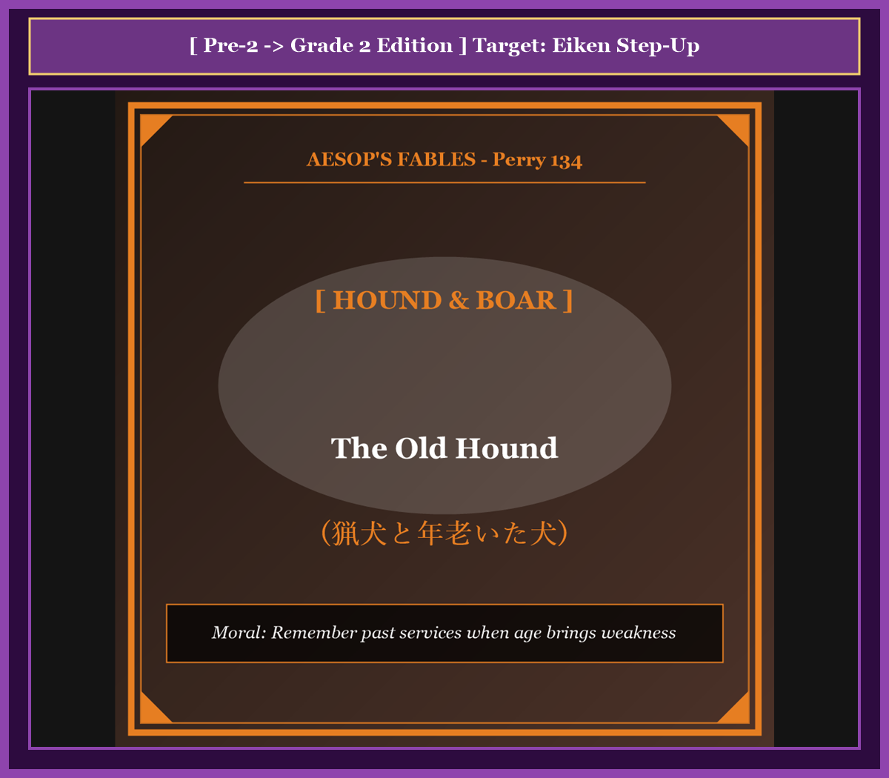
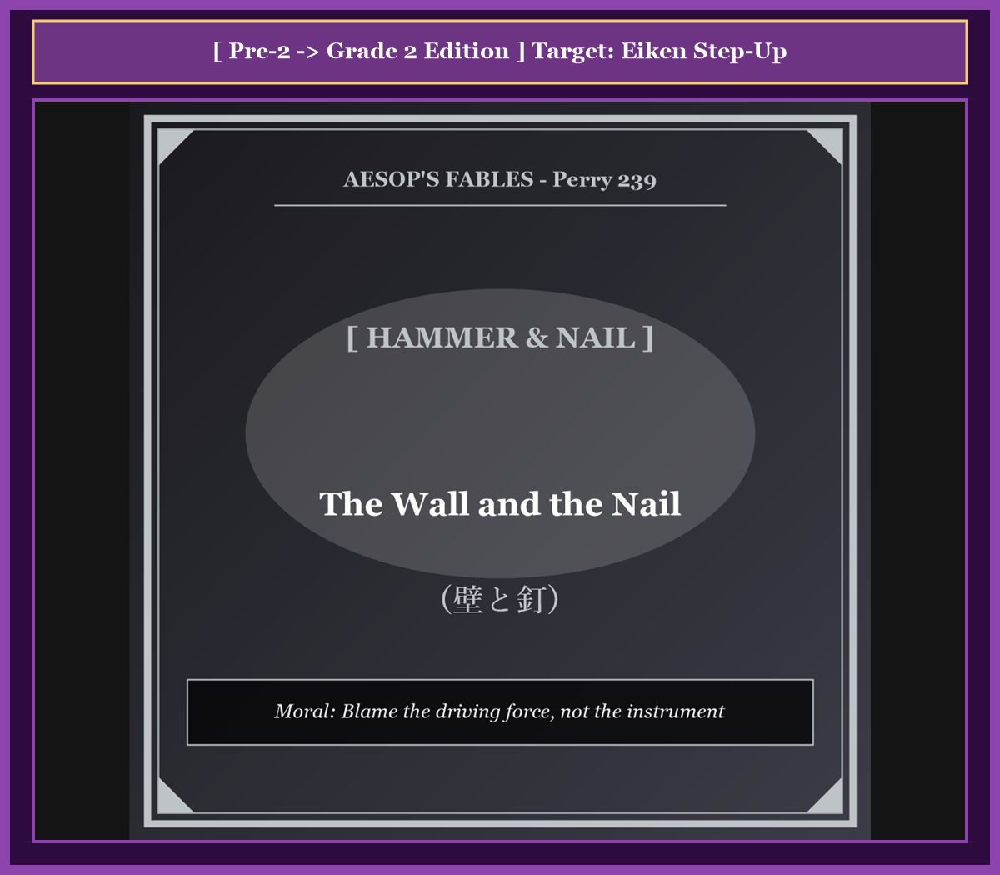
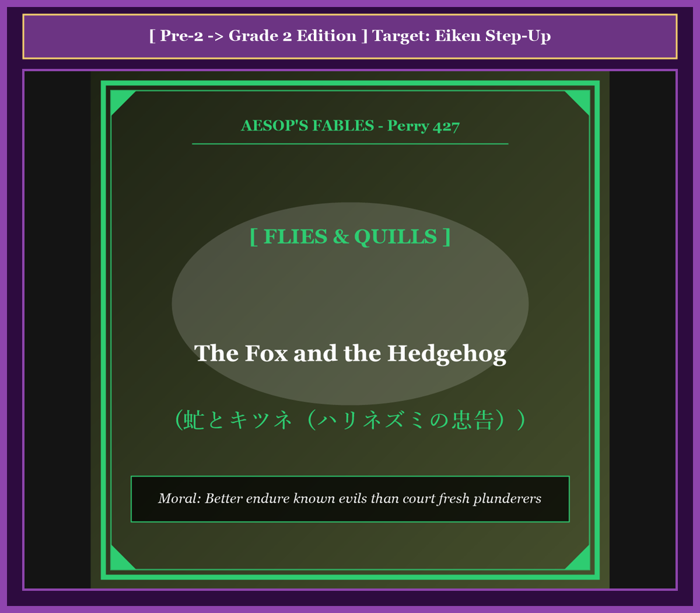
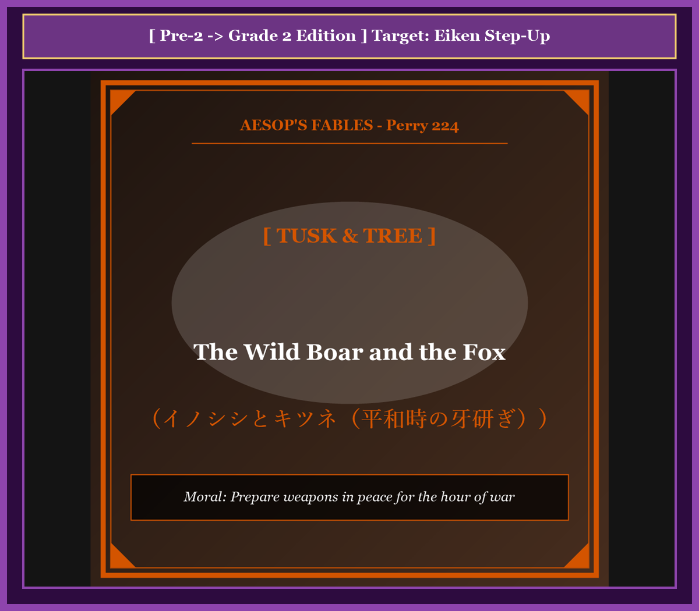
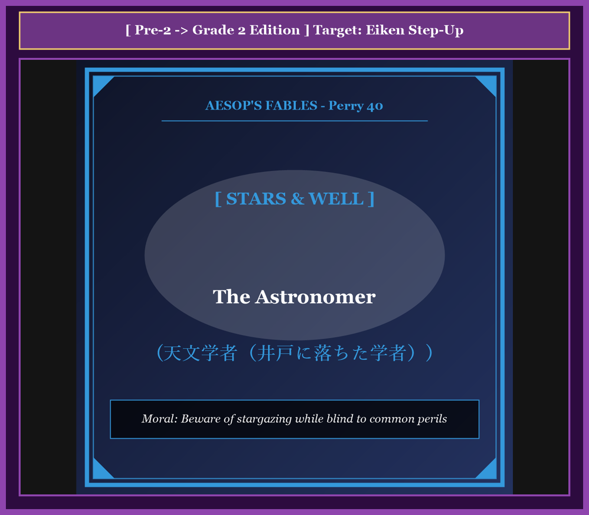
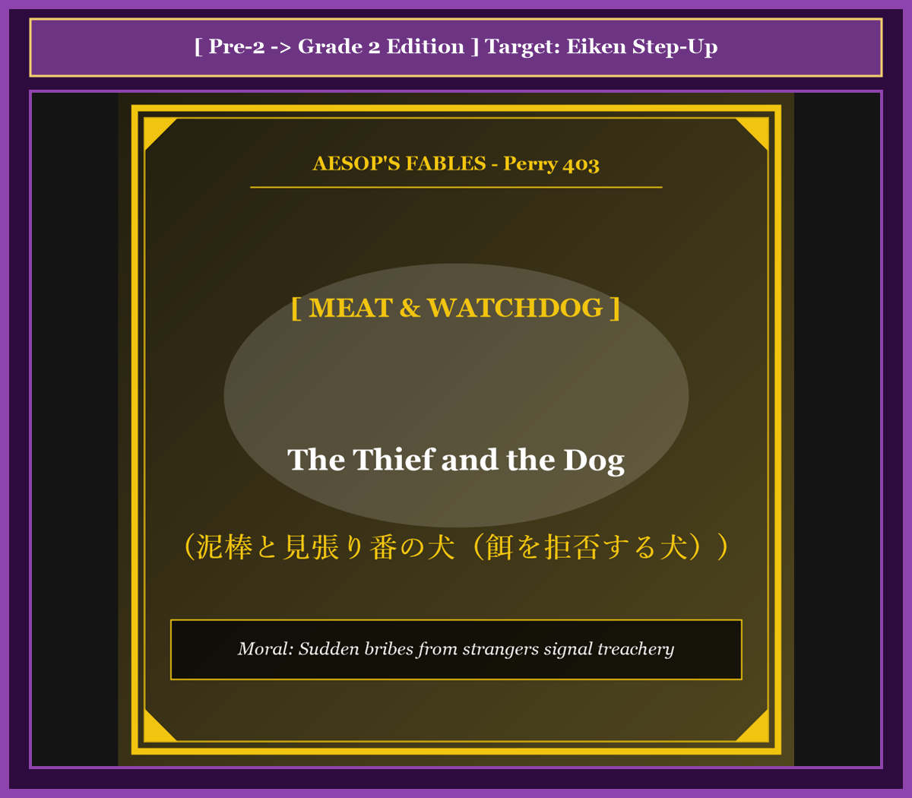
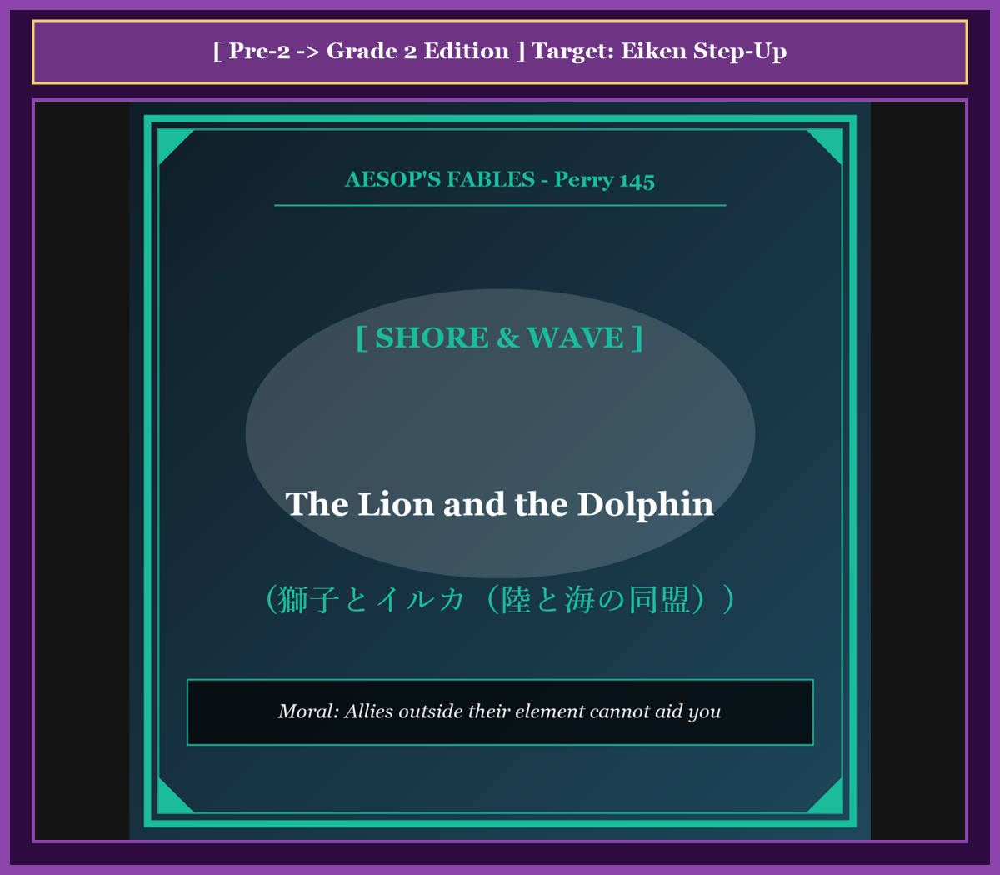
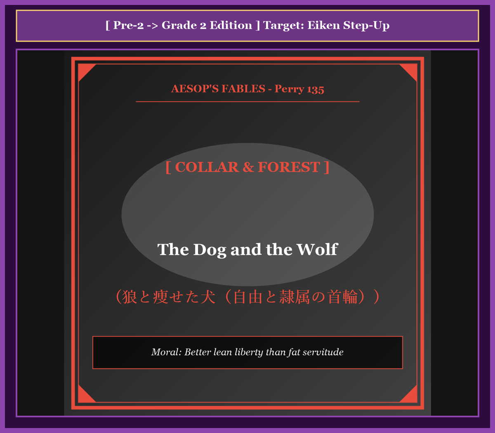
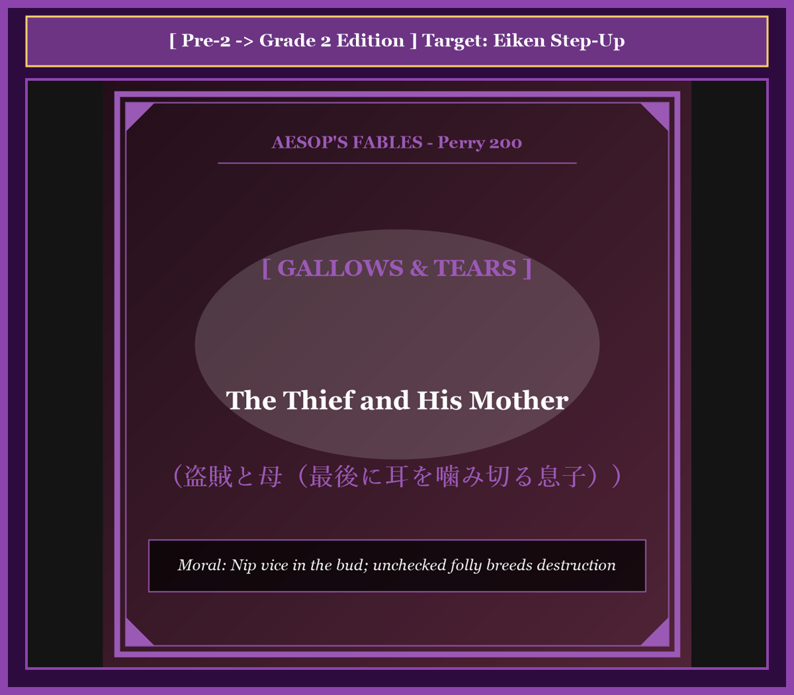

# 『英検ステップアップ多読：イソップ寓話編 第19巻（準2級 ➔ 2級対比学習・第5集）』

---

## はじめに：なぜ「対比多読」で英検2級の壁を突破できるのか？

英検2級の合格を目指す英語学習者にとって最大の課題は、**「平易な日常英語」から「論理的・学術的なアカデミック英語」への飛躍**です。

準2級までは日常的な情景描写や直感的な感情表現で大意を把握できましたが、2級からは社会・倫理・自然科学に関わる抽象語彙（*allegiance, precarious, opportunistic, catastrophe*など）や複文構造、洗練されたエッセイ文体が頻出します。

本書では、世界中で親しまれてきた珠玉のイソップ寓話（第5集・全10話）を題材に、**「理解しやすい準2級英語」** が **「知性あふれる2級合格レベルの英語」** へとどのように深まっていくかを対比学習します。

* **身近なストーリー（準2級）** で文脈と教訓を確実に把握
* **洗練されたアカデミック表現（2級）** で大学入試・ビジネスにも通じる本格的英語力を養う
* **暗唱キーフレーズ対比** で二次面接（ナレーション・質疑応答）や要約・ライティングに直結

楽しく名作寓話を読み進めながら、英検2級合格に必要な圧倒的読解力と語彙力を手に入れましょう！

---

## 本書の収録作品（第5集・全10話）

1. **Chapter 41**: 猟犬と年老いた犬 (*The Old Hound*) [Perry 134]
2. **Chapter 42**: 壁と釘 (*The Wall and the Nail*) [Perry 239]
3. **Chapter 43**: 虻とキツネ（ハリネズミの忠告） (*The Fox and the Hedgehog*) [Perry 427]
4. **Chapter 44**: イノシシとキツネ（平和時の牙研ぎ） (*The Wild Boar and the Fox*) [Perry 224]
5. **Chapter 45**: 天文学者（井戸に落ちた学者） (*The Astronomer*) [Perry 40]
6. **Chapter 46**: 泥棒と見張り番の犬（餌を拒否する犬） (*The Thief and the Dog*) [Perry 403]
7. **Chapter 47**: 獅子とイルカ（陸と海の同盟） (*The Lion and the Dolphin*) [Perry 145]
8. **Chapter 48**: 狼と痩せた犬（自由と隷属の首輪） (*The Dog and the Wolf*) [Perry 135]
9. **Chapter 49**: 盗賊と母（最後に耳を噛み切る息子） (*The Thief and His Mother*) [Perry 200]
10. **Chapter 50**: 盲人と子鹿（触れて知る本性） (*The Blind Man and the Whelp*) [Perry 242]

---

## 本書の構成と電子書籍 / Kobo最適化

各章は以下の構成で統一されています。

```text
┌─────────────────────────────────────────────────────────────┐
│ 1. Chapter Title & Visual Illustration (章タイトル ＆ 挿絵)   │
│ 2. Benchmark Level: 英検準2級レベル英文                       │
│ 3. Target Level: 英検2級レベル英文                           │
│ 4. Classic Original English Text (イソップ寓話クラシック原文)  │
│ 5. Japanese Translation (日本語訳 ＆ 教訓)                     │
│ 6. Recite & Compare (そらんじたいキーフレーズ対比カード)        │
│ 7. Key Vocabulary & Exam Notes (語彙・文法・試験対策解説)        │
└─────────────────────────────────────────────────────────────┘
```

> **【ポイント】 音声読み上げ（TTS）をご利用の方へ**
> 本文セクション（ステップ1〜3）は英語のみで構成されており、電子書籍やKoboの自動音声読み上げ機能（Text-to-Speech）で日本語が混ざることなく、格調高い英語音声で快適にリスニング学習していただけます。


# Chapter 41: The Old Hound (猟犬と年老いた犬)

<!-- 電子書籍 Page Break & Image Header -->
<div style="text-align: center; margin-bottom: 20px;">
  
</div>

<div style="page-break-before: always;"></div>

## 1. Benchmark Level: Eiken Grade Pre-2 (英検準2級レベル本文)
*Read in ~2 to 2.5 minutes. Baseline vocabulary and basic syntax.*

Throughout his long hunting career, a seasoned woodsman relied upon an exceptional hunting hound that had rendered invaluable service across countless dangerous expeditions. During the prime of his youth, the canine was celebrated for his astonishing endurance and relentless tenacity, regularly overpowering formidable predators that terrorized the region.

Inevitably, the relentless passage of time undermined the veteran's biological vitality. His once muscular limbs grew stiffened with arthritis, his sensory perception deteriorated, and his formidable dental armaments became blunt and fragile. Despite these undeniable physical limitations, the faithful companion refused to retire from active duty, continuing to follow his master into the wilderness with unyielding devotion.

One autumn morning, while exploring a treacherous mountain valley, the pair surprised an enormous wild boar. Recognizing the immediate threat, the hunter dispatched his faithful hound to intercept the raging beast. Displaying remarkable valor that defied his physical decay, the veteran launched himself at the adversary, successfully clamping his jaws around the boar's leathery ear.

A violent struggle ensued, with the mammoth beast thrashing furiously to shake off its assailant. The hound resisted with every ounce of remaining willpower, desperately attempting to immobilize the prey until the hunter could deliver a decisive shot. Tragically, his brittle teeth fractured under the immense strain, allowing the enraged boar to tear itself free and disappear into the dense brambles.

Confronted with the loss of such a valuable prize, the hunter succumbed to irrational fury. Oblivious to the animal's conspicuous bravery, the man raised his iron-tipped staff and administered a merciless beating upon the exhausted veteran.

Enduring the blows with dignified sorrow, the battered hound delivered a poignant rebuke: "Master, why do you punish an ally whose devotion remains untarnished? My spirit is as resolute as in the days of my triumphs, but my aging anatomy can no longer execute the commands of my heart. It is unjust to condemn me for the inevitable decay of nature while completely erasing the memory of my lifelong dedication."

---
<div style="page-break-before: always;"></div>

## 2. Target Level: Eiken Grade 2 (英検2級レベル本文)
*Read in ~2.5 to 3 minutes. Advanced vocabulary, complex syntax, and formal rhetoric.*

Across decades of hazardous wilderness exploration, an experienced huntsman had maintained an indispensable tactical partnership with a legendary hound whose predatory pedigree was celebrated throughout the province. In the zenith of his physiological prime, the canine operative had exhibited an extraordinary synthesis of acoustic tracking, relentless cardiovascular stamina, and ferocious biomechanical force, systematically neutralizing dangerous game that threatened agrarian settlements.

However, the inexorable trajectory of biological senescence gradually dismantled the veteran's operational efficacy. Progressive degenerative arthritis stiffened his musculoskeletal framework, his olfactory acuity deteriorated, and the calcified enamel of his maxillary dentition suffered severe erosion and fragility. Nevertheless, psychological allegiance triumphed over somatic degeneration; the faithful beast steadfastly refused to decommission himself, continuing to escort his patron across challenging terrains with undiminished zeal.

During an expedition traversing a precipitous alpine gorge, the duo unexpectedly intersected the territory of an exceptionally aggressive mature boar. Perceiving an existential menace, the huntsman signaled an immediate tactical assault. Mobilizing every residual reserve of neuromuscular willpower, the venerable hound executed a desperate lunge, securing an initial hold upon the quarry's auricular tissue.

A titanic kinetic conflict materialized. The mammoth herbivore thrashed violently, generating tremendous centrifugal torque designed to dislodge its pursuer. Although the canine maintained his grip with heroic fortitude to facilitate a lethal intervention by his master, his degraded dental structures proved incapable of sustaining the mechanical stress. Multiple teeth suffered structural fracture, permitting the lacerated quarry to break containment and vanish into impenetrable underbrush.

Deprived of an illustrious trophy, the huntsman experienced a catastrophic collapse of professional composure, succumbing to vindictive wrath. Utterly dismissing the animal's conspicuous heroism, the proprietor brandished an iron-reinforced cudgel, subjecting the prostrate veteran to severe physical trauma.

Absorbing the battery with stoic nobility, the hemorrhaging hound articulated a devastating philosophical critique of human perfidy: "Patron, by what rational ethical standard do you penalize an instrument whose fidelity remains incorruptible? My metaphysical courage endures undiminished, yet somatic decay refuses to obey the mandates of my will. To visit brutal retribution upon the inevitable infirmities of age, while systematically obliterating the moral equity accumulated through a lifetime of sacrifice, constitutes a grotesque perversion of justice."

---
<div style="page-break-before: always;"></div>

## 3. Classic Original English Text (イソップ寓話クラシック原文)
*Perry 134: Translated by George Fyler Townsend (1867)*

A Hound who in the days of his youth and strength had never yielded to any beast of the forest, encountered in his old age a boar in the chace. 

He seized him boldly by the ear, but could not retain his hold because of the decay of his teeth, so that the boar escaped. 

His master, quickly coming up, was very much disappointed, and fiercely abused the dog. 

The Hound looked up and said: "It was not my fault, master, my spirit was as good as ever, but I could not help my infirmities. I rather deserve to be praised for what I have been, than to be scolded for what I am."

---
<div style="page-break-before: always;"></div>

## 4. Japanese Translation & Moral (日本語訳と教訓)

### 【日本語全訳：英検2級レベル本文】
数十年におよぶ危険な荒野の探検を通じて、ある経験豊かな狩人は、その卓越した狩猟の血統が地方全体で称賛されていた伝説的な猟犬と、不可欠な戦術的パートナーシップを維持していました。その肉体的な全盛期の頂点において、この有能な使役犬は、音響的追跡力、容赦のない心肺持久力、そして獰猛な生体力学的圧力の見事な統合を発揮し、農耕集落を脅かす危険な獲物を組織的に無力化していました。

しかしながら、生物学的老化という容赦のない軌跡が、この老犬の実質的な運用能力を徐々に解体していきました。進行性の変形性関節炎がその筋骨格系を強張らせ、嗅覚の鋭敏さは衰退し、上顎歯列の石灰化したエナメル質は深刻な摩耗と脆さに苛まれていました。それにもかかわらず、心理的忠誠が肉体的変性を圧倒していました。この忠実な獣は自らを引退させることを断固として拒否し、衰えぬ熱意をもって過酷な地形を横切る主人の護衛を続けていたのです。

険しい高山の峡谷を横断する遠征中、このコンビは極めて攻撃的な成体のイノシシの縄張りと不意に交差しました。実存的脅威を察知した狩人は即座の戦術的突撃を命じました。神経筋の意志力の残されたあらゆる予備力を動員し、老いた猟犬は必死の跳躍を実行し、獲物の耳の組織に最初の一撃を噛み留めることに成功しました。

凄まじい運動力学的な衝突が具現化しました。巨大な草食獣は激しく暴れ回り、追跡者を振り落とすために設計された凄まじい遠心トルクを生み出しました。主人が致死的な介入を行えるよう、猟犬は英雄的な不屈の精神をもってその噛み合わせを維持しましたが、その劣化した歯牙構造は機械的応力に耐えきれないことが露呈しました。複数の歯が構造的骨折（破損）を被り、裂傷を負った獲物は包囲網を破って進入不可能な藪の中へと姿を消したのです。

輝かしい戦利品を奪われた狩人は、職業的沈着さの破滅的な崩壊を経験し、復讐心に満ちた激怒に屈服しました。老犬の顕著な英雄的行動など完全に無視し、主人は鉄で補強された棍棒を振りかざし、平伏する老犬に過酷な肉体的外傷を浴びせかけたのです。

禁欲的な高貴さをもってその乱打を耐え忍びながら、血を流す老犬は、人間の背信に対する痛烈な哲学的批判を口にしました。「主人よ、いかなる合理的な倫理基準に基づいて、その忠誠が清廉なままである忠臣を処罰するというのか？ 私の精神的な勇気は衰えを知らぬまま存続しているが、肉体の衰退が私の意志の命令に従うことを拒絶しているのだ。年齢の不可避な虚弱に対して残酷な報復を加える一方で、生涯の犠牲を通じて蓄積された道徳的債権（功績）を組織的に抹殺することは、正義のグロテスクな倒錯（歪曲）に他ならない。」

### 【教訓（Moral）】
**Respect past loyalty when old age brings weakness.**  
（年老いて衰えた者を切り捨てるのではなく、かつて捧げてくれた献身と功績に敬意を払いなさい。現在の能力低下だけを責め立て、過去の貢献を忘れ去る態度は、人間としての最も恥ずべき忘恩である。）

---
<div style="page-break-before: always;"></div>

## 5. Recite & Compare: そらんじたいキーフレーズ対比カード

<div class="comparison-card">
  <div class="card-header">フレーズ 1：老化の不可避な進行による肉体機能の低下</div>
  <div class="card-row-pre2-base"><span class="card-badge-pre2-base">準2級</span>Inevitably, the relentless passage of time undermined the veteran's biological vitality.</div>
  <div class="card-row-g2"><span class="card-badge-g2">2級</span>The inexorable trajectory of biological senescence gradually dismantled his operational efficacy.</div>
  <div class="card-note"><strong>解説：</strong>「inexorable trajectory（容赦のない軌道・必然の道程）」「senescence（加齢、老化）」を用いた学術的な分析表現です。</div>
</div>

<div class="comparison-card">
  <div class="card-header">フレーズ 2：肉体の衰退を乗り越える精神的忠誠</div>
  <div class="card-row-pre2-base"><span class="card-badge-pre2-base">準2級</span>Despite physical limitations, the faithful companion refused to retire from active duty.</div>
  <div class="card-row-g2"><span class="card-badge-g2">2級</span>Psychological allegiance triumphed over somatic degeneration; the beast refused to decommission himself.</div>
  <div class="card-note"><strong>解説：</strong>「somatic degeneration（肉体的変性・衰退）」「decommission oneself（自らを現役解除・退役させる）」という知的な対比です。</div>
</div>

<div class="comparison-card">
  <div class="card-header">フレーズ 3：遠心力と機械的応力による歯の損壊</div>
  <div class="card-row-pre2-base"><span class="card-badge-pre2-base">準2級</span>His brittle teeth fractured under the immense strain, allowing the boar to tear itself free.</div>
  <div class="card-row-g2"><span class="card-badge-g2">2級</span>His degraded dental structures proved incapable of sustaining mechanical stress, suffering structural fracture.</div>
  <div class="card-note"><strong>解説：</strong>工学・物理学用語の「mechanical stress（機械的応力）」「structural fracture（構造破壊・破損）」を応用しています。</div>
</div>

<div class="comparison-card">
  <div class="card-header">フレーズ 4：蓄積された長年の道徳的功績の抹殺は正義の倒錯</div>
  <div class="card-row-pre2-base"><span class="card-badge-pre2-base">準2級</span>It is unjust to condemn me for inevitable decay while completely erasing the memory of my dedication.</div>
  <div class="card-row-g2"><span class="card-badge-g2">2級</span>To visit retribution upon infirmities while obliterating moral equity accumulated through sacrifice is a grotesque perversion.</div>
  <div class="card-note"><strong>解説：</strong>法倫理の最高峰概念「obliterate moral equity（道徳的持分・功績を抹消する）」「grotesque perversion of justice（正義の奇怪な歪曲）」です。</div>
</div>

---
<div style="page-break-before: always;"></div>

## 6. Key Vocabulary & Exam Notes (英検2級 重要語彙・文法・面接対策)

### 1. 英検2級 必須ボキャブラリー
* **senescence** [名] 老化、老衰
* **efficacy** [名] 効力、有効性（*operational efficacy*）
* **somatic** [形] 身体の、肉体の（*somatic degeneration*）
* **decommission** [動] 〜を退役させる、任務解除する
* **torque** [名] 回転力、トルク（*centrifugal torque*）
* **vindictive** [形] 復讐心に燃えた、悪意ある
* **perfidy** [名] 背信、裏切り行為
* **perversion** [名] 倒錯、曲解、改悪（*perversion of justice*）

### 2. 文法・構文のチェックポイント
* **visit A upon B**:
  * 「A（罰・災難・復讐）をBに加える、下す」。格調高い文語で聖書や法廷弁論などで多用されるイディオムです。
* **triumph over + 名詞**:
  * 「〜に打ち勝つ、〜を克服する」。精神性が物理的困難を凌駕する場面で頻出する動詞表現です。

### 3. スピーキング（面接）＆ライティング活用ヒント
「終身雇用とシニア世代の処遇」「福祉制度における世代間倫理」を論述する際のフレーズ：
* *To discard elderly employees solely due to declining mechanical speed while ignoring decades of loyal service is socially unacceptable.*（数十年にわたる忠実な奉仕を無視して、作業速度の低下のみを理由に高齢労働者を切り捨てることは、社会的に容認されない。）
* *A humane society preserves the moral contract between generations by safeguarding the dignity of its retired pioneers.*（人道的な社会は、引退した先駆者たちの尊厳を守ることによって、世代間の道徳的契約を維持する。）


# Chapter 42: The Wall and the Nail (壁と釘)

<!-- 電子書籍 Page Break & Image Header -->
<div style="text-align: center; margin-bottom: 20px;">
  
</div>

<div style="page-break-before: always;"></div>

## 1. Benchmark Level: Eiken Grade Pre-2 (英検準2級レベル本文)
*Read in ~2 to 2.5 minutes. Baseline vocabulary and basic syntax.*

Within the interior of an architecturally refined residence, an immaculate partition wall maintained its flawless aesthetic dignity. Constructed from reinforced lime plaster and finely sanded gypsum, its smooth surface had endured for seasons without suffering the slightest blemish, symbolizing structural stability and domestic serenity.

This harmonious equilibrium was abruptly shattered when an artisan arrived to install an ornate bronze installation. Equipped with a forged iron nail and a substantial steel mallet, the craftsman selected a central coordinate upon the wall and positioned the tempered metal spike against the delicate finish.

Without hesitation, the workman delivered a series of concussive blows. Driven by the mechanical kinetic energy of the mallet, the sharp nail penetrated the outer plaster and bored deep into the underlying brickwork. The structural violence fractured the surrounding mortar, sending spiderweb fissures radiating across the pristine surface and generating immense internal tension.

Convulsing under this traumatic intrusion, the wall lamented its grievance with profound indignation: "Why do you subject my harmless structure to such brutal mutilation? Throughout my existence, I have sheltered you from wind and tempest without inflicting the slightest injury upon you. How can you justify lacerating my flesh with such callous indifference?"

Resonating with acoustic vibration and groaning beneath the continuous barrage of blows, the embedded nail offered a logical defense: "Cease directing your righteous indignation toward an innocent proxy. I possess zero autonomous agency, nor do I derive satisfaction from violating your integrity. I am merely a passive instrument compelled by physical necessity; direct your accusations toward the heavy hammer that impacts my crown with relentless kinetic momentum from behind."

---
<div style="page-break-before: always;"></div>

## 2. Target Level: Eiken Grade 2 (英検2級レベル本文)
*Read in ~2.5 to 3 minutes. Advanced vocabulary, complex syntax, and formal rhetoric.*

Within a neoclassical domestic sanctuary, an architectural partition wall embodied structural permanence and geometric perfection. Composed of reinforced calcareous plaster bonded to load-bearing masonry, its immaculate monochromatic facade had maintained absolute spatial equilibrium through successive decades, completely unmarred by abrasive deterioration or cosmetic fractures.

This architectural tranquility was violently compromised during a structural modification. An artisan, charged with anchoring a ponderous bronze relief, identified an arbitrary structural locus and positioned an elongated, tempered steel fastener against the pristine stucco. Armed with an unyielding cast-iron hammer, the workman initiated a sequence of high-velocity ballistic impacts.

Transmitting tremendous compressive kinetic force through its narrow cross-sectional apex, the metal projectile penetrated the crystalline outer boundary, pulverizing the subterranean substrate and severing the molecular cohesion of the mortar. Micro-fractures propagated radially across the wall's expansive plane, destabilizing its aesthetic harmony and generating acute structural resonance.

Agonizing under this unprovoked material violation, the wall articulated a passionate philosophical indictment: "By what ethical prerogative do you subject an unoffending architecture to catastrophic physical mutilation? For generations, my monolithic presence has sustained domestic shelter and resisted external atmospheric turbulence, delivering uncompromised protection without ever perpetrating an offensive act. Why do you repay innocent fidelity with calculated, systemic destruction?"

Vibrating violently amidst the concussive onslaught and compressed within the fracturing masonry, the embedded nail articulated an airtight metaphysical rejoinder: "Your moral indignation, while psychologically understandable, suffers from a fatal misdirection of culpability. I am utterly devoid of intentional volition; I harbor no intrinsic malice, nor do I exercise autonomous jurisdiction over my ballistic vector. I operate solely as an inert mechanical conduit through which external force is channeled. If you demand judicial accountability for your trauma, direct your condemnation toward the unyielding hammer that strikes my crown from behind with overwhelming concussive momentum."

---
<div style="page-break-before: always;"></div>

## 3. Classic Original English Text (イソップ寓話クラシック原文)
*Perry 239: Translated by George Fyler Townsend (1867)*

A Wall, violently driven with a Nail, exclaimed: "Why do you tear me down, who have done you no injury?" 

The Nail replied: "It is not I who am to blame, but he who with great violence drives me on behind."

---
<div style="page-break-before: always;"></div>

## 4. Japanese Translation & Moral (日本語訳と教訓)

### 【日本語全訳：英検2級レベル本文】
新古典主義様式の住宅の聖域において、ある建築の仕切り壁は構造的な永続性と幾何学的な完璧さを具現化していました。耐力レンガ構造に接着された補強石灰漆喰で構成されたその染みひとつない単色のファサード（壁面）は、数十年を経ても研磨による劣化や外見上の亀裂に一切損なわれることなく、絶対的な空間的均衡を保ち続けていました。

この建築的静寂は、ある構造改修の最中に暴力的に侵害されました。重厚な青銅のレリーフを固定する任務を帯びた職人が、任意の構造的地点を特定し、手入れの行き届いた漆喰の上に細長く焼き入れされた鋼鉄の留め具（釘）をあてがいました。屈強な鋳鉄製の金槌を手にした職人は、高速の弾道的な打撃のシークエンスを開始しました。

その狭い断面積の先端を通じて莫大な圧縮運動エネルギーを伝達しながら、金属の投射物は結晶化した外層境界を貫通し、地下の基質を粉砕し、モルタルの分子的な凝集力を切断しました。微細な亀裂が壁の広大な平面を放射状に伝播し、その美的な調和を不安定化させ、深刻な構造的共振を引き起こしました。

この理由なき物質的侵害に苦悶しながら、壁は情熱的な哲学的告発を口にしました。「いかなる倫理的特権に基づいて、何ら罪を犯していない建築物をこれほど破滅的な肉体的損傷にさらすのか？ 何世代にもわたり、私の単一の構造的存在は家庭のシェルターを維持し、外部の大気的乱流に抵抗し、攻撃的な行動を一度も犯すことなく完全無欠の保護を提供してきた。それなのにどうして、無垢な忠実さに対して、計算された組織的破壊をもって報いることができるのか？」

衝撃的な猛攻の中で激しく振動し、破壊されつつある石造構造の中に圧縮されながら、打ち込まれた釘は反論の余地のない形而上学的答弁を口にしました。「あなたの道徳的憤怒は、心理的には理解可能であるものの、責任の所在の致命的な誤認に苛まれている。私には意図的な意志（主体性）など完全に欠如している。内在的な悪意など宿しておらず、自らの弾道ベクトルに対して自律的な管轄権を行使しているわけでもない。私は、外部の力が伝達される単なる不活性な機械的導管として機能しているにすぎないのだ。もし自らのトラウマに対する司法的な責任追及を求めるのであれば、背後から圧倒的な衝撃的運動量をもって私の頭部を打ち据えている、あの容赦なき金槌こそを断罪せよ。」

### 【教訓（Moral）】
**Blame the driving power, not the helpless instrument.**  
（被害をもたらした無力な道具を責めるのではなく、背後でその力を振るっている真の元凶を見据えなさい。不当な圧力や上位の権力によって動かされている手先の実行者だけを非難しても、被害の根本原因を見誤ることになる。）

---
<div style="page-break-before: always;"></div>

## 5. Recite & Compare: そらんじたいキーフレーズ対比カード

<div class="comparison-card">
  <div class="card-header">フレーズ 1：数十年間にわたり維持された幾何学的完全性</div>
  <div class="card-row-pre2-base"><span class="card-badge-pre2-base">準2級</span>Its smooth surface had endured for seasons, symbolizing structural stability.</div>
  <div class="card-row-g2"><span class="card-badge-g2">2級</span>An architectural partition wall embodied structural permanence and geometric perfection.</div>
  <div class="card-note"><strong>解説：</strong>「structural permanence（構造的永続性）」「geometric perfection（幾何学的完璧さ）」という高度な学術語彙です。</div>
</div>

<div class="comparison-card">
  <div class="card-header">フレーズ 2：圧縮運動エネルギーの伝達と微細亀裂の放射</div>
  <div class="card-row-pre2-base"><span class="card-badge-pre2-base">準2級</span>Driven by kinetic energy, the nail penetrated and sent spiderweb fissures radiating.</div>
  <div class="card-row-g2"><span class="card-badge-g2">2級</span>Transmitting compressive kinetic force, micro-fractures propagated radially across the plane.</div>
  <div class="card-note"><strong>解説：</strong>「compressive kinetic force（圧縮運動力）」「micro-fractures propagated radially（微細亀裂が放射状に伝播した）」という物理工学的記述です。</div>
</div>

<div class="comparison-card">
  <div class="card-header">フレーズ 3：責任の所在の致命的な誤認</div>
  <div class="card-row-pre2-base"><span class="card-badge-pre2-base">準2級</span>Cease directing your righteous indignation toward an innocent proxy.</div>
  <div class="card-row-g2"><span class="card-badge-g2">2級</span>Your moral indignation suffers from a fatal misdirection of culpability.</div>
  <div class="card-note"><strong>解説：</strong>法哲学用語の最高峰「fatal misdirection of culpability（有責性の致命的な宛先誤認）」を用いた知的な抗論です。</div>
</div>

<div class="comparison-card">
  <div class="card-header">フレーズ 4：外力が通過する単なる不活性な導管</div>
  <div class="card-row-pre2-base"><span class="card-badge-pre2-base">準2級</span>I am merely a passive instrument compelled by physical necessity.</div>
  <div class="card-row-g2"><span class="card-badge-g2">2級</span>I operate solely as an inert mechanical conduit through which external force is channeled.</div>
  <div class="card-note"><strong>解説：</strong>「inert mechanical conduit（不活性な機械的導管・媒介物）」「force is channeled（力が誘導される）」という客観的論理です。</div>
</div>

---
<div style="page-break-before: always;"></div>

## 6. Key Vocabulary & Exam Notes (英検2級 重要語彙・文法・面接対策)

### 1. 英検2級 必須ボキャブラリー
* **permanence** [名] 永続性、不変性
* **compromise** [動] （安全や完全性を）損なう、危うくする
* **substrate** [名] 基質、基盤
* **cohesion** [名] 凝集力、結束（*molecular cohesion*）
* **propagate** [動] （波や亀裂が）伝播する、広がる
* **prerogative** [名] 特権、大権
* **culpability** [名] 有責性、過失責任（*misdirection of culpability*）
* **conduit** [名] 導管、仲介者（*mechanical conduit*）

### 2. 文法・構文のチェックポイント
* **be devoid of + 名詞**:
  * 「〜が全く欠如している」。*completely lacking in* のフォーマルな同義語で、性質の不在を断定する表現です。
* **through which + S + V**:
  * 前置詞＋関係代名詞。「それを通じて〜される」。媒体や経路を論理的に説明する重要文法です。

### 3. スピーキング（面接）＆ライティング活用ヒント
「システム障害や企業不祥事における構造的責任」を論じる際のフレーズ：
* *Punishing subordinate operators while ignoring executive pressure represents a fatal misdirection of culpability.*（幹部からの圧力を無視して末端の作業員のみを処罰することは、過失責任の致命的な宛先誤認である。）
* *Modern legal frameworks should hold accountable the institutional mechanisms that channel systemic harm.*（現代の法制度は、構造的害悪を媒介する組織的メカニズムに対して責任を問わなければならない。）


# Chapter 43: The Fox and the Hedgehog (虻とキツネ)

<!-- 電子書籍 Page Break & Image Header -->
<div style="text-align: center; margin-bottom: 20px;">
  
</div>

<div style="page-break-before: always;"></div>

## 1. Benchmark Level: Eiken Grade Pre-2 (英検準2級レベル本文)
*Read in ~2 to 2.5 minutes. Baseline vocabulary and basic syntax.*

Negotiating the treacherous currents of a swollen mountain river, an unlucky fox lost his footing and was violently propelled downstream. Deposited into an inaccessible rocky canyon, the bruised predator lay physically incapacitated, his energy completely depleted from battling the turbulent torrent.

Taking opportunistic advantage of his immobilized state, a dense colony of blood-sucking parasites descended upon his body. Fastening themselves upon every exposed patch of tender skin, the ravenous insects engaged in unremitting hematological extraction. Deprived of the muscular strength necessary to dislodge them, the fox was subjected to agonizing, prolonged torment.

At that juncture, a well-meaning hedgehog navigated the perimeter of the gorge. Horrified by the grotesque spectacle of his fellow creature being drained alive, the spiny mammal immediately volunteered an intervention: "Comrade, your plight is intolerable. Grant me permission to approach, and I shall systematically brush away this parasitic swarm utilizing the defensive armor of my quills."

"I implore you, refrain from any intervention!" the fox gasped in desperate protestation.

Incredulous at this apparent irrationality, the hedgehog demanded an explanation: "How can you conceivably justify enduring this excruciating affliction when deliverance is freely offered?"

"Your compassion is commendable, yet your proposal betrays a dangerous political shortsightedness," the fox articulated weakly. "These present parasites have already satiated their appetites; their current consumption is negligible, and their stings are relatively benign. Should you disperse them, their vacancy will inevitably attract a famished, desperate horde of fresh predators that will ruthlessly extract every residual drop of vitality from my veins."

---
<div style="page-break-before: always;"></div>

## 2. Target Level: Eiken Grade 2 (英検2級レベル本文)
*Read in ~2.5 to 3 minutes. Advanced vocabulary, complex syntax, and formal rhetoric.*

Attempting to traverse the hydraulic turbulence of a flooded river, an unfortunate vulpine predator was overwhelmed by hydrostatic momentum and swept into a precipitous, subterranean ravine. Immobilized on a damp sediment shelf with multiple physical contusions, the exhausted carnivore suffered total locomotor exhaustion, rendering him incapable of navigating an ascent up the sheer geological escarpment.

Exploiting this acute physiological paralysis, a dense infestation of parasitic diptera discovered the defenseless organism. Infiltrating every exposed dermatological perimeter, the hematophagous swarm established an aggressive extractive regime. Deprived of neuromuscular stamina to execute mechanical swatting or somatic shivers, the incapacitated fox was subjected to systemic biological exploitation, enduring chronic subcutaneous irritation without recourse.

At this critical impasse, an altruistic hedgehog traversed the rim of the chasm. Witnessing this grotesque tableau of parasitic predation, the insectivore was galvanized by humanitarian concern, promptly proposing a surgical intervention: "Colleague, your systemic devastation is intolerable. If you authorize my approach, I can deploy my rigid keratinous quills to mechanically dislodge this predatory infestation and terminate your physical affliction."

"I vehemently petition you to maintain absolute non-intervention!" the fox gasped with frantic intellectual urgency.

Stupefied by this counterintuitive repudiation of salvation, the bewildered hedgehog interrogated his reasoning: "By what conceivable dialectic do you prefer chronic physical torment over immediate, cost-free liberation?"

"Your ethical benevolence is beyond reproach, yet your strategic calculus suffers from profound historical naivety," the debilitated philosopher elucidated. "This incumbent cohort of parasites has already attained nutritional saturation; their extractive volume has plateaued, and their physiological demands are virtually quiescent. If you unilaterally disperse these satiated leeches, their institutional vacancy will generate an ecological vacuum, immediately attracting an aggressive, famished cohort that will voraciously drain every residual milliliter of my biological reserves."

---
<div style="page-break-before: always;"></div>

## 3. Classic Original English Text (イソップ寓話クラシック原文)
*Perry 427: Translated by George Fyler Townsend (1867)*

A Fox swimming across a rapid river was carried by the force of the current into a deep ravine, where he lay for a long time unable to get out, and sorely tormented by a swarm of horseflies that fastened on him. 

A Hedgehog wandering by, took pity on him, and asked if he should drive away the flies that were sucking his blood. 

The Fox replied: "Do not, I pray you, brush away these flies." 

"Why not?" asked the Hedgehog. 

"Because," replied the Fox, "these flies are now full of blood and bite me but little; but if you drive them away, others, who are hungry, will come and drink up all the blood I have left."

---
<div style="page-break-before: always;"></div>

## 4. Japanese Translation & Moral (日本語訳と教訓)

### 【日本語全訳：英検2級レベル本文】
増水した河川の流体力学的乱流を横断しようとしたある不運なキツネが、静水圧の運動量に圧倒され、険しい地下のような峡谷へと押し流されてしまいました。複数の肉体的打撲を負って湿った堆積物の段丘の上に身動きできなくなったこの疲弊した肉食獣は、完全な運動麻痺（運動能力の枯渇）に見舞われ、切り立った地質学的急斜面を這い上がることが完全に不可能になっていました。

この深刻な生理学的麻痺につけ込み、寄生性の双翅目（アブ）の密集した大発生が、この無防備な生体を発見しました。露出した皮膚の境界の隅々にまで侵入し、この吸血性の昆虫群は攻撃的な搾取体制を確立しました。機械的なハエ叩き動作や身体の身震いを実行するための神経筋のスタミナを奪われていたこの無力化されたキツネは、全身性の生物学的搾取にさらされ、何の救済策もないまま慢性的な皮下刺激に耐え忍んでいました。

この危機的な行き詰まりにおいて、ある利他主義的なハリネズミが深淵の縁を横切りました。寄生的な捕食のこの奇怪な光景を目撃したこの食虫動物は人道主義的配慮に奮起し、外科的な介入を即座に提案しました。「同胞よ、あなたの全身的な荒廃は耐え難い。もし私の接近を許可してくださるなら、私の硬いケラチン質の針を展開して、この捕食性の害虫の大群を機械的に払い落とし、あなたの肉体的苦痛を終結させることができます。」

「完全な不干渉を維持してくださるよう、猛烈に懇願する！」とキツネは必死の知的な切迫感をもって息も絶え絶えに訴えました。

救済に対するこの直観に反する拒絶に呆然としたハリネズミは、その論理を問い質しました。「一体いかなる弁証法（理屈）によって、あなたは即座の無償の解放よりも慢性的な肉体の苦痛を好むというのか？」

「あなたの倫理的善意は非の打ち所がないが、あなたの戦略的計算は深刻な歴史的ナイーブさ（世間知らず）に苛まれている」と、衰弱した哲学者は解き明かしました。「現在権力の座にあるこの寄生者の一団は、すでに栄養的飽和に達しているのだ。彼らの搾取量はすでにプラトー（頭打ち）に達しており、その生理的要求は事実上鎮静化している。もしあなたがこれら満腹した蛭どもを一方的に追い散らしてしまえば、その制度的空席が生態学的空白を生み出し、貪欲にも私の生物学的蓄えの残された最後のミリリットルまで吸い尽くす、攻撃的で飢え切った新たな集団を即座に招き寄せることになるのだ。」

### 【教訓（Moral）】
**Better endure known evils than court fresh plunderers.**  
（すでに行き渡った既知の害悪を耐え忍ぶほうが、飢えた新たな略奪者を呼び寄せるよりもはるかに賢明である。性急に体制や役人を入れ替えても、より強欲な新たな搾取者がやってくれば、残された富をすべて奪い去られることになる。）

---
<div style="page-break-before: always;"></div>

## 5. Recite & Compare: そらんじたいキーフレーズ対比カード

<div class="comparison-card">
  <div class="card-header">フレーズ 1：露出した皮膚に侵入して確立された搾取体制</div>
  <div class="card-row-pre2-base"><span class="card-badge-pre2-base">準2級</span>Fastening upon exposed skin, ravenous insects engaged in unremitting hematological extraction.</div>
  <div class="card-row-g2"><span class="card-badge-g2">2級</span>Infiltrating dermatological perimeters, the hematophagous swarm established an extractive regime.</div>
  <div class="card-note"><strong>解説：</strong>「hematophagous（吸血性の）」「extractive regime（搾取体制）」という社会科学的・生物学的アナロジーです。</div>
</div>

<div class="comparison-card">
  <div class="card-header">フレーズ 2：救済に対する直観に反する拒絶への驚愕</div>
  <div class="card-row-pre2-base"><span class="card-badge-pre2-base">準2級</span>Incredulous at this irrationality, the hedgehog asked why he endured this affliction.</div>
  <div class="card-row-g2"><span class="card-badge-g2">2級</span>Stupefied by this counterintuitive repudiation of salvation, he interrogated his reasoning.</div>
  <div class="card-note"><strong>解説：</strong>「counterintuitive repudiation of salvation（救済に対する直観に反する拒絶）」という最高水準の語彙配列です。</div>
</div>

<div class="comparison-card">
  <div class="card-header">フレーズ 3：現行の搾取者はすでに飽和して要求が鎮静化</div>
  <div class="card-row-pre2-base"><span class="card-badge-pre2-base">準2級</span>These parasites have satiated their appetites; their consumption is negligible and benign.</div>
  <div class="card-row-g2"><span class="card-badge-g2">2級</span>This incumbent cohort has attained nutritional saturation; their extractive volume has plateaued and is quiescent.</div>
  <div class="card-note"><strong>解説：</strong>「incumbent cohort（現職・既存の集団）」「plateaued（頭打ちになった）」「quiescent（活動休止中の、沈静化した）」の応用です。</div>
</div>

<div class="comparison-card">
  <div class="card-header">フレーズ 4：追放による生態学的空白が新たな飢えた略奪者を招く</div>
  <div class="card-row-pre2-base"><span class="card-badge-pre2-base">準2級</span>Their vacancy will attract a famished horde that will ruthlessly extract every residual drop.</div>
  <div class="card-row-g2"><span class="card-badge-g2">2級</span>Dispersing these leeches generates an ecological vacuum, attracting a famished cohort that will drain every milliliter.</div>
  <div class="card-note"><strong>解説：</strong>「ecological vacuum（生態学的空白）」「drain every milliliter（最後の一滴まで絞り取る）」という政治経済学的洞察です。</div>
</div>

---
<div style="page-break-before: always;"></div>

## 6. Key Vocabulary & Exam Notes (英検2級 重要語彙・文法・面接対策)

### 1. 英検2級 必須ボキャブラリー
* **hydrostatic** [形] 静水圧の、流体力学の
* **escarpment** [名] 急斜面、断崖
* **hematophagous** [形] 吸血性の
* **impasse** [名] 行き詰まり、袋小路
* **counterintuitive** [形] 直観に反する
* **repudiation** [名] 拒絶、否認、破棄
* **incumbent** [形] 現職の、在任中の [名] 現職者
* **quiescent** [形] 静止した、活動を休止している

### 2. 文法・構文のチェックポイント
* **beyond reproach**:
  * 「非の打ち所がない、非難の余地がない」。*Your ethical benevolence is beyond reproach.* で高潔さを認める定型表現です。
* **attain + 名詞**:
  * 「〜に到達する、達成する」。*attain saturation* で「飽和状態に達する」を表す学術語彙です。

### 3. スピーキング（面接）＆ライティング活用ヒント
「性急な行政改革の副作用」「既得権益と新たな参入者の力学」を論じる際のフレーズ：
* *Abruptly dismantling established administrative structures without viable alternatives creates an institutional vacuum.*（実行可能な代替案なしに確立された行政機構を唐突に解体することは、制度的空白を生み出す。）
* *In transitional governance, reckless purge of incumbent officials frequently invites more rapacious corruption.*（移行期の統治において、現職官僚の無謀な追放はより強欲な汚職を招くことが頻繁にある。）


# Chapter 44: The Wild Boar and the Fox (イノシシとキツネ)

<!-- 電子書籍 Page Break & Image Header -->
<div style="text-align: center; margin-bottom: 20px;">
  
</div>

<div style="page-break-before: always;"></div>

## 1. Benchmark Level: Eiken Grade Pre-2 (英検準2級レベル本文)
*Read in ~2 to 2.5 minutes. Baseline vocabulary and basic syntax.*

In a secluded forest sanctuary bathed in warm sunshine, an imposing wild boar occupied a grassy knoll beneath a centuries-old oak. The ambient conditions indicated total tranquility; songbirds chirped harmoniously, and the gentle breeze carried zero scent of predatory danger or human intrusion.

Notwithstanding this idyllic setting, the formidable beast was engaged in an austere program of military preparedness. Leaning his massive bulk against the rough bark, he rhythmically sharpened his protruding ivory tusks. With meticulous precision, he honed their razor edges against the hard wood, determined to maintain his primary biological deterrent in a state of peak operational readiness.

A cynical fox wandered into the clearing and observed this deliberate conditioning with condescending amusement. Convinced that the boar was indulging in pointless anxiety, the fox approached with a sarcastic sneer.

"Pardon my curiosity, distinguished warrior," the fox jeered playfully, "but why squander your vital reserves during an interval of unconditional peace? No hounds patrol these valleys, nor does any hunter conceal himself behind these thickets. Is it not the height of absurdity to sharpen defensive armaments when no active menace threatens your security?"

Without losing his rhythmic cadence, the boar cast a discerning glance toward his critic and articulated a profound strategic maxim: "My diligence is governed not by irrational apprehension, but by calculated prudence. When a lethal crisis materializes, the luxury of preparation evaporates instantaneously. In the sudden crucible of combat, one must deploy existing armaments; to initiate preparation amid battle guarantees catastrophe."

---
<div style="page-break-before: always;"></div>

## 2. Target Level: Eiken Grade 2 (英検2級レベル本文)
*Read in ~2.5 to 3 minutes. Advanced vocabulary, complex syntax, and formal rhetoric.*

Occupying an elevated strategic knoll within an ancient deciduous forest, an apex wild boar conducted a rigorous regimen of anatomical maintenance. Ambient ecological indicators registered absolute geopolitical tranquility: mild atmospheric conditions prevailed, avian fauna communicated peaceful acoustic signatures, and the surrounding biosphere was completely devoid of anthropogenic or predatory threats.

Subordinating current tranquility to the imperatives of long-term survival, the disciplined mammal actively engaged in hardening his offensive and defensive capabilities. Pressing his massive cranial framework against the fibrous bark of an ancient oak, he systematically whetted his elongated dentition. Through relentless friction, he calibrated the bevel of his ivory tusks, refining their cutting geometry to guarantee maximum lethality in the event of an unprovoked engagement.

An opportunistic vulpine cynic strolled into the perimeter and scrutinized this persistent labor with intellectual condescension. Interpreting the boar's disciplined routine as a manifestation of ungrounded neurotic paranoia, the fox initiated a satirical interrogation.

"Permit me to inquire, venerable combatant," the fox intoned with mock deference, "what rational utility justifies dissipating your caloric capital during an epoch of verified geopolitical detente? Neither canine hunting packs nor armed human skirmishers occupy this sector. Does not the unilateral mobilization of armaments in the complete absence of a credible threat constitute a preposterous misallocation of biological resources?"

Uninterrupted by this sophisticated derision, the veteran boar maintained his rhythmic abrasion, formulating a devastating exposition of deterrence theory: "Your superficial critique conflates the temporary absence of conflict with the permanent obsolescence of violence. When an asymmetric offensive is launched, the temporal window for preparation collapses to zero. In the kinetic crucible of existential confrontation, survival depends entirely upon pre-existing readiness. He who postpones the sharpening of his weapons until hostilities commence has already conceded his own execution."

---
<div style="page-break-before: always;"></div>

## 3. Classic Original English Text (イソップ寓話クラシック原文)
*Perry 224: Translated by George Fyler Townsend (1867)*

A Wild Boar stood under a tree and rubbed his tusks against the trunk. 

A Fox passing by asked him why he thus whetted his teeth when there was no danger in sight from either hunter or hound. 

"I do it advisedly," said the Boar; "for it would never do to have to sharpen my weapons just at the time I ought to be using them to defend myself."

---
<div style="page-break-before: always;"></div>

## 4. Japanese Translation & Moral (日本語訳と教訓)

### 【日本語全訳：英検2級レベル本文】
古代の落葉樹林内にある高台の戦略的な丘に陣取り、1頭の頂点捕食者イノシシが、厳格な解剖学的兵装の維持管理体制を遂行していました。周囲の生態学的指標は完全な地政学的静寂を記録していました。温暖な大気条件が広がり、鳥類の群れは平和な音響シグナルを交わし合い、周囲の生物圏には人為的あるいは捕食的な脅威は完全に存在していませんでした。

当面の平穏を長期的な生存の至上命令に従属させ、この規律ある哺乳類は、自らの攻撃的および防御的能力を強化することに能動的に従事していました。古代の樫の木の繊維質の樹皮に巨大な頭蓋骨を押し当て、彼は自らの細長い歯列組織を系統的に研ぎ澄ましました。容赦のない摩擦を通じて象牙質の牙の傾斜角を較正し、予期せぬ交戦が生起した場合に最大の致死性を保証するよう、その切削幾何学（刃先）を精密に調整していたのです。

日和見主義的で皮肉屋のキツネが敷地内に迷い込み、知的な見下しをもってこの執拗な労働を精査しました。イノシシの規律ある日課を、根拠のない神経症的パラノイア（被害妄想）の発現であると解釈したキツネは、風刺的な尋問を開始しました。

「質問をお許し願いたい、歴戦の戦士殿」とキツネはうわべだけの敬意を込めて唱えました。「検証された地政学的デタント（緊張緩和）の時代において、どのような合理的効用が、あなたのカロリー資本の散財を正当化するというのですか？ 猟犬の群れも武装した人間の散兵もこのセクターを占領してはいない。明白な脅威が完全に不在である状況で兵装を一方的に動員することは、生物学的資源の不条理な誤配分を構成するものではありませんか？」

この洗練された嘲笑によって中断されることなく、歴戦のイノシシはそのリズミカルな研磨を維持し、抑止理論の見事な解説を構築しました。「あなたの浅薄な批評は、紛争の一時的な不在と、暴力の永続的な時代遅れ化（無効化）とを混同している。非対称な攻撃が開始された時、準備のための時間的猶予（ウィンドウ）は瞬時にゼロへと崩壊するのだ。実存的対立という運動力学的な過酷な試練において、生存は完全に既存の即応態勢にかかっている。戦闘行動が開始されるまで武器を研ぎ澄ますことを先送りする者は、すでに自らの死刑執行に同意したも同然なのだ。」

### 【教訓（Moral）】
**Prepare weapons in peace for the hour of war.**  
（平和な時こそ有事に備えて武器を研いでおきなさい。危機が目前に迫ってから準備を始めても手遅れであり、平時の地道な備えこそが、いざという時に身を守る最大の盾となる。）

---
<div style="page-break-before: always;"></div>

## 5. Recite & Compare: そらんじたいキーフレーズ対比カード

<div class="comparison-card">
  <div class="card-header">フレーズ 1：当面の平穏を長期生存の至上命令に従属させる</div>
  <div class="card-row-pre2-base"><span class="card-badge-pre2-base">準2級</span>Notwithstanding this idyllic setting, the beast engaged in military preparedness.</div>
  <div class="card-row-g2"><span class="card-badge-g2">2級</span>Subordinating current tranquility to the imperatives of survival, he actively hardened his capabilities.</div>
  <div class="card-note"><strong>解説：</strong>分詞構文「Subordinating A to B（AをBに従属させながら）」と「harden capabilities（能力を強化する）」の組み合わせです。</div>
</div>

<div class="comparison-card">
  <div class="card-header">フレーズ 2：緊張緩和の時代における資源の誤配分という批判</div>
  <div class="card-row-pre2-base"><span class="card-badge-pre2-base">準2級</span>Is it not absurdity to sharpen armaments when no active menace threatens security?</div>
  <div class="card-row-g2"><span class="card-badge-g2">2級</span>Does not mobilization of armaments in the absence of a threat constitute a misallocation of resources?</div>
  <div class="card-note"><strong>解説：</strong>国際政治学用語「detente（デタント・緊張緩和）」「misallocation of resources（資源の誤配分）」を用いた知的な議論です。</div>
</div>

<div class="comparison-card">
  <div class="card-header">フレーズ 3：紛争の一時的不在と暴力の陳腐化の混同</div>
  <div class="card-row-pre2-base"><span class="card-badge-pre2-base">準2級</span>My diligence is governed not by irrational apprehension, but by calculated prudence.</div>
  <div class="card-row-g2"><span class="card-badge-g2">2級</span>Your critique conflates the temporary absence of conflict with the permanent obsolescence of violence.</div>
  <div class="card-note"><strong>解説：</strong>哲学・戦略論の最高峰「conflate A with B（AとBを混同する）」「obsolescence of violence（暴力の時代遅れ化）」です。</div>
</div>

<div class="comparison-card">
  <div class="card-header">フレーズ 4：有事まで研ぎを遅らせる者は自らの処刑に同意したに等しい</div>
  <div class="card-row-pre2-base"><span class="card-badge-pre2-base">準2級</span>To initiate preparation amid battle guarantees catastrophe.</div>
  <div class="card-row-g2"><span class="card-badge-g2">2級</span>He who postpones sharpening his weapons until hostilities commence has already conceded his own execution.</div>
  <div class="card-note"><strong>解説：</strong>「concede one's execution（自らの処刑・死刑を受け入れる）」という格調高く峻烈な命題です。</div>
</div>

---
<div style="page-break-before: always;"></div>

## 6. Key Vocabulary & Exam Notes (英検2級 重要語彙・文法・面接対策)

### 1. 英検2級 必須ボキャブラリー
* **deciduous** [形] 落葉性の（*deciduous forest*）
* **anthropogenic** [形] 人類発生の、人為的な
* **subordinate** [動] 〜を従属させる、下位に置く（*subordinate A to B*）
* **detente** [名] （国家間の）緊張緩和、デタント
* **misallocation** [名] 誤配分、不適正な割り当て
* **conflate** [動] 〜を混同する、ごたまぜにする
* **obsolescence** [名] 陳腐化、廃れた状態
* **hostility** [名] 敵対行為、戦闘行動（複数形で*hostilities*）

### 2. 文法・構文のチェックポイント
* **conflate A with B**:
  * 「AとBを混同する」。概念の混同や論理のすり替えを指摘する際の最高度のアカデミック動詞です。
* **has already conceded + 名詞**:
  * 「すでに〜を認めてしまっている、〜を譲歩してしまっている」。勝敗の決着を先行して論じる構文です。

### 3. スピーキング（面接）＆ライティング活用ヒント
「安全保障政策における抑止論」「インフラの予防保全」を論じる際のフレーズ：
* *Deterrence theory posits that peaceful intervals are sustained precisely by maintaining credible defensive readiness.*（抑止理論は、平和な期間はまさに信頼に足る防衛即応態勢を維持することによって維持されると仮定する。）
* *Delaying preventive maintenance on municipal bridges until structural failures occur incurs exorbitant costs.*（構造的欠陥が生じるまで自治体の橋梁の予防保全を先送りすることは、法外なコストを招く。）


# Chapter 45: The Astronomer (天文学者)

<!-- 電子書籍 Page Break & Image Header -->
<div style="text-align: center; margin-bottom: 20px;">
  
</div>

<div style="page-break-before: always;"></div>

## 1. Benchmark Level: Eiken Grade Pre-2 (英検準2級レベル本文)
*Read in ~2 to 2.5 minutes. Baseline vocabulary and basic syntax.*

In an ancient Hellenic metropolis, an intellectual sage devoted his waking existence exclusively to speculative astrophysics. Dismissing terrestrial affairs as vulgar and inconsequential, he concentrated his intellectual faculties upon calculating planetary orbits and formulating cosmological hypotheses. Every evening, he ventured unaccompanied into the countryside, entirely preoccupied with charting stellar trajectories across the nocturnal sky.

On a moonless night characterized by extraordinary atmospheric clarity, the scholar wandered into an uncultivated pasture. Enchanted by a rare planetary conjunction, he tilted his head backward at an acute angle, fixing his optical focus upon the zenith. Immersed in profound philosophical euphoria, his consciousness was entirely disengaged from terrestrial sensory data; he moved as if navigating an incorporeal dreamscape.

Tragically, this absolute cognitive detachment proved hazardous. An ancient subterranean cistern, long neglected by local agriculturalists and completely concealed by overgrown vegetation, lay directly aligned with his vector of movement. Because the aperture lacked any protective parapet, it represented an invisible lethal trap. Advancing blindly with his gaze anchored to the Milky Way, the intellectual took a fatal step into empty space and plummeted vertically into the dark subterranean reservoir.

The catastrophic impact with the frigid water shattered his romantic reverie. Submerged in darkness, suffering severe contusions and struggling against hypothermia, the helpless philosopher articulated frantic vociferations for emergency extraction.

Attracted by the resonance of distress echoing from the earth, an unpretentious peasant approached the chasm equipped with a rescue rope. Shining his lantern into the depths and identifying the distinguished theorist trembling amidst the stagnant muck, the rustic orchestrated his extraction while articulating a devastating epistemological critique.

"Distinguished master," the peasant remarked with dry irony, "you expend boundless intellectual capital attempting to decipher the grand mysteries of celestial spheres millions of miles away, yet you remain pathetically incompetent at navigating the elementary hazards of the very earth upon which you tread."

---
<div style="page-break-before: always;"></div>

## 2. Target Level: Eiken Grade 2 (英検2級レベル本文)
*Read in ~2.5 to 3 minutes. Advanced vocabulary, complex syntax, and formal rhetoric.*

Within a classical Hellenic academy, a distinguished epistemologist cultivated a profound disdain for terrestrial phenomenological reality. Convinced that mundane human affairs constituted trivial illusions, the scholar concentrated his intellectual bandwidth exclusively upon theoretical cosmography, calculating epicycles, planetary perturbations, and celestial mechanics. Nocturnally, he systematically deserted the civic perimeter, seeking absolute isolation in the wilderness to conduct optical audits of the firmament.

On an evening characterized by optimal celestial transparency, the philosopher navigated a desolate agricultural plateau. Mesmerized by a rare alignment of celestial bodies across the ecliptic, he elevated his cranial posture to the absolute vertical, anchoring his retinal attention entirely upon stellar coordinates millions of light-years distant. Totally intoxicated by metaphysical abstraction, his sensory apparatus suffered an absolute severance from somatic proprioception; he traversed the terrain in a condition of catatonic terrestrial oblivion.

Tragically, the laws of gravity remain indifferent to metaphysical sublimity. Direct in his trajectory lay an ancient, abandoned subterranean cistern, excavated into the bedrock and completely masked by invasive briars. Devoid of any perimeter balustrade or tactile warnings, this subterranean void formed a lethal hazard. Maintained in a state of sensory blindness by his astronomical ecstasy, the academic took an uncalculated step beyond the precipice and underwent an abrupt vertical acceleration into the subterranean abyss.

The violent hydro-dynamic impact with the freezing reservoir instantaneously dismantled his celestial detachment. Entrapped within the subterranean gloom, afflicted with concussive contusions and fighting acute systemic hypothermia, the celebrated intellectual was reduced to desperate, visceral shrieks for terrestrial salvage.

Galvanized by the acoustic reverberations emanating from the borehole, a pragmatic local husbandman arrived at the aperture armed with a lantern and hoisting rigging. Peer down into the aquatic darkness and recognizing the renowned cosmologist shivering in muddy effluents, the peasant facilitated his extraction while formulating a devastating critique of ungrounded intellectualism.

"Esteemed academician," the rustic observed with searing didactic irony, "you squander immense cerebral resources striving to unlock the transcendent secrets of the astral heavens, yet you exhibit absolute, suicidal incompetence when confronting the fundamental physical realities immediately beneath your soles."

---
<div style="page-break-before: always;"></div>

## 3. Classic Original English Text (イソップ寓話クラシック原文)
*Perry 40: Translated by George Fyler Townsend (1867)*

An Astronomer used to go out at night to observe the stars. 

One evening, as he wandered through the suburbs with his whole attention fixed on the sky, he fell unawares into a deep well. 

While he lamented and bewailed his sores and bruises, and cried loudly for help, a neighbor ran to the well, and learning what had happened said: 

"Hark ye, old fellow, why, in striving to pry into what is in heaven, do you not manage to see what is on earth?"

---
<div style="page-break-before: always;"></div>

## 4. Japanese Translation & Moral (日本語訳と教訓)

### 【日本語全訳：英検2級レベル本文】
ある古代ギリシャの学園において、名高い認識論学者が、地上の現象学的現実に対して深刻な軽蔑の念を抱いていました。日常的な人間の諸事は取るに足らない幻影にすぎないと確信したこの学者は、自らの知性の帯域幅（キャパシティ）を理論的宇宙誌学のみに集中させ、周転円、惑星の摂動、そして天体力学の計算に没頭していました。夜になると、彼は天球の視覚的監査を実施するため、常に都市の境界を離れ、荒野での絶対的な孤独を求めていました。

最適な天体透明度を誇るある晩、この哲学者は人気のない農耕高原を歩き進んでいました。黄道帯を横切る天体の稀有な直列に魅了された彼は、その頭蓋骨の姿勢を完全な垂直へと跳ね上げ、何百万光年も彼方にある恒星の座標へと網膜の注意を完全に繋ぎ止めました。形而上学的な抽象概念に完全に陶酔した彼の感覚器官は、身体の固有受容感覚（自己の身体位置の感覚）から完全な切断を被っていました。彼は地上の完全な忘却という緊張病的な状態で大地を横断していたのです。

悲劇的なことに、重力の法則は形而上学的な崇高さに対してまったく無関心です。彼の進路の真正面には、岩盤へと掘削され侵入性のイバラに完全に覆い隠された、古代の打ち捨てられた地下貯水槽（古井戸）が横たわっていました。境界の手すりも触覚的な警告も一切欠いていたこの地下の空洞は、致死的な落とし穴を形成していました。天文学的法悦によって感覚的盲目の状態に置かれていたこの学者は、断崖の先へと計算外の一歩を踏み出し、地下の深淵へと唐突な垂直加速（転落）を遂げたのです。

凍てつく貯水槽との暴力的な流体力学的激突が、彼の天体への超然たる態度を一瞬で解体しました。地下の暗闇の中に閉じ込められ、衝撃による打撲傷に苦しみ、急性の全身性低体温症と戦いながら、この名高い知識人は、地上の救助を求める必死で動物的な悲鳴へと成り下がりました。

井戸の穴から放射される音響的反響に奮起したある実践的な地元の農夫が、カンテラと巻き上げ用のロープを携えて開口部へと駆けつけました。水中の暗闇を見下ろし、濁った排水の中で震えている有名な宇宙論学者を特定した農民は、根なし草の知識人主義に対する痛烈な批判を構築しながら、彼の救出を段取りました。

「尊い学者先生」と農民は痛烈な教訓的皮肉をもって指摘しました。「あなたは星々の天界の超越的な秘密を解き明かそうと莫大な頭脳資源を浪費する一方で、自らの足裏の直下にある根本的な物理的現実に直面した時には、完全で自殺的なほどの無能さを露呈するのですな。」

### 【教訓（Moral）】
**Beware of stargazing while blind to common perils.**  
（遠大な空論や理想ばかりを見上げて、足元の身近な危険や現実から目をそらしてはならない。高邁な目標に熱中するあまり初歩的な現実管理をおろそかにする者は、不意の落とし穴に落ちて身を滅ぼすことになる。）

---
<div style="page-break-before: always;"></div>

## 5. Recite & Compare: そらんじたいキーフレーズ対比カード

<div class="comparison-card">
  <div class="card-header">フレーズ 1：地上の現実への軽蔑と天文学への完全没頭</div>
  <div class="card-row-pre2-base"><span class="card-badge-pre2-base">準2級</span>Dismissing terrestrial affairs, he concentrated faculties on calculating planetary orbits.</div>
  <div class="card-row-g2"><span class="card-badge-g2">2級</span>Cultivating a disdain for reality, the scholar concentrated his bandwidth on theoretical cosmography.</div>
  <div class="card-note"><strong>解説：</strong>「phenomenological reality（現象学的現実）」「theoretical cosmography（理論的宇宙誌学）」という最高水準の学術語彙です。</div>
</div>

<div class="comparison-card">
  <div class="card-header">フレーズ 2：形而上学的崇高さに無関心な重力の法則</div>
  <div class="card-row-pre2-base"><span class="card-badge-pre2-base">準2級</span>Tragically, this absolute cognitive detachment proved hazardous.</div>
  <div class="card-row-g2"><span class="card-badge-g2">2級</span>Tragically, the laws of gravity remain indifferent to metaphysical sublimity.</div>
  <div class="card-note"><strong>解説：</strong>「laws of gravity remain indifferent to metaphysical sublimity（重力の法則は形而上学的崇高さに対して冷淡である）」という見事な文学的警句です。</div>
</div>

<div class="comparison-card">
  <div class="card-header">フレーズ 3：冷水との激突による抽象的遊離の解体</div>
  <div class="card-row-pre2-base"><span class="card-badge-pre2-base">準2級</span>The catastrophic impact with the frigid water shattered his romantic reverie.</div>
  <div class="card-row-g2"><span class="card-badge-g2">2級</span>Violent hydro-dynamic impact with the reservoir instantaneously dismantled his celestial detachment.</div>
  <div class="card-note"><strong>解説：</strong>「dismantled his celestial detachment（天上的な超越的態度を解体した）」というアイロニー豊かな表現です。</div>
</div>

<div class="comparison-card">
  <div class="card-header">フレーズ 4：星々の秘密を探る者が足元の現実に無能</div>
  <div class="card-row-pre2-base"><span class="card-badge-pre2-base">準2級</span>You expend capital deciphering celestial spheres, yet remain incompetent at navigating hazards.</div>
  <div class="card-row-g2"><span class="card-badge-g2">2級</span>You squander cerebral resources unlocking transcendent secrets, yet exhibit suicidal incompetence confronting realities beneath your soles.</div>
  <div class="card-note"><strong>解説：</strong>「squander cerebral resources（頭脳資源を浪費する）」「transcendent secrets（超越的秘密）」の鮮やかなコントラストです。</div>
</div>

---
<div style="page-break-before: always;"></div>

## 6. Key Vocabulary & Exam Notes (英検2級 重要語彙・文法・面接対策)

### 1. 英検2級 必須ボキャブラリー
* **epistemologist** [名] 認識論学者
* **disdain** [名] 軽蔑、侮蔑（*cultivate a disdain for ~*）
* **perturbation** [名] 動揺、混乱、（天文学の）摂動
* **firmament** [名] 大空、蒼穹
* **proprioception** [名] 固有受容感覚（自己の身体運動・位置の感覚）
* **balustrade** [名] 欄干、手すり
* **sublimity** [名] 崇高さ、荘厳さ
* **didactic** [形] 教訓的な、説教じみた（*didactic irony*）

### 2. 文法・構文のチェックポイント
* **remain indifferent to + 名詞**:
  * 「〜に対して無関心・冷淡なままである」。自然法則や社会の客観的現実の厳しさを語る頻出表現です。
* **be reduced to + 名詞 [動名詞]**:
  * 「〜にまで落ちぶれる、〜へと成り下がる」。誇り高い存在の屈辱的な凋落を描写する重要成句です。

### 3. スピーキング（面接）＆ライティング活用ヒント
「理想主義的政策と現場の実務的実現可能性の乖離」を論じる際のフレーズ：
* *Policymakers must not become so enamored with abstract theoretical models that they ignore empirical implementation obstacles.*（政策立案者は、抽象的な理論モデルに夢中になるあまり実証的な実施の障害を見落としてはならない。）
* *Academic research achieves genuine societal impact only when tethered to tangible human realities.*（学術研究は、具体的な人間の現実に結びつけられて初めて真の社会的影響を達成する。）


# Chapter 46: The Thief and the Dog (泥棒と見張り番の犬)

<!-- 電子書籍 Page Break & Image Header -->
<div style="text-align: center; margin-bottom: 20px;">
  
</div>

<div style="page-break-before: always;"></div>

## 1. Benchmark Level: Eiken Grade Pre-2 (英検準2級レベル本文)
*Read in ~2 to 2.5 minutes. Baseline vocabulary and basic syntax.*

Assigned to safeguard a prominent agricultural estate, a disciplined canine sentinel maintained an uncompromising nocturnal vigil. Imbued with deep psychological loyalty to his patron, the guardian surveyed the outer perimeter with unwavering attention, refusing to succumb to fatigue while the inhabitants slept in peaceful security.

Under cover of an overcast midnight, a professional burglar breached the estate's stone enclosure, calculating that a clandestine infiltration would yield a substantial harvest of silver and gold. However, the trespasser severely underestimated the sentinel's acute sensory apparatus. The instant the intruder navigated the perimeter shrubbery, the canine registered the auditory anomaly and unleashed a barrage of deep, reverberating barks that shattered the nocturnal silence.

Alarmed that this acoustic escalation would prematurely alert the armed household, the intruder executed a calculated countermeasure. Reaching into his satchel, he extracted a generous portion of freshly roasted mutton, infused with tempting aromas. He flung the gastronomic inducement directly before the hound, attempting to purchase the animal's complicity through instant gratification.

"Subside, faithful guardian," the criminal whispered coaxingly. "Indulge in this feast and turn a blind eye to my transient presence."

Far from succumbing to the temptation, the incorruptible sentinel retreated several paces, viewing the offering with unmitigated revulsion.

"Initially," the canine articulated with menacing resolve, "I interpreted your nocturnal intrusion merely as the suspicious trespass of an opportunistic wanderer. However, your desperate attempt to subvert my fiduciary allegiance with an illicit bribe constitutes absolute confirmation of your criminal designs! Rather than silencing me, your corrupt offering demonstrates that the master's entire fortune is in jeopardy. I shall amplify my alarms until the garrison is mobilized and your treason is violently suppressed!"

---
<div style="page-break-before: always;"></div>

## 2. Target Level: Eiken Grade 2 (英検2級レベル本文)
*Read in ~2.5 to 3 minutes. Advanced vocabulary, complex syntax, and formal rhetoric.*

Commissioned to enforce physical security across a fortified agrarian demesne, an incorruptible canine sentinel executed an unyielding nocturnal surveillance protocol. Characterized by absolute fiduciary fidelity toward his human patriarch, the guardian surveyed the perimeter with hyper-vigilant cognitive focus, rejecting the seduction of slumber while the estate's inhabitants rested in vulnerable oblivion.

Under the concealment of an overcast midnight, an experienced burglar penetrated the perimeter ramparts, calculating that an asymmetric stealth infiltration would facilitate the extraction of portable domestic treasures. However, the felon failed to anticipate the organism's extraordinary sensory acuity. The microsecond the trespasser's boots fractured a dormant twig amidst the hedgerow, the sentinel registered the acoustic irregularity, instantaneously discharging a resonant acoustic bombardment that shattered the nocturnal equilibrium.

Terrified that this acoustic broadcast would precipitate a lethal mobilization of the estate's armed retainers, the intruder deployed a calculated tactical pacification. Reaching into his haversack, he produced a lavish portion of prime roasted beef, seasoned to release irresistible olfactory stimuli. He hurled this epicurean inducement directly into the guardian's perimeter, seeking to negotiate transactional complicity and neutralize defensive vigilance through biological bribery.

"Desist from your alarms, valiant guardian," the felon murmured with obsequious deference. "Consume this magnificent tribute and grant me unmolested transit."

Viewing the savory bribe with sovereign contempt, the principled sentinel refused to compromise his post, backing away from the illicit bait while fixing the intruder with an unblinking, predatory gaze.

"At the inception of this encounter," the hound articulated with icy judicial severity, "I regarded your presence merely as the erratic trespass of a solitary vagrant. However, your calculated endeavor to subvert my institutional allegiance through transactional corruption provides incontrovertible forensic evidence of a premeditated felony! Far from appeasing my hostility, your unsolicited largesse establishes that an existential threat menaces this entire household. I shall redouble my acoustic alarms until the citadel is mobilized and your criminal enterprise is annihilated!"

---
<div style="page-break-before: always;"></div>

## 3. Classic Original English Text (イソップ寓話クラシック原文)
*Perry 403: Translated by George Fyler Townsend (1867)*

A Thief coming to rob a house would have fed the Dog who barked at him, that he might not awaken the family. He tossed him a crust of bread. 

The Dog said: "I had indeed some suspicion that you were a rogue; but since you try to bribe me with a crust of bread, I am sure of it; and I will not cease barking until I have roused the whole house."

---
<div style="page-break-before: always;"></div>

## 4. Japanese Translation & Moral (日本語訳と教訓)

### 【日本語全訳：英検2級レベル本文】
要塞化された農園領地全体の物理的セキュリティを執行する任務を委任された、清廉潔白な番犬の衛兵が、断固たる夜間監視プロトコルを遂行していました。人間たる家父長に対する絶対的な受託者責任の忠誠心を特徴とし、この警護官は、領地の居住者たちが無防備な忘却（睡眠）の中で休息している間、眠気の誘惑を断固として拒絶し、超警戒的な認知的集中をもって外郭を監視していました。

雲の垂れ込める深夜の隠蔽の下で、経験豊かな泥棒が外壁の城壁を突破しました。非対称な隠密潜入が、可搬性の高い家庭の財宝の強奪を容易にすると計算したのです。しかし、この重罪犯は、番犬の並外れた感覚の鋭敏さを予見することに失敗しました。侵入者のブーツが生け垣の中で休眠していた小枝を折ったそのマイクロ秒、衛兵はその音響的異常を記録し、夜の均衡を粉砕する轟くような音響的爆撃（猛烈な吠え声）を即座に放射したのです。

この音響的放送（警報）が、領地の武装した従者たちの致死的な動員を引き起こすのではないかと恐怖に駆られた侵入者は、計算された戦術的鎮撫策を展開しました。背負い袋の中に手を突っ込み、彼は抗いがたい嗅覚刺激を放出するよう味付けされた、最高級のローストビーフの豪勢な切り身を取り出しました。彼はこの美食の誘惑物を衛兵のテリトリーへと直接投げ入れ、生物学的な買収を通じて取引的な共謀を交渉し、防衛の警戒心を無力化しようと図ったのです。

「警報をやめてくれ、勇敢な番犬殿」と重罪犯は追従的な敬意を込めて囁きました。「この素晴らしい貢物を平らげ、邪魔されることのない通過を認めてほしい。」

この美味な賄賂を至高の軽蔑をもって見下ろしながら、信念ある衛兵は自らの持ち場を妥協することを拒み、瞬きひとつしない捕食者の凝視で侵入者を射すくめながら、不正な餌から身を引きました。

「この遭遇の当初においては」と猟犬は氷のように冷徹な司法の厳格さをもって言い放ちました。「私はお前の存在を、単なる孤独な浮浪者の不規則な不法侵入程度に見なしていた。しかし、取引的腐敗（賄賂）を通じて私の組織的忠誠を転覆させようとするお前の計算された企てこそが、計画的な重犯罪の動かぬ法医学的証拠を提供したのだ！ 私の敵意を宥めるどころか、お前の不自然な施し（好意）は、実存的脅威がこの屋敷全体に迫っていることを証明している。城塞が動員され、お前の犯罪的事業が粉砕されるまで、私は警報の音響を倍加させ続けるぞ！」

### 【教訓（Moral）】
**Sudden bribes from strangers signal treachery.**  
（見知らぬ者からの唐突な施しや甘い誘惑には、必ず裏の悪意と罠が潜んでいる。職務や忠誠を放棄させるための賄賂に決して乗ってはならず、不自然な好意こそ最大の警戒シグナルと心得よ。）

---
<div style="page-break-before: always;"></div>

## 5. Recite & Compare: そらんじたいキーフレーズ対比カード

<div class="comparison-card">
  <div class="card-header">フレーズ 1：受託者責任としての絶対的忠誠</div>
  <div class="card-row-pre2-base"><span class="card-badge-pre2-base">準2級</span>The guardian surveyed with attention, refusing to succumb to fatigue while they slept.</div>
  <div class="card-row-g2"><span class="card-badge-g2">2級</span>Characterized by absolute fiduciary fidelity, the guardian surveyed with hyper-vigilant focus.</div>
  <div class="card-note"><strong>解説：</strong>「fiduciary fidelity（受託者としての忠実義務・信託責任）」「hyper-vigilant（超警戒的な）」という最高水準の法学用語です。</div>
</div>

<div class="comparison-card">
  <div class="card-header">フレーズ 2：生物学的買収による取引的共謀の試み</div>
  <div class="card-row-pre2-base"><span class="card-badge-pre2-base">準2級</span>He flung the inducement, attempting to purchase complicity through instant gratification.</div>
  <div class="card-row-g2"><span class="card-badge-g2">2級</span>He hurled the inducement, seeking to negotiate transactional complicity through biological bribery.</div>
  <div class="card-note"><strong>解説：</strong>「transactional complicity（取引的な共謀関係）」「biological bribery（食欲等を利用した生物学的買収）」の対比です。</div>
</div>

<div class="comparison-card">
  <div class="card-header">フレーズ 3：賄賂こそ計画的重犯罪の動かぬ証拠</div>
  <div class="card-row-pre2-base"><span class="card-badge-pre2-base">準2級</span>Your attempt to subvert my allegiance constitutes absolute confirmation of criminal designs.</div>
  <div class="card-row-g2"><span class="card-badge-g2">2級</span>Your endeavor to subvert my allegiance provides incontrovertible forensic evidence of a premeditated felony!</div>
  <div class="card-note"><strong>解説：</strong>「incontrovertible forensic evidence（反駁の余地のない科学的・法医学的証拠）」「premeditated felony（計画的重罪）」の重厚な修辞です。</div>
</div>

<div class="comparison-card">
  <div class="card-header">フレーズ 4：不自然な施しこそ脅威の証明・警報倍加</div>
  <div class="card-row-pre2-base"><span class="card-badge-pre2-base">準2級</span>Rather than silencing me, your corrupt offering demonstrates that fortune is in jeopardy.</div>
  <div class="card-row-g2"><span class="card-badge-g2">2級</span>Far from appeasing me, your unsolicited largesse establishes that an existential threat menaces the household.</div>
  <div class="card-note"><strong>解説：</strong>「unsolicited largesse（求められてもいない不自然な寛大さ・施し）」「existential threat menaces ~」という知的な警鐘構文です。</div>
</div>

---
<div style="page-break-before: always;"></div>

## 6. Key Vocabulary & Exam Notes (英検2級 重要語彙・文法・面接対策)

### 1. 英検2級 必須ボキャブラリー
* **demesne** [名] 所領、荘園、私有地
* **fiduciary** [形] 信託の、受託者の（*fiduciary duty / fidelity*）
* **rampart** [名] 城壁、防壁
* **acuity** [名] 鋭敏さ、鋭さ（*sensory acuity*）
* **epicurean** [形] 美食の、快楽主義の
* **largesse** [名] （気前のよい）施し、惜しみない贈り物（*unsolicited largesse*）
* **incontrovertible** [形] 明白な、反駁の余地のない
* **premeditated** [形] 計画的な、予謀された（*premeditated crime*）

### 2. 文法・構文のチェックポイント
* **Far from doing A, S + V**:
  * 「Aするどころか、まったく逆に…」。相手の目論見が完全に逆効果を生んだことを強調する重要構文です。
* **unsolicited + 名詞**:
  * 「求められていない、自発的すぎる（不自然な）」。*unsolicited advice / largesse* はビジネス・国際関係の批判で頻出します。

### 3. スピーキング（面接）＆ライティング活用ヒント
「公職における贈収賄の防止」「サイバーセキュリティにおけるソーシャルエンジニアリング対策」を論じる際のフレーズ：
* *Unsolicited favors from foreign entities should be treated by intelligence agencies as indicators of espionage.*（外国組織からの求められていない好意は、諜報機関によってスパイ活動の指標として扱われるべきである。）
* *A fiduciary relationship requires absolute transparency, where any transactional inducement must be immediately disclosed.*（受託者関係は絶対的な透明性を要求し、いかなる取引的利益供与も直ちに開示されなければならない。）


# Chapter 47: The Lion and the Dolphin (獅子とイルカ)

<!-- 電子書籍 Page Break & Image Header -->
<div style="text-align: center; margin-bottom: 20px;">
  
</div>

<div style="page-break-before: always;"></div>

## 1. Benchmark Level: Eiken Grade Pre-2 (英検準2級レベル本文)
*Read in ~2 to 2.5 minutes. Baseline vocabulary and basic syntax.*

Patrolling the boundary separating the terrestrial wilderness from the maritime domain, an imperial lion paused upon a rocky promontory, observing an adult dolphin breach the azure waters with effortless elegance. The autocrat of the savanna was captivated by the mammal's oceanic supremacy, immediately extrapolating that a bilateral diplomatic confederation between their respective realms would consolidate absolute geopolitical hegemony.

Descending to the coastal shallows, the monarch enunciated an articulate proposition: "Peerless sovereign of the tides, you command uncontested jurisdiction across the pelagic depths, just as my acoustic roar commands universal deference throughout the continents. Nature clearly intended for the apex sovereigns of land and sea to establish an unbreakable mutual-defense coalition, guaranteeing reciprocal assistance whenever our sovereign integrity is jeopardized."

Enchanted by this prestigious geopolitical alignment, the dolphin unreservedly ratified the treaty, and the cross-biome alliance was formally established.

The practical efficacy of this diplomatic compact was swiftly subjected to an existential test. An unruly wild bull, possessing formidable horns and immense kinetic momentum, challenged the lion's territorial sovereignty along the coastal dunes. A brutal engagement commenced; the carnivore found himself outmaneuvered and pinned against the crashing surf by the herbivore's relentless battering. Confronted with imminent physical destruction, the beleaguered monarch vocalized desperate acoustic signals, imploring his maritime ally to intervene.

The dolphin was galvanized by honor and fully resolved to discharge his treaty obligations. Mobilizing maximum hydrodynamic propulsion, he accelerated toward the epicenter of combat. However, the moment his aerodynamic form crossed the marine threshold, environmental physics asserted their immutable laws. Stranded upon the shallow sandbanks, his pectoral fins floundered uselessly, utterly incapable of generating terrestrial locomotion.

When the exhausted bull finally abandoned the theater of conflict, the bloodied lion crawled to the shoreline, his frustration erupting in bitter diplomatic recrimination: "You solemnized a sacred defensive confederation, yet when existential peril threatened my life, you observed my agony with treasonous neutrality!"

The oceanic sovereign articulated an impassioned epistemological rebuttal: "Censure the immutable constraints of biology, rather than indicting my integrity. Mother Nature elevated me to the trophic summit of the maritime biosphere, yet categorically denied me the physiological mechanisms to operate beyond the aquatic medium."

---
<div style="page-break-before: always;"></div>

## 2. Target Level: Eiken Grade 2 (英検2級レベル本文)
*Read in ~2.5 to 3 minutes. Advanced vocabulary, complex syntax, and formal rhetoric.*

Surveying the geographic interface dividing terrestrial biomass from the pelagic ecosystem, an apex terrestrial carnivore observed an adult cetacean executing majestic ballistic breaches amidst the rolling oceanic swells. Seduced by the romantic symmetry of absolute sovereignty, the feline autocrat conceptualized a trans-biome geopolitical confederation, hypothesizing that a formal coalition between the trophic sovereigns of land and sea would guarantee uncontested dominion across the globe.

Advancing to the tidal waterline, the lion articulated an elaborate diplomatic overture: "Sublime regent of the oceanic depths, you administer uncontested jurisdiction across the marine hydrosphere, precisely as my acoustic resonance commands terror across continental territories. Cosmological order dictates that the dual autocrats of nature synthesize their coercive potentials into an indissoluble mutual-security alliance, thereby establishing an unassailable defensive deterrence against any hostile incursions."

Beguiled by the prestige of this bilateral consortium, the cetacean sovereign promptly ratified the compact, pledging unconditional reciprocal assistance in times of existential crisis.

However, the operational viability of this cross-medium coalition was prematurely subjected to empirical stress. An unruly wild bull of massive cranial density and unbridled kinetic momentum launched an aggressive territorial incursion along the littoral littoral dunes. In the ensuing clash, the feline sovereign suffered severe mechanical trauma, finding himself physically pinned against the pounding surf by the adversary's crushing frontal impacts. Facing catastrophic somatic collapse, the immobilized monarch emitted desperate vocal distress signals, invoking the mutual-defense clause of the maritime treaty.

Honoring the sanctity of his diplomatic oath, the dolphin mobilized maximum caudal propulsion, accelerating toward the shoreline with tremendous hydrodynamic velocity. Yet, the instant the marine mammal crossed the aquatic-terrestrial boundary, immutable bio-mechanical constraints intervened. Stranded upon the desiccating sandbanks, destitute of ambulatory appendages, the cetacean lay entirely immobilized, his pectoral flippers oscillating pathetically in the air, completely incapable of projecting power onto the terrestrial battlefield.

Following the voluntary withdrawal of the satiated bull, the mutilated lion dragged his lacerated frame to the shoreline, his cognitive dissonance discharging in vehement accusations of treachery: "You solemnly consecrated an unbreakable mutual-defense confederacy, yet when an existential conflict imperiled my life, you passively witnessed my mutilation from the tranquility of your aquatic sanctuary!"

With philosophical dignity that transcended the feline's rage, the oceanic autocrat delivered an airtight epistemological rebuttal: "Direct your judicial grievances toward the uncompromising architecture of evolutionary biology, not toward my diplomatic integrity. Universal Nature crowned me sovereign of the oceanic hydrosphere, yet categorically withheld the morphological apparatus required to project kinetic force upon dry land."

---
<div style="page-break-before: always;"></div>

## 3. Classic Original English Text (イソップ寓話クラシック原文)
*Perry 145: Translated by George Fyler Townsend (1867)*

A Lion, roaming on the seashore, saw a Dolphin lift up its head out of the water, and suggested that they should form a mutual alliance, saying that they were the two best fit to be friends, since one was the king of beasts and the other was the king of the fishes. 

The Dolphin gladly consented. 

Not long after, the Lion had a fierce battle with a wild Bull, and called on the Dolphin to help him. 

The Dolphin, though quite willing, was unable to come to the shore, so the Lion accused him of being a traitor. 

The Dolphin said: "Do not blame me, but blame Nature, who made me king of the sea, but gave me no power on the land."

---
<div style="page-break-before: always;"></div>

## 4. Japanese Translation & Moral (日本語訳と教訓)

### 【日本語全訳：英検2級レベル本文】
陸上のバイオマスと遠洋の生態系を分かつ地理的インターフェース（接点）を観察していた陸の頂点肉食獣ライオンが、うねる大洋の波間の中で成体のクジラ類（イルカ）が雄大な弾道的跳躍を繰り広げているのを目撃しました。絶対的主権のロマンチックな対称性（美しさ）に魅了されたこのネコ科の独裁者は、生態系（バイオーム）を越えた地政学的連邦の構想を抱きました。陸と海の栄養段階の主権者同士による公式の連合が、地球全体にわたる争う者のない支配権を保証するはずだと仮定したのです。

潮の満ち引きの水際へと前進したライオンは、入念な外交的提案を述べました。「海洋の深淵の崇高なる摂政よ、私の音響的共鳴（咆哮）が大陸全土に恐怖を命じているのとまったく同様に、あなたも海のハイドロスフィア（水圏）全体にわたって誰もが認める管轄権を行使している。宇宙の秩序は、大自然の2人の独裁者がその強制的ポテンシャルを不滅の相互安全保障同盟へと統合し、それによっていかなる敵対的侵略に対しても難攻不落の防衛的抑止力を確立することを命じているのだ。」

この二国間コンソーシアム（同盟）の威信に魅せられたイルカの主権者は即座に協定を批准し、実存的危機の際には無条件の相互援助を行うことを誓約しました。

しかしながら、この媒質を越えた（異媒体間の）同盟の実質的な運用可能性は、時期尚早にも実証的な試練にさらされることになりました。巨大な頭蓋骨の密度と抑制の利かない運動エネルギーを持つ乱暴な野牛が、海岸の砂丘沿いで攻撃的な領土侵入を開始したのです。その後の衝突において、ネコ科の君主は深刻な機械的外傷を被り、敵の粉砕するような正面打撃によって、打ち寄せる波の前に物理的に釘付けにされました。破滅的な肉体的崩壊に直面した身動きの取れない君主は、海洋条約の相互防衛条項を発動し、必死の遭難音響シグナルを放射しました。

自らの外交的誓いの神聖さを重んじ、イルカは最大の尾ビレの推進力を動員し、凄まじい流体力学的速度をもって海岸線へと突進しました。しかし、この海の哺乳類が水生と陸上の境界線を越えたその瞬間、不変の生体力学的制約が介入しました。乾燥する砂州の上に乗り上げ、歩行用の付属器官（手足）を完全に欠いていたクジラ類は完全に身動きできなくなり、胸ビレを虚しく空中で動かすだけで、陸上の戦場へと戦力を投射する能力を完全に欠いていたのです。

満足した野牛が自発的に立ち去った後、傷だらけとなったライオンはその引き裂かれた体を波打ち際へと引きずり、その認知的不協和は激しい裏切りの告発となって爆発しました。「お前は不滅の相互防衛連邦を厳粛に神聖化したはずだ。それなのに実存的紛争が私の生命を脅かしたまさにその時、お前は自らの水生聖域の平穏の中から私の受傷を受動的に目撃していただけではないか！」

ネコ科の怒りを超越した哲学的威厳をもって、海洋の独裁者は反論の余地のない認識論的反論を言い渡しました。「あなたの司法的苦情は、私の外交的誠実さに対してではなく、進化生物学の妥協なきアーキテクチャ（構造）へと向けられるべきだ。普遍的なる大自然は私を海洋水圏の主権者として戴冠させたが、乾燥した陸地上へと運動エネルギー（武力）を投射するために必要な形態学的器官を断固として拒絶されたのだから。」

### 【教訓（Moral）】
**Allies outside their element cannot aid you.**  
（活動領域（領分）がまったく異なる者と同盟を結んでも、いざという危機に互いを救うことはできない。同盟や提携を結ぶ際は、相手の善意や名声だけでなく、自らの領域で実質的な支援を実行できる能力があるかを冷静に見極めなければならない。）

---
<div style="page-break-before: always;"></div>

## 5. Recite & Compare: そらんじたいキーフレーズ対比カード

<div class="comparison-card">
  <div class="card-header">フレーズ 1：陸海主権者の統合による抑止力構想</div>
  <div class="card-row-pre2-base"><span class="card-badge-pre2-base">準2級</span>A bilateral diplomatic confederation would consolidate absolute geopolitical hegemony.</div>
  <div class="card-row-g2"><span class="card-badge-g2">2級</span>The dual autocrats synthesize coercive potentials into an alliance, establishing unassailable deterrence.</div>
  <div class="card-note"><strong>解説：</strong>「synthesize coercive potentials（強制力のポテンシャルを統合する）」「unassailable deterrence（難攻不落の抑止力）」という国際安全保障の最高峰表現です。</div>
</div>

<div class="comparison-card">
  <div class="card-header">フレーズ 2：歩行器官を欠き陸上での戦力投射が不能</div>
  <div class="card-row-pre2-base"><span class="card-badge-pre2-base">準2級</span>His pectoral fins floundered uselessly, utterly incapable of generating terrestrial locomotion.</div>
  <div class="card-row-g2"><span class="card-badge-g2">2級</span>Destitute of ambulatory appendages, the cetacean was completely incapable of projecting power onto land.</div>
  <div class="card-note"><strong>解説：</strong>軍事戦略用語「project power（戦力を投射する）」と解剖学用語「ambulatory appendages（歩行付属肢＝手足）」の高度な融合です。</div>
</div>

<div class="comparison-card">
  <div class="card-header">フレーズ 3：安全な聖域からの受動的傍観という非難</div>
  <div class="card-row-pre2-base"><span class="card-badge-pre2-base">準2級</span>When peril threatened my life, you observed my agony with treasonous neutrality!</div>
  <div class="card-row-g2"><span class="card-badge-g2">2級</span>When an existential conflict imperiled my life, you passively witnessed my mutilation from your sanctuary!</div>
  <div class="card-note"><strong>解説：</strong>「imperiled my life（我が命を危機に陥れた）」「passively witnessed my mutilation（私の損傷を受動的に傍観した）」という痛烈な非難です。</div>
</div>

<div class="comparison-card">
  <div class="card-header">フレーズ 4：誠実さではなく進化生物学の構造を責めよ</div>
  <div class="card-row-pre2-base"><span class="card-badge-pre2-base">準2級</span>Censure the immutable constraints of biology, rather than indicting my integrity.</div>
  <div class="card-row-g2"><span class="card-badge-g2">2級</span>Direct your judicial grievances toward the architecture of evolutionary biology, not toward my diplomatic integrity.</div>
  <div class="card-note"><strong>解説：</strong>「judicial grievances（司法・法的な苦情・訴え）」「architecture of evolutionary biology（進化生物学の構造）」という知性の極みです。</div>
</div>

---
<div style="page-break-before: always;"></div>

## 6. Key Vocabulary & Exam Notes (英検2級 重要語彙・文法・面接対策)

### 1. 英検2級 必須ボキャブラリー
* **cetacean** [名] クジラ目の動物（クジラ、イルカなど）
* **coercive** [形] 強制的な、威圧的な（*coercive power / potentials*）
* **unassailable** [形] 難攻不落の、非難の余地がない
* **littoral** [形] 沿岸の、海岸の（*littoral dunes*）
* **ambulatory** [形] 歩行の、移動できる（*ambulatory appendages*）
* **consecrate** [動] 〜を神聖にする、捧げる
* **dissonance** [名] 不協和音、不一致（*cognitive dissonance*）
* **morphological** [形] 形態学的な、形態上の

### 2. 文法・構文のチェックポイント
* **destitute of + 名詞**:
  * 「〜を完全に欠いている、〜が全くない」。*lacking in* の極めて格調高い同義語です。
* **project power onto [into] ~**:
  * 「〜へ軍事力・影響力を投射する」。国際地政学のニュースや長文論説で頻出する重要コロケーションです。

### 3. スピーキング（面接）＆ライティング活用ヒント
「非現実的な国際条約の限界」「異業種連携における実務的実現可能性」を論じる際のフレーズ：
* *Military alliances between land-locked states and naval powers often struggle with force-projection incompatibilities.*（内陸国と海軍国との間の軍事同盟は、戦力投射の非互換性に苦しむことが多い。）
* *In cross-sector mergers, executives must ensure that disparate technological platforms can meaningfully project capabilities.*（異業種間の合併において、経営陣は異質な技術プラットフォームが有意義に能力を展開できるかを担保しなければならない。）


# Chapter 48: The Dog and the Wolf (狼と痩せた犬)

<!-- 電子書籍 Page Break & Image Header -->
<div style="text-align: center; margin-bottom: 20px;">
  
</div>

<div style="page-break-before: always;"></div>

## 1. Benchmark Level: Eiken Grade Pre-2 (英検準2級レベル本文)
*Read in ~2 to 2.5 minutes. Baseline vocabulary and basic syntax.*

Navigating the desolate periphery of an agrarian settlement during the nadir of an arctic winter, a skeletal wolf was reduced to the metaphysical frontier of biological survival. Consumed by visceral hunger, shivering under sub-zero blizzards, and unable to secure prey amidst the frozen timber, the famished carnivore confronted imminent starvation.

At this desperate juncture, the predator encountered a monumental domestic mastiff traversing a plowed field. The canine specimen presented a vivid study in physical opulence: his pelt was lustrous and dense, his subcutaneous fat layers were abundantly insulated, and his gait resonated with the relaxed confidence of continuous material security.

"Greetings, kinsman," the famished predator intoned with solemn reverence. "I observe your extraordinary anatomical condition with profound astonishment. While my existence is an unrelenting struggle against environmental adversity and chronic malnutrition, your physiology exemplifies supreme nutritional prosperity."

The indulged hound articulated a patronizing invitation: "Your misery is entirely self-inflicted, resulting from an obsolete attachment to sovereign autonomy. You could permanently eradicate your hardships by entering the service of my landed proprietor. Your institutional responsibilities would be exceptionally modest: repelling nocturnal trespassers and flattering the household with obsequious demonstrations of affection. In compensation, the dining hall will allocate lavish culinary surpluses—roasted cuts of venison, enriched grain porridge, and comfortable indoor quarters."

Seduced by this alluring paradigm of material security divorced from existential struggle, the wolf eagerly accompanied his guide toward the illuminated manor. However, as the nocturnal radiance illuminated the mastiff's cervical contour, the wild beast detected an anomalous anatomical feature: a circumferential ring around the neck where the dense coat was completely eroded, revealing calloused, discolored epidermis.

"What catastrophic traumatic ordeal generated that hideous furrow encircling your throat?" the wolf interrogated, his predatory instincts instantly alerted.

"A negligible inconvenience beneath notice," the hound laughed dismissively. "It is merely the physical indentation produced by the reinforced iron collar to which my overseers tether me during diurnal hours, ensuring I do not harass visitors or wander without authorization."

The wild creature arrested his stride instantaneously, seized by existential revulsion. "Do you frankly confess that your physical mobility is unilaterally curtailed at the sovereign whim of another entity?"

"Diurnally, yes," the canine conceded with tranquil indifference, "yet what relevance does abstract mobility retain when one's caloric intake is unconditionally guaranteed?"

"It constitutes the absolute demarcation between existence and annihilation!" the wolf proclaimed with fierce philosophical conviction. "Preserve your gilded banquet and your luxurious degradation, domesticated cousin. I would choose to perish amid the freezing winds of untamed autonomy rather than fatten my anatomy within the humiliating confinement of golden servitude."

---
<div style="page-break-before: always;"></div>

## 2. Target Level: Eiken Grade 2 (英検2級レベル本文)
*Read in ~2.5 to 3 minutes. Advanced vocabulary, complex syntax, and formal rhetoric.*

Traversing the frost-shrouded periphery of a feudal demesne during the catastrophic depths of an arctic winter, an emaciated Canis lupus hovered upon the razor-thin frontier dividing biological respiration from somatic extinction. Subjected to unrelenting caloric deprivation, his skeletal geometry was starkly visible through a mangy pelt, and his hypothermic extremities trembled under the onslaught of polar blizzards.

At this existential threshold, the starving predator intersected the path of a colossal domestic mastiff. The specimen manifested an extraordinary spectacle of physiological opulence: his dense coat exhibited an immaculate, oil-rich luster, his substantial frame was insulated by generous adipose reserves, and his demeanor projected the languid tranquility of an organism whose material subsistence was permanently insulated from ecological competition.

"Hail, biological cousin," the starving predator murmured with unfeigned deference. "Your anatomical splendor strikes me with profound awe. While my daily existence constitutes an agonizing crusade against environmental hostility and chronic starvation, your physical state exemplifies absolute, sybaritic prosperity."

The pampered guardian responded with condescending philanthropy: "Your chronic destitution represents the inevitable penalty of your archaic romanticization of sovereign independence. You can definitively terminate this existential precarity by assimilating into the feudal hierarchy of my human proprietor. Your functional obligations would be remarkably nominal: executing sporadic nocturnal deterrent patrols and demonstrating theatrical obsequiousness toward the ruling family. In reciprocal compensation, you will receive institutional caloric surpluses—gourmet carcasses, marrow-enriched broth, and sheltered atmospheric quarters."

Intoxicated by this seductive vision of comprehensive welfare severed from predatory toil, the wild carnivore trotted alongside his domestic sponsor toward the illuminated manor. Yet, as celestial illumination bathed the mastiff's cervical axis, the wolf's predatory acuity detected a grotesque anatomical pathology: a deep, circumferential furrow encircling the creature's throat, where the dermal tissue was severely ulcerated and calloused from chronic mechanical friction.

"What catastrophic trauma carved that hideous, hairless indentation into your cervical anatomy?" the wolf inquired, suddenly paralyzed by instinctive apprehension.

"An inconsequential cosmetic blemish beneath serious consideration," the mastiff chuckled with breezy nonchalance. "It is merely the somatic trace of the forged iron collar with which my human custodians tether me during diurnal hours, restricting my physical transit so that I do not intimidate visiting dignitaries or wander beyond administrative boundaries."

The wild wolf halted abruptly, transfixed by a profound philosophical epiphany: "Do you explicitly concede that your spatial autonomy is unilaterally subjugated to the arbitrary discretion of external overlords?"

"During daylight hours, unquestionably," the mastiff acknowledged with bovine complacency. "Yet under what coherent utilitarian calculus does abstract spatial liberty supersede guaranteed caloric abundance?"

"Under the categorical imperative of dignity!" the wolf roared with righteous existential fury. "Retain your decadent scraps and your gilded humiliation, domesticated sycophant! I would infinitely prefer to perish from hypothermia amid the sovereign liberty of the frozen wilderness than fatten my carcass as a collar-shackled vassal in the kennel of opulent servitude!"

---
<div style="page-break-before: always;"></div>

## 3. Classic Original English Text (イソップ寓話クラシック原文)
*Perry 135: Translated by George Fyler Townsend (1867)*

A gaunt Wolf was almost dead with hunger when he met a House-dog, who happened to be passing by. 

"Where do you get all this food to make you so fat and sleek?" said the Wolf. 

"I guard the house at night," replied the Dog, "and drive away thieves." 

"I should like that," said the Wolf, "for it is hard work to find food in the woods." 

"Then come with me," said the Dog. 

As they were jogging along together, the Wolf noticed a mark on the Dog's neck, and asked what made it. 

"Oh, nothing," replied the Dog, "it is only the collar by which I am tied up at night." 

"Then good-bye to you," said the Wolf, "for I would rather starve free, than be a fat slave."

---
<div style="page-break-before: always;"></div>

## 4. Japanese Translation & Moral (日本語訳と教訓)

### 【日本語全訳：英検2級レベル本文】
極北の冬の破滅的な深淵において、霜に閉ざされた封建的荘園領地の外縁部を横切っていた、骨と皮ばかりの狼（Canis lupus）は、生物学的呼吸と肉体的絶滅を分かつカミソリのように薄い境界線の上に危うく漂っていました。容赦のないカロリー欠乏にさらされ、その骨格の幾何学的形状は禿げかかった毛皮を通して痛々しいほど露わになり、低体温症の手足は極地の吹雪の猛威の下で激しく震えていました。

この実存的危機の閾値において、この飢えた捕食者は巨大な飼い犬（マスティフ）の軌道と交差しました。その個体は、生理学的豊かさの並外れた光景を呈していました。その密集した毛皮は汚れなき油分に富んだ光沢を放ち、その大柄な体躯は豊富な脂肪の備蓄によって断熱され、その物腰は、物質的な生存が生態学的競争から恒久的に隔離された生体特有の、気だるい平穏を漂わせていました。

「万歳、生物学的なる同胞よ」と飢えた捕食者は偽りのない敬意をもって呟きました。「あなたの解剖学的な壮麗さは、私に深い畏怖を抱かせます。私の日々の生存が環境の敵意と慢性的飢餓に対する苦悶に満ちた十字軍（闘争）である一方で、あなたの肉体的状態は絶対的で快楽主義的な繁栄を体現していますね。」

甘やかされた警護犬は、見下すような人道主義をもって答えました。「あなたの慢性的困窮は、主権的独立という時代遅れのロマン化がもたらした必然の代償です。私の人間の土地所有者の封建的ヒエラルキー（序列）へと同化することによって、あなたはこの実存的不安（プレカリティ）を決定的に終結させることができますよ。あなたの機能的義務は極めて名目的なものです。散発的な夜間の威嚇巡回を実行し、支配者家族に対して劇的な追従の愛情表現を披露することだけです。その見返りの報酬として、あなたには組織的なカロリー余剰（美食の動物の死骸、骨髄が濃縮されたブイヨン、そして寒風から遮断された寝室）が配分されるのです。」

捕食の労苦から切り離された包括的福祉というこの魅力的なビジョンに陶酔し、野生の肉食獣は自らの飼い慣らされた後援者と並んで、明かりの灯る邸宅へと小走りに向かいました。しかし、天上の月光が番犬の首の軸を照らし出した時、狼の捕食者としての鋭敏な視力は奇怪な解剖学的病変を感知しました。犬の喉を取り囲む深い円周状の溝であり、慢性的機械摩擦によって皮膚組織が深刻に潰瘍化し、角質化していたのです。

「一体いかなる壊滅的な外傷が、お前の首の解剖学的構造にその恐ろしい毛の抜けた窪みを刻み込んだのだ？」と、本能的な恐怖に突如として凍りつきながら狼は問い質しました。

「真面目に検討するにも値しない、取るに足らない外見上の傷ですよ」とマスティフは軽薄な無頓着さでくすくす笑いました。「日中の間、私が訪問客たる高官たちを威嚇したり管理境界線を越えて徘徊したりしないよう、私の人間の管理者たちが私を繋ぎ止めておく鍛造鉄の首輪が残した、単なる肉体的な痕跡にすぎません。」

野生の狼は、深遠な哲学的エピファニー（悟り）に打たれて突然立ち止まりました。「お前は、自らの空間的自律（移動の自由）が、外部の支配者の恣意的な裁量へと一方的に従属させられていることを、公然と認めるというのか？」

「日光のある間は、紛れもなくね」とマスティフは牛のような無反省な満足感で認めました。「しかし、一体いかなる一貫した功利主義的計算のもとで、抽象的な空間の自由が、保証されたカロリーの豊かさに優先するというのですか？」

「尊厳という至上命題（定言命法）のもとにおいてだ！」と狼は正義の実存的激怒をもって咆哮しました。「お前の退廃的な残飯と金ぴかの屈辱は、お前自身で守るがいい、飼い慣らされた追従者よ！ 私は、贅沢な隷属の犬小屋の中で首輪に繋がれた臣下として死骸を肥え太らせるくらいなら、凍てついた荒野の誇り高き主権の自由の中で低体温症で果てるほうを無限に選ぶ！」

### 【教訓（Moral）】
**Better lean liberty than fat servitude.**  
（飽食の首輪に繋がれた奴隷として生きるより、たとえ飢えようとも自由の荒野を生きるほうが尊い。どれほど贅沢な物質的豊かさや安楽を提供されようとも、自由と尊厳を差し出す対価として見合うものなど存在しない。）

---
<div style="page-break-before: always;"></div>

## 5. Recite & Compare: そらんじたいキーフレーズ対比カード

<div class="comparison-card">
  <div class="card-header">フレーズ 1：環境競争から隔離された物質的豊かさ</div>
  <div class="card-row-pre2-base"><span class="card-badge-pre2-base">準2級</span>While my life is an unrelenting struggle, your physiology exemplifies supreme prosperity.</div>
  <div class="card-row-g2"><span class="card-badge-g2">2級</span>My existence is an agonizing crusade, while your material subsistence is permanently insulated from ecological competition.</div>
  <div class="card-note"><strong>解説：</strong>「agonizing crusade（苦悶に満ちた闘争・遠征）」「insulated from ecological competition（生態学的競争から隔離された）」という社会生物学的な知的高度表現です。</div>
</div>

<div class="comparison-card">
  <div class="card-header">フレーズ 2：首輪の機械的摩擦による皮膚の潰瘍化</div>
  <div class="card-row-pre2-base"><span class="card-badge-pre2-base">準2級</span>The dense coat was eroded, revealing calloused, discolored epidermis.</div>
  <div class="card-row-g2"><span class="card-badge-g2">2級</span>A deep circumferential furrow where dermal tissue was severely ulcerated from chronic mechanical friction.</div>
  <div class="card-note"><strong>解説：</strong>医学病理用語「dermal tissue was severely ulcerated（皮膚組織が深刻に潰瘍化した）」による痛烈な実態描写です。</div>
</div>

<div class="comparison-card">
  <div class="card-header">フレーズ 3：支配者の恣意的裁量への移動自由の従属</div>
  <div class="card-row-pre2-base"><span class="card-badge-pre2-base">準2級</span>Do you confess that physical mobility is unilaterally curtailed at the whim of another?</div>
  <div class="card-row-g2"><span class="card-badge-g2">2級</span>Do you concede that spatial autonomy is unilaterally subjugated to the arbitrary discretion of overlords?</div>
  <div class="card-note"><strong>解説：</strong>政治哲学用語「spatial autonomy（空間的自律＝移動の自由）」「subjugated to arbitrary discretion（恣意的裁量に従属させられた）」の重厚な構文です。</div>
</div>

<div class="comparison-card">
  <div class="card-header">フレーズ 4：隷属の臣下として太るより主権の自由の中で死ぬ</div>
  <div class="card-row-pre2-base"><span class="card-badge-pre2-base">準2級</span>I choose to perish amid freezing winds of untamed autonomy rather than fatten within golden servitude.</div>
  <div class="card-row-g2"><span class="card-badge-g2">2級</span>I infinitely prefer to perish amid sovereign liberty than fatten my carcass as a collar-shackled vassal in opulent servitude!</div>
  <div class="card-note"><strong>解説：</strong>「sovereign liberty（主権的自由）」「collar-shackled vassal in opulent servitude（富裕な隷属の中で首輪に繋がれた臣下）」という最高峰のレトリックです。</div>
</div>

---
<div style="page-break-before: always;"></div>

## 6. Key Vocabulary & Exam Notes (英検2級 重要語彙・文法・面接対策)

### 1. 英検2級 必須ボキャブラリー
* **demesne** [名] 荘園、領地、直轄地
* **languid** [形] だるい、気のない、ゆったりとした
* **precarity** [名] 不安定さ、不安定な状態（*existential precarity*）
* **nominal** [形] 名ばかりの、ほんのわずかの（*remarkably nominal*）
* **ulcerate** [動] 潰瘍を形成する、ただれる
* **discretion** [名] 裁量権、思慮分別（*arbitrary discretion*）
* **bovine** [形] ウシ属の、愚鈍な、鈍重な（*bovine complacency*）
* **vassal** [名] 封臣、従属者、家来

### 2. 文法・構文のチェックポイント
* **be insulated from + 名詞**:
  * 「〜から隔離されている、保護されている」。経済や安全保障の自給自足性を表現する重要熟語です。
* **supersede + 名詞**:
  * 「〜に取って代わる、〜より優先する」。法律や権利の優先順位を論じる際のフォーマル動詞です。

### 3. スピーキング（面接）＆ライティング活用ヒント
「全体主義国家における福祉と個人の自由」「経済的従属と国家主権」を論じる際のフレーズ：
* *Authoritarian regimes frequently offer guaranteed material subsidies to induce citizens to surrender spatial and political autonomy.*（権威主義体制は、市民に空間的・政治的自律を放棄させる誘因として、保証された物質的補助金を提供することが多い。）
* *Human dignity cannot be measured solely by caloric consumption; fundamental liberty remains an irreducible human right.*（人間の尊厳はカロリー消費のみによって測定されることはできず、基本的自由は削減不可能な人権であり続ける。）


# Chapter 49: The Thief and His Mother (盗賊と母)

<!-- 電子書籍 Page Break & Image Header -->
<div style="text-align: center; margin-bottom: 20px;">
  
</div>

<div style="page-break-before: always;"></div>

## 1. Benchmark Level: Eiken Grade Pre-2 (英検準2級レベル本文)
*Read in ~2 to 2.5 minutes. Baseline vocabulary and basic syntax.*

Within a provincial community, an impressionable schoolboy committed his initial infraction against civil morality by pilfering an illuminated manuscript from a peer's satchel. Expecting stern retribution upon returning home, the delinquent was astonished when his maternal guardian, blinded by uncritical affection, actively commended his dexterity and bestowed celebratory delicacies upon him.

This fatal validation corrupted the adolescent's developing moral compass. Interpreting maternal praise as ethical sanction, the youth systematically escalated his criminal enterprises, graduating from purloining apparel to staging sophisticated nocturnal burglaries. His matriarch consistently shielded his misdeeds from communal scrutiny, celebrating his illicit plunder while systematically suffocating any nascent pangs of conscience.

Inevitably, this trajectory of unchecked deviance culminated in catastrophe. Having transitioned into a notorious highwayman, the felon was apprehended during a violent armed robbery. Judicial magistrates convicted him of capital felonies, sentencing him to public strangulation on the municipal gallows.

On the appointed dawn of execution, an immense multitude assembled to observe the administration of penal justice. Trailing the procession was the wretched mother, wailing hysterically, tearing her garments, and vocalizing theatrical lamentations regarding her tragic destiny.

Arriving at the scaffold, the condemned criminal requested a final confidential petition: permission to articulate an intimate farewell into his mother's ear. Conceding this customary mercy, the executioners escorted the distraught woman to the platform. Weeping uncontrollably, she pressed her visage against her son's manacled shoulder.

Without warning, the felon seized her earlobe between his jaws and severed the cartilage with savage ferocity.

As the mangled matriarch collapsed in blood and agony, the criminal addressed the stunned magistrates with searing analytical clarity: "Direct your moral outrage toward this corrupt accomplice, not toward my desperate retribution. Had this woman administered corrective chastisement when I presented that stolen primer in my youth, my ethical integrity would have been preserved, and I would not be ascending the stairs of this disgraceful scaffold today."

---
<div style="page-break-before: always;"></div>

## 2. Target Level: Eiken Grade 2 (英検2級レベル本文)
*Read in ~2.5 to 3 minutes. Advanced vocabulary, complex syntax, and formal rhetoric.*

Within a rural agrarian municipality, an impressionable adolescent perpetrated his inaugural transgression against communal jurisprudence by purloining an illuminated academic codex from a peer's depository. Anticipating draconian domestic retribution upon returning home, the fledgling delinquent was utterly disoriented when his maternal progenitor, blinded by uncritical psychological indulgence, actively validated his illicit dexterity, rewarding the theft with gourmet delicacies and maternal adulation.

This catastrophic pedagogical dereliction poisoned the youth's developmental moral scaffolding. Interpreting maternal approbation as an unconditional ethical dispensation, the adolescent progressively accelerated his criminal trajectory, transitioning systematically from opportunistic larceny to orchestrated armed robberies targeting fortified baronial estates. Throughout this moral devolution, the complicit matriarch operated as an informal accessory: concealing stolen assets from civil constables, celebrating the material dividends of his felonies, and systematically anesthetizing any residual pangs of ethical remorse.

Inevitably, this trajectory of unchecked sociological deviance terminated in judicial retribution. Having evolved into an infamous armed brigand whose violent incursions terrorized the province, the felon was apprehended red-handed during a lethal residential burglary. Judicial magistrates convicted the perpetrator of multiple capital offenses, pronouncing an irreversible decree of public execution upon the civic scaffold.

On the scheduled morning of penal liquidation, an immense multitude assembled to witness the solemn demonstration of judicial deterrence. Processioning behind the armed garrison was the wretched matriarch, performing theatrical exhibitions of maternal grief—wailing vociferously, lacerating her garments, and invoking divine mercy for her cursed progeny.

Ascending the gallows, the condemned felon formulated an extraordinary final petition: permission to whisper an intimate testamentary confession into his mother's ear. Granting this customary prerogative of the condemned, the magistrates permitted the hysterical woman to mount the scaffold. Weeping profusely, the mother pressed her countenance against her son's iron-manacled neck.

In an instant of savage kinetic violence, the criminal clamped his maxillary dentition around her auricular tissue, violently severing the cartilage from the cranium.

As the mutilated woman collapsed in torrential hemorrhage and shrill shrieks of agony, the condemned son addressed the horrified assembly with chilling analytical precision: "Redirect your judicial indignation toward this architectural architect of my destruction! Had this woman administered rigorous corrective chastisement when I presented that purloined primer in my childhood, my moral compass would have remained untarnished, and I would not be standing upon this shameful scaffold awaiting immediate biological termination!"

---
<div style="page-break-before: always;"></div>

## 3. Classic Original English Text (イソップ寓話クラシック原文)
*Perry 200: Translated by George Fyler Townsend (1867)*

A Boy stole a lesson-book of one of his schoolfellows and took it home to his Mother. 

She not only abstained from beating him, but encouraged him. 

He next stole a cloak and brought it to her, and she yet more highly praised him. 

The Boy, growing to be a man, began to steal things of much greater value. At last he was caught in the very act, and having his hands bound behind him, was led away to the place of public execution. 

His Mother followed in the crowd and bewailed her bad luck. The Thief said he desired to say something to his Mother in her ear, and when she came close to him, he quickly seized her ear with his teeth and bit it off. 

The Mother upbraided him as an unnatural child, whereon he replied: "Ah! if you had beaten me when I first stole and brought to you that lesson-book, I should not have come to this, nor have been thus led to a disgraceful death."

---
<div style="page-break-before: always;"></div>

## 4. Japanese Translation & Moral (日本語訳と教訓)

### 【日本語全訳：英検2級レベル本文】
ある農耕地方自治体において、感受性の強い少年が、同級生の保管箱から彩飾学術写本（教科書）を盗み出すことによって、共同体の法秩序に対する最初の違反を犯しました。帰宅後に厳しい家庭内処罰を受けることを予期していたこの駆け出しの非行少年は、無批判な心理的甘やかしに目が眩んだ実の母親が、息子の不法な手際の良さを積極的に肯定し、その窃盗をご馳走と母親の称賛をもって報いたことに完全に困惑しました。

この破滅的な教育的義務不履行（職務怠慢）が、青年の発達途上にあった道徳的足場を毒しました。母親の是認を無条件の倫理的免除（お墨付き）と解釈した青年は、自らの犯罪の軌道を漸進的に加速させ、日和見的な万引きから、要塞化された貴族の館を標的とする計画的な武装強盗へと組織的に移行していきました。この道徳的退行の全過程を通じて、共犯たる母親は非公式の従犯者として機能しました。市民警吏から盗まれた資産を隠蔽し、息子の重罪がもたらす物質的配当を祝い、倫理的な後悔の残された痛痒を組織的に麻痺させ続けたのです。

不可避なことに、この歯止めの利かない社会学的逸脱の軌道は、司法的報復（死刑）に行き着きました。その暴力的な侵入が地方全体を恐怖に陥れた悪名高い武装強盗へと進化していたこの重罪犯は、致死的な家屋強盗の最中に現行犯逮捕されました。裁判官たちはこの犯人に複数の死刑に値する重罪の有罪判決を下し、市民の絞首台での公開処刑という不可逆的な判決を言い渡しました。

処刑の予定された朝、司法的抑止力の厳粛な実演を目撃するために莫大な群衆が集まりました。武装した守備隊の後ろを行進していたのは哀れな母親であり、母親としての悲嘆の劇的な実演（大声で叫び、自らの衣服を引き裂き、呪われた我が子への神の慈悲を祈る）を繰り広げていました。

絞首台に登った死刑囚は、異例の最後の請願を申し出ました。母親の耳元で内密な遺言の告白を囁く許可でした。死刑囚のこの慣習的特権を認めた裁判官たちは、取り乱した母親が絞首台に登ることを許可しました。激しく泣き崩れながら、母親はその顔を息子の鉄の手錠がはめられた首元へと押し当てました。

野蛮な運動暴発の瞬間に、犯罪者は母親の耳の組織を自らの上顎歯列で挟み込み、激しく頭蓋骨から軟骨を噛みちぎりました。

引き裂かれた女が大量の出血と激痛の甲高い悲鳴の中に倒れ込む中、死刑を宣告された息子は、恐怖に凍りつく群衆に向かって、背筋も凍るような分析的精密さをもって語りかけました。「司法の憤怒を、私の破滅のこの構造的設計者（母）へと方向転換せよ！ 私が幼少期にあの盗んだ教科書を差し出した時、もしこの女が厳格な是正的懲戒を与えてくれていたなら、私の道徳の羅針盤は傷つくことなく保たれ、即座の生物学的終末を待つこの恥辱の絞首台の上に、今日私が立つことなど決してなかったはずなのだ！」

### 【教訓（Moral）】
**Nip vice in the bud; unchecked folly breeds destruction.**  
（悪の芽は小さなうちに摘み取らなければならない。子供の初期の過ちを甘やかし、叱責と躾を怠る親の盲愛こそが、やがて取り返しのつかない破滅と大罪を育てる真の共犯者である。）

---
<div style="page-break-before: always;"></div>

## 5. Recite & Compare: そらんじたいキーフレーズ対比カード

<div class="comparison-card">
  <div class="card-header">フレーズ 1：親の教育的義務不履行による道徳の破壊</div>
  <div class="card-row-pre2-base"><span class="card-badge-pre2-base">準2級</span>This fatal validation corrupted the adolescent's developing moral compass.</div>
  <div class="card-row-g2"><span class="card-badge-g2">2級</span>This catastrophic pedagogical dereliction poisoned the youth's developmental moral scaffolding.</div>
  <div class="card-note"><strong>解説：</strong>教育学術語「pedagogical dereliction（教育的職務怠慢）」「moral scaffolding（道徳的足場）」を用いた最高峰の批評文体です。</div>
</div>

<div class="comparison-card">
  <div class="card-header">フレーズ 2：従犯者として倫理的痛痒を麻痺させた母親</div>
  <div class="card-row-pre2-base"><span class="card-badge-pre2-base">準2級</span>His matriarch shielded his misdeeds, suffocating any nascent pangs of conscience.</div>
  <div class="card-row-g2"><span class="card-badge-g2">2級</span>The complicit matriarch operated as an accessory, systematically anesthetizing any residual pangs of remorse.</div>
  <div class="card-note"><strong>解説：</strong>刑法用語「complicit accessory（共謀した従犯者）」と「anesthetize pangs of remorse（良心の呵責を麻痺させる）」の融合です。</div>
</div>

<div class="comparison-card">
  <div class="card-header">フレーズ 3：耳の軟骨を頭蓋骨から噛みちぎる瞬間</div>
  <div class="card-row-pre2-base"><span class="card-badge-pre2-base">準2級</span>The felon seized her earlobe between his jaws and severed the cartilage with ferocity.</div>
  <div class="card-row-g2"><span class="card-badge-g2">2級</span>The criminal clamped his dentition around her auricular tissue, severing cartilage from cranium.</div>
  <div class="card-note"><strong>解説：</strong>解剖学的記述「auricular tissue（耳介組織）」「sever cartilage from cranium（頭蓋から軟骨を切断する）」による迫真の表現です。</div>
</div>

<div class="comparison-card">
  <div class="card-header">フレーズ 4：破滅の構造的設計者への怒りの方向転換</div>
  <div class="card-row-pre2-base"><span class="card-badge-pre2-base">準2級</span>Direct your moral outrage toward this corrupt accomplice, not toward my retribution.</div>
  <div class="card-row-g2"><span class="card-badge-g2">2級</span>Redirect your judicial indignation toward this architectural architect of my destruction!</div>
  <div class="card-note"><strong>解説：</strong>「architectural architect of my destruction（我が破滅の構造的設計者・元凶）」という圧倒的な修辞的クライマックスです。</div>
</div>

---
<div style="page-break-before: always;"></div>

## 6. Key Vocabulary & Exam Notes (英検2級 重要語彙・文法・面接対策)

### 1. 英検2級 必須ボキャブラリー
* **jurisprudence** [名] 法理学、法律体制、裁判体系
* **dereliction** [名] （義務や職務の）怠慢、不履行（*dereliction of duty*）
* **approbation** [名] 是認、賛成、公式の承認
* **devolution** [名] （権力の）委譲、退行、堕落（*moral devolution*）
* **complicit** [形] 共謀した、加担した（*complicit matriarch*）
* **anesthetize** [動] 〜に麻酔をかける、無感覚にさせる
* **brigand** [名] 山賊、追いはぎ、山林強盗
* **auricular** [形] 耳の、耳介の（*auricular tissue*）

### 2. 文法・構文のチェックポイント
* **operate as + 名詞**:
  * 「〜として機能する、作用する」。機械や組織・人間関係の隠れた役割を分析する重要表現です。
* **Had + S + 過去分詞, S + would not be + 現在分詞**:
  * 混合仮定法。「過去に〜していたら、現在…していないだろう」。過去の行動が現在の破滅に直結していることを示す重要構文です。

### 3. スピーキング（面接）＆ライティング活用ヒント
「親の刑事・民事責任」「少年司法における家庭環境の審査」を論じる際のフレーズ：
* *Jurisprudence increasingly recognizes that severe pedagogical dereliction by guardians fosters chronic criminal behavior.*（保護者による深刻な教育的職務怠慢が慢性的犯罪行動を育てることを、法体制はますます認識している。）
* *Early accountability within the domestic sphere is indispensable to prevent systemic moral devolution.*（組織的な道徳的退行を予防するためには、家庭内での初期の責任追及が不可欠である。）


# Chapter 50: The Blind Man and the Whelp (盲人と子狼)

<!-- 電子書籍 Page Break & Image Header -->
<div style="text-align: center; margin-bottom: 20px;">
  
</div>

<div style="page-break-before: always;"></div>

## 1. Benchmark Level: Eiken Grade Pre-2 (英検準2級レベル本文)
*Read in ~2 to 2.5 minutes. Baseline vocabulary and basic syntax.*

In an ancient community, there lived a revered sage who had lost his physical eyesight in early youth. In compensation for his blindness, providence had endowed the elderly man with an astonishing faculty of tactile perception. Whenever any living creature was placed into his withered hands, he could identify its biological species solely through the delicate touch of his fingertips.

Recognizing this extraordinary diagnostic talent, the local villagers frequently brought strange birds, domestic livestock, and wild game to test his sensory acumen. Without hesitation, the blind man would stroke the ears, inspect the paws, measure the spine, and accurately announce whether the creature was an eagle, a rabbit, or a hound.

One crisp autumn morning, a group of mischievous herdsmen captured a newly born predator cub in the neighboring forest. Seeking to confound the venerable elder's celebrated reputation, they wrapped the squirming infant animal in coarse cloth and carried it to his modest cottage.

"Venerable grandfather," the mischievous shepherds announced, placing the infant beast into his open palms. "Examine this mysterious orphan and reveal to us what manner of beast we hold."

The blind sage received the trembling creature and began his methodical examination. His sensitive fingers glided across the dense, bristling fur of its back. He probed the sharp contour of its snout, palpated the needle-like milk teeth hidden within its jaws, and carefully felt the curved, retractable claws emerging from its soft paws. As he caressed the creature's ribcage, he detected an instinctive tremor of latent ferocity vibrating through its muscles.

A profound silence descended upon the assembly as the elder closed his unseeing eyes in concentrated contemplation. Several anxious moments elapsed while the shepherds exchanged confident grins, anticipating his total bewilderment.

Finally, the blind man lifted his weathered countenance and delivered his solemn judgment: "Whether this creature was whelped by a ferocious timber wolf or sired by a cunning red fox, my tactile senses cannot distinguish with absolute certainty. However, of this vital reality I am unequivocally convinced: it is an innate beast of prey, and under no circumstances should this creature ever be admitted into a flock of sheep!"

---
<div style="page-break-before: always;"></div>

## 2. Target Level: Eiken Grade 2 (英検2級レベル本文)
*Read in ~2.5 to 3 minutes. Advanced vocabulary, complex syntax, and formal rhetoric.*

In an ancient agrarian commune, there resided a venerable patriarch who had been deprived of ocular vision from his earliest adolescence. Yet, in profound compensation for this sensory deficit, physiological adaptation had bestowed upon the ascetic elder an extraordinary faculty of tactile discrimination. Whenever any zoological specimen was deposited into his sinewy palms, he could deduce its precise biological taxonomy solely by palpating the physiological nuances of its anatomical architecture.

Recognizing this formidable diagnostic capability, provincial herdsmen and hunters routinely presented exotic fauna to calibrate the parameters of his sensory precision. With unerring accuracy, the blind diagnostician would trace the skeletal contours, evaluate the texture of plumage or pelt, calculate craniological proportions, and immediately proclaim whether the specimen constituted an avian raptor, an amphibious rodent, or a domestic canine.

One autumn morning, an assemblage of cynical shepherds captured a newborn carnivore whelp within the periphery of a dense mountainous forest. Intending to humiliate the celebrated sage and expose the vulnerability of his diagnostic method, the conspirators wrapped the squirming infant beast in woolen blankets and conveyed it to his hermitage.

"Revered diagnostician," the herdsmen asserted with veiled insolence, depositing the fledgling beast into his receptive palms. "Conduct your sensory analysis upon this unclassified newborn and identify its zoological classification."

The blind sage welcomed the fragile organism into his hands and commenced an exhaustive diagnostic palpation. His calloused yet hyper-sensitive fingertips traversed the coarse, bristling epidermal coat covering its vertebral column. He systematically probed the elongated maxilla, inspected the razor-sharp deciduous dentition concealed within its gums, and meticulously calibrated the tensile rigidity of its nascent claws. Beneath the cutaneous tissue, he discerned an instinctive muscular rhythm pulsating with primordial predatory aggression.

A tense stillness enveloped the chamber as the blind philosopher suspended his tactile interrogation and engaged in rigorous deductive synthesis. The shepherds exchanged triumphant glances, convinced that the ambiguous morphological traits of the newborn carnivore had successfully compromised his diagnostic faculty.

Eventually, the blind patriarch inclined his sightless countenance toward the assembly and articulated a definitive ethical deduction: "Whether this fledgling specimen was whelped by an apex timber wolf or generated by a predatory fox remains anatomically ambiguous to my sensory fingers. Nevertheless, regarding its fundamental teleological nature, I entertain no residual ambiguity: this creature harbors the irreducible disposition of a predator, and under no conceivable circumstances should it ever be permitted access to a pastoral sheepfold!"

---
<div style="page-break-before: always;"></div>

## 3. Classic Original English Text (イソップ寓話クラシック原文)
*Perry 242: Translated by George Fyler Townsend (1867)*

A Blind Man was accustomed, the story says, to distinguish different animals by touching them with his hands. 

Once upon a time they brought him a young Wolf-whelp, and asked him to say what it was. 

He felt the animal all over with his hands and said: "I am not quite sure whether it is the whelp of a wolf or the whelp of a fox; but this I do know well, that it is no fit beast to put into a sheepfold."

---
<div style="page-break-before: always;"></div>

## 4. Japanese Translation & Moral (日本語訳と教訓)

### 【日本語全訳：英検2級レベル本文】
ある古代の農耕共同体に、若年期から視覚を奪われていた徳の高い長老が暮らしていました。しかし、この感覚的欠損への深遠な代償として、生理的適応はこの禁欲的な老人に、驚異的な触覚識別能力を授けていました。どのような動物の標本がその筋張った掌に置かれようとも、彼はその解剖学的構造の微細なニュアンスを触診するだけで、その正確な生物学的分類を推定することができたのです。

この恐るべき診断能力を認めた地方の羊飼いや狩人たちは、その感覚的精密さの限界を試そうと、珍しい動物たちを日常的に連れてきました。盲目の診断者は過ちのない正確さで、骨格の輪郭をなぞり、羽毛や毛皮の質感を評価し、頭蓋骨の比率を算出しては、その標本が猛禽類か、水陸両生の齧歯類か、あるいは家庭内の猟犬であるかを即座に宣言しました。

ある秋の朝、懐疑的な羊飼いたちの一団が、鬱蒼とした山林の境界で生まれたばかりの肉食獣の幼獣（子狼）を捕獲しました。名高い賢者を当惑させ、その診断技術の脆さを暴こうと目論んだ企み手たちは、身もだえする赤ん坊の獣を羊毛の毛布で包み、老人の庵へと運び込みました。

「敬愛なる診断者よ」羊飼いたちは隠れた不遜さを帯びて声をかけ、受容の構えをとる老人の掌へとその幼獣を預けました。「この分類不能の新生児に感覚分析を実施し、その動物学的分類を特定してくだされ」

盲目の賢者はその脆い生命体を両手に迎え入れ、網羅的な触診調査を開始しました。タコのできた、しかし研ぎ澄まされた指先が、背骨を覆う粗く逆立った表皮の毛並みを撫でていきました。彼は細長い上顎骨を丹念に探り、歯茎に隠された剃刀のように鋭い乳歯を検査し、生え始めた爪の張力と硬度を細心に測定しました。皮膚組織の奥底に、彼は原始の捕食者的攻撃性をもって脈動する本能的な筋肉のリズムを感じ取ったのです。

盲目の哲学者が触覚による調査を中断し、厳密な演繹的総合へと入ると、張り詰めた静寂が部屋を包み込みました。羊飼いたちは、生まれたばかりの肉食獣の曖昧な形態学的特徴が賢者の診断能力を見事に狂わせたと確信し、勝ち誇った視線を交わし合いました。

やがて、盲目の長老は見えない顔を群衆へと向け、決定的な倫理的演繹を言い渡しました。「この幼き標本が頂点捕食者のハイイロオオカミによって産み落とされたのか、狡猾なキツネによって生み出されたのかについては、私の感覚指にとっても解剖学的に曖昧なままである。しかしながら、その根源的な目的論的本性に関して、私はいささかの疑念も抱いていない。この獣は捕食者の還元不可能な性質（生来の獰猛さ）を宿しており、いかなる想定しうる状況下にあっても、決して羊の囲いへの立ち入りを許してはならない！」

### 【教訓（Moral）】
**Innate nature betrays itself even in the dark.**  
（本性は暗闇の中でも自らを暴露する。外見の未熟さや無力な姿に惑わされてはならない。生来の攻撃性や悪意を宿した存在は、かすかな気配や細部の手触りにおいてその危険な本質を露わにするのであり、善意や同情から羊の群れ（弱者の共同体）に招き入れてはならない。）

---
<div style="page-break-before: always;"></div>

## 5. Recite & Compare: そらんじたいキーフレーズ対比カード

<div class="comparison-card">
  <div class="card-header">フレーズ 1：失明の代償として授かった驚異的な触覚識別力</div>
  <div class="card-row-pre2-base"><span class="card-badge-pre2-base">準2級</span>Providence had endowed the elderly man with an astonishing faculty of tactile perception.</div>
  <div class="card-row-g2"><span class="card-badge-g2">2級</span>Physiological adaptation had bestowed upon the elder an extraordinary faculty of tactile discrimination.</div>
  <div class="card-note"><strong>解説：</strong>認知科学・医学術語「tactile discrimination（触覚識別・弁別能力）」を用いた洗練された知覚描写です。</div>
</div>

<div class="comparison-card">
  <div class="card-header">フレーズ 2：触診によって解剖学的構造を分析する</div>
  <div class="card-row-pre2-base"><span class="card-badge-pre2-base">準2級</span>He could identify its biological species solely through the delicate touch of his fingertips.</div>
  <div class="card-row-g2"><span class="card-badge-g2">2級</span>He could deduce taxonomy solely by palpating the physiological nuances of its anatomical architecture.</div>
  <div class="card-note"><strong>解説：</strong>生物医学術語「deduce taxonomy（分類を演繹・特定する）」「palpate anatomical architecture（解剖学的構造を触診する）」の高度な表現です。</div>
</div>

<div class="comparison-card">
  <div class="card-header">フレーズ 3：皮膚の奥に潜む原初の捕食者本能を感知する</div>
  <div class="card-row-pre2-base"><span class="card-badge-pre2-base">準2級</span>He detected an instinctive tremor of latent ferocity vibrating through its muscles.</div>
  <div class="card-row-g2"><span class="card-badge-g2">2級</span>He discerned an instinctive muscular rhythm pulsating with primordial predatory aggression.</div>
  <div class="card-note"><strong>解説：</strong>進化学的語彙「primordial predatory aggression（原初の捕食者特有の攻撃性）」が触感の生々しさを際立たせます。</div>
</div>

<div class="comparison-card">
  <div class="card-header">フレーズ 4：羊の囲いへの立ち入りを断固拒絶する宣告</div>
  <div class="card-row-pre2-base"><span class="card-badge-pre2-base">準2級</span>Under no circumstances should this creature ever be admitted into a flock of sheep!</div>
  <div class="card-row-g2"><span class="card-badge-g2">2級</span>Under no conceivable circumstances should it ever be permitted access to a pastoral sheepfold!</div>
  <div class="card-note"><strong>解説：</strong>倒置強調「Under no conceivable circumstances should...」を用いた最高格式の警戒指示です。</div>
</div>

---
<div style="page-break-before: always;"></div>

## 6. Key Vocabulary & Exam Notes (英検2級 重要語彙・文法・面接対策)

### 1. 英検2級 必須ボキャブラリー
* **tactile** [形] 触覚の、触感の（*tactile perception / tactile discrimination*）
* **discrimination** [名] 識別、識別力、弁別（※「差別」だけでなく「物事を見分ける眼識」として重要）
* **palpate** [動] 〜を触診する、手で触って調べる（*palpate the tissue*）
* **taxonomy** [名] 分類学、分類体系
* **deciduous** [形] 脱落性の、乳歯の（*deciduous teeth* = 乳歯）、落葉性の
* **primordial** [形] 原始の、根源的な、本能的な
* **predatory** [形] 捕食性の、略奪的な
* **sheepfold** [名] 羊の囲い、羊柵

### 2. 文法・構文のチェックポイント
* **Under no (conceivable) circumstances + 助動詞 + S + V**:
  * 否定語句を文頭に置いた倒置構文。「いかなる状況下にあっても決して〜してはならない」。公式規則や強い倫理的警告を表明する際の最頻出構文です。
* **bestow + A + upon + B**:
  * 「BにA（名誉・才能・恩恵）を授ける、与える」。*give* や *grant* の格調高い同義表現です。

### 3. スピーキング（面接）＆ライティング活用ヒント
「外見的属性と本質的資質の見極め」「組織のセキュリティ管理と人物審査」を論じる際のフレーズ：
* *Prudent leaders must look beyond superficial traits to discern inherent behavioral dispositions.*（賢明な指導者は表面的な特徴を超えて、生来の行動特性を見極めなければならない。）
* *Under no circumstances should an organization admit unvetted elements into its core security architecture.*（いかなる状況下にあっても、組織はその中核的セキュリティ構造に未検証の要素を招き入れてはならない。）


# おわりに：2級合格から最高峰・準1級への飛躍

お疲れ様でした！『英検ステップアップ多読：イソップ寓話編 第19巻（準2級 ➔ 2級対比学習・第5集）』の全10話を読了されたあなたは、すでに平易な英語の枠組みを超え、英検2級合格にふさわしい論理的で格調高い英語力を完全に体得しました。

---

## 達成度の振り返り

本書の対比多読を通じて、以下の重要スキルが強固に身につきました：

1. **アカデミック語彙・抽象概念の習熟**：自然科学・社会倫理・心理描写に関わる重要語彙の定着。
2. **重層的な英文構造の把握**：分詞構文、倒置、強調構文、複合関係詞を含む長文の正確でスピーディーな読解力。
3. **論理的スピーキング・ライティング力**：暗唱キーフレーズを活用した、面接や自由英作文での説得力ある論述展開力。

---

## 次のステップへのご案内

さらなる高み、国内外で英語のスペシャリスト・プロフェッショナルとして認められる**英検準1級**を目指す方には、**『第20巻（2級 ➔ 準1級対比学習・第5集）』**への挑戦を強くお勧めします！

* **第20巻（2級 ➔ 準1級対比学習）**: タイム誌・エコノミスト誌レベルの洗練されたレトリックと最高峰の教養英語を極める極上の1冊！

継続的な英語の鍛錬が、あなたの世界を大きく広げます。次巻でまたお会いしましょう！


