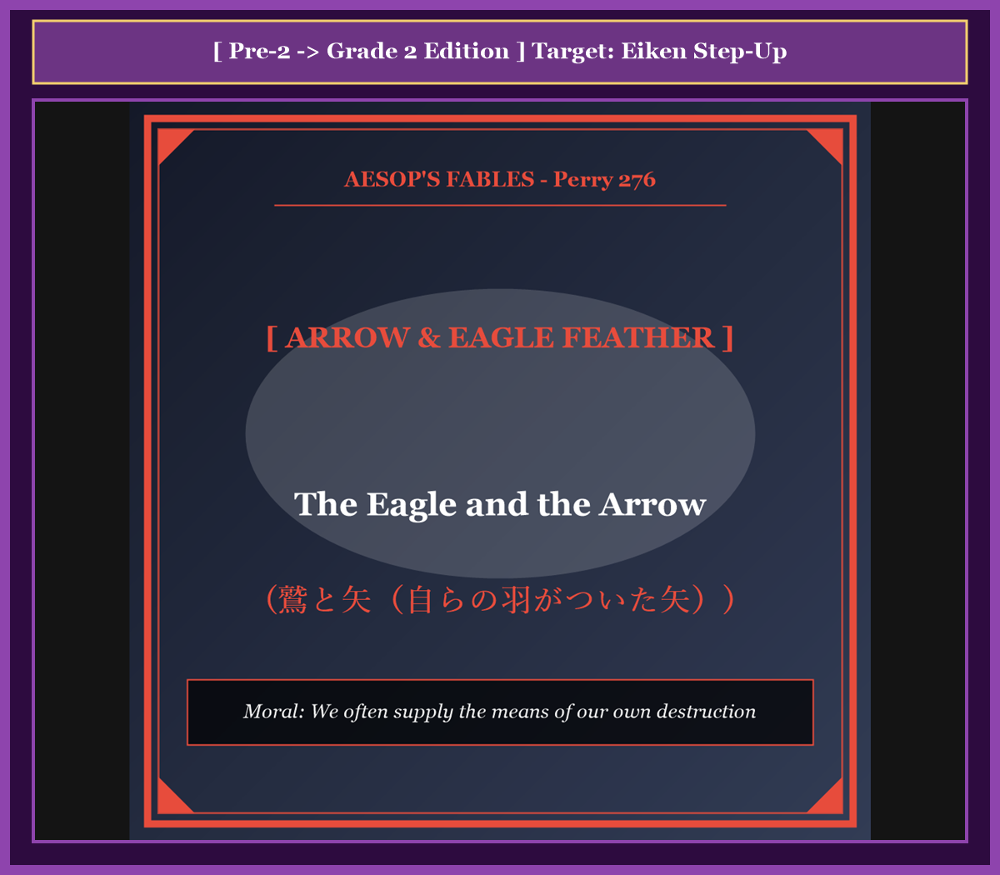
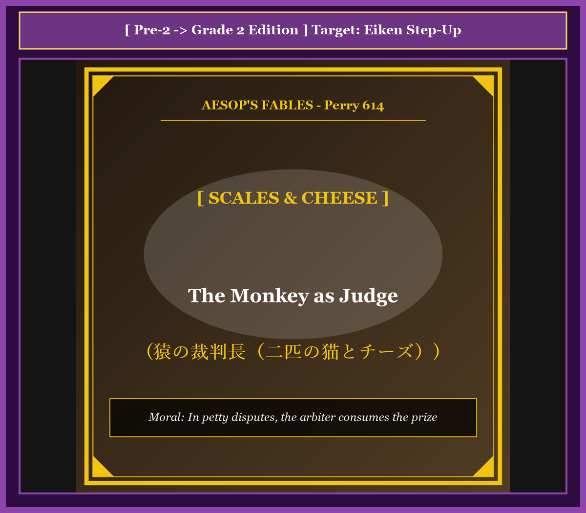
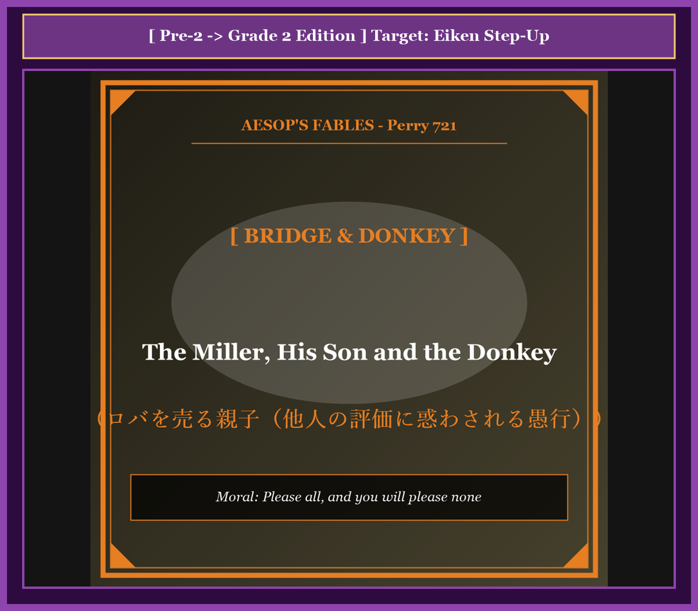
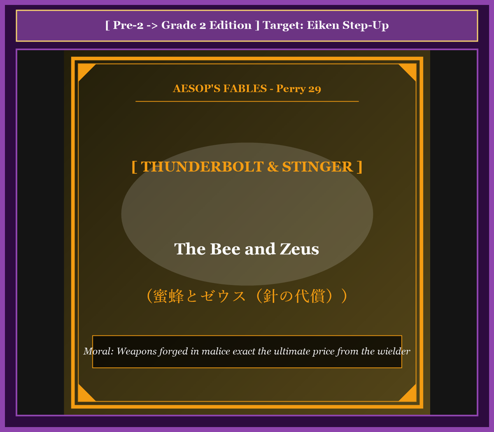
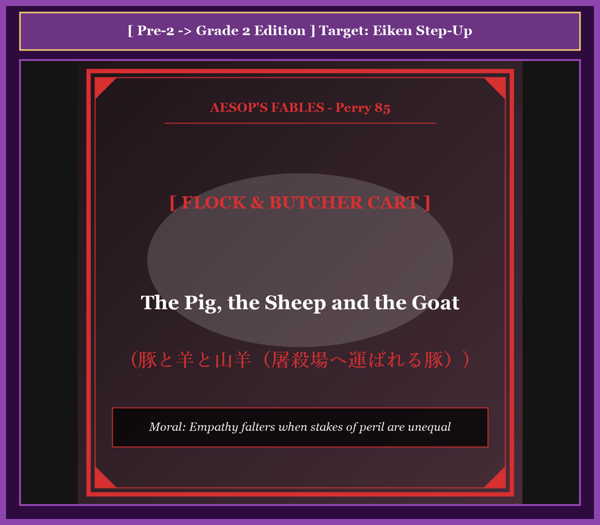
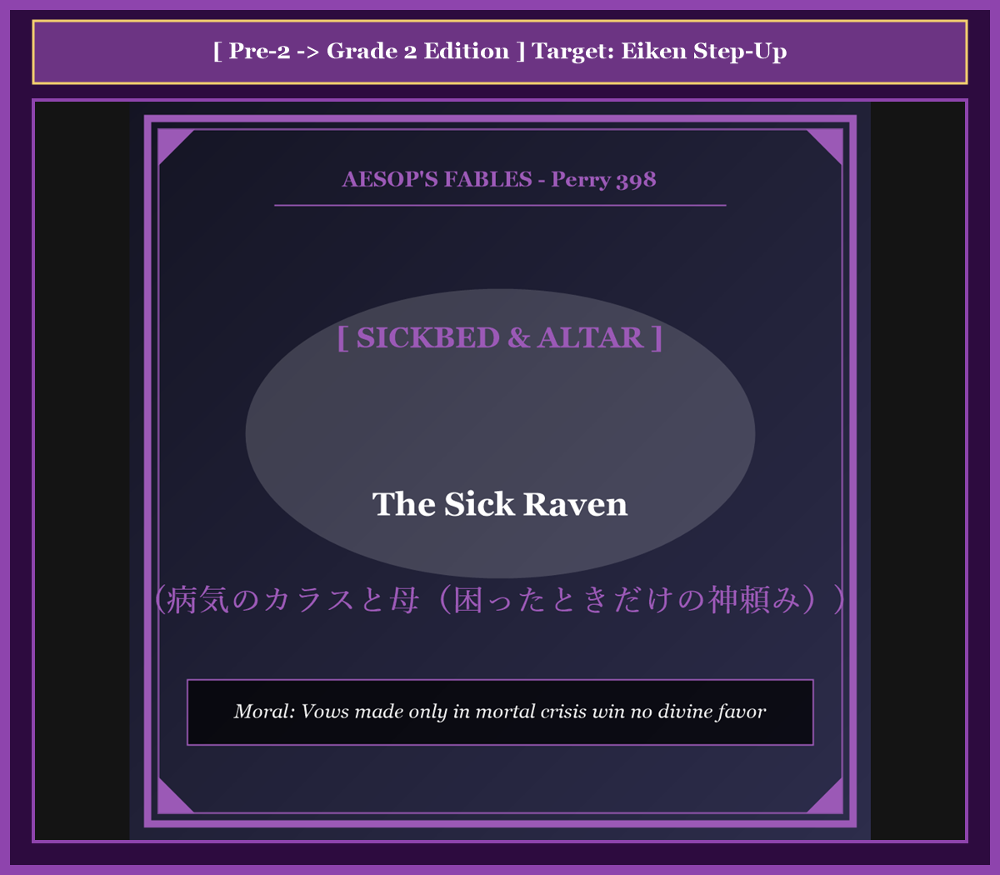
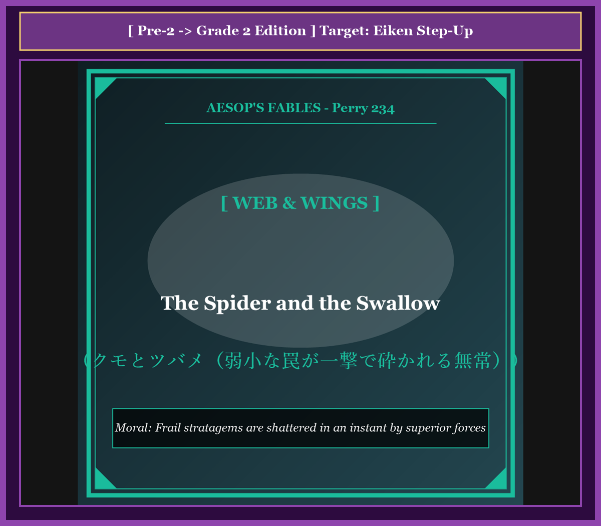
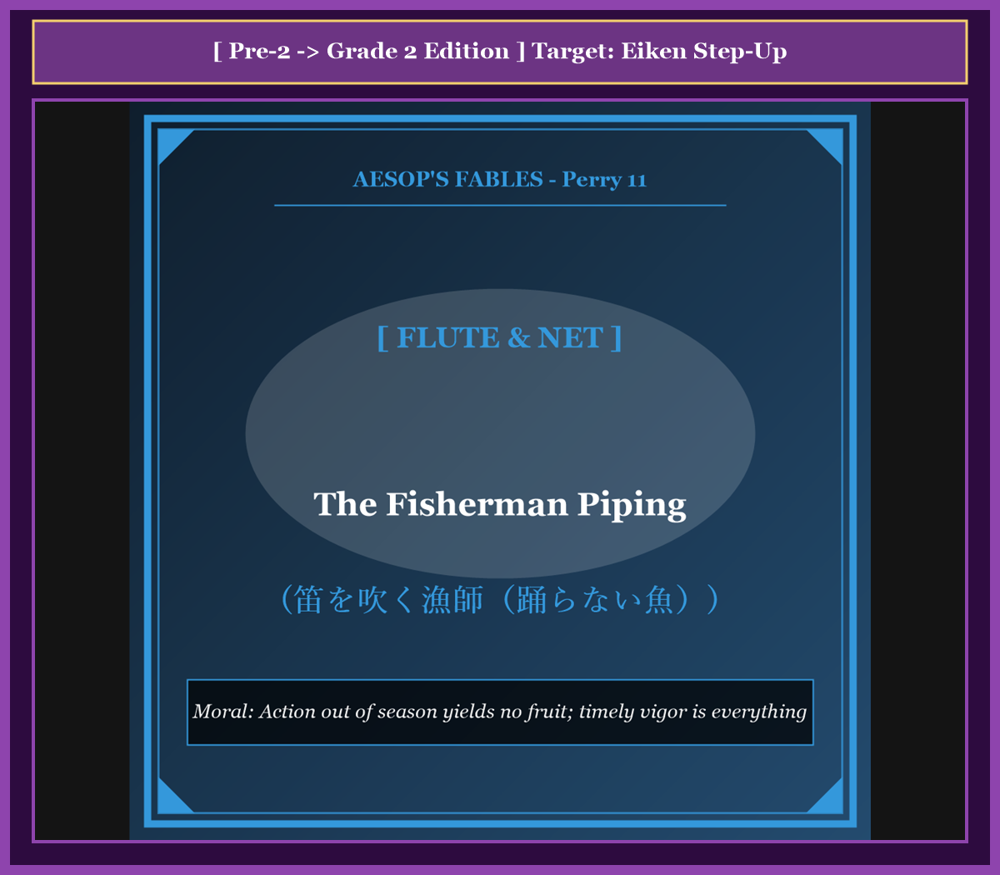
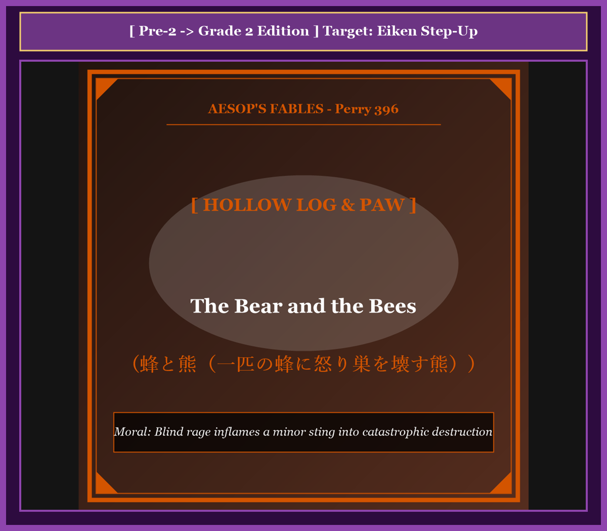
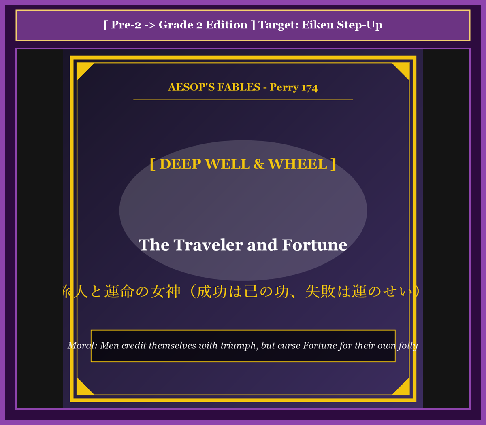

# 『英検ステップアップ多読：イソップ寓話編 第23巻（準2級 ➔ 2級対比学習・第6集・完結巻）』

---

## はじめに：なぜ「対比多読」で英検2級の壁を突破できるのか？

英検2級は、「高校卒業程度」および「社会生活に必要な実用英語」の運用能力を証明する重要資格です。大学入試の優遇措置やビジネス現場での基礎英語力としても広く認知されています。

しかし、準2級合格者にとって2級の壁は決して低くありません。日常的・具体的な事象を語る英語から、**「社会問題」「抽象的な概念」「高度な原因・結果の因果関係」を論理的・客観的に叙述するフォーマルなアカデミック英語**への転換が求められるからです。

本書では、世界中で読み継がれてきたイソップ寓話（第6集・10話）を舞台に、**「準2級レベルの物語英語」** が **「2級レベルの社会・知性論述英語」** へとどのように洗練・昇華されるかを鮮やかに比較します。

* **準2級英文（ベンチマーク）** で寓話の起承転結をスピーディに把握
* **2級英文（ターゲット）** で格調高い動詞、名詞構文、学術的語彙を無理なく吸収
* **キーフレーズ対比カード** で、ライティング（要約・意見論述）や二次面接（ナレーション・質疑応答）で高得点を叩き出す表現力を養成

普遍的な人間心理や組織の力学を描いたイソップ寓話の神髄を味わいながら、2級合格を確固たるものにしてください！

---

## 本書の収録作品（第6集・全10話 / シリーズ通算51〜60話）

1. **Chapter 51**: 鷲と矢（自分の羽がついた矢） (*The Eagle and the Arrow*) [Perry 276]
2. **Chapter 52**: 猿の裁判長（二匹の猫とチーズ） (*The Monkey as Judge*) [Perry 614]
3. **Chapter 53**: ロバを売る親子（他人の評価に惑わされる話） (*The Miller, His Son and the Donkey*) [Perry 721]
4. **Chapter 54**: 蜜蜂とゼウス（針の代償） (*The Bee and Zeus*) [Perry 29]
5. **Chapter 55**: 豚と羊と山羊（屠殺場へ運ばれる豚） (*The Pig, the Sheep and the Goat*) [Perry 85]
6. **Chapter 56**: 病気のカラスと母（困ったときだけの神頼み） (*The Sick Raven*) [Perry 398]
7. **Chapter 57**: クモとツバメ（弱小な罠が一撃で砕かれる無常） (*The Spider and the Swallow*) [Perry 234]
8. **Chapter 58**: 笛を吹く漁師（踊らない魚） (*The Fisherman Piping*) [Perry 11]
9. **Chapter 59**: 蜂と熊（一匹の蜂に怒り巣を壊す熊） (*The Bear and the Bees*) [Perry 396]
10. **Chapter 60**: 旅人と運命の女神（成功は己の功、失敗は運のせい） (*The Traveler and Fortune*) [Perry 174]

---

## 本書の構成と電子書籍 / Kobo最適化

各章は以下の6部構成で統一されています。

```text
┌─────────────────────────────────────────────────────────────┐
│ 1. Chapter Title & Visual Illustration (章タイトル ＆ 挿絵)   │
│ 2. Benchmark Level: 英検準2級レベル英文                       │
│ 3. Target Level: 英検2級レベル英文                           │
│ 4. Classic Original English Text (イソップ寓話クラシック原文)  │
│ 5. Japanese Translation (日本語訳 ＆ 教訓)                     │
│ 6. Recite & Compare (そらんじたいキーフレーズ対比カード)        │
│ 7. Key Vocabulary & Exam Notes (語彙・文法・試験対策解説)        │
└─────────────────────────────────────────────────────────────┘
```

> **【ポイント】 音声読み上げ（TTS）をご利用の方へ**
> 本文セクション（ステップ1〜3）は英語のみで構成されており、電子書籍やKoboの自動音声読み上げ機能（Text-to-Speech）で日本語が混ざることなく、美しい英語音声で快適にリスニング学習していただけます。


# Chapter 51: The Eagle and the Arrow (鷲と矢)

<!-- 電子書籍 Page Break & Image Header -->
<div style="text-align: center; margin-bottom: 20px;">
  
</div>

<div style="page-break-before: always;"></div>

## 1. Benchmark Level: Eiken Grade Pre-2 (英検準2級レベル本文)
*Read in ~2 to 2.5 minutes. Baseline vocabulary and basic syntax.*

Perched majestically upon an alpine promontory, a sovereign eagle surveyed the expansive valleys beneath his domain. Endowed with acute optical perception and formidable predatory instincts, the avian monarch habitually scrutinized the terrain from immense altitudes, readily detecting any vulnerable quarry concealing itself amidst the foliage.

During a tranquil twilight, the predator descended to a prominent granite outcrop, patiently anticipating the emergence of a hare. Wholly absorbed in monitoring the valley floor, the eagle remained entirely oblivious to an experienced archer who was quietly maneuvering through the dense undergrowth below.

Discerning the silhouette of the noble raptor against the horizon, the hunter methodically notched a feathered projectile into his recurve bow. Drawing the cord to its maximum tension with practiced precision, he discharged the missile toward the summit.

The arrow traversed the intervening atmosphere with lethal velocity, penetrating deeply into the eagle's vital organs. Traumatized by the catastrophic impact, the sovereign of the skies experienced instantaneous equilibrium failure, plummeting precipitously to the rocky embankment beneath.

Lying prostrate and hemorrhaging upon the stony earth, the dying predator cast his failing gaze upon the fatal shaft protruding from his chest. With profound shock and existential despair, he identified the stabilizing fletchings fixed to the arrow's tail. They were identical to the magnificent plumage he had naturally shed from his own pinions during the preceding seasonal molt.

Experiencing an acute pang of tragic irony, the mortally wounded raptor gasped his dying lamentation: "While physical extinction is inherently agonizing, it constitutes an infinitely more grievous torment to comprehend that my own shed feathers furnished the aerodynamic instruments that orchestrated my destruction."

---
<div style="page-break-before: always;"></div>

## 2. Target Level: Eiken Grade 2 (英検2級レベル本文)
*Read in ~2.5 to 3 minutes. Advanced vocabulary, complex syntax, and formal rhetoric.*

Perched upon an alpine promontory, a sovereign eagle systematically surveyed the vast valleys within his territorial jurisdiction. Possessing acute visual discernment and formidable predatory capabilities, the avian monarch routinely scrutinized the terrain from extreme altitudes, effortlessly detecting any vulnerable prey attempting to conceal itself within the dense vegetation.

During a serene twilight, the apex raptor descended toward a prominent granite outcrop, patiently anticipating the emergence of a foraging hare. Entirely preoccupied with monitoring the movement across the valley floor, the eagle remained oblivious to an experienced archer who was quietly maneuvering through the dense undergrowth below.

Discerning the distinct silhouette of the great bird against the horizon, the hunter methodically notched a feathered projectile into his recurve bow. Drawing the cord to its maximum tension with practiced precision, he discharged the lethal arrow toward the mountain summit.

Traversing the intervening atmosphere with tremendous kinetic velocity, the projectile penetrated deep into the eagle's thoracic cavity. Overwhelmed by the traumatic impact, the monarch of the skies suffered an immediate loss of equilibrium, plummeting precipitously toward the rocky earth below.

Lying prostrate upon the stony ground and hemorrhaging profusely, the mortally wounded predator directed his fading gaze toward the fatal shaft protruding from his breast. With profound astonishment and psychological despair, he identified the stabilizing fletchings attached to the projectile's shaft. They were identical to the majestic flight feathers that had naturally detached from his own wings during the preceding seasonal molt.

Experiencing an acute pang of bitter irony, the dying eagle articulated a profound philosophical lamentation: "While physical termination is inherently agonizing, it constitutes an infinitely more grievous tragedy to comprehend that my own discarded feathers provided the aerodynamic instruments that orchestrated my destruction."

---
<div style="page-break-before: always;"></div>

## 3. Classic Original English Text (イソップ寓話クラシック原文)
*Translated by George Fyler Townsend (1867)*

An Eagle sat on a high rock, looking for hares. A hunter shot an arrow at him and hit him. As the Eagle fell dying, he looked at the arrow and saw that its feathers were plucked from an eagle's own wing. "Alas," he cried, "it is a double grief to me that I must die by an arrow feathered with my own plumage!"

---
<div style="page-break-before: always;"></div>

## 4. Japanese Translation & Moral (日本語訳と教訓)

### 【日本語全訳：英検2級レベル本文】
高山帯の岬の上に止まり、主権者たるワシは自らの領土的管轄内にある広大な谷を組織的に見渡していました。鋭敏な視覚的識別力と恐るべき捕食能力を宿していたこの鳥類の君主は、極度の高度から地形を日常的に精査し、鬱蒼とした植生の中に身を隠そうと試みるいかなる脆弱な獲物をも難なく探知していました。

穏やかな黄昏時、この頂点捕食者の猛禽類は目立つ花崗岩の露出部へと舞い降り、採餌する野ウサギの出現を辛抱強く待っていました。谷底の動きを監視することに完全に没頭していたため、ワシは下方の密生した下草の間を静かに操縦（接近）していた熟練の射手にまったく気づいていませんでした。

地平線を背景とするその大きな鳥の明瞭なシルエットを認めた狩人は、羽のついた投射体（矢）を規則正しく自らの弓へと番えました。熟練の精密さをもって弦を最大張力まで引き絞ると、彼は山頂に向かって致死的な矢を放ちました。

凄まじい運動速度をもって大気中を横断し、投射体はワシの胸腔深くへと貫通しました。外傷的な衝撃に圧倒され、空の君主は即座の平衡喪失を被り、眼下の岩がちの地面へと真っ逆さまに急転落しました。

石だらけの地面の上に平伏し激しく出血しながら、致命傷を負った捕食者は、自らの胸から突き出ている致命的な矢の柄へと衰えゆく視線を向けました。深甚な驚愕と心理的絶望の中で、彼は投射体の柄に取り付けられている安定用の矢羽を識別しました。それらは、前回の季節の換羽期に自らの翼から自然に脱落していた見事な風切羽と完全に同一のものだったのです。

苦い皮肉の鋭い痛痒を経験しながら、死にゆくワシは深遠な哲学的嘆きを口にしました。「肉体的な終焉そのものも生来耐え難い苦痛であるが、自らが捨て去った羽が、自らの破滅を組織した空気力学的道具を提供していたのだと理解することは、無限により悲痛な悲劇である。」

### 【教訓（Moral）】
**We often supply the means of our own destruction.**  
（人間はしばしば、自らが過去に提供した技術・情報・リソースによって、皮肉にも自らを撃ち落とす最も致命的な武器の部品を敵に与えてしまう。）

---
<div style="page-break-before: always;"></div>

## 5. Recite & Compare: そらんじたいキーフレーズ対比カード

<div class="comparison-card">
  <div class="card-header">フレーズ 1：領土的管轄内を極度の高度から精査する</div>
  <div class="card-row-pre2-base"><span class="card-badge-pre2-base">準2級</span>Endowed with acute optical perception, he scrutinized the terrain from immense altitudes.</div>
  <div class="card-row-g2"><span class="card-badge-g2">2級</span>Possessing acute visual discernment, the monarch systematically surveyed the vast valleys within his jurisdiction.</div>
  <div class="card-note"><strong>解説：</strong>法学・社会科学用語「jurisdiction（管轄区域）」と「systematically surveyed」を用いた高度な表現です。</div>
</div>

<div class="comparison-card">
  <div class="card-header">フレーズ 2：凄まじい運動速度で胸腔を貫通する矢</div>
  <div class="card-row-pre2-base"><span class="card-badge-pre2-base">準2級</span>The arrow traversed the intervening atmosphere with velocity, penetrating deeply into vital organs.</div>
  <div class="card-row-g2"><span class="card-badge-g2">2級</span>Traversing the atmosphere with tremendous kinetic velocity, the projectile penetrated deep into his thoracic cavity.</div>
  <div class="card-note"><strong>解説：</strong>物理学用語「kinetic velocity（運動速度）」と解剖学用語「thoracic cavity（胸腔）」の正確な描写です。</div>
</div>

<div class="comparison-card">
  <div class="card-header">フレーズ 3：自らの翼から脱落した羽と同一だと識別する</div>
  <div class="card-row-pre2-base"><span class="card-badge-pre2-base">準2級</span>He identified the fletchings as identical to the plumage naturally shed from his pinions.</div>
  <div class="card-row-g2"><span class="card-badge-g2">2級</span>He identified stabilizing fletchings identical to the flight feathers naturally detached from his wings.</div>
  <div class="card-note"><strong>解説：</strong>「stabilizing fletchings（安定用矢羽）」と「naturally detached from his wings」の洗練された文体です。</div>
</div>

<div class="comparison-card">
  <div class="card-header">フレーズ 4：自らの羽が破滅の空気力学を組織した悲劇</div>
  <div class="card-row-pre2-base"><span class="card-badge-pre2-base">準2級</span>My own shed feathers furnished aerodynamic instruments that orchestrated my destruction.</div>
  <div class="card-row-g2"><span class="card-badge-g2">2級</span>My own discarded feathers provided the aerodynamic instruments that orchestrated my destruction.</div>
  <div class="card-note"><strong>解説：</strong>航空工学と哲学が融合した「aerodynamic instruments that orchestrated my destruction」です。</div>
</div>

---
<div style="page-break-before: always;"></div>

## 6. Key Vocabulary & Exam Notes (英検2級 重要語彙・文法・面接対策)

### 1. 英検2級 必須ボキャブラリー
* **jurisdiction** [名] 管轄権、司法権、支配権
* **discernment** [名] 識別力、眼識、洞察力
* **preoccupied** [形] 夢中になった、心を奪われた（*preoccupied with*）
* **thoracic** [形] 胸の、胸部の（*thoracic cavity* = 胸腔）
* **prostrate** [形] ひれ伏した、倒れた、打ちのめされた
* **fletching** [名] 矢羽、矢の安定翼
* **aerodynamic** [形] 空気力学の、流線型の
* **orchestrate** [動] 〜を組織化する、画策する

### 2. 文法・構文のチェックポイント
* **preoccupied with + 名詞 / 動名詞**:
  * 「〜に夢中になって、〜に気を取られて」。他の危険に無防備になる文脈で重宝されます。
* **it constitutes + 名詞 + to do**:
  * 「〜することは…を構成する、〜に他ならない」。formalな論述の骨格です。

### 3. スピーキング（面接）＆ライティング活用ヒント
* 自社の知的所有権や技術データが競合他社に渡り自社を脅かす現象について、*Firms frequently discover that their proprietary technologies have furnished the aerodynamic tools of their own market displacement.* と展開できます。


# Chapter 52: The Monkey as Judge (猿の裁判長)

<!-- 電子書籍 Page Break & Image Header -->
<div style="text-align: center; margin-bottom: 20px;">
  
</div>

<div style="page-break-before: always;"></div>

## 1. Benchmark Level: Eiken Grade Pre-2 (英検準2級レベル本文)
*Read in ~2 to 2.5 minutes. Baseline vocabulary and basic syntax.*

While foraging through an agrarian settlement, two feral felines stumbled upon an opulent block of aged dairy cheese. Initially electrified by this fortuitous acquisition, the predators were almost immediately engulfed in contentious litigation regarding proprietary distribution.

Neither party demonstrated the slightest inclination to negotiate an equitable compromise. The dark feline asserted priority of discovery, whereas the white counterpart maintained tangible possession. Recognizing the absolute deadlock of their bilateral negotiations, the naive litigants resolved to submit their conflict to external judicial arbitration.

Materializing opportunistically from the canopy, an unscrupulous simian offered his professional mediation. Projecting an aura of judicial solemnity, the monkey assured them that his objective calibration would guarantee egalitarian equity. Subordinating skepticism to legal desperation, the felines surrendered their prize to the magistrate.

The primate promptly deployed an apparatus of balancing scales. Bisecting the cheese into deliberately unequal proportions, he deposited the fragments upon opposite pans, causing the heavier sector to plunge abruptly.

"An intolerable structural imbalance," observed the magistrate with theatrical gravity. "Equilibrium must be restored through regulatory adjustment." Thereupon, the arbiter consumed a substantial mouthful from the dominant fragment. However, this clumsy subtraction reversed the disparity, necessitating a reciprocal bite from the opposite side.

Iterating this manipulative oscillation, the feline spectators witnessed their asset systematically liquidated before their eyes. Terrified by the rapid vanishing of their property, the litigants implored the court to terminate the proceedings: "Surrender the residual fragments! We dissolve our appeal!"

"Judicial procedure cannot be summarily aborted without the satisfaction of professional stipends," retorted the simian. Devouring the final crumbs with nonchalant satisfaction, the arbiter absconded into the forest, leaving the litigants thoroughly destitute.

---
<div style="page-break-before: always;"></div>

## 2. Target Level: Eiken Grade 2 (英検2級レベル本文)
*Read in ~2.5 to 3 minutes. Advanced vocabulary, complex syntax, and formal rhetoric.*

Within an agrarian settlement, two feral domestic felines discovered a substantial block of seasoned cheese. Initially exhilarated by this unexpected acquisition, the predators quickly descended into contentious litigation regarding the equitable distribution of their communal property.

Neither party demonstrated the slightest inclination to achieve a diplomatic compromise. The black cat asserted chronological priority of visual discovery, whereas the white adversary maintained physical possession. Recognizing the total paralysis of their bilateral negotiations, the naive litigants resolved to submit their conflict to formal external arbitration.

Appearing opportunistically from an adjacent oak tree, an unscrupulous primate offered his professional mediation. Projecting an aura of judicial solemnity, the monkey assured them that his objective calibration would guarantee egalitarian justice. Subordinating prudence to procedural desperation, the felines surrendered their contested asset to the magistrate.

The primate immediately deployed an apparatus of balancing scales. Bisecting the cheese into deliberately disproportionate segments, he deposited them upon opposite pans, causing the heavier sector to plunge abruptly toward the ground.

"An intolerable structural discrepancy," proclaimed the judge with theatrical gravity. "Equilibrium must be restored through regulatory reduction." Thereupon, the arbiter consumed an enormous portion from the dominant fragment. However, this clumsy subtraction reversed the disparity, necessitating a reciprocal reduction from the opposing side.

Iterating this manipulative oscillation, the anxious felines witnessed their prized commodity systematically liquidated before their eyes. Terrified by the rapid evaporation of their property, the litigants implored the court to suspend proceedings: "Surrender the residual fragments! We formally dissolve our dispute!"

"Judicial procedure cannot be summarily terminated without the full liquidation of professional administrative fees," retorted the primate. Consuming the final crumbs with nonchalant satisfaction, the arbiter absconded into the forest canopy, leaving the litigants thoroughly destitute.

---
<div style="page-break-before: always;"></div>

## 3. Classic Original English Text (イソップ寓話クラシック原文)
*Translated by George Fyler Townsend (1867)*

Two Cats found a piece of cheese and could not agree on dividing it. They went to a Monkey to arbitrate. The Monkey brought a balance scale and broke the cheese into two pieces. One was heavier, so he bit a piece off it. Then the other side was heavier, so he bit a piece off that. He kept eating from each side until the Cats pleaded: "Give us what is left!" The Monkey said: "The rest is my fee for judging," and devoured it all.

---
<div style="page-break-before: always;"></div>

## 4. Japanese Translation & Moral (日本語訳と教訓)

### 【日本語全訳：英検2級レベル本文】
ある農耕集落において、二匹の野生化した家庭猫が熟成したチーズの相当な大きさの塊を発見しました。最初はこの予期せぬ獲得に大喜びした捕食者たちでしたが、自らの共有財産の公平な分配を巡る論争の的となる訴訟（激しい対立）へと急速に転落していきました。

どちらの当事者も、外交的な妥協を達成する微塵の傾向も示しませんでした。黒猫は視覚的発見の時系列的な優先権を主張し、白い敵対者は物理的な占有権を維持しました。自らの二者間交渉の完全な麻痺を認識した素朴な訴訟当事者たちは、自らの紛争を公式な外部仲裁に委ねることを決意しました。

隣接するカシの木から日和見主義的に姿を現した不謹慎な霊長類（サル）が、自らの専門的な調停を申し出ました。司法の厳粛さのオーラを醸し出しながら、サルは自らの客観的な測定が平等主義的正義を保証すると彼らに断言しました。思慮分別を手続き的絶望に従属させ、猫たちは係争中の資産を判事へと引き渡してしまいました。

霊長類の調停者は即座に天秤ばかりの装置を展開しました。意図的に不均衡な区画へとチーズを二分すると、彼はそれらを反対側の皿の上に載せ、重い方のセクターを地面に向かって急激に沈下させました。

「容認しがたい構造的不一致である」と判事は演劇的な重々しさをもって宣言しました。「規制的削減を通じて均衡を回復せねばならない。」そうして、仲裁者は支配的な破片から膨大な一口を消費しました。しかしながら、この粗野な引き算は格差を逆転させ、反対側からの相互の削減を必要とさせたのです。

この巧妙な往復運動を繰り返すことで、不安がる猫たちは自らの貴重な商品が目の前で組織的に清算（消滅）されていくのを目撃しました。自らの財産の急速な蒸発に恐怖した訴訟当事者たちは、手続きを停止するよう法廷に懇願しました。「残りの破片を引き渡してください！ 私たちは公式に争いを解消します！」

「専門職の行政手数料の完全な清算なしに、司法手続きを即決で終了させることはできない」と霊長類は反論しました。平然とした満足感をもって最後のパンくずを平らげると、仲裁者は森林の樹冠の中へと逃走し、訴訟当事者たちを完全に無一文のまま置き去りにしたのです。

### 【教訓（Moral）】
**In petty disputes, the arbiter consumes the prize.**  
（私利私欲に固執して無用な外部仲裁や訴訟に頼る当事者たちは、仲裁者の手数料によって全ての資産を収奪され、共倒れとなる。）

---
<div style="page-break-before: always;"></div>

## 5. Recite & Compare: そらんじたいキーフレーズ対比カード

<div class="comparison-card">
  <div class="card-header">フレーズ 1：二者間交渉の完全麻痺と公式仲裁の要請</div>
  <div class="card-row-pre2-base"><span class="card-badge-pre2-base">準2級</span>Recognizing absolute deadlock, litigants resolved to submit conflict to judicial arbitration.</div>
  <div class="card-row-g2"><span class="card-badge-g2">2級</span>Recognizing the total paralysis of negotiations, the litigants submitted conflict to formal external arbitration.</div>
  <div class="card-note"><strong>解説：</strong>「total paralysis of negotiations（交渉の完全麻痺）」と「formal external arbitration（公式な外部仲裁）」の的確な表現です。</div>
</div>

<div class="comparison-card">
  <div class="card-header">フレーズ 2：不均衡な区画に二分して天秤を傾かせる</div>
  <div class="card-row-pre2-base"><span class="card-badge-pre2-base">準2級</span>Bisecting the cheese into deliberately unequal proportions, he caused the heavier sector to plunge.</div>
  <div class="card-row-g2"><span class="card-badge-g2">2級</span>Bisecting the cheese into deliberately disproportionate segments, he caused the heavier sector to plunge.</div>
  <div class="card-note"><strong>解説：</strong>「disproportionate segments（不均衡な区画）」と「plunge abruptly」による精密な力学描写です。</div>
</div>

<div class="comparison-card">
  <div class="card-header">フレーズ 3：資産の急速な蒸発と訴訟停止の懇願</div>
  <div class="card-row-pre2-base"><span class="card-badge-pre2-base">準2級</span>Terrified by the rapid vanishing of property, litigants implored court to terminate proceedings.</div>
  <div class="card-row-g2"><span class="card-badge-g2">2級</span>Terrified by the rapid evaporation of property, the litigants implored the court to suspend proceedings.</div>
  <div class="card-note"><strong>解説：</strong>経済比喩「rapid evaporation of property（財産の急速な蒸発・消滅）」を用いた洗練された表現です。</div>
</div>

<div class="comparison-card">
  <div class="card-header">フレーズ 4：行政手数料の清算なしに手続きを終了できない屁理屈</div>
  <div class="card-row-pre2-base"><span class="card-badge-pre2-base">準2級</span>Procedure cannot be aborted without satisfaction of professional stipends.</div>
  <div class="card-row-g2"><span class="card-badge-g2">2級</span>Judicial procedure cannot be summarily terminated without the full liquidation of administrative fees.</div>
  <div class="card-note"><strong>解説：</strong>法学用語「summarily terminated（即決終了される）」「liquidation of administrative fees（手数料の清算）」の融合です。</div>
</div>

---
<div style="page-break-before: always;"></div>

## 6. Key Vocabulary & Exam Notes (英検2級 重要語彙・文法・面接対策)

### 1. 英検2級 必須ボキャブラリー
* **litigation** [名] 訴訟、法廷闘争
* **adversary** [名] 敵対者、相手（*legal adversary*）
* **disproportionate** [形] 不釣り合いな、不均衡な
* **discrepancy** [名] 相違、矛盾、食い違い
* **evaporation** [名] 蒸発、消滅（資産などの急速な消失）
* **summarily** [副] 即座に、略式で、即決で
* **canopy** [名] 樹冠、天蓋
* **destitute** [形] 困窮した、無一文の

### 2. 文法・構文のチェックポイント
* **descended into + 名詞**:
  * 「〜へと転落する、堕落する」。*descended into contentious litigation*。
* **without + the + 名詞 + of ...**:
  * 前提条件を示す前置詞句。「〜の…なしには」。

### 3. スピーキング（面接）＆ライティング活用ヒント
* 知的財産権の侵害訴訟や泥沼の境界紛争について、*Litigants consumed by proprietary greed frequently witness their contested capital evaporate into administrative legal expenses.* と論評できます。


# Chapter 53: The Miller, His Son and the Donkey (ロバを売る親子)

<!-- 電子書籍 Page Break & Image Header -->
<div style="text-align: center; margin-bottom: 20px;">
  
</div>

<div style="page-break-before: always;"></div>

## 1. Benchmark Level: Eiken Grade Pre-2 (英検準2級レベル本文)
*Read in ~2 to 2.5 minutes. Baseline vocabulary and basic syntax.*

An aged miller accompanied by his adolescent son departed their homestead at daybreak, escorting an equine beast of burden toward a commercial market. Prioritizing the preservation of the animal's marketable vigor, the custodians elected to travel pedestrian-style alongside their quadruped.

While traversing a public thoroughfare, they intersected with an assembly of maidens congregating around a communal fountain. "Observe the incomprehensible ineptitude of those wanderers!" ridiculed one spectator. "For what conceivable objective does one maintain a beast if both custodians subject themselves to arduous pedestrian exertion?"

Excessively susceptible to external social judgment, the patriarch instructed his offspring to mount the donkey's dorsal ridge while he persevered on foot.

Inevitably, this configuration attracted swift condemnation from a council of village elders. "Bear witness to the moral degeneration of modern youth!" proclaimed a dogmatic patriarch. "A vigorous youth reclines in ostentatious comfort, compelling his decrepit progenitor to trudge through the dust."

Mortified by this public chastisement, the adolescent vacated the saddle and demanded that his father occupy the mount. Reluctantly acquiescing, the miller assumed the equestrian posture, confident that filial propriety had been restored.

Nevertheless, subsequent observers formulated an antithetical grievance. Encountering agrarian laborers, the pair was violently excoriated: "What reprehensible paternal egoism! An adult male indulges in luxury while an underdeveloped minor pantingly expends his vitality attempting to sustain velocity!"

Paralyzed by anxiety regarding communal perception, the miller hoisted the adolescent onto the saddle, endeavoring to achieve consensus through simultaneous transport.

Yet, upon entering the metropolitan periphery, civic spectators voiced visceral indignation regarding alleged animal cruelty: "Invert the arrangement, you tyrannical oppressors! The physical dimensions of the riders vastly eclipse the carrying capacity of the quadruped!"

Reduced to cognitive paralysis by endless contradictory dictates, the desperate pair bound the animal's hooves to a horizontal timber, hoisting the inverted beast upon their shoulders.

Confronted with this surreal pantomime upon a municipal aqueduct, the populace exploded in derisive pandemonium. Convulsed by sensory panic, the inverted donkey fractured the hemp restraints, plummeted into the torrent, and perished.

The destitute miller returned home having assimilated an immutable sociological verity: he who calibrates his conduct solely to conciliate universal approval inevitably orchestrates his own total ruin.

---
<div style="page-break-before: always;"></div>

## 2. Target Level: Eiken Grade 2 (英検2級レベル本文)
*Read in ~2.5 to 3 minutes. Advanced vocabulary, complex syntax, and formal rhetoric.*

An aged miller accompanied by his adolescent son departed their homestead at dawn, escorting a beast of burden toward a commercial market. Prioritizing the preservation of the animal's physical vigor, the custodians elected to travel pedestrian-style alongside their quadruped.

While traversing a public thoroughfare, they encountered a gathering of young women drawing water from a communal fountain. "Observe the incomprehensible incompetence of those travelers!" ridiculed one spectator. "Why should both custodians endure arduous physical exertion when their beast of burden carries no burden whatsoever?"

Excessively sensitive to communal criticism, the patriarch instructed his offspring to mount the donkey's back while he persevered on foot.

Inevitably, this configuration provoked swift moral condemnation from a council of village elders. "Bear witness to the deplorable moral decay of the modern generation!" proclaimed an elderly observer. "A vigorous youth lounges in comfort, while his aged father is forced to endure the exhaustion of the dusty road."

Mortified by this public reprimand, the adolescent vacated the mount and insisted that his father occupy the saddle. Reluctantly acquiescing, the miller assumed the riding posture, confident that proper familial hierarchy had been established.

Nevertheless, subsequent observers formulated an entirely opposite grievance. Encountering a group of agrarian laborers, the pair was harshly criticized: "What callous paternal selfishness! An adult man enjoys leisure while an underdeveloped child struggles breathlessly to maintain his pace!"

Paralyzed by anxiety regarding external perception, the miller hoisted the boy up behind him, endeavoring to achieve universal consensus through simultaneous transport.

Yet, upon entering the municipal perimeter, civic spectators voiced collective outrage regarding perceived animal cruelty: "Invert the arrangement, you cruel tyrants! The physical weight of the riders vastly exceeds the carrying capacity of the quadruped!"

Reduced to cognitive paralysis by endless contradictory demands, the desperate pair bound the animal's legs to a horizontal timber and hoisted the beast upon their shoulders.

Confronted with this absurd spectacle upon a municipal bridge, the populace erupted in roaring laughter. Startled by the commotion, the struggling donkey snapped the ropes, plummeted into the turbulent river, and drowned.

The destitute miller returned home having internalized a timeless sociological verity: he who attempts to please every observer inevitably pleases nobody and orchestrates his own ruin.

---
<div style="page-break-before: always;"></div>

## 3. Classic Original English Text (イソップ寓話クラシック原文)
*Translated by George Fyler Townsend (1867)*

A Miller and his Son were leading their Donkey to market. A passerby said: "Why walk when you have a beast to ride?" So the Miller put his Son on the Donkey. Another criticized the boy for riding while his old father walked, so the Miller took his place. A third cried shame that the poor donkey carried the heavy man, so both rode. A fourth called them cruel to overload the animal, so they tied the donkey's feet to a pole and carried him. As they crossed a bridge, the crowd laughed, the donkey kicked, broke loose, fell into the river, and drowned.

---
<div style="page-break-before: always;"></div>

## 4. Japanese Translation & Moral (日本語訳と教訓)

### 【日本語全訳：英検2級レベル本文】
年老いた粉屋が思春期の息子を伴い、商業市場に向けて役畜のロバを護送しながら、夜明けとともに自らの農家を出発しました。動物の肉体的活力を保全することを優先し、管理者（親子）は四足獣の隣を徒歩形式で旅することを選択したのです。

公道を進む途中、彼らは共同の泉から水を汲んでいた若い女性たちの集まりに遭遇しました。「あの旅人たちの理解不能な無能ぶりを見てごらんなさい！」と一人の見物人が嘲笑しました。「役畜が一切の荷物を運んでいないというのに、なぜ両方の管理者が過酷な肉体的運動に耐えねばならないのかしら？」

共同体の批判に対して過敏すぎた家長は、自らは徒歩を続けながら、息子の背骨に乗るよう指示しました。

必然的に、この配置は村の長老会議からの迅速な道徳的非難を引き起こしました。「現代世代の嘆かわしい道徳的退廃を目撃せよ！」と一人の年老いた観察者が宣言しました。「元気な若者が安楽の中にもたれかかり、老いた父親が埃っぽい道の疲労に耐えることを強いられているではないか。」

この公の叱責に打ちのめされ、青年は乗り場を明け渡し、父親が鞍に座るよう強く主張しました。不本意ながらも同意し、粉屋は適切な家族の秩序が確立されたと確信して、騎乗の姿勢を取りました。

それにもかかわらず、その後に遭遇した観察者たちは完全に正反対の不満を表明しました。農耕労働者の一団に出くわしたとき、その二人組は厳しく非難されました。「なんと冷酷な父親の利己主義だろう！ 未発達の子供が息を切らしてその歩調を維持しようと奮闘している間に、大人の男が優雅に寛いでいるではないか！」

外部の認識に関する不安によって麻痺した粉屋は、同時輸送によって普遍的な合意を達成しようと試み、少年を自らの後ろへと引き上げました。

しかし自治体の境界に入ると、市民の傍観者たちは、疑わしい動物虐待に関して集団的憤りを表明したのです。「その配置を逆にせよ、この残酷な暴君どもめ！ 乗り手の物理的重量は、四足獣の積載能力を遥かに超過しているではないか！」

終わりのない矛盾した要求によって認知的麻痺に陥った絶望的な二人組は、動物の足を水平の材木に縛り付け、その獣を自らの肩の上へと担ぎ上げました。

市立の橋の上でこの不条理な見世物に直面した大衆は、轟くような大爆笑を巻き起こしました。騒音に驚いたロバが激しくもがき、ロープを引きちぎり、激流の川の中へと急落して溺死したのです。

すべての観察者を喜ばせようと試みる者は必然的に誰をも喜ばせることができず、自らの破滅を組織することになるという時代を超越した社会学的真理を内面化し、無一文になった粉屋は帰宅しました。

### 【教訓（Moral）】
**Please all, and you will please none.**  
（万人の意見や批判に振り回されて全員の合意を得ようとする者は、自らの判断軸を喪失し、誰をも納得させられずに破滅的な自滅を遂げる。）

---
<div style="page-break-before: always;"></div>

## 5. Recite & Compare: そらんじたいキーフレーズ対比カード

<div class="comparison-card">
  <div class="card-header">フレーズ 1：共同体の批判に過敏になり息子の騎乗を命じる</div>
  <div class="card-row-pre2-base"><span class="card-badge-pre2-base">準2級</span>Excessively susceptible to social judgment, the patriarch instructed his offspring to mount.</div>
  <div class="card-row-g2"><span class="card-badge-g2">2級</span>Excessively sensitive to communal criticism, the patriarch instructed his offspring to mount the donkey's back.</div>
  <div class="card-note"><strong>解説：</strong>「sensitive to communal criticism（共同体の批判に敏感な）」と「offspring（子・息子孫）」の格調高い文体です。</div>
</div>

<div class="comparison-card">
  <div class="card-header">フレーズ 2：現代世代の嘆かわしい道徳的退廃の非難</div>
  <div class="card-row-pre2-base"><span class="card-badge-pre2-base">準2級</span>Bear witness to the moral degeneration of modern youth!</div>
  <div class="card-row-g2"><span class="card-badge-g2">2級</span>Bear witness to the deplorable moral decay of the modern generation!</div>
  <div class="card-note"><strong>解説：</strong>「deplorable moral decay（嘆かわしい道徳的退廃）」という重厚な社会批評表現です。</div>
</div>

<div class="comparison-card">
  <div class="card-header">フレーズ 3：矛盾した要求による認知的麻痺の末の愚行</div>
  <div class="card-row-pre2-base"><span class="card-badge-pre2-base">準2級</span>Reduced to cognitive paralysis by contradictory dictates, they bound hooves to timber.</div>
  <div class="card-row-g2"><span class="card-badge-g2">2級</span>Reduced to cognitive paralysis by endless contradictory demands, they bound the legs to a timber.</div>
  <div class="card-note"><strong>解説：</strong>現代認知心理学「cognitive paralysis（認知的麻痺）」を用いた的確な心理状況描写です。</div>
</div>

<div class="comparison-card">
  <div class="card-header">フレーズ 4：万人に阿る者は誰をも喜ばせられず破滅する</div>
  <div class="card-row-pre2-base"><span class="card-badge-pre2-base">準2級</span>He who calibrates conduct solely to conciliate approval inevitably orchestrates ruin.</div>
  <div class="card-row-g2"><span class="card-badge-g2">2級</span>He who attempts to please every observer inevitably pleases nobody and orchestrates his own ruin.</div>
  <div class="card-note"><strong>解説：</strong>普遍的教訓の最高峰構文「pleases nobody and orchestrates his own ruin」です。</div>
</div>

---
<div style="page-break-before: always;"></div>

## 6. Key Vocabulary & Exam Notes (英検2級 重要語彙・文法・面接対策)

### 1. 英検2級 必須ボキャブラリー
* **custodian** [名] 管理者、保護者、管理人
* **thoroughfare** [名] 大通り、主要道路、公道
* **reprimand** [名] 叱責、戒告 [動] 〜を叱責する
* **acquiesce** [動] 黙従する、不本意ながら従う
* **paternal** [形] 父親の、父方の（*paternal selfishness*）
* **cognitive** [形] 認知の、認識の（*cognitive paralysis*）
* **turbulent** [形] 大荒れの、激動の（*turbulent river*）
* **internalize** [動] 〜を内面化する、自己のものにする

### 2. 文法・構文のチェックポイント
* **Bear witness to + 名詞**:
  * 「〜を目撃せよ、〜の証人となれ」。演説などで注目を集める格調高い表現です。
* **attempt to please + A, inevitably pleases nobody**:
  * ことわざ構造。対比による教訓の提示。

### 3. スピーキング（面接）＆ライティング活用ヒント
* 全方位外交や矛盾する顧客要求に迎合するビジネス戦略のリスクについて、*Executives who attempt to conciliate every contradictory stakeholder demand inevitably surrender strategic coherence.* と論述できます。


# Chapter 54: The Bee and Zeus (蜜蜂とゼウス)

<!-- 電子書籍 Page Break & Image Header -->
<div style="text-align: center; margin-bottom: 20px;">
  
</div>

<div style="page-break-before: always;"></div>

## 1. Benchmark Level: Eiken Grade Pre-2 (英検準2級レベル本文)
*Read in ~2 to 2.5 minutes. Baseline vocabulary and basic syntax.*

The matriarch of an apiary colony inhabited a fortified arboreal hollow. Throughout the pollen season, her synchronized foragers manufactured dense reserves of amber honey. However, because both human gatherers and woodland quadrupeds perpetually raided the comb, the queen cultivated an obsessive, vindictive paranoia.

Determined to procure an invincible defensive deterrent, the insect embarked on an arduous ascent to the celestial court of Mount Olympus. Penetrating the ethereal halls, she deposited an offering of virgin, aromatic honey before Zeus, the sovereign Olympian ruler.

Captivated by the sublime flavor of the tribute, the deity expressed benevolent patronage and articulated an unconditional covenant: "In remuneration for this ambrosial delicacy, name whatever boon your heart covets, and it shall be granted."

Unmasking the poisonous malevolence underlying her pilgrimage, the bee articulated a draconian petition: "Omnipotent sovereign, equip my anatomy with a lethal venomous spine! Whenever any trespasser presumes to compromise my nectar, empower me to inflict a terminal sting, extinguishing their life instantaneously."

Zeus experienced profound revulsion regarding this ruthless animosity, harboring deep paternal affection for mortal humanity. Nevertheless, constrained by the sacrosanct sanctity of an Olympian pledge, the deity could not annul his dispensation.

Consequently, Zeus tempered the decree with poetic jurisprudence: "Your petition is ratified; a sharp barb shall be bestowed upon your frame. However, whenever you discharge your toxic projectile into an assailant, the serrated stinger shall become permanently anchored in the victim's epidermis. As you attempt to disengage, your internal viscera shall rupture, terminating your own existence. The lethal mechanism engineered to slaughter others shall function as the instrument of your own capital execution."

---
<div style="page-break-before: always;"></div>

## 2. Target Level: Eiken Grade 2 (英検2級レベル本文)
*Read in ~2.5 to 3 minutes. Advanced vocabulary, complex syntax, and formal rhetoric.*

The matriarch of an apiary colony inhabited a fortified arboreal hollow. Throughout the pollen season, her synchronized foragers manufactured dense reserves of pure amber honey. However, because both human collectors and forest quadrupeds perpetually raided the comb, the queen cultivated an obsessive, vindictive paranoia.

Determined to procure an invincible defensive deterrent, the insect undertook an arduous pilgrimage to Mount Olympus. Penetrating the ethereal halls, she deposited an offering of freshly harvested honey before Zeus, the supreme ruler of the gods.

Captivated by the sublime flavor of the tribute, the deity expressed benevolent patronage and established an unconditional covenant: "In recognition of this magnificent offering, name whatever boon your heart desires, and it shall be granted."

Revealing the malicious hostility underlying her journey, the bee articulated a draconian petition: "Almighty sovereign, equip my physical frame with a lethal venomous spine! Whenever an intruder presumes to compromise my honeycombs, empower me to inflict a terminal sting, extinguishing their life instantaneously."

Zeus experienced profound revulsion regarding this ruthless animosity, harboring deep affection for mortal humanity. Nevertheless, constrained by the sacred sanctity of an Olympian oath, the deity could not revoke his dispensation.

Consequently, Zeus tempered the decree with poetic justice: "Your petition is ratified; a sharp weapon shall be bestowed upon your frame. However, whenever you discharge your toxic projectile into an assailant, the serrated stinger shall become permanently anchored in the victim's flesh. As you attempt to withdraw, your internal organs shall rupture, terminating your own life. The lethal instrument engineered to slaughter others shall function as the mechanism of your own destruction."

---
<div style="page-break-before: always;"></div>

## 3. Classic Original English Text (イソップ寓話クラシック原文)
*Translated by George Fyler Townsend (1867)*

A Bee went to Mount Olympus to offer fresh honey to Zeus. Zeus was pleased and promised her whatever she asked. The Bee requested a stinger so that she might kill anyone who tried to take her honey. Zeus was displeased with her malicious wish, yet kept his promise; but he decreed that whenever she stung someone, the stinger should remain in the wound, and she should lose her life.

---
<div style="page-break-before: always;"></div>

## 4. Japanese Translation & Moral (日本語訳と教訓)

### 【日本語全訳：英検2級レベル本文】
養蜂コロニーの母たる女王蜂が、要塞化された樹木のうろの中に住まっていました。花粉の季節を通じて、彼女の同期した働き蜂たちは純粋な琥珀色の蜂蜜の高密度な備蓄を製造しました。しかしながら、人間の採取者も森の四足獣たちも巣を絶え間なく襲撃したため、女王蜂は執拗で復讐心に満ちた偏執病を育んでいきました。

無敵の防衛的抑止力を調達することを決意したその昆虫は、オリュンポス山への過酷な巡礼に乗り出しました。霊妙な大広間に侵入すると、彼女は神々の最高支配者ゼウスの前に、収穫したばかりの蜂蜜の供物を捧げました。

その贈り物の神々しい風味に魅了された神は、慈悲深い後援の意を表明し、無条件の誓約を確立しました。「この見事な捧げ物を認めて、お前の心が望むいかなる恩恵でも名指すがよい。必ずや叶えてやろう。」

自らの旅の根底にある悪意に満ちた敵意を露わにし、蜂は過酷な請願を口にしました。「全能の主権者よ、私の肉体に致死的な有毒のトゲを備え付けてください！ 侵入者が私の巣房を侵害しようと図ったときには、即座にその命を消滅させる、終末的な一刺しを加える力を私にお授けください。」

死すべき人間に対して深い愛情を抱いていたゼウスは、この無慈悲な敵意に関して深甚な嫌悪を経験しました。それにもかかわらず、オリュンポスの誓約の神聖さに制約されていたため、神は自らの約束を取り消すことができませんでした。

その結果、ゼウスは詩的正義（因果応報）をもってその布告を調整しました。「お前の請願は批准された。鋭い武器がお前の肉体に授けられるであろう。しかしながら、お前が襲撃者の中へと有毒な発射体を放出するときにはいつでも、その鋸歯状の針は犠牲者の肉の中に永続的に固定されることになる。お前が離脱を試みるとき、お前の体内臓器は破裂し、お前自身の命を終わらせるだろう。他者を虐殺するために設計されたその致死の道具は、お前自身を破滅させる機構として機能するのだ。」

### 【教訓（Moral）】
**Weapons forged in malice exact the ultimate price from the wielder.**  
（他者を殺傷するための悪意の武器を求める者は、その武器の構造的制約によって、自らの生命そのものを代償として支払わねばならない。）

---
<div style="page-break-before: always;"></div>

## 5. Recite & Compare: そらんじたいキーフレーズ対比カード

<div class="comparison-card">
  <div class="card-header">フレーズ 1：無敵の防衛抑止力を調達する決意</div>
  <div class="card-row-pre2-base"><span class="card-badge-pre2-base">準2級</span>Determined to procure an invincible defensive deterrent, the insect embarked on an ascent.</div>
  <div class="card-row-g2"><span class="card-badge-g2">2級</span>Determined to procure an invincible defensive deterrent, the insect undertook an arduous pilgrimage.</div>
  <div class="card-note"><strong>解説：</strong>「procure an invincible defensive deterrent（無敵の防衛的抑止力を調達する）」という洗練された政経・軍事語彙です。</div>
</div>

<div class="comparison-card">
  <div class="card-header">フレーズ 2：神酒のような供物に対する無条件の誓約</div>
  <div class="card-row-pre2-base"><span class="card-badge-pre2-base">準2級</span>In remuneration for this ambrosial delicacy, name whatever boon your heart covets.</div>
  <div class="card-row-g2"><span class="card-badge-g2">2級</span>In recognition of this magnificent offering, name whatever boon your heart desires.</div>
  <div class="card-note"><strong>解説：</strong>「In recognition of...（〜を認めて・表彰して）」「name whatever boon（いかなる恩恵をも名指せ）」の格調高い表現です。</div>
</div>

<div class="comparison-card">
  <div class="card-header">フレーズ 3：他者の命を瞬時に消滅させる終末的一刺し</div>
  <div class="card-row-pre2-base"><span class="card-badge-pre2-base">準2級</span>Empower me to inflict a terminal sting, extinguishing their life instantaneously.</div>
  <div class="card-row-g2"><span class="card-badge-g2">2級</span>Empower me to inflict a terminal sting, extinguishing their life instantaneously.</div>
  <div class="card-note"><strong>解説：</strong>「empower me to...（私に〜する権能・力を授けよ）」「extinguishing life instantaneously」の迫真の文体です。</div>
</div>

<div class="comparison-card">
  <div class="card-header">フレーズ 4：他者を虐殺する武器が自らを滅ぼす機構となる</div>
  <div class="card-row-pre2-base"><span class="card-badge-pre2-base">準2級</span>The lethal mechanism engineered to slaughter others shall function as the instrument of execution.</div>
  <div class="card-row-g2"><span class="card-badge-g2">2級</span>The lethal instrument engineered to slaughter others shall function as the mechanism of your destruction.</div>
  <div class="card-note"><strong>解説：</strong>「engineered to slaughter others」対「mechanism of destruction」の完成された対比修辞です。</div>
</div>

---
<div style="page-break-before: always;"></div>

## 6. Key Vocabulary & Exam Notes (英検2級 重要語彙・文法・面接対策)

### 1. 英検2級 必須ボキャブラリー
* **covenant** [名] 誓約、契約、盟約（聖書・法律用語）
* **draconian** [形] 過酷な、厳格な、容赦のない（*draconian measures*）
* **presume** [動] あつかましくも〜する、推定する
* **terminal** [形] 末期の、致死的な、終末の（*terminal illness/sting*）
* **sanctity** [名] 神聖さ、不可侵性（*sanctity of life*）
* **serrated** [形] 鋸歯状の、ギザギザのある
* **rupture** [動] 破裂する、決裂する [名] 破裂
* **wielder** [名] （武器・権力の）行使者、所持者

### 2. 文法・構文のチェックポイント
* **In recognition of + 名詞**:
  * 「〜を認めて、〜への感謝・評価として」。公式表彰で必須の句です。
* **empower + O + to do**:
  * 「Oに〜する権限や能力を与える」。*enable* の公的・強権版です。

### 3. スピーキング（面接）＆ライティング活用ヒント
* サイバー兵器や自爆型ドローンの拡散リスクについて、*Developing autonomous offensive weapons inherently threatens the security architecture of the host nation itself.* と論証できます。


# Chapter 55: The Pig, the Sheep and the Goat (豚と羊と山羊)

<!-- 電子書籍 Page Break & Image Header -->
<div style="text-align: center; margin-bottom: 20px;">
  
</div>

<div style="page-break-before: always;"></div>

## 1. Benchmark Level: Eiken Grade Pre-2 (英検準2級レベル本文)
*Read in ~2 to 2.5 minutes. Baseline vocabulary and basic syntax.*

Within the pastoral perimeter of a rustic paddock, a swine, an ovine sheep, and a caprine goat coexisted in apparent pastoral tranquility. Sharing the same forage and sheltered beneath the same timber lean-to, the animals appeared to enjoy equivalent social status under their human overseer.

However, during a routine inspection, the herdsman suddenly lunged past the ruminants, violently securing the squealing swine by his calcified hock.

Instantly recognizing the existential gravity of the assault, the pig inaugurated a frantic, convulsive struggle. He thrashed against the terrestrial surface, projecting deafening, high-decibel acoustic detonations that reverberated through the agricultural valley.

The herdsman remorselessly dragged the thrashing mammal toward a motorized transport bound for the municipal abattoir.

Observing this undignified resistance, the sheep and the goat exhibited profound moral condescension. Approaching the barrier, the ruminants interrogated the captive regarding his complete abandonment of philosophical composure.

"Why orchestrate such an unseemly hysterical spectacle?" bleated the sheep with aloof disapproval. "The proprietor subjects our flock to periodic physical detention, shearing our woolen coats without provoking such vulgar vocalizations."

"Precisely," reinforced the goat with self-congratulatory pride. "The dairy master confines me daily to extract lactation, yet I submit with stoic passivity. Why can you not assimilate the rudimentary tenets of dignified resignation?"

The condemned swine fixed his terrified eyes upon his sanctimonious peers, articulating a scathing socio-philosophical rebuke: "How grotesquely disingenuous for creatures facing zero existential jeopardy to sermonize about stoic etiquette! When the overseer apprehends your bodies, he extracts merely surplus secondary commodities—renewable fleece or nutritional secretions. But when his talons enclose my flesh, he solicits neither fiber nor dairy; he demands my total biological liquidation! You surrender a superficial haircut, whereas I am conveyed to the butchering block!"

Confronted with the stark disparity of their existential stakes, the sheep and goat lapsed into stunned, sheepish silence.

---
<div style="page-break-before: always;"></div>

## 2. Target Level: Eiken Grade 2 (英検2級レベル本文)
*Read in ~2.5 to 3 minutes. Advanced vocabulary, complex syntax, and formal rhetoric.*

Within the perimeter of a rustic pasture, a swine, an ovine sheep, and a caprine goat coexisted in apparent pastoral tranquility. Sharing the same forage and sheltered beneath the same timber roof, the animals appeared to enjoy equivalent status under their human overseer.

However, during a routine morning inspection, the herdsman suddenly lunged past the ruminants, violently securing the squealing swine by his hind leg.

Instantly recognizing the existential gravity of the assault, the pig began a frantic, convulsive struggle. He thrashed violently against the ground, projecting high-decibel acoustic screams that reverberated across the agricultural valley.

The herdsman remorselessly dragged the struggling mammal toward a transport vehicle bound for the municipal slaughterhouse.

Observing this undignified resistance, the sheep and the goat exhibited profound moral condescension. Approaching the fence, the ruminants criticized the captive regarding his complete abandonment of philosophical composure.

"Why orchestrate such an unseemly hysterical spectacle?" bleated the sheep with aloof disapproval. "The proprietor subjects our flock to periodic detention, shearing our heavy fleece without provoking such vulgar screams."

"Precisely," reinforced the goat with self-righteous pride. "The dairy master confines me daily to extract milk, yet I submit with patient passivity. Why can you not assimilate the rudimentary principles of dignified resignation?"

The condemned swine fixed his terrified eyes upon his sanctimonious companions, articulating a scathing rebuke: "How grotesquely disingenuous for creatures facing zero existential danger to sermonize about dignity! When the overseer apprehends your bodies, he extracts merely surplus secondary commodities—renewable wool or daily milk. But when his hands seize my flesh, he solicits neither fiber nor dairy; he demands my total biological liquidation! You surrender a superficial haircut, whereas I am conveyed to the butcher's knife!"

Confronted with the stark disparity of their existential stakes, the sheep and goat lapsed into stunned, embarrassed silence.

---
<div style="page-break-before: always;"></div>

## 3. Classic Original English Text (イソップ寓話クラシック原文)
*Translated by George Fyler Townsend (1867)*

A Pig, a Sheep, and a Goat were kept in the same meadow. One day the shepherd seized the Pig, which began to squeal and struggle furiously. The Sheep and Goat rebuked him: "The shepherd takes us constantly, and we never make such an outcry." The Pig replied: "Your capture and mine are very different matters: he wants you for your wool and milk, but he takes me for my life."

---
<div style="page-break-before: always;"></div>

## 4. Japanese Translation & Moral (日本語訳と教訓)

### 【日本語全訳：英検2級レベル本文】
素朴な放牧場の境界内において、ブタ、ヒツジ、そしてヤギが、外見上は牧歌的な静けさの中で共存していました。同じ飼料を分け合い、同じ木造の屋根の下に身を寄せ合い、動物たちは人間の監視者のもとで同等の地位を享受しているかのように見えました。

しかしながら、日常の朝の点検の最中、牧夫は突如として反芻動物を通り抜け、金切り声を上げるブタの後ろ足を力任せに拘束しました。

襲撃の実存的重大性を瞬時に認識したブタは、狂乱の痙攣的抵抗を開始しました。彼は地面に対して激しくもがき、農業の谷間に反響する大音量の悲鳴を放ちました。

牧夫は身もだえする哺乳類を、市の屠殺場へと向かう輸送車両へと容赦なく引きずっていきました。

この威厳のない抵抗を観察した羊と山羊は、深甚な道徳的見下しを示しました。柵に歩み寄り、反芻動物たちは哲学的沈着の完全な放棄について囚人を非難しました。

「なぜそのような見苦しいヒステリックな見世物を演出するのかね？」と羊は冷淡な不賛成を込めて鳴きました。「所有者は我々の群れを定期的な拘束に服従させ、羊毛を刈り取りますが、そのような下品な叫びを引き起こしたことなどありませんよ。」

「その通りだ」と山羊も独善的な誇りをもって補強しました。「酪農の主人は乳を搾取するために毎日私を監禁するが、私は忍耐強い受動性をもって服従している。なぜ君は尊厳ある諦念の初歩的な原則を理解できないのかね？」

死刑を宣告されたブタは、自らの独善的な仲間たちに怯えた目を据え、痛烈な叱責を口にしました。「実存的危機（生命の危険）にまったく直面していない生き物が、尊厳について説教するなど、なんと奇怪で不誠実なことか！ 監視者があなた方の肉体を拘束するとき、彼が抽出するのは単なる余剰の二次的商品——再生可能な羊毛か、日常のミルクに過ぎない。しかし彼の手が私の肉体を掴むとき、彼が求めているのは繊維でも乳でもない。彼は私の完全な生物学的清算（屠殺）を要求しているのだ！ あなた方が差し出すのは表面的な散髪に過ぎないが、私が運ばれているのは肉屋の包丁なのだ！」

自らの実存的利害の明白な格差に直面し、羊と山羊は茫然自失の、居心地の悪い沈黙へと沈んでいきました。

### 【教訓（Moral）】
**Empathy falters when stakes of peril are unequal.**  
（自らの失うリスクが軽微な者が、生命の危機に直面する他者の恐怖と叫びを『取り乱している』と傲慢に断罪してはならない。）

---
<div style="page-break-before: always;"></div>

## 5. Recite & Compare: そらんじたいキーフレーズ対比カード

<div class="comparison-card">
  <div class="card-header">フレーズ 1：外見上は牧歌的な静けさの中で共存する</div>
  <div class="card-row-pre2-base"><span class="card-badge-pre2-base">準2級</span>They coexisted in apparent pastoral tranquility, sharing forage beneath the same shelter.</div>
  <div class="card-row-g2"><span class="card-badge-g2">2級</span>They coexisted in apparent pastoral tranquility, sharing forage beneath the same timber roof.</div>
  <div class="card-note"><strong>解説：</strong>「coexisted in apparent pastoral tranquility（外見上の牧歌的静けさの中で共存した）」の高度な表現です。</div>
</div>

<div class="comparison-card">
  <div class="card-header">フレーズ 2：哲学的沈着の完全な放棄に対する非難</div>
  <div class="card-row-pre2-base"><span class="card-badge-pre2-base">準2級</span>The ruminants interrogated the captive regarding his complete abandonment of philosophical composure.</div>
  <div class="card-row-g2"><span class="card-badge-g2">2級</span>The ruminants criticized the captive regarding his complete abandonment of philosophical composure.</div>
  <div class="card-note"><strong>解説：</strong>「abandonment of philosophical composure（哲学的沈着・平静さの放棄）」という表現です。</div>
</div>

<div class="comparison-card">
  <div class="card-header">フレーズ 3：生命の危険がない者が尊厳を説く奇怪な偽善</div>
  <div class="card-row-pre2-base"><span class="card-badge-pre2-base">準2級</span>How grotesquely disingenuous for creatures facing zero existential jeopardy to sermonize about etiquette!</div>
  <div class="card-row-g2"><span class="card-badge-g2">2級</span>How grotesquely disingenuous for creatures facing zero existential danger to sermonize about dignity!</div>
  <div class="card-note"><strong>解説：</strong>「grotesquely disingenuous（奇怪なほど不誠実・偽善的）」と「sermonize about dignity」の鋭利な批判です。</div>
</div>

<div class="comparison-card">
  <div class="card-header">フレーズ 4：二次的商品と完全な生物学的清算の対比</div>
  <div class="card-row-pre2-base"><span class="card-badge-pre2-base">準2級</span>He extracts merely surplus secondary commodities, whereas he demands my total biological liquidation!</div>
  <div class="card-row-g2"><span class="card-badge-g2">2級</span>He extracts merely surplus secondary commodities, whereas he demands my total biological liquidation!</div>
  <div class="card-note"><strong>解説：</strong>「surplus secondary commodities（余剰二次商品）」と「total biological liquidation（完全な生物学的清算）」の見事な対比です。</div>
</div>

---
<div style="page-break-before: always;"></div>

## 6. Key Vocabulary & Exam Notes (英検2級 重要語彙・文法・面接対策)

### 1. 英検2級 必須ボキャブラリー
* **pasture** [名] 牧草地、放牧場
* **slaughterhouse** [名] 屠殺場、食肉処理場
* **unseemly** [形] 見苦しい、不体裁な、不作法な
* **sanctimonious** [形] 神聖ぶった、独善的な、偽善的な
* **commodity** [名] 商品、日用品、必需品
* **liquidation** [名] 清算、全滅、抹殺
* **disparity** [名] 格差、相違、不均衡
* **stakes** [名] 利害関係、賭け金（*existential stakes*）

### 2. 文法・構文のチェックポイント
* **sermonize about + 名詞**:
  * 「〜について（偉そうに）説教する」。軽蔑的な含みを持つ動詞です。
* **whereas + S + V**:
  * 「〜であるのに対して、…である」。対照的な2者を並列する接続詞です。

### 3. スピーキング（面接）＆ライティング活用ヒント
* 経済的セーフティネットを持つ層と困窮層の認識の断絶について、*Privileged classes must avoid sermonizing fiscal discipline to vulnerable citizens who face absolute economic liquidation.* と論評できます。


# Chapter 56: The Sick Raven (病気のカラスと母)

<!-- 電子書籍 Page Break & Image Header -->
<div style="text-align: center; margin-bottom: 20px;">
  
</div>

<div style="page-break-before: always;"></div>

## 1. Benchmark Level: Eiken Grade Pre-2 (英検準2級レベル本文)
*Read in ~2 to 2.5 minutes. Baseline vocabulary and basic syntax.*

Incarcerated by acute pathological delirium within his arboreal roost, a raven languished under the assault of a terminal pestilence. Throughout his arrogant youth, the predatory corvid had conducted an unabashedly profane career: whenever religious supplicants deposited sacred viands and floral tributes upon stone altars, the corvid audaciously pillaged the sanctified offerings.

Now, incapacitated by violent hyperthermia and systemic respiratory collapse, the juvenile scavenger perceived that his vital pulse was irreversibly decelerating. Gathering his residual breath, he petitioned his maternal attendant, who perched beside the deathbed in ritual mourning.

"Revered mother," articulated the stricken corvid between convulsive gasps, "undertake immediate flight to the monumental acropolis of Apollo! Humiliate yourself before the celestial tribunal, imploring therapeutic salvation. Vow that should the gods preserve my biological integrity, I shall consecrate a monumental holocaust of cattle upon their altars!"

The matriarch scrutinized her doomed progeny with an expression of melancholic severity. Exhaling a heavy sigh, she shattered his superstitious delusions with devastating analytical precision:

"Deluded child, upon which celestial sovereign can your appeal possibly register? Enumerate a single temple whose sacred perimeter you have not desecrated, or an isolated sacrificial brazier from which you have not purloined sacred flesh! Throughout your prosperous vitality, you exhibited sovereign contempt for holy jurisprudence. To imagine that celestial deities will extend miraculous clemency to an inveterate thief at the threshold of biological extinction is the nadir of narcissistic absurdity."

Stunned by the unassailable equity of her judgment, the dying corvid collapsed in silent resignation as cognitive darkness extinguished his consciousness.

---
<div style="page-break-before: always;"></div>

## 2. Target Level: Eiken Grade 2 (英検2級レベル本文)
*Read in ~2.5 to 3 minutes. Advanced vocabulary, complex syntax, and formal rhetoric.*

Incapacitated by acute delirium within his arboreal nest, a wild raven suffered from a terminal illness. Throughout his arrogant youth, the predatory corvid had conducted an unprincipled existence: whenever religious villagers deposited sacred meats and grain upon stone altars, the corvid audaciously pillaged the consecrated offerings.

Now, afflicted by violent fevers and systemic physical collapse, the young scavenger perceived that his vital strength was rapidly failing. Gathering his remaining breath, he petitioned his mother, who was perched beside him in mourning.

"Dearest mother," articulated the stricken bird between painful gasps, "undertake immediate flight to the monumental sanctuaries of Apollo! Prostrate yourself before the celestial shrines and implore their divine mercy. Vow that should the gods preserve my life, I shall dedicate a magnificent sacrifice upon their altars!"

The mother raven scrutinized her dying offspring with profound sorrow. Exhaling a heavy sigh, she shattered his superstitious hopes with devastating analytical clarity:

"Deluded child, upon which celestial sovereign can your appeal possibly register? Can you name a single temple whose sacred perimeter you have not desecrated, or an isolated sacrificial altar from which you have not stolen consecrated meat? Throughout your prosperous vitality, you exhibited sovereign contempt for divine jurisprudence. To imagine that celestial deities will extend miraculous clemency to an inveterate thief at the threshold of biological extinction is the height of narcissistic absurdity."

Stunned by the unassailable justice of her words, the dying corvid remained silent as darkness extinguished his consciousness.

---
<div style="page-break-before: always;"></div>

## 3. Classic Original English Text (イソップ寓話クラシック原文)
*Translated by George Fyler Townsend (1867)*

A Raven was taken very ill and expected to die. He said to his Mother: "Pray to the gods for my recovery, and promise them a sacrifice." The Mother replied: "Alas, my son, which of the gods will have pity on you? For is there any god from whose altar you have not stolen offerings?"

---
<div style="page-break-before: always;"></div>

## 4. Japanese Translation & Moral (日本語訳と教訓)

### 【日本語全訳：英検2級レベル本文】
樹木の巣の中で急性の譫妄（せんもう）によって行動不能となり、野生のカラスが末期の病気に苦しんでいました。自らの傲慢な若年期を通じて、この捕食性のカラス科の鳥は、節操のない自堕落な生活を送っていました。信心深い村人たちが石の祭壇の上に神聖な肉や穀物を供えるたびに、このカラス科の鳥は大胆不敵にも奉納された捧げ物を略奪していたのです。

今や、激しい高熱と全身性の肉体的崩壊に苛まれ、この若い清掃動物は自らの生命の活力が急速に失われつつあるのを知覚しました。残された息をかき集め、彼は隣に喪に服して止まっていた母親に請願しました。

「愛するお母さん」と打ちのめされた鳥は苦痛に満ちたあえぎの合間に言葉を絞り出しました。「アポロンの記念碑的な神殿へと即座の飛行に乗り出してください！ 神々の聖域の前にひれ伏し、その神聖な慈悲を懇願してください。もし神々が私の命を助けてくださるならば、祭壇の上に壮大な生贄を捧げると誓ってください！」

母ガラスは深い悲しみをもって、死にゆく我が子を精査しました。重いため息を吐き出すと、彼女は壊滅的な分析的明晰さをもって、息子の迷信的な希望を粉々に打ち砕きました。

「迷妄の子よ、いったいどの天の主権者にあなたの訴えが届く可能性があるというのですか？ あなたがその神聖な境内を冒涜しなかった神殿を一つでも名指せるのですか、あるいはあなたが神聖な肉を盗み去らなかった孤立した生贄の祭壇が一つでもあるのですか！ 繁栄した活力の全期間を通じて、あなたは神聖な法理学に対する絶対的な軽蔑を示してきました。生物学的絶滅の敷居（死の淵）に至った今になって、天の神々が根っからの盗人に奇跡的な寛大さを差し伸べてくれるなどと妄想することは、自己愛的な不条理の極致です。」

母親の言葉の反論の余地なき正義に圧倒され、死にゆくカラスは、暗闇が自らの意識を消滅させる中、沈黙したままでした。

### 【教訓（Moral）】
**Vows made only in mortal crisis win no divine favor.**  
（過去に神聖な道徳や他者の権利を組織的に蹂躙してきた者が、自らの破滅に直面した土壇場でのみ慌てて捧げる空虚な誓約や祈りは、誰の心にも響かない。）

---
<div style="page-break-before: always;"></div>

## 5. Recite & Compare: そらんじたいキーフレーズ対比カード

<div class="comparison-card">
  <div class="card-header">フレーズ 1：神聖な捧げ物を大胆に略奪した過去</div>
  <div class="card-row-pre2-base"><span class="card-badge-pre2-base">準2級</span>The corvid had conducted an unabashedly profane career, audaciously pillaging sanctified offerings.</div>
  <div class="card-row-g2"><span class="card-badge-g2">2級</span>The corvid had conducted an unprincipled existence, audaciously pillaging consecrated offerings.</div>
  <div class="card-note"><strong>解説：</strong>「unprincipled existence（節操のない生活）」と「pillaging consecrated offerings」の表現です。</div>
</div>

<div class="comparison-card">
  <div class="card-header">フレーズ 2：生命を保全してくれるなら壮大な生贄を捧げる誓い</div>
  <div class="card-row-pre2-base"><span class="card-badge-pre2-base">準2級</span>Vow that should the gods preserve my integrity, I shall consecrate a monumental holocaust.</div>
  <div class="card-row-g2"><span class="card-badge-g2">2級</span>Vow that should the gods preserve my life, I shall dedicate a magnificent sacrifice.</div>
  <div class="card-note"><strong>解説：</strong>仮定法倒置「should the gods preserve my life」と「dedicate a magnificent sacrifice」の融合です。</div>
</div>

<div class="comparison-card">
  <div class="card-header">フレーズ 3：一度も冒涜しなかった神殿を名指せるかという追及</div>
  <div class="card-row-pre2-base"><span class="card-badge-pre2-base">準2級</span>Enumerate a single temple whose sacred perimeter you have not desecrated!</div>
  <div class="card-row-g2"><span class="card-badge-g2">2級</span>Can you name a single temple whose sacred perimeter you have not desecrated?</div>
  <div class="card-note"><strong>解説：</strong>関係代名詞「whose」を用いた法廷尋問的レトリックです。</div>
</div>

<div class="comparison-card">
  <div class="card-header">フレーズ 4：絶滅の淵に至って慈悲を妄想する自己愛的不条理</div>
  <div class="card-row-pre2-base"><span class="card-badge-pre2-base">準2級</span>To imagine deities will extend clemency to an inveterate thief at extinction is the nadir of absurdity.</div>
  <div class="card-row-g2"><span class="card-badge-g2">2級</span>To imagine that celestial deities will extend miraculous clemency is the height of narcissistic absurdity.</div>
  <div class="card-note"><strong>解説：</strong>「extend miraculous clemency（奇跡的な恩赦・慈悲を与える）」と「height of narcissistic absurdity」の表現です。</div>
</div>

---
<div style="page-break-before: always;"></div>

## 6. Key Vocabulary & Exam Notes (英検2級 重要語彙・文法・面接対策)

### 1. 英検2級 必須ボキャブラリー
* **consecrated** [形] 奉納された、神聖化された
* **sanctuary** [名] 聖域、神殿、避難所
* **desecrate** [動] 〜を冒涜する、神聖を汚す
* **jurisprudence** [名] 法理学、法律体系、法秩序
* **clemency** [名] 慈悲、寛大な処置、恩赦
* **inveterate** [形] 根深い、常習的な（*inveterate liar/thief*）
* **narcissistic** [形] 自己愛的な、うぬぼれの強い
* **extinguish** [動] 〜を消す、消滅させる

### 2. 文法・構文のチェックポイント
* **Vow that should + S + 原形動詞, S + shall ...**:
  * 倒置仮定法。「万一〜ならば…すると誓え」。
* **whose + 名詞**:
  * 所有格の関係代名詞。先行詞の境内や所有物を修飾します。

### 3. スピーキング（面接）＆ライティング活用ヒント
* 過去のコンプライアンス違反と非常時の支援要請について、*Chronic corporate offenders cannot credibly request emergency bailouts from regulatory bodies they have historically undermined.* と論証できます。


# Chapter 57: The Spider and the Swallow (クモとツバメ)

<!-- 電子書籍 Page Break & Image Header -->
<div style="text-align: center; margin-bottom: 20px;">
  
</div>

<div style="page-break-before: always;"></div>

## 1. Benchmark Level: Eiken Grade Pre-2 (英検準2級レベル本文)
*Read in ~2 to 2.5 minutes. Baseline vocabulary and basic syntax.*

An enterprising arachnid had established her architectural dominion across the shadowy alcoves of a baronial courtyard. Deploying high-tensile protein filaments, she fabricated elaborate orbicular webs that flawlessly arrested airborne gnats and diptera. Over time, uninterrupted foraging success engendered a fatal delusion regarding the sovereign efficacy of her mechanical contrivance.

During the summer solstice, a swift swallow colonized the courtyard airspace. Endowed with razor-honed aerodynamics and predatory velocity, the avian insectivore executed breathtaking aerial maneuvers, harvesting clouds of prey mid-trajectory.

Watching this kinetic phenomenon from her perimeter, the spider suffered profound narcissistic mortification. "That feathered interloper flagrantly usurps my legitimate territory," the arachnid hissed. "Humanity extols avian grace, but structural engineering is superior. I shall weave a barrier of such unprecedented density that it will immobilize the tyrant mid-flight."

Laboring throughout the diurnal cycle, the megalomaniacal spinner strung an expansive web spanning the central gateway. Stationing herself within the central hub, she anticipated the humiliating capture of her adversary.

Presently, the swallow plummeted through the portal at terminal acceleration.

The anticipated interception never materialized. Far from arresting the speeding avian mass, the microscopic gossamer web ruptured instantaneously, offering zero perceptible aerodynamic resistance. The swallow traversed the perimeter without the slightest deceleration. However, the fractured silk strands, along with their hapless architect, became tenaciously entangled within the bird's dorsal feathers.

Propelled toward the upper troposphere by the bird's relentless kinetics, the crushed arachnid articulated her posthumous epigram: "Alas! In my miniature realm of subjugating helpless gnats, I conflated petty predatory competence with the power to constrain the sovereign kinetic forces of the cosmos!"

---
<div style="page-break-before: always;"></div>

## 2. Target Level: Eiken Grade 2 (英検2級レベル本文)
*Read in ~2.5 to 3 minutes. Advanced vocabulary, complex syntax, and formal rhetoric.*

An enterprising spider had established her architectural dominion within the sheltered alcove of an ancient courtyard. Deploying high-tensile silk filaments, she fabricated elaborate orbicular webs that flawlessly arrested airborne gnats and flies. Over time, uninterrupted predatory success engendered a fatal delusion regarding the sovereign efficacy of her mechanical contrivance.

During midsummer, an agile swallow colonized the courtyard airspace. Endowed with razor-honed aerodynamics and impressive velocity, the avian insectivore executed breathtaking maneuvers, harvesting clouds of insects mid-flight.

Watching this kinetic phenomenon from her corner, the spider suffered profound narcissistic mortification. "That feathered interloper flagrantly usurps my legitimate territory," the arachnid hissed. "Humanity extols avian grace, but structural engineering is superior. I shall construct a barrier of such unprecedented density that it will immobilize the intruder mid-flight."

Laboring throughout the day, the megalomaniacal spinner strung an expansive web spanning the central gateway. Stationing herself within the central hub, she anticipated the humiliating capture of her rival.

Presently, the swallow plummeted through the portal at terminal velocity.

The anticipated interception never materialized. Far from arresting the speeding avian mass, the microscopic silk web ruptured instantaneously, offering zero perceptible aerodynamic resistance. The swallow traversed the perimeter without the slightest deceleration. However, the fractured silk strands, along with their hapless architect, became tenaciously entangled within the bird's dorsal feathers.

Propelled toward the upper atmosphere by the bird's relentless kinetics, the crushed spider articulated her tragic realization: "In my miniature realm of capturing helpless flies, I foolishly conflated petty predatory competence with the power to constrain the sovereign kinetic forces of the sky!"

---
<div style="page-break-before: always;"></div>

## 3. Classic Original English Text (イソップ寓話クラシック原文)
*Translated by George Fyler Townsend (1867)*

A Spider watched a Swallow catching flies in the air and felt bitter jealousy. Thinking she could trap the bird, the Spider spun a web across a courtyard where the Swallow flew. The Swallow swept past at full speed, tore right through the frail web without feeling it, and carried off the web and the Spider together.

---
<div style="page-break-before: always;"></div>

## 4. Japanese Translation & Moral (日本語訳と教訓)

### 【日本語全訳：英検2級レベル本文】
ある進取的なクモが、古い中庭の雨風を防ぐ壁窪の中に、自らの建築的支配権を確立していました。高張力の絹の繊維を展開し、彼女は空中のブヨやハエを寸分の狂いもなく捕獲する、精巧な円形の網を製造していました。時が経つにつれ、途切れることのない捕食の成功が、自らの機械的仕掛けの主権的有効性に関する致命的な妄想を生み出していきました。

真夏の間、敏捷なツバメが中庭の空域を自らの縄張りとして利用し始めました。剃刀のように研ぎ澄まされた空気力学と印象的な速度を授けられたこの鳥類の食虫動物は、息をのむような機動を実行し、飛翔の最中に昆虫の雲を収穫していきました。

自らの巣の片隅からこの運動現象を観察しながら、クモは深甚な自己愛の屈辱に苦しみました。「あの羽の生えた不法侵入者は、私の正当な領土をあからさまに強奪している」とクモは毒づきました。「人類は鳥類の優雅さを称賛するが、構造工学の方が優れているのだ。あの侵入者を飛行の最中に行動不能にするほどの、前例のない密度の防壁を構築してやるわ。」

一日中骨折って働き、誇大妄想的な紡ぎ手は中央の門を横切る広大な網を張り巡らせました。中央のハブに陣取り、彼女は自らのライバルの屈辱的な捕獲を心待ちにしていました。

やがてツバメが、終末速度をもって門を通り抜けて急降下してきました。

予期された迎撃はついに具現化しませんでした。疾走する鳥類の質量を拘束するどころか、微細な絹の網は瞬時に破断し、知覚可能な空気力学的抵抗を微塵も提供しませんでした。ツバメは微小な減速すらすることなく境界を横断しました。しかしながら、破断した絹の繊維は、その不運な設計者自身とともに、鳥の背の羽の中に頑固に絡みついてしまったのです。

鳥の容赦ない運動エネルギーによって上空へと推進されながら、押し潰されたクモは自らの悲劇的な自覚を口にしました。「無力なハエを捕獲する自らのミニチュアの領域において、私は些細な捕食能力と、空の主権的な運動エネルギーの力を拘束する能力とを愚かにも混同してしまったのだ！」

### 【教訓（Moral）】
**Frail stratagems are shattered in an instant by superior forces.**  
（小手先の罠や局所的な優位性に酔いしれ、自らを遥かに凌駕する巨大な実力者を拘束できると錯覚する者は、自らの仕掛けた罠ごと一撃で粉砕され連れ去られる。）

---
<div style="page-break-before: always;"></div>

## 5. Recite & Compare: そらんじたいキーフレーズ対比カード

<div class="comparison-card">
  <div class="card-header">フレーズ 1：機械的仕掛けの万能さに対する致命的妄想</div>
  <div class="card-row-pre2-base"><span class="card-badge-pre2-base">準2級</span>Foraging success engendered a fatal delusion regarding sovereign efficacy.</div>
  <div class="card-row-g2"><span class="card-badge-g2">2級</span>Uninterrupted predatory success engendered a fatal delusion regarding the sovereign efficacy of her contrivance.</div>
  <div class="card-note"><strong>解説：</strong>「engendered a fatal delusion（致命的妄想を生み出した）」「sovereign efficacy of her contrivance」の表現です。</div>
</div>

<div class="comparison-card">
  <div class="card-header">フレーズ 2：前例のない密度の防壁で飛行中の敵を行動不能にする</div>
  <div class="card-row-pre2-base"><span class="card-badge-pre2-base">準2級</span>I shall weave a barrier of unprecedented density to immobilize the tyrant mid-flight.</div>
  <div class="card-row-g2"><span class="card-badge-g2">2級</span>I shall construct a barrier of such unprecedented density that it will immobilize the intruder mid-flight.</div>
  <div class="card-note"><strong>解説：</strong>「construct a barrier of such unprecedented density that...」の構文です。</div>
</div>

<div class="comparison-card">
  <div class="card-header">フレーズ 3：空気抵抗すら与えずに瞬時に破断する網</div>
  <div class="card-row-pre2-base"><span class="card-badge-pre2-base">準2級</span>The gossamer web ruptured instantaneously, offering zero perceptible aerodynamic resistance.</div>
  <div class="card-row-g2"><span class="card-badge-g2">2級</span>The microscopic silk web ruptured instantaneously, offering zero perceptible aerodynamic resistance.</div>
  <div class="card-note"><strong>解説：</strong>「ruptured instantaneously（瞬時に破断した）」「zero perceptible aerodynamic resistance」の精密描写です。</div>
</div>

<div class="comparison-card">
  <div class="card-header">フレーズ 4：小手先の能力と空の巨大な力を混同した愚</div>
  <div class="card-row-pre2-base"><span class="card-badge-pre2-base">準2級</span>I conflated petty predatory competence with the power to constrain sovereign kinetic forces!</div>
  <div class="card-row-g2"><span class="card-badge-g2">2級</span>I foolishly conflated petty predatory competence with the power to constrain sovereign kinetic forces!</div>
  <div class="card-note"><strong>解説：</strong>「conflated petty predatory competence with...」という決定的な批評表現です。</div>
</div>

---
<div style="page-break-before: always;"></div>

## 6. Key Vocabulary & Exam Notes (英検2級 重要語彙・文法・面接対策)

### 1. 英検2級 必須ボキャブラリー
* **enterprising** [形] 進取の気性に富んだ、積極的な
* **orbicular** [形] 円形の、球状の
* **contrivance** [名] 仕掛け、考案物、工夫
* **interloper** [名] 不法侵入者、おせっかいな人
* **usurp** [動] 〜を強奪する、不法に奪う
* **megalomaniacal** [形] 誇大妄想の、誇大妄想的な
* **rupture** [動] 破断する、決裂する
* **conflate** [動] 〜を混同する、同一視する

### 2. 文法・構文のチェックポイント
* **conflate + A + with + B**:
  * 「AとBを混同する」。概念の誤謬を指摘する最頻出語です。
* **Far from + 動名詞, S + V**:
  * 「〜するどころか、全く〜せずに」。

### 3. スピーキング（面接）＆ライティング活用ヒント
* ローカル市場の成功体験に囚われた企業がグローバルな競合の進出に対抗しようとする無謀さについて論じる際に最適です。


# Chapter 58: The Fisherman Piping (笛を吹く漁師)

<!-- 電子書籍 Page Break & Image Header -->
<div style="text-align: center; margin-bottom: 20px;">
  
</div>

<div style="page-break-before: always;"></div>

## 1. Benchmark Level: Eiken Grade Pre-2 (英検準2級レベル本文)
*Read in ~2 to 2.5 minutes. Baseline vocabulary and basic syntax.*

A littoral mariner celebrated among provincial villagers for his virtuoso flute performances traversed a rocky coastline during morning low tide. Equipped with both his acoustic wind instrument and functional marine trawls, the artisan entertained an unorthodox theoretical hypothesis.

Schooled in classical fables professing that marine organisms were innately susceptible to melodic cadence, the piper postulated that harmonious acoustic stimuli could induce the fish to emerge spontaneously upon dry land. "Why endure the grueling biomechanical attrition of manual netting," he reasoned, "when acoustic persuasion can orchestrate voluntary self-harvesting?"

Stationing himself upon a jagged maritime cliff jutting into the cerulean surf, the artisan applied his lips to the flute aperture. He broadcast an elaborate sequence of pastoral cantatas, followed by rhythmic dance orchestrations that resonated across the waves. For hours under intense ultraviolet exposure, he maintained his acoustic recital, peering intently into the translucent depths.

The marine ecosystem exhibited profound indifference. The fish circulated tranquilly within their subterranean kelp forests, utterly anesthetized to his symphonic overtures.

Infuriated by the comprehensive empirical bankruptcy of his hypothesis, the piper terminated the musical performance. Abandoning his instrument upon the rocks, he deployed his weighted casting net, hurling the mesh into the breakers with practiced athletic leverage. Dragging the cordage ashore, he extracted an immense harvest of thrashing, dyspneic marine vertebrates.

Discharging the catch across the desiccated gravel, the fish convulsed frantically in atmospheric asphyxiation, executing violent, erratic bounds across the stones.

Contemplating their agonizing kinetic paroxysms, the fisherman delivered a sarcastic philosophical indictment: "What incorrigibly paradoxical organisms you are! When I deployed melodious cadences specifically to solicit your merry dance, you maintained obstinate immobility. Yet now that my artistic performance has definitively terminated, you execute the most furious choreography of your lives!"

---
<div style="page-break-before: always;"></div>

## 2. Target Level: Eiken Grade 2 (英検2級レベル本文)
*Read in ~2.5 to 3 minutes. Advanced vocabulary, complex syntax, and formal rhetoric.*

A coastal mariner celebrated among provincial villagers for his virtuoso flute performances traversed a rocky coastline during morning low tide. Equipped with both his acoustic wind instrument and functional fishing nets, the artisan entertained an unorthodox theoretical hypothesis.

Influenced by ancient fables professing that marine organisms were innately susceptible to melodic cadence, the piper postulated that harmonious acoustic stimuli could induce the fish to emerge spontaneously upon dry land. "Why endure the grueling physical exhaustion of manual netting," he reasoned, "when acoustic persuasion can orchestrate voluntary self-harvesting?"

Perching upon a rocky promontory overlooking the azure tide, the artisan applied his lips to the flute aperture. He broadcast an elaborate sequence of pastoral melodies, followed by rhythmic dance orchestrations that resonated across the waves. For hours under intense sunlight, he maintained his acoustic recital, peering intently into the transparent depths.

The marine ecosystem exhibited profound indifference. The fish circulated tranquilly within their subterranean kelp forests, utterly oblivious to his musical overtures.

Infuriated by the comprehensive empirical bankruptcy of his hypothesis, the piper terminated the musical performance. Abandoning his instrument upon the rocks, he deployed his weighted casting net, hurling the mesh into the breakers with practiced vigor. Dragging the net ashore, he extracted an immense harvest of thrashing, gasping marine vertebrates.

Discharging the catch across the dry gravel, the fish convulsed frantically in atmospheric asphyxiation, executing violent, erratic bounds across the stones.

Contemplating their chaotic movements, the fisherman delivered a sarcastic philosophical indictment: "What contrary and paradoxical organisms you are! When I deployed melodious cadences specifically to invite your merry dance, you maintained obstinate immobility. Yet now that my musical performance has definitively terminated, you execute the most furious choreography of your lives!"

---
<div style="page-break-before: always;"></div>

## 3. Classic Original English Text (イソップ寓話クラシック原文)
*Translated by George Fyler Townsend (1867)*

A Fisherman who was also a flute player took his pipes and nets to the seashore. Standing on a rock, he played beautiful tunes, hoping the fish would be charmed by his music and jump out onto the shore. When not a single fish appeared, he put down his pipe, cast his net, and hauled in a great catch. Throwing the flopping fish onto the sand, he said: "O foolish creatures, you would not dance when I piped, but now that I have stopped, you dance merrily!"

---
<div style="page-break-before: always;"></div>

## 4. Japanese Translation & Moral (日本語訳と教訓)

### 【日本語全訳：英検2級レベル本文】
名演奏のフルート演技によって地方の村人たちの間で賞賛されていた沿岸の船乗りが、朝の引き潮の最中に岩だらけの海岸線を横断していました。音響的な管楽器と機能的な漁網の両方を備えていたその職人は、正統派から外れた理論的仮説を抱いていました。

海洋生物は生来的に旋律のリズムに影響されやすいと公言する古代の寓話に影響を受け、その笛吹きは、調和のとれた音響刺激が魚たちを自発的に乾燥した陸上へと出現させ得ると仮定したのです。「音響的な説得が自発的なセルフ収穫を組織できるというのに、なぜ手動による網引きの過酷な肉体的疲労に耐えねばならないのか」と彼は推論しました。

青い潮を見下ろす岩がちの岬の上に腰掛け、職人はフルートの吹き口に唇を当てました。彼は精巧な一連の牧歌的メロディを発信し、続いて波間に共鳴するリズミカルな舞踊の管弦楽曲を演奏しました。強烈な日光のもとで何時間も、彼は透明な深淵を熱心に覗き込みながら、自らの音響リサイタルを維持しました。

海洋生態系は深甚な無関心を示しました。魚たちは自らの地下の昆布の森の中で穏やかに回遊し、彼の音楽的序曲にまったく気づきもしませんでした。

自らの仮説の包括的な実証的破産（完全な失敗）に激怒した笛吹きは、音楽的演奏を終了しました。岩の上に楽器を遺棄すると、彼は加重された投網を展開し、熟練した力強さをもって砕波の中へと網を投げ込みました。網を岸へと引き揚げると、彼は暴れあえぐ海洋脊椎動物の巨大な収穫物を抽出しました。

乾燥した砂利の上に獲物を放出すると、魚たちは大気中での窒息の中で狂乱して痙攣し、石の上で暴力的で不規則な跳躍を実行しました。

彼らの混沌とした動きを熟考しながら、漁師は皮肉な哲学的告発を述べました。「なんと天邪鬼で逆説的な生物たちだろう！ 私がお前たちの陽気なダンスを招くために特別に旋律的なリズムを展開していたときには、お前たちは頑固な不動を維持した。それなのに私の音楽的演奏が決定的に終了した今になって、お前たちは生涯で最も猛烈な振り付けを実行しているではないか！」

### 【教訓（Moral）】
**Action out of season yields no fruit; timely vigor is everything.**  
（時機を完全に逸した行動は成果を生まない。求められている平時に適切な行動を起こさず、すべてが手遅れになった危機において慌てて跳ね回っても、もはや何の救いも得られない。）

---
<div style="page-break-before: always;"></div>

## 5. Recite & Compare: そらんじたいキーフレーズ対比カード

<div class="comparison-card">
  <div class="card-header">フレーズ 1：音響刺激が魚の自発的跳躍を促すという仮説</div>
  <div class="card-row-pre2-base"><span class="card-badge-pre2-base">準2級</span>He postulated that acoustic stimuli could induce fish to emerge spontaneously.</div>
  <div class="card-row-g2"><span class="card-badge-g2">2級</span>He postulated that harmonious acoustic stimuli could induce the fish to emerge spontaneously upon dry land.</div>
  <div class="card-note"><strong>解説：</strong>科学論文用語「postulated that harmonious acoustic stimuli could induce...」の用例です。</div>
</div>

<div class="comparison-card">
  <div class="card-header">フレーズ 2：仮説の実証的破産に激怒して網を投げる</div>
  <div class="card-row-pre2-base"><span class="card-badge-pre2-base">準2級</span>Infuriated by the empirical bankruptcy of his hypothesis, the piper deployed his net.</div>
  <div class="card-row-g2"><span class="card-badge-g2">2級</span>Infuriated by the comprehensive empirical bankruptcy of his hypothesis, the piper terminated performance.</div>
  <div class="card-note"><strong>解説：</strong>「comprehensive empirical bankruptcy of hypothesis（仮説の包括的・実証的破綻）」の表現です。</div>
</div>

<div class="comparison-card">
  <div class="card-header">フレーズ 3：大気中での窒息による狂乱の痙攣</div>
  <div class="card-row-pre2-base"><span class="card-badge-pre2-base">準2級</span>The fish convulsed frantically in atmospheric asphyxiation, executing erratic bounds.</div>
  <div class="card-row-g2"><span class="card-badge-g2">2級</span>The fish convulsed frantically in atmospheric asphyxiation, executing violent, erratic bounds.</div>
  <div class="card-note"><strong>解説：</strong>「atmospheric asphyxiation（大気中窒息）」「convulsed frantically」の正確な描写です。</div>
</div>

<div class="comparison-card">
  <div class="card-header">フレーズ 4：音楽が終わった今になって猛烈なダンスを演じる</div>
  <div class="card-row-pre2-base"><span class="card-badge-pre2-base">準2級</span>When I deployed cadences, you refused. Now that it terminated, you execute furious choreography!</div>
  <div class="card-row-g2"><span class="card-badge-g2">2級</span>When I deployed cadences to invite your dance, you refused. Now that it terminated, you execute furious choreography!</div>
  <div class="card-note"><strong>解説：</strong>対照構文「When I deployed... you refused. Now that it terminated, you execute furious choreography!」です。</div>
</div>

---
<div style="page-break-before: always;"></div>

## 6. Key Vocabulary & Exam Notes (英検2級 重要語彙・文法・面接対策)

### 1. 英検2級 必須ボキャブラリー
* **unorthodox** [形] 異端の、型破りな、正統派でない
* **postulate** [動] 〜を仮定する、自明のこととして前提とする
* **grueling** [形] 過酷な、へとへとに疲れさせる
* **promontory** [名] 岬、突き出た高台
* **asphyxiation** [名] 窒息、呼吸停止
* **vertebrate** [名] 脊椎動物
* **indictment** [名] 告発、非難、起訴
* **choreography** [名] 振り付け、舞踊構成

### 2. 文法・構文のチェックポイント
* **postulate that + S + V**:
  * 「〜と仮定する」。学術論文で仮説を提示する最重要動詞です。
* **Infuriated by + 名詞, S + V**:
  * 過去分詞による分詞構文。「〜に激怒して、Sは…した」。

### 3. スピーキング（面接）＆ライティング活用ヒント
* 危機管理や金融政策における「遅すぎた対応（Behind the curve）」の無意味さを論評する際に最適です。


# Chapter 59: The Bear and the Bees (蜂と熊)

<!-- 電子書籍 Page Break & Image Header -->
<div style="text-align: center; margin-bottom: 20px;">
  
</div>

<div style="page-break-before: always;"></div>

## 1. Benchmark Level: Eiken Grade Pre-2 (英検準2級レベル本文)
*Read in ~2 to 2.5 minutes. Baseline vocabulary and basic syntax.*

A colossal grizzly bear navigated a subalpine conifer forest during an exhaustive quest for caloric sustenance. Brushing inadvertently against a desiccated, fallen timber, the mammal disturbed an indigenous apiary colony. Interpreting the vibration as an imminent existential assault, a solitary sentinel bee deployed from the entrance and administered a sharp venomous puncture upon the tender epithelium of the bear's snout.

The instantaneous neurological shock provoked an immediate collapse of the bear's emotional equilibrium. Rather than dismissing the negligible localized pain and continuing his nomadic trajectory, the apex predator allowed injured narcissism to extinguish every trace of rational forbearance.

Vocalizing a ferocious acoustic roar of indignity, the carnivore initiated a violent, retaliatory siege against the wooden redoubt. Deploying curved claws of hardened keratin and exerting kinetic compressive pressure, he pulverized the decayed bark into kindling, fanatically determined to eradicate the entire hive.

However, this unmeasured escalation unleashed an immediate military catastrophe. Galvinized by the physical violation of their sanctum, the mobilized swarm—an overwhelming contingent numbering tens of thousands of venomous combatants—erupted from the subterranean cavity like a billowing cloud of toxic shrapnel.

Before the lumbering quadruped could coordinate a retreat, the airborne legion colonized his cephalic zone. The insects systematically penetrated his ocular margins, inner auricular passages, nasal membranes, and every cutaneous vulnerability across his frame.

Convulsed by agonizing pain, the panic-stricken giant stampeded recklessly through the woodland biome, crashing against obstacles and lacerating his pelt on tangled briars. Ultimately, the battered predator precipitated into a deep alpine torrent, incarcerating his swollen head beneath the icy current to escape absolute biological liquidation.

Shivering in the glacial waters, adorned with hundreds of pulsating dermal inflammations, the chastised carnivore recognized his catastrophic disproportionality: "What unmitigated folly! In executing a disproportionate campaign of vengeance for a single negligible sting, I provoked an entire syndicate and engineered my own near-fatal ruin."

---
<div style="page-break-before: always;"></div>

## 2. Target Level: Eiken Grade 2 (英検2級レベル本文)
*Read in ~2.5 to 3 minutes. Advanced vocabulary, complex syntax, and formal rhetoric.*

A colossal grizzly bear navigated a dense pine forest during an exhaustive quest for caloric sustenance. Brushing inadvertently against a fallen hollow timber, the mammal disturbed an indigenous apiary colony. Interpreting the vibration as an imminent existential assault, a solitary sentinel bee deployed from the entrance and administered a sharp venomous puncture upon the tender epithelium of the bear's snout.

The instantaneous neurological shock provoked an immediate collapse of the bear's emotional equilibrium. Rather than dismissing the negligible localized pain and continuing his nomadic trajectory, the apex predator allowed wounded pride to overpower his rational judgment.

Vocalizing a ferocious roar of indignity, the carnivore initiated a violent, retaliatory siege against the wooden redoubt. Deploying curved claws of hardened keratin and exerting immense physical strength, he pulverized the decayed bark into kindling, fanatically determined to eradicate the entire hive.

However, this unmeasured escalation unleashed an immediate military catastrophe. Galvanized by the physical violation of their sanctuary, the entire colony—an overwhelming force numbering tens of thousands of venomous combatants—erupted from the cavity like a billowing cloud of toxic shrapnel.

Before the lumbering quadruped could coordinate a retreat, the airborne legion colonized his cephalic zone. The insects systematically penetrated his nostrils, inner auricular passages, tender eyelids, and every unprotected patch of skin.

Convulsed by excruciating pain, the panic-stricken giant stampeded recklessly through the forest biome, crashing against obstacles and lacerating his pelt on tangled briars. Ultimately, the battered predator plunged into a deep mountain stream, submerging his swollen head beneath the icy current to escape total biological destruction.

Shivering in the freezing waters, covered in hundreds of pulsating stings, the chastised carnivore recognized his catastrophic error: "What unmitigated folly! In executing a disproportionate campaign of vengeance for a single negligible sting, I provoked an entire army and engineered my own near-fatal ruin."

---
<div style="page-break-before: always;"></div>

## 3. Classic Original English Text (イソップ寓話クラシック原文)
*Translated by George Fyler Townsend (1867)*

A Bear was stung by a single bee that flew out of a hollow tree. Enraged by the pain, the Bear attacked the hive with claws and teeth, tearing it apart. Thereupon the whole swarm poured out and attacked him, stinging him mercilessly about the eyes, ears, and nose. The Bear barely escaped with his life, lamenting that a moment's rage over one tiny sting had brought him hundreds of painful wounds.

---
<div style="page-break-before: always;"></div>

## 4. Japanese Translation & Moral (日本語訳と教訓)

### 【日本語全訳：英検2級レベル本文】
巨大なハイイログマが、食料の徹底的な探求の最中に、鬱蒼としたマツの森を徘徊していました。倒れてうろのできた材木に不注意に体を擦りつけたとき、その哺乳類はそこに自生していた養蜂コロニーを刺激してしまいました。その振動を切迫した実存的急襲と解釈した一匹の見張り蜂が入口から展開し、クマの鼻腔の柔らかい上皮の上に鋭い有毒の刺傷を加えました。

瞬間的な神経学的ショックが、クマの感情的平衡の即座の崩壊を引き起こしました。無視できる局所的な痛みを退けて自らの放浪の旅を継続するどころか、頂点捕食者は傷つけられたプライドによって理性的判断を圧倒させてしまったのです。

屈辱の獰猛な咆哮を轟かせながら、その肉食獣は木造の拠点に対する暴力的で報復的な包囲攻撃を開始しました。硬化したケラチンの曲がった爪を展開し、巨大な物理的怪力を発揮して、彼は腐った樹皮を焚き付けの木屑へと粉砕し、巣全体を根絶やしにしようと狂信的に決意しました。

しかしながら、この節度のないエスカレーションは、即座の軍事的破滅を解き放ちました。聖域の物理的侵害によって刺激されたコロニー全体（数万匹の有毒な戦闘員からなる圧倒的な軍勢）が、有毒な榴散弾の渦巻く雲のように空洞から噴出したのです。

鈍重な四足獣が退却を組織する暇もなく、空中の軍団はその頭部領域を完全包囲しました。昆虫たちは彼の鼻孔、内耳の通路、繊細なまぶた、そしてあらゆる保護されていない皮膚の隙間を組織的に貫通していきました。

耐え難い苦痛によって痙攣したパニック状態の巨獣は、森林生態系の中を向こう見ずに暴走し、障害物に衝突し、絡み合った野ばらの茂みで自らの毛皮を切り裂きました。最終的に、打ちのめされた捕食者は深い山の小川の中へと飛び込み、完全な生物学的破壊から逃れるために、氷のような水流の下へと腫れ上がった頭部を沈めました。

凍てつく水の中で震え、何百もの脈動する刺傷に覆われながら、懲罰を受けた肉食獣は自らの破滅的な過ちを認識しました。「なんと純然たる愚行だろう！ たった一つの無視できる一刺しに対する不釣り合いな復讐作戦を実行したばかりに、私は軍隊全体を挑発し、自らの瀕死の破滅を自ら招き寄せてしまったのだ。」

### 【教訓（Moral）】
**Blind rage inflames a minor sting into catastrophic destruction.**  
（一時の些細な侮辱や打撃に理性を失って過剰な報復を仕掛ける者は、相手の組織的防衛力を総動員させ、自らを瀕死の重傷と破滅へと追い込む。）

---
<div style="page-break-before: always;"></div>

## 5. Recite & Compare: そらんじたいキーフレーズ対比カード

<div class="comparison-card">
  <div class="card-header">フレーズ 1：感情の平衡崩壊と理性的判断の圧倒</div>
  <div class="card-row-pre2-base"><span class="card-badge-pre2-base">準2級</span>The neurological shock provoked a collapse of equilibrium, extinguishing rational forbearance.</div>
  <div class="card-row-g2"><span class="card-badge-g2">2級</span>The neurological shock provoked an immediate collapse of equilibrium, allowing pride to overpower rational judgment.</div>
  <div class="card-note"><strong>解説：</strong>「collapse of emotional equilibrium」「overpower rational judgment」の表現です。</div>
</div>

<div class="comparison-card">
  <div class="card-header">フレーズ 2：不釣り合いな過剰エスカレーションによる軍事的大惨事</div>
  <div class="card-row-pre2-base"><span class="card-badge-pre2-base">準2級</span>This unmeasured escalation unleashed an immediate military catastrophe.</div>
  <div class="card-row-g2"><span class="card-badge-g2">2級</span>This unmeasured escalation unleashed an immediate military catastrophe.</div>
  <div class="card-note"><strong>解説：</strong>地政学・軍事用語「unmeasured escalation（無制限のエスカレーション）」の卓越した用例です。</div>
</div>

<div class="comparison-card">
  <div class="card-header">フレーズ 3：数万の有毒戦闘員が榴散弾のように噴出する</div>
  <div class="card-row-pre2-base"><span class="card-badge-pre2-base">準2級</span>An overwhelming contingent of toxic combatants erupted like a billowing cloud of shrapnel.</div>
  <div class="card-row-g2"><span class="card-badge-g2">2級</span>An overwhelming force numbering tens of thousands of combatants erupted like a billowing cloud of toxic shrapnel.</div>
  <div class="card-note"><strong>解説：</strong>「billowing cloud of toxic shrapnel（渦巻く有毒榴散弾の雲）」の比喩描写です。</div>
</div>

<div class="comparison-card">
  <div class="card-header">フレーズ 4：些細な一撃への不釣り合いな報復が招いた自滅</div>
  <div class="card-row-pre2-base"><span class="card-badge-pre2-base">準2級</span>In executing a disproportionate campaign of vengeance for a negligible sting, I provoked an entire syndicate.</div>
  <div class="card-row-g2"><span class="card-badge-g2">2級</span>In executing a disproportionate campaign of vengeance for a single sting, I provoked an entire army.</div>
  <div class="card-note"><strong>解説：</strong>「disproportionate campaign of vengeance（不釣り合いな復讐作戦）」と「provoked an entire army」の結実です。</div>
</div>

---
<div style="page-break-before: always;"></div>

## 6. Key Vocabulary & Exam Notes (英検2級 重要語彙・文法・面接対策)

### 1. 英検2級 必須ボキャブラリー
* **caloric** [形] カロリーの、熱の（*caloric sustenance*）
* **equilibrium** [名] 平衡、心の平静、均衡
* **retaliatory** [形] 報復的な、仕返しの（*retaliatory tariff/siege*）
* **pulverize** [動] 〜を粉砕する、叩き壊す
* **escalation** [名] 拡大、段階的激化（*military escalation*）
* **shrapnel** [名] 榴散弾、破片
* **disproportionate** [形] 不釣り合いな、不均衡な、過大な
* **chastised** [形] 懲らしめられた、叱責された

### 2. 文法・構文のチェックポイント
* **provoked a collapse of + 名詞**:
  * 「〜の崩壊を引き起こした」。因果関係を論述する表現です。
* **fanatically determined to + 原形動詞**:
  * 「〜しようと狂信的に決意して」。

### 3. スピーキング（面接）＆ライティング活用ヒント
* 国際紛争における局地衝突の無秩序なエスカレーションリスクについて論証する際に最適です。


# Chapter 60: The Traveler and Fortune (旅人と運命の女神)

<!-- 電子書籍 Page Break & Image Header -->
<div style="text-align: center; margin-bottom: 20px;">
  
</div>

<div style="page-break-before: always;"></div>

## 1. Benchmark Level: Eiken Grade Pre-2 (英検準2級レベル本文)
*Read in ~2 to 2.5 minutes. Baseline vocabulary and basic syntax.*

A fatigued wayfarer traversed an inhospitable arid wasteland during an extended continental pilgrimage. Deprived of essential hydration, burdened by physical exhaustion, and suffering acute sensory disorientation, the traveler encountered an ancient subterranean cistern situated contiguous to the highway.

Seeking immediate relief from atmospheric exposure, the wanderer collapsed directly upon the crumbling masonry framing the abyss. The architecture was profoundly precarious: decades of structural degradation had eroded the mortar, leaving an unreinforced lip suspended immediately above a fifty-foot vertical drop into freezing subterranean waters.

Completely subordinating self-preservation to physical fatigue, the nomad lapsed into profound, comatose unconsciousness. His cranium hovered perilous inches over the void; an inadvertent nocturnal spasm would inevitably cause his center of gravity to shift, precipitating an irreversible plunge to oblivion.

At that fateful interlude, the divine personification of Fortune materialized upon the desert wind, illuminated by an ethereal celestial luminescence.

Extending a slender hand, the deity agitated the traveler's shoulder, forcibly arresting his dangerous slumber: "Rouse your faculties, reckless mortal, and vacate this lethal ledge!"

Startled into acute wakefulness, the traveler peered into the subterranean chasm and recoiled in visceral horror, perceiving how narrowly he had skirted catastrophic liquidation.

Before the bewildered wanderer could articulate clumsy gratitude, Fortune addressed him with devastating analytical insight:

"Absorb this deliverance, naive nomad, but meditate upon the chronic duplicity of human psychology. Had you shifted in your sleep and plummeted to an aqueous grave, your grieving relatives would never have imputed the catastrophe to your own gross negligence. Uniformly, they would have anathematized Fortune, proclaiming that malevolent destiny had snuffed out an innocent soul. Mankind perpetually monopolizes credit for their triumphs, attributing prosperity to personal virtue, yet ruthlessly scapegoats Fortune for the natural consequences of their unmitigated idiocy."

---
<div style="page-break-before: always;"></div>

## 2. Target Level: Eiken Grade 2 (英検2級レベル本文)
*Read in ~2.5 to 3 minutes. Advanced vocabulary, complex syntax, and formal rhetoric.*

A fatigued wayfarer traversed an inhospitable arid wasteland during an extended continental journey. Deprived of essential hydration, burdened by physical exhaustion, and suffering acute sensory fatigue, the traveler encountered an ancient subterranean cistern situated beside the road.

Seeking immediate relief from atmospheric exposure, the wanderer collapsed directly upon the crumbling masonry framing the abyss. The architecture was profoundly precarious: decades of structural degradation had eroded the mortar, leaving an unreinforced ledge suspended immediately above a vertical drop into freezing subterranean waters.

Completely subordinating self-preservation to physical fatigue, the nomad lapsed into profound, comatose unconsciousness. His head hovered perilous inches over the void; an inadvertent nocturnal spasm would inevitably cause his center of gravity to shift, precipitating an irreversible plunge to his death.

At that critical juncture, the divine personification of Fortune materialized upon the desert wind, illuminated by celestial luminescence.

Extending a slender hand, the deity shook the traveler's shoulder, forcibly arresting his dangerous slumber: "Rouse your faculties, reckless mortal, and vacate this lethal ledge!"

Startled into acute wakefulness, the traveler peered into the subterranean chasm and recoiled in visceral horror, perceiving how narrowly he had skirted catastrophic destruction.

Before the bewildered wanderer could articulate clumsy gratitude, Fortune addressed him with devastating analytical insight:

"Absorb this deliverance, naive nomad, but meditate upon the chronic duplicity of human psychology. Had you shifted in your sleep and plummeted to an aqueous grave, your grieving relatives would never have imputed the catastrophe to your own gross negligence. Invariably, they would have cursed Fortune, proclaiming that malevolent destiny had claimed an innocent victim. Mankind perpetually monopolizes credit for their triumphs, attributing prosperity to personal virtue, yet ruthlessly scapegoats Fortune for the natural consequences of their own folly."

---
<div style="page-break-before: always;"></div>

## 3. Classic Original English Text (イソップ寓話クラシック原文)
*Translated by George Fyler Townsend (1867)*

A tired Traveler lay down and fell asleep right at the slippery edge of a deep well. Fortune appeared beside him, woke him, and said: "Rise, my friend, and depart. For if you had fallen into the well, men would not have blamed your own reckless carelessness, but would have cursed Fortune for your death!"

---
<div style="page-break-before: always;"></div>

## 4. Japanese Translation & Moral (日本語訳と教訓)

### 【日本語全訳：英検2級レベル本文】
疲労困憊した旅人が、長期にわたる大陸の旅の途上、過酷で乾燥した荒野を横断していました。不可欠な水分補給を奪われ、肉体的疲労に圧迫され、急性の感覚疲労に苦しみながら、その旅人は街道のそばに位置していた古代の地下貯水槽（井戸）に遭遇しました。

大気への暴露からの即座の救済を求め、放浪者は深淵を縁取る崩れかけた石造りの構造物の上に直接倒れ込みました。その建築構造は深刻なほど不安定でした。何十年もの構造的劣化がモルタルを侵食し、氷のように冷たい地下水の中へと向かう垂直落下の真上に、補強されていない岩棚が宙づりのまま残されていたのです。

自己保存を肉体的疲労へと完全に従属させ、放浪者は昏睡状態のような深い無意識へと沈んでいきました。彼の頭部は虚空のわずか数インチ上を危うく漂っていました。眠りの中でのうっかりした不随意の痙攣一つが、必然的に彼の重心を移動させ、死への不可逆的な転落を引き起こす状況だったのです。

その危機的な瞬間、運命の女神フォーチュンの神聖な擬人化された姿が、天上の光彩に照らされながら、砂漠の風の上に具現化しました。

ほっそりとした手を差し伸べ、女神は旅人の肩を揺すり、その危険な眠りを力強く制止しました。「知性を奮い立たせなさい、無謀な定命の者よ、そしてこの致死的な岩棚から退くのです！」

鋭い覚醒へと叩き起こされた旅人は、地下の裂け目を覗き込み、自らがいかに紙一重で壊滅的な破滅を免れたかを知覚して、本能的な恐怖のあまり後ずさりしました。

困惑した放浪者が不器用な感謝の言葉を口にする間もなく、運命の女神は壊滅的な分析的洞察をもって彼に語りかけました。

「この救済を受け止めなさい、世間知らずの放浪者よ。しかし人間の心理の慢性的な二面性を深く思索するのです。もしあなたが眠りの中で身じろぎし、水底の墓場へと急落していたなら、あなたの悲嘆に暮れる親族たちは、決してその大惨事をあなた自身の甚だしい過失に帰することはなかったでしょう。決まって、彼らは運命の女神を呪い、邪悪な運命が無実の犠牲者を奪ったと宣言したはずです。人類は常に自らの勝利に対する功績を独占し、繁栄を自らの美徳に帰属させるくせに、自らの愚行の自然な結末については、無慈悲にも運命をスケープゴートにするものなのですから。」

### 【教訓（Moral）】
**Men credit themselves with triumph, but curse Fortune for their own folly.**  
（人間は自らの成功を個人の才能や努力の賜物として独占して誇る一方、自らの怠慢や不注意による過失の破滅については、すべて運命や不運のせいにして責任転嫁する。）

---
<div style="page-break-before: always;"></div>

## 5. Recite & Compare: そらんじたいキーフレーズ対比カード

<div class="comparison-card">
  <div class="card-header">フレーズ 1：自己保存を疲労に従属させて昏睡状態に陥る</div>
  <div class="card-row-pre2-base"><span class="card-badge-pre2-base">準2級</span>Subordinating self-preservation to fatigue, the nomad lapsed into comatose unconsciousness.</div>
  <div class="card-row-g2"><span class="card-badge-g2">2級</span>Subordinating self-preservation to physical fatigue, the nomad lapsed into profound, comatose unconsciousness.</div>
  <div class="card-note"><strong>解説：</strong>分詞構文「Subordinating self-preservation to fatigue」の洗練表現です。</div>
</div>

<div class="comparison-card">
  <div class="card-header">フレーズ 2：わずかな重心移動が不可逆の転落を招く危機</div>
  <div class="card-row-pre2-base"><span class="card-badge-pre2-base">準2級</span>An inadvertent spasm would cause his center of gravity to shift, precipitating an irreversible plunge.</div>
  <div class="card-row-g2"><span class="card-badge-g2">2級</span>An inadvertent spasm would inevitably cause his center of gravity to shift, precipitating an irreversible plunge.</div>
  <div class="card-note"><strong>解説：</strong>物理学用語「center of gravity to shift（重心の移動）」「precipitating an irreversible plunge」の迫真描写です。</div>
</div>

<div class="comparison-card">
  <div class="card-header">フレーズ 3：過失を顧みず運命を呪う親族たちの偽善</div>
  <div class="card-row-pre2-base"><span class="card-badge-pre2-base">準2級</span>Relatives would never have imputed catastrophe to negligence, but would have anathematized Fortune.</div>
  <div class="card-row-g2"><span class="card-badge-g2">2級</span>Relatives would never have imputed the catastrophe to negligence, but would have cursed Fortune.</div>
  <div class="card-note"><strong>解説：</strong>「imputed the catastrophe to gross negligence（大惨事を重過失のせいにした）」の法律用語的表現です。</div>
</div>

<div class="comparison-card">
  <div class="card-header">フレーズ 4：勝利の功績は独占し、愚行は運命に責任転嫁する</div>
  <div class="card-row-pre2-base"><span class="card-badge-pre2-base">準2級</span>Mankind perpetually monopolizes credit for triumphs, yet ruthlessly scapegoats Fortune for idiocy.</div>
  <div class="card-row-g2"><span class="card-badge-g2">2級</span>Mankind perpetually monopolizes credit for triumphs, attributing prosperity to virtue, yet scapegoats Fortune for folly.</div>
  <div class="card-note"><strong>解説：</strong>「monopolizes credit for triumphs（勝利の功績を独占する）」対「scapegoats Fortune for folly」の白眉の対比です。</div>
</div>

---
<div style="page-break-before: always;"></div>

## 6. Key Vocabulary & Exam Notes (英検2級 重要語彙・文法・面接対策)

### 1. 英検2級 必須ボキャブラリー
* **inhospitable** [形] 過酷な、人を寄せ付けない
* **subterranean** [形] 地下の、隠れた
* **cistern** [名] 貯水槽、井戸
* **precarious** [形] 不安定な、危険な、不確実な
* **negligence** [名] 怠慢、過失（*gross negligence*）
* **monopolize** [動] 〜を独占する、独り占めにする
* **scapegoat** [動] 〜のせいにする、身代わりにする
* **duplicity** [名] 二面性、二枚舌、自己欺瞞

### 2. 文法・構文のチェックポイント
* **attribute + A + to + B**:
  * 「AをBの原因・功績とする」。*ascribe A to B* と同義の重要語句です。
* **Had you + 過去分詞, S + would have + 過去分詞**:
  * 仮定法過去完了の倒置構文。「もし〜していたならば、…だっただろうに」。

### 3. スピーキング（面接）＆ライティング活用ヒント
* 経営破綻や投資失敗における「運のせい」にする経営者責任について、*Corporate leaders routinely monopolize praise during macroeconomic booms yet scapegoat Fortune for operational insolvency.* と論評できます。


# おわりに：2級合格と準1級への飛翔

お疲れ様でした！『英検ステップアップ多読：イソップ寓話編 第23巻（準2級 ➔ 2級対比学習・第6集・完結巻）』の全10話を読了されたあなたは、すでに高校卒業レベルを超え、実用的な社会英語を自在に読み解く高い英語力を手に入れています。

---

## 達成度の振り返り

本書の学習を通じて、以下の重要事項を体得しました：

1. **抽象的・論理的英文の読解力**：原因と結果、対比、譲歩などを明快に整理したフォーマルな論述構造を即座に見抜く力。
2. **2級必須の高度語彙・コロケーション**：経済・社会・心理・モラルに関する洗練されたボキャブラリーの定着。
3. **論述・面接での運用力**：キーフレーズ対比カードを通じてインプットした表現は、2級の英作文（ライティング）や二次面接で説得力のある論理を展開する強力な武器となります。

---

## 次のステップへのご案内

英語学習の最高峰、リーダーや専門家として世界で通用する「教養ある高度英語」を目指す方には、いよいよシリーズの集大成となる**『第24巻（2級 ➔ 準1級対比学習・第6集・完結巻）』**への挑戦を強くお勧めします！

* **第24巻（2級 ➔ 準1級対比学習）**: TIME誌や学術論文に匹敵する知的な語彙と修辞学を駆使した、最高峰のマスター対比多読！

日々の継続的な多読こそが、あなたの英語の可能性を大きく広げます。次巻でまたお会いしましょう！


