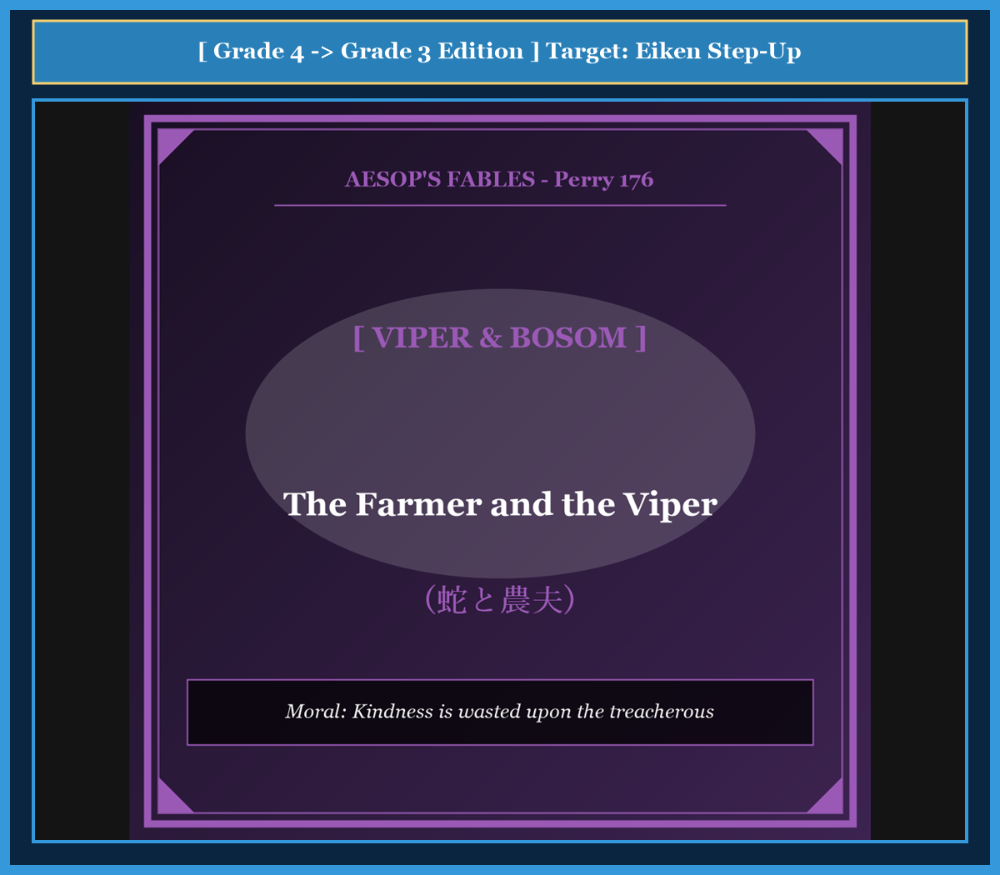

# 『英検ステップアップ多読：イソップ寓話編 第13巻（4級 ➔ 3級対比学習・第4集）』

---

## はじめに：なぜ「対比多読」で英検3級の壁を突破できるのか？

英検3級の合格を目指す英語学習者にとって、最初の大きな壁は**「単文の箇条書き」から「接続詞や関係代名詞を用いたまとまりのある英文」への飛躍**です。

4級までは短い平易な文（SVOや助動詞can/willなど）の組み合わせで対応できましたが、3級からは「when, because, if, so」などの従属接続詞や現在完了形、受動態、不定詞・動名詞を駆使した自然な英文読解・リスニング力が問われます。

本書では、世界中で愛読される珠玉のイソップ寓話（第4集・10話）を題材に、**「知っている4級英語」** が **「3級合格レベルの英語」** へとどのようにステップアップするかを分かりやすく対比学習します。

* **馴染みのあるストーリー（4級英文）** で文脈を瞬時に把握
* **洗練された表現（3級英文）** で接続詞・複文・重要熟語を自然にインプット
* **暗唱キーフレーズ対比** で面接スピーキング・英作文に直結する表現力を定着

楽しく名作寓話を読み進めながら、3級合格に必要な英語の基礎体力を固めましょう！

---

## 本書の収録作品（第4集・全10話）

1. **Chapter 31**: オオカミとツル (*The Wolf and the Crane*) [Perry 156]
2. **Chapter 32**: 樫の木と葦 (*The Oak and the Reed*) [Perry 70]
3. **Chapter 33**: 馬とロバ (*The Horse and the Donkey*) [Perry 181]
4. **Chapter 34**: 農夫とその息子たち（束ねた棒） (*The Bundle of Sticks*) [Perry 53]
5. **Chapter 35**: 隠された財産（ブドウ畑の宝） (*The Farmer and His Sons*) [Perry 42]
6. **Chapter 36**: カエルたちの王様選び (*The Frogs Desiring a King*) [Perry 44]
7. **Chapter 37**: 猿と漁師 (*The Monkey and the Fishermen*) [Perry 203]
8. **Chapter 38**: 恋するライオン (*The Lion in Love*) [Perry 140]
9. **Chapter 39**: 蛇と農夫 (*The Farmer and the Viper*) [Perry 176]
10. **Chapter 40**: ロバと子犬 (*The Ass and the Lapdog*) [Perry 91]

---

## 本書の構成と電子書籍 / Kobo最適化

各章は以下の構成で統一されています。

```text
┌─────────────────────────────────────────────────────────────┐
│ 1. Chapter Title & Visual Illustration (章タイトル ＆ 挿絵)   │
│ 2. Benchmark Level: 英検4級レベル英文                         │
│ 3. Target Level: 英検3級レベル英文                           │
│ 4. Classic Original English Text (イソップ寓話クラシック原文)  │
│ 5. Japanese Translation (日本語訳 ＆ 教訓)                     │
│ 6. Recite & Compare (そらんじたいキーフレーズ対比カード)        │
│ 7. Key Vocabulary & Exam Notes (語彙・文法・試験対策解説)        │
└─────────────────────────────────────────────────────────────┘
```

> **【ポイント】 音声読み上げ（TTS）をご利用の方へ**
> 本文セクション（ステップ1〜3）は英語のみで構成されており、電子書籍やKoboの自動音声読み上げ機能（Text-to-Speech）で日本語が混ざることなく、美しい英語音声で快適にリスニング学習していただけます。


# Chapter 31: The Wolf and the Crane (オオカミとツル)

<!-- 電子書籍 Page Break & Image Header -->
<div style="text-align: center; margin-bottom: 20px;">
  
</div>

<div style="page-break-before: always;"></div>

## 1. Benchmark Level: Eiken Grade 4 (英検4級レベル本文)
*Read in ~1 to 1.5 minutes. Baseline vocabulary and basic syntax.*

A greedy wolf was eating meat very quickly. Suddenly, a small bone got stuck in his throat.

The wolf felt terrible pain. He could not swallow, and he could not breathe easily. He ran around the forest and asked many animals for help.

"Please pull out this bone!" he cried. "I will give a great reward to anyone who saves my life!"

No animal wanted to help him because everyone knew the wolf was dangerous. But a crane with a long neck and a sharp beak heard his promise. The crane felt pity for the wolf.

The crane told the wolf to open his huge mouth wide. She carefully put her long beak deep into his throat. With one quick pull, she removed the bone.

The wolf was relieved. But as he turned to walk away, the crane said, "Wait! What about my reward?"

The wolf grinned and showed his sharp teeth. "You put your head inside a wolf's jaws and took it out safely. Isn't that enough reward for you?"

The crane realized her mistake.

---
<div style="page-break-before: always;"></div>

## 2. Target Level: Eiken Grade 3 (英検3級レベル本文)
*Read in ~1.5 to 2 minutes. Features relative clauses, passive voice, and dependent clauses.*

A greedy wolf, who was devouring an animal in a hurry, swallowed a sharp bone that became firmly lodged in his throat.

Because he could neither eat nor breathe comfortably, the wolf suffered intense pain. Desperate for relief, he wandered through the woods, begging every creature he met for assistance. He promised that he would provide a handsome reward to anyone who could remove the bone.

Most animals immediately refused because they were terrified of his fierce nature. However, a crane with a remarkably long neck was persuaded by his tempting offer. Taking pity on the suffering beast, she agreed to perform the dangerous task.

The wolf lay on his side and opened his terrible jaws as wide as possible. The crane courageously inserted her long beak into his mouth and skillfully extracted the bone. 

When the pain ceased, the wolf stood up and prepared to leave. The crane promptly stepped forward and reminded him of his promise. "Sir, you promised a reward for saving your life. Where is it?"

The wolf chuckled unkindly and bared his sharp teeth. "Ungrateful creature! You were allowed to withdraw your head from my jaws without harm. Is that not sufficient reward from a hungry wolf?"

The crane learned that serving a wicked creature brings no gratitude.

---
<div style="page-break-before: always;"></div>

## 3. Classic Original English Text (イソップ寓話クラシック原文)
*Perry 156: Translated by George Fyler Townsend (1867)*

A Wolf had got a bone stuck in his throat, and in the greatest agony ran up and down, beseeching every animal he met to relieve him, at the same time hinting at a very handsome reward to the one who should succeed. 

A Crane, moved by his entreaties and promises of reward, ventured her long neck down the Wolf's throat, and drew out the bone. 

She then modestly asked for the promised reward. 

To this, the Wolf, grinning and showing his teeth, replied: "Be content with what you have got, my friend. Is it not a sufficient reward for you that you have had your head inside a Wolf's mouth, and have brought it out again safe and sound?"

---
<div style="page-break-before: always;"></div>

## 4. Japanese Translation & Moral (日本語訳と教訓)

### 【日本語全訳：英検3級レベル本文】
欲張りなオオカミが急いで獲物をむさぼり食っていたところ、鋭い骨を飲み込んでしまい、それが喉にしっかりと引っかかってしまいました。

快適に食べることも息をすることもできず、オオカミは激しい痛みに苦しみました。苦痛から逃れたい一心で、彼は森の中をうろつき回り、出会うあらゆる生き物に助けを懇願しました。そして、その骨を取り除いてくれた者には誰にでも、素晴らしい報酬を与えると約束しました。

オオカミの凶暴な性質を恐れていたため、ほとんどの動物はすぐに断りました。しかし、際立って長い首を持つツルが、彼の魅力的な申し出に心を動かされました。苦しんでいる獣を哀れに思った彼女は、その危険な役目を引き受けることに同意しました。

オオカミは横たわり、恐ろしい顎（あご）をできる限り大きく開けました。ツルは勇気を奮い起こして長い嘴（くちばし）を彼の口の奥深くへと入れ、器用に骨を引き抜きました。

痛みが消えると、オオカミは立ち上がり、立ち去ろうとしました。ツルはすかさず前に進み出て、約束を思い出させました。「あなた、命を助けた報酬を約束してくれましたよね。それはどこにあるのですか？」

オオカミは意地悪そうにくすくす笑い、鋭い牙を剥き出しにしました。「恩知らずなやつめ！ お前は私の顎の中から無傷で頭を引き抜くことを許されたのだぞ。飢えたオオカミから得た見返りとして、それだけで十分ではないというのか？」

ツルは、悪意ある者に仕えても感謝など得られないという教訓を学んだのでした。

### 【教訓（Moral）】
**Expect no reward from the wicked.**  
（悪人に施しをしても見返りを期待してはならない。悪人に関わって無事だったこと自体が最大の幸運である。）

---
<div style="page-break-before: always;"></div>

## 5. Recite & Compare: そらんじたいキーフレーズ対比カード

<div class="comparison-card">
  <div class="card-header">フレーズ 1：喉に骨が刺さった状況の表現</div>
  <div class="card-row-g4"><span class="card-badge-g4">4級</span>A small bone got stuck in his throat.</div>
  <div class="card-row-g3"><span class="card-badge-g3">3級</span>A sharp bone became firmly lodged in his throat.</div>
  <div class="card-note"><strong>解説：</strong>4級の「got stuck（挟まった・詰まった）」を、3級では「firmly lodged（しっかりと固定された・めり込んだ）」という状態を表す受動的表現へブラッシュアップしています。</div>
</div>

<div class="comparison-card">
  <div class="card-header">フレーズ 2：助けを求める切実な行動</div>
  <div class="card-row-g4"><span class="card-badge-g4">4級</span>He ran around the forest and asked many animals for help.</div>
  <div class="card-row-g3"><span class="card-badge-g3">3級</span>Desperate for relief, he wandered through the woods, begging every creature he met for assistance.</div>
  <div class="card-note"><strong>解説：</strong>分詞構文的な形容詞句「Desperate for relief（救いを切望して）」や、「ask for help」を一段上の「beg for assistance」に置き換えることで、感情の高まりを生き生きと描いています。</div>
</div>

<div class="comparison-card">
  <div class="card-header">フレーズ 3：危険な行為への同意</div>
  <div class="card-row-g4"><span class="card-badge-g4">4級</span>The crane felt pity for the wolf and decided to help.</div>
  <div class="card-row-g3"><span class="card-badge-g3">3級</span>Taking pity on the suffering beast, she agreed to perform the dangerous task.</div>
  <div class="card-note"><strong>解説：</strong>「Taking pity on ~（〜を哀れに思って）」という分詞構文や、「perform the dangerous task（危険な任務を実行する）」という英検3級長文で好まれる成句を活用しています。</div>
</div>

<div class="comparison-card">
  <div class="card-header">フレーズ 4：オオカミの冷酷な反論</div>
  <div class="card-row-g4"><span class="card-badge-g4">4級</span>Isn't that enough reward for you?</div>
  <div class="card-row-g3"><span class="card-badge-g3">3級</span>Is that not sufficient reward from a hungry wolf?</div>
  <div class="card-note"><strong>解説：</strong>日常的な「enough」を、フォーマルな文脈で頻出する「sufficient（十分な）」へと洗練させています。</div>
</div>

---
<div style="page-break-before: always;"></div>

## 6. Key Vocabulary & Exam Notes (英検3級 重要語彙・文法・面接対策)

### 1. 英検3級 必須ボキャブラリー
* **devour** [動] むさぼり食う、がつがつ食べる
* **lodge** [動] （狭い場所に）引っかかる、留まる
* **desperate** [形] 必死の、絶望的な、喉から手が出るほど求めている
* **assistance** [名] 援助、手助け（*help* よりフォーマル）
* **handsome** [形] （容姿だけでなく）多額の、気前の良い（*a handsome reward* で「多額の報酬」）
* **persuade** [動] 説得する、促す
* **extract** [動] 引き抜く、抽出する（*pull out* の格調高い語）
* **sufficient** [形] 十分な（= *enough*）

### 2. 文法・構文のチェックポイント
* **neither A nor B**: 「AもBも〜ない」
  * *Because he could neither eat nor breathe comfortably...*（快適に食べることも息をすることもできなかったため……）
  * 3級長文やライティングで文を簡潔にまとめるための強力な相関接続詞です。
* **be allowed to do**: 「〜することを許される（許可の受動態）」
  * *You were allowed to withdraw your head without harm.*（お前は無傷で頭を引っ込めることを許されたのだ。）
  * 「オオカミが情けをかけてやって生かしておいた」という傲慢な立場を受動態で見事に表現しています。

### 3. スピーキング（面接）＆ライティング活用ヒント
英検3級のライティングや面接で「親切にすることの大切さ」や「人との付き合い方」を述べる際、次のような表現が役立ちます：
* *We should always be kind, but we must choose who we trust.*（常に親切であるべきだが、誰を信頼するかは慎重に選ばなければならない。）
* *A good deed brings no return if the other person is dishonest.*（相手が不誠実であれば、善行も見返りをもたらさない。）


# Chapter 32: The Oak and the Reed (樫の木と葦)

<!-- 電子書籍 Page Break & Image Header -->
<div style="text-align: center; margin-bottom: 20px;">
  
</div>

<div style="page-break-before: always;"></div>

## 1. Benchmark Level: Eiken Grade 4 (英検4級レベル本文)
*Read in ~1 to 1.5 minutes. Baseline vocabulary and basic syntax.*

A huge oak tree stood proudly near a calm river. Next to the river grew many thin, green reeds.

The oak tree looked down at the reeds and said, "Look at you! You are so weak and small. Even a gentle breeze makes you bow your heads. But look at me! I am strong and solid. No wind can move me."

The reeds did not get angry. A little reed smiled and answered softly, "You are very strong, Mr. Oak. But please do not worry about us. We bend when the wind blows, so we never break."

The oak tree just laughed at the reed's words.

One day, a terrible storm came from the north. The wind was violent and screamed through the forest.

The reeds bowed low to the ground. The fierce wind blew over them easily, and they were safe.

However, the proud oak tree refused to bend. He fought against the howling wind with all his strength. Finally, a tremendous blast snapped his thick trunk, and the mighty tree crashed into the river.

When the storm stopped, the little reeds stood up straight again.

---
<div style="page-break-before: always;"></div>

## 2. Target Level: Eiken Grade 3 (英検3級レベル本文)
*Read in ~1.5 to 2 minutes. Features relative clauses, passive voice, and dependent clauses.*

A magnificent oak tree, whose trunk was exceptionally thick and strong, grew along the bank of a quiet stream. Beside him in the water grew slender reeds that swayed gently with the water.

Filled with pride, the oak frequently mocked his slender neighbors. "How unfortunate you are," he boasted. "Even the lightest breath of air causes you to tremble and bow your heads to the earth. Look at my enormous branches! I fear no tempest, for my roots are anchored deeply in the soil."

The reeds listened patiently without displaying any anger. Eventually, a slender reed responded, "Your pity is misplaced, dear oak. You resist the gale with stubborn defiance, whereas we yield obediently to every gust. Because we bow, we survive without being broken."

The oak tree scoffed at this explanation, confident that his brute strength would protect him forever.

Shortly afterward, a ferocious hurricane swept across the valley with unprecedented fury. As the tempest raged, the flexible reeds bowed low until they almost touched the water, allowing the gale to pass harmlessly over them.

In contrast, the mighty oak stood rigid and resisted the storm with all his might. The tremendous force of the wind battered his heavy crown until his stubborn roots were torn from the earth. With a thunderous roar, the giant tree collapsed into the river.

After the storm subsided, the humble reeds rose erect once more, intact and unharmed.

---
<div style="page-break-before: always;"></div>

## 3. Classic Original English Text (イソップ寓話クラシック原文)
*Perry 70: Translated by George Fyler Townsend (1867)*

A very large Oak was uprooted by the wind and thrown across a stream. It fell among some Reeds, which it thus addressed: 

"I wonder how you, who are so light and weak, are not entirely crushed by these strong winds."

They replied: "You fight and contend with the wind, and consequently you are destroyed; while we on the contrary bend before the least breath of air, and therefore remain unbroken, and escape."

---
<div style="page-break-before: always;"></div>

## 4. Japanese Translation & Moral (日本語訳と教訓)

### 【日本語全訳：英検3級レベル本文】
堂々たる樫の大木が、静かな小川の土手に生えていました。その幹は並外れて太く力強いものでした。そのすぐそばの水辺には、水流とともに穏やかに揺れる細い葦（あし）が生えていました。

誇りに満ちた樫の木は、細身の隣人たちをしばしば馬鹿にしました。「お前たちは何と哀れなことか」と樫は自慢しました。「微風がひと吹きしただけで、お前たちは震え上がり、地面に向かって頭を下げる。私の巨大な枝を見てみろ！ 私の根は土深くにしっかりと錨を下ろしているから、私はどんな嵐も恐れはしないのだ。」

葦たちは怒りを見せることなく、辛抱強く耳を傾けました。やがて、一本の細い葦が答えました。「樫さん、あなたの同情は的外れですよ。あなたは頑固な反抗心をもって強風に立ち向かいますが、私たちはあらゆる突風に素直に従い、身をかがめます。私たちは身をしならせるからこそ、折られることなく生き残ることができるのです。」

樫の木は、己の腕力と頑健さが永遠に自分を守ってくれると確信し、その説明を鼻で笑いました。

まもなくして、猛烈な暴風雨が前例のない猛威を振るって谷を駆け抜けました。嵐が荒れ狂う中、しなやかな葦は水面に触れんばかりに低く頭を垂れ、強風を何事もなく受け流しました。

対照的に、力強い樫の木は硬直したまま仁王立ちし、全力を尽くして嵐に抵抗しました。風のすさまじい力はその重い樹冠を激しく打ちつけ、ついにはその頑固な根が土から引き抜かれてしまいました。雷鳴のような轟音とともに、大木は川へと崩れ落ちました。

嵐が収まった後、謙虚な葦たちは何一つ傷つくことなく、再びまっすぐに立ち上がったのでした。

### 【教訓（Moral）】
**Better to bend than break.**  
（折れるよりも曲がる（しなる）ほうが賢明である。柔軟性と謙虚さは、硬直した傲慢な力よりもはるかに強靭である。）

---
<div style="page-break-before: always;"></div>

## 5. Recite & Compare: そらんじたいキーフレーズ対比カード

<div class="comparison-card">
  <div class="card-header">フレーズ 1：相手を見下して自慢する</div>
  <div class="card-row-g4"><span class="card-badge-g4">4級</span>The oak tree looked down at the reeds and said, "Look at me! I am strong."</div>
  <div class="card-row-g3"><span class="card-badge-g3">3級</span>Filled with pride, the oak frequently mocked his slender neighbors.</div>
  <div class="card-note"><strong>解説：</strong>「Filled with pride（誇りに満ちて）」という過去分詞句による副詞的修飾や、「mock（あざける、からかう）」という3級・準2級で役立つ語彙で描写を濃密にしています。</div>
</div>

<div class="comparison-card">
  <div class="card-header">フレーズ 2：風に抵抗する vs 風に身を任せる</div>
  <div class="card-row-g4"><span class="card-badge-g4">4級</span>We bend when the wind blows, so we never break.</div>
  <div class="card-row-g3"><span class="card-badge-g3">3級</span>You resist the gale with stubborn defiance, whereas we yield obediently to every gust.</div>
  <div class="card-note"><strong>解説：</strong>接続詞「whereas（〜であるのに対して）」を用いた明快な対比構文です。「resist（抵抗する）」と「yield（屈する・譲る）」という反対語の組み合わせが、物語のテーマを象徴します。</div>
</div>

<div class="comparison-card">
  <div class="card-header">フレーズ 3：嵐の威力を受け流す葦</div>
  <div class="card-row-g4"><span class="card-badge-g4">4級</span>The fierce wind blew over them easily, and they were safe.</div>
  <div class="card-row-g3"><span class="card-badge-g3">3級</span>The flexible reeds bowed low, allowing the gale to pass harmlessly over them.</div>
  <div class="card-note"><strong>解説：</strong>分詞構文「allowing O to do（Oが〜するのを許しながら・可能にしながら）」を用いることで、2つの文を流れるように1文にまとめています。</div>
</div>

<div class="comparison-card">
  <div class="card-header">フレーズ 4：嵐のあとの無事な姿</div>
  <div class="card-row-g4"><span class="card-badge-g4">4級</span>When the storm stopped, the little reeds stood up straight again.</div>
  <div class="card-row-g3"><span class="card-badge-g3">3級</span>After the storm subsided, the humble reeds rose erect once more, intact and unharmed.</div>
  <div class="card-note"><strong>解説：</strong>「subside（嵐や痛みが収まる）」や形容詞の叙述用法「intact and unharmed（無傷で完全なままで）」を添えることで、格調高い英語表現になっています。</div>
</div>

---
<div style="page-break-before: always;"></div>

## 6. Key Vocabulary & Exam Notes (英検3級 重要語彙・文法・面接対策)

### 1. 英検3級 必須ボキャブラリー
* **magnificent** [形] 堂々とした、壮大な、素晴らしい
* **slender** [形] 細身の、すらりとした
* **mock** [動] 馬鹿にする、あざける（*make fun of* の洗練語）
* **resist** [動] 抵抗する、耐える
* **yield** [動] 屈する、身を任せる、譲る
* **flexible** [形] 柔軟な、しなやかな
* **rigid** [形] 硬直した、融通の利かない
* **subside** [動] （嵐・熱・騒ぎなどが）静まる、引く

### 2. 文法・構文のチェックポイント
* **whose + 名詞 (関係代名詞の所有格)**:
  * *A magnificent oak tree, whose trunk was exceptionally thick...*（堂々たる樫の木、その幹は並外れて太く……）
  * 英検3級後半〜準2級で頻出する所有格関係代名詞の基礎です。
* **in contrast**: 「対照的に、これに反して」
  * *In contrast, the mighty oak stood rigid...*
  * ライティングの意見論述で「一方の意見と他方の意見を対比させる」際の必須ディスコースマーカーです。

### 3. スピーキング（面接）＆ライティング活用ヒント
「困難への対処法」や「柔軟な考え方」について意見を述べる際に応用できます：
* *When facing difficulties, flexibility is more effective than stubborn pride.*（困難に直面したとき、頑固なプライドよりも柔軟性のほうが効果的である。）
* *It is wise to listen to others instead of being overly confident.*（過剰に自信を持つのではなく、他人の意見に耳を傾けるのが賢明だ。）


# Chapter 33: The Horse and the Donkey (馬とロバ)

<!-- 電子書籍 Page Break & Image Header -->
<div style="text-align: center; margin-bottom: 20px;">
  
</div>

<div style="page-break-before: always;"></div>

## 1. Benchmark Level: Eiken Grade 4 (英検4級レベル本文)
*Read in ~1 to 1.5 minutes. Baseline vocabulary and basic syntax.*

A merchant was traveling to the city with his horse and his donkey. Both animals carried goods, but the donkey carried a much heavier load.

The day was hot, and the road was steep. The donkey became very tired. His legs were shaking, and he could hardly walk.

The donkey looked at the proud horse. The horse had a fine saddle, but his bags were very light.

"Please help me, brother," said the poor donkey. "Take just a little part of my heavy load. If you do, I can survive. If you do not, I will die here on the road."

The horse shook his head proudly. "Why should I help you? Carrying heavy bags is your job, not mine. Leave me alone!"

A few minutes later, the exhausted donkey collapsed onto the dusty ground and died.

The master was very sad and worried. He needed to get all his goods to the market. So, he picked up all the donkey's heavy bags and placed them onto the horse's back. In addition, the master skinned the dead donkey and put the heavy hide on top of everything.

Now the selfish horse had to carry the entire load alone. "I was a fool," he cried. "Because I refused to take a small burden, I must now carry everything, even the skin of my dead friend!"

---
<div style="page-break-before: always;"></div>

## 2. Target Level: Eiken Grade 3 (英検3級レベル本文)
*Read in ~1.5 to 2 minutes. Features relative clauses, passive voice, and dependent clauses.*

A wealthy merchant set out on a journey toward a bustling city, accompanied by his spirited horse and a patient donkey. Although they were both working animals, their duties were divided unfairly. The donkey was burdened with enormous packs, whereas the horse pranced gracefully, carrying only lightweight saddlebags.

As the afternoon sun beat down mercilessly upon the dusty mountain path, the donkey began to falter under his crushing load. Feeling his strength draining away rapidly, he turned to his companion and pleaded earnestly.

"My dear friend," the donkey gasped, "if you care for my life in the slightest degree, please relieve me of a small portion of this burden. If you take even a fraction of my load, I might manage to reach our destination safely."

However, the haughty horse snorted with disdain and refused coldly. "Mind your own business! Burden-bearing is the proper lot of a donkey, whereas a noble steed like me was bred for honor, not hard labor."

Unable to endure the relentless weight any longer, the donkey stumbled and dropped dead in the dust.

Confronted with this sudden misfortune, the merchant had no choice but to transfer the entire cargo onto the horse's back. To make matters worse, he flayed the dead donkey and laid the heavy hide atop the already staggering heap.

Groaning under the unbearable mass, the miserable horse wept bitter tears of regret. "Alas, what a terrible penalty I must pay for my selfishness! Because I refused to share a minor fraction of the burden, I am now forced to carry the whole load, along with the skin of my fallen companion."

---
<div style="page-break-before: always;"></div>

## 3. Classic Original English Text (イソップ寓話クラシック原文)
*Perry 181: Translated by George Fyler Townsend (1867)*

A Man who had a Horse and a Donkey took the road with them. The Donkey, who was exhausted with fatigue and the heat of the day, said to the Horse: 

"Take a little of my load, if you have any regard for my life." 

The Horse refused, bidding him to mind his own business. 

The Donkey fell dead under his burden. The master then took the whole of the burden from the dead Donkey, and laid it on the Horse, together with the skin of the Donkey. 

The Horse, groaning under his load, exclaimed: "Woe is me! What a wretched creature I am! I would not help the Donkey with a little of his load, and now I have to carry the whole of it, together with his skin into the bargain."

---
<div style="page-break-before: always;"></div>

## 4. Japanese Translation & Moral (日本語訳と教訓)

### 【日本語全訳：英検3級レベル本文】
裕福な商人が、元気のいい馬と辛抱強いロバを連れて、賑やかな都市へと旅に出ました。どちらも働く動物でしたが、その役目は不公平に分担されていました。ロバが巨大な荷物を背負わされていたのに対し、馬は軽やかな鞍袋（くらぶくろ）だけを身につけて、優雅に小走りしていました。

埃っぽい山道に午後の日差しが容赦なく照りつける中、ロバはその押しつぶされそうな重荷の下でよろめき始めました。体力が急速に奪われていくのを感じ、ロバは仲間の馬に向き直り、真剣に懇願しました。

「親愛なる友よ」とロバは息を切らしながら言いました。「私の命を少しでも気にかけてくれるなら、どうかこの荷物のほんの一部を肩代わりしてください。ほんのわずかでも引き受けてくれたら、私は無事に目的地までたどり着けるかもしれません。」

しかし、傲慢な馬は軽蔑の鼻を鳴らし、冷たく断りました。「自分の心配だけしていろ！ 重荷を運ぶのはロバの分相応な役目であり、私のような気高い名馬は名誉のために育てられたのであって、重労働のためではないのだ。」

容赦ない重さにこれ以上耐えられず、ロバはつまずき、埃の中に倒れて息絶えました。

この突然の災難に直面した商人は、荷物全体を馬の背へと移し替えるしかありませんでした。さらに悪いことに、商人は死んだロバの皮を剥ぎ、すでに山積みになった荷物の一番上にその重い皮を載せました。

耐えがたい重さにうめき声を上げながら、哀れな馬は激しい後悔の涙を流しました。「ああ、己の身勝手さゆえに何という重い罰を支払わねばならないのか！ ほんの少しの負担を分かち合うことさえ拒んだために、いまや荷物全体はおろか、倒れた仲間の皮まで背負わねばならなくなってしまった。」

### 【教訓（Moral）】
**Help others lest their burden fall on you.**  
（他者の困窮を助けよ。さもなくば、その重荷がすべて自分に降りかかることになる。相互扶助を拒む者は、より重い代償を払わねばならない。）

---
<div style="page-break-before: always;"></div>

## 5. Recite & Compare: そらんじたいキーフレーズ対比カード

<div class="comparison-card">
  <div class="card-header">フレーズ 1：不公平な負担の対比</div>
  <div class="card-row-g4"><span class="card-badge-g4">4級</span>Both animals carried goods, but the donkey carried a much heavier load.</div>
  <div class="card-row-g3"><span class="card-badge-g3">3級</span>The donkey was burdened with enormous packs, whereas the horse carried only lightweight saddlebags.</div>
  <div class="card-note"><strong>解説：</strong>「be burdened with ~（〜の重荷を負わされる）」という受動態表現と、接続詞「whereas」によるコントラストで格段に表現力が向上しています。</div>
</div>

<div class="comparison-card">
  <div class="card-header">フレーズ 2：少しでも助けてほしいという懇願</div>
  <div class="card-row-g4"><span class="card-badge-g4">4級</span>Take just a little part of my heavy load.</div>
  <div class="card-row-g3"><span class="card-badge-g3">3級</span>Please relieve me of a small portion of this burden.</div>
  <div class="card-note"><strong>解説：</strong>「relieve A of B（AからBを取り除いて楽にする）」という3級・準2級頻出の重要語法です。</div>
</div>

<div class="comparison-card">
  <div class="card-header">フレーズ 3：冷淡な拒絶の態度</div>
  <div class="card-row-g4"><span class="card-badge-g4">4級</span>The horse shook his head proudly. "Leave me alone!"</div>
  <div class="card-row-g3"><span class="card-badge-g3">3級</span>The haughty horse snorted with disdain and refused coldly.</div>
  <div class="card-note"><strong>解説：</strong>感情を「snorted with disdain（軽蔑して鼻を鳴らした）」のように、具体的な名詞・副詞を組み合わせて豊かに描写しています。</div>
</div>

<div class="comparison-card">
  <div class="card-header">フレーズ 4：身勝手さが招いた重い代償</div>
  <div class="card-row-g4"><span class="card-badge-g4">4級</span>Because I refused to take a small burden, I must now carry everything.</div>
  <div class="card-row-g3"><span class="card-badge-g3">3級</span>Because I refused to share a minor fraction of the burden, I am now forced to carry the whole load.</div>
  <div class="card-note"><strong>解説：</strong>「be forced to do（〜せざるを得ない・余儀なくされる）」という強制的受動態により、逃れられない因果応報を強調しています。</div>
</div>

---
<div style="page-break-before: always;"></div>

## 6. Key Vocabulary & Exam Notes (英検3級 重要語彙・文法・面接対策)

### 1. 英検3級 必須ボキャブラリー
* **bustling** [形] 賑やかな、活気のある（*a bustling city*）
* **burden** [名] 重荷、負担 / [動] 負担を負わせる
* **falter** [動] よろめく、勢いが鈍る
* **plead** [動] 懇願する、嘆願する（*ask* より切実な要求）
* **relieve** [動] 和らげる、解放する、安心させる
* **portion** [名] 一部、割り当て
* **disdain** [名] 軽蔑、侮蔑
* **misfortune** [名] 不運、災難

### 2. 文法・構文のチェックポイント
* **have no choice but to do**: 「〜するよりほかに選択肢がない（〜せざるを得ない）」
  * *The merchant had no choice but to transfer the entire cargo...*（商人は荷物全体を移し替えるよりほかに道がなかった……）
  * 英検3級・準2級の長文読解やライティングで極めて有用な成句です。
* **to make matters worse**: 「さらに悪いことには（泣きっ面に蜂）」
  * 物語や意見文で状況が一段と悪化したことを読者に伝える定型表現です。

### 3. スピーキング（面接）＆ライティング活用ヒント
「チームワーク」や「助け合いの重要性」を論じる際に最適の表現です：
* *Cooperation is essential because sharing small burdens prevents major failures.*（小さな負担を分かち合うことが大きな破綻を防ぐため、協力は不可欠である。）
* *Refusing to assist a partner usually leads to heavier troubles later on.*（パートナーを助けるのを拒むと、後で決まってより重いトラブルを招く。）


# Chapter 34: The Bundle of Sticks (農夫とその息子たち)

<!-- 電子書籍 Page Break & Image Header -->
<div style="text-align: center; margin-bottom: 20px;">
  
</div>

<div style="page-break-before: always;"></div>

## 1. Benchmark Level: Eiken Grade 4 (英検4級レベル本文)
*Read in ~1 to 1.5 minutes. Baseline vocabulary and basic syntax.*

An old farmer had several sons. The sons were always arguing with each other. They fought about work, money, and land.

The father was very worried. He tried to stop their quarrels with gentle words, but the young men never listened. He knew that when he died, enemies would easily defeat them.

One day, the old man felt that his end was near. He called all his sons to his bedside.

He showed them a bundle of thin wooden sticks. The sticks were tied tightly together with a strong cord.

"My sons," said the father, "I want to see who is the strongest. Can any of you break this bundle in two?"

The eldest son tried first. He pulled with all his strength, but he could not break it. The second son tried, and then the third, but none of them could snap the bundle.

"It is impossible!" they cried.

Then the father smiled and untied the cord. He gave one single stick to each son. "Now, try to break your stick."

Each son snapped his stick easily with a loud crack.

The wise father said, "Do you understand? When you stay united like the bundle, no enemy can harm you. But if you quarrel and separate, you will be broken as easily as these single sticks."

---
<div style="page-break-before: always;"></div>

## 2. Target Level: Eiken Grade 3 (英検3級レベル本文)
*Read in ~1.5 to 2 minutes. Features relative clauses, passive voice, and dependent clauses.*

An elderly farmer had several sons who were constantly engaged in bitter disputes with one another. No matter how earnestly their father urged them to live in harmony, his wise counsel was completely ignored.

Realizing that his health was declining, the father was deeply troubled by the thought of leaving his divided family behind. He recognized that as long as his sons continued to quarrel, they would remain vulnerable to their dishonest neighbors. Therefore, he decided to teach them an unforgettable practical lesson.

Gathering his sons together, he ordered a servant to bring a bundle of sticks that were tied firmly with rope. Handing the bundle to his eldest son, the farmer said, "I challenge you to break this entire bundle in half."

The eldest son strained with all his might, but the bundle resisted his efforts completely. One by one, the other brothers attempted the feat, yet not a single stick was damaged. Eventually, they gave up and declared that no mortal man possessed enough strength to succeed.

The father then untied the knot and distributed the sticks individually among his sons. "Now, break them," he commanded calmly. Without the slightest difficulty, each son snapped his individual stick in an instant.

The old man looked at them earnestly and explained, "My sons, this bundle represents your future. As long as you remain united by brotherly affection, no enemy in the world can overpower you. But if you allow jealousy and discord to divide you, you will be broken as effortlessly as these brittle sticks."

---
<div style="page-break-before: always;"></div>

## 3. Classic Original English Text (イソップ寓話クラシック原文)
*Perry 53: Translated by George Fyler Townsend (1867)*

An old man had many sons, who were often falling out with one another. When the father had failed to reconcile them by any of his words, he thought he would try whether he could not make an impression upon them by means of an act. 

So he called his sons together, and bade them bring him a bundle of sticks. The young men did as they were bid. The father took the bundle, and giving it to each of them in turn, told him to try if he could not break it in pieces. But not one of them could. 

The father then untied the bundle, and gave each a single stick, which each easily snapped in two. 

"My sons," said he, "if you are of one mind, and unite to assist each other, you will be as this bundle of sticks, unbroken by all the attempts of your enemies; but if you divide among yourselves, you will be broken as easily as are these sticks."

---
<div style="page-break-before: always;"></div>

## 4. Japanese Translation & Moral (日本語訳と教訓)

### 【日本語全訳：英検3級レベル本文】
ある年老いた農夫には数人の息子がいましたが、彼らは互いに激しい口論に明け暮れてばかりいました。父親がどれほど熱心に仲良く暮らすよう説得しても、その賢明な忠告は完全に無視されていました。

自らの健康が衰えつつあることを悟った父親は、分裂した家族を後に残すことを深く憂慮しました。息子たちが争い続ける限り、悪意ある隣人たちの格好の餌食になってしまうことを見抜いていたからです。そこで父親は、息子たちに忘れられない実践的な教訓を与えることに決めました。

息子たちを一堂に集めると、農夫は召使いに命じて、縄でしっかりと束ねられた棒の束を持ってこさせました。その束を長男に手渡し、農夫は言いました。「この束全体を真っ二つに折ってみせなさい。」

長男は渾身の力を込めて力を入れましたが、束はその力にびくともしませんでした。他の兄弟たちも次々と試みましたが、一本の棒すら傷つけることはできませんでした。やがて彼らは諦め、これを折るほどの力を持つ人間などこの世にいないと宣言しました。

そこで父親は結び目をほどき、息子たちに棒を一本ずつ配りました。「さあ、折ってみなさい」と父親は静かに命じました。息子たちは少しも苦労することなく、あっという間にそれぞれの手の棒をへし折ってしまいました。

老人は真剣な眼差しで息子たちを見つめ、諭しました。「我が息子たちよ、この束こそはお前たちの未来を象徴しているのだ。お前たちが兄弟愛によって一つに結束している限り、世のどんな敵もお前たちを打ち負かすことはできない。しかし、もし嫉妬と不和によって分裂してしまうなら、お前たちはいまの脆い一本の棒のように、いとも容易く叩き折られてしまうだろう。」

### 【教訓（Moral）】
**Union gives strength.**  
（団結は力なり。結束していれば無敵であるが、分裂すれば容易に滅ぼされる。）

---
<div style="page-break-before: always;"></div>

## 5. Recite & Compare: そらんじたいキーフレーズ対比カード

<div class="comparison-card">
  <div class="card-header">フレーズ 1：いつも喧嘩ばかりしている関係</div>
  <div class="card-row-g4"><span class="card-badge-g4">4級</span>The sons were always arguing with each other.</div>
  <div class="card-row-g3"><span class="card-badge-g3">3級</span>His sons were constantly engaged in bitter disputes with one another.</div>
  <div class="card-note"><strong>解説：</strong>「be engaged in ~（〜に携わっている・従事している）」という重要成句と、「bitter disputes（激しい紛争）」という洗練された語彙で状況の深刻さを際立たせています。</div>
</div>

<div class="comparison-card">
  <div class="card-header">フレーズ 2：結束している限り敵わない</div>
  <div class="card-row-g4"><span class="card-badge-g4">4級</span>When you stay united, no enemy can harm you.</div>
  <div class="card-row-g3"><span class="card-badge-g3">3級</span>As long as you remain united by brotherly affection, no enemy can overpower you.</div>
  <div class="card-note"><strong>解説：</strong>条件を表す「As long as ~（〜である限り）」と、「remain + 形容詞（〜のままでいる）」の連結が非常に論理的です。</div>
</div>

<div class="comparison-card">
  <div class="card-header">フレーズ 3：単独の棒を簡単に折る</div>
  <div class="card-row-g4"><span class="card-badge-g4">4級</span>Each son snapped his stick easily with a loud crack.</div>
  <div class="card-row-g3"><span class="card-badge-g3">3級</span>Without the slightest difficulty, each son snapped his individual stick in an instant.</div>
  <div class="card-note"><strong>解説：</strong>「easily」を「Without the slightest difficulty（少しの困難もなく）」と言い換える技法は、英検3級・準2級の記述で高得点を獲得するテクニックです。</div>
</div>

<div class="comparison-card">
  <div class="card-header">フレーズ 4：分裂が招く結末</div>
  <div class="card-row-g4"><span class="card-badge-g4">4級</span>If you quarrel and separate, you will be broken easily.</div>
  <div class="card-row-g3"><span class="card-badge-g3">3級</span>If you allow discord to divide you, you will be broken as effortlessly as these brittle sticks.</div>
  <div class="card-note"><strong>解説：</strong>「allow O to do（Oが〜するのを許す）」を用いた使役的構文と、「as ~ as ...」の同等比較を組み合わせて文学的な説得力を出しています。</div>
</div>

---
<div style="page-break-before: always;"></div>

## 6. Key Vocabulary & Exam Notes (英検3級 重要語彙・文法・面接対策)

### 1. 英検3級 必須ボキャブラリー
* **dispute** [名] 紛争、論争 / [動] 議論する
* **harmony** [名] 調和、和睦（*live in harmony* で「仲良く暮らす」）
* **vulnerable** [形] 攻撃を受けやすい、脆い
* **feat** [名] 偉業、離れ業
* **distribute** [動] 配る、分配する
* **affection** [名] 愛情、慈しみ
* **discord** [名] 不和、対立（*harmony* の対義語）
* **brittle** [形] 脆い、ポキリと折れやすい

### 2. 文法・構文のチェックポイント
* **no matter how + 形容詞/副詞**: 「どんなに〜であろうとも（譲歩）」
  * *No matter how earnestly their father urged them...*（父親がどんなに熱心に促そうとも……）
  * 3級の長文読解で筆者の主張を強調する重要な構文です。
* **as long as**: 「〜である限り（条件・期間）」
  * *As long as you remain united...*（お前たちが団結している限り……）
  * 接続詞として英検のリスニング・リーディング双方で頻出します。

### 3. スピーキング（面接）＆ライティング活用ヒント
面接での「学校生活」や「スポーツチームの団結」に関する質問で威力を発揮します：
* *Working as a team is important because unity brings great strength.*（団結は大きな力をもたらすため、チームとして働くことが重要だ。）
* *When members support each other, they can overcome difficult challenges.*（メンバーがお互いを支え合うとき、困難な課題を乗り越えることができる。）


# Chapter 35: The Farmer and His Sons (隠された財産)

<!-- 電子書籍 Page Break & Image Header -->
<div style="text-align: center; margin-bottom: 20px;">
  
</div>

<div style="page-break-before: always;"></div>

## 1. Benchmark Level: Eiken Grade 4 (英検4級レベル本文)
*Read in ~1 to 1.5 minutes. Baseline vocabulary and basic syntax.*

An old farmer worked hard on his land for many years. He had a large vineyard, but his sons were very lazy. They only wanted to sleep and spend money.

The farmer became ill and knew he would die soon. He wanted his sons to learn how to farm, so he thought of a clever plan.

He called his sons to his room and whispered softly, "My dear sons, I have a secret. There is a great treasure buried somewhere in our vineyard. Dig the ground carefully, and you will find it."

Shortly after saying these words, the old farmer died.

As soon as the funeral was over, the sons ran to the vineyard with shovels. They were eager to become rich without working.

They dug around every vine. They turned over all the soil from one corner of the field to the other. They searched day after day, digging deeper and deeper, but they found no gold or silver.

"Our father tricked us," they complained.

However, because the soil was dug so well, the vines grew better than ever before. In autumn, the vineyard produced an enormous harvest of sweet grapes. The sons sold the fruit for a huge amount of money.

Finally, they understood their father's wisdom: hard work itself was the hidden treasure.

---
<div style="page-break-before: always;"></div>

## 2. Target Level: Eiken Grade 3 (英検3級レベル本文)
*Read in ~1.5 to 2 minutes. Features relative clauses, passive voice, and dependent clauses.*

A hardworking farmer, who had spent his entire life tending his vineyard with devotion, was blessed with three able-bodied sons. Unfortunately, the young men were excessively idle and showed no interest in agriculture, preferring to live carefree lives.

When the farmer realized that his days were numbered, he was anxious about the future of his beloved land. He knew that without industrious labor, his sons would soon fall into poverty. Therefore, he devised an ingenious plan to teach them the value of honest toil.

Summoning the boys to his bedside, he confided in them with his final breath. "My children, all my wealth lies buried somewhere beneath the vines. If you search diligently, you will unearth a great fortune."

Following their father's demise, the sons were seized by greed. Eager to discover the hidden gold, they took up spades and pickaxes and began to dig the vineyard methodically. Not an inch of soil was left untouched. They excavated around every root and turned over every clod of earth, from early morning until dusk.

Although they searched relentlessly for months, they discovered neither jewels nor chests of coin. Frustrated and exhausted, they concluded that their father's promise was merely a delusion.

However, because the earth had been cultivated so thoroughly, the vines flourished as never before. When autumn arrived, the vineyard yielded an unprecedented abundance of rich, luscious grapes. The harvest was sold at the market for a handsome profit.

At last, the enlightened sons realized their father's true intention: diligent industry is the only genuine gold mine on earth.

---
<div style="page-break-before: always;"></div>

## 3. Classic Original English Text (イソップ寓話クラシック原文)
*Perry 42: Translated by George Fyler Townsend (1867)*

An old Farmer, when he was on the point of death, wishing to impart to his sons the secret of how to acquire wealth, called them to him and said: 

"My sons, I am now departing out of this life, but all that I have to leave you is to be found in the vineyard; dig there, and you will find it." 

The sons, as soon as their father was dead, set to work with all their might, and dug up every corner of the vineyard, expecting to find some hidden treasure. 

They found no gold, but the vines, through this thorough turning up of the ground, yielded a greater vintage than had ever been seen before, and made them wealthy men.

---
<div style="page-break-before: always;"></div>

## 4. Japanese Translation & Moral (日本語訳と教訓)

### 【日本語全訳：英検3級レベル本文】
自らの生涯をブドウ畑の手入れに捧げてきた勤勉な農夫には、3人の健康な息子たちがいました。あいにく息子たちはひどく怠け者で、農業には何の関心も示さず、気ままな暮らしを好んでいました。

自分の余命がいくばくもないことを悟った農夫は、愛する農地の将来を案じました。精を出して働かなければ、息子たちがすぐに貧困に陥ることは明らかだったからです。そこで彼は、正直な労働の価値を教えるための独創的な計画を考案しました。

息子たちを枕元に呼び寄せ、農夫は最期の息の下で打ち明けました。「我が子たちよ、私の全財産はブドウの木の下のどこかに埋められている。念入りに探せば、お前たちは莫大な富を掘り当てるだろう。」

父親の死後、息子たちは欲望に駆り立てられました。隠された黄金を見つけ出そうと躍起になり、彼らは鋤（すき）やつるはしを手に取って、ブドウ畑を几帳面に掘り起こし始めました。手つかずの土は一寸たりとも残りませんでした。彼らは朝早くから日暮れまで、すべての根の周りを掘り、土塊をくまなくひっくり返しました。

何ヶ月ものあいだ執念深く探し続けましたが、宝石も金貨の箱も見つかりませんでした。いらだち疲れ果てた彼らは、父の約束は単なる妄想だったのだと結論づけました。

しかし、地面がこれほど徹底的に耕されたおかげで、ブドウの木はかつてないほど繁茂しました。秋が訪れると、ブドウ畑は豊かでみずみずしいブドウの前例のない豊作をもたらしました。その収穫物は市場で高値で売れ、莫大な利益をもたらしました。

ついに真実を悟った息子たちは、父親の真意を理解しました。すなわち、勤勉な労働こそが、この地上における唯一無二の本物の金鉱なのだと。

### 【教訓（Moral）】
**Diligent labor is the truest treasure.**  
（勤勉な労働こそが真の財産である。棚ぼたの富を探すよりも、流した汗が最も確実で豊かな実りをもたらす。）

---
<div style="page-break-before: always;"></div>

## 5. Recite & Compare: そらんじたいキーフレーズ対比カード

<div class="comparison-card">
  <div class="card-header">フレーズ 1：怠け者な若者たちの表現</div>
  <div class="card-row-g4"><span class="card-badge-g4">4級</span>His sons were very lazy. They only wanted to sleep.</div>
  <div class="card-row-g3"><span class="card-badge-g3">3級</span>The young men were excessively idle, preferring to live carefree lives.</div>
  <div class="card-note"><strong>解説：</strong>「excessively idle（極度に怠惰な）」や、分詞構文「preferring to live carefree lives（気楽な生活を好んで）」により、3級らしい洗練された表現になっています。</div>
</div>

<div class="comparison-card">
  <div class="card-header">フレーズ 2：畑の隅々まで掘り尽くす</div>
  <div class="card-row-g4"><span class="card-badge-g4">4級</span>They turned over all the soil from one corner to the other.</div>
  <div class="card-row-g3"><span class="card-badge-g3">3級</span>Not an inch of soil was left untouched.</div>
  <div class="card-note"><strong>解説：</strong>否定語を主語に置いた受動態構文（部分否定・全面否定の応用）で、「一寸の土も手つかずのまま残されなかった」という徹底的な掘り起こしを力強く表現しています。</div>
</div>

<div class="comparison-card">
  <div class="card-header">フレーズ 3：徹底的に耕された土壌の恩恵</div>
  <div class="card-row-g4"><span class="card-badge-g4">4級</span>Because the soil was dug so well, the vines grew better.</div>
  <div class="card-row-g3"><span class="card-badge-g3">3級</span>Because the earth had been cultivated so thoroughly, the vines flourished as never before.</div>
  <div class="card-note"><strong>解説：</strong>過去完了受動態「had been cultivated（耕されていた）」と、動詞「flourish（繁栄する・栄える）」を用いることで、時間の前後関係と結果を格調高く伝えています。</div>
</div>

<div class="comparison-card">
  <div class="card-header">フレーズ 4：隠された真の教訓への気づき</div>
  <div class="card-row-g4"><span class="card-badge-g4">4級</span>Finally, they understood their father's wisdom.</div>
  <div class="card-row-g3"><span class="card-badge-g3">3級</span>At last, the enlightened sons realized their father's true intention.</div>
  <div class="card-note"><strong>解説：</strong>過去分詞形容詞「enlightened（真実に目覚めた・啓発された）」を用いることで、息子たちの内面的な精神的成長を鮮やかに表現しています。</div>
</div>

---
<div style="page-break-before: always;"></div>

## 6. Key Vocabulary & Exam Notes (英検3級 重要語彙・文法・面接対策)

### 1. 英検3級 必須ボキャブラリー
* **devotion** [名] 献身、深い愛情
* **idle** [形] 何もしない、怠惰な（*lazy* の類義語）
* **industrious** [形] 勤勉な、熱心な（*industry*「勤勉」より）
* **devise** [動] 考案する、工夫する
* **methodically** [副] 几帳面に、秩序正しく
* **cultivate** [動] 耕作する、栽培する
* **flourish** [動] 繁栄する、見事に育つ
* **unprecedented** [形] 前例のない、空前の

### 2. 文法・構文のチェックポイント
* **one's days are numbered**: 「余命いくばくもない、終わりが近づいている」
  * 成句として物語・エッセイで頻繁に使われます。
* **neither A nor B**: 「AもBも〜ない」
  * *They discovered neither jewels nor chests of coin.*（彼らは宝石も金貨の箱も見出さなかった。）
  * 3級の多読・読解で登場頻度の高い最重要否定構文です。

### 3. スピーキング（面接）＆ライティング活用ヒント
「将来の仕事観」や「努力の価値」を主張する際に効果的です：
* *Success does not come from luck, but from steady and industrious effort.*（成功は運からもたらされるのではなく、着実で勤勉な努力から生まれる。）
* *Learning new skills requires patience and hard work, which is the true treasure of youth.*（新しいスキルを学ぶには忍耐と努力が必要であり、それこそが若さの真の財産である。）


# Chapter 36: The Frogs Desiring a King (カエルたちの王様選び)

<!-- 電子書籍 Page Break & Image Header -->
<div style="text-align: center; margin-bottom: 20px;">
  
</div>

<div style="page-break-before: always;"></div>

## 1. Benchmark Level: Eiken Grade 4 (英検4級レベル本文)
*Read in ~1 to 1.5 minutes. Baseline vocabulary and basic syntax.*

A group of frogs lived happily in a wide, muddy lake. They could swim, jump, and croak whenever they wanted. They had total freedom.

However, after some time, the frogs became bored. They felt that having no ruler was disorganized. They wanted a great king to govern them and bring order.

The frogs sent a prayer to Jupiter, the king of the gods. "Please send us a king!" they croaked loudly.

Jupiter laughed at their foolish request. He threw a huge wooden log down from the sky into the lake.

The log hit the water with a tremendous splash! The water flew everywhere, and the frogs were terrified. They dived into the deep mud and hid for hours.

After a while, the lake became quiet again. One brave frog poked his nose above the water. He saw that the new king was completely still. Soon, other frogs swam closer. They realized the king was just a piece of wood.

The frogs lost all respect for the log. They jumped onto it, danced on its surface, and made fun of it.

"We want a real, active king!" they complained to Jupiter.

This time, Jupiter became angry. He sent a hungry stork down to the lake. The stork did not listen to their complaints. Instead, the stork began to catch and eat the frogs one after another.

The frogs were terrified and cried for help, but Jupiter replied, "You did not appreciate your peaceful freedom. Now you must suffer under a harsh master."

---
<div style="page-break-before: always;"></div>

## 2. Target Level: Eiken Grade 3 (英検3級レベル本文)
*Read in ~1.5 to 2 minutes. Features relative clauses, passive voice, and dependent clauses.*

A community of frogs lived peacefully in a spacious marsh, enjoying an easy and unrestricted existence. They were permitted to leap among the reeds and croak at their leisure, completely unburdened by laws or government.

Nevertheless, the discontented frogs gradually grew weary of their tranquil lifestyle. Believing that their society lacked dignity and discipline, they sent a petition to Jupiter, the sovereign of the gods, pleading for a powerful monarch to reign over them.

Amused by their foolishness, Jupiter tossed an enormous log directly into the center of the pool.

When the massive timber struck the water, it produced a terrifying splash that reverberated across the entire marsh. Panicked by the commotion, the frogs plunged into the murky depths and concealed themselves beneath the slime.

As time elapsed, however, the marsh returned to stillness. A daring frog cautiously surfaced and observed that the new monarch remained motionless. Encouraged by his discovery, the entire colony emerged. Within a few days, having recognized that the log was entirely harmless, the disrespectful frogs began to leap onto the monarch's back and treat him with open mockery.

Dissatisfied with a ruler who lacked authority, they sent another urgent appeal to Jupiter, demanding a vigorous leader who could command respect.

Irritated by their senseless ingratitude, Jupiter resolved to teach them a bitter lesson. He dispatched a long-legged stork to the marsh. Unlike the peaceful log, this savage tyrant immediately seized the terrified frogs with his sharp beak, gobbling them up by the dozens.

In their despair, the surviving frogs sent a messenger to beg for mercy. But Jupiter answered sternly, "You were not content with liberty, nor were you satisfied with a gentle ruler. Bear your punishment, for you brought this calamity upon yourselves."

---
<div style="page-break-before: always;"></div>

## 3. Classic Original English Text (イソップ寓話クラシック原文)
*Perry 44: Translated by George Fyler Townsend (1867)*

The Frogs, grieved at having no established ruler, sent ambassadors to Jupiter for a King. 

He, perceiving their simplicity, cast down a huge log into the lake. The Frogs were terrified at first by the splash made by it, and hid themselves in the depths of the pool. 

At last, seeing that it continued motionless, they swam down to it, and treated it with such contempt that they leaped upon it, and squatted on it. 

After some time they began to think that a King of this sort was quite beneath them, and sent a second deputation to Jupiter to pray that he would send them another King. 

He, displeased at their complaints, sent a Stork to rule over them, who at once began to catch the Frogs and eat them. 

Then they repented uselessly of their foolishness.

---
<div style="page-break-before: always;"></div>

## 4. Japanese Translation & Moral (日本語訳と教訓)

### 【日本語全訳：英検3級レベル本文】
カエルたちの群れが広々とした湿地で平和に暮らし、気楽で制約のない生活を享受していました。彼らは法律や政府に一切縛られることなく、葦の間を跳び回り、好きなときに鳴くことを許されていました。

それにもかかわらず、不満を抱いたカエルたちは次第にその平穏な暮らしに飽きてきました。自分たちの社会には威厳と規律が欠けていると思い込んだ彼らは、神々の主権者であるユピテルに請願を送り、自分たちを統治してくれる強力な君主を授けてほしいと懇願しました。

その愚かさを面白がったユピテルは、巨大な丸太を池の真ん中へと放り投げました。

巨大な木材が水面に激突したとき、湿地全体に響き渡る凄まじい水しぶきが上がりました。その大騒動にパニックになったカエルたちは濁った水底へと飛び込み、泥の中に身を隠しました。

しかし時が経つにつれて、湿地は再び静寂を取り戻しました。一匹の勇敢なカエルが用心深く浮上し、新しい君主がまったく動かないことを観察しました。その発見に勇気づけられ、群れ全体が姿を現しました。数日のうちに、丸太が完全に無害であると見抜いた不敬なカエルたちは、君主の背中に飛び乗り、あからさまに馬鹿にし始めました。

威厳のない統治者に不満を覚えた彼らは、ユピテルに再び緊急の懇願を送り、敬意を集めることができる力強い指導者を求めました。

その分別なき恩知らずに苛立ったユピテルは、彼らに苦い教訓を教えてやることに決めました。彼は脚の長いコウノトリを湿地に派遣しました。平和な丸太とは異なり、この凶暴な暴君はすぐさま鋭いくちばしで怯えるカエルたちを捕らえ、何十匹もむさぼり食い始めました。

絶望の中、生き残ったカエルたちは慈悲を求めて使者を送りました。しかしユピテルは厳しく答えました。「お前たちは自由にも満足せず、穏やかな統治者にも納得しなかった。この災厄はお前たち自身が招いたものなのだから、その罰を受け入れるがよい。」

### 【教訓（Moral）】
**Let well enough alone.**  
（現状に満足し、余計な不満を抱いて自滅してはならない。分不相応な支配者を求めると、最悪の暴君を招く結果となる。）

---
<div style="page-break-before: always;"></div>

## 5. Recite & Compare: そらんじたいキーフレーズ対比カード

<div class="comparison-card">
  <div class="card-header">フレーズ 1：自由な暮らしへの不満</div>
  <div class="card-row-g4"><span class="card-badge-g4">4級</span>They had total freedom, but after some time they became bored.</div>
  <div class="card-row-g3"><span class="card-badge-g3">3級</span>The discontented frogs gradually grew weary of their tranquil lifestyle.</div>
  <div class="card-note"><strong>解説：</strong>「grow weary of ~（〜に飽き飽きする・うんざりする）」という英検3級熟語を用い、内面的な不満の推移を的確に描写しています。</div>
</div>

<div class="comparison-card">
  <div class="card-header">フレーズ 2：丸太の無害さに気づく</div>
  <div class="card-row-g4"><span class="card-badge-g4">4級</span>They realized the king was just a piece of wood.</div>
  <div class="card-row-g3"><span class="card-badge-g3">3級</span>Having recognized that the log was entirely harmless, they began to treat him with open mockery.</div>
  <div class="card-note"><strong>解説：</strong>完了分詞構文「Having recognized that ~（〜と分かったので）」を用いることで、気づいた後の態度の豹変を格調高く描いています。</div>
</div>

<div class="comparison-card">
  <div class="card-header">フレーズ 3：暴君の出現と捕食</div>
  <div class="card-row-g4"><span class="card-badge-g4">4級</span>The stork began to catch and eat the frogs one after another.</div>
  <div class="card-row-g3"><span class="card-badge-g3">3級</span>This savage tyrant immediately seized the terrified frogs, gobbling them up by the dozens.</div>
  <div class="card-note"><strong>解説：</strong>「gobble up（ガツガツ平らげる）」や「by the dozens（何十もまとめて）」といった生き生きとした表現で、コウノトリの圧倒的な残虐さを浮き彫りにしています。</div>
</div>

<div class="comparison-card">
  <div class="card-header">フレーズ 4：身から出た錆の宣告</div>
  <div class="card-row-g4"><span class="card-badge-g4">4級</span>Now you must suffer under a harsh master.</div>
  <div class="card-row-g3"><span class="card-badge-g3">3級</span>Bear your punishment, for you brought this calamity upon yourselves.</div>
  <div class="card-note"><strong>解説：</strong>理由を表す等位接続詞「for」を用いた重厚な文体と、「bring calamity upon oneself（自ら災厄を招く）」という成句が教訓の重みを高めています。</div>
</div>

---
<div style="page-break-before: always;"></div>

## 6. Key Vocabulary & Exam Notes (英検3級 重要語彙・文法・面接対策)

### 1. 英検3級 必須ボキャブラリー
* **discontented** [形] 不満を抱いた
* **petition** [名] 請願、嘆願書
* **monarch** [名] 君主、国王（*king* の格調高い語）
* **commotion** [名] 騒音、混乱、動揺
* **at one's leisure** [熟語] 暇なときに、思いのままに
* **mockery** [名] あざけり、冷笑（*mock* の名詞形）
* **disgraceful** [形] 恥ずべき、不面目な
* **calamity** [名] 災難、大惨事

### 2. 文法・構文のチェックポイント
* **be permitted to do**: 「〜することを許可されている（受動態）」
  * *They were permitted to leap among the reeds...*（彼らは葦の間を跳び回ることを許されていた……）
  * 日常会話の *can* をフォーマルなルール・状況として表す重要構文です。
* **bring ~ upon oneself**: 「自ら〜を招く（自業自得）」
  * 読解や会話表現で教訓を述べる際の定型フレーズです。

### 3. スピーキング（面接）＆ライティング活用ヒント
「現状に感謝すること」や「軽率な変化の危険」を論じる際に活用できます：
* *We should appreciate our current freedom instead of constantly complaining.*（常に不満を言うのではなく、現在の自由に感謝すべきである。）
* *Unnecessary desires often lead to worse conditions than before.*（不必要な欲望は、しばしば以前よりも悪い状況を引き起こす。）


# Chapter 37: The Monkey and the Fishermen (猿と漁師)

<!-- 電子書籍 Page Break & Image Header -->
<div style="text-align: center; margin-bottom: 20px;">
  
</div>

<div style="page-break-before: always;"></div>

## 1. Benchmark Level: Eiken Grade 4 (英検4級レベル本文)
*Read in ~1 to 1.5 minutes. Baseline vocabulary and basic syntax.*

A curious monkey lived in a tall tree near a broad river.

One sunny afternoon, some fishermen came to the riverbank. The monkey watched them from a high branch. The fishermen threw their large nets into the water. After waiting a little while, they pulled the nets back. The nets were full of splashing fish.

"That looks so easy and fun!" thought the foolish monkey. "I am very smart, so I can catch fish just like those men."

Around noon, the fishermen put their nets on the shore and went to a small hut to eat lunch.

As soon as they were gone, the monkey climbed down from his tree. He ran to the nets. He wanted to imitate the fishermen.

The monkey picked up a heavy net. But he did not know how to hold it or how to throw it. The net was large and tangled.

When he tried to cast it into the water, the net fell over his own body. He struggled to escape, but the strong cords wrapped tightly around his hands, legs, and neck.

He slipped off the riverbank and fell into the deep water, completely wrapped in the net.

As he was sinking, the monkey gasped, "I deserve this! I knew nothing about fishing, yet I tried to do the work of skilled men."

---
<div style="page-break-before: always;"></div>

## 2. Target Level: Eiken Grade 3 (英検3級レベル本文)
*Read in ~1.5 to 2 minutes. Features relative clauses, passive voice, and dependent clauses.*

An inquisitive monkey, who perched upon the high boughs of a tree beside a flowing river, observed several fishermen casting their nets into the water.

He watched with fascinated eyes as the men skillfully flung the broad mesh and retrieved abundant catches of glistening fish. Because monkeys are natural mimics, he foolishly assumed that the art of fishing required no special practice or intelligence. "What an effortless craft," the conceited creature whispered to himself. "I can perform that task with equal skill."

At midday, the fishermen laid their wet nets along the grassy shore and retired to a neighboring cottage to have their meal.

Seizing this favorable opportunity, the monkey descended swiftly from his perch. He approached the equipment and resolved to display his supposed talent. He lifted the heavy cords and attempted to duplicate the exact motions he had observed.

However, lacking experience and coordination, he became completely confused by the intricate cords. As he swung the bulky mesh clumsily, the net enveloped his own head and limbs instead of spreading across the water.

The more violently the monkey struggled to free himself, the more tightly the wet knots bound his body. Stumbling blindly along the slippery bank, he fell into the rushing current.

Weighted down by the heavy mesh, the drowning monkey sighed in bitter remorse. "Alas, I am rightly punished for my absurd conceit! Without possessing the slightest skill, why did I meddle in a craft that belonged entirely to experienced men?"

---
<div style="page-break-before: always;"></div>

## 3. Classic Original English Text (イソップ寓話クラシック原文)
*Perry 203: Translated by George Fyler Townsend (1867)*

A Monkey, seated on a lofty tree, saw some Fishermen casting their nets into a river, and narrowly watched their proceedings. 

The Fishermen after a while gave up fishing, and on going home to dinner, left their nets upon the bank. 

The Monkey, who is the most imitative of animals, descended from the treetop, and endeavoured to do as they had done. Having handled the net, he threw it from him; but it became entangled around him, and he rolled into the river. 

Being in the act of drowning, he said to himself: "This is a just reward for my foolishness; for what business had I, who knew nothing of the matter, to try and fish with nets?"

---
<div style="page-break-before: always;"></div>

## 4. Japanese Translation & Moral (日本語訳と教訓)

### 【日本語全訳：英検3級レベル本文】
流れる川のほとりにある木の高い枝に止まっていた好奇心旺盛な猿が、数人の漁師が水中に網を投げ入れている様子を観察していました。

男たちが器用に広い網を投げ、光り輝く魚をたくさん引き上げる様子を、猿は魅了された目で見つめていました。猿は生まれつき真似をするのが得意な動物であるため、漁の技術には何の特別な訓練も知恵も必要ないと思い込んでしまいました。「何とたやすい技だろう」と自惚れた生き物は独り言をつぶやきました。「自分にも彼らと同じ腕前でその仕事ができるはずだ。」

真昼になり、漁師たちは濡れた網を草の生えた岸辺に置き、食事をとるために近くの小屋へと引き上げました。

この絶好の好機を捉えて、猿は止まり木から素早く降りてきました。彼は道具に近づき、自分の自負する才能を披露しようと決意しました。彼は重い網の縄を持ち上げ、観察した通りの動作を正確に再現しようと試みました。

しかし、経験も身のこなしの器用さも欠いていたため、彼は複雑に入り組んだ縄にすっかり混乱してしまいました。かさばる網をぎこちなく振り回した拍子に、網は水面に広がるどころか、彼自身の頭や手足を包み込んでしまいました。

猿が身悶えして逃れようと暴れれば暴れるほど、濡れた結び目はより固く彼の体を締めつけました。滑りやすい土手を盲目同然によろめき歩くうちに、彼は急流の中へと転落してしまいました。

重い網の重みで沈んでいきながら、溺れゆく猿は激しい後悔の溜息をもらしました。「ああ、己のばかげた自惚れゆえに、当然の報いを受けてしまった！ 少しの技術も持ち合わせていないのに、なぜ完全に熟練者たちの領域である技術に軽々しく手を出してしまったのだろうか。」

### 【教訓（Moral）】
**Do not meddle with what you do not understand.**  
（自分が理解していない専門領域に軽々しく介入してはならない。他人の仕事を表面だけ真似る浅知恵は、身の破滅を招く。）

---
<div style="page-break-before: always;"></div>

## 5. Recite & Compare: そらんじたいキーフレーズ対比カード

<div class="comparison-card">
  <div class="card-header">フレーズ 1：真似をしようとする浅はかな心理</div>
  <div class="card-row-g4"><span class="card-badge-g4">4級</span>"That looks so easy!" thought the foolish monkey.</div>
  <div class="card-row-g3"><span class="card-badge-g3">3級</span>He foolishly assumed that the art of fishing required no special practice or intelligence.</div>
  <div class="card-note"><strong>解説：</strong>動詞「assume that ~（〜だと思い込む・決めつける）」を用いた思考の描写で、猿の過信を論理的に表現しています。</div>
</div>

<div class="comparison-card">
  <div class="card-header">フレーズ 2：好機と見て行動に移す</div>
  <div class="card-row-g4"><span class="card-badge-g4">4級</span>As soon as they were gone, the monkey climbed down.</div>
  <div class="card-row-g3"><span class="card-badge-g3">3級</span>Seizing this favorable opportunity, the monkey descended swiftly from his perch.</div>
  <div class="card-note"><strong>解説：</strong>分詞構文「Seizing this favorable opportunity（この好機を捉えて）」という格調高いフレーズにより、文章のスピード感と品格を高めています。</div>
</div>

<div class="comparison-card">
  <div class="card-header">フレーズ 3：もがけばもがくほど絡まる網</div>
  <div class="card-row-g4"><span class="card-badge-g4">4級</span>He struggled, but the cords wrapped tightly around his body.</div>
  <div class="card-row-g3"><span class="card-badge-g3">3級</span>The more violently the monkey struggled, the more tightly the wet knots bound his body.</div>
  <div class="card-note"><strong>解説：</strong>英検3級・準2級で頻出する「The + 比較級 ..., the + 比較級 ...（〜すればするほど、ますます…）」の比例構文を活用しています。</div>
</div>

<div class="comparison-card">
  <div class="card-header">フレーズ 4：身の程知らずへの後悔の叫び</div>
  <div class="card-row-g4"><span class="card-badge-g4">4級</span>I knew nothing about fishing, yet I tried to do it.</div>
  <div class="card-row-g3"><span class="card-badge-g3">3級</span>Without possessing the slightest skill, why did I meddle in a craft that belonged entirely to experienced men?</div>
  <div class="card-note"><strong>解説：</strong>前置詞句「Without possessing ~」と関係代名詞「that belonged to ~」を重ね、自嘲的な反語で物語を締めくくっています。</div>
</div>

---
<div style="page-break-before: always;"></div>

## 6. Key Vocabulary & Exam Notes (英検3級 重要語彙・文法・面接対策)

### 1. 英検3級 必須ボキャブラリー
* **inquisitive** [形] 好奇心が強い、詮索好きな
* **retrieve** [動] 回収する、引き上げる
* **mimic** [名] まねをする人・動物 / [動] まねる
* **conceited** [形] 自惚れた、思い上がった
* **intricate** [形] 複雑な、入り組んだ
* **envelop** [動] 包み込む、覆い隠す
* **meddle** [動] （余計なおせっかいで）干渉する、手を出す
* **remorse** [名] 深い後悔、自責の念

### 2. 文法・構文のチェックポイント
* **The + 比較級 ..., the + 比較級 ...**: 「〜すればするほど、ますます…」
  * *The more violently he struggled, the more tightly the knots bound him.*（彼が激しくもがけばもがくほど、結び目はより固く彼を縛りつけた。）
  * 読解問題の選択肢や英作文で表現力を飛躍させる重要構文です。
* **seize an opportunity**: 「機会を捉える・チャンスをつかむ」
  * 面接やライティングで積極的な行動を述べる際の定型フレーズです。

### 3. スピーキング（面接）＆ライティング活用ヒント
「専門知識の重要性」や「準備の大切さ」を論じる際に応用できます：
* *We must respect professionals and avoid interfering without proper training.*（私たちは専門家を尊重し、適切な訓練なしに口出しすることを避けるべきである。）
* *Tasks that look easy often require years of hard practice.*（簡単そうに見える仕事ほど、何年もの厳しい練習を必要としていることが多い。）


# Chapter 38: The Lion in Love (恋するライオン)

<!-- 電子書籍 Page Break & Image Header -->
<div style="text-align: center; margin-bottom: 20px;">
  
</div>

<div style="page-break-before: always;"></div>

## 1. Benchmark Level: Eiken Grade 4 (英検4級レベル本文)
*Read in ~1 to 1.5 minutes. Baseline vocabulary and basic syntax.*

A powerful lion fell deeply in love with a woodcutter's beautiful daughter.

The lion went to the woodcutter's cottage and said, "I want to marry your daughter. Give her to me, or I will destroy your house and eat your animals!"

The woodcutter was terrified. He could not refuse the mighty beast, but he certainly did not want his daughter to marry a wild animal.

He thought quickly and came up with a clever plan.

"Great King of Beasts," the woodcutter said politely, "we are honored by your proposal. But my daughter is very gentle and timid. She is afraid of your sharp teeth and your long claws. If you pull out your teeth and cut off your claws, she will gladly marry you."

The lion was so blind with love that he agreed immediately.

He went to a doctor and had all his sharp teeth pulled out. Then he had his powerful claws trimmed down completely.

He returned to the cottage, harmless and toothless, and smiled at the father. "Now give me your daughter!"

The woodcutter smiled coldly. Seeing that the lion was completely defenseless, he picked up a heavy club and drove the foolish beast away into the forest.

---
<div style="page-break-before: always;"></div>

## 2. Target Level: Eiken Grade 3 (英検3級レベル本文)
*Read in ~1.5 to 2 minutes. Features relative clauses, passive voice, and dependent clauses.*

A formidable lion, whose roar struck terror into the hearts of all forest creatures, fell desperately in love with the daughter of a humble woodcutter.

Overcome by his intense passion, the king of beasts visited the humble cottage and demanded the maiden's hand in marriage. The poor father was confronted with an agonized dilemma: he dared not decline the demand of such a ferocious predator, yet he could not bear the thought of surrendering his cherished child to a savage beast.

Exercising his wits, the shrewd woodcutter formulated a cunning scheme to neutralize the threat.

"My lord," he answered with apparent humility, "my family would be deeply flattered by such an alliance. However, my tender daughter is exceedingly sensitive. She faints with dread whenever she beholds your formidable fangs, and she trembles at the sight of your razor-sharp claws. If you truly wish to win her affection, you must consent to having your teeth extracted and your claws removed."

Blinded by infatuation, the foolish monarch did not pause to consider the consequences. He readily consented to the humiliating surgery, allowing his primary weapons to be completely stripped away.

When the mutilation was accomplished, the toothless and clawless lion returned triumphantly to the cottage to claim his bride.

Observing that the once-terrible beast was now entirely disarmed and helpless, the woodcutter seized a stout cudgel. Without the slightest fear, he fell upon the defenseless lion, beating him soundly until the miserable creature fled in disgrace back into the wilderness.

---
<div style="page-break-before: always;"></div>

## 3. Classic Original English Text (イソップ寓話クラシック原文)
*Perry 140: Translated by George Fyler Townsend (1867)*

A Lion demanded the daughter of a woodcutter in marriage. 

The Father, unwilling to grant, and yet afraid to refuse his request, hit upon this expedient to rid himself of his importunities. 

He told the Lion that he was very willing to make him his son-in-law, but that he could not do so unless he would consent to have his teeth drawn and his claws trimmed, as the young girl was terribly afraid of both. 

The Lion was so madly in love that he was easily prevailed upon to consent. 

When he had done this, and came again to the woodman, the latter, no longer having any fear of him, set upon him with a club and drove him away.

---
<div style="page-break-before: always;"></div>

## 4. Japanese Translation & Moral (日本語訳と教訓)

### 【日本語全訳：英検3級レベル本文】
その咆哮が森のあらゆる生き物の心に恐怖を植え付けていた恐るべきライオンが、慎ましい木こりの娘に激しい恋に落ちました。

燃え盛る情熱に圧倒された百獣の王は木こりの質素な小屋を訪れ、乙女への求婚を迫りました。哀れな父親は苦渋のジレンマに直面しました。これほど凶暴な捕食者の要求を断る勇気はありませんでしたが、大切に育てた我が子を野獣に引き渡すなど到底耐えられなかったからです。

知恵を絞り、抜け目のない木こりは脅威を無力化するための巧妙な計画を思いつきました。

「我が主よ」と彼はうわべだけの謙遜さで答えました。「私の家族は、このようなご縁をいただけるなら深く光栄に存じます。しかし、私の繊細な娘はひどく怖がりなのです。あなたの恐ろしい牙を目にするたびに恐怖で気を失い、カミソリのように鋭い爪を見ては震え上がってしまいます。もし本当に娘の心をつかみたいとお望みなら、歯を抜き、爪を切り落とすことにご同意いただかなければなりません。」

盲目的な熱情に目を奪われた愚かな君主は、その結果について立ち止まって考えることすらしませんでした。彼はその屈辱的な手術に快く同意し、自らの最大の武器を完全に奪い去られることを許してしまったのです。

処置が終わると、歯も爪も失ったライオンは、花嫁を迎えようと意気揚々と小屋へ戻ってきました。

かつて恐れられた獣がいまや完全に武装解除され無力であるのを見て取った木こりは、太いこん棒を手に取りました。木こりは少しの恐れも抱くことなく無防備なライオンに襲いかかり、哀れな獣がほうほうの体で荒野へと逃げ帰るまで徹底的に打ち据えたのでした。

### 【教訓（Moral）】
**Surrender not your strength for blind affection.**  
（盲目的な情熱のために自らの防壁や強みを放棄してはならない。自らを無力化してしまえば、相手の意のままに蹂躙されるだけである。）

---
<div style="page-break-before: always;"></div>

## 5. Recite & Compare: そらんじたいキーフレーズ対比カード

<div class="comparison-card">
  <div class="card-header">フレーズ 1：求婚を断れないジレンマ</div>
  <div class="card-row-g4"><span class="card-badge-g4">4級</span>The woodcutter was terrified. He could not refuse the mighty beast.</div>
  <div class="card-row-g3"><span class="card-badge-g3">3級</span>He dared not decline the demand of such a ferocious predator.</div>
  <div class="card-note"><strong>解説：</strong>助動詞「dare not do（あえて〜する勇気がない）」と、「ferocious predator（凶暴な捕食者）」という表現で、父親の緊迫した心理を見事に表しています。</div>
</div>

<div class="comparison-card">
  <div class="card-header">フレーズ 2：愛に目がくらんだ承諾</div>
  <div class="card-row-g4"><span class="card-badge-g4">4級</span>The lion was so blind with love that he agreed immediately.</div>
  <div class="card-row-g3"><span class="card-badge-g3">3級</span>Blinded by infatuation, the foolish monarch did not pause to consider the consequences.</div>
  <div class="card-note"><strong>解説：</strong>分詞構文「Blinded by ~」に加え、「not pause to consider the consequences（結果を考慮するために立ち止まることすらしない）」という定型表現が思考停止を的確に伝えます。</div>
</div>

<div class="comparison-card">
  <div class="card-header">フレーズ 3：武器を完全に奪われた状態</div>
  <div class="card-row-g4"><span class="card-badge-g4">4級</span>He had all his sharp teeth pulled out and his claws trimmed down.</div>
  <div class="card-row-g3"><span class="card-badge-g3">3級</span>He allowed his primary weapons to be completely stripped away.</div>
  <div class="card-note"><strong>解説：</strong>使役動詞「allow + 目的語 + to be 過去分詞（〜が…されるのを許す）」を用いた受動態で、自発的に弱点を作ってしまった愚行を浮き彫りにしています。</div>
</div>

<div class="comparison-card">
  <div class="card-header">フレーズ 4：無防備になった敵への反撃</div>
  <div class="card-row-g4"><span class="card-badge-g4">4級</span>Seeing that the lion was completely defenseless, he drove the beast away.</div>
  <div class="card-row-g3"><span class="card-badge-g3">3級</span>Observing that the once-terrible beast was now entirely disarmed, the woodcutter fell upon the defenseless lion.</div>
  <div class="card-note"><strong>解説：</strong>「disarmed（武装解除された）」や「fall upon（襲いかかる）」という文学的表現により、情勢の完全な逆転を描写しています。</div>
</div>

---
<div style="page-break-before: always;"></div>

## 6. Key Vocabulary & Exam Notes (英検3級 重要語彙・文法・面接対策)

### 1. 英検3級 必須ボキャブラリー
* **formidable** [形] 手ごわい、恐ろしい
* **passion** [名] 情熱、強い感情
* **dilemma** [名] 板挟み、窮地
* **predator** [名] 捕食者、天敵
* **humility** [名] 謙遜、卑下
* **affection** [名] 愛情、好意
* **infatuation** [名] 盲目的な夢中、のぼせ上がり
* **defenseless** [形] 無防備な、抵抗できない

### 2. 文法・構文のチェックポイント
* **dare not do**: 「あえて〜する勇気がない」
  * 主語の強い恐怖や躊躇を簡潔かつ重厚に表現する助動詞用法です。
* **fall upon / set upon**: 「〜に襲いかかる、攻撃を仕掛ける」
  * 物語展開で反撃や奇襲を述べる頻出句動詞です。

### 3. スピーキング（面接）＆ライティング活用ヒント
「感情に流されない判断力」を述べる際に効果的です：
* *Strong emotions like anger or infatuation can blind our rational thinking.*（怒りや盲目的な熱情のような強い感情は、私たちの合理的な思考を曇らせることがある。）
* *It is dangerous to compromise core principles for short-term desires.*（短期的な欲望のために自らの根幹となる原則を妥協するのは危険である。）


# Chapter 39: The Farmer and the Viper (蛇と農夫)

<!-- 電子書籍 Page Break & Image Header -->
<div style="text-align: center; margin-bottom: 20px;">
  
</div>

<div style="page-break-before: always;"></div>

## 1. Benchmark Level: Eiken Grade 4 (英検4級レベル本文)
*Read in ~1 to 1.5 minutes. Baseline vocabulary and basic syntax.*

One cold winter morning, a kind farmer was walking through his snow-covered field.

By the side of the path, he saw a poisonous snake lying stiff on the frozen ground. The snake was completely frozen and close to death from the bitter cold.

The farmer had a soft heart. He felt deep pity for the dying creature.

"Poor thing," he thought. "If I leave it here, it will freeze to death."

The gentle farmer picked up the cold snake with both hands. He put it inside his warm coat, right against his chest, to warm it back to life.

As the farmer walked home, the warmth of his body slowly revived the viper. The snake began to move. Its cold blood flowed once more, and it regained its full strength.

However, the snake was wicked by nature. It did not think about gratitude.

As soon as it was strong enough, the snake opened its venomous mouth and bit the farmer hard on the chest.

The farmer gasped in shock and dropped the snake into the snow. He felt the deadly poison spreading quickly through his veins.

As he lay dying, he wept, "I have only myself to blame! I showed pity to a treacherous creature that knows nothing except malice."

---
<div style="page-break-before: always;"></div>

## 2. Target Level: Eiken Grade 3 (英検3級レベル本文)
*Read in ~1.5 to 2 minutes. Features relative clauses, passive voice, and dependent clauses.*

On a bitterly cold winter morning, a benevolent farmer was traversing his frost-bitten fields on his way home from work.

Near a barren hedge, he stumbled upon a venomous viper that lay rigid and motionless upon the snow. The reptile was numbed by the severe frost and was hovering on the very brink of death.

Moved by compassionate sympathy, the warm-hearted countryman could not bear to abandon the helpless creature to such a cruel fate. "If I leave this serpent in the snow, it will surely perish," he murmured softly.

Taking the frozen viper into his gentle hands, he carefully placed it inside his bosom, beneath his thick wool coat, so that the radiant heat of his chest might restore its vitality.

As the farmer continued his journey, the reviving warmth gradually dissolved the chill within the viper's veins. Sensation returned to its stiff muscles, and its dormant venom became active once more.

However, no sooner had the ungrateful reptile recovered its strength than its inherently treacherous instincts awakened. Instead of feeling indebted to its savior, the vicious viper plunged its deadly fangs directly into the farmer's heart.

Overcome by excruciating agony, the mortally wounded man sank to the ground, realizing that the fatal toxin was circulating swiftly through his blood.

With his dying breath, the grieving farmer whispered a final warning to the world: "Woe is me! I deserve this tragic fate, for I took pity on an ungrateful villain whose innate nature cannot be altered by kindness."

---
<div style="page-break-before: always;"></div>

## 3. Classic Original English Text (イソップ寓話クラシック原文)
*Perry 176: Translated by George Fyler Townsend (1867)*

A Farmer found in the winter time a Viper stiff and frozen with cold. He had compassion on it, and taking it up, placed it in his bosom. 

The Viper was revived by the warmth, and having recovered its natural instincts, bit its benefactor, inflicting on him a mortal wound. 

The Farmer, as he was dying, exclaimed: "I have only got what I deserved, for taking compassion on an evil beast."

---
<div style="page-break-before: always;"></div>

## 4. Japanese Translation & Moral (日本語訳と教訓)

### 【日本語全訳：英検3級レベル本文】
身を切るように寒い冬の朝、心優しい農夫が仕事の帰り道、霜に覆われた畑を横切っていました。

枯れ果てた生け垣のそばで、農夫は雪の上に硬直して横たわる一匹の毒蛇を見つけました。その爬虫類は厳しい凍結によって感覚を失い、まさに死の淵をさまよっていました。

深い同情心に駆られたその温厚な田舎男は、この無力な生き物をそのような過酷な運命に見捨てるに忍びなくなりました。「もしこの蛇を雪の中に残しておけば、確実に凍え死んでしまうだろう」と彼は静かにつぶやきました。

凍りついた毒蛇をその優しい両手で抱き上げると、農夫は胸の温もりによってその活力が蘇るよう、厚手のウールの上着の下、自らの懐（ふところ）へと注意深く納めました。

農夫が歩みを進めるにつれ、蘇る温もりが毒蛇の血管の中の冷気を次第に溶かしていきました。硬直した筋肉に感覚が戻り、眠っていた毒が再び活性化しました。

しかし、この恩知らずな爬虫類が体力を回復するやいなや、その生まれつきの邪悪な本能が目を覚ましました。命の恩人に恩義を感じるどころか、この凶悪な毒蛇は農夫の胸元へ直接、その致命的な牙を突き刺したのです。

耐えがたい激痛に打ちのめされ、致命傷を負った男は地面に崩れ落ち、致死の毒素が血液を通って急速に全身を駆け巡っているのを悟りました。

息を引き取りながら、嘆き悲しむ農夫は世界に向けて最後の警告をささやきました。「ああ、何と哀れな私か！ 私はこの悲惨な運命を受けて当然なのだ。優しさによってその生まれつきの性分を変えることなど決してできない恩知らずの悪人に、哀れみをかけてしまったのだから。」

### 【教訓（Moral）】
**Kindness is wasted upon the treacherous.**  
（邪悪な本性を持つ者に慈悲をかけても報われることはない。救ってくれた恩人すら牙にかける者に対して、哀れみは命取りとなる。）

---
<div style="page-break-before: always;"></div>

## 5. Recite & Compare: そらんじたいキーフレーズ対比カード

<div class="comparison-card">
  <div class="card-header">フレーズ 1：瀕死の生き物への同情</div>
  <div class="card-row-g4"><span class="card-badge-g4">4級</span>The farmer had a soft heart and felt pity for the dying creature.</div>
  <div class="card-row-g3"><span class="card-badge-g3">3級</span>Moved by compassionate sympathy, he could not bear to abandon the helpless creature.</div>
  <div class="card-note"><strong>解説：</strong>過去分詞構文「Moved by ~（〜に心を動かされて）」と、成句「cannot bear to do（〜するのに耐えられない）」を用いて農夫の純粋な善意を表現しています。</div>
</div>

<div class="comparison-card">
  <div class="card-header">フレーズ 2：回復するやいなや牙を剥く</div>
  <div class="card-row-g4"><span class="card-badge-g4">4級</span>As soon as it was strong, the snake bit the farmer.</div>
  <div class="card-row-g3"><span class="card-badge-g3">3級</span>No sooner had the reptile recovered its strength than its treacherous instincts awakened.</div>
  <div class="card-note"><strong>解説：</strong>「No sooner had S + 過去分詞 than S + 過去形（〜するやいなや…）」という格調高い倒置構文により、劇的な緊迫感を演出しています。</div>
</div>

<div class="comparison-card">
  <div class="card-header">フレーズ 3：恩義を仇で返す態度</div>
  <div class="card-row-g4"><span class="card-badge-g4">4級</span>It did not think about gratitude.</div>
  <div class="card-row-g3"><span class="card-badge-g3">3級</span>Instead of feeling indebted to its savior, the viper plunged its deadly fangs into his heart.</div>
  <div class="card-note"><strong>解説：</strong>前置詞句「Instead of doing（〜する代わりに・〜するどころか）」と形容詞「indebted（恩義を感じている）」で恩知らずの酷さを強調しています。</div>
</div>

<div class="comparison-card">
  <div class="card-header">フレーズ 4：死に際の後悔の自戒</div>
  <div class="card-row-g4"><span class="card-badge-g4">4級</span>I have only myself to blame!</div>
  <div class="card-row-g3"><span class="card-badge-g3">3級</span>I took pity on a villain whose innate nature cannot be altered by kindness.</div>
  <div class="card-note"><strong>解説：</strong>関係代名詞の所有格「whose innate nature（その生まれつきの性分が）」と受動態「cannot be altered（変えられない）」で不変の教訓を表現しています。</div>
</div>

---
<div style="page-break-before: always;"></div>

## 6. Key Vocabulary & Exam Notes (英検3級 重要語彙・文法・面接対策)

### 1. 英検3級 必須ボキャブラリー
* **benevolent** [形] 慈悲深い、親切な
* **traverse** [動] 横切る、旅する（*cross* の格調高い語）
* **rigid** [形] カチコチの、硬直した
* **brink** [名] 瀬戸際、間際（*on the brink of death* で「死の淵に」）
* **perish** [動] 滅びる、死に絶える（*die* の文学的表現）
* **vitality** [名] 活力、生命力
* **treacherous** [形] 裏切りの、不誠実な、当てにならない
* **innate** [形] 生まれつきの、先天的な

### 2. 文法・構文のチェックポイント
* **on the brink of ~**: 「〜の寸前で、〜の瀬戸際で」
  * 状態の極限を示す頻出イディオムです。
* **no sooner ~ than ...**: 「〜するやいなや…」
  * 過去完了と組み合わせて出来事の電光石火の連続を表現します。

### 3. スピーキング（面接）＆ライティング活用ヒント
「善意の境界線」や「判断力の大切さ」を論じる際に応用できます：
* *Kindness is a virtue, but we must protect ourselves from harmful people.*（親切さは美徳であるが、有害な人物から自らを守らなければならない。）
* *Helping someone who repeatedly betrays trust can lead to dangerous outcomes.*（信頼を繰り返し裏切る者を助けることは、危険な結果につながりかねない。）


# Chapter 40: The Ass and the Lapdog (ロバと子犬)

<!-- 電子書籍 Page Break & Image Header -->
<div style="text-align: center; margin-bottom: 20px;">
  
</div>

<div style="page-break-before: always;"></div>

## 1. Benchmark Level: Eiken Grade 4 (英検4級レベル本文)
*Read in ~1 to 1.5 minutes. Baseline vocabulary and basic syntax.*

A man had a donkey and a small lapdog.

The donkey worked hard every single day. He carried heavy sacks of grain, turned the heavy millstone, and carried wood from the forest. He slept in a cold, dusty barn and ate only dry straw.

On the other hand, the little dog did no work at all. When the master sat down to eat, the little dog ran to him, wagged his tail, and jumped onto the master's lap. The master smiled, stroked the dog's soft fur, and fed him delicious bits of meat from his own plate.

The donkey watched this through the window and felt very jealous.

"It is not fair," thought the donkey. "I work hard all day, but my master never pets me. The dog only wags his tail and jumps on his lap, and he gets rich food and love. If I do the same thing, the master will love me too!"

The next day, the donkey broke out of the barn. He ran straight into the house and entered the dining room.

He brayed loudly and ran toward the master. With a clumsy leap, the huge donkey put his heavy hooves right onto the master's knees! He tried to lick the master's face with his big, wet tongue.

The table broke, dishes smashed on the floor, and the master screamed in terror.

Hearing the loud noise, the servants rushed into the room with heavy sticks. They beat the foolish donkey soundly and dragged him back to the barn.

Bruised and aching, the donkey groaned, "Why did I try to act like a lapdog? Hard work is my true nature, not playful affection."

---
<div style="page-break-before: always;"></div>

## 2. Target Level: Eiken Grade 3 (英検3級レベル本文)
*Read in ~1.5 to 2 minutes. Features relative clauses, passive voice, and dependent clauses.*

A country gentleman owned both a sturdy donkey and a pampered lapdog.

The donkey was subjected to constant toil from dawn till dusk. He was required to haul heavy sacks of grain to the mill and drag heavy timber from the distant woods. At night, he was confined to a dreary stable, nourished with nothing better than dry chaff and stale water.

In sharp contrast, the pet dog enjoyed an utterly carefree life of luxury. Whenever the master returned home, the playful dog would frisk about his feet, wagging his tail enthusiastically and jumping into his lap. Delighted by these affectionate gestures, the master would caress the animal fondly and reward him with choice morsels from the dining table.

Observing this partiality from afar, the envious donkey grew resentful of his lowly station. "How unjust my destiny is!" he grumbled to himself. "Although I exhaust myself through endless drudgery, I receive neither praise nor comfort. Meanwhile, this idle puppy is showered with affection simply because he frisks and fawns. Surely, if I adopt the same charming manners, our master will cherish me with equal devotion."

Acting upon this absurd logic, the donkey slipped out of his paddock the following afternoon and trotted boldly into the parlor.

Bellowing a deafening bray of welcome, the clumsy beast charged toward the armchair where his master sat. With immense clumsy enthusiasm, he reared up on his hind legs and planted his heavy, muddy hooves squarely upon his master's chest, attempting to lick the terrified gentleman's cheeks.

The master, nearly crushed under the overwhelming weight, shrieked in horror. Tables were overturned, fine porcelain was shattered into fragments, and complete chaos engulfed the room.

Alerted by the desperate cries, the household servants burst through the door, armed with stout clubs. Without hesitation, they fell upon the intruder and administered a severe thrashing until the battered creature was dragged back to his stall.

Nursing his sore ribs, the humiliated donkey reflected upon his folly: "I have earned this bitter punishment. Nature intended me to carry heavy burdens with patient dignity, not to mimic the playful antics of a spoiled lapdog."

---
<div style="page-break-before: always;"></div>

## 3. Classic Original English Text (イソップ寓話クラシック原文)
*Perry 91: Translated by George Fyler Townsend (1867)*

A Man had a Donkey and a Maltese Lapdog, a very great beauty. The Donkey was conditioned only to carry burdens, but the Dog had every advantage. 

The Donkey, seeing how much the Dog was petted, determined to try if he could not win his Master's favor by imitating him. 

One day, having broken his halter, he ran into his Master's house, and began to gambol about in the room, breaking the furniture. 

He then ran up to his Master, and put his fore-feet upon his shoulders, and licked his face with his tongue, just as he had seen the Dog do. 

The Master cried out with fear, and the servants running in with sticks, beat the Donkey till he was nearly dead, and then turned him out into his stable. 

The Donkey, groaning with his bruises, said: "What a fool I was to imitate a Lapdog, when I was only born to carry burdens!"

---
<div style="page-break-before: always;"></div>

## 4. Japanese Translation & Moral (日本語訳と教訓)

### 【日本語全訳：英検3級レベル本文】
ある田舎の紳士が、頑丈なロバと甘やかされた愛玩用の小犬を飼っていました。

ロバは夜明けから日暮れまで絶え間ない重労働を課されていました。重い穀物の袋を粉挽き場まで運び、遠い森から重い材木を引きずってくることが義務付けられていました。夜になると陰気な馬小屋に閉じ込められ、乾燥したわらと濁った水以外には何も与えられませんでした。

これとは際立った対照的に、ペットの犬は贅沢で完全に気楽な生活を享受していました。主人が帰宅するたびに、その陽気な犬は足元で戯れ、熱心に尾を振り、主人の膝の上へと飛び乗りました。その愛らしい仕草に喜んだ主人は、犬を愛情を込めて撫で、食卓から上等な肉の切れ端をご褒美として与えるのでした。

遠くからこの不公平な贔屓（ひいき）を眺めていた嫉妬深いロバは、自らの卑しい境遇に憤りを募らせました。「私の運命は何と不公平なことか！」とロバは愚痴をこぼしました。「終わりのない苦役で自分をすり減らしているのに、褒め言葉も慰めも得られない。その一方で、あの怠惰な子犬は、ただ戯れて媚びを売るだけで溢れんばかりの愛情を注がれている。もし私が同じ魅力的な振る舞いを身につければ、間違いなく主人も同じ愛情をもって私を大切にしてくれるはずだ。」

この愚かな論理に基づいて行動し、ロバは翌日の午後、放牧場を抜け出して応接間へと堂々と足を踏み入れました。

歓迎の耳をつんざくような鳴き声を上げながら、その不器用な獣は主人が座っていた安楽椅子へと突進しました。巨大でぎこちない熱情を抱いて後ろ足で立ち上がり、重く泥だらけの蹄（ひづめ）を主人の胸元にまともに載せ、怯える紳士の頬を舐めようとしました。

圧倒的な重さの下で押しつぶされそうになった主人は、恐怖のあまり悲鳴を上げました。テーブルはひっくり返り、上質な磁器は粉々に砕け散り、部屋全体が完全な大混乱に包まれました。

必死の叫び声に気づいた召使いたちが、太い棍棒を手にしてドアを破って突入してきました。彼らは躊躇することなくその侵入者に襲いかかり、痛めつけられた哀れなロバを馬小屋へと引きずり戻すまで、容赦のない殴打を浴びせました。

痛む脇腹をさすりながら、屈辱にまみれたロバは自らの愚行を省みました。「私はこの苦い罰を受けて当然だ。天は私を、甘やかされた小犬のおどけた仕草を真似るためではなく、辛抱強い尊厳をもって重荷を運ぶために創られたのだから。」

### 【教訓（Moral）】
**Do not mimic what is contrary to your nature.**  
（自らの天分や適性に反する振る舞いを軽々しく真似てはならない。不器用な追従や無理なおべっかは、好意を得るどころか手酷い制裁と破滅を招く。）

---
<div style="page-break-before: always;"></div>

## 5. Recite & Compare: そらんじたいキーフレーズ対比カード

<div class="comparison-card">
  <div class="card-header">フレーズ 1：過酷な使役と恵まれた暮らしの対比</div>
  <div class="card-row-g4"><span class="card-badge-g4">4級</span>The donkey worked hard, but the little dog did no work at all.</div>
  <div class="card-row-g3"><span class="card-badge-g3">3級</span>The donkey was subjected to constant toil, whereas the pet dog enjoyed a carefree life of luxury.</div>
  <div class="card-note"><strong>解説：</strong>「be subjected to ~（〜を余儀なくされる・課される）」という受動態成句と「in sharp contrast / whereas」により、2頭の置かれた環境の違いを鮮烈に提示しています。</div>
</div>

<div class="comparison-card">
  <div class="card-header">フレーズ 2：歪んだ嫉妬と間違った決意</div>
  <div class="card-row-g4"><span class="card-badge-g4">4級</span>If I do the same thing, the master will love me too!</div>
  <div class="card-row-g3"><span class="card-badge-g3">3級</span>If I adopt the same charming manners, our master will cherish me with equal devotion.</div>
  <div class="card-note"><strong>解説：</strong>「adopt ~（〜を取り入れる・採用する）」や「cherish O with devotion（深い愛情で大切にする）」というフォーマル語彙を用いることで、知的な皮肉を込めています。</div>
</div>

<div class="comparison-card">
  <div class="card-header">フレーズ 3：突進と混乱の大惨事</div>
  <div class="card-row-g4"><span class="card-badge-g4">4級</span>The table broke, dishes smashed, and the master screamed.</div>
  <div class="card-row-g3"><span class="card-badge-g3">3級</span>Tables were overturned, porcelain was shattered into fragments, and complete chaos engulfed the room.</div>
  <div class="card-note"><strong>解説：</strong>受動態の連続描写（overturned, shattered into fragments, engulfed）により、部屋が一瞬で破壊されていくパニック状態を臨場感たっぷりに描写しています。</div>
</div>

<div class="comparison-card">
  <div class="card-header">フレーズ 4：自分の天分への反省と気づき</div>
  <div class="card-row-g4"><span class="card-badge-g4">4級</span>Hard work is my true nature, not playful affection.</div>
  <div class="card-row-g3"><span class="card-badge-g3">3級</span>Nature intended me to carry heavy burdens with patient dignity, not to mimic the antics of a lapdog.</div>
  <div class="card-note"><strong>解説：</strong>「Nature intended O to do（天はOが〜するように定めた）」という格調高い主語構文が、イソップ寓話の深い倫理観を表現しています。</div>
</div>

---
<div style="page-break-before: always;"></div>

## 6. Key Vocabulary & Exam Notes (英検3級 重要語彙・文法・面接対策)

### 1. 英検3級 必須ボキャブラリー
* **pampered** [形] 甘やかされた、大事にされた
* **subject to** [熟語] 〜を受けさせる、〜にさらす
* **in sharp contrast** [熟語] 際立った対照をなして
* **frisk** [動] 跳ね回る、じゃれつく
* **morsel** [名] （食べ物の）一口、少量のごちそう
* **drudgery** [名] 退屈な苦役、辛い労働
* **chaos** [名] 大混乱、無秩序
* **dignity** [名] 尊厳、気品、威厳

### 2. 文法・構文のチェックポイント
* **be subjected to ~**: 「〜にさらされる、〜を受ける」
  * 厳しい環境や使役を表す際の重要表現です。
* **Nature intended A to do**: 「天・自然はAが〜するように意図した（Aの天分である）」
  * 英語特有の無生物主語構文で、物事の本来あるべき姿を堂々と述べる名文句です。

### 3. スピーキング（面接）＆ライティング活用ヒント
「自分らしさ（個性の尊重）」や「他者との比較の無意味さ」について論じる際に最適です：
* *Everyone has different talents, so we should not copy others blindly.*（人それぞれ異なる才能があるのだから、他人の真似を盲目的にすべきではない。）
* *Finding satisfaction in our own strengths is the key to true happiness.*（自分自身の強みに満足を見出すことこそが、真の幸福への鍵である。）


# おわりに：3級合格から準2級への新たな一歩

お疲れ様でした！『英検ステップアップ多読：イソップ寓話編 第13巻（4級 ➔ 3級対比学習・第4集）』の全10話を読了されたあなたは、すでに4級レベルの単文英語から脱却し、英検3級合格に十分な構文力・読解力を身につけています。

---

## 達成度の振り返り

本書の学習を通じて、以下の重要事項を体得しました：

1. **接続詞による複文展開**：*when*, *because*, *although*, *as soon as* などを使い、物事の経緯や理由を淀みなく説明する力。
2. **重要文法・構文の定着**：現在完了形、受動態、不定詞（名詞的・副詞的・形容詞的用法）、比較表現の確実な理解。
3. **キーフレーズの暗唱**：声に出して暗唱したキーフレーズは、英検3級の二次面接（スピーキング）や英作文（ライティング）で強力な得点源となります。

---

## 次のステップへのご案内

さらなるステップアップを目指す方には、高校中級レベル・大学入試準備の足がかりとなる**『第14巻（3級 ➔ 準2級対比学習・第4集）』**への挑戦を強くお勧めします！

* **第14巻（3級 ➔ 準2級対比学習）**: 関係代名詞、分詞構文、仮定法など、より論理的で豊かな英語表現を身につける決定版！

日々の継続的な多読こそが、あなたの英語の可能性を大きく広げます。次巻でまたお会いしましょう！


