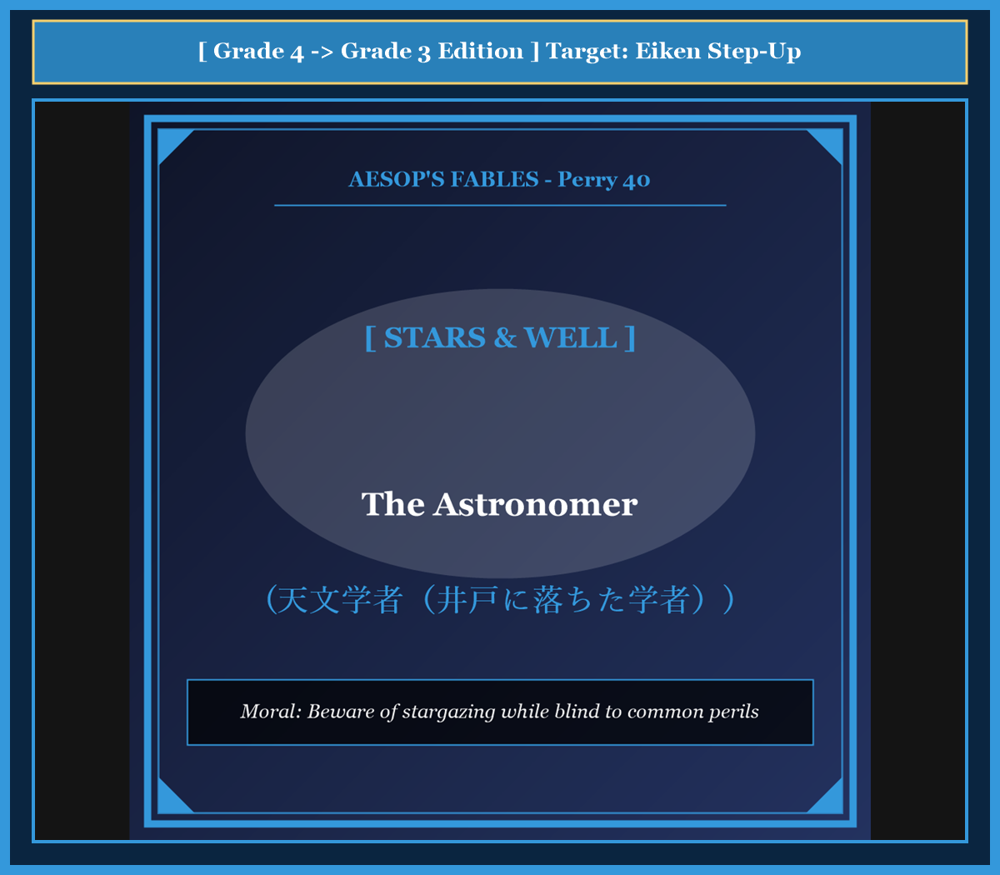

# 『英検ステップアップ多読：イソップ寓話編 第17巻（4級 ➔ 3級対比学習・第5集）』

---

## はじめに：なぜ「対比多読」で英検3級の壁を突破できるのか？

英検3級の合格を目指す英語学習者にとって、最初の大きな壁は**「単文の箇条書き」から「接続詞や関係代名詞を用いたまとまりのある英文」への飛躍**です。

4級までは短い平易な文（SVOや助動詞can/willなど）の組み合わせで対応できましたが、3級からは「when, because, if, so」などの従属接続詞や現在完了形、受動態、不定詞・動名詞を駆使した自然な英文読解・リスニング力が問われます。

本書では、世界中で愛読される珠玉のイソップ寓話（第5集・10話）を題材に、**「知っている4級英語」** が **「3級合格レベルの英語」** へとどのようにステップアップするかを分かりやすく対比学習します。

* **馴染みのあるストーリー（4級英文）** で文脈を瞬時に把握
* **洗練された表現（3級英文）** で接続詞・複文・重要熟語を自然にインプット
* **暗唱キーフレーズ対比** で面接スピーキング・英作文に直結する表現力を定着

楽しく名作寓話を読み進めながら、3級合格に必要な英語の基礎体力を固めましょう！

---

## 本書の収録作品（第5集・全10話）

1. **Chapter 41**: 猟犬と年老いた犬 (*The Old Hound*) [Perry 134]
2. **Chapter 42**: 壁と釘 (*The Wall and the Nail*) [Perry 239]
3. **Chapter 43**: 虻とキツネ（ハリネズミの忠告） (*The Fox and the Hedgehog*) [Perry 427]
4. **Chapter 44**: イノシシとキツネ（平和時の牙研ぎ） (*The Wild Boar and the Fox*) [Perry 224]
5. **Chapter 45**: 天文学者（井戸に落ちた学者） (*The Astronomer*) [Perry 40]
6. **Chapter 46**: 泥棒と見張り番の犬（餌を拒否する犬） (*The Thief and the Dog*) [Perry 403]
7. **Chapter 47**: 獅子とイルカ（陸と海の同盟） (*The Lion and the Dolphin*) [Perry 145]
8. **Chapter 48**: 狼と痩せた犬（自由と隷属の首輪） (*The Dog and the Wolf*) [Perry 135]
9. **Chapter 49**: 盗賊と母（最後に耳を噛み切る息子） (*The Thief and His Mother*) [Perry 200]
10. **Chapter 50**: 盲人と子鹿（触れて知る本性） (*The Blind Man and the Whelp*) [Perry 242]

---

## 本書の構成と電子書籍 / Kobo最適化

各章は以下の構成で統一されています。

```text
┌─────────────────────────────────────────────────────────────┐
│ 1. Chapter Title & Visual Illustration (章タイトル ＆ 挿絵)   │
│ 2. Benchmark Level: 英検4級レベル英文                         │
│ 3. Target Level: 英検3級レベル英文                           │
│ 4. Classic Original English Text (イソップ寓話クラシック原文)  │
│ 5. Japanese Translation (日本語訳 ＆ 教訓)                     │
│ 6. Recite & Compare (そらんじたいキーフレーズ対比カード)        │
│ 7. Key Vocabulary & Exam Notes (語彙・文法・試験対策解説)        │
└─────────────────────────────────────────────────────────────┘
```

> **【ポイント】 音声読み上げ（TTS）をご利用の方へ**
> 本文セクション（ステップ1〜3）は英語のみで構成されており、電子書籍やKoboの自動音声読み上げ機能（Text-to-Speech）で日本語が混ざることなく、美しい英語音声で快適にリスニング学習していただけます。


# Chapter 41: The Old Hound (猟犬と年老いた犬)

<!-- 電子書籍 Page Break & Image Header -->
<div style="text-align: center; margin-bottom: 20px;">
  
</div>

<div style="page-break-before: always;"></div>

## 1. Benchmark Level: Eiken Grade 4 (英検4級レベル本文)
*Read in ~1 to 1.5 minutes. Short and simple sentences.*

A hunter had a faithful hound. When the dog was young, he was very strong and fast. He caught many wild animals for his master. The hunter loved the dog very much.

Many years passed. The hound became old and weak. His legs were slow, and his teeth were not sharp. But he still loved to hunt with his master in the forest.

One day, the hunter and the hound went into the deep woods. They saw a big, dangerous wild boar. The hunter fired, but the boar ran away. The old hound ran after it bravely.

The hound caught the boar by its ear. He held it with all his strength. But his old teeth were too weak. The ear slipped from his mouth, and the wild boar escaped into the bushes.

The hunter ran up. He was very angry because he lost the prize. He raised his heavy whip and began to beat the poor old dog.

The old hound looked up at his master with sad, tearful eyes. "Master," said the hound, "please do not beat me. My heart is still brave, but my body is old. Remember the days when I caught many beasts for you, and do not punish me for my weak old age."

---
<div style="page-break-before: always;"></div>

## 2. Target Level: Eiken Grade 3 (英検3級レベル本文)
*Read in ~1.5 to 2 minutes. Compound sentences, conjunctions, and rich expressions.*

A hunter kept a courageous hound that had served him loyally for many years. In his youth, the hound was famous for his incredible speed and powerful jaws, and he never allowed any wild beast to escape.

However, as time went by, the faithful hound grew old and infirm. His limbs lost their youthful agility, and his teeth became blunt and loose. Even though he could no longer run as fast as before, his spirit remained as brave as ever, and he still accompanied his master on every hunt.

One morning, the hunter encountered a ferocious wild boar in the dense forest. The hunter signaled his dog to attack, and the old hound dashed forward without hesitation. With great determination, he seized the monstrous beast by the ear.

The hound struggled desperately to hold the thrashing beast until his master arrived. Unfortunately, his decayed teeth gave way, and the boar broke free and vanished into the thick undergrowth.

When the hunter arrived and discovered that his quarry had escaped, he flew into a violent rage. Instead of showing gratitude for the dog's courage, he raised his heavy stick and began to strike the defenseless animal.

The bruised hound looked up at his master with sorrowful eyes and spoke gently: "Do not strike me, master, for it is not my courage that has failed, but only my physical strength. You should remember the countless victories of my youth rather than despise me for the natural infirmities of my old age."

---
<div style="page-break-before: always;"></div>

## 3. Classic Original English Text (イソップ寓話クラシック原文)
*Perry 134: Translated by George Fyler Townsend (1867)*

A Hound who in the days of his youth and strength had never yielded to any beast of the forest, encountered in his old age a boar in the chace. 

He seized him boldly by the ear, but could not retain his hold because of the decay of his teeth, so that the boar escaped. 

His master, quickly coming up, was very much disappointed, and fiercely abused the dog. 

The Hound looked up and said: "It was not my fault, master, my spirit was as good as ever, but I could not help my infirmities. I rather deserve to be praised for what I have been, than to be scolded for what I am."

---
<div style="page-break-before: always;"></div>

## 4. Japanese Translation & Moral (日本語訳と教訓)

### 【日本語全訳：英検3級レベル本文】
ある猟師が、何年もの間忠実に仕えてくれた勇敢な猟犬を飼っていました。若い頃、その猟犬は信じられないほどの走力と力強い顎の力で知られており、どんな野獣も決して逃がしませんでした。

しかし時が経つにつれて、この忠実な猟犬は年老いて体が弱くなっていきました。四肢は若き日の俊敏さを失い、歯はすり減ってグラついていました。以前のように速く走ることはできなくなっていましたが、心は変わらず勇敢なままであり、今でも主人のすべての狩りに付き添っていました。

ある朝、猟師は深い森の中で凶暴なイノシシに出遭いました。猟師が攻撃の合図を出すと、老いた猟犬はためらうことなく前へ駆け出しました。強い決意をもって、彼はその巨大な野獣の耳にかじりつきました。

猟犬は主人が駆けつけるまで、暴れ回る野獣を押さえ込もうと必死に踏ん張りました。しかし不運にも、弱った歯が耐えきれず、イノシシは逃げ出して鬱蒼とした藪の奥へと姿を消してしまいました。

猟師が追いつき獲物が逃げてしまったことを知ると、彼は激しい怒りに駆られました。犬の勇気に感謝するどころか、重い杖を振り上げ、無防備な老犬を容赦なく叩き始めたのです。

傷だらけの猟犬は悲しげな瞳で主人を見上げ、静かに語りかけました。「ご主人様、どうか私を打たないでください。衰えたのは私の勇気ではなく、ただ肉体の力なのです。老いて衰えた姿を軽蔑するのではなく、若い頃にあなたのために収めた数え切れない勝利の功績をどうか思い出してください。」

### 【教訓（Moral）】
**Respect past loyalty when old age brings weakness.**  
（老いて衰えた者を切り捨てるのではなく、かつて捧げてくれた献身と功績に敬意を払いなさい。過去の貢献を忘れ、年老いた弱さだけを責めるのは人間の最も醜い冷酷さである。）

---
<div style="page-break-before: always;"></div>

## 5. Recite & Compare: そらんじたいキーフレーズ対比カード

<div class="comparison-card">
  <div class="card-header">フレーズ 1：若き日の比類なき強さと俊敏さ</div>
  <div class="card-row-g4"><span class="card-badge-g4">4級</span>When the dog was young, he was very strong and fast.</div>
  <div class="card-row-g3"><span class="card-badge-g3">3級</span>In his youth, the hound was famous for his incredible speed and powerful jaws.</div>
  <div class="card-note"><strong>解説：</strong>3級では「In his youth（若い頃に）」「be famous for ~（〜で有名である）」を用いて具体的に描写します。</div>
</div>

<div class="comparison-card">
  <div class="card-header">フレーズ 2：体は衰えても心は勇敢なまま</div>
  <div class="card-row-g4"><span class="card-badge-g4">4級</span>His legs were slow, but he still loved to hunt with his master.</div>
  <div class="card-row-g3"><span class="card-badge-g3">3級</span>Even though he could no longer run fast, his spirit remained as brave as ever.</div>
  <div class="card-note"><strong>解説：</strong>譲歩の接続詞「Even though（〜にもかかわらず）」と「as brave as ever（相変わらず勇敢な）」を組み合わせた3級頻出の表現です。</div>
</div>

<div class="comparison-card">
  <div class="card-header">フレーズ 3：歯が弱く獲物が逃げてしまう</div>
  <div class="card-row-g4"><span class="card-badge-g4">4級</span>His teeth were too weak, and the wild boar escaped.</div>
  <div class="card-row-g3"><span class="card-badge-g3">3級</span>Unfortunately, his decayed teeth gave way, and the boar broke free.</div>
  <div class="card-note"><strong>解説：</strong>「give way（崩れる・持ちこたえられなくなる）」「break free（逃げ出す）」は物語展開で極めて有用な熟語です。</div>
</div>

<div class="comparison-card">
  <div class="card-header">フレーズ 4：老いた弱さではなく過去の功績を思い出して</div>
  <div class="card-row-g4"><span class="card-badge-g4">4級</span>Remember the days when I caught many beasts, and do not punish me.</div>
  <div class="card-row-g3"><span class="card-badge-g3">3級</span>You should remember the victories of my youth rather than despise me for my old age.</div>
  <div class="card-note"><strong>解説：</strong>「A rather than B（BというよりむしろA）」を用いて、対比の主張を鮮やかに表現しています。</div>
</div>

---
<div style="page-break-before: always;"></div>

## 6. Key Vocabulary & Exam Notes (英検3級 重要語彙・文法・面接対策)

### 1. 英検3級 必須ボキャブラリー
* **hound** [名] 猟犬
* **infirm** [形] （高齢などで）虚弱な、衰弱した
* **hesitation** [名] ためらい、躊躇（*without hesitation*）
* **determination** [名] 決意、決断力
* **quarry** [名] （狩りの）獲物、追及物
* **gratitude** [名] 感謝の念（*show gratitude*）
* **despise** [動] 〜を軽蔑する、見下す
* **infirmity** [名] 衰弱、持病、虚弱

### 2. 文法・構文のチェックポイント
* **Even though + S + V**:
  * 「〜であるけれども」。*although* や *though* よりも事実を強く対比させる接続詞です。
* **rather than ~**:
  * 「〜ではなく、〜よりもむしろ」。面接や英作文で対比的な意見を述べる際に必須の成句です。

### 3. スピーキング（面接）＆ライティング活用ヒント
「高齢化社会」「長年の貢献への評価」を語る際の模範フレーズ：
* *Society should always show gratitude to senior citizens for their lifelong contributions.*（社会は高齢者の生涯にわたる貢献に対して常に感謝を示すべきである。）
* *We must not judge workers merely by their current speed, but honor their wisdom and dedication.*（労働者を現在のスピードだけで評価するのではなく、その知恵と献身を重んじなければならない。）


# Chapter 42: The Wall and the Nail (壁と釘)

<!-- 電子書籍 Page Break & Image Header -->
<div style="text-align: center; margin-bottom: 20px;">
  
</div>

<div style="page-break-before: always;"></div>

## 1. Benchmark Level: Eiken Grade 4 (英検4級レベル本文)
*Read in ~1 to 1.5 minutes. Short and simple sentences.*

There was a strong white wall in an old house. The wall was peaceful and stood quietly for many years.

One afternoon, a carpenter entered the room. He carried a sharp iron nail and a heavy hammer. He wanted to hang a picture on the wall.

The carpenter placed the nail against the wall and hit it hard. The sharp nail cut into the wall. The wall felt great pain and began to crack.

The wall cried out angrily to the nail. "Why are you piercing me?" asked the wall. "I have never hurt you! Why do you break my smooth surface and give me so much pain?"

The poor nail trembled from the blows. He replied in a sad voice: "Do not blame me, good wall. I do not want to hurt you. Look behind me! It is the heavy hammer that drives me into your body with all its power."

---
<div style="page-break-before: always;"></div>

## 2. Target Level: Eiken Grade 3 (英検3級レベル本文)
*Read in ~1.5 to 2 minutes. Compound sentences, conjunctions, and rich expressions.*

Inside a newly renovated cottage, a smooth plaster wall stood proud and undisturbed. For a long time, nothing disturbed its pristine surface, and it enjoyed complete tranquility.

However, one morning, a homeowner decided to hang a heavy mirror. Armed with a sharp steel nail and an iron hammer, the man approached the wall and positioned the metal point against the smooth plaster.

With several forceful blows, the heavy hammer drove the sharp nail deep into the masonry. As the metal pierced the plaster, fine cracks spread across the white surface, causing the wall acute distress.

Unable to endure the pain, the wall cried out indignantly: "Why are you tearing through my body so mercilessly? I have always treated you with kindness and done you no harm! Why do you wound me so cruelly?"

The vibrating nail, suffering under the repeated impacts of the hammer, groaned in response: "Do not direct your anger at me, friend. I have no personal malice against you, nor do I pierce you of my own free will. Blame the heavy hammer that strikes my head from behind with irresistible force!"

---
<div style="page-break-before: always;"></div>

## 3. Classic Original English Text (イソップ寓話クラシック原文)
*Perry 239: Translated by George Fyler Townsend (1867)*

A Wall, violently driven with a Nail, exclaimed: "Why do you tear me down, who have done you no injury?" 

The Nail replied: "It is not I who am to blame, but he who with great violence drives me on behind."

---
<div style="page-break-before: always;"></div>

## 4. Japanese Translation & Moral (日本語訳と教訓)

### 【日本語全訳：英検3級レベル本文】
新しく改築された山小屋の内部で、滑らかな漆喰の壁が誇らしげに静かに立っていました。長い間、その美しい表面を乱すものは何もなく、壁は完全な静けさを享受していました。

しかしある朝、家の主人が重い鏡を壁に掛けようと決意しました。鋭い鉄の釘と鉄の金槌を手にして、男は壁に近づき、滑らかな漆喰に金属の先端をあてがいました。

力強い数回の打撃によって、重い金槌は鋭い釘を石造りの壁の奥深くへと打ち込みました。金属が漆喰を貫くにつれて白い壁面に細かいひび割れが走り、壁は激しい苦痛に襲われました。

痛みに耐えかねた壁は、怒りを込めて叫びました。「なぜお前はこれほど容赦なく私の体を裂くのか？ 私はお前に害を加えたことなど一度もない！ なぜそのように残酷に私を傷つけるのか？」

金槌の度重なる衝撃にさらされ震える釘は、苦痛のうめき声を上げて答えました。「友よ、怒りを私に向けないでくれ。私にはお前に対する個人的な悪意など何もなく、自分の自由意志でお前を貫いているのでもない。抗えない力をもって、背後から私の頭を打ち据えている重い金槌こそを責めてくれ！」

### 【教訓（Moral）】
**Blame the driving power, not the helpless instrument.**  
（被害をもたらした手先の道具を責めるのではなく、背後でその力を振るっている真の元凶を見据えなさい。不当な圧力や命令によって動かされている実行役だけを責めても、根本的な問題は決して解決しない。）

---
<div style="page-break-before: always;"></div>

## 5. Recite & Compare: そらんじたいキーフレーズ対比カード

<div class="comparison-card">
  <div class="card-header">フレーズ 1：滑らかな壁面を傷つけない穏やかな日々</div>
  <div class="card-row-g4"><span class="card-badge-g4">4級</span>The wall was peaceful and stood quietly for many years.</div>
  <div class="card-row-g3"><span class="card-badge-g3">3級</span>Nothing disturbed its pristine surface, and it enjoyed complete tranquility.</div>
  <div class="card-note"><strong>解説：</strong>「pristine（元のままの、汚れていない）」「tranquility（静寂・平穏）」を用いて情景をより豊かに表現しています。</div>
</div>

<div class="comparison-card">
  <div class="card-header">フレーズ 2：何も悪いことをしていないのに何故傷つけるのか</div>
  <div class="card-row-g4"><span class="card-badge-g4">4級</span>Why are you piercing me? I have never hurt you!</div>
  <div class="card-row-g3"><span class="card-badge-g3">3級</span>Why are you tearing through my body when I have done you no harm?</div>
  <div class="card-note"><strong>解説：</strong>「tear through（〜を引き裂く）」「do someone no harm（人に害を加えない）」は英作文で極めて有用な定型表現です。</div>
</div>

<div class="comparison-card">
  <div class="card-header">フレーズ 3：自分の意志でやっているのではないという弁明</div>
  <div class="card-row-g4"><span class="card-badge-g4">4級</span>I do not want to hurt you. Look behind me!</div>
  <div class="card-row-g3"><span class="card-badge-g3">3級</span>I have no malice against you, nor do I pierce you of my own free will.</div>
  <div class="card-note"><strong>解説：</strong>「of one's own free will（自らの自由意志で）」は、責任の所在を明確にする頻出成句です。</div>
</div>

<div class="comparison-card">
  <div class="card-header">フレーズ 4：背後から打ち据える真の力を責めよ</div>
  <div class="card-row-g4"><span class="card-badge-g4">4級</span>It is the heavy hammer that drives me into your body with all its power.</div>
  <div class="card-row-g3"><span class="card-badge-g3">3級</span>Blame the heavy hammer that strikes my head from behind with irresistible force!</div>
  <div class="card-note"><strong>解説：</strong>命令文「Blame A that ~」と「irresistible force（抗えない力）」の組み合わせで教訓を強調しています。</div>
</div>

---
<div style="page-break-before: always;"></div>

## 6. Key Vocabulary & Exam Notes (英検3級 重要語彙・文法・面接対策)

### 1. 英検3級 必須ボキャブラリー
* **renovate** [動] 〜を修復する、改築する
* **pristine** [形] 初期状態の、損なわれていない、清潔な
* **tranquility** [名] 静けさ、平穏
* **indignantly** [副] 憤慨して、怒りを込めて
* **malice** [名] 悪意、敵意（*have no malice against ~*）
* **free will** [名] 自由意志（*of one's own free will*）
* **irresistible** [形] 抵抗できない、圧倒的な

### 2. 文法・構文のチェックポイント
* **nor + 助動詞 + S**:
  * 「〜もまた…ない」。否定文の後に続けて「さらに〜もない」と追加する洗練された構文です。
* **do someone harm [good]**:
  * 「（人）に害[益]を与える」。第4文型（SVOO）の重要イディオムです。

### 3. スピーキング（面接）＆ライティング活用ヒント
「責任の所在」「本質的な原因の追及」を論述する際のフレーズ：
* *When addressing environmental damage, we should regulate the corporations behind it rather than blaming consumers.*（環境被害に対処する際、消費者を責めるのではなく背後にある企業を規制すべきである。）
* *Do not punish the messenger; look at the policies that created the problem.*（メッセンジャーを処罰してはならない。問題を生み出した根本の政策を見るべきである。）


# Chapter 43: The Fox and the Hedgehog (虻とキツネ)

<!-- 電子書籍 Page Break & Image Header -->
<div style="text-align: center; margin-bottom: 20px;">
  
</div>

<div style="page-break-before: always;"></div>

## 1. Benchmark Level: Eiken Grade 4 (英検4級レベル本文)
*Read in ~1 to 1.5 minutes. Short and simple sentences.*

A fox was crossing a fast river. The current was very strong, and it pushed the fox into a deep ditch. The fox hurt his leg and could not move.

Soon, a large cloud of hungry flies found the fox. The flies settled on his head, back, and ears. They drank his blood, and the poor fox suffered greatly. But he could not shake them off.

A kind hedgehog walked by the ditch. He saw the poor fox covered with flies. The hedgehog felt sorry for him.

"Friend fox," said the hedgehog, "you are in terrible pain. Shall I use my sharp quills to drive away all these greedy flies for you?"

"No, please do not touch them!" cried the fox quickly.

The hedgehog was surprised. "Why do you want these painful flies to stay?" he asked.

The fox answered: "These flies are already full of my blood. They do not bite me hard now. But if you drive them away, a fresh swarm of starving flies will come and drink every last drop of my blood!"

---
<div style="page-break-before: always;"></div>

## 2. Target Level: Eiken Grade 3 (英検3級レベル本文)
*Read in ~1.5 to 2 minutes. Compound sentences, conjunctions, and rich expressions.*

While attempting to cross a rapid river, an unfortunate fox was swept away by the fierce current and washed into a steep, muddy ravine. Bruised and exhausted from the ordeal, the fox lay completely helpless on the bank, unable to climb back up.

Before long, a swarm of blood-sucking horseflies discovered the defenseless animal. They descended upon his wounds in vast numbers and began to torment him mercilessly. Because the fox was too weak to flick his tail or shake his fur, he had to endure their painful bites in silence.

Presently, a benevolent hedgehog came wandering past the ravine. Seeing the fox in such acute misery, the hedgehog felt deep sympathy and offered his assistance.

"Good neighbor," whispered the hedgehog, "you are suffering terribly from this plague of pests. If you wish, I can easily deploy my sharp quills and drive these tormentors away."

"I beg you, do not disturb them!" the fox exclaimed with great urgency.

The bewildered hedgehog asked: "Why on earth would you refuse my help when these creatures are torturing you?"

"Because," the fox explained prudently, "these flies are already gorged on my blood, so they sting only lightly. If you chase them away, a new swarm of famished flies will take their place and drain the few drops of life that remain within me."

---
<div style="page-break-before: always;"></div>

## 3. Classic Original English Text (イソップ寓話クラシック原文)
*Perry 427: Translated by George Fyler Townsend (1867)*

A Fox swimming across a rapid river was carried by the force of the current into a deep ravine, where he lay for a long time unable to get out, and sorely tormented by a swarm of horseflies that fastened on him. 

A Hedgehog wandering by, took pity on him, and asked if he should drive away the flies that were sucking his blood. 

The Fox replied: "Do not, I pray you, brush away these flies." 

"Why not?" asked the Hedgehog. 

"Because," replied the Fox, "these flies are now full of blood and bite me but little; but if you drive them away, others, who are hungry, will come and drink up all the blood I have left."

---
<div style="page-break-before: always;"></div>

## 4. Japanese Translation & Moral (日本語訳と教訓)

### 【日本語全訳：英検3級レベル本文】
流れの速い川を渡ろうとしていたある不運なキツネが、激しい急流に押し流され、険しい泥の峡谷へと打ち上げられてしまいました。その過酷な試練によって傷だらけになり疲れ果てたキツネは、斜面を這い上がることもできず、土手の上で完全に無力な状態で横たわっていました。

まもなく、血を吸うアブの大群が無防備なキツネを発見しました。アブたちは無数に傷口へと群がり、容赦なくキツネを苦しめ始めました。キツネは衰弱しすぎて尻尾を振ることも毛皮を震わせることもできなかったため、その痛烈な咬み傷をじっと耐えるしかありませんでした。

やがて、親切なハリネズミが峡谷のそばを通りかかりました。キツネの深刻な苦痛を目の当たりにしたハリネズミは深い同情を寄せ、救いの手を差し伸べました。

「キツネさん」とハリネズミは囁きました。「あなたはこの害虫の群れにひどく苦しめられていますね。もし望むなら、私の鋭い針を使って、この厄介者たちを簡単に追い払ってあげましょう。」

「お願いだから、彼らには触れないでくれ！」とキツネは切迫した声で叫びました。

困惑したハリネズミは尋ねました。「これほど苦しめられているのに、一体なぜ私の助けを拒むのですか？」

「なぜなら」とキツネは慎重に説明しました。「このアブたちはすでに私の血で満腹になっており、今は軽く刺してくるだけだからだ。もしお前が彼らを追い払ってしまえば、飢え切った新しいアブの大群がやってきて、私の中に残された命の血の最後の一滴まで吸い尽くしてしまうだろう。」

### 【教訓（Moral）】
**Better endure known evils than court fresh plunderers.**  
（すでに行き渡った既知の害悪を耐え忍ぶほうが、飢えた新たな略奪者を呼び寄せるよりもはるかに賢明である。性急に体制や役人を入れ替えても、より強欲な新たな搾取者がやってくれば、残された富をすべて奪い去られることになる。）

---
<div style="page-break-before: always;"></div>

## 5. Recite & Compare: そらんじたいキーフレーズ対比カード

<div class="comparison-card">
  <div class="card-header">フレーズ 1：急流に流されて動けなくなる苦境</div>
  <div class="card-row-g4"><span class="card-badge-g4">4級</span>The current pushed the fox into a ditch, and he could not move.</div>
  <div class="card-row-g3"><span class="card-badge-g3">3級</span>The fox was swept away by the fierce current and lay completely helpless.</div>
  <div class="card-note"><strong>解説：</strong>受動態「be swept away by ~（〜に押し流される）」と「lie helpless（無力な状態で横たわる）」が自然なストーリーテリングを作ります。</div>
</div>

<div class="comparison-card">
  <div class="card-header">フレーズ 2：針を使って害虫を追い払いましょうか？</div>
  <div class="card-row-g4"><span class="card-badge-g4">4級</span>Shall I use my sharp quills to drive away all these flies?</div>
  <div class="card-row-g3"><span class="card-badge-g3">3級</span>If you wish, I can easily deploy my sharp quills and drive these tormentors away.</div>
  <div class="card-note"><strong>解説：</strong>「If you wish（望むのであれば）」という控えめで丁寧な申し出と、「drive away（追い払う）」の使い分けです。</div>
</div>

<div class="comparison-card">
  <div class="card-header">フレーズ 3：すでに満腹だからこれ以上深く刺さない</div>
  <div class="card-row-g4"><span class="card-badge-g4">4級</span>These flies are already full of my blood. They do not bite hard.</div>
  <div class="card-row-g3"><span class="card-badge-g3">3級</span>These flies are already gorged on my blood, so they sting only lightly.</div>
  <div class="card-note"><strong>解説：</strong>「gorged on ~（〜で満腹になった）」と「sting lightly（軽く刺す）」という的確な語彙を用いています。</div>
</div>

<div class="comparison-card">
  <div class="card-header">フレーズ 4：新しい飢えた群れが最後の一滴まで吸い尽くす</div>
  <div class="card-row-g4"><span class="card-badge-g4">4級</span>A fresh swarm of starving flies will drink every last drop of blood.</div>
  <div class="card-row-g3"><span class="card-badge-g3">3級</span>A new swarm of famished flies will take their place and drain the few drops that remain.</div>
  <div class="card-note"><strong>解説：</strong>「take one's place（〜の後釜に座る・代わりになる）」「drain（吸い尽くす・空にする）」は3級の頻出重要フレーズです。</div>
</div>

---
<div style="page-break-before: always;"></div>

## 6. Key Vocabulary & Exam Notes (英検3級 重要語彙・文法・面接対策)

### 1. 英検3級 必須ボキャブラリー
* **ravine** [名] 峡谷、深い谷
* **ordeal** [名] 厳しい試練、過酷な体験
* **torment** [動] 〜を苦しめる、いじめる [名] 苦痛
* **hedgehog** [名] ハリネズミ
* **quill** [名] （ハリネズミやヤマアラシの）針、トゲ
* **gorged** [形] 満腹になった、たらふく食った
* **famished** [形] 飢え切った、腹ペコの
* **drain** [動] 〜を流出させる、吸い尽くす

### 2. 文法・構文のチェックポイント
* **take one's place**: 「〜の代わりになる、〜の後任となる」
  * 代替や世代交代を論じる日常会話・ビジネス・長文読解で極めて重要なイディオムです。
* **Why on earth ~ ?**: 「一体全体なぜ〜なのか？」
  * 疑問詞を強調する表現で、驚きや不審を表す口語・リスニングの頻出表現です。

### 3. スピーキング（面接）＆ライティング活用ヒント
「性急な組織改革の是非」「税制や制度の安定性」を論じる際の論理フレーズ：
* *Radical political changes often bring inexperienced leaders who cause greater damage than the previous administration.*（急激な政治変革は、前の政権よりも大きな損害をもたらす未熟な指導者を呼び寄せることが多い。）
* *Stability in taxation is preferable to frequent changes that invite fresh financial burdens.*（新たな財政負担を招く頻繁な税制変更よりも、制度の安定性のほうが望ましい。）


# Chapter 44: The Wild Boar and the Fox (イノシシとキツネ)

<!-- 電子書籍 Page Break & Image Header -->
<div style="text-align: center; margin-bottom: 20px;">
  
</div>

<div style="page-break-before: always;"></div>

## 1. Benchmark Level: Eiken Grade 4 (英検4級レベル本文)
*Read in ~1 to 1.5 minutes. Short and simple sentences.*

A wild boar stood under a big oak tree in the forest. The day was sunny and quiet. There was no sound of danger anywhere.

The boar was rubbing his long, sharp tusks against the rough bark of the tree. He rubbed them back and forth with great care. He wanted to make his tusks as sharp as knives.

A sly fox walked past the tree. He stopped and watched the boar. The fox laughed and made a funny face.

"Why are you working so hard?" asked the fox. "The forest is peaceful today. There are no hunters with guns, and no hungry hounds are chasing you. Why do you waste your energy sharpening your teeth?"

The wild boar did not stop his work. He looked at the fox and said: "I have a good reason for this. When danger comes, there will be no time to sharpen my tusks. I must be ready to fight at a moment's notice!"

---
<div style="page-break-before: always;"></div>

## 2. Target Level: Eiken Grade 3 (英検3級レベル本文)
*Read in ~1.5 to 2 minutes. Compound sentences, conjunctions, and rich expressions.*

On a calm summer morning, a massive wild boar stood beside an ancient oak tree in a quiet clearing. The surrounding woods were serene, and not a single predator was in sight.

Despite the peaceful atmosphere, the boar was diligently whetting his formidable tusks against the tree's sturdy trunk. He ground each curved tooth methodically, ensuring that their points were razor-sharp and ready for combat.

A witty fox happened to stroll by and noticed the boar's intensive labor. Finding the behavior peculiar, the fox tilted his head and mocked the serious beast.

"My dear friend," chuckled the fox, "why are you exhausting yourself on such a lovely day? There is neither a hunter's arrow nor a barking hound within miles of this meadow. What is the point of sharpening your weapons when there is no enemy to fight?"

The boar paused momentarily and delivered a wise reply: "I do not sharpen my tusks out of paranoia, but out of foresight. When an adversary ambushes me in the dark woods, I will have no leisure to prepare my weapons. It is too late to sharpen one's tusks when the battle has already begun."

---
<div style="page-break-before: always;"></div>

## 3. Classic Original English Text (イソップ寓話クラシック原文)
*Perry 224: Translated by George Fyler Townsend (1867)*

A Wild Boar stood under a tree and rubbed his tusks against the trunk. 

A Fox passing by asked him why he thus whetted his teeth when there was no danger in sight from either hunter or hound. 

"I do it advisedly," said the Boar; "for it would never do to have to sharpen my weapons just at the time I ought to be using them to defend myself."

---
<div style="page-break-before: always;"></div>

## 4. Japanese Translation & Moral (日本語訳と教訓)

### 【日本語全訳：英検3級レベル本文】
穏やかな夏の朝、巨大なイノシシが静かな空き地にある古い樫の木のそばに立っていました。周囲の森は穏やかで、敵となる捕食者の姿はどこにも見当たりませんでした。

平和な雰囲気にもかかわらず、イノシシは頑丈な木の幹にその手強い牙を熱心に擦りつけて研ぎ澄ましていました。その先端がカミソリのように鋭く戦闘に即応できるよう、彼は左右の湾曲した牙を入念に磨いていたのです。

機転の利くキツネが通りかかり、イノシシの真剣な労働に気づきました。その行動を奇妙に感じたキツネは、首を傾げて真面目な野獣を冷やかしました。

「親愛なる友よ」とキツネはくすくす笑いました。「なぜこんな素晴らしい日に自分を疲れさせているんだい？ この野原から何マイルの範囲にも、猟師の矢も吠える猟犬もいないというのに。戦うべき敵がいない平時に、なぜ武器を研ぎ澄ます必要があるんだ？」

イノシシはほんの一瞬手を止め、賢明な答えを返しました。「私は被害妄想から牙を研いでいるのではない。先を見通す洞察力（先見の明）から研いでいるのだ。暗い森で敵が不意に襲いかかってきたとき、武器を準備している暇などないのだから。戦いがすでに始まってから牙を研ぎ始めるのでは、遅すぎるのだ。」

### 【教訓（Moral）】
**Prepare weapons in peace for the hour of war.**  
（平和な時こそ有事に備えて武器を研いでおきなさい。危機が目前に迫ってから準備を始めても手遅れであり、平時の地道な備えこそが、いざという時に身を守る最大の盾となる。）

---
<div style="page-break-before: always;"></div>

## 5. Recite & Compare: そらんじたいキーフレーズ対比カード

<div class="comparison-card">
  <div class="card-header">フレーズ 1：平和な雰囲気の中で牙を研ぐイノシシ</div>
  <div class="card-row-g4"><span class="card-badge-g4">4級</span>The day was quiet, but the boar was rubbing his long tusks.</div>
  <div class="card-row-g3"><span class="card-badge-g3">3級</span>Despite the peaceful atmosphere, the boar was diligently whetting his formidable tusks.</div>
  <div class="card-note"><strong>解説：</strong>「Despite ~（〜にもかかわらず）」と「diligently whet ~（〜を入念に研ぐ）」を用いた洗練された表現です。</div>
</div>

<div class="comparison-card">
  <div class="card-header">フレーズ 2：戦うべき敵がいないのになぜ疲れることをするのか</div>
  <div class="card-row-g4"><span class="card-badge-g4">4級</span>Why do you waste your energy sharpening your teeth?</div>
  <div class="card-row-g3"><span class="card-badge-g3">3級</span>What is the point of sharpening your weapons when there is no enemy to fight?</div>
  <div class="card-note"><strong>解説：</strong>「What is the point of -ing?（〜することに何の意味があるのか？）」は議論やディベートで必須の構文です。</div>
</div>

<div class="comparison-card">
  <div class="card-header">フレーズ 3：恐怖からではなく先見の明から備える</div>
  <div class="card-row-g4"><span class="card-badge-g4">4級</span>I have a good reason for this. I must be ready to fight!</div>
  <div class="card-row-g3"><span class="card-badge-g3">3級</span>I do not sharpen my tusks out of paranoia, but out of foresight.</div>
  <div class="card-note"><strong>解説：</strong>「not out of A, but out of B（Aからではなく、Bという理由から）」のコントラスト構文です。</div>
</div>

<div class="comparison-card">
  <div class="card-header">フレーズ 4：戦いが始まってから準備しても手遅れ</div>
  <div class="card-row-g4"><span class="card-badge-g4">4級</span>When danger comes, there will be no time to sharpen my tusks.</div>
  <div class="card-row-g3"><span class="card-badge-g3">3級</span>It is too late to sharpen one's tusks when the battle has already begun.</div>
  <div class="card-note"><strong>解説：</strong>格言構文「It is too late to do ~ when ...（…の時には〜しても手遅れだ）」の典型例です。</div>
</div>

---
<div style="page-break-before: always;"></div>

## 6. Key Vocabulary & Exam Notes (英検3級 重要語彙・文法・面接対策)

### 1. 英検3級 必須ボキャブラリー
* **whet** [動] （刃物を）研ぐ、研磨する
* **formidable** [形] 手強い、恐るべき
* **peculiar** [形] 奇妙な、独特の
* **mock** [動] 〜を冷やかす、からかう
* **meadow** [名] 牧草地、草原
* **paranoia** [名] 被害妄想、過度の疑心暗鬼
* **foresight** [名] 先見の明、洞察力
* **ambush** [動] 〜を待ち伏せして襲う [名] 待ち伏せ

### 2. 文法・構文のチェックポイント
* **What is the point of doing ~?**:
  * 「〜して何の意味があるのか？」。面接の質疑応答や反論で極めて使いやすい重要表現です。
* **neither A nor B**:
  * 「AもBも〜ない」。*There is neither hunter nor hound.* のように2つの要素を同時に否定します。

### 3. スピーキング（面接）＆ライティング活用ヒント
「防災」「日頃の健康管理・危機管理」を論述する際の模範フレーズ：
* *Disaster prevention drills are essential because it is too late to plan an evacuation when an earthquake strikes.*（地震が起きてから避難計画を立てても遅すぎるため、防災訓練は不可欠である。）
* *Regular exercise maintains health so that the body is prepared against unexpected illnesses.*（予期せぬ病気に備えて体が即応できるよう、定期的な運動で健康を維持すべきである。）


# Chapter 45: The Astronomer (天文学者)

<!-- 電子書籍 Page Break & Image Header -->
<div style="text-align: center; margin-bottom: 20px;">
  
</div>

<div style="page-break-before: always;"></div>

## 1. Benchmark Level: Eiken Grade 4 (英検4級レベル本文)
*Read in ~1 to 1.5 minutes. Short and simple sentences.*

In an ancient town, there lived an astronomer. Every clear night, he walked outside to watch the stars. He loved the silver moon and the shining planets in the sky.

One night, the sky was full of bright stars. The astronomer walked through an open field outside the town. His head was tilted up, and his eyes never left the night sky. He was thinking about the mysteries of the heavens.

There was an old, deep well in the middle of the field. The well was dark, and it had no wooden cover. Because the astronomer looked only at the stars, he did not see the hole on the ground.

Suddenly, he stepped into the empty air. With a loud splash, the astronomer fell into the cold, deep water at the bottom of the well.

He was wet and bruised. He could not climb the slippery stone walls. He began to shout loudly for help. "Help me! I am drowning in the well!"

A neighbor heard his cries and ran to the well. When he looked down and saw the famous scholar, the neighbor shook his head and smiled. "My friend," said the neighbor, "you try so hard to see what is in the distant stars, but you fail to see what is right under your feet!"

---
<div style="page-break-before: always;"></div>

## 2. Target Level: Eiken Grade 3 (英検3級レベル本文)
*Read in ~1.5 to 2 minutes. Compound sentences, conjunctions, and rich expressions.*

In a prosperous ancient city, there lived an eccentric astronomer who dedicated his entire life to the study of the heavens. Every evening, he would venture into the countryside to observe the constellations, recording the movements of celestial bodies with passionate devotion.

One evening, captivated by an unusually brilliant alignment of stars, the philosopher wandered far beyond the city gates. With his chin pointed upward and his eyes glued to the starry vault above, he became completely lost in sublime contemplation, entirely oblivious to his physical surroundings.

Unbeknownst to the scholar, an abandoned water well lay directly in his path. Because the rim of the pit was level with the grass, it constituted an invisible hazard in the darkness. Absorbed in astronomical calculations, the man took one careless stride forward and plunged headlong into the subterranean abyss.

The astronomer hit the icy water with a deafening splash. Trapped in the pitch-black well with soaked robes and painful bruises, he shrieked frantically for assistance, his voice echoing up the circular shaft.

Hearing the desperate commotion, a sensible farmer rushed toward the opening with a lantern. Upon discovering that the town's most celebrated intellectual was shivering at the bottom of the pit, the farmer lowered a rescue rope, but could not resist offering a piece of practical advice.

"My esteemed philosopher," chuckled the rescuer, "while you strain your eyes to decipher the secrets of the distant heavens, how on earth do you manage to overlook the common dangers beneath your feet?"

---
<div style="page-break-before: always;"></div>

## 3. Classic Original English Text (イソップ寓話クラシック原文)
*Perry 40: Translated by George Fyler Townsend (1867)*

An Astronomer used to go out at night to observe the stars. 

One evening, as he wandered through the suburbs with his whole attention fixed on the sky, he fell unawares into a deep well. 

While he lamented and bewailed his sores and bruises, and cried loudly for help, a neighbor ran to the well, and learning what had happened said: 

"Hark ye, old fellow, why, in striving to pry into what is in heaven, do you not manage to see what is on earth?"

---
<div style="page-break-before: always;"></div>

## 4. Japanese Translation & Moral (日本語訳と教訓)

### 【日本語全訳：英検3級レベル本文】
ある繁栄した古代の都市に、全生涯を天体の研究に捧げている一風変わった天文学者が住んでいました。毎晩のように彼は星座を観察するために田舎へと繰り出し、情熱的な献身をもって天体の運行を記録していました。

ある晩、星々の類まれな輝かしい配列に心を奪われたこの哲学者は、城門をはるかに越えて歩き回っていました。顎を空へと突き上げ、瞳を満天の星空に釘付けにしたまま、彼は崇高な瞑想に完全に没頭し、足元の現実の環境をまったく意識していませんでした。

学者がまったく気づかないうちに、打ち捨てられた古井戸が彼の進路の真正面に口を開けていました。その井戸の縁は草むらと同じ高さであったため、暗闇の中では目に見えない危険な落とし穴となっていました。天文学の計算に没頭した男は不注意な一歩を踏み出し、頭から地下の深淵へと転落してしまったのです。

天文学者は耳をつんざく水しぶきを上げて冷たい水の中へと激突しました。びしょ濡れの衣類と痛烈な打撲傷を負い、真っ暗な井戸に閉じ込められた彼は、円形の井戸壁に声を反響させながら、狂ったように助けを求めて叫び声を上げました。

必死の騒ぎを聞きつけたある分別のある農夫が、カンテラを手にして井戸へと駆け寄ってきました。町で最も名高い知識人が井戸の底でガタガタ震えているのを発見した農夫は、救助用のロープを下ろしながらも、現実的な忠告を口にせずにはいられませんでした。

「尊い哲学者先生」と救助者は苦笑しました。「遠い夜空の秘密を解読しようと目を凝らす一方で、一体どうして自分の足元にあるありふれた危険を見落としてしまうのですかな？」

### 【教訓（Moral）】
**Beware of stargazing while blind to common perils.**  
（遠大な空論や理想ばかりを見上げて、足元の身近な危険や現実から目をそらしてはならない。高邁な目標に熱中するあまり初歩的な現実管理をおろそかにする者は、不意の落とし穴に落ちて身を滅ぼすことになる。）

---
<div style="page-break-before: always;"></div>

## 5. Recite & Compare: そらんじたいキーフレーズ対比カード

<div class="comparison-card">
  <div class="card-header">フレーズ 1：空の星に目を奪われて歩く学者</div>
  <div class="card-row-g4"><span class="card-badge-g4">4級</span>His head was tilted up, and his eyes never left the night sky.</div>
  <div class="card-row-g3"><span class="card-badge-g3">3級</span>With his eyes glued to the starry vault, he was entirely oblivious to his surroundings.</div>
  <div class="card-note"><strong>解説：</strong>「be glued to ~（〜に釘付けになる）」「be oblivious to ~（〜に気づいていない）」の組み合わせで没頭状態を鮮やかに描写します。</div>
</div>

<div class="comparison-card">
  <div class="card-header">フレーズ 2：足元を見ずに深淵へと転落</div>
  <div class="card-row-g4"><span class="card-badge-g4">4級</span>Because he looked only at the stars, he fell into the deep well.</div>
  <div class="card-row-g3"><span class="card-badge-g3">3級</span>The man took one careless stride forward and plunged headlong into the abyss.</div>
  <div class="card-note"><strong>解説：</strong>「plunge headlong into ~（〜へ頭から真っ逆さまに突っ込む）」という躍動感ある動詞表現です。</div>
</div>

<div class="comparison-card">
  <div class="card-header">フレーズ 3：井戸の底から大声で助けを求める</div>
  <div class="card-row-g4"><span class="card-badge-g4">4級</span>He could not climb the slippery walls and began to shout for help.</div>
  <div class="card-row-g3"><span class="card-badge-g3">3級</span>Trapped in the pitch-black well, he shrieked frantically for assistance.</div>
  <div class="card-note"><strong>解説：</strong>分詞構文「Trapped in ~」と副詞「frantically（狂ったように、必死に）」による緊張感の演出です。</div>
</div>

<div class="comparison-card">
  <div class="card-header">フレーズ 4：天空を見つめて地上の足元を見落とす愚かさ</div>
  <div class="card-row-g4"><span class="card-badge-g4">4級</span>You try to see distant stars, but you fail to see what is under your feet!</div>
  <div class="card-row-g3"><span class="card-badge-g3">3級</span>While you decipher the secrets of the heavens, you overlook the dangers beneath your feet!</div>
  <div class="card-note"><strong>解説：</strong>接続詞「While（〜する一方で）」を用いた、理想と現実のアイロニカルな対比です。</div>
</div>

---
<div style="page-break-before: always;"></div>

## 6. Key Vocabulary & Exam Notes (英検3級 重要語彙・文法・面接対策)

### 1. 英検3級 必須ボキャブラリー
* **eccentric** [形] 一風変わった、常軌を逸した
* **constellation** [名] 星座
* **celestial** [形] 天体の、天上の
* **sublime** [形] 崇高な、雄大な
* **oblivious** [形] （〜に）気づいていない、無頓着な（*oblivious to ~*）
* **hazard** [名] 危険物、障害
* **subterranean** [形] 地下の、地中の
* **decipher** [動] 〜を解読する、読み解く

### 2. 文法・構文のチェックポイント
* **be oblivious to + 名詞**:
  * 「〜にまったく気づいていない」。周囲の状況やリスクに対する無防備さを表す頻出形容詞です。
* **fail to do ~**:
  * 「〜し損なう、〜できない」。*cannot* よりも客観的・公式的なニュアンスを持ちます。

### 3. スピーキング（面接）＆ライティング活用ヒント
「理論先行の実務軽視」「足元のリスク管理」を論じる際のフレーズ：
* *Academic researchers should not become so absorbed in abstract theories that they overlook practical societal needs.*（研究者は抽象的理論に没頭するあまり、実践的な社会の要請を見落としてはならない。）
* *Before planning ambitious corporate expansions, management must address immediate workplace safety concerns.*（野心的な企業拡大を計画する前に、経営陣は足元の職場安全の懸念に対処しなければならない。）


# Chapter 46: The Thief and the Dog (泥棒と見張り番の犬)

<!-- 電子書籍 Page Break & Image Header -->
<div style="text-align: center; margin-bottom: 20px;">
  
</div>

<div style="page-break-before: always;"></div>

## 1. Benchmark Level: Eiken Grade 4 (英検4級レベル本文)
*Read in ~1 to 1.5 minutes. Short and simple sentences.*

A wealthy farmer had a faithful watchdog. Every night, the dog guarded the front gate of the farm. He kept his ears open and watched for danger.

One dark midnight, a thief came to rob the house. The thief walked quietly across the yard. But the watchful dog heard the footsteps and began to bark loudly.

The thief was afraid that the farmer would wake up. He reached into his bag and took out a large piece of delicious meat. He threw the meat to the dog to make him quiet.

"Here, good dog," whispered the thief. "Eat this tasty food and stop barking."

The faithful dog did not touch the food. Instead, he barked even louder.

"Before you threw this meat," said the dog, "I only suspected that you were a bad man. But now that you try to bribe me, I am certain you are a thief! I will bark until my master wakes up and catches you!"

---
<div style="page-break-before: always;"></div>

## 2. Target Level: Eiken Grade 3 (英検3級レベル本文)
*Read in ~1.5 to 2 minutes. Compound sentences, conjunctions, and rich expressions.*

A vigilant watchdog guarded a spacious country estate. The dog took immense pride in his duty, never slumbering while his master's family slept soundly inside the dark residence.

In the dead of night, a cunning burglar sneaked over the garden wall, intending to plunder the family's valuables. However, as soon as the intruder's boots touched the gravel path, the alert hound detected the subtle vibration and emitted a thunderous series of warnings.

Panic-stricken that the clamor would arouse the household, the burglar swiftly retrieved a succulent cut of roasted meat from his knapsack. He tossed the savory bribe toward the hound, hoping to silence the creature's frantic barks.

"Hush, noble beast," the thief coaxed in a hushed tone. "Accept this delicious feast and permit me to pass unhindered."

The steadfast hound backed away from the treat and glared at the stranger with fierce indignation.

"At first," growled the dog, "I was merely suspicious of your stealthy movements in the shadows. But now that you attempt to bribe me into betraying my master's trust, I am thoroughly convinced of your villainy! I will not cease barking until the entire household is awake and you are delivered to justice!"

---
<div style="page-break-before: always;"></div>

## 3. Classic Original English Text (イソップ寓話クラシック原文)
*Perry 403: Translated by George Fyler Townsend (1867)*

A Thief coming to rob a house would have fed the Dog who barked at him, that he might not awaken the family. He tossed him a crust of bread. 

The Dog said: "I had indeed some suspicion that you were a rogue; but since you try to bribe me with a crust of bread, I am sure of it; and I will not cease barking until I have roused the whole house."

---
<div style="page-break-before: always;"></div>

## 4. Japanese Translation & Moral (日本語訳と教訓)

### 【日本語全訳：英検3級レベル本文】
油断のない1頭の見張り番の犬が、広大な田舎の邸宅を警護していました。その犬は自らの職務に大きな誇りを持っており、主人の家族が暗い屋敷の中で安らかに眠っている間、決して居眠りすることはありませんでした。

夜の静寂の中、狡猾な泥棒が家族の貴重品を略奪しようと企て、庭の塀を忍び越えて侵入してきました。しかし、侵入者のブーツが砂利道に触れた瞬間、敏感な猟犬はその微かな振動を察知し、雷鳴のような警告の吠え声を轟かせました。

その騒動が一家を起こしてしまうのではないかと恐怖に駆られた泥棒は、背負い袋から香ばしいロースト肉の塊を素早く取り出しました。犬の必死の吠え声を鎮めようと、泥棒はその旨そうな賄賂を犬に向かって投げ与えたのです。

「静かにしろ、いい犬だ」と泥棒は押し殺した声で宥めました。「この美味しいご馳走を受け取って、邪魔をせずに通してくれ。」

忠誠心あふれる番犬はその餌から身を引き、激しい怒りをもって見知らぬ男を睨み据えました。

「最初は」と犬は低く唸りました。「暗闇の中で忍び寄るお前の不審な動きを怪しんでいたにすぎなかった。しかし、私の主人の信頼を裏切らせようと賄賂で私を買収しようとした今、お前が悪党であることは完全に確信へと変わった！ 家中の者が目を覚まし、お前が正義の手へと引き渡されるまで、私は吠えるのを決してやめないぞ！」

### 【教訓（Moral）】
**Sudden bribes from strangers signal treachery.**  
（見知らぬ者からの唐突な施しや甘い誘惑には、必ず裏の悪意と罠が潜んでいる。職務や忠誠を放棄させるための賄賂に決して乗ってはならず、不自然な好意こそ最大の警戒シグナルと心得よ。）

---
<div style="page-break-before: always;"></div>

## 5. Recite & Compare: そらんじたいキーフレーズ対比カード

<div class="comparison-card">
  <div class="card-header">フレーズ 1：家族が眠る間決して居眠りしない忠誠心</div>
  <div class="card-row-g4"><span class="card-badge-g4">4級</span>The dog guarded the gate and watched for danger every night.</div>
  <div class="card-row-g3"><span class="card-badge-g3">3級</span>The dog took pride in his duty, never slumbering while the family slept soundly.</div>
  <div class="card-note"><strong>解説：</strong>「take pride in ~（〜に誇りを持つ）」「never slumbering while...（…する間決して眠らない）」という品格ある描写です。</div>
</div>

<div class="comparison-card">
  <div class="card-header">フレーズ 2：犬を黙らせようと肉を投げ与える泥棒</div>
  <div class="card-row-g4"><span class="card-badge-g4">4級</span>He threw the meat to the dog to make him quiet.</div>
  <div class="card-row-g3"><span class="card-badge-g3">3級</span>He tossed the savory bribe toward the hound, hoping to silence his frantic barks.</div>
  <div class="card-note"><strong>解説：</strong>「savory bribe（旨そうな賄賂）」と分詞構文「hoping to silence ~」で犯人の心理を表現しています。</div>
</div>

<div class="comparison-card">
  <div class="card-header">フレーズ 3：買収しようとしたことで悪党だと確信</div>
  <div class="card-row-g4"><span class="card-badge-g4">4級</span>Now that you try to bribe me, I am certain you are a thief!</div>
  <div class="card-row-g3"><span class="card-badge-g3">3級</span>Now that you attempt to bribe me into betraying my master, I am convinced of your villainy!</div>
  <div class="card-note"><strong>解説：</strong>「Now that + S + V（今や〜なのだから）」と「bribe A into -ing（Aを買収して〜させる）」のハイレベル構文です。</div>
</div>

<div class="comparison-card">
  <div class="card-header">フレーズ 4：全員が起きるまで吠えるのをやめない</div>
  <div class="card-row-g4"><span class="card-badge-g4">4級</span>I will bark until my master wakes up and catches you!</div>
  <div class="card-row-g3"><span class="card-badge-g3">3級</span>I will not cease barking until the household is awake and you are delivered to justice!</div>
  <div class="card-note"><strong>解説：</strong>「cease -ing（〜するのをやめる）」「be delivered to justice（法の裁き・正義に引き渡される）」という格調高い表現です。</div>
</div>

---
<div style="page-break-before: always;"></div>

## 6. Key Vocabulary & Exam Notes (英検3級 重要語彙・文法・面接対策)

### 1. 英検3級 必須ボキャブラリー
* **vigilant** [形] 油断のない、警戒を怠らない
* **slumber** [動] まどろむ、眠る [名] 睡眠
* **intruder** [名] 侵入者、不審者
* **savory** [形] 風味豊かな、食欲をそそる
* **bribe** [名] 賄賂 [動] 〜を買収する
* **steadfast** [形] 確固たる、忠実な
* **villainy** [名] 悪事、極悪非道
* **justice** [名] 正義、司法（*be delivered to justice*）

### 2. 文法・構文のチェックポイント
* **Now that + S + V**:
  * 「今や〜である以上は、〜となったからには」。理由や新たな状況を受けて結論を導く頻出接続詞です。
* **bribe someone into -ing**:
  * 「（人）を買収して〜させる」。*persuade / force someone into -ing* と同様の使役的構文です。

### 3. スピーキング（面接）＆ライティング活用ヒント
「公務員の倫理」「サイバーセキュリティ・甘い話への警戒」を論じる際のフレーズ：
* *Public officials must strictly reject gifts because unexpected favors often conceal unethical motives.*（不自然な好意には不当な動機が潜んでいることが多いため、公務員は贈り物を厳格に拒否しなければならない。）
* *Internet users should be wary of suspicious free offers that aim to compromise personal data.*（個人情報の詐取を目的とした疑わしい無料オファーに対し、ネット利用者は警戒すべきである。）


# Chapter 47: The Lion and the Dolphin (獅子とイルカ)

<!-- 電子書籍 Page Break & Image Header -->
<div style="text-align: center; margin-bottom: 20px;">
  
</div>

<div style="page-break-before: always;"></div>

## 1. Benchmark Level: Eiken Grade 4 (英検4級レベル本文)
*Read in ~1 to 1.5 minutes. Short and simple sentences.*

A lion was walking along the sandy seashore. The blue waves rolled softly on the beach.

Suddenly, a dolphin popped his head out of the sea. The lion looked at the beautiful creature and had an idea.

"Hello, king of the ocean!" roared the lion. "I am the king of all land beasts, and you rule the deep sea. Let us make a promise to be best friends and help each other in battle."

The dolphin was pleased and agreed to the alliance.

A few days later, a huge, angry wild bull attacked the lion on the beach. The bull had sharp horns, and the fight was very hard. The lion was losing and cried out: "Help me, my friend dolphin! Swim here and fight this bull!"

The dolphin swam to the shallow water and tried to jump onto the sand. But he had no legs, so he could not leave the sea. The bull hit the lion hard and ran away.

The bruised lion was furious. "You are a false friend and a traitor!" shouted the lion.

"Do not blame me," answered the dolphin sadly. "Blame Mother Nature. She made me powerful in the sea, but gave me no feet to walk upon the land."

---
<div style="page-break-before: always;"></div>

## 2. Target Level: Eiken Grade 3 (英検3級レベル本文)
*Read in ~1.5 to 2 minutes. Compound sentences, conjunctions, and rich expressions.*

While wandering along a sandy coastline, a majestic lion observed a dolphin leaping gracefully from the rolling azure waves. Recognizing the creature's nobility, the monarch of the land conceived an ambitious diplomatic proposal.

Approaching the water's edge, the lion addressed the sea creature: "Noble sovereign, you hold dominion over the vast ocean, just as I reign supreme over the terrestrial beasts. It is only fitting that the two most magnificent rulers on earth form a sacred alliance to defend one another against all adversaries."

Flattered by the royal proposal, the dolphin readily consented, and the two monarchs sealed their mutual pact with solemn oaths.

Not long afterward, the lion engaged in a mortal struggle against a ferocious wild bull right beside the surf. The bull fought with tremendous ferocity, driving his sharp horns toward the lion's throat. Finding himself overwhelmed, the lion turned toward the ocean and roared desperately for reinforcements.

The dolphin was deeply eager to honor his commitment. He dashed through the waves toward the shore with all his speed. However, as soon as his fins struck the sandy beach, he was immobilized by gravity. Despite his best efforts, he could not cross the barrier of sand to assist his beleaguered ally.

After the bull finally withdrew, the battered lion limped toward the surf and accused the dolphin of treachery: "You pledged eternal brotherhood, yet you abandoned me in my hour of greatest peril!"

The dolphin responded with dignified sorrow: "Direct your reproach toward Nature, not toward me. While she crowned me sovereign of the ocean deep, she denied me the physical capacity to set foot upon the earth."

---
<div style="page-break-before: always;"></div>

## 3. Classic Original English Text (イソップ寓話クラシック原文)
*Perry 145: Translated by George Fyler Townsend (1867)*

A Lion, roaming on the seashore, saw a Dolphin lift up its head out of the water, and suggested that they should form a mutual alliance, saying that they were the two best fit to be friends, since one was the king of beasts and the other was the king of the fishes. 

The Dolphin gladly consented. 

Not long after, the Lion had a fierce battle with a wild Bull, and called on the Dolphin to help him. 

The Dolphin, though quite willing, was unable to come to the shore, so the Lion accused him of being a traitor. 

The Dolphin said: "Do not blame me, but blame Nature, who made me king of the sea, but gave me no power on the land."

---
<div style="page-break-before: always;"></div>

## 4. Japanese Translation & Moral (日本語訳と教訓)

### 【日本語全訳：英検3級レベル本文】
砂浜の海岸線を散策していた威厳あるライオンが、青い波間から優雅に跳び上がるイルカを目撃しました。その生き物の気品を認めた陸の王者ライオンは、野心的な外交提案を思いつきました。

水際へと近づいたライオンは、その海の生き物に語りかけました。「高貴なる君主よ、私が陸の獣たちの上に君臨しているように、あなたも広大な海原を支配している。地球上で最も偉大な2人の支配者が神聖な同盟を結び、あらゆる敵に対して互いを守り合うことこそ、最も相応しいはずだ。」

王の提案に誇らしく思ったイルカは喜んで同意し、2人の君主は厳粛な誓いをもって相互協定を結びました。

それから間もなく、ライオンは波打ち際のすぐそばで凶暴な野牛と命懸けの死闘を繰り広げることになりました。野牛は凄まじい獰猛さで戦い、その鋭い角をライオンの喉元へと突き立てようとしました。圧倒されたライオンは海の方を振り返り、必死に救援を求めて咆哮しました。

イルカは自らの誓いを果たそうと強く望みました。彼は全速力で波をかき分け海岸へと突進しました。しかし、ヒレが砂浜に触れた瞬間、彼は重力によって身動きが取れなくなってしまったのです。どれほど全力を尽くしても、砂の境界線を越えて窮地に陥った同盟者を助けに行くことはできませんでした。

野牛がようやく立ち去った後、傷だらけのライオンは波打ち際へと足を引きずりながら近づき、イルカを裏切り者だと非難しました。「永遠の兄弟の契りを交わしておきながら、私が最大の危機に瀕した時に見殺しにするとは何事だ！」

イルカは威厳ある悲しみをもって答えました。「私を責めるのではなく、大自然を責めてください。自然は私を深海の君主として戴冠させましたが、地上に足を踏み入れる肉体的な能力を与えてはくださらなかったのです。」

### 【教訓（Moral）】
**Allies outside their element cannot aid you.**  
（活動領域（領分）がまったく異なる者と同盟を結んでも、いざという危機に互いを救うことはできない。同盟や提携を結ぶ際は、相手の善意や名声だけでなく、自らの領域で実質的な支援を実行できる能力があるかを冷静に見極めなければならない。）

---
<div style="page-break-before: always;"></div>

## 5. Recite & Compare: そらんじたいキーフレーズ対比カード

<div class="comparison-card">
  <div class="card-header">フレーズ 1：陸と海の王者が結ぶ相互防衛の同盟</div>
  <div class="card-row-g4"><span class="card-badge-g4">4級</span>I rule the land, and you rule the sea. Let us make a promise to help each other.</div>
  <div class="card-row-g3"><span class="card-badge-g3">3級</span>You hold dominion over the ocean, just as I reign supreme over terrestrial beasts; let us form an alliance.</div>
  <div class="card-note"><strong>解説：</strong>「hold dominion over ~（〜を統治する）」「reign supreme（最高位に君臨する）」という格調高い外交英語の対比です。</div>
</div>

<div class="comparison-card">
  <div class="card-header">フレーズ 2：助けたいと願うが砂の境界を越えられない</div>
  <div class="card-row-g4"><span class="card-badge-g4">4級</span>The dolphin had no legs, so he could not leave the sea.</div>
  <div class="card-row-g3"><span class="card-badge-g3">3級</span>Despite his best efforts, he could not cross the barrier of sand to assist his ally.</div>
  <div class="card-note"><strong>解説：</strong>「Despite one's best efforts（最善の努力にもかかわらず）」は頻出の論理展開フレーズです。</div>
</div>

<div class="comparison-card">
  <div class="card-header">フレーズ 3：最大の危機において裏切られたという非難</div>
  <div class="card-row-g4"><span class="card-badge-g4">4級</span>You are a false friend and a traitor!</div>
  <div class="card-row-g3"><span class="card-badge-g3">3級</span>You pledged eternal brotherhood, yet you abandoned me in my hour of greatest peril!</div>
  <div class="card-note"><strong>解説：</strong>「pledge ~（〜を誓約する）」「in one's hour of greatest peril（最大の危機の時に）」はドラマチックな対話表現です。</div>
</div>

<div class="comparison-card">
  <div class="card-header">フレーズ 4：海では王でも陸上の能力を持たない運命</div>
  <div class="card-row-g4"><span class="card-badge-g4">4級</span>Nature made me powerful in the sea, but gave me no feet on land.</div>
  <div class="card-row-g3"><span class="card-badge-g3">3級</span>She crowned me sovereign of the ocean, but denied me the capacity to set foot upon earth.</div>
  <div class="card-note"><strong>解説：</strong>動詞「deny someone the capacity to do（人に〜する能力を与えない・拒む）」を用いた知的な弁明です。</div>
</div>

---
<div style="page-break-before: always;"></div>

## 6. Key Vocabulary & Exam Notes (英検3級 重要語彙・文法・面接対策)

### 1. 英検3級 必須ボキャブラリー
* **dominion** [名] 支配権、統治（*hold dominion over ~*）
* **terrestrial** [形] 陸上の、地球の
* **adversary** [名] 敵、対抗者
* **reinforcement** [名] 援軍、増援部隊
* **beleaguered** [形] 窮地に陥った、包囲された
* **treachery** [名] 裏切り、背信行為
* **peril** [名] 危険、危機（*in peril*）
* **reproach** [名] 非難、叱責 [動] 〜を咎める

### 2. 文法・構文のチェックポイント
* **just as S + V, so S + V**:
  * 「ちょうど〜であるように、…である」。比喩や対比を美しく展開する伝統的構文です。
* **set foot upon [on] ~**:
  * 「〜に足を踏み入れる」。文学作品や旅行・探検の文脈で極めて頻出のイディオムです。

### 3. スピーキング（面接）＆ライティング活用ヒント
「国家間の軍事同盟」「企業間の異業種アライアンス」を論じる際のフレーズ：
* *Strategic partnerships are futile if partners lack the logistical capacity to operate in the relevant environment.*（パートナーが該当環境で運用するロジスティクス能力を欠いている場合、戦略的提携は無益である。）
* *International treaties must account for geographical and technical limitations of each member state.*（国際条約は各加盟国の地理的・技術的制約を考慮しなければならない。）


# Chapter 48: The Dog and the Wolf (狼と痩せた犬)

<!-- 電子書籍 Page Break & Image Header -->
<div style="text-align: center; margin-bottom: 20px;">
  
</div>

<div style="page-break-before: always;"></div>

## 1. Benchmark Level: Eiken Grade 4 (英検4級レベル本文)
*Read in ~1 to 1.5 minutes. Short and simple sentences.*

It was a cold winter night. A skinny, hungry wolf was walking along a dark road. He had not eaten for many days.

Suddenly, the wolf met a house dog. The dog was big, fat, and had smooth, shiny fur. He looked very healthy and happy.

"Hello," said the wolf politely. "How do you get so much food? Your coat is beautiful, and you look very strong. My life in the cold forest is so hard."

"My life is very easy," replied the dog with a smile. "I only guard my master's house at night and keep out thieves. In return, my master gives me delicious meat, bread, and bones from his table."

"That sounds wonderful!" cried the wolf. "I want to work with you!"

They walked together toward the town. As they trotted under a street lamp, the wolf looked closely at the dog's neck. The fur around the dog's neck was rubbed away, and the red skin was bare.

"What happened to your neck?" asked the wolf.

"Oh, that is nothing," answered the dog carelessly. "It is just the mark of the heavy iron collar. My master ties me to a post during the day so I do not bite the guests."

The wolf stopped walking immediately. "You are chained?" whispered the wolf in horror. "Then keep all your fine meat and bones! I would rather be hungry and free than be fat in a heavy golden chain!"

---
<div style="page-break-before: always;"></div>

## 2. Target Level: Eiken Grade 3 (英検3級レベル本文)
*Read in ~1.5 to 2 minutes. Compound sentences, conjunctions, and rich expressions.*

During the depth of a freezing winter, an emaciated wolf was prowling through the outskirts of a rural village, shivering from the arctic wind and nearly perishing from starvation.

By chance, the wolf crossed paths with a well-fed mastiff. The domestic hound possessed a sleek, glossy coat and robust musculature, radiating the unmistakable glow of prosperity and contentment.

"Good evening, cousin," the famished wolf murmured respectfully. "I cannot help admiring your magnificent condition. While I struggle every day to find a single scrap of meat in the frozen woods, you thrive in absolute abundance."

The mastiff wagged his tail pleasantly. "You can easily enjoy the same comfortable life if you abandon your wild roaming. If you enter my master's service, your only obligation will be to guard the homestead at night and bark at suspicious strangers. In exchange, the household will shower you with succulent scraps, roasted fowl, and warm bedding."

Tempted by the prospect of an effortless existence, the wolf eagerly accompanied the dog toward the estate. However, as they trotted beneath the moonlight, the wolf noticed a strange ring around the dog's neck, where the glossy fur was worn down to the raw flesh.

"What is that curious blemish on your throat?" inquired the wolf with sudden suspicion.

"Oh, it is a trifling matter," the dog dismissed casually. "It is merely the chafe of the leather collar to which my master fastens an iron chain during the daytime, so that I do not disturb the household."

The wolf halted in his tracks, horrified by the revelation. "You mean you are not permitted to run wherever you please?"

"Not during the day," the dog admitted, "but what does that matter when the banquet is so plentiful?"

"It matters everything!" declared the wolf proudly. "Enjoy your pampered feast, my friend, but I shall return to the wilderness. I would infinitely prefer to starve in glorious liberty than grow fat as a subjugated slave."

---
<div style="page-break-before: always;"></div>

## 3. Classic Original English Text (イソップ寓話クラシック原文)
*Perry 135: Translated by George Fyler Townsend (1867)*

A gaunt Wolf was almost dead with hunger when he met a House-dog, who happened to be passing by. 

"Where do you get all this food to make you so fat and sleek?" said the Wolf. 

"I guard the house at night," replied the Dog, "and drive away thieves." 

"I should like that," said the Wolf, "for it is hard work to find food in the woods." 

"Then come with me," said the Dog. 

As they were jogging along together, the Wolf noticed a mark on the Dog's neck, and asked what made it. 

"Oh, nothing," replied the Dog, "it is only the collar by which I am tied up at night." 

"Then good-bye to you," said the Wolf, "for I would rather starve free, than be a fat slave."

---
<div style="page-break-before: always;"></div>

## 4. Japanese Translation & Moral (日本語訳と教訓)

### 【日本語全訳：英検3級レベル本文】
凍てつく冬のどん底で、骨と皮ばかりに痩せ細った狼が、北極のような冷たい風に震え飢え死にしそうになりながら、田舎の村の郊外をうろついていました。

偶然にも、狼はたっぷりと餌を与えられた番犬（マスティフ）と出くわしました。この飼い犬は滑らかで光沢のある毛並みと頑丈な筋肉を持ち、繁栄と満足のまぎれもない輝きを放っていました。

「今晩は、従兄弟殿」と飢えた狼は敬意を込めて呟きました。「あなたの素晴らしい体格に感嘆せずにはいられません。私が凍りついた森で一片の肉を探すために毎日苦闘している一方で、あなたは完全な豊かさの中で暮らしているのですね。」

番犬は嬉しそうに尾を振りました。「荒野の放浪をやめれば、あなたもこの快適な生活を簡単に手に入れられますよ。私の主人のもとで仕えるなら、あなたの唯一の義務は夜に屋敷を見張り、怪しい見知らぬ者に吠えることだけです。その見返りに、一家はあなたにジューシーなご馳走の残り物やローストチキン、温かい寝床を惜しみなく与えてくれますよ。」

努力のいらない安楽な生活の見通しに魅了された狼は、喜んで犬について屋敷へと向かいました。しかし、月明かりの下を歩いているとき、狼は犬の首の周りに奇妙な輪があり、光沢ある毛が擦り切れて生々しい皮膚が露出していることに気づきました。

「お前の喉にあるその奇妙な傷跡は何だい？」と狼は突然の不審を抱いて尋ねました。

「ああ、そんなのは些細なことですよ」と犬は何気なく受け流しました。「昼間、家の人たちを邪魔しないように主人が鉄の鎖をつなぐ革の首輪で、少し擦れているだけです。」

狼はその衝撃の事実に愕然とし、ピタリと立ち止まりました。「つまり、お前は自分の行きたいところへ自由に走ることを許されていないというのか？」

「昼の間はね」と犬は認めました。「でも、これほど贅沢な食事がたっぷりあるのに、それが何だというのです？」

「それがすべてだ！」と狼は誇り高く宣言しました。「親友よ、その甘やかされたご馳走を存分に楽しむがいい。だが私は荒野へ戻る。鎖につながれた隷属の奴隷として肥え太るくらいなら、私は誇り高き自由の中で飢え死にするほうを無限に選ぶ！」

### 【教訓（Moral）】
**Better lean liberty than fat servitude.**  
（飽食の首輪に繋がれた奴隷として生きるより、たとえ飢えようとも自由の荒野を生きるほうが尊い。どれほど贅沢な物質的豊かさや安楽を提供されようとも、自由と尊厳を差し出す対価として見合うものなど存在しない。）

---
<div style="page-break-before: always;"></div>

## 5. Recite & Compare: そらんじたいキーフレーズ対比カード

<div class="comparison-card">
  <div class="card-header">フレーズ 1：飢餓の狼と贅沢に肥えた飼い犬の遭遇</div>
  <div class="card-row-g4"><span class="card-badge-g4">4級</span>A skinny wolf met a big, fat house dog on a winter night.</div>
  <div class="card-row-g3"><span class="card-badge-g3">3級</span>An emaciated wolf crossed paths with a well-fed mastiff possessing a sleek coat.</div>
  <div class="card-note"><strong>解説：</strong>「emaciated（痩せ細った）」「cross paths with ~（〜と出くわす）」を用いた格調高い書き出しです。</div>
</div>

<div class="comparison-card">
  <div class="card-header">フレーズ 2：首輪の擦れ跡という隷属の印</div>
  <div class="card-row-g4"><span class="card-badge-g4">4級</span>The fur around the dog's neck was rubbed away by the heavy collar.</div>
  <div class="card-row-g3"><span class="card-badge-g3">3級</span>It is merely the chafe of the leather collar to which my master fastens an iron chain.</div>
  <div class="card-note"><strong>解説：</strong>関係代名詞「to which S + V」を用いた複文で、首輪の拘束理由を説明しています。</div>
</div>

<div class="comparison-card">
  <div class="card-header">フレーズ 3：自由に走ることが許されていない衝撃</div>
  <div class="card-row-g4"><span class="card-badge-g4">4級</span>You are chained? whispered the wolf in horror.</div>
  <div class="card-row-g3"><span class="card-badge-g3">3級</span>The wolf halted in his tracks: You mean you are not permitted to run wherever you please?</div>
  <div class="card-note"><strong>解説：</strong>「halt in one's tracks（その場で立ちすくむ）」「wherever you please（好きな場所どこへでも）」は感情豊かな定型表現です。</div>
</div>

<div class="comparison-card">
  <div class="card-header">フレーズ 4：隷属の飽食よりも自由の飢餓を選ぶ宣言</div>
  <div class="card-row-g4"><span class="card-badge-g4">4級</span>I would rather be hungry and free than be fat in a heavy chain!</div>
  <div class="card-row-g3"><span class="card-badge-g3">3級</span>I would infinitely prefer to starve in glorious liberty than grow fat as a subjugated slave.</div>
  <div class="card-note"><strong>解説：</strong>「would prefer to A than B（BするよりAしたい）」「subjugated slave（従属させられた奴隷）」という不朽の格言構文です。</div>
</div>

---
<div style="page-break-before: always;"></div>

## 6. Key Vocabulary & Exam Notes (英検3級 重要語彙・文法・面接対策)

### 1. 英検3級 必須ボキャブラリー
* **emaciated** [形] （飢えや病気で）やつれた、骨と皮ばかりの
* **mastiff** [名] マスティフ（大型の番犬）
* **prosperity** [名] 繁栄、富、富裕
* **obligation** [名] 義務、責務
* **chafe** [名] 擦れ、摩擦による傷 [動] 〜を擦りむく
* **halt** [動] 立ち止まる、停止する（*halt in one's tracks*）
* **infinitely** [副] 無限に、はるかに
* **subjugate** [動] 〜を従属させる、征服する

### 2. 文法・構文のチェックポイント
* **would prefer to do A rather than do B**:
  * 「BするよりもむしろAしたい」。*would rather do A than B* と同様に、強い価値観の優先順位を表します。
* **wherever you please**:
  * 「あなたの好きな所ならどこへでも」。*whatever / whenever you please* と応用が利く上品な口語表現です。

### 3. スピーキング（面接）＆ライティング活用ヒント
「個人の自由と生活保障のバランス」「独立性と安定性の選択」を語る際のフレーズ：
* *Financial subsidies must not be traded for the erosion of fundamental democratic freedoms.*（財政的補助金の対価として、基本的民主主義の自由を侵食させてはならない。）
* *Many creative professionals prefer the uncertainty of freelancing over the secure subordination of corporate employment.*（多くのクリエイティブ専門職は、企業雇用の安定した従属よりも、フリーランスの不確実な自由を好む。）


# Chapter 49: The Thief and His Mother (盗賊と母)

<!-- 電子書籍 Page Break & Image Header -->
<div style="text-align: center; margin-bottom: 20px;">
  
</div>

<div style="page-break-before: always;"></div>

## 1. Benchmark Level: Eiken Grade 4 (英検4級レベル本文)
*Read in ~1 to 1.5 minutes. Short and simple sentences.*

A young boy went to school in a small village. One day, he stole a reading book from his classmate. He brought the stolen book home to his mother.

His mother did not scold him. She smiled and said, "What a clever boy you are!" She praised his bad action.

When the boy grew older, he stole a warm winter coat and brought it home. His mother was very happy and praised him again.

The boy became a man, and he became a dangerous thief. He broke into big houses and stole gold and silver. But one day, the town guards caught him red-handed. The judge sentenced him to death.

As guards led the young man to the gallows, a large crowd followed. His mother wept loudly and tore her hair in grief.

The thief saw his mother and asked the guards: "Please let me whisper one last secret into my mother's ear."

The guards allowed it. When the mother brought her ear close to his lips, the thief suddenly bit her ear hard. The mother cried out in great pain. "You are an evil, ungrateful son!" she screamed.

The young man replied with bitter tears: "Mother, if you had scolded me when I stole that first little book, I would not be dying here today!"

---
<div style="page-break-before: always;"></div>

## 2. Target Level: Eiken Grade 3 (英検3級レベル本文)
*Read in ~1.5 to 2 minutes. Compound sentences, conjunctions, and rich expressions.*

In a modest village, a young boy attended the local school. One afternoon, he stole a textbook belonging to one of his classmates and carried it home in secret.

Instead of reprimanding the child for his dishonesty, his foolish mother praised his cunning and rewarded him with sweets. Delighted by her approval, the boy soon stole a neighbor's woolen cloak, and once again, his mother celebrated his petty theft rather than punishing him.

As the years passed, the boy matured into an incorrigible criminal. Encouraged by his mother's lifelong indulgence, he graduated from petty thievery to armed robbery, breaking into wealthy estates to steal jewels and gold. Eventually, his luck ran out, and he was apprehended in the act by the royal constables.

Found guilty of heinous crimes, the thief was condemned to be executed on the public gallows. A massive crowd gathered to witness the grim spectacle, among whom was his mother, weeping copiously and beating her chest in sorrow.

Observing his mother among the spectators, the condemned man requested permission to whisper a final farewell into her ear. The guards granted the request, and the grieving woman rushed forward to embrace her doomed child.

However, the moment her ear came within reach, the thief clamped his teeth onto her earlobe and bit it clean off.

As the horrified woman shrieked in agony, the son declared before the shocked onlookers: "Do not pity this woman! If she had disciplined me when I brought home that stolen schoolbook in my childhood, I would have grown into an honest citizen instead of standing upon this scaffold today."

---
<div style="page-break-before: always;"></div>

## 3. Classic Original English Text (イソップ寓話クラシック原文)
*Perry 200: Translated by George Fyler Townsend (1867)*

A Boy stole a lesson-book of one of his schoolfellows and took it home to his Mother. 

She not only abstained from beating him, but encouraged him. 

He next stole a cloak and brought it to her, and she yet more highly praised him. 

The Boy, growing to be a man, began to steal things of much greater value. At last he was caught in the very act, and having his hands bound behind him, was led away to the place of public execution. 

His Mother followed in the crowd and bewailed her bad luck. The Thief said he desired to say something to his Mother in her ear, and when she came close to him, he quickly seized her ear with his teeth and bit it off. 

The Mother upbraided him as an unnatural child, whereon he replied: "Ah! if you had beaten me when I first stole and brought to you that lesson-book, I should not have come to this, nor have been thus led to a disgraceful death."

---
<div style="page-break-before: always;"></div>

## 4. Japanese Translation & Moral (日本語訳と教訓)

### 【日本語全訳：英検3級レベル本文】
ある質素な村で、幼い少年が地元の学校に通っていました。ある日の午後、彼はクラスメートの教科書を盗み、誰にも見つからないように家に持ち帰りました。

不正を働いた我が子を叱るどころか、愚かな母親はその悪知恵を褒めそやし、お菓子をご褒美として与えました。母親の承認に気を良くした少年は、やがて隣人のウールの外套を盗み、母親はまたしても少年を罰するどころか、その軽犯罪を称賛したのです。

年月が経つにつれ、少年は救いようのない犯罪者へと成長していきました。母親の生涯にわたる甘やかしに煽られ、彼は小遣い稼ぎの万引きから武装強盗へとエスカレートし、富裕層の屋敷に押し入っては宝石や金銀を強奪しました。しかしついに運は尽き、彼は現行犯で王室の警吏たちに取り押さえられました。

凶悪な罪で有罪判決を受けた盗賊は、広場の絞首刑台で処刑されることが宣告されました。その陰惨な見せ場を目撃するために大群衆が集まり、その中には涙を流して激しく泣き崩れ、悲嘆に暮れて胸を叩く母親の姿もありました。

見物人の中に母親の姿を認めた死刑囚は、母親の耳元で最後の別れの言葉を囁く許可を願い出ました。護衛たちはその要請を聞き入れ、悲嘆に暮れる母親は処刑を待つ我が子を抱きしめようと前に駆け寄りました。

しかし、母親の耳が口元に近づいたその瞬間、盗賊はその耳たぶに歯を突き立て、一気に噛みちぎってしまったのです。

恐怖に駆られた母親が激痛に叫び声を上げる中、息子は呆然とする見物人たちの前で言い放ちました。「この女に同情してはならない！ 私が子供の頃に盗んだ教科書を持ち帰った時、もしこの女が厳しく私を躾けてくれていたなら、私は今日この絞首台に立つような真似はせず、誠実な市民として生きられたはずなのだ！」

### 【教訓（Moral）】
**Nip vice in the bud; unchecked folly breeds destruction.**  
（悪の芽は小さなうちに摘み取らなければならない。子供の初期の過ちを甘やかし、叱責と躾を怠る親の盲愛こそが、やがて取り返しのつかない破滅と大罪を育てる真の共犯者である。）

---
<div style="page-break-before: always;"></div>

## 5. Recite & Compare: そらんじたいキーフレーズ対比カード

<div class="comparison-card">
  <div class="card-header">フレーズ 1：叱るどころか悪事を褒めて育てた愚行</div>
  <div class="card-row-g4"><span class="card-badge-g4">4級</span>His mother did not scold him. She praised his bad action.</div>
  <div class="card-row-g3"><span class="card-badge-g3">3級</span>Instead of reprimanding the child, his mother praised his cunning and rewarded him.</div>
  <div class="card-note"><strong>解説：</strong>「Instead of -ing（〜する代わりに）」と「reprimand（叱責する）」の組み合わせで教育の過ちを浮き彫りにします。</div>
</div>

<div class="comparison-card">
  <div class="card-header">フレーズ 2：小悪から凶悪強盗へのエスカレーション</div>
  <div class="card-row-g4"><span class="card-badge-g4">4級</span>The boy became a man, and he became a dangerous thief.</div>
  <div class="card-row-g3"><span class="card-badge-g3">3級</span>Encouraged by her indulgence, he graduated from petty thievery to armed robbery.</div>
  <div class="card-note"><strong>解説：</strong>「graduate from A to B（AからBへと進む・悪化する）」は比喩的表現として英作文で高評価を得られます。</div>
</div>

<div class="comparison-card">
  <div class="card-header">フレーズ 3：耳元に別れを告げると見せかけて耳を噛み切る</div>
  <div class="card-row-g4"><span class="card-badge-g4">4級</span>When the mother brought her ear close, the thief suddenly bit her ear hard.</div>
  <div class="card-row-g3"><span class="card-badge-g3">3級</span>The moment her ear came within reach, the thief clamped his teeth onto her earlobe and bit it clean off.</div>
  <div class="card-note"><strong>解説：</strong>接続詞「The moment S + V（〜した瞬間に）」と「bite something clean off（綺麗に噛みちぎる）」の迫真描写です。</div>
</div>

<div class="comparison-card">
  <div class="card-header">フレーズ 4：最初の盗みを叱ってくれていたなら死なずに済んだ</div>
  <div class="card-row-g4"><span class="card-badge-g4">4級</span>If you had scolded me when I stole the book, I would not be dying today!</div>
  <div class="card-row-g3"><span class="card-badge-g3">3級</span>If she had disciplined me in my childhood, I would have grown into an honest citizen.</div>
  <div class="card-note"><strong>解説：</strong>仮定法過去完了「If + S + had p.p., S + would have p.p.」の王道構文です。</div>
</div>

---
<div style="page-break-before: always;"></div>

## 6. Key Vocabulary & Exam Notes (英検3級 重要語彙・文法・面接対策)

### 1. 英検3級 必須ボキャブラリー
* **reprimand** [動] 〜を叱責する、戒める [名] 叱責
* **cunning** [名] 悪知恵、狡猾さ [形] ずる賢い
* **incorrigible** [形] 救いようのない、矯正できない
* **indulgence** [名] 甘やかし、放縦、寛容
* **apprehend** [動] （犯人を）逮捕する、取り押さえる
* **scaffold** [名] （処刑用の）絞首台、足場
* **spectator** [名] 見物人、観客
* **discipline** [動] 〜を躾ける、訓練する [名] 規律、躾

### 2. 文法・構文のチェックポイント
* **仮定法過去完了 (If + S + had p.p., S + would have p.p.)**:
  * 過去の事実と反対の仮定と後悔を表す、英検3級〜準2級の最頻出重要文法です。
* **The moment + S + V**:
  * 「〜した瞬間に」。*as soon as* よりも切迫した同時性を表します。

### 3. スピーキング（面接）＆ライティング活用ヒント
「幼児教育」「家庭での躾と親の責任」を論じる際のフレーズ：
* *Parents bear the primary responsibility for correcting unethical behavior before it becomes habit.*（親は、不正な行動が習慣化する前にそれを正す第一の責任を負っている。）
* *Early childhood discipline is essential to nurture moral integrity in future citizens.*（将来の市民に道徳的誠実さを育むためには、幼児期の適切な躾が不可欠である。）


# Chapter 50: The Blind Man and the Whelp (盲人と子狼)

<!-- 電子書籍 Page Break & Image Header -->
<div style="text-align: center; margin-bottom: 20px;">
  
</div>

<div style="page-break-before: always;"></div>

## 1. Benchmark Level: Eiken Grade 4 (英検4級レベル本文)
*Read in ~1 to 1.5 minutes. Short and simple sentences.*

In a quiet village, there lived an old blind man. Although he could not see with his eyes, his hands were very sensitive. He could tell what kind of animal he touched just by feeling its fur and shape.

One day, some young hunters caught a very young animal in the forest. It was a baby wolf, called a whelp. The hunters brought the little beast to the blind man to test his special skill.

"Grandfather," said the hunters with a laugh, "tell us what creature this is using only your hands."

The blind man gently touched the animal. He felt its soft ears, its sharp little teeth, and its small paws with pointed claws. The baby animal growled softly in his hands.

The old man stroked its fur for a long time. Finally, he gave the little creature back to the hunters.

"I cannot see its color," said the wise blind man, "and I am not sure if it is a young wolf or a young fox. But I know one thing for certain: it is not an animal that should ever be trusted near a flock of sheep!"

---
<div style="page-break-before: always;"></div>

## 2. Target Level: Eiken Grade 3 (英検3級レベル本文)
*Read in ~1.5 to 2 minutes. Compound sentences, conjunctions, and rich expressions.*

In an ancient rural hamlet, there resided an elderly blind man who possessed an extraordinary sense of touch. Deprived of physical sight since childhood, he had developed an uncanny ability to identify any living creature simply by stroking its contours with his sensitive fingertips.

One afternoon, a group of mischievous young hunters captured a newly born predator in the surrounding hills. It was the young cub of a ferocious wolf. Curious to test whether the old man's famous intuition was genuine or merely a myth, they placed the squirming whelp onto the blind man's lap.

"Esteemed elder," the youths challenged him playfully, "distinguish this specimen using only the touch of your palms."

The blind man closed his eyes and began his delicate examination. His experienced fingers traced the animal's sharp snout, the restless tension in its lean limbs, and the concealed curves of its predatory talons. As his hand brushed near its mouth, the infant creature snapped instinctively with razor-sharp milk teeth.

After pondering in silence for several moments, the venerable man gently set the beast aside and delivered his verdict.

"Whether this creature is the offspring of a wolf or the cub of a fox, I cannot state with absolute certainty," the old man declared calmly. "However, one fundamental truth is unmistakable: this animal possesses an innate predatory instinct, and it should never be admitted into a sheepfold under any circumstances."

---
<div style="page-break-before: always;"></div>

## 3. Classic Original English Text (イソップ寓話クラシック原文)
*Perry 242: Translated by George Fyler Townsend (1867)*

A Blind Man was accustomed to distinguish different animals by touching them with his hands. 

The whelp of a Wolf was once brought to him, that he might feel it and say what it was. 

He felt it all over, and being in doubt, said: "I know not whether it be the child of a wolf or the child of a fox, but one thing I know well, that it is not a fit beast to be admitted into a sheepfold."

---
<div style="page-break-before: always;"></div>

## 4. Japanese Translation & Moral (日本語訳と教訓)

### 【日本語全訳：英検3級レベル本文】
ある古代の鄙びた村に、並外れた触覚を持つ年老いた盲人が住んでいました。幼少期から視力を奪われていたため、彼は繊細な指先でその輪郭を撫でるだけで、あらゆる生き物を言い当てることができるという驚くべき能力を発達させていました。

ある日の午後、いたずら好きな若い猟師たちが、周囲の丘陵で生まれたばかりの捕食者の幼獣を捕らえました。それは凶暴なオオカミの子供（子狼）でした。老人の名高い直感が本物なのか、それとも単なる作り話なのかを試してやろうと、猟師たちは身をよじる子獣を盲人の膝の上に置きました。

「長老様」と若者たちは面白半分に挑みかけました。「手のひらの感触だけで、この生き物の正体を言い当ててみてください。」

盲人は目を閉じ、入念な触診を始めました。経験豊かな指先が、動物の鋭い鼻先、引き締まった四肢の落ち着きのない緊張、そして隠された捕食者の鉤爪のカーブを辿っていきました。手が口元に触れると、その幼獣は鋭い乳歯で本能的に噛みつこうとしました。

静寂の中でしばらく考え込んだ後、この尊敬すべき老人は静かにその野獣を脇に置き、自らの判定を下しました。

「この生き物がオオカミの子なのか、それともキツネの子なのかは、確信を持って言い切ることはできない」と老人は穏やかに宣言しました。「しかし、一つの根本的な真実は絶対に間違いようがない。この動物は生まれながらの捕食者の本能を宿しており、いかなる事情があろうとも、決して羊の囲いの中に入れてはならないものだ。」

### 【教訓（Moral）】
**Innate nature betrays itself even in the dark.**  
（生来の本質や悪性は、どれほど幼く小さくとも、触れれば隠すことができない。表面的な外見や色合いを誤魔化すことはできても、内に宿る本能的な危険性を見抜く洞察力を持たねばならない。）

---
<div style="page-break-before: always;"></div>

## 5. Recite & Compare: そらんじたいキーフレーズ対比カード

<div class="comparison-card">
  <div class="card-header">フレーズ 1：触れるだけで生き物の正体を見抜く能力</div>
  <div class="card-row-g4"><span class="card-badge-g4">4級</span>He could tell what animal he touched just by feeling its fur and shape.</div>
  <div class="card-row-g3"><span class="card-badge-g3">3級</span>He had an uncanny ability to identify any living creature simply by stroking its contours.</div>
  <div class="card-note"><strong>解説：</strong>「uncanny ability（超人的な・不思議な能力）」「stroke one's contours（輪郭を撫でる）」という格調高い表現です。</div>
</div>

<div class="comparison-card">
  <div class="card-header">フレーズ 2：隠された捕食者の爪と本能的な噛みつき</div>
  <div class="card-row-g4"><span class="card-badge-g4">4級</span>The baby animal growled softly, and he felt its small sharp paws.</div>
  <div class="card-row-g3"><span class="card-badge-g3">3級</span>His fingers traced its sharp claws, and the infant creature snapped instinctively.</div>
  <div class="card-note"><strong>解説：</strong>「trace ~（〜を辿る）」「snap instinctively（本能的に噛みつこうとする）」による質感豊かな描写です。</div>
</div>

<div class="comparison-card">
  <div class="card-header">フレーズ 3：オオカミかキツネかは分からぬが確かな真実</div>
  <div class="card-row-g4"><span class="card-badge-g4">4級</span>I am not sure if it is a wolf or a fox, but I know one thing for certain.</div>
  <div class="card-row-g3"><span class="card-badge-g3">3級</span>Whether this is the offspring of a wolf or a fox, one fundamental truth is unmistakable.</div>
  <div class="card-note"><strong>解説：</strong>「Whether A or B（AであれBであれ）」を用いた論理構文です。</div>
</div>

<div class="comparison-card">
  <div class="card-header">フレーズ 4：決して羊の群れに入れてはならない危険な本性</div>
  <div class="card-row-g4"><span class="card-badge-g4">4級</span>It is not an animal that should ever be trusted near a flock of sheep!</div>
  <div class="card-row-g3"><span class="card-badge-g3">3級</span>This animal possesses a predatory instinct and should never be admitted into a sheepfold.</div>
  <div class="card-note"><strong>解説：</strong>「predatory instinct（捕食者の本能）」「be admitted into ~（〜への立ち入りを許される）」の組み合わせです。</div>
</div>

---
<div style="page-break-before: always;"></div>

## 6. Key Vocabulary & Exam Notes (英検3級 重要語彙・文法・面接対策)

### 1. 英検3級 必須ボキャブラリー
* **deprived of** [熟語] 〜を奪われた（*deprived of sight*）
* **uncanny** [形] 異様な、驚くべき、超人的な
* **whelp** [名] （狼・犬・狐などの）子、幼獣
* **squirm** [動] 身をよじる、もがく
* **snout** [名] （動物の突き出た）鼻先、口吻
* **instinctively** [副] 本能的に、直感的に
* **offspring** [名] 子、子孫（単複同形）
* **sheepfold** [名] 羊の囲い、羊小屋

### 2. 文法・構文のチェックポイント
* **Whether A or B, S + V**:
  * 「AであろうとBであろうと…」。譲歩を表す副詞節を導く重要接続詞です。
* **admit A into B**:
  * 「AをBに入れることを許可する」。受動態 *be admitted into ~* は大学入試や英検でも頻出です。

### 3. スピーキング（面接）＆ライティング活用ヒント
「人物評価の本質」「リスク管理における本質の洞察」を論じる際のフレーズ：
* *Surface credentials should not distract recruiters from assessing an applicant's core ethical character.*（表面的な資格や肩書きに惑わされず、応募者の根本的な道徳的品性を評価しなければならない。）
* *Prudent risk managers look beyond polished marketing to evaluate underlying financial viability.*（賢明なリスク管理者は、磨き上げられたマーケティングの奥にある根本的な財務健全性を評価する。）


# おわりに：3級合格から準2級への新たな一歩

お疲れ様でした！『英検ステップアップ多読：イソップ寓話編 第17巻（4級 ➔ 3級対比学習・第5集）』の全10話を読了されたあなたは、すでに4級レベルの単文英語から脱却し、英検3級合格に十分な構文力・読解力を身につけています。

---

## 達成度の振り返り

本書の学習を通じて、以下の重要事項を体得しました：

1. **接続詞による複文展開**：*when*, *because*, *although*, *as soon as* などを使い、物事の経緯や理由を淀みなく説明する力。
2. **重要文法・構文の定着**：現在完了形、受動態、不定詞（名詞的・副詞的・形容詞的用法）、比較表現の確実な理解。
3. **キーフレーズの暗唱**：声に出して暗唱したキーフレーズは、英検3級の二次面接（スピーキング）や英作文（ライティング）で強力な得点源となります。

---

## 次のステップへのご案内

さらなるステップアップを目指す方には、高校中級レベル・大学入試準備の足がかりとなる**『第18巻（3級 ➔ 準2級対比学習・第5集）』**への挑戦を強くお勧めします！

* **第18巻（3級 ➔ 準2級対比学習）**: 関係代名詞、分詞構文、仮定法など、より論理的で豊かな英語表現を身につける決定版！

日々の継続的な多読こそが、あなたの英語の可能性を大きく広げます。次巻でまたお会いしましょう！


