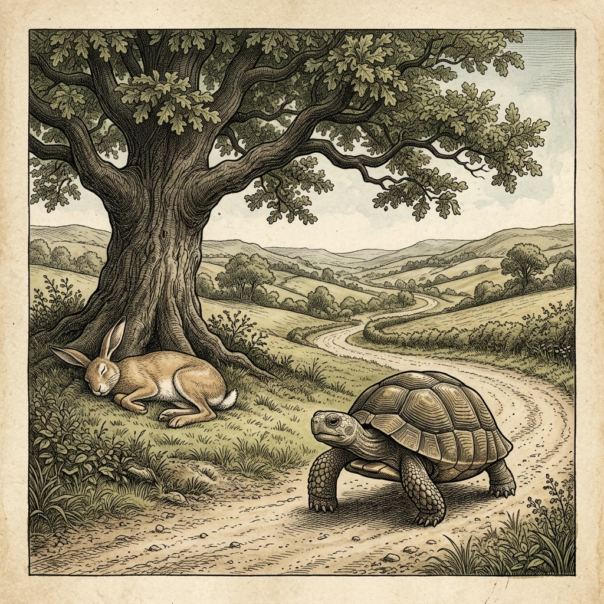
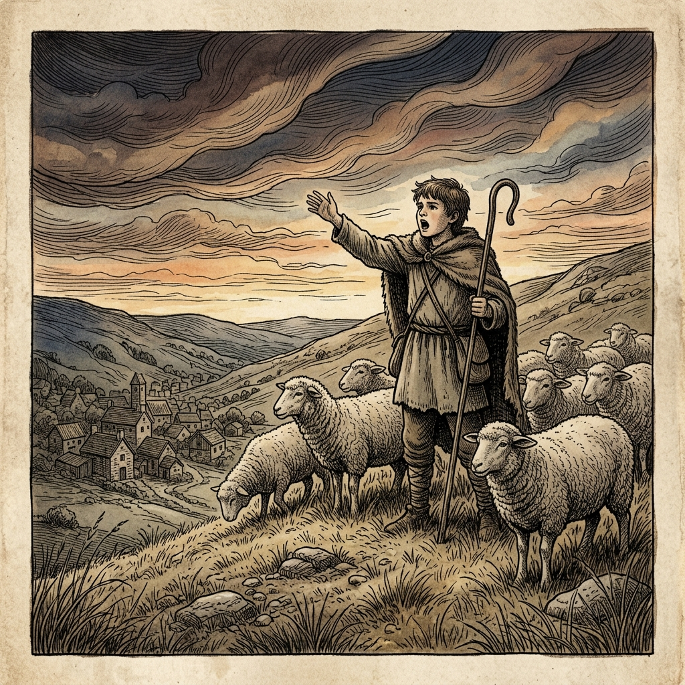
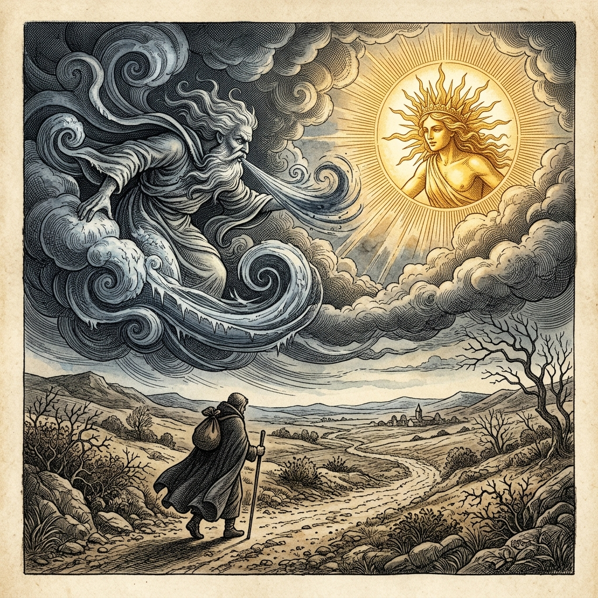
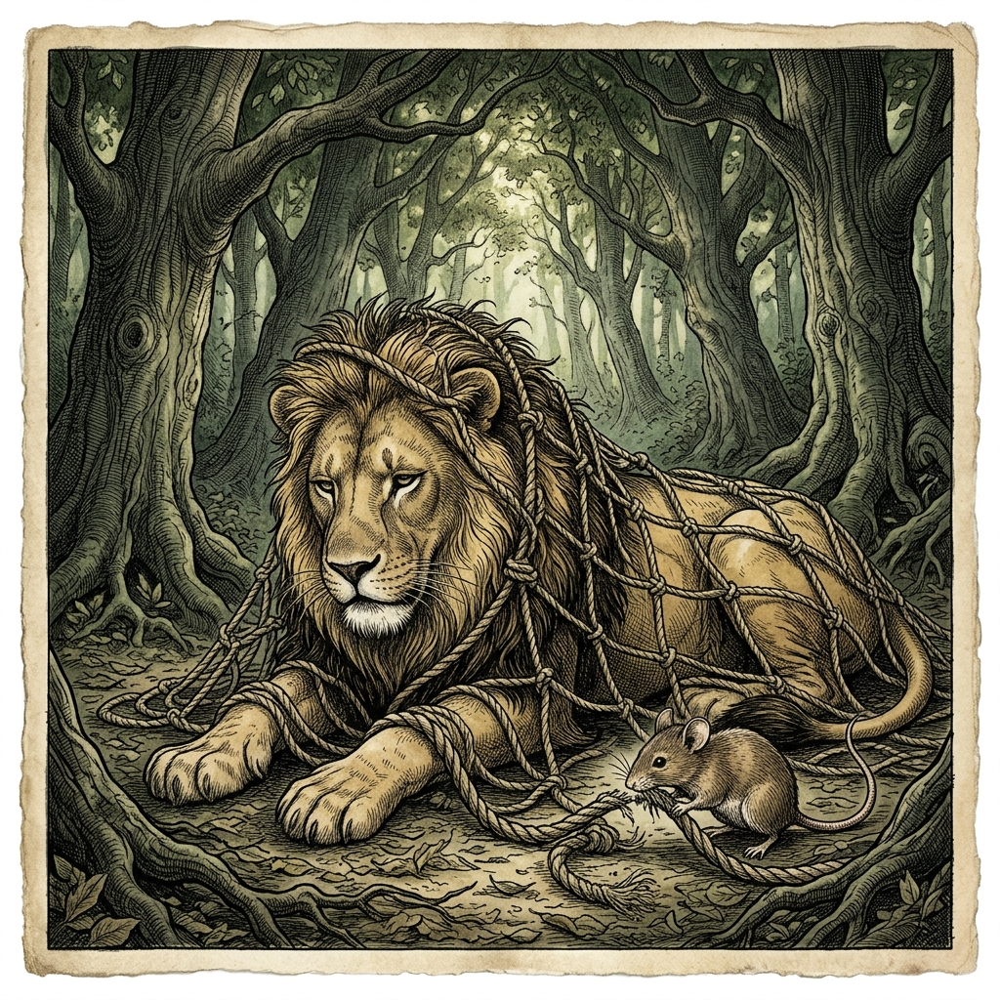
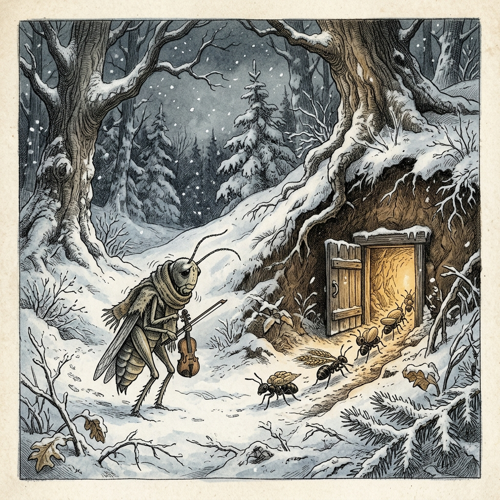
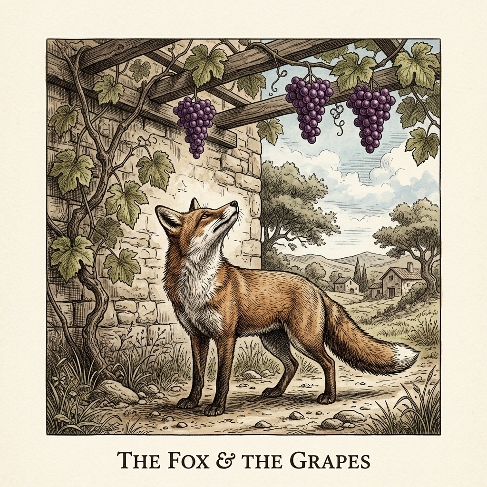
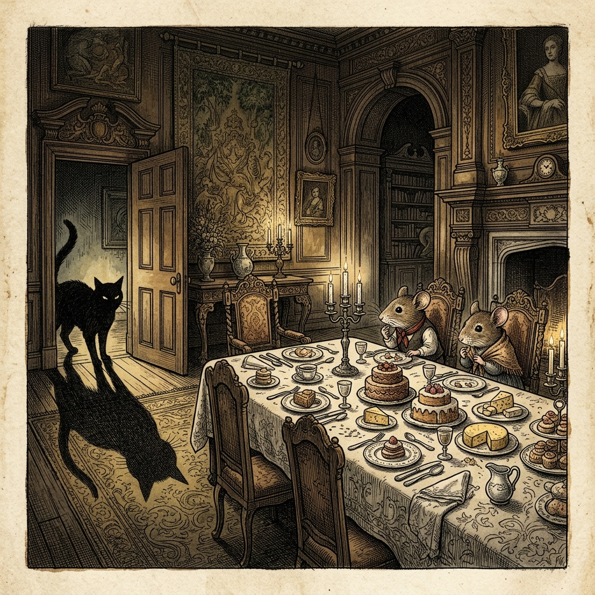
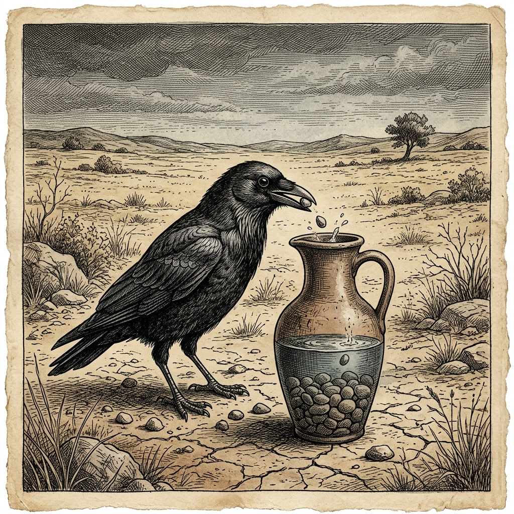
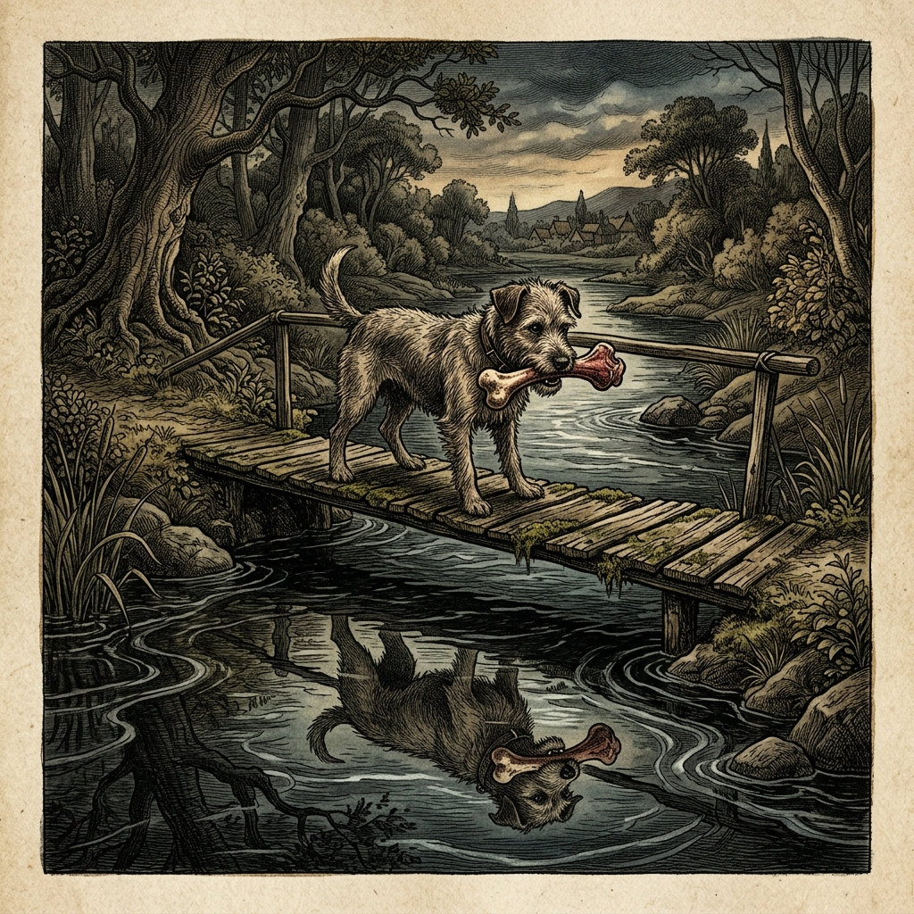
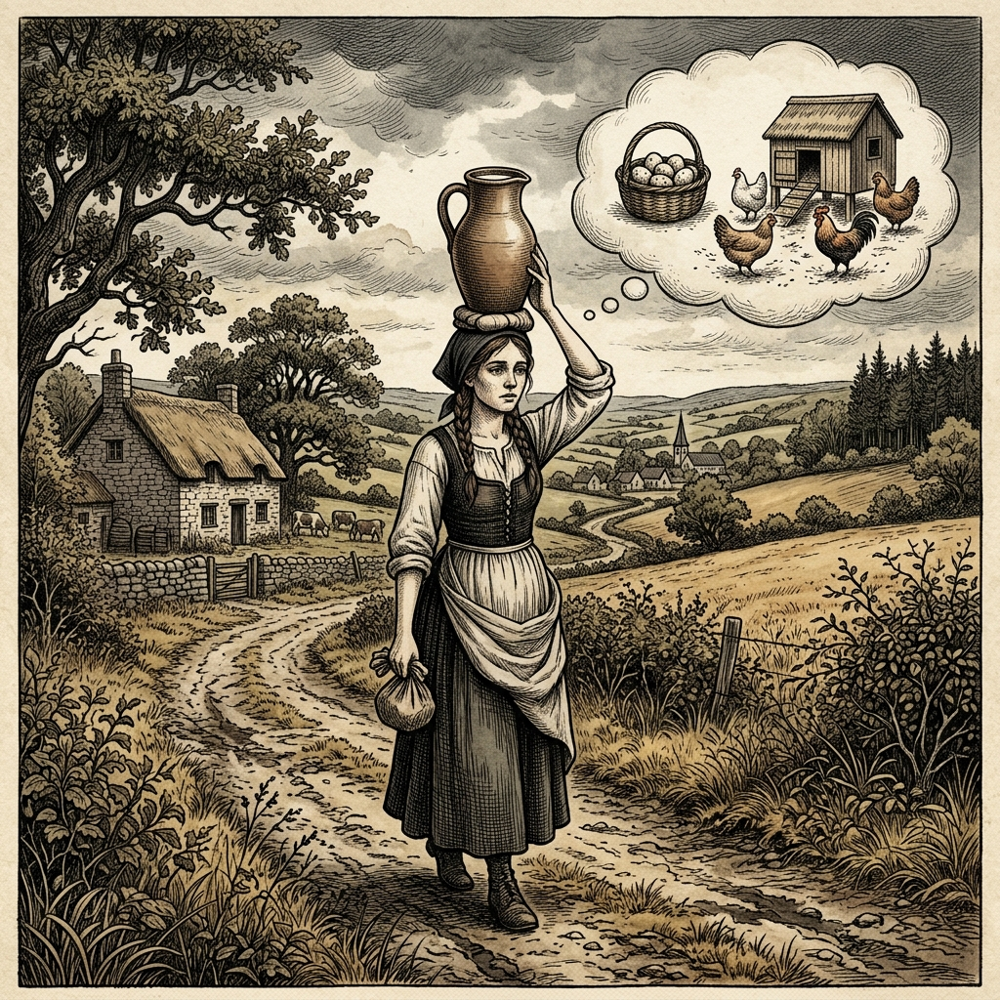

# 『英検ステップアップ多読：イソップ寓話編（4級 ➔ 3級対比学習）』

---
<div style="page-break-before: always;"></div>

## はじめに：なぜ「対比多読」で英検3級に合格できるのか？

英検3級の壁を突破するために最も効果的な学習法は、**「すでに知っている基礎英語（4級レベル）」と「目指すべき合格英語（3級レベル）」を対比して学ぶこと**です。

多くの英語学習者が「単語帳を暗記しても、読解や英作文で使えない」という悩みを抱えています。
本書では、馴染み深いイソップ寓話（全10話）を題材に、同じストーリーが4級レベルから3級レベルへとどのように洗練されていくのかを体験します。

* **知っている文法・語彙（4級）** でストーリーのイメージを掴む
* **ワンランク上の表現（3級）** で「どう言えばより自然で高得点が取れるか」を理解する
* **暗唱キーフレーズ** をそらんじることで、ライティング（英作文）や二次面接（スピーキング）の表現力を爆発的に高める

さあ、イソップ寓話の世界を楽しみながら、英検3級合格の確実な英語力を身につけましょう！

---
<div style="page-break-before: always;"></div>

## 本書の構成と電子書籍読書の工夫

本書の各章は、**音声読み上げ機能（Text-to-Speech / TTS）** と **スモールステップ学習** に最適化された7つのステップで構成されています。

```text
┌─────────────────────────────────────────────────────────────┐
│ 【前半】音声読み上げ機能 (TTS) 読み上げ最適化エリア（純英文のみ）           │
│  1. Visual Illustration (章頭挿絵)                           │
│  2. Benchmark Level: 英検4級レベル英文                       │
│  3. Target Level: 英検3級レベル英文                          │
│  4. Classic Original English Text (イソップ寓話クラシック原文)  │
└─────────────────────────────────────────────────────────────┘
                              ↓ （改ページ）
┌─────────────────────────────────────────────────────────────┐
│ 【後半】日本語解説・試験対策エリア                           │
│  5. Japanese Translation (日本語訳)                           │
│  6. Recite & Compare (そらんじたいキーフレーズ対比表)          │
│  7. Key Vocabulary & Exam Notes (語彙・文法・出題解説)        │
└─────────────────────────────────────────────────────────────┘
```

> **【ポイント】 電子書籍読み上げ（TTS）機能をご利用の方へ**
> 前半のステップ1〜3は純粋な英文のみで構成されています。音声読み上げ機能をONにすると、4級英文・3級英文・クラシック原文が日本語に邪魔されることなく、自然なネイティブ発音でスムーズに連続朗読されます。

---
<div style="page-break-before: always;"></div>

## 英検3級合格のための「効果的な4ステップ学習法」

本書を120%活用し、短期で英検3級の英語力を定着させるおすすめの学習ステップです。

### ■ STEP 1: 【4級英文でイメージ掴み】（目標時間：1分）
まず章頭の挿絵を眺め、**「2. Benchmark Level（4級英文）」** をスラスラ読みます。
知っている単語だけで物語の情景と流れを完全に頭に入れましょう。

### ■ STEP 2: 【3級英文でステップアップ】（目標時間：2分）
次に **「3. Target Level（3級英文）」** を読みます。
4級本文と比べて「どのように表現が豊かになっているか」「どんな接続詞や関係代名詞が使われているか」を意識しながら読み進めます。

### ■ STEP 3: 【電子書籍読み上げ機能で耳からインプット】
電子書籍の朗読（TTS）機能を使って、英文を聴きながら目で購入・声に出して追う**「シャドーイング（音読）」**を行います。
最後に **「4. Classic Original English Text（クラシック原文）」** の本格的な英文の響きを楽しみましょう。

### ■ STEP 4: 【対比表で「そらんじる」＆ 語彙・文法解説】
後半の解説ページに進み、**「6. そらんじたいキーフレーズ対比表」** を確認します。
3級のターゲット表現を何度も声に出して「そらんじ（暗唱）」、英作文や面接でそのまま使える自分の引き出しにしましょう。最後に **「7. 語彙・文法ノート」** で試験に出る重要ポイントを整理すれば完璧です！

---
<div style="page-break-before: always;"></div>

## 収録ストーリー一覧（全10話）

* **Chapter 1**: The Tortoise and the Hare（ウサギとカメ）
* **Chapter 2**: The Boy Who Cried Wolf（オオカミ少年）
* **Chapter 3**: The North Wind and the Sun（北風と太陽）
* **Chapter 4**: The Lion and the Mouse（ライオンとネズミ）
* **Chapter 5**: The Ant and the Grasshopper（アリとキリギリス）
* **Chapter 6**: The Fox and the Grapes（キツネとブドウ）
* **Chapter 7**: The Town Mouse and the Country Mouse（田舎のネズミと街のネズミ）
* **Chapter 8**: The Crow and the Pitcher（カラスと水つぼ）
* **Chapter 9**: The Dog and His Shadow（欲張りな犬）
* **Chapter 10**: The Milkmaid and Her Pail（ミルク搾りの娘）


<div style="page-break-before: always;"></div>

# Chapter 1: The Tortoise and the Hare (ウサギとカメ)

<!-- 電子書籍 Page Break & Image Header -->
<div style="text-align: center; margin-bottom: 20px;">
  
</div>

<div style="page-break-before: always;"></div>

## 1. Benchmark Level: Eiken Grade 4 (英検4級レベル本文)
*Read in ~1 to 1.5 minutes. Baseline vocabulary and basic syntax.*

A proud hare always laughed at a slow tortoise. "You walk so slowly! Look at me. I am the fastest animal in the forest," the hare said.

The tortoise smiled and answered, "Let's have a race today. I can run faster than you think."

The hare laughed loudly. "That is impossible! But okay, let's run."

The race started. The hare ran very fast. Soon, he was far ahead of the tortoise. He looked back and saw no one. "The tortoise is too slow. I have a lot of time. I will take a short nap under this big tree," said the hare. He sat down and fell asleep.

Meanwhile, the tortoise kept walking. He did not stop. He walked step by step.

When the hare woke up, the sun was going down. He ran quickly to the finish line. However, the tortoise was already there!

Slow and steady wins the race.

---
<div style="page-break-before: always;"></div>

## 2. Target Level: Eiken Grade 3 (英検3級レベル本文)
*Read in ~2 to 3 minutes. Upgraded vocabulary, sophisticated sentence structures, and idioms.*

Once upon a time, a proud hare was always boasting about his speed to the other animals. He especially enjoyed making fun of a slow tortoise. "Nobody can beat me because I am the fastest runner in these woods!" he cried.

To his surprise, the quiet tortoise replied calmly, "I accept your challenge. Let's race to the top of the hill."

The hare laughed out loud, believing that victory was already his. As soon as the signal was given, the hare dashed forward and left the tortoise far behind.

After running for a while, the hare stopped to look back. The tortoise was moving so slowly that he was barely visible in the distance. "I have plenty of time before he catches up," thought the hare. "I think I will rest under this shady tree." He lay down on the soft grass and soon fell into a deep sleep.

While the hare was sleeping, the tortoise continued to walk steadily without stopping.

When the hare finally opened his eyes, he saw that the sun was setting. He sprinted toward the finish line as fast as he could. However, the tortoise had already crossed the line and won the race.

Persistence and hard work will always bring success in the end.

---
<div style="page-break-before: always;"></div>

## 3. Classic Original English Text (イソップ寓話 クラシック原文)
*Townsend / Jacobs Edition (Public Domain)*

A Hare was one day making fun of the short feet and slow pace of the Tortoise, who retorted: "Though you be swift as the wind, I will beat you in a race." The Hare, believing her assertion to be simply impossible, agreed to the proposal; and they agreed that the Fox should choose the course and fix the goal. On the day appointed for the race the two started together. The Tortoise never for a moment stopped, but went on with a slow but steady pace straight to the end of the course. The Hare, lying down by the wayside, fell asleep. At last waking up, and moving as fast as he could, he saw the Tortoise had reached the goal, and was comfortably resting after her fatigue.

Slow and steady wins the race.

---
<div style="page-break-before: always;"></div>

## 4. Japanese Translation (日本語訳)

ある日、野ウサギがカメの足の短さと歩みの遅さを馬鹿にして笑いました。するとカメは言い返しました。「あなたが風のように速くても、かけっこなら私の方が勝ちますよ。」
ウサギはそんな主張は到底不可能だと信じ込んで、その提案に同意しました。そして、キツネにコースを選んでもらい、ゴールを決めてもらうことにしました。
レースの当日、二匹は一緒にスタートしました。カメは一瞬たりとも立ち止まらず、遅くとも着実な歩みで、まっすぐコースの終わりへと進み続けました。一方のウサギは、道端に横になって眠り込んでしまいました。
やがて目を覚ましたウサギは、できる限りの速さで駆け抜けましたが、カメがすでにゴールに到達し、走った後の疲れを癒やして心地よく休んでいるのを目にするのでした。

**教訓**: 遅くとも着実な者が、最後にはレースに勝つ。

---
<div style="page-break-before: always;"></div>

## 5. Recite & Compare (そらんじたいキーフレーズ対比表)
*Memorize these contrastive expressions to elevate speaking, writing, and reading fluency.*

| Context / Scene | Grade 4 (Baseline) | Grade 3 (Target / Recite) | Nuance & Exam Value |
|---|---|---|---|
| **自慢・からかい** | *always laughed at a slow tortoise* | *was boasting about his speed / making fun of...* | 単純な `laugh at` から、英検3級ライティングで役立つ表現 `boast about` や熟語 `make fun of` への強化。 |
| **挑戦を受ける** | *I can run faster than you think.* | *I accept your challenge.* | 「相手の挑戦を受諾する」という公式・フォーマルな動詞 `accept` の正しいコロケーション。 |
| **相手を引き離す** | *was far ahead of the tortoise* | *left the tortoise far behind* | `be ahead of`（〜より前にいる）から、能動的な表現 `leave A far behind`（Aを遠く置き去りにする）へのレベルアップ。 |
| **追いつく** | *The tortoise is too slow.* | *before he catches up* | 英検3級リスニング・読解の超頻出熟語 `catch up (with)`（〜に追いつく）の定着。 |
| **全力疾走** | *ran quickly to the finish line* | *sprinted toward the finish line as fast as he could* | 速度を表す動詞 `sprint` および同等比較 `as ~ as one can` の重要構文。 |
| **教訓（Moral）** | *Slow and steady wins the race.* | *Persistence and hard work will always bring success in the end.* | 定番のことわざに加え、英検3級の英作文・面接で理由付けに使える抽象名詞 `Persistence`（継続力・粘り強さ）の活用。 |

---
<div style="page-break-before: always;"></div>

## 6. Key Vocabulary & Exam Notes (語彙・文法・試験対策解説)

### 【出題頻出語彙・熟語ノート】
- **boast (about...)** [動] （〜について）自慢する（英検3級〜準2級頻出。*boast about one's success* など）
- **make fun of...** [熟] 〜をからかう（3級定番熟語。同義表現：*laugh at*, *tease*）
- **accept** [動] （提案・挑戦などを）受け入れる、承諾する（3級ライティング・会話文頻出）
- **dash** [動] 勢いよく駆け出す、突進する（*run* より躍動感のある描写動詞）
- **catch up (with...)** [熟] （〜に）追いつく（3級長文・リスニングで必ず問われる重要フレーズ）
- **sprint** [動] 全力疾走する（*run fast* の上位語表現）
- **persistence** [名] 粘り強さ、継続、根気（動詞 *persist* の名詞形。英作文の結論部で強力な説得力を発揮する語彙）

### 【文法・構文ポイント】
1. **so ~ that ... 構文（〜すぎて…できない / 非常に〜なので…）**
   - 3級本文: *"The tortoise was moving so slowly that he was barely visible in the distance."*
   - ポイント: 英検3級・準2級で必須の重要構文。`so + 副詞/形容詞 + that` の関係をしっかり把握しましょう。
2. **同等比較 + 助動詞 `as ~ as one can`（できる限り〜）**
   - 3級本文: *"He sprinted toward the finish line as fast as he could."*
   - ポイント: `as fast as possible` と同義の表現で、面接や作文で非常に好まれる基本構文です。


<div style="page-break-before: always;"></div>

# Chapter 2: The Boy Who Cried Wolf (オオカミ少年)

<!-- 電子書籍 Page Break & Image Header -->
<div style="text-align: center; margin-bottom: 20px;">
  
</div>

<div style="page-break-before: always;"></div>

## 1. Benchmark Level: Eiken Grade 4 (英検4級レベル本文)
*Read in ~1 to 1.5 minutes. Baseline vocabulary and basic syntax.*

A young shepherd boy watched his sheep on a hill near a village. He felt bored every day. One day, he decided to play a trick.

He ran down to the village and shouted, "Wolf! Wolf! A wolf is chasing my sheep!"

The villagers stopped working and ran up the hill to help him. But when they arrived, there was no wolf. The boy laughed at them. The villagers were angry and returned to their work.

A few days later, the boy shouted "Wolf!" again. The villagers ran to help him, but it was another lie.

Then, one evening, a real wolf appeared from the forest. It attacked the sheep. The boy cried loudly, "Help! A real wolf is here!"

However, no one came to help. The villagers thought, "He is lying again." The wolf killed many sheep.

A liar is not believed even when he tells the truth.

---
<div style="page-break-before: always;"></div>

## 2. Target Level: Eiken Grade 3 (英検3級レベル本文)
*Read in ~2 to 3 minutes. Upgraded vocabulary, sophisticated sentence structures, and idioms.*

Once upon a time, a young shepherd boy was guarding his flock of sheep on a hill outside a small village. Because his job was very quiet, he often felt bored. One afternoon, he decided to play a trick on the villagers to entertain himself.

He ran toward the village and shouted as loudly as he could, "Wolf! Wolf! A wolf is attacking my sheep!"

Hearing his cries, the villagers dropped their work and hurried up the hill to protect the sheep. However, when they arrived, they found no wolf at all. The boy laughed heartily at their shocked faces. The villagers were very upset with him and went back to their work.

A few days later, the foolish boy played the same trick again, and once more the villagers came running only to be fooled.

Finally, a real wolf emerged from the dark woods and began to attack the flock. Terrified, the boy screamed, "Please help! A real wolf is attacking!"

Unfortunately, nobody responded to his cries because everyone believed that he was lying again. In the end, the wolf destroyed many sheep, and the boy learned a painful lesson.

Nobody believes a liar, even when he tells the truth.

---
<div style="page-break-before: always;"></div>

## 3. Classic Original English Text (イソップ寓話 クラシック原文)
*Townsend / Jacobs Edition (Public Domain)*

A Shepherd Boy, who watched a flock of sheep near a village, brought out the villagers three or four times by crying out, "Wolf! Wolf!" and when his neighbors came to help him, laughed at them for their pains. The Wolf, however, did truly come at last. The Shepherd-boy, now really alarmed, shouted in an agony of apprehension: "Pray, come and help me; the Wolf is killing the sheep"; but no one paid the least heed to his cries, nor rendered any assistance. The Wolf, having no cause of fear, at his leisure lacerated or destroyed the whole flock.

There is no believing a liar, even when he speaks the truth.

---
<div style="page-break-before: always;"></div>

## 4. Japanese Translation (日本語訳)

ある村の近くで羊の群れを見張っていた羊飼いの少年が、「オオカミだ！オオカミだ！」と叫んで、3回も4回も村人たちを駆けつけさせ、助けに来た近所の人々の骨折りを笑いものにしました。
しかし、ついに本物のオオカミが現れました。今度こそ本当に恐ろしくなった少年は、必死の思いで叫びました。「お願いです、来て助けてください！オオカミが羊を殺しています！」
しかし、誰も少年の叫びに少しも注意を払わず、手助けもしませんでした。オオカミは何も恐れることなく、思う存分羊の群れ全体を傷つけ、咬み殺してしまいました。

**教訓**: 嘘つきは、たとえ本当のことを言っても信用されない。

---
<div style="page-break-before: always;"></div>

## 5. Recite & Compare (そらんじたいキーフレーズ対比表)
*Memorize these contrastive expressions to elevate speaking, writing, and reading fluency.*

| Context / Scene | Grade 4 (Baseline) | Grade 3 (Target / Recite) | Nuance & Exam Value |
|---|---|---|---|
| **自分を楽しませる** | *decided to play a trick* | *decided to play a trick to entertain himself* | 単純な行為から、目的を表す不定詞構文 `to entertain himself`（自分を楽しませるために）へのアップデート。 |
| **大声で叫ぶ** | *shouted, "Wolf!"* | *shouted as loudly as he could* | 英検3級必須構文 `as ~ as one can`（できる限り〜）を使った躍動感のある描写。 |
| **急いで助けに向かう** | *ran up the hill to help him* | *hurried up the hill to protect the sheep* | `run` を表現力の高い動詞 `hurry`（急いで行く）や `protect`（保護する）に置き換え。 |
| **笑いものにする** | *laughed at them* | *laughed heartily at their shocked faces* | 副詞 `heartily`（心から・大笑いして）を添えることで感情描写の語彙力をアピール。 |
| **助けに応じない** | *no one came to help* | *nobody responded to his cries* | 重要な3級動詞 `respond (to...)`（〜に反応する・応答する）の正しいコロケーション。 |
| **教訓（Moral）** | *A liar is not believed...* | *Nobody believes a liar, even when he tells the truth.* | 否定主語 `Nobody` + 譲歩の接続詞 `even when`（〜の時でさえ）を使った英作文で非常に高い評価を受ける構文。 |

---
<div style="page-break-before: always;"></div>

## 6. Key Vocabulary & Exam Notes (語彙・文法・試験対策解説)

### 【出題頻出語彙・熟語ノート】
- **guard** [動] （〜を）守る、見張る（英検3級定番動詞。名詞 *guardian*）
- **flock** [名] （羊や鳥などの）群れ（3級〜準2級長文頻出。*a flock of sheep*）
- **entertain** [動] 〜を楽しませる（3級主要動詞。名詞形 *entertainment*）
- **hurry** [動] 急ぐ、急いで行く（3級会話文・長文必須動詞）
- **respond (to...)** [動] （〜に）応答する、応じる（3級リスニング・長文重要動詞）
- **in the end** [熟] 結局のところ、最後に（3級作文で理由の締めくくりに使える接続熟語）

### 【文法・構文ポイント】
1. **現在分詞・過去分詞による分詞構文的表現 / 状況描写**
   - 3級本文: *"Hearing his cries, the villagers dropped their work and hurried..."*
   - ポイント: 「彼の叫びを聞いて（聞いてすぐに）」という時の流れをスムーズに表す表現。
2. **否定主語 `Nobody / No one` による表現**
   - 3級本文: *"Nobody believes a liar, even when he tells the truth."*
   - ポイント: 英語では `Not anybody` よりも `Nobody` を主語にする方が自然で力強い文になります。ライティングのまとめ文として暗唱しましょう。


<div style="page-break-before: always;"></div>

# Chapter 3: The North Wind and the Sun (北風と太陽)

<!-- 電子書籍 Page Break & Image Header -->
<div style="text-align: center; margin-bottom: 20px;">
  
</div>

<div style="page-break-before: always;"></div>

## 1. Benchmark Level: Eiken Grade 4 (英検4級レベル本文)
*Read in ~1 to 1.5 minutes. Baseline vocabulary and basic syntax.*

The North Wind and the Sun were arguing about who was stronger. Just then, they saw a traveler walking down the road. He was wearing a warm coat.

"Look," said the Wind. "Let's see who can take off his coat first."

The Wind blew hard. Cold air rushed across the land. But the harder he blew, the more tightly the man held his coat. Finally, the Wind stopped blowing because he was tired.

Next, it was the Sun's turn. The Sun smiled and began to shine brightly. Soon, the day became very warm. The traveler felt hot, took off his coat, and sat under a tree to rest.

Kindness is stronger than anger.

---
<div style="page-break-before: always;"></div>

## 2. Target Level: Eiken Grade 3 (英検3級レベル本文)
*Read in ~2 to 3 minutes. Upgraded vocabulary, sophisticated sentence structures, and idioms.*

Once upon a time, a fierce argument arose between the North Wind and the Sun over which of them was stronger. While they were arguing, they noticed a traveler walking along a country road, wrapped in a heavy cloak.

"I have an idea," proposed the Wind. "The one who can force that traveler to take off his cloak shall be the winner."

The Wind began to blow as hard as he could. Icy air rushed across the field. However, the harder he blew, the more tightly the traveler wrapped the cloak around his body. In the end, the Wind gave up in despair.

Then, the Sun stepped forward and shone warmly upon the earth. Within a few minutes, the traveler felt so hot that he could no longer bear his heavy cloak. He happily took it off and sat down under a shady tree.

Gentleness and warm words can accomplish more than force.

---
<div style="page-break-before: always;"></div>

## 3. Classic Original English Text (イソップ寓話 クラシック原文)
*Townsend / Jacobs Edition (Public Domain)*

The North Wind and the Sun had a contest to decide which was the stronger. To settle the matter, they agreed to test their strength upon a traveler who was walking down the road wrapped in a warm cloak. Whichever of them could make him take his cloak off first was to be accounted the victor.

The North Wind blew with all his might, but the harder he blew, the more closely did the traveler wrap his cloak around him, till at last the North Wind gave up the attempt in despair.

Then the Sun shone out warmly, and immediately the traveler took off his cloak.

Persuasion is better than force.

---
<div style="page-break-before: always;"></div>

## 4. Japanese Translation (日本語訳)

北風と太陽が、どちらが強いかを決める勝負をしました。決着をつけるため、二者は暖かいマントを羽織って道を歩いている旅人で力を試すことに同意しました。旅人のマントを先に脱がせることができた方が勝ちということになりました。

北風はありったけの力で吹き立てましたが、激しく吹けば吹くほど、旅人はマントを一層きつく身に巻きつけ、ついに北風は絶望して断念しました。

次に太陽が温かく照りつけると、旅人はすぐにマントを脱ぎ捨てました。

**教訓**: 説得（優しさ）は、力づく（強情）よりも効果的である。

---
<div style="page-break-before: always;"></div>

## 5. Recite & Compare (そらんじたいキーフレーズ対比表)
*Memorize these contrastive expressions to elevate speaking, writing, and reading fluency.*

| Context / Scene | Grade 4 (Baseline) | Grade 3 (Target / Recite) | Nuance & Exam Value |
|---|---|---|---|
| **議論・対立の発生** | *were arguing about who was stronger* | *a fierce argument arose between A and B over...* | 単純な `arguing` から、抽象名詞 `argument` や前置詞 `over` を用いた本格的な文構造への発展。 |
| **提案する** | *said, "Let's see..."* | *proposed, "The one who can..."* | 会話動詞 `propose`（提案する）と関係代名詞 `The one who...`（〜する人）の高度な組み合わせ。 |
| **全力で吹きつける** | *blew hard* | *blew as hard as he could* | 限界まで行うことを意味する `as ~ as one can` 構文の徹底活用。 |
| **〜に耐えられない** | *felt hot, took off...* | *felt so hot that he could no longer bear...* | 英検3級最重要構文 `so ~ that ...` と動詞 `bear`（耐える）の連携。 |
| **達成する** | *is stronger than...* | *can accomplish more than force* | 面接やライティングで「成果を上げる」と言いたい時に効く上級動詞 `accomplish`。 |

---
<div style="page-break-before: always;"></div>

## 6. Key Vocabulary & Exam Notes (語彙・文法・試験対策解説)

### 【出題頻出語彙・熟語ノート】
- **argument** [名] 議論、口論（動詞 *argue*。英検3級主要名詞）
- **propose** [動] （〜を）提案する（ライティングで意見を述べる際の必須動詞）
- **wrap** [動] （〜を）包む、巻きつける（3級長文・リスニング頻出）
- **give up (in despair)** [熟] （絶望して）あきらめる（3級最重要熟語）
- **bear** [動] 〜に耐える、我慢する（*cannot bear to ~* などの形で出題）
- **accomplish** [動] 〜を成し遂げる、達成する（3級〜準2級頻出動詞）

### 【文法・構文ポイント】
1. **[The + 比較級 ..., the + 比較級 ...]（〜すればするほど、益々…する）**
   - 3級本文: *"The harder he blew, the more tightly the traveler wrapped the cloak..."*
   - ポイント: 読解問題で差がつく比較構文。規則変化（*harder*）と副詞（*more tightly*）の組み合わせをチェック！
2. **関係代名詞 `The one who ...`（〜する者）**
   - 3級本文: *"The one who can force that traveler to take off his cloak shall be the winner."*
   - ポイント: 人を表す代名詞 `The one` と関係代名詞 `who` の先行詞関係。ライティングの主語として非常にスマートです。


<div style="page-break-before: always;"></div>

# Chapter 4: The Lion and the Mouse (ライオンとネズミ)

<!-- 電子書籍 Page Break & Image Header -->
<div style="text-align: center; margin-bottom: 20px;">
  
</div>

<div style="page-break-before: always;"></div>

## 1. Benchmark Level: Eiken Grade 4 (英検4級レベル本文)
*Read in ~1 to 1.5 minutes. Baseline vocabulary and basic syntax.*

A big lion was sleeping under a tree. Suddenly, a little mouse ran over his face. The lion woke up and caught the mouse with his big paw.

"Please don't eat me!" squeaked the mouse. "If you let me go, I will help you someday."

The lion laughed. "How can a little mouse help a big lion?" But he was kind and let the mouse go free.

A few weeks later, some hunters caught the lion in a heavy net. The lion roared loudly because he could not move.

The mouse heard the roar and ran to the lion. He used his sharp teeth to chew the ropes. Soon, the lion was free.

"Thank you," said the lion.

Even a small friend can be a great help.

---
<div style="page-break-before: always;"></div>

## 2. Target Level: Eiken Grade 3 (英検3級レベル本文)
*Read in ~2 to 3 minutes. Upgraded vocabulary, sophisticated sentence structures, and idioms.*

Once upon a time, a mighty lion was sleeping peacefully under a shaded tree. Suddenly, a tiny mouse ran across his nose and woke him up. Furious at being disturbed, the lion caught the creature under his huge paw.

"Please spare my life!" begged the mouse. "If you set me free, I promise to return your kindness in the future."

The lion laughed out loud, wondering how such a tiny creature could ever assist the king of beasts. However, feeling generous, he decided to let the mouse go.

A few weeks later, the lion was caught in a hunter's strong net. Unable to break free, he roared in anger and distress.

Hearing the familiar sound, the little mouse rushed to the scene. He quickly began to chew through the thick ropes with his sharp teeth. Before long, the net fell apart, and the lion was rescued.

"You laughed at me before, but now you see that even a mouse can help a lion," smiled the little mouse.

Little friends may prove to be great friends.

---
<div style="page-break-before: always;"></div>

## 3. Classic Original English Text (イソップ寓話 クラシック原文)
*Townsend / Jacobs Edition (Public Domain)*

A Lion was awakened from sleep by a Mouse running over his face. Rising up angrily, he caught him and was about to kill him, when the Mouse piteously entreated, saying: "If you would only spare my life, I would be sure to repay your kindness." The Lion laughed and let him go. It happened shortly after this that the Lion was caught by some hunters, who bound him by strong ropes to the ground. The Mouse, recognizing his roar, came and gnawed the rope with his teeth, and set him free, exclaiming: "You ridiculed the idea of my ever being able to help you, not expecting to receive from me any requital of your favor; now you know that it is possible for even Mice to confer benefits upon Lions."

Little friends may prove great friends.

---
<div style="page-break-before: always;"></div>

## 4. Japanese Translation (日本語訳)

あるライオンが、顔の上を走ったネズミによって眠りを破られました。怒って起き上がったライオンはネズミを捕まえ、殺そうとしましたが、ネズミは哀れっぽく命乞いをしました。「どうか私の命をお助けくだされば、必ずこのご恩をお返しいたします。」ライオンは笑ってネズミを逃がしてやりました。

それからまもなくして、ライオンは狩人たちに捕らわれ、強い縄で地面に縛りつけられてしまいました。その咆哮に気づいたネズミがやってきて、歯で縄をかみ切り、ライオンを自由にしてあげました。そして叫びました。「以前、私がお役に立つなんて無理だと笑い、恩返しなど期待していらっしゃいませんでしたね。でも今、ネズミでさえライオンのお役に立てることがお分かりいただけたでしょう。」

**教訓**: 小さな友も、大いに頼りになる友となり得る。

---
<div style="page-break-before: always;"></div>

## 5. Recite & Compare (そらんじたいキーフレーズ対比表)
*Memorize these contrastive expressions to elevate speaking, writing, and reading fluency.*

| Context / Scene | Grade 4 (Baseline) | Grade 3 (Target / Recite) | Nuance & Exam Value |
|---|---|---|---|
| **命乞いをする** | *Please don't eat me!* | *Please spare my life!* | 直訳的口語から、英検3級長文・面接で高得点が取れる重要動詞 `spare`（〜の命を助ける）の活用。 |
| **恩返しを約束する** | *I will help you someday.* | *I promise to return your kindness...* | 動詞 `promise` + 不定詞句、および熟語 `return one's kindness`（恩返しする）のスマートな組み合わせ。 |
| **解放する** | *let the mouse go free* | *set me free* | 定番熟語 `set A free`（Aを自由にする・解放する）のマスター。 |
| **脱出できない** | *could not move* | *Unable to break free* | `could not` を分詞構文 `Unable to ~` に書き換える高度な記述力。 |
| **救出される** | *the lion was free* | *the lion was rescued* | 受動態 `was rescued`（救出された）を使った語彙力の表現。 |
| **教訓（Moral）** | *Even a small friend can be a help.* | *Little friends may prove to be great friends.* | 動詞 `prove to be...`（〜であることが分かる）を使いこなす名言フレーズ。 |

---
<div style="page-break-before: always;"></div>

## 6. Key Vocabulary & Exam Notes (語彙・文法・試験対策解説)

### 【出題頻出語彙・熟語ノート】
- **mighty** [形] 力強い、巨大な（英検3級〜準2級頻出形容詞）
- **disturb** [動] 〜を邪魔する、動揺させる（3級主要動詞。*sorry to disturb you* など）
- **spare** [动] （命などを）助ける、惜しむ（*spare one's life* で超頻出）
- **rescue** [動] 〜を救出する、助け出す（リスニング・読解必須動詞）
- **distress** [名] 苦痛、困窮（3級〜準2級表現）
- **prove (to be...)** [動] （〜であることが）証明される、判明する（3級・準2級構文動詞）

### 【文法・構文ポイント】
1. **[Unable to + 動詞原形]（〜することができず）の分詞構文省略形**
   - 3級本文: *"Unable to break free, he roared in anger..."*
   - ポイント: `Being unable to...` の `Being` が省略された形。作文で書けると一目置かれます。
2. **[promise + to + 動詞原形]（〜することを約束する）**
   - 3級本文: *"I promise to return your kindness in the future."*
   - ポイント: `promise` は目的語に That節だけでなく `to 不定詞` を取る代表的動詞です。


<div style="page-break-before: always;"></div>

# Chapter 5: The Ant and the Grasshopper (アリとキリギリス)

<!-- 電子書籍 Page Break & Image Header -->
<div style="text-align: center; margin-bottom: 20px;">
  
</div>

<div style="page-break-before: always;"></div>

## 1. Benchmark Level: Eiken Grade 4 (英検4級レベル本文)
*Read in ~1 to 1.5 minutes. Baseline vocabulary and basic syntax.*

During the warm summer, a grasshopper sang and danced all day. He saw a hard-working ant carrying heavy corn to her nest.

"Why do you work so hard?" asked the grasshopper. "Summer is fun! Come and sing with me."

The ant replied, "I am storing food for the cold winter. You should collect food too." But the grasshopper laughed and kept dancing.

Soon, winter came. Snow covered the ground, and there was no food anywhere. The grasshopper was very hungry and cold.

He went to the ant's house and asked, "Please give me some food."

The ant asked, "What did you do during the summer?"

The grasshopper answered, "I sang and danced all summer."

The ant said, "Then you can dance through the winter!" And she closed her door.

Work today, and you will have food tomorrow.

---
<div style="page-break-before: always;"></div>

## 2. Target Level: Eiken Grade 3 (英検3級レベル本文)
*Read in ~2 to 3 minutes. Upgraded vocabulary, sophisticated sentence structures, and idioms.*

On a bright summer day, a carefree grasshopper was singing and enjoying music in a green field. Nearby, a group of ants was working tirelessly, gathering grain and carrying it to their underground nest.

"Why waste such a lovely day working so hard?" asked the grasshopper. "Come and join me! We should enjoy the summer."

The wise ant replied, "I am preparing food for the coming winter, and I advise you to do the same." However, the grasshopper ignored her advice and continued to play his music.

When winter arrived, freezing winds blew across the land, and snow buried the field. Having stored nothing, the grasshopper found himself starving and shivering from the cold.

In desperation, he knocked on the ant's door and begged for a small piece of corn.

"What did you do all summer while we were working?" asked the ant.

"I was busy singing," replied the grasshopper regretfully.

"If you were foolish enough to sing all summer, you may dance all winter!" answered the ant firmly.

It is wise to prepare today for the needs of tomorrow.

---
<div style="page-break-before: always;"></div>

## 3. Classic Original English Text (イソップ寓話 クラシック原文)
*Townsend / Jacobs Edition (Public Domain)*

In a field one summer's day a Grasshopper was hopping about, chirping and singing to its heart's content. An Ant passed by, bearing along with great toil an ear of corn he was taking to the nest. "Why not come and chat with me," said the Grasshopper, "instead of toiling and moiling in that way?" "I am helping to lay up food for the winter," said the Ant, "and recommend you to do the same." "Why bother about winter?" said the Grasshopper; "we have got plenty of food at present." But the Ant went on its way and continued its toil. When the winter came the Grasshopper had no food and found itself dying of hunger, while it saw the ants distributing every day corn and grain from the stores they had collected in the summer. Then the Grasshopper knew:

It is best to prepare for the days of necessity.

---
<div style="page-break-before: always;"></div>

## 4. Japanese Translation (日本語訳)

ある夏の日に、キリギリスが野原を跳ね回り、心ゆくまで鳴いて歌っていました。そこへ、トウモロコシの穂をたいそう苦労して自分の巣へと運んでいるアリが通りかかりました。

「そんなに骨折って働かないで、僕とおしゃべりでもしないかい？」とキリギリスが言いました。

「冬のための食料を蓄えているのです。あなたもそうすることをお勧めしますよ」とアリは答えました。

「どうして冬のことなんか気にするのさ。今ここには食料がたくさんあるじゃないか。」しかしアリはそのまま歩み続け、仕事を続けました。

やがて冬が来ると、キリギリスには食べるものがなくなり、空腹に苦しみました。一方アリたちは、夏のうちに集めて蓄えておいた穀物を毎日分け合っていました。そこでキリギリスは悟りました。

**教訓**: 必要となる日に備えて、あらかじめ準備しておくのが最も良い。

---
<div style="page-break-before: always;"></div>

## 5. Recite & Compare (そらんじたいキーフレーズ対比表)
*Memorize these contrastive expressions to elevate speaking, writing, and reading fluency.*

| Context / Scene | Grade 4 (Baseline) | Grade 3 (Target / Recite) | Nuance & Exam Value |
|---|---|---|---|
| **時間を無駄にする** | *Why do you work so hard?* | *Why waste such a lovely day working so hard?* | 3級文法 `waste + 時間 + ~ing`（〜して時間を浪費する）の洗練された疑問文。 |
| **助言する** | *You should collect food too.* | *I advise you to do the same.* | 助動詞 `should` から、公式な動詞構文 `advise A to do`（Aに〜するよう勧める）への昇華。 |
| **助言を無視する** | *laughed and kept dancing* | *ignored her advice and continued to...* | 3級重要動詞 `ignore`（無視する）と `continue to do`（〜し続ける）の組み合わせ。 |
| **極限状態** | *was very hungry and cold* | *found himself starving and shivering...* | 第5文型 `find oneself + 分詞`（気がつくと〜な状態になっている）という上級構文。 |
| **乞い願う** | *asked, "Please give me..."* | *In desperation, begged for...* | 単純な `ask` から、3級熟語 `in desperation`（必死で）と動詞 `beg for` への強化。 |
| **教訓（Moral）** | *Work today, and you will...* | *It is wise to prepare today for the needs of tomorrow.* | 形式主語構文 `It is + 形容詞 + to do`（〜することは…だ）をマスターする必須暗唱フレーズ。 |

---
<div style="page-break-before: always;"></div>

## 6. Key Vocabulary & Exam Notes (語彙・文法・試験対策解説)

### 【出題頻出語彙・熟語ノート】
- **gather** [動] （〜を）集める、蓄える（英検3級読解必須動詞）
- **advise** [動] 〜に助言する（*advise A to do* で出題頻出）
- **ignore** [動] 〜を無視する（3級・準2級で必ず問われる形容詞・動詞）
- **desperation** [名] 必死、自暴自棄（*in desperation* でよく使われる表現）
- **beg (for...)** [動] （〜を）乞う、懇願する（3級長文表現）
- **prepare (for...)** [動] （〜の）準備をする（英検ライティング・リスニングの超頻出語彙）

### 【文法・構文ポイント】
1. **[advise + 目的語 + to + 動詞原形]（〜に…するよう助言する）**
   - 3級本文: *"I advise you to do the same."*
   - ポイント: `tell A to do`, `ask A to do`, `advise A to do` など「目的語 + to不定詞」の形をとる代表的動詞です。
2. **形式主語構文 [It is + 形容詞 + to + 動詞原形]**
   - 3級本文: *"It is wise to prepare today for the needs of tomorrow."*
   - ポイント: 自分の意見を論理的に述べる際、英検ライティングの決定打となる最重要構文です。


<div style="page-break-before: always;"></div>

# Chapter 6: The Fox and the Grapes (キツネとブドウ)

<!-- 電子書籍 Page Break & Image Header -->
<div style="text-align: center; margin-bottom: 20px;">
  
</div>

<div style="page-break-before: always;"></div>

## 1. Benchmark Level: Eiken Grade 4 (英検4級レベル本文)
*Read in ~1 to 1.5 minutes. Baseline vocabulary and basic syntax.*

One hot summer afternoon, a hungry fox walked through a farm. He saw some beautiful purple grapes hanging high on a tree.

"I am so thirsty and hungry," thought the fox. "Those grapes look delicious."

He walked back a few steps and jumped high in the air. But he missed the grapes.

He tried again and again, but the grapes were too high.

Finally, the fox was tired. He stopped jumping and looked at the grapes.

"I don't need those grapes," he said, turning his nose up. "I am sure they are sour and bad to eat."

Then he walked away calmly.

It is easy to dislike what you cannot get.

---
<div style="page-break-before: always;"></div>

## 2. Target Level: Eiken Grade 3 (英検3級レベル本文)
*Read in ~2 to 3 minutes. Upgraded vocabulary, sophisticated sentence structures, and idioms.*

On a scorching summer afternoon, a hungry fox was wandering through an orchard in search of food. Suddenly, he noticed a bunch of ripe, juicy purple grapes hanging from a high branch.

"Those grapes look delicious, and they will surely satisfy my thirst," said the fox to himself.

He took a few steps back, ran forward, and leaped as high as he could into the air. However, he missed the grapes by a few inches.

Refusing to give up, the fox tried several times, but the grapes remained far beyond his reach.

Exhausted from his repeated efforts, he finally realized that his attempts were useless. Walking away with his nose in the air, he remarked coldly, "They are probably sour anyway, and I have no interest in eating sour fruit."

It is easy to despise what you cannot obtain.

---
<div style="page-break-before: always;"></div>

## 3. Classic Original English Text (イソップ寓話 クラシック原文)
*Townsend / Jacobs Edition (Public Domain)*

One hot summer's day a Fox was strolling through an orchard till he came to a bunch of Grapes just ripening on a vine which had been trained over a lofty branch. "Just the thing to quench my thirst," quoth he. Drawing back a few paces, he took a run and a jump, and just missed the bunch. Turning round again with a One, Two, Three, he jumped up, but with no greater success. Again and again he tried after the tempting morsel, but at last had to give it up, and walked away with his nose in the air, saying: "I am sure they are sour."

It is easy to despise what you cannot get.

---
<div style="page-break-before: always;"></div>

## 4. Japanese Translation (日本語訳)

ある暑い夏の日に、一匹のキツネが果樹園をぶらぶら歩いていると、高い枝に渡したつるに熟しかけているブドウの房を見つけました。「喉の渇きをいやされるのにうってつけだ」とキツネは言いました。

数歩後ずさりし、助走をつけて飛び上がりましたが、あと少しで房に届きませんでした。振り返り、「一、二の三」と再び飛び跳ねましたが、うまくいきません。何度も何度も魅惑的な一粒を求めて試みましたが、ついにあきらめざるを得ず、鼻を高々と上げて立ち去りながら言いました。「どうせあのブドウは酸っぱいに決まっているさ。」

**教訓**: 手に入らないものを蔑むのは容易なことだ（負け惜しみ）。

---
<div style="page-break-before: always;"></div>

## 5. Recite & Compare (そらんじたいキーフレーズ対比表)
*Memorize these contrastive expressions to elevate speaking, writing, and reading fluency.*

| Context / Scene | Grade 4 (Baseline) | Grade 3 (Target / Recite) | Nuance & Exam Value |
|---|---|---|---|
| **喉・空腹を満たす** | *Those grapes look delicious.* | *will surely satisfy my thirst* | 動詞 `satisfy`（〜を満たす）を用いた目的達成のスマートな言い回し。 |
| **高く跳ぶ** | *jumped high in the air* | *leaped as high as he could into the air* | `jump` より力強い動詞 `leap` と同等比較構文のベストマッチ。 |
| **届かない** | *the grapes were too high* | *remained far beyond his reach* | 3級読解・イディオム `beyond one's reach`（手の届かない位置に）の修得。 |
| **無駄だと悟る** | *the fox was tired* | *realized that his attempts were useless* | 接続詞 `that` 節＋重要形容詞 `useless`（無駄な・役に立たない）による思考描写。 |
| **負け惜しみを言う** | *said, "I am sure they are..."* | *remarked coldly, "They are probably..."* | 発言を表すフォーマル語 `remark` と副詞 `coldly` の対比。 |
| **教訓（Moral）** | *It is easy to dislike...* | *It is easy to despise what you cannot obtain.* | 他動詞 `despise`（蔑む）と `obtain`（手に入れる）を使った3級〜準2級必須の構文。 |

---
<div style="page-break-before: always;"></div>

## 6. Key Vocabulary & Exam Notes (語彙・文法・試験対策解説)

### 【出題頻出語彙・熟語ノート】
- **satisfy** [動] （〜を）満たす、満足させる（英検3級頻出動詞。名詞 *satisfaction*）
- **leap** [動] 躍り上がる、跳ぶ（*jump* より躍動感のある3級動詞）
- **beyond one's reach** [熟] 手の届かないところに（読解・リスニングで問われるフレーズ）
- **useless** [形] 役に立たない、無益な（反義語：*useful*）
- **remark** [動] （意見などを）述べる、言う（3級長文で会話文の代わりに使われる動詞）
- **obtain** [動] （〜を）手に入れる、獲得する（*get* の上位表現。ライティング・面接で強力）

### 【文法・構文ポイント】
1. **[in search of ...]（〜を探して）**
   - 3級本文: *"a hungry fox was wandering through an orchard in search of food."*
   - ポイント: `look for` の名詞形を用いた熟語表現。前文をかっこよく飾る熟語です。
2. **関係代名詞 `what`（〜するもの・こと）**
   - 3級本文: *"It is easy to despise what you cannot obtain."*
   - ポイント: `what` は `the thing which` と同義の先行詞を含む関係代名詞です。


<div style="page-break-before: always;"></div>

# Chapter 7: The Town Mouse and the Country Mouse (田舎のネズミと街のネズミ)

<!-- 電子書籍 Page Break & Image Header -->
<div style="text-align: center; margin-bottom: 20px;">
  
</div>

<div style="page-break-before: always;"></div>

## 1. Benchmark Level: Eiken Grade 4 (英検4級レベル本文)
*Read in ~1 to 1.5 minutes. Baseline vocabulary and basic syntax.*

A country mouse invited his friend, a town mouse, to his home. He served simple corn and bread. The town mouse turned up his nose.

"Your life is so poor," said the town mouse. "Come to the city with me. I have fine cheese and delicious cake every day."

The country mouse agreed and visited the town mouse's big house. The dining table was full of delicious food.

However, just as they began to eat, a big cat burst into the room with a loud noise! The two mice ran quickly and hid in a dark hole. They shook with fear.

When the cat left, the country mouse packed his bag.

"I am going home," he said. "I prefer simple food in peace to rich food in fear."

Peace and safety are better than luxury with danger.

---
<div style="page-break-before: always;"></div>

## 2. Target Level: Eiken Grade 3 (英検3級レベル本文)
*Read in ~2 to 3 minutes. Upgraded vocabulary, sophisticated sentence structures, and idioms.*

Once upon a time, a country mouse invited his old friend, a town mouse, to visit his humble home in the fields. The country mouse offered simple meals such as dried beans and wheat. The town mouse tasted a little and complained politely.

"My friend, your food is so plain and your life is so quiet," said the town mouse. "You must come to the city with me to enjoy luxury and fine dining."

Curious, the country mouse accompanied his friend to a grand mansion in the city. The dining room was filled with delicious cakes, fruit, and expensive cheese.

However, before they could enjoy their meal, the dining room door suddenly opened, and two fierce barking dogs rushed inside. Terrified, both mice sprinted into a narrow hole in the wall, holding their breath in terror.

As soon as the danger passed, the country mouse said goodbye to his friend.

"You may have luxury in the city," he said, "but I prefer my simple life in peace and safety."

A humble life in peace is better than a luxurious life in fear.

---
<div style="page-break-before: always;"></div>

## 3. Classic Original English Text (イソップ寓話 クラシック原文)
*Townsend / Jacobs Edition (Public Domain)*

A Country Mouse invited a Town Mouse to dinner. The Country Mouse produced wheat stalks, roots, and acorns. The Town Mouse refused to eat them, saying: "I cannot understand, my friend, how you can put up with such poor food as this. Come with me to the city, and you shall enjoy a feast." So they set off together. Arriving at the city house late at night, the Town Mouse showed his friend a rich spread of pastries, jellies, and cheese. But just as they began to eat, the door suddenly flew open, and a huge cat bounded in with a roar. Both mice scampered off to a tiny hole in the wall, trembling with fright. As soon as the room was quiet again, the Country Mouse took his leave, saying: "Good-bye, my friend. You have luxury and rich dainties, but they are accompanied by fear and danger. I prefer my simple food in safety."

Poverty with security is better than plenty in the midst of fear and uncertainty.

---
<div style="page-break-before: always;"></div>

## 4. Japanese Translation (日本語訳)

田舎のネズミが街のネズミをディナーに招待しました。田舎のネズミは小麦の茎や根、ドングリを出しました。街のネズミは食べるのを拒み、「友よ、どうして君がこんな粗末な食事で我慢できるのか理解できないよ。僕と一緒に街へおいで。ご馳走が楽しめるよ」と言いました。そこで二匹は一緒に出発しました。

夜遅くに街の邸宅に着くと、街のネズミはパイやゼリー、チーズといった豊かな食卓を友に見せました。ところが二匹が食べ始めようとしたまさにその時、突然ドアが飛び開き、巨大なネコが唸り声を上げて跳び込んできました。二匹のネズミは恐怖で震えながら壁の小さな穴へ逃げ込みました。部屋が再び静かになると、田舎のネズミはお別れを言い出しました。「さようなら、友よ。君には贅沢と美味しい料理があるけれど、それには恐怖と危険がつきまとっている。僕は安全の中で素朴な食べ物を食べる方を選ぶよ。」

**教訓**: 恐怖と不確実さの中での豊かさよりも、安全の中でのつつましい暮らしの方が良い。

---
<div style="page-break-before: always;"></div>

## 5. Recite & Compare (そらんじたいキーフレーズ対比表)
*Memorize these contrastive expressions to elevate speaking, writing, and reading fluency.*

| Context / Scene | Grade 4 (Baseline) | Grade 3 (Target / Recite) | Nuance & Exam Value |
|---|---|---|---|
| **同行する・連れていく** | *visited the town mouse's big house* | *accompanied his friend to a grand mansion* | `go with` から、フォーマルな動詞 `accompany`（〜に同行する）への語彙力アップ。 |
| **恐怖に震える** | *shook with fear* | *holding their breath in terror* | 感情表現 `hold one's breath`（息を殺す）と抽象名詞 `terror` の活用。 |
| **〜をより好む** | *I prefer simple food in peace to...* | *I prefer my simple life in peace and safety.* | 3級文法超頻出 `prefer A to B`（BよりAを好む）の完全定着フレーズ。 |
| **～を満たす** | *The dining table was full of...* | *was filled with delicious cakes...* | `be full of` から、受動態 `be filled with`（〜で満たされている）への構文書き換え。 |
| **教訓（Moral）** | *Peace and safety are better than...* | *A humble life in peace is better than a luxurious life...* | 形容詞 `humble`（つつましい）と `luxurious`（贅沢な）の対比でライティングの表現力を最大化。 |

---
<div style="page-break-before: always;"></div>

## 6. Key Vocabulary & Exam Notes (語彙・文法・試験対策解説)

### 【出題頻出語彙・熟語ノート】
- **humble** [形] つつましい、質素な（英検3級〜準2級頻出形容詞）
- **accompany** [動] 〜に同行する、付添う（*go with* の上位動詞）
- **terrified** [形] 恐怖に陥った、怯えた（感情を表す分詞形容詞）
- **prefer (A to B)** [熟] （BよりAを）好む（3級・準2級文法で最頻出の動詞パターン）
- **as soon as ...** [熟] 〜するとすぐに（3級長文・リスニング重要接続詞）
- **luxurious** [形] 贅沢な、豪華な（名詞 *luxury*）

### 【文法・構文ポイント】
1. **[prefer A to B]（BよりAを好む）**
   - 3級本文: *"I prefer my simple life in peace and safety (to luxury)."*
   - ポイント: 比較対象に `than` ではなく前置詞 `to` を用いる最重要構文です。
2. **[be filled with ...]（〜で満たされている）**
   - 3級本文: *"The dining room was filled with delicious cakes..."*
   - ポイント: `be full of` と同じ意味ですが、受動態の知識として問われます。


<div style="page-break-before: always;"></div>

# Chapter 8: The Crow and the Pitcher (カラスと水つぼ)

<!-- 電子書籍 Page Break & Image Header -->
<div style="text-align: center; margin-bottom: 20px;">
  
</div>

<div style="page-break-before: always;"></div>

## 1. Benchmark Level: Eiken Grade 4 (英検4級レベル本文)
*Read in ~1 to 1.5 minutes. Baseline vocabulary and basic syntax.*

A thirsty crow flew all over the field looking for water. Finally, he found a tall pitcher with a little water at the bottom.

He tried to drink, but the neck of the pitcher was too narrow. His beak could not reach the water.

"I am so thirsty! What should I do?" thought the crow.

He looked around and saw many small stones on the ground. Suddenly, he had a good idea.

He picked up the stones one by one with his beak and dropped them into the pitcher.

Slowly, the water level rose to the top. The crow drank the cool water happily and saved his life.

Little by little does the trick.

---
<div style="page-break-before: always;"></div>

## 2. Target Level: Eiken Grade 3 (英検3級レベル本文)
*Read in ~2 to 3 minutes. Upgraded vocabulary, sophisticated sentence structures, and idioms.*

During a hot summer drought, a thirsty crow flew across the dry countryside searching for water to drink. At last, he discovered a tall clay pitcher containing a small amount of water at the bottom.

He eagerly thrust his beak into the pitcher, but the neck was far too narrow. Try as he might, he could not reach the water.

Determined not to give up, the clever crow thought carefully until he came up with a brilliant plan.

He began picking up small pebbles from the ground one by one and dropping them into the pitcher. With each pebble he dropped, the water level slowly rose higher.

After dropping dozens of pebbles, the water finally reached the top. The crow was able to quench his thirst and save his own life.

Where there is a will, there is a way.

---
<div style="page-break-before: always;"></div>

## 3. Classic Original English Text (イソップ寓話 クラシック原文)
*Townsend / Jacobs Edition (Public Domain)*

A Crow, half-dead with thirst, came upon a Pitcher which had once been full of water; but when the Crow pushed his beak into the mouth of the Pitcher, he found that only very little water was left in it, and that he could not reach far enough down to get at it. He tried, and he tried, but at last had to give it up, and walked away with his nose in the air, saying: "I am sure they are sour." Then a thought came to him, and he took a pebble and dropped it into the Pitcher; then he took another pebble and dropped it into the Pitcher; then he took another and dropped it into the Pitcher. At last, at last, he saw the water mount up near to the brim, and kneeling down he quenched his thirst.

Little by little does the trick.

---
<div style="page-break-before: always;"></div>

## 4. Japanese Translation (日本語訳)

喉の渇きで瀕死状態のカラスが、かつては水でいっぱいだった水つぼを見つけました。しかしカラスが水つぼの口にクチバシを突っ込んだとき、底にわずかな水しか残っておらず、届くところまで伸ばせないことがわかりました。カラスは何度も試みましたが、ついに絶望してあきらめざるを得ませんでした。

そのとき一つの考えが浮かびました。カラスは小石を一つ拾って水つぼの中に落としました。次にもう一つ小石を拾って落とし、さらにもう一つ拾って落としました。ついに、ついに水が縁の近くまで上がってくるのを見て、カラスは屈み込んで喉の渇きをいやしました。

**教訓**: 為せば成る（意思のあるところに道はある）。少しずつの積み重ねが成功を生む。

---
<div style="page-break-before: always;"></div>

## 5. Recite & Compare (そらんじたいキーフレーズ対比表)
*Memorize these contrastive expressions to elevate speaking, writing, and reading fluency.*

| Context / Scene | Grade 4 (Baseline) | Grade 3 (Target / Recite) | Nuance & Exam Value |
|---|---|---|---|
| **探す・発見する** | *looking for water / found a tall pitcher* | *searching for water / discovered a tall...* | `look for` ➔ `search for`、`find` ➔ `discover` への語彙ステップアップ。 |
| **アイデアを思いつく** | *he had a good idea* | *came up with a brilliant plan* | 3級最頻出熟語 `come up with`（アイデア等を思いつく）を使った必須表現。 |
| **〜しようと決意して** | *What should I do?* | *Determined not to give up,...* | 分詞構文 `Determined not to do`（〜しないと決意して）による強い意思表現。 |
| **〜するごとに** | *Slowly, the water level rose...* | *With each pebble he dropped, ...* | `With each + 名詞`（〜するごとに/〜とともに）を用いた美しい文脈展開。 |
| **喉の渇きを癒やす** | *drank the cool water happily* | *was able to quench his thirst* | 助動詞 `was able to` と定型フレーズ `quench one's thirst` のマスター。 |
| **教訓（Moral）** | *Little by little does the trick.* | *Where there is a will, there is a way.* | 世界的に有名なことわざ「為せば成る」をそのまま英語論文・英作文の結びとして活用。 |

---
<div style="page-break-before: always;"></div>

## 6. Key Vocabulary & Exam Notes (語彙・文法・試験対策解説)

### 【出題頻出語彙・熟語ノート】
- **discover** [動] 〜を発見する（*find* のフォーマル動詞）
- **come up with...** [熟] （考えなどを）思いつく、考案する（3級読解・リスニングで超頻出）
- **pebble** [名] 小石（3級長文語彙）
- **determine** [動] 〜を決定する、決意させる（*be determined to do* で必須）
- **quench** [動] （渇きなどを）いやす、消す
- **Where there is a will, there is a way.** [ことわざ] 為せば成る（意思あるところに道あり）

### 【文法・構文ポイント】
1. **[come up with ...]（〜を思いつく）**
   - 3級本文: *"He came up with a brilliant plan."*
   - ポイント: `think of` よりも英検の長文問題やリスニング問題で出題されやすい最重要熟語です。
2. **否定の不定詞 [not + to + 動詞原形]**
   - 3級本文: *"Determined not to give up, the clever crow..."*
   - ポイント: 不定詞の否定 `not to do`（〜しないこと）の位置に注意しましょう。


<div style="page-break-before: always;"></div>

# Chapter 9: The Dog and His Shadow (欲張りな犬)

<!-- 電子書籍 Page Break & Image Header -->
<div style="text-align: center; margin-bottom: 20px;">
  
</div>

<div style="page-break-before: always;"></div>

## 1. Benchmark Level: Eiken Grade 4 (英検4級レベル本文)
*Read in ~1 to 1.5 minutes. Baseline vocabulary and basic syntax.*

A dog stole a big piece of meat from a butcher's shop. He was very happy and ran home to eat it.

On his way home, he had to cross a small wooden bridge over a clear stream.

As he looked down into the water, he saw his own reflection. But the greedy dog thought it was another dog carrying another big piece of meat!

"I want that meat too!" thought the dog.

He opened his mouth and barked loudly at the reflection.

The moment he opened his mouth, his own piece of meat fell into the water and sank to the bottom. The dog was left with nothing.

If you are greedy and want everything, you will lose what you have.

---
<div style="page-break-before: always;"></div>

## 2. Target Level: Eiken Grade 3 (英検3級レベル本文)
*Read in ~2 to 3 minutes. Upgraded vocabulary, sophisticated sentence structures, and idioms.*

A greedy dog managed to steal a juicy piece of meat from a local butcher's shop. Carrying his prize proudly in his mouth, he hurried toward his home to enjoy his feast.

On his way, he had to cross a narrow wooden bridge spanning a calm stream.

Looking down into the clear water, he noticed his own reflection. However, assuming it was another dog carrying a piece of meat that appeared even larger than his own, his greed overcame him.

"If I take his meat as well, I will have twice as much!" thought the foolish dog.

He snapped fiercely at the image in the water. But as soon as he opened his mouth, his piece of meat dropped into the river and sank out of sight.

He who grasps at the shadow loses the substance.

---
<div style="page-break-before: always;"></div>

## 3. Classic Original English Text (イソップ寓話 クラシック原文)
*Townsend / Jacobs Edition (Public Domain)*

A Dog, crossing a bridge over a stream with a piece of meat in his mouth, saw his own shadow in the water and took it for that of another Dog, with a piece of meat double his own in size. He immediately let go of his own, and fiercely attacked the other Dog to get his larger piece from him. He thus lost both: that which he grasped at in the water, because it was a shadow; and his own, because the stream swept it away.

Beware lest you lose the substance by grasping at the shadow.

---
<div style="page-break-before: always;"></div>

## 4. Japanese Translation (日本語訳)

犬が口に肉をくわえて川にかかった橋を渡っていると、水の中に自分の影が見え、それを自分のものの2倍の大きさの肉を持った別の犬だと思い込みました。

犬はすぐに自分の肉を手放し、相手のより大きな肉を奪おうと猛然と襲いかかりました。こうして犬は両方を失いました。水の中で掴もうとしたものは影だったからであり、自分の肉は流れる水に流されてしまったからです。

**教訓**: 影（まぼろし）を掴もうとして、実体（本物・今ある幸せ）を失わないよう用心しなさい。

---
<div style="page-break-before: always;"></div>

## 5. Recite & Compare (そらんじたいキーフレーズ対比表)
*Memorize these contrastive expressions to elevate speaking, writing, and reading fluency.*

| Context / Scene | Grade 4 (Baseline) | Grade 3 (Target / Recite) | Nuance & Exam Value |
|---|---|---|---|
| **大事に運ぶ** | *ran home to eat it* | *hurried toward his home to enjoy his feast* | 単純な `eat` から `enjoy one's feast`（ご馳走を楽しむ）への豊かな語彙。 |
| **～と思い込む** | *thought it was another dog* | *assuming it was another dog...* | 分詞構文 `assuming that...`（〜と思い込んで/〜と仮定して）の高度な記述。 |
| **欲に負ける** | *wanted that meat too* | *his greed overcame him* | 無生物主語構文 `greed overcame him`（強欲が彼を打ち負かした ➔ 欲に目が眩んだ）。 |
| **2倍の量** | *another big piece of meat* | *twice as much* | 倍数表現 `twice as much`（2倍の量）は英検3級・準2級文法の最頻出。 |
| **視界から消える** | *sank to the bottom* | *sank out of sight* | 定型熟語 `out of sight`（視界から消えて）を組み合わせた見事な表現。 |
| **教訓（Moral）** | *If you are greedy..., you will lose...* | *He who grasps at the shadow loses the substance.* | 文法構文 `He who + 動詞`（〜する人）を用いた歴史的・文学的な暗唱名句。 |

---
<div style="page-break-before: always;"></div>

## 6. Key Vocabulary & Exam Notes (語彙・文法・試験対策解説)

### 【出題頻出語彙・熟語ノート】
- **prize** [名] 獲得物、獲物、賞（英検3級主要名詞）
- **reflection** [名] 反射、水面の影（動詞 *reflect* の名詞形）
- **assume** [動] 〜と思い込む、仮定する（3級・準2級長文超必須動詞）
- **overcome** [動] 〜に打ち勝つ、克服する（過去形 *overcame*。*overcome difficulties* など）
- **twice as much** [熟] 2倍の量（倍数比較構文）
- **substance** [名] 実体、物質（*shadow*（影）と対比される哲学・抽象語彙）

### 【文法・構文ポイント】
1. **無生物主語構文 [Subject + overcome + Object]**
   - 3級本文: *"His greed overcame him."*
   - ポイント: 英語らしい表現の筆頭。「感情や状況」を主語にして人を動かす構文です。
2. **倍数比較 [twice as + 形容詞/副詞 + as]**
   - 3級本文: *"I will have twice as much!"*
   - ポイント: `as much as` の前に `twice`（2倍）や `three times`（3倍）を置く構文。3級の文法問題で必ず出題されます。


<div style="page-break-before: always;"></div>

# Chapter 10: The Milkmaid and Her Pail (ミルク搾りの娘)

<!-- 電子書籍 Page Break & Image Header -->
<div style="text-align: center; margin-bottom: 20px;">
  
</div>

<div style="page-break-before: always;"></div>

## 1. Benchmark Level: Eiken Grade 4 (英検4級レベル本文)
*Read in ~1 to 1.5 minutes. Baseline vocabulary and basic syntax.*

Patty, a milkmaid, carried a pail of fresh milk on her head. She was walking to the market to sell the milk.

As she walked, she began to calculate her future.

"I will sell this milk for money," she thought. "With the money, I will buy eggs. The eggs will hatch into fine chickens. Then I will sell the chickens and buy a beautiful new dress."

She felt so happy and proud. "I will wear the dress to the party. All the young men will want to dance with me. But I will toss my head and say no!"

As she said this, she tossed her head back.

Down fell the pail of milk! The milk spilled all over the ground, and all her dreams vanished in a moment.

Do not count your chickens before they are hatched.

---
<div style="page-break-before: always;"></div>

## 2. Target Level: Eiken Grade 3 (英検3級レベル本文)
*Read in ~2 to 3 minutes. Upgraded vocabulary, sophisticated sentence structures, and idioms.*

Patty, a young milkmaid, was walking to the market, balancing a pail of fresh milk carefully on top of her head. As she strolled along the country path, she began daydreaming about what she would do with her earnings.

"When I sell this delicious milk, I will use the money to purchase a hundred eggs," she thought excitedly. "Most of the eggs will hatch into healthy chickens. I will raise them and sell them for a good price."

Continuing her calculations, she smiled to herself. "With that money, I will buy a splendid dress to wear to the festival. All the young men will ask me to dance, but I will proudly toss my head and refuse them all!"

Forgetting the heavy pail on her head, she tossed her head back to demonstrate her pride.

Instantly, the pail fell to the ground, and the milk was spilled everywhere. Tears filled her eyes as she realized that all her grand plans had disappeared in a second.

Do not count your chickens before they are hatched.

---
<div style="page-break-before: always;"></div>

## 3. Classic Original English Text (イソップ寓話 クラシック原文)
*Townsend / Jacobs Edition (Public Domain)*

Patty the Milkmaid was going to market carrying her milk in a Pail on her head. As she went along, she began calculating what she would do with the money she would get for the milk. "I'll buy some eggs from Farmer Brown," said she, "and they will hatch into chickens. I'll sell the chickens, and buy a new gown to wear to the fair. All the young fellows will propose to me, but I'll toss my head and say No." As she spoke, she tossed her head back, the Pail fell off, and all the milk was spilled! She had to go home and tell her mother what had occurred. "Ah, my child," said the mother:

Do not count your chickens before they are hatched.

---
<div style="page-break-before: always;"></div>

## 4. Japanese Translation (日本語訳)

ミルク搾りの娘パティは、頭の上に置いたバケツにミルクを入れて市場へ向かっていました。歩きながら彼女は、ミルクを売って得られるお金で何ができるかを計算し始めました。「ブラウン農場主から卵を買おう」と彼女は言いました。「すると卵からヒヨコが生まれるわ。ヒヨコを売って、お祭り着る新しいドレスを買うの。若い男の人たちがみんな私にプロポーズしてくるけれど、私は頭をはねつけて『嫌よ』って言うわ。」

こう話しつつ彼女が頭を後ろにはねつけると、バケツが落ち、ミルクがすべてこぼれてしまいました！彼女は家に帰って、起きた出来事を母親に話さなければなりませんでした。「ああ、我が子よ」と母親は言いました。

**教訓**: 卵が孵化する前にヒヨコの数を数えるな（取らぬ狸の皮算用）。

---
<div style="page-break-before: always;"></div>

## 5. Recite & Compare (そらんじたいキーフレーズ対比表)
*Memorize these contrastive expressions to elevate speaking, writing, and reading fluency.*

| Context / Scene | Grade 4 (Baseline) | Grade 3 (Target / Recite) | Nuance & Exam Value |
|---|---|---|---|
| **頭に載せて運ぶ** | *carried a pail on her head* | *balancing a pail... on top of her head* | 分詞構文 `balancing A on top of B`（AをBの上でバランスを取りながら）。 |
| **購入する** | *buy eggs / buy a new dress* | *purchase eggs / buy a splendid dress* | `buy` の上位フォーマル語 `purchase`（購入する）や形容詞 `splendid`（すばらしい）。 |
| **拒絶する・断る** | *toss my head and say no* | *toss my head and refuse them all* | 単純な `say no` から、フォーマルな動詞 `refuse`（〜を拒否する・断る）への書き換え。 |
| **夢が消え去る** | *all her dreams vanished...* | *all her grand plans had disappeared...* | 過去完了形 `had disappeared`（〜してしまっていた）を使った時間の前後関係の明確化。 |
| **教訓（Moral）** | *Do not count your chickens...* | *Do not count your chickens before they are hatched.* | 日本語の「取らぬ狸の皮算用」に相当する超有名ことわざ（英検読解・英作文で大活躍）。 |

---
<div style="page-break-before: always;"></div>

## 6. Key Vocabulary & Exam Notes (語彙・文法・試験対策解説)

### 【出題頻出語彙・熟語ノート】
- **balance** [動] （〜の）バランスをとる（英検3級主要動詞）
- **earnings** [名] 収入、収益（動詞 *earn*「稼ぐ」の名詞形）
- **purchase** [動] （〜を）購入する（*buy* の上位語表現。ライティング・面接必須）
- **refuse** [動] （〜を）断る、辞退する（3級・準2級必須動詞）
- **disappear** [動] 消える、姿を消す（反義語：*appear*）
- **Do not count your chickens before they are hatched.** [ことわざ] 取らぬ狸の皮算用（孵化する前にヒヨコを数えるな）

### 【文法・構文ポイント】
1. **[what + 主語 + would + 動詞原形]（〜が何をするつもりか）**
   - 3級本文: *"She began daydreaming about what she would do with her earnings."*
   - ポイント: 過去の時点から見た未来（過去未来）を表す `would` の用法です。
2. **過去完了形 [had + 過去分詞]**
   - 3級本文: *"She realized that all her grand plans had disappeared in a second."*
   - ポイント: 「気がついた（realized）」時点よりも前に「消え去っていた（had disappeared）」ことを表す大過去・過去完了の用法です。


<div style="page-break-before: always;"></div>

# おわりに ＆ 次巻のご案内

---
<div style="page-break-before: always;"></div>

## おわりに：10の物語を読了したあなたへ

『英検ステップアップ多読：イソップ寓話編（4級 ➔ 3級対比学習）』を最後までお読みいただき、誠にありがとうございました！

イソップ寓話（全10話）を通して、**「知っている4級表現」が「洗練された3級の合格英語」へとステップアップしていく感覚** を実感していただけたでしょうか。

本書で学んだ暗唱フレーズや、接続詞・関係代名詞・分詞構文などの文法知識は、英検3級の一次試験（リーディング・ライティング）はもちろん、二次試験の面接（スピーキング）でもそのまま使える強力な武器になります。

繰り返し音読（音声読み上げ機能 (TTS)活用）を行い、キーフレーズを口からスラスラ出せるようになるまで「そらんじる」習慣を続けてみてください！

---
<div style="page-break-before: always;"></div>

##  さあ、次は「英検準2級」の壁を突破しよう！

英検3級レベルの表現に自信がついたら、ステップアップの旅をさらに一歩進めましょう。

シリーズ第2弾となる**『英検ステップアップ多読：イソップ寓話編 第2巻（3級 ➔ 準2級対比学習）』**では、高校中級レベル・英検準2級で合否を分ける「因果関係の接続表現」「仮定法」「分詞構文」「語彙の抽象化」を対比多読で楽しくマスターします。

<div style="text-align: center; margin: 30px 0; padding: 20px; border: 2px solid #2a6f97; border-radius: 8px; background-color: #f8f9fa;">
  <h3 style="color: #012a4a; margin-top: 0;">『英検ステップアップ多読 第2巻（3級 ➔ 準2級編）』</h3>
  <p style="margin-bottom: 20px; font-weight: bold;">「読む・書く・話す」をワンランク上の準2級レベルへ進化させる決定版！</p>
  <a href="" style="display: inline-block; padding: 12px 24px; background-color: #ff9900; color: #111; text-decoration: none; font-weight: bold; border-radius: 4px; box-shadow: 0 2px 4px rgba(0,0,0,0.2);">
    ・ 各電子書籍ストアにて第2巻も好評配信中！
  </a>
</div>

### ■ 第2巻の主な収録ストーリー
* **金の卵を産むガチョウ (The Goose with the Golden Eggs)**: 強欲の愚かさと経済・投資の比喩
* **酸っぱいブドウと甘いレモン (The Fox and the Grapes - Advanced)**: 認知の歪みと心理学語彙
* **ウシとカエル (The Frog and the Ox)**: 身の程を知ることと誇張表現
* **身ぐるみをはがされたウサギ (The Hare with Many Friends)**: 誠実な友情と人間関係の教訓

---
<div style="page-break-before: always;"></div>

## ■ 読者の皆様へのお願い（レビューご協力のお願い）

本書があなたの英語学習のお役に立ちましたら、ぜひ電子書籍ストアのカスタマーレビューにて温かい星評価やご感想をお寄せいただけますと幸いです。

皆様からのレビューが、今後のシリーズ執筆やより良い教材づくりの大きな励みとなります！

* **シリーズ一覧ページ**: 
* **発行日**: 2026年
* **著者**: Eiken Fables Publishing Team


<div style="page-break-before: always;"></div>

