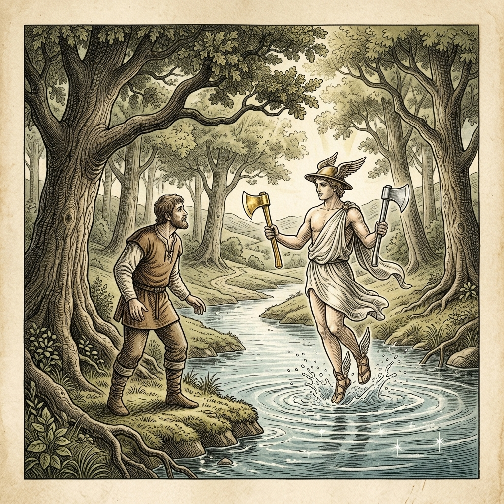
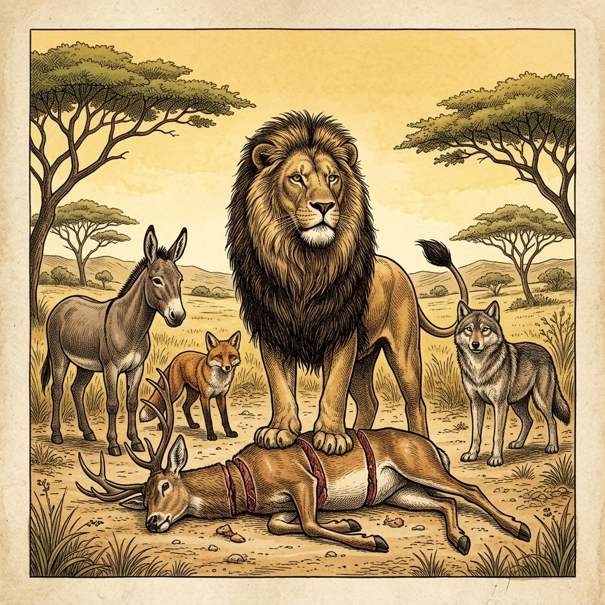

# 『英検ステップアップ多読：イソップ寓話編 第5巻（4級 ➔ 3級対比学習・第2集）』

---

## はじめに：なぜ「対比多読」で英検3級の壁を突破できるのか？

英検3級の合格を目指す英語学習者にとって、最初の大きな壁は**「単文の箇条書き」から「接続詞や関係代名詞を用いたまとまりのある英文」への飛躍**です。

4級までは短い平易な文（SVOや助動詞can/willなど）の組み合わせで対応できましたが、3級からは「when, because, if, so」などの従属接続詞や現在完了形、受動態、不定詞・動名詞を駆使した自然な英文読解・リスニング力が問われます。

本書では、世界中で愛読される珠玉のイソップ寓話（第2集・10話）を題材に、**「知っている4級英語」** が **「3級合格レベルの英語」** へとどのようにステップアップするかを分かりやすく対比学習します。

* **馴染みのあるストーリー（4級英文）** で文脈を瞬時に把握
* **洗練された表現（3級英文）** で接続詞・複文・重要熟語を自然にインプット
* **暗唱キーフレーズ対比** で面接スピーキング・英作文に直結する表現力を定着

楽しく名作寓話を読み進めながら、3級合格に必要な英語の基礎体力を固めましょう！

---

## 本書の収録作品（第2集・全10話）

1. **Chapter 11**: 金の斧と銀の斧 (*The Honest Woodcutter*) [Perry 173]
2. **Chapter 12**: 金の卵を産むガチョウ (*The Goose that Laid the Golden Eggs*) [Perry 87]
3. **Chapter 13**: 羊の皮をかぶった狼 (*The Wolf in Sheep's Clothing*) [Perry 451]
4. **Chapter 14**: キツネとツル (*The Fox and the Stork*) [Perry 426]
5. **Chapter 15**: カエルと牛 (*The Frog and the Ox*) [Perry 376]
6. **Chapter 16**: コウモリと鳥と獣 (*The Bat, the Birds, and the Beasts*) [Perry 566]
7. **Chapter 17**: ネズミの会議 (*Belling the Cat*) [Perry 613]
8. **Chapter 18**: 旅人とクマ (*The Bear and the Two Travelers*) [Perry 65]
9. **Chapter 19**: 獅子の分け前 (*The Lion's Share*) [Perry 149]
10. **Chapter 20**: ネズミとカエル (*The Frog and the Mouse*) [Perry 384]

---

## 本書の構成と電子書籍 / Kobo最適化

各章は以下の6段階で構成されています。

```text
┌─────────────────────────────────────────────────────────────┐
│ 1. Chapter Title & Visual Illustration (章タイトル ＆ 挿絵)   │
│ 2. Benchmark Level: 英検4級レベル英文                         │
│ 3. Target Level: 英検3級レベル英文                           │
│ 4. Classic Original English Text (イソップ寓話クラシック原文)  │
│ 5. Japanese Translation (日本語訳 ＆ 教訓)                     │
│ 6. Recite & Compare (そらんじたいキーフレーズ対比カード)        │
│ 7. Key Vocabulary & Exam Notes (語彙・文法・試験対策解説)        │
└─────────────────────────────────────────────────────────────┘
```

> **【ポイント】 音声読み上げ（TTS）をご利用の方へ**
> 本文セクション（ステップ1〜3）は英語のみで構成されており、電子書籍やKoboの自動音声読み上げ機能（Text-to-Speech）で日本語が混ざることなく、美しい英語音声で快適にリスニング学習していただけます。


# Chapter 11: The Honest Woodcutter (金の斧と銀の斧)

<!-- 電子書籍 Page Break & Image Header -->
<div style="text-align: center; margin-bottom: 20px;">
  
</div>

<div style="page-break-before: always;"></div>

## 1. Benchmark Level: Eiken Grade 4 (英検4級レベル本文)
*Read in ~1 to 1.5 minutes. Baseline vocabulary and basic syntax.*

A poor woodcutter was chopping wood near a deep river. Suddenly, his axe slipped from his hand and fell into the water. He lost his only tool, so he sat by the river and cried.

Suddenly, Hermes, the god of the forest, appeared. "Why are you crying?" Hermes asked. 

The woodcutter answered, "I lost my axe in the river. Now I cannot work."

Hermes dived into the water and brought up a gold axe. "Is this your axe?" he asked.

"No, that is not mine," the honest man said.

Hermes dived again and brought up a silver axe. "Is this yours?"

"No, that is not mine either," the man replied.

Finally, Hermes brought up the old iron axe. "Yes! That is my axe!" the woodcutter shouted happily.

Hermes smiled and said, "You are very honest. I will give you all three axes as a gift."

Later, a greedy man heard this story. He went to the river and dropped his axe on purpose. When Hermes showed him the gold axe, the greedy man lied, "Yes! That is mine!" 

Hermes was angry at his lie. He disappeared with the gold axe and did not return the old axe. The greedy man lost everything.

Honesty is the best policy.

---
<div style="page-break-before: always;"></div>

## 2. Target Level: Eiken Grade 3 (英検3級レベル本文)
*Read in ~2 to 3 minutes. Upgraded vocabulary, sophisticated sentence structures, and idioms.*

Once upon a time, an honest woodcutter was working near a deep river. By accident, his axe slipped out of his hands and sank to the bottom of the water. Since he was too poor to buy a new one, he sat on the riverbank and wept bitterly.

Suddenly, Hermes, a divine messenger, appeared before him. Learning about the woodcutter's trouble, Hermes decided to help. He dived into the cold river and returned with a brilliant golden axe. "Is this the axe that you lost?" Hermes inquired.

"No, that is not mine," the woodcutter replied truthfully.

Hermes dived a second time and brought up a silver axe. Again, the honest woodcutter shook his head and said, "No, my axe is much older than that."

Finally, Hermes dived a third time and pulled out the old iron axe. The woodcutter cried out with joy, "That is indeed my axe! Thank you so much!"

Impressed by his honesty, Hermes rewarded the man by giving him all three axes.

When a greedy neighbor heard about this fortunate event, he decided to trick the god. He rushed to the river and threw his own axe into the water on purpose. When Hermes appeared with a golden axe, the greedy man shouted eagerly, "Yes, that belongs to me!"

Disgusted by his deception, Hermes vanished instantly, leaving the greedy man with neither the golden axe nor his own.

Greed will bring you nothing, but honesty is always rewarded in the end.

---
<div style="page-break-before: always;"></div>

## 3. Classic Original English Text (イソップ寓話 クラシック原文)
*Townsend / Jacobs Edition (Public Domain)*

A Woodman was felling a tree on the bank of a river, and by chance his axe slipped from his hand and dropped into the water. Deeply troubled, he sat down by the river and began to weep. Hermes appeared and, learning the reason for his grief, dived into the river. He brought up a golden axe and asked if it was the one he had lost. The woodman replied that it was not. Hermes dived a second time and brought up a silver axe. Again the woodman denied that it was his. Hermes dived a third time and brought up the wooden axe which had been lost. The woodman recognized it with joy. Hermes, delighted by his honesty, gave him all three axes. The woodman told his friends what had happened. One of them went to the river, dropped his axe on purpose, and sat weeping. Hermes appeared, dived, brought up a golden axe, and asked if it was his. The greedy man cried out with joy, "Yes, that is mine!" Hermes was disgusted by his dishonesty and not only kept the golden axe, but refused to retrieve the wooden one.

Honesty is the best policy.

---
<div style="page-break-before: always;"></div>

## 4. Japanese Translation (日本語訳)

ある貧しい木こりが深い川のそばで木を伐っていました。偶然にも、彼の手から斧がすべり落ち、水の中に沈んでしまいました。新しい斧を買う余裕もなかったため、彼は川岸に座り込んで激しく泣きました。

突然、神の使者であるヘルメスが彼の前に現れました。木こりの困りごとを知ったヘルメスは、手助けすることに決めました。彼は冷たい川に飛び込み、輝く金の斧を持って戻ってきました。「これがあなたがなくした斧ですか？」とヘルメスは尋ねました。

「いいえ、それは私のものではありません」と木こりは正直に答えました。

ヘルメスは二度目に飛び込み、銀の斧を持って上がってきました。正直な木こりは再び首を振り、「いいえ、私の斧はそれよりもずっと古いものです」と言いました。

ついに三度目に飛び込んだヘルメスは、古い鉄の斧を取り出しました。木こりは大喜びで叫びました。「それこそが私の斧です！本当にありがとうございます！」

彼の正直さに感銘を受けたヘルメスは、報酬として3本の斧すべてを彼に与えました。

ある強欲な隣人がこの幸運な出来事について聞くと、神をだまそうと決意しました。彼は川へ急ぎ、自分の斧をわざと水に投げ込みました。ヘルメスが金の斧を持って現れると、その強欲な男は身を乗り出して叫びました。「そうです、それは私のものです！」

彼の欺瞞にあきれ果てたヘルメスは瞬時に姿を消し、強欲な男には金の斧も自分の斧も残りませんでした。

**教訓**: 正直は最大の美徳であり、強欲は失意のみをもたらす。

---
<div style="page-break-before: always;"></div>

## 5. Recite & Compare (そらんじたいキーフレーズ対比)
*Memorize these contrastive expressions to elevate speaking, writing, and reading fluency.*

<div class="comparison-card">
  <div class="card-header">■ 場面：うっかり斧を落とす</div>
  <div class="card-row-g4"><span class="card-badge-g4">【Grade 4 基礎】</span> <em>his axe slipped from his hand and fell...</em></div>
  <div class="card-row-g3"><span class="card-badge-g3">【Grade 3 暗唱】</span> <strong><em>By accident, his axe slipped out of his hands and sank...</em></strong></div>
  <div class="card-note">【ポイント】 <strong>解説・試験活用</strong>：「うっかり・偶然に」を表すイディオム `By accident`（同義語：`by chance`）と、水に沈む動詞 `sink` の過去形 `sank` の活用。</div>
</div>

<div class="comparison-card">
  <div class="card-header">■ 場面：正直に回答する・否定する</div>
  <div class="card-row-g4"><span class="card-badge-g4">【Grade 4 基礎】</span> <em>the honest man said, "No, that is not mine."</em></div>
  <div class="card-row-g3"><span class="card-badge-g3">【Grade 3 暗唱】</span> <strong><em>the woodcutter replied truthfully... / shook his head</em></strong></div>
  <div class="card-note">【ポイント】 <strong>解説・試験活用</strong>：副詞 `truthfully`（正直に・ありのままに）や、「首を横に振って否定する」ジェスチャー表現 `shake one's head` の修得。</div>
</div>

<div class="comparison-card">
  <div class="card-header">■ 場面：正直さを称えて報酬を与える</div>
  <div class="card-row-g4"><span class="card-badge-g4">【Grade 4 基礎】</span> <em>You are very honest. I will give you all three...</em></div>
  <div class="card-row-g3"><span class="card-badge-g3">【Grade 3 暗唱】</span> <strong><em>Impressed by his honesty, Hermes rewarded the man...</em></strong></div>
  <div class="card-note">【ポイント】 <strong>解説・試験活用</strong>：過去分詞を使った文頭表現 `Impressed by...`（〜に感銘を受けて）と、動詞 `reward`（〜に報いる・報酬を与える）。</div>
</div>

<div class="comparison-card">
  <div class="card-header">■ 場面：故意（わざと）行動する</div>
  <div class="card-row-g4"><span class="card-badge-g4">【Grade 4 基礎】</span> <em>dropped his axe on purpose</em></div>
  <div class="card-row-g3"><span class="card-badge-g3">【Grade 3 暗唱】</span> <strong><em>threw his own axe into the water on purpose</em></strong></div>
  <div class="card-note">【ポイント】 <strong>解説・試験活用</strong>：英検3級長文・会話文で最頻出の熟語 `on purpose`（わざと・故意に）。対義語は `by accident`。</div>
</div>

<div class="comparison-card">
  <div class="card-header">■ 場面：所有権を主張する</div>
  <div class="card-row-g4"><span class="card-badge-g4">【Grade 4 基礎】</span> <em>Yes! That is mine!</em></div>
  <div class="card-row-g3"><span class="card-badge-g3">【Grade 3 暗唱】</span> <strong><em>Yes, that belongs to me!</em></strong></div>
  <div class="card-note">【ポイント】 <strong>解説・試験活用</strong>：英検3級必須の熟語 `belong to...`（〜に属する、〜のものである）。所有代名詞 `mine` からの自然な書き換え。</div>
</div>

---
<div style="page-break-before: always;"></div>

## 6. Key Vocabulary & Exam Notes (語彙・文法・試験対策解説)

### 【出題頻出語彙・熟語ノート】
- **by accident** [熟] 誤って、偶然に（対義熟語：*on purpose*「わざと」）
- **truthfully** [副] 正直に、誠実に（形容詞 *truthful*、名詞 *truth*）
- **reward** [動] 〜に報いる、報酬を与える（[名] 報酬・ごほうび。英検3級〜準2級頻出）
- **on purpose** [熟] わざと、故意に（英検3級リスニング・読解の定番熟語）
- **belong to...** [熟] 〜のものである、〜に属する（3級ライティングで自分の持ち物を説明する重要表現）
- **deception** [名] 欺瞞、詐欺、ごまかし（動詞 *deceive*「〜をだます」）

### 【文法・構文ポイント】
1. **比較級の強調表現 `much + 比較級`（〜よりずっと…）**
   - 3級本文: *"My axe is much older than that."*
   - ポイント: 比較級 `older` の前に `much`（または `far`）を置くことで「ずっと〜だ」と強意を表します。3級・準2級で必須の比較構文です。
2. **関係代名詞 `that / which` の目的格**
   - 3級本文: *"Is this the axe that you lost?"*
   - ポイント: 先行詞 `the axe`（モノ）を修飾する関係代名詞 `that`。会話や作文で極めて自然に使われます。


# Chapter 12: The Goose that Laid the Golden Eggs (金の卵を産むガチョウ)

<!-- 電子書籍 Page Break & Image Header -->
<div style="text-align: center; margin-bottom: 20px;">
  
</div>

<div style="page-break-before: always;"></div>

## 1. Benchmark Level: Eiken Grade 4 (英検4級レベル本文)
*Read in ~1 to 1.5 minutes. Baseline vocabulary and basic syntax.*

A poor farmer and his wife owned a wonderful goose. Every morning, the goose laid a shiny golden egg.

The farmer sold the golden egg at the market every day. Soon, they became rich and lived comfortably.

However, the farmer became greedy. "One egg a day is too slow," he thought. "The goose must have a lot of gold inside her belly. If I open her, I can get all the gold at once!"

He told his wife about his plan, and she agreed. They killed the goose and opened her belly.

To their surprise, there was no gold inside at all! She was just like any other ordinary goose.

Now, they had no golden eggs and no goose. They wept because their greed destroyed everything.

Do not be greedy, or you will lose what you have.

---
<div style="page-break-before: always;"></div>

## 2. Target Level: Eiken Grade 3 (英検3級レベル本文)
*Read in ~2 to 3 minutes. Upgraded vocabulary, sophisticated sentence structures, and idioms.*

Once upon a time, a humble farmer and his wife were fortunate enough to possess a rare goose. To their delight, every single morning the goose laid a solid golden egg.

By selling these precious eggs at the market, the couple gradually accumulated wealth and enjoyed a comfortable life. 

However, as time passed, the farmer grew impatient and greedy. He thought to himself, "It takes too long to get just one egg a day. If the goose produces gold, her inside must be filled with a vast treasure! If we cut her open, we can acquire all the gold at once."

Hoping to become millionaires overnight, the foolish couple decided to carry out the plan. They killed the goose immediately and examined her inside. 

Much to their disappointment, they discovered that the bird was no different from any normal goose. There was not a single piece of gold inside.

Realizing their terrible mistake, the couple cried in despair. By seeking to gain everything too quickly, they had lost their steady source of wealth forever.

Those who are overly greedy will end up losing even what they already possess.

---
<div style="page-break-before: always;"></div>

## 3. Classic Original English Text (イソップ寓話 クラシック原文)
*Townsend / Jacobs Edition (Public Domain)*

A Cottager and his wife had a Hen which laid a golden egg every day. They supposed that the Hen must contain a great lump of gold in its inside, and in order to get the gold, they killed it. Having done so, they found to their surprise that the Hen differed in no respect from their other hens. The foolish pair, hoping to become rich all at once, thus deprived themselves of the gain of which they were assured day by day.

Thinking to get at once all the gold, they lost even the little they had.

---
<div style="page-break-before: always;"></div>

## 4. Japanese Translation (日本語訳)

むかし、貧しい農夫とその妻が、運よく珍しいガチョウを1羽所有していました。彼らが喜んだことに、毎朝そのガチョウは本物の金の卵を1個産みました。

市場でこの貴重な卵を売ることで、夫妻は次第に富を蓄え、快適な暮らしを楽しむようになりました。

しかし時が経つにつれて、農夫はしびれを切らし、強欲になっていきました。彼は心の中で考えました。「1日にたった1個の卵を得るのに時間をかけすぎだ。もしガチョウが金を産むなら、腹の中は莫大な宝で満たされているに違いない！もし切り開けば、一度にすべての金を手に入れられるぞ。」

一夜にして大金持ちになろうと望んだ愚かな夫婦は、その計画を実行することに決めました。彼らはすぐにガチョウを殺し、お腹の中を調べました。

非常にがっかりしたことに、その鳥は普通のガチョウと何ら変わりがないことが判明しました。中には金の一片すらありませんでした。

自分たちの恐ろしい過ちに気づき、夫婦は絶望して泣きました。すべてをあまりにも早く手に入れようとしたことで、彼らは着実な富の源泉を永遠に失ってしまったのです。

**教訓**: 度を越して強欲な者は、すでに手にしているものさえも失うことになる。

---
<div style="page-break-before: always;"></div>

## 5. Recite & Compare (そらんじたいキーフレーズ対比)
*Memorize these contrastive expressions to elevate speaking, writing, and reading fluency.*

<div class="comparison-card">
  <div class="card-header">■ 場面：富を蓄えて豊かな生活を送る</div>
  <div class="card-row-g4"><span class="card-badge-g4">【Grade 4 基礎】</span> <em>they became rich and lived comfortably</em></div>
  <div class="card-row-g3"><span class="card-badge-g3">【Grade 3 暗唱】</span> <strong><em>gradually accumulated wealth and enjoyed a comfortable life</em></strong></div>
  <div class="card-note">【ポイント】 <strong>解説・試験活用</strong>：「蓄積する」を意味する動詞 `accumulate`（名詞：`accumulation`）と、抽象名詞 `wealth`（財産・富）を用いた英検3級〜準2級頻出の表現。</div>
</div>

<div class="comparison-card">
  <div class="card-header">■ 場面：焦りと欲望（短期的な欲）</div>
  <div class="card-row-g4"><span class="card-badge-g4">【Grade 4 基礎】</span> <em>One egg a day is too slow... get all the gold at once!</em></div>
  <div class="card-row-g3"><span class="card-badge-g3">【Grade 3 暗唱】</span> <strong><em>grew impatient... Hoping to become millionaires overnight...</em></strong></div>
  <div class="card-note">【ポイント】 <strong>解説・試験活用</strong>：形容詞 `impatient`（しびれを切らした・不気味な焦り）と、副詞 `overnight`（一夜にして・一朝一夕に）。</div>
</div>

<div class="comparison-card">
  <div class="card-header">■ 場面：期待外れと失望</div>
  <div class="card-row-g4"><span class="card-badge-g4">【Grade 4 基礎】</span> <em>To their surprise, there was no gold inside at all!</em></div>
  <div class="card-row-g3"><span class="card-badge-g3">【Grade 3 暗唱】</span> <strong><em>Much to their disappointment, they discovered... no different from...</em></strong></div>
  <div class="card-note">【ポイント】 <strong>解説・試験活用</strong>：英検3級・準2級最重要構文 `Much to one's disappointment`（非常にがっかりしたことに）と比較表現 `be no different from`（〜と全く違わない）。</div>
</div>

<div class="comparison-card">
  <div class="card-header">■ 場面：絶望と過ちへの気づき</div>
  <div class="card-row-g4"><span class="card-badge-g4">【Grade 4 基礎】</span> <em>They wept because their greed destroyed everything.</em></div>
  <div class="card-row-g3"><span class="card-badge-g3">【Grade 3 暗唱】</span> <strong><em>Realizing their terrible mistake, the couple cried in despair.</em></strong></div>
  <div class="card-note">【ポイント】 <strong>解説・試験活用</strong>：分詞構文 `Realizing...`（〜に気づいて）と、前置詞句 `in despair`（絶望して）。物語や英作文の感情描写を高めます。</div>
</div>

<div class="comparison-card">
  <div class="card-header">■ 場面：教訓（Moral）</div>
  <div class="card-row-g4"><span class="card-badge-g4">【Grade 4 基礎】</span> <em>Do not be greedy, or you will lose what you have.</em></div>
  <div class="card-row-g3"><span class="card-badge-g3">【Grade 3 暗唱】</span> <strong><em>Those who are overly greedy will end up losing...</em></strong></div>
  <div class="card-note">【ポイント】 <strong>解説・試験活用</strong>：関係代名詞 `Those who...`（〜する人々）と熟語 `end up -ing`（結局〜することになる）。英検3級英作文・スピーキングの結論句で大活躍。</div>
</div>

---
<div style="page-break-before: always;"></div>

## 6. Key Vocabulary & Exam Notes (語彙・文法・試験対策解説)

### 【出題頻出語彙・熟語ノート】
- **accumulate** [動] （財産・知識など）を蓄積する、ためる（*accumulate wealth/knowledge*）
- **impatient** [形] 我慢できない、短気な、焦っている（反義語：*patient*）
- **overnight** [副] 一夜にして、一晩で（*become famous overnight*「一夜にして有名になる」）
- **disappointment** [名] 失望、落胆（*Much to one's disappointment* 「とてもがっかりしたことに」）
- **despair** [名] 絶望（*in despair*「絶望して」）
- **end up -ing** [熟] 結局〜することになる（英検3級・準2級超頻出の動名詞熟語）

### 【文法・構文ポイント】
1. **[Much to one's + 感情名詞]（非常に〜なことに）**
   - 3級本文: *"Much to their disappointment, they discovered that the bird was no different from any normal goose."*
   - ポイント: `To my surprise`（驚いたことに）の強調型表現。感情の原因を示す前置詞 `to` の頻出構文です。
2. **[Those who + 動詞]（〜する人々）**
   - 3級本文: *"Those who are overly greedy will end up losing even what they already possess."*
   - ポイント: `People who...` の格調高い言い換え。エッセイやスピーキングの結論文で一般論・教訓を述べるときに非常に効果的です。


# Chapter 13: The Wolf in Sheep's Clothing (羊の皮をかぶった狼)

<!-- 電子書籍 Page Break & Image Header -->
<div style="text-align: center; margin-bottom: 20px;">
  
</div>

<div style="page-break-before: always;"></div>

## 1. Benchmark Level: Eiken Grade 4 (英検4級レベル本文)
*Read in ~1 to 1.5 minutes. Baseline vocabulary and basic syntax.*

A hungry wolf wanted to eat sheep. However, a watchman and his strong dogs protected the sheep every day. The wolf could not go near the flock.

One day, the wolf found an old sheep skin on the ground. He had a clever idea. "I will wear this skin. Then I can look like a sheep!" he thought.

The wolf put on the sheep skin and walked into the field. The sheep did not know he was a wolf. A young lamb even walked behind him. The wolf quietly led the lamb away and ate it.

For many days, the wolf tricked the sheep and ate well.

One night, the shepherd came to the farm. He wanted to catch a sheep for dinner. In the dark, he saw the wolf wearing the sheep skin. The shepherd thought it was a big sheep, so he caught it and killed it.

The wolf was caught in his own trick.

Appearances can be deceiving.

---
<div style="page-break-before: always;"></div>

## 2. Target Level: Eiken Grade 3 (英検3級レベル本文)
*Read in ~2 to 3 minutes. Upgraded vocabulary, sophisticated sentence structures, and idioms.*

Once upon a time, a sly wolf was desperately searching for a way to attack a flock of sheep. However, because the shepherd and his fierce dogs kept a close watch, the wolf failed every time he tried to approach them.

One afternoon, the wolf discovered the fleece of a sheep that had been thrown away in the pasture. A wicked plan entered his mind. "If I disguise myself in this wool," he reasoned, "the shepherd will mistake me for one of his own animals."

After putting on the sheep's skin, the wolf strolled calmly among the flock. As he had expected, neither the shepherd nor the guard dogs noticed his true identity. A innocent lamb even followed him closely. Taking advantage of the opportunity, the wolf led the lamb into the forest and devoured it.

For a while, the wolf succeeded in deceiving everyone and enjoyed effortless feasts every night.

However, justice came unexpectedly. One evening, the shepherd entered the fold in the dark, intending to slaughter a sheep for his family's meal. Mistaking the disguised wolf for a fat sheep, the shepherd seized him instantly and put an end to his life.

Those who try to deceive others through fake appearances will eventually suffer the consequences.

---
<div style="page-break-before: always;"></div>

## 3. Classic Original English Text (イソップ寓話 クラシック原文)
*Townsend / Jacobs Edition (Public Domain)*

A Wolf found great difficulty in getting at the sheep owing to the vigilance of the shepherd and his dogs. But one day it found the skin of a sheep that had been flayed and thrown aside, so it put it on over its own pelt and strolled down among the sheep. The lamb that belonged to the sheep whose skin the Wolf was wearing began to follow the Wolf; so leading the lamb a little away, he soon made a meal off her, and for some time he succeeded in deceiving the sheep, and enjoying hearty meals.

Appearances are deceptive.

---
<div style="page-break-before: always;"></div>

## 4. Japanese Translation (日本語訳)

ある時、ずる賢い狼が羊の群れを襲う方法を必死で探していました。しかし、羊飼いと気性の荒い犬たちが厳重に見張っていたため、狼が近づこうとするたびに失敗していました。

ある日の午後、狼は牧草地に投げ捨てられていた羊の毛皮を見つけました。彼の心に邪悪な計画が浮かびました。「もしこの羊毛で変装すれば、羊飼いは私を自分の飼っている動物の1匹だと勘違いするだろう」と彼は考えました。

羊の皮を身にまとった後、狼は群れの中に静かに歩み入りました。彼が予想していた通り、羊飼いも番犬も彼の正体に気づきませんでした。無知な子羊さえも彼の後ろをぴったりとついて行きました。この機会を利用して、狼は子羊を森へと連れ出し、むさぼり食べました。

しばらくの間、狼は全員をだますことに成功し、毎晩のように苦労せずごちそうを味わいました。

しかし、正義は予期せぬ形で訪れました。ある日の夕方、羊飼いは家族の夕食のために羊を1匹収穫しようと、暗闇の中で羊小屋に入りました。変装した狼を肥えた羊だと勘違いした羊飼いは、即座に狼を捕らえ、その命を絶ちました。

**教訓**: 偽りの外見で他者をだまそうとする者は、最終的に自らその報いを受けることになる。

---
<div style="page-break-before: always;"></div>

## 5. Recite & Compare (そらんじたいキーフレーズ対比)
*Memorize these contrastive expressions to elevate speaking, writing, and reading fluency.*

<div class="comparison-card">
  <div class="card-header">■ 場面：羊の群れを狙う・襲う</div>
  <div class="card-row-g4"><span class="card-badge-g4">【Grade 4 基礎】</span> <em>wanted to eat sheep... protect the sheep</em></div>
  <div class="card-row-g3"><span class="card-badge-g3">【Grade 3 暗唱】</span> <strong><em>searching for a way to attack a flock of sheep</em></strong></div>
  <div class="card-note">【ポイント】 <strong>解説・試験活用</strong>：集合名詞 `a flock of sheep`（羊のひと群れ）と動詞 `attack`。動物の群れを表す表現は英検3級読解の常連です。</div>
</div>

<div class="comparison-card">
  <div class="card-header">■ 場面：変装して正体を偽る</div>
  <div class="card-row-g4"><span class="card-badge-g4">【Grade 4 基礎】</span> <em>wear this skin... look like a sheep</em></div>
  <div class="card-row-g3"><span class="card-badge-g3">【Grade 3 暗唱】</span> <strong><em>disguise myself in this wool... mistake me for...</em></strong></div>
  <div class="card-note">【ポイント】 <strong>解説・試験活用</strong>：再帰代名詞を使った `disguise oneself`（変装する）と熟語 `mistake A for B`（AをBと間違える）。</div>
</div>

<div class="comparison-card">
  <div class="card-header">■ 場面：好機を利用して連れ去る</div>
  <div class="card-row-g4"><span class="card-badge-g4">【Grade 4 基礎】</span> <em>quietly led the lamb away and ate it</em></div>
  <div class="card-row-g3"><span class="card-badge-g3">【Grade 3 暗唱】</span> <strong><em>Taking advantage of the opportunity, led... and devoured it</em></strong></div>
  <div class="card-note">【ポイント】 <strong>解説・試験活用</strong>：分詞構文 `Taking advantage of...`（〜という機会を利用して）と、*eat* の上位語表現 `devour`（〜をむさぼり喰らう）。</div>
</div>

<div class="comparison-card">
  <div class="card-header">■ 場面：欺瞞に成功する</div>
  <div class="card-row-g4"><span class="card-badge-g4">【Grade 4 基礎】</span> <em>tricked the sheep and ate well</em></div>
  <div class="card-row-g3"><span class="card-badge-g3">【Grade 3 暗唱】</span> <strong><em>succeeded in deceiving everyone and enjoyed effortless feasts...</em></strong></div>
  <div class="card-note">【ポイント】 <strong>解説・試験活用</strong>：熟語 `succeed in -ing`（〜することに成功する）と動詞 `deceive`（〜をだます）。英検3級英作文のキー構文。</div>
</div>

<div class="comparison-card">
  <div class="card-header">■ 場面：教訓（Moral）</div>
  <div class="card-row-g4"><span class="card-badge-g4">【Grade 4 基礎】</span> <em>Appearances can be deceiving.</em></div>
  <div class="card-row-g3"><span class="card-badge-g3">【Grade 3 暗唱】</span> <strong><em>Those who try to deceive others... will suffer the consequences.</em></strong></div>
  <div class="card-note">【ポイント】 <strong>解説・試験活用</strong>：抽象名詞 `appearances`（外見・見かけ）と、熟語 `suffer the consequences`（結果に苦しむ・自業自得の報いを受ける）。</div>
</div>

---
<div style="page-break-before: always;"></div>

## 6. Key Vocabulary & Exam Notes (語彙・文法・試験対策解説)

### 【出題頻出語彙・熟語ノート】
- **flock** [名] （鳥・羊などの）群れ（*a flock of sheep/birds*）
- **disguise** [動] （〜を）変装させる（*disguise oneself as...*「〜に変装する」）
- **mistake A for B** [熟] AをBと間違える（英検3級定番熟語）
- **take advantage of...** [熟] （機会など）を利用する、乗じる（3級・準2級超重要フレーズ）
- **devour** [動] （〜を）むさぼり食べる、貪食する（*eat* より迫力のある描写動詞）
- **succeed in -ing** [熟] 〜することに成功する（前置詞 *in* + 動名詞）
- **consequence** [名] 結果、結末、報い（*suffer the consequences*「報いを受ける」）

### 【文法・構文ポイント】
1. **熟語 [mistake A for B]（AをBと誤認する）**
   - 3級本文: *"The shepherd will mistake me for one of his own animals."*
   - ポイント: 似ているものの見分けがつかず間違えるときに使われる基本熟語です。
2. **前置詞 + 動名詞 [succeed in -ing]（〜することに成功する）**
   - 3級本文: *"For a while, the wolf succeeded in deceiving everyone."*
   - ポイント: `succeed` の後に前置詞 `in` を伴い、その後に動名詞が続く形。英検ライティングで目標達成を述べるときに重宝します。


# Chapter 14: The Fox and the Stork (キツネとツル)

<!-- 電子書籍 Page Break & Image Header -->
<div style="text-align: center; margin-bottom: 20px;">
  
</div>

<div style="page-break-before: always;"></div>

## 1. Benchmark Level: Eiken Grade 4 (英検4級レベル本文)
*Read in ~1 to 1.5 minutes. Baseline vocabulary and basic syntax.*

A mischievous fox invited a stork to dinner. The fox wanted to play a trick on her.

When the stork arrived, the fox served delicious soup in a very shallow plate. The fox lapped up the soup easily with his tongue. However, the stork had a very long beak, so she could not drink any soup at all. 

"I am sorry," the fox laughed. "Is the soup not good?"

The stork smiled and said, "Thank you for dinner. Please come to my house tomorrow."

The next day, the fox went to the stork's home. The stork served dinner in a tall jar with a narrow neck. The stork put her long beak into the jar and enjoyed the food. But the fox could only lick the outside of the jar.

The fox went home very hungry. He realized his mistake.

Treat others as you want them to treat you.

---
<div style="page-break-before: always;"></div>

## 2. Target Level: Eiken Grade 3 (英検3級レベル本文)
*Read in ~2 to 3 minutes. Upgraded vocabulary, sophisticated sentence structures, and idioms.*

Once upon a time, a sly fox decided to play a trick on his neighbor, a stork. He invited her to his house for dinner, promising a delicious meal.

When the stork arrived, the fox served some hot soup, but he poured it into very shallow dishes. While the fox lapped up the soup effortlessly with his broad tongue, the poor stork could only touch the liquid with the tip of her long beak. As a result, she was unable to eat anything and remained hungry throughout the evening.

"I am afraid that you do not like my soup," the fox said with a mischievous grin.

"On the contrary, it smells wonderful," replied the stork politely. "To show my gratitude, please accept an invitation to dine at my home tomorrow night."

The following evening, the fox visited the stork's residence. To his surprise, the stork served the meal in a tall, narrow jar with a slender neck. The stork easily inserted her long beak into the container and enjoyed her food. However, the fox's snout was far too wide to fit inside, so he could do nothing but lick the outer rim of the jar.

Feeling embarrassed and hungry, the fox returned home, understanding that he had received a fitting punishment for his previous rudeness.

One good turn deserves another, but bad treatment will return to you just the same.

---
<div style="page-break-before: always;"></div>

## 3. Classic Original English Text (イソップ寓話 クラシック原文)
*Townsend / Jacobs Edition (Public Domain)*

At one time the Fox and the Stork seemed to be on very good terms and invited each other to dinner. First the Fox invited the Stork, and served nothing but soup in a very shallow dish. The Fox lapped it up with ease, but the Stork could only wet the end of her long bill in it, and left the meal as hungry as when she came. "I am sorry," said the Fox, "that the soup is not to your liking." The Stork thanked him and invited him to dine with her in return. When the Fox arrived, the Stork served the meal in a tall jar with a narrow neck. The Stork easily inserted her long bill and enjoyed the food, while the Fox could only lick the outside of the jar.

One bad turn deserves another.

---
<div style="page-break-before: always;"></div>

## 4. Japanese Translation (日本語訳)

ある時、ずる賢いキツネが隣人のツルにいたずらをしようと考えました。彼は美味しい食事を約束し、彼女を夕食に招待しました。

ツルが到着すると、キツネは温かいスープを出しましたが、とても浅い皿に注ぎました。キツネは広い舌でスープを軽々と飲み干しましたが、気の毒なツルは長いクチバシの先で液体に触れることしかできませんでした。その結果、彼女は何も食べることができず、一晩中お腹を空かせたままでした。

「私のスープがお気に召さなかったようで申し訳ないね」とキツネは悪戯っぽい笑みを浮かべて言いました。

「それどころか、素晴らしい匂いがしますわ」とツルは礼儀正しく答えました。「感謝の気持ちを込めて、明日の夜は私の家での食事にお越しくださいな。」

翌晩、キツネはツルの家を訪れました。驚いたことに、ツルは首の細い背の高い瓶に料理を盛り付けて出しました。ツルは容器の中に長いクチバシを簡単に挿入し、食事を楽しみました。しかし、キツネの鼻口部は広すぎて中に入らなかったため、彼は瓶の外側の縁をなめることしかできませんでした。

恥ずかしさと空腹を感じながら、キツネは家へと戻り、自分の以前の無礼に対してふさわしい報いを受けたのだと理解しました。

**教訓**: 人になした悪意は、そのまま自分に返ってくる。相手を尊重し、自分がされたいように接しなさい。

---
<div style="page-break-before: always;"></div>

## 5. Recite & Compare (そらんじたいキーフレーズ対比)
*Memorize these contrastive expressions to elevate speaking, writing, and reading fluency.*

<div class="comparison-card">
  <div class="card-header">■ 場面：浅い皿にスープを注ぐ</div>
  <div class="card-row-g4"><span class="card-badge-g4">【Grade 4 基礎】</span> <em>served soup in a very shallow plate</em></div>
  <div class="card-row-g3"><span class="card-badge-g3">【Grade 3 暗唱】</span> <strong><em>poured it into very shallow dishes... lapped up effortlessly</em></strong></div>
  <div class="card-note">【ポイント】 <strong>解説・試験活用</strong>：対比の形容詞 `shallow`（浅い）↔ `deep`（深い）と、副詞 `effortlessly`（軽々と・労せずして）。</div>
</div>

<div class="comparison-card">
  <div class="card-header">■ 場面：結果として何も食べられない</div>
  <div class="card-row-g4"><span class="card-badge-g4">【Grade 4 基礎】</span> <em>she could not drink any soup at all</em></div>
  <div class="card-row-g3"><span class="card-badge-g3">【Grade 3 暗唱】</span> <strong><em>As a result, she was unable to eat anything...</em></strong></div>
  <div class="card-note">【ポイント】 <strong>解説・試験活用</strong>：英検3級ライティングで必須の接続表現 `As a result`（その結果）と `be unable to`（〜することができない）。</div>
</div>

<div class="comparison-card">
  <div class="card-header">■ 場面：お礼と返礼の招待</div>
  <div class="card-row-g4"><span class="card-badge-g4">【Grade 4 基礎】</span> <em>Please come to my house tomorrow.</em></div>
  <div class="card-row-g3"><span class="card-badge-g3">【Grade 3 暗唱】</span> <strong><em>To show my gratitude, accept an invitation to dine...</em></strong></div>
  <div class="card-note">【ポイント】 <strong>解説・試験活用</strong>：前置詞句 `To show my gratitude`（感謝の気持ちを示すために）と名詞 `invitation`（招待・招待状）。</div>
</div>

<div class="comparison-card">
  <div class="card-header">■ 場面：首の細い容器と挿入</div>
  <div class="card-row-g4"><span class="card-badge-g4">【Grade 4 基礎】</span> <em>a tall jar with a narrow neck</em></div>
  <div class="card-row-g3"><span class="card-badge-g3">【Grade 3 暗唱】</span> <strong><em>a tall, narrow jar... inserted her long beak into...</em></strong></div>
  <div class="card-note">【ポイント】 <strong>解説・試験活用</strong>：形容詞 `narrow`（細い・狭い）と動詞 `insert`（〜を差し込む・挿入する）。</div>
</div>

<div class="comparison-card">
  <div class="card-header">■ 場面：自分の無礼に対する報い</div>
  <div class="card-row-g4"><span class="card-badge-g4">【Grade 4 基礎】</span> <em>He realized his mistake.</em></div>
  <div class="card-row-g3"><span class="card-badge-g3">【Grade 3 暗唱】</span> <strong><em>received a fitting punishment for his previous rudeness</em></strong></div>
  <div class="card-note">【ポイント】 <strong>解説・試験活用</strong>：形容詞 `fitting`（ふさわしい・適切な）、名詞 `punishment`（バツ・罰）、`rudeness`（無礼さ・不躾さ）。</div>
</div>

---
<div style="page-break-before: always;"></div>

## 6. Key Vocabulary & Exam Notes (語彙・文法・試験対策解説)

### 【出題頻出語彙・熟語ノート】
- **shallow** [形] 浅い（対義語：*deep*「深い」）
- **effortlessly** [副] 楽々と、努力せずに（形容詞 *effortless*）
- **as a result** [熟] その結果として（英検3級・準2級英作文の因果関係表現）
- **gratitude** [名] 感謝の気持ち、謝意（*express one's gratitude*）
- **invitation** [名] 招待、招待状（動詞 *invite*「招待する」）
- **narrow** [形] 狭い、細い（対義語：*wide* / *broad*）
- **insert** [動] （〜を）挿入する、差し込む（*insert A into B*）

### 【文法・構文ポイント】
1. **[be unable to + 動詞原形]（〜することができない）**
   - 3級本文: *"She was unable to eat anything and remained hungry."*
   - ポイント: `cannot` の書き換え表現。より格調高い英文として英検3級ライティングで推奨されます。
2. **接続副詞 [On the contrary]（それどころか、反対に）**
   - 3級本文: *"On the contrary, it smells wonderful," replied the stork politely.*
   - ポイント: 相手の予想や否定的な意見に対して「それどころか全く逆だ」と強調する3級〜準2級頻出の副詞句です。


# Chapter 15: The Frog and the Ox (カエルと牛)

<!-- 電子書籍 Page Break & Image Header -->
<div style="text-align: center; margin-bottom: 20px;">
  
</div>

<div style="page-break-before: always;"></div>

## 1. Benchmark Level: Eiken Grade 4 (英検4級レベル本文)
*Read in ~1 to 1.5 minutes. Baseline vocabulary and basic syntax.*

An old mother frog lived near a pond with her little frogs. One day, a huge ox came to drink water at the pond.

When the ox walked away, the little frogs ran to their mother. "Mother! We saw a terrible monster today! It was as big as a mountain!" they cried.

The mother frog was very proud. She did not believe them. "I can make myself very big, too," she said. 

She took a deep breath and puffed herself up. "Was the monster as big as this?" she asked.

"Oh, no! It was much bigger than that!" the children answered.

The mother frog took another big breath and puffed herself up even more. "Was it as big as this?"

"No, no! You cannot become as big as the ox!" the little frogs said.

The proud mother frog tried once more. She blew herself up harder and harder—POP! She burst into pieces.

Do not try to be bigger than you really are.

---
<div style="page-break-before: always;"></div>

## 2. Target Level: Eiken Grade 3 (英検3級レベル本文)
*Read in ~2 to 3 minutes. Upgraded vocabulary, sophisticated sentence structures, and idioms.*

An old mother frog, who was famous for her pride, lived near a quiet meadow with her young children. One morning, an enormous ox stepped into the pond to quench his thirst.

After the ox departed, the terrified young frogs hurried back to their mother. "Mother! We just saw the largest creature in the world!" they exclaimed. "His body was truly massive!"

Unwilling to admit that any creature could be far grander than herself, the mother frog replied haughtily, "Nonsense! I can easily make myself just as big as that beast."

She took a deep breath and expanded her body as much as possible. "Was he as large as this?" she inquired.

"No, Mother! He was vastly larger than that!" the children insisted.

Annoyed by their response, the mother frog inhaled even more air, puffing herself out to double her original size. "How about now? Am I not equal to him?"

"If you try to compare yourself to the ox, you will only hurt yourself!" warned her children.

Ignoring their sensible advice, the foolish mother frog inhaled with all her remaining strength. She puffed and stretched until—BOOM! Her skin tore apart, and she burst completely.

Foolish vanity will eventually lead to self-destruction.

---
<div style="page-break-before: always;"></div>

## 3. Classic Original English Text (イソップ寓話 クラシック原文)
*Townsend / Jacobs Edition (Public Domain)*

An Ox, drinking at a pool, stepped on a family of young frogs and crushed one of them to death. When the mother frog came home, she asked where her little one was. "A huge beast came by," said one of the brothers, "and crushed him under his big foot." "How big was he?" asked the mother frog, puffing herself out. "Was he as big as this?" "Oh, much bigger than that!" replied the young frog. The mother puffed herself out more and more, asking, "Was he this big?" "Cease your puffing, mother," said the son, "for if you burst yourself, you will never equal the beast." But the foolish frog tried once more, blew herself up even bigger, and burst!

Self-conceit may lead to self-destruction.

---
<div style="page-break-before: always;"></div>

## 4. Japanese Translation (日本語訳)

見栄っ張りで有名な老いた母カエルが、静かな牧草地の近くで子供たちと暮らしていました。ある朝、巨大な牛が喉の渇きを癒やすために池に足を踏み入れました。

牛が去った後、怯えた子カエルたちは急いで母親のもとへ戻りました。「お母さん！今日世界で一番大きな生き物を見たよ！」と彼らは叫びました。「彼の体は本当に巨大だったんだ！」

自分よりもはるかに立派な生き物がいると認めるのが嫌だった母カエルは、高慢に答えました。「馬鹿馬鹿しい！私だってあの獣と同じくらい簡単に大きくなれますよ。」

彼女は深呼吸をし、できる限り自分の体を膨らませました。「あの獣はこのくらい大きかったかい？」と彼女は尋ねました。

「ううん、お母さん！彼はそれよりもずっとずっと大きかったよ！」と子供たちは主張しました。

彼らの返答にいらだった母カエルは、さらに多くの空気を吸い込み、元のサイズの2倍に自分を膨らませました。「これならどうだい？彼と同等じゃないかい？」

「牛と自分を比べようとしたら、お母さんが傷つくだけだよ！」と子供たちは警告しました。

彼らの賢明な助言を無視して、愚かな母カエルは残された全力を振り絞って空気を吸い込みました。彼女が膨らみ、伸び続けたその時――ドカン！彼女の皮膚は引き裂かれ、破裂してしまいました。

**教訓**: 身の程を知らない見栄や虚栄心は、最終的に自滅をもたらす。

---
<div style="page-break-before: always;"></div>

## 5. Recite & Compare (そらんじたいキーフレーズ対比)
*Memorize these contrastive expressions to elevate speaking, writing, and reading fluency.*

<div class="comparison-card">
  <div class="card-header">■ 場面：喉の渇きを癒やすために池に来る</div>
  <div class="card-row-g4"><span class="card-badge-g4">【Grade 4 基礎】</span> <em>came to drink water at the pond</em></div>
  <div class="card-row-g3"><span class="card-badge-g3">【Grade 3 暗唱】</span> <strong><em>stepped into the pond to quench his thirst</em></strong></div>
  <div class="card-note">【ポイント】 <strong>解説・試験活用</strong>：「喉の渇きを癒やす」という重要フレーズ `quench one's thirst`（動詞 *quench*＝消す・癒やす）。</div>
</div>

<div class="comparison-card">
  <div class="card-header">■ 場面：身体を大きく膨らませる</div>
  <div class="card-row-g4"><span class="card-badge-g4">【Grade 4 基礎】</span> <em>puffed herself up / make myself very big</em></div>
  <div class="card-row-g3"><span class="card-badge-g3">【Grade 3 暗唱】</span> <strong><em>expanded her body as much as possible... puffing herself out</em></strong></div>
  <div class="card-note">【ポイント】 <strong>解説・試験活用</strong>：動詞 `expand`（拡大する・膨張させる）と同等比較構文 `as ~ as possible`（できる限り〜）。</div>
</div>

<div class="comparison-card">
  <div class="card-header">■ 場面：比較級の強調（はるかに大きい）</div>
  <div class="card-row-g4"><span class="card-badge-g4">【Grade 4 基礎】</span> <em>much bigger than that</em></div>
  <div class="card-row-g3"><span class="card-badge-g3">【Grade 3 暗唱】</span> <strong><em>vastly larger than that</em></strong></div>
  <div class="card-note">【ポイント】 <strong>解説・試験活用</strong>：比較級の強調副詞 `vastly`（非常に・圧倒的に）。`much` や `far` のワンランク上の言い換え語。</div>
</div>

<div class="comparison-card">
  <div class="card-header">■ 場面：他者と同等・対等になる</div>
  <div class="card-row-g4"><span class="card-badge-g4">【Grade 4 基礎】</span> <em>as big as the ox</em></div>
  <div class="card-row-g3"><span class="card-badge-g3">【Grade 3 暗唱】</span> <strong><em>equal to him / compare yourself to the ox</em></strong></div>
  <div class="card-note">【ポイント】 <strong>解説・試験活用</strong>：形容詞 `be equal to...`（〜と同等である）と熟語 `compare A to B`（AをBと比較する）。</div>
</div>

<div class="comparison-card">
  <div class="card-header">■ 場面：教訓（Moral）</div>
  <div class="card-row-g4"><span class="card-badge-g4">【Grade 4 基礎】</span> <em>Do not try to be bigger than you really are.</em></div>
  <div class="card-row-g3"><span class="card-badge-g3">【Grade 3 暗唱】</span> <strong><em>Foolish vanity will eventually lead to self-destruction.</em></strong></div>
  <div class="card-note">【ポイント】 <strong>解説・試験活用</strong>：抽象名詞 `vanity`（虚栄心・見栄）と `self-destruction`（自滅）。熟語 `lead to...`（〜につながる・引き起こす）。</div>
</div>

---
<div style="page-break-before: always;"></div>

## 6. Key Vocabulary & Exam Notes (語彙・文法・試験対策解説)

### 【出題頻出語彙・熟語ノート】
- **enormous** [形] 巨大な、途方もない（*huge* / *very big* の上位語表現）
- **quench** [動] （渇きなど）を癒やす、消す（*quench one's thirst*）
- **expand** [动] 膨張する、拡大する（名詞 *expansion*）
- **inquire** [動] 尋ねる、問う（*ask* のフォーマルな言い換え語）
- **vastly** [副] 非常に、広大に（比較級の強調で頻出）
- **be equal to...** [熟] 〜と同等である、〜に匹敵する
- **vanity** [名] 虚栄心、見栄、自惚れ（形容詞 *vain*）

### 【文法・構文ポイント】
1. **比較級の強調副詞 `vastly / far / much + 比較級`**
   - 3級本文: *"He was vastly larger than that!"*
   - ポイント: 単なる比較を超えて「差が非常に大きい」ことを明確に示す副詞修飾です。
2. **目的の不定詞 [to + 動詞原形]（〜するために）**
   - 3級本文: *"An enormous ox stepped into the pond to quench his thirst."*
   - ポイント: 「目的」を表す副詞的用法の不定詞。英検3級の読解・英作文で最も多用される基本文法です。


# Chapter 16: The Bat, the Birds, and the Beasts (コウモリと鳥と獣)

<!-- 電子書籍 Page Break & Image Header -->
<div style="text-align: center; margin-bottom: 20px;">
  
</div>

<div style="page-break-before: always;"></div>

## 1. Benchmark Level: Eiken Grade 4 (英検4級レベル本文)
*Read in ~1 to 1.5 minutes. Baseline vocabulary and basic syntax.*

Long ago, a big war started between the birds and the beasts. A bat did not want to join the war. He decided to wait and see who would win.

At first, the birds were winning the battle. The bat flew to the birds and said, "Look at my wings! I have wings, so I am a bird!" The birds welcomed him.

Later, the beasts became stronger and started to win. The bat quickly left the birds and ran to the beasts. "Look at my teeth and fur! I have no feathers, so I am a beast!" he said. The beasts welcomed him, too.

Finally, the war ended, and both sides became friends again. They made peace.

However, both the birds and the beasts discovered the bat's trick. "You are not a true friend to anyone," they said angrily.

Both sides rejected the bat. From that day on, the bat could not show his face in the daytime. He had to hide in dark caves and fly only at night.

He who tries to please everyone pleases no one.

---
<div style="page-break-before: always;"></div>

## 2. Target Level: Eiken Grade 3 (英検3級レベル本文)
*Read in ~2 to 3 minutes. Upgraded vocabulary, sophisticated sentence structures, and idioms.*

Once upon a time, a fierce conflict broke out between the birds of the air and the beasts of the field. Being timid and selfish, a bat decided to remain neutral until he was certain which side would emerge victorious.

In the beginning, the birds seemed to have the advantage. Seeing their success, the bat flew over to the birds and declared, "I am clearly one of you! Look at my broad wings." The birds accepted him as a comrade.

However, as the war continued, the beasts gained the upper hand. The sly bat immediately changed his loyalty and joined the beasts. "I am definitely a beast," he claimed. "Look at my sharp teeth and fur! Birds do not have teeth." The beasts welcomed him into their army.

When the long conflict finally came to an end, the birds and beasts signed a peace treaty. As they shared their experiences, they soon uncovered the bat's deceitful behavior.

Disgusted by his dishonesty, both groups rejected the bat completely and banished him from their territories.

Ever since, the bat has been forced to live in dark caves, flying silently only after nightfall to avoid being seen.

Those who try to stand on both sides will eventually find themselves isolated from everyone.

---
<div style="page-break-before: always;"></div>

## 3. Classic Original English Text (イソップ寓話 クラシック原文)
*Townsend / Jacobs Edition (Public Domain)*

A great battle was about to be fought between the Birds and the Beasts. The Bat, fearing the result, stayed away and waited to see which side would win. When the Birds were winning, the Bat flew among them, claiming to be a bird because he had wings. Later, when the Beasts gained the upper hand, the Bat went over to them, claiming to be a beast because he had teeth and fur. But when peace was declared, both sides recognized his deceit. Ashamed and rejected by all, the Bat was forced to hide in dark caves, flying only at night.

He that is friend to all is friend to none.

---
<div style="page-break-before: always;"></div>

## 4. Japanese Translation (日本語訳)

むかし、空の鳥たちと陸の獣たちの間で激しい紛争が勃発しました。臆病で利己的なコウモリは、どちらの陣営が勝利を収めるかが確実になるまで、中立を保つことに決めました。

最初、鳥たちが優勢であるように見えました。彼らの成功を見て、コウモリは鳥たちの元へ飛んで行き、「私は明らかにあなた方の仲間です！私の広い翼を見てください」と宣言しました。鳥たちは彼を仲間として受け入れました。

しかし戦争が続くにつれ、獣たちが優位に立ちました。ずる賢いコウモリはすぐに忠誠を変え、獣たちに加わりました。「私は絶対に獣です」と彼は主張しました。「私の鋭い歯と毛皮を見てください！鳥には歯がありません。」獣たちも彼を軍勢に歓迎しました。

長い紛争がようやく終わりを迎えると、鳥と獣は平和条約に署名しました。お互いの体験を分かち合う中で、彼らはすぐにコウモリの欺瞞に満ちた行動を暴きました。

彼の不誠実さにあきれ果てた両グループは、コウモリを完全に拒絶し、自分たちの領土から追放しました。

それ以来、コウモリは姿を見られるのを避けるため、暗い洞窟で暮らし、日が暮れた後だけ静かに飛ぶことを余儀なくされています。

**教訓**: 両方の陣営にいい顔をしようとする者は、最終的に誰からも見放され孤立することになる。

---
<div style="page-break-before: always;"></div>

## 5. Recite & Compare (そらんじたいキーフレーズ対比)
*Memorize these contrastive expressions to elevate speaking, writing, and reading fluency.*

<div class="comparison-card">
  <div class="card-header">■ 場面：戦争・紛争が勃発する</div>
  <div class="card-row-g4"><span class="card-badge-g4">【Grade 4 基礎】</span> <em>a big war started between...</em></div>
  <div class="card-row-g3"><span class="card-badge-g3">【Grade 3 暗唱】</span> <strong><em>a fierce conflict broke out between...</em></strong></div>
  <div class="card-note">【ポイント】 <strong>解説・試験活用</strong>：名詞 `conflict`（紛争・衝突）と熟語 `break out`（〜が勃発する・突然始まる）。英検3級読解・ニュース英語の定番。</div>
</div>

<div class="comparison-card">
  <div class="card-header">■ 場面：優勢になる・勝ち目を制する</div>
  <div class="card-row-g4"><span class="card-badge-g4">【Grade 4 基礎】</span> <em>became stronger and started to win</em></div>
  <div class="card-row-g3"><span class="card-badge-g3">【Grade 3 暗唱】</span> <strong><em>gained the upper hand / emerge victorious</em></strong></div>
  <div class="card-note">【ポイント】 <strong>解説・試験活用</strong>：最重要慣用句 `gain the upper hand`（優勢になる・主導権を握る）と `emerge victorious`（勝利を収める）。</div>
</div>

<div class="comparison-card">
  <div class="card-header">■ 場面：忠誠を変える・寝返る</div>
  <div class="card-row-g4"><span class="card-badge-g4">【Grade 4 基礎】</span> <em>ran to the beasts / left the birds</em></div>
  <div class="card-row-g3"><span class="card-badge-g3">【Grade 3 暗唱】</span> <strong><em>changed his loyalty and joined the beasts</em></strong></div>
  <div class="card-note">【ポイント】 <strong>解説・試験活用</strong>：抽象名詞 `loyalty`（忠誠・誠実さ）と、動詞 `join` のコロケーション。</div>
</div>

<div class="comparison-card">
  <div class="card-header">■ 場面：追放する・拒絶する</div>
  <div class="card-row-g4"><span class="card-badge-g4">【Grade 4 基礎】</span> <em>Both sides rejected the bat.</em></div>
  <div class="card-row-g3"><span class="card-badge-g3">【Grade 3 暗唱】</span> <strong><em>rejected the bat completely and banished him...</em></strong></div>
  <div class="card-note">【ポイント】 <strong>解説・試験活用</strong>：動詞 `reject`（〜を拒絶する・受け入れない）と `banish`（〜を追放する）。歴史・社会系読解必須。</div>
</div>

<div class="comparison-card">
  <div class="card-header">■ 場面：教訓（Moral）</div>
  <div class="card-row-g4"><span class="card-badge-g4">【Grade 4 基礎】</span> <em>He who tries to please everyone pleases no one.</em></div>
  <div class="card-row-g3"><span class="card-badge-g3">【Grade 3 暗唱】</span> <strong><em>Those who try to stand on both sides will... find themselves isolated...</em></strong></div>
  <div class="card-note">【ポイント】 <strong>解説・試験活用</strong>：構文 `find oneself + 過去分詞`（気がつくと〜という状態になっている）と形容詞 `isolated`（孤立した）。</div>
</div>

---
<div style="page-break-before: always;"></div>

## 6. Key Vocabulary & Exam Notes (語彙・文法・試験対策解説)

### 【出題頻出語彙・熟語ノート】
- **conflict** [名] 紛争、対立、衝突（*arm conflict*「武力紛争」）
- **break out** [熟] （戦争・火事などが）突然発生する、勃発する
- **gain the upper hand** [熟] 優勢になる、主導権を握る（英検読解の頻出イディオム）
- **loyalty** [名] 忠誠心、誠実さ（形容詞 *loyal*）
- **reject** [動] （〜を）拒絶する、不採用にする（名詞 *rejection*）
- **banish** [動] （〜を）追放する、追い出す（*banish A from B*）
- **isolated** [形] 孤立した、離れた（動詞 *isolate*「〜を孤立させる」）

### 【文法・構文ポイント】
1. **[find oneself + 過去分詞]（気がつくと〜の状態になっている）**
   - 3級本文: *"Those who try to stand on both sides will eventually find themselves isolated."*
   - ポイント: 無意識のうちに自分が特定の状態に陥っていることを表すSVOC構文（`find + O + C`）です。
2. **目的語を取る補語 [be forced to + 動詞原形]（〜することを余儀なくされる）**
   - 3級本文: *"The bat has been forced to live in dark caves."*
   - ポイント: `force A to do` の受動態。完了形 `has been forced to` と組み合わせることで、過去から続く制限状態を強調します。


# Chapter 17: Belling the Cat (ネズミの会議)

<!-- 電子書籍 Page Break & Image Header -->
<div style="text-align: center; margin-bottom: 20px;">
  
</div>

<div style="page-break-before: always;"></div>

## 1. Benchmark Level: Eiken Grade 4 (英検4級レベル本文)
*Read in ~1 to 1.5 minutes. Baseline vocabulary and basic syntax.*

The mice in a big house had a serious problem. A cruel cat lived in the same house. The cat walked very quietly and caught a mouse every day. The mice were terrified.

One night, the mice held a meeting to discuss a plan. "We must find a way to know when the cat is coming," said one mouse.

Many mice spoke, but no one had a good idea. 

At last, a young mouse stood up proudly. "I have a wonderful idea!" he said. "Let's tie a small bell around the cat's neck. When the cat walks, the bell will ring! Then we can hear it and run away easily."

All the mice cheered and clapped their hands. "What a great idea!" they shouted.

Then, a wise old mouse stood up slowly. He looked around the room and asked quietly, "That is indeed a smart plan. But tell me—who will put the bell on the cat?"

The room became completely quiet. No mouse volunteered.

Talking is easy, but doing is difficult.

---
<div style="page-break-before: always;"></div>

## 2. Target Level: Eiken Grade 3 (英検3級レベル本文)
*Read in ~2 to 3 minutes. Upgraded vocabulary, sophisticated sentence structures, and idioms.*

The mice living in a large estate were suffering from a severe crisis. A fierce cat was constantly hunting them, creeping so silently that no one could predict her approach. As a result, the mice lived in constant fear and were afraid to leave their holes.

To solve this life-threatening problem, the mice summoned a general council to brainstorm a strategy. 

After several useless proposals had been made, a young mouse stepped forward with great confidence. "I have devised an excellent solution," he announced. "We should attach a small silver bell to a ribbon and fasten it around the cat's neck. Whenever she moves, the bell will jingle, giving us ample warning to escape safely!"

Hearing this clever proposal, the assembly erupted in applause, praising the young mouse for his brilliant mind.

However, an experienced old mouse, who had remained silent until then, stood up slowly. He smiled faintly and said, "The proposal is certainly ingenious. However, I have one simple question: Which one of us is brave enough to bell the cat?"

Upon hearing this question, the cheering stopped instantly. The mice looked at each other in silence, realizing that not a single member was willing to execute the dangerous plan.

It is easy to propose grand ideas, but carrying them out in reality is far more difficult.

---
<div style="page-break-before: always;"></div>

## 3. Classic Original English Text (イソップ寓話 クラシック原文)
*Townsend / Jacobs Edition (Public Domain)*

The Mice held a general council to consider what measures they could take to outwit their common enemy, the Cat. Many plans were discussed, but none was thought practical. At last a young Mouse got up and proposed that a bell should be hung around the neck of the Cat. "Then," said he, "we shall always have notice when she is coming, and can easily escape." This proposal was received with applause, until an old Mouse got up and said, "That is all very well, but who is to bell the Cat?"

It is easy to propose, but hard to execute.

---
<div style="page-break-before: always;"></div>

## 4. Japanese Translation (日本語訳)

大きな屋敷に住むネズミたちは、深刻な危機に苦しんでいました。獰猛な猫が絶えず彼らを狩っており、誰にもその接近を予知できないほど静かに忍び寄ってきました。その結果、ネズミたちは絶え間ない恐怖の中で暮らし、穴から出ることを恐れていました。

この命に関わる問題を解決するために、ネズミたちは戦略を練る全体会議を召集しました。

いくつかの役に立たない提案がなされた後、若ネズミが大きな自信を持って前に進み出ました。「素晴らしい解決策を考案しました」と彼は発表しました。「小さな銀の鈴をリボンに取り付け、それを猫の首のまわりに結びつけるのです。猫が動くたびに鈴が鳴り、私たちが安全に逃げるための十分な警告を与えてくれるでしょう！」

この賢い提案を聞いて、満場は拍手喝采に包まれ、若ネズミの素晴らしい知性を称賛しました。

しかし、それまで黙っていた経験豊富な老ネズミがゆっくりと立ち上がりました。彼はかすかに微笑み、「その提案は確かに独創的だ。だが、私にはひとつ簡単な質問がある。我々のうちの誰が、猫に鈴をつけるほど勇敢なのかね？」と言いました。

この質問を聞くと、歓声は即座に止まりました。ネズミたちはお互いを無言で見つめ合い、その危険な計画を実行しようとするメンバーは一人としていないことに気づきました。

**教訓**: 壮大なアイデアを提案することは簡単だが、それを現実において実行することははるかに難しい。

---
<div style="page-break-before: always;"></div>

## 5. Recite & Compare (そらんじたいキーフレーズ対比)
*Memorize these contrastive expressions to elevate speaking, writing, and reading fluency.*

<div class="comparison-card">
  <div class="card-header">■ 場面：危機に対処するために会議を開く</div>
  <div class="card-row-g4"><span class="card-badge-g4">【Grade 4 基礎】</span> <em>held a meeting to discuss a plan</em></div>
  <div class="card-row-g3"><span class="card-badge-g3">【Grade 3 暗唱】</span> <strong><em>summoned a general council to brainstorm a strategy</em></strong></div>
  <div class="card-note">【ポイント】 <strong>解説・試験活用</strong>：動詞 `summon`（〜を召集する）、`council`（評議会・会議）、`brainstorm`（アイデアを出し合う）。</div>
</div>

<div class="comparison-card">
  <div class="card-header">■ 場面：解決策を考案・提案する</div>
  <div class="card-row-g4"><span class="card-badge-g4">【Grade 4 基礎】</span> <em>I have a wonderful idea! Let's tie a bell...</em></div>
  <div class="card-row-g3"><span class="card-badge-g3">【Grade 3 暗唱】</span> <strong><em>devised an excellent solution... attach a bell and fasten it...</em></strong></div>
  <div class="card-note">【ポイント】 <strong>解説・試験活用</strong>：動詞 `devise`（〜を考案する・工夫する）と `attach A to B`（AをBに取り付ける）、`fasten`（〜をしっかり結びつける）。</div>
</div>

<div class="comparison-card">
  <div class="card-header">■ 場面：十分な警告を与える</div>
  <div class="card-row-g4"><span class="card-badge-g4">【Grade 4 基礎】</span> <em>hear it and run away easily</em></div>
  <div class="card-row-g3"><span class="card-badge-g3">【Grade 3 暗唱】</span> <strong><em>giving us ample warning to escape safely</em></strong></div>
  <div class="card-note">【ポイント】 <strong>解説・試験活用</strong>：形容詞 `ample`（十分な・余裕のある）と名詞 `warning`（警告）。`ample warning` はコロケーションの宝庫。</div>
</div>

<div class="comparison-card">
  <div class="card-header">■ 場面：拍手喝采と絶賛</div>
  <div class="card-row-g4"><span class="card-badge-g4">【Grade 4 基礎】</span> <em>cheered and clapped their hands</em></div>
  <div class="card-row-g3"><span class="card-badge-g3">【Grade 3 暗唱】</span> <strong><em>erupted in applause, praising... for his brilliant mind</em></strong></div>
  <div class="card-note">【ポイント】 <strong>解説・試験活用</strong>：前置詞句 `erupt in applause`（拍手喝采が巻き起こる）と動詞構文 `praise A for B`（BのことでAを称賛する）。</div>
</div>

<div class="comparison-card">
  <div class="card-header">■ 場面：教訓（Moral）</div>
  <div class="card-row-g4"><span class="card-badge-g4">【Grade 4 基礎】</span> <em>Talking is easy, but doing is difficult.</em></div>
  <div class="card-row-g3"><span class="card-badge-g3">【Grade 3 暗唱】</span> <strong><em>It is easy to propose grand ideas, but carrying them out... is far more difficult.</em></strong></div>
  <div class="card-note">【ポイント】 <strong>解説・試験活用</strong>：形式主語構文 `It is + 形容詞 + to do` と、実行するを意味する句動詞 `carry out`（＝`execute`）。</div>
</div>

---
<div style="page-break-before: always;"></div>

## 6. Key Vocabulary & Exam Notes (語彙・文法・試験対策解説)

### 【出題頻出語彙・熟語ノート】
- **summon** [動] （会議・人などを）召集する、呼び出す
- **council** [名] 評議会、会議（*hold/summon a council*）
- **devise** [動] （計画・解決策など）を考案する、発明する
- **fasten** [動] （〜を）しっかり留める、結びつける（*fasten one's seatbelt*）
- **ample** [形] 十分な、広々とした（*ample time/warning*）
- **applause** [名] 拍手、称賛（*erupt in applause*「拍手がわき起こる」）
- **carry out** [熟] （計画・約束など）を実行する、遂行する（＝*execute*）

### 【文法・構文ポイント】
1. **[It is + 形容詞 + to + 動詞原形]（〜することは…である）**
   - 3級本文: *"It is easy to propose grand ideas, but carrying them out in reality is far more difficult."*
   - ポイント: 形式主語 `It` を立てて文末に真主語（`to propose...`）を置く基本構文。
2. **動詞構文 [praise A for B]（BのことでAを褒める）**
   - 3級本文: *"The assembly erupted in applause, praising the young mouse for his brilliant mind."*
   - ポイント: 理由・原因を表す前置詞 `for` を伴う重要動詞構文（*thank A for B*, *praise A for B*）。


# Chapter 18: The Bear and the Two Travelers (旅人とクマ)

<!-- 電子書籍 Page Break & Image Header -->
<div style="text-align: center; margin-bottom: 20px;">
  
</div>

<div style="page-break-before: always;"></div>

## 1. Benchmark Level: Eiken Grade 4 (英検4級レベル本文)
*Read in ~1 to 1.5 minutes. Baseline vocabulary and basic syntax.*

Two good friends were walking together on a quiet mountain road. They promised to help each other if any danger came.

Suddenly, a huge bear came out of the forest!

One traveler quickly ran away, climbed a tall tree, and hid in the leaves. He did not help his friend at all.

The other traveler could not run fast. He knew that bears do not touch dead bodies. So he dropped to the ground and held his breath. He lay completely still like a dead man.

The bear walked up to him and smelled his ears, nose, and mouth. The bear thought he was dead, so it walked back into the forest.

When the bear was gone, the man in the tree came down. He laughed and asked, "What did the bear whisper in your ear?"

The other man answered quietly, "The bear gave me good advice. He said: 'Never travel with a friend who leaves you in danger.'"

A friend in need is a friend indeed.

---
<div style="page-break-before: always;"></div>

## 2. Target Level: Eiken Grade 3 (英検3級レベル本文)
*Read in ~2 to 3 minutes. Upgraded vocabulary, sophisticated sentence structures, and idioms.*

Two companions were traveling together along a lonely forest path. Before setting out, they had made a solemn promise to stand by each other in times of trouble.

Suddenly, a giant bear emerged unexpectedly from the thick bushes, letting out a terrifying roar.

Panicked by the sight, one of the travelers immediately abandoned his friend, sprinted toward a nearby tree, and concealed himself among the high branches.

Left alone on the path, the other traveler realized he had no chance of escaping or fighting the beast. Remembering that bears rarely attack dead creatures, he collapsed onto the ground, closed his eyes, and held his breath, pretending to be deceased.

The bear approached the motionless man, sniffing around his ears, nose, and chest. Believing that the man was already dead, the bear lost interest and quietly ambled back into the woods.

Once the danger had passed, the traveler in the tree climbed down and asked jokingly, "My friend, I noticed the bear put his snout right next to your ear! What secret did he whisper to you?"

The other traveler looked at him coldly and replied, "He offered me a piece of valuable advice. He warned me never to trust a companion who deserts his friend in a crisis."

True friends prove their loyalty when danger arrives.

---
<div style="page-break-before: always;"></div>

## 3. Classic Original English Text (イソップ寓話 クラシック原文)
*Townsend / Jacobs Edition (Public Domain)*

Two friends were traveling on the same road together when a Bear suddenly appeared out of the forest. One of them quickly climbed up into a tree and hid himself among the branches. The other, seeing that he had no chance alone against the Bear, fell flat upon the ground and held his breath, pretending to be a corpse. The Bear came up, smelled his ears and nose, and believing him to be a corpse, walked away. When the danger was past, the friend in the tree came down and asked jokingly, "What did the Bear whisper in your ear?" The other replied, "He gave me this advice: Never travel with a friend who deserts you in the face of danger."

Misfortune tests the sincerity of friends.

---
<div style="page-break-before: always;"></div>

## 4. Japanese Translation (日本語訳)

2人の旅の連れが、寂しい森の小道を一緒に歩いていました。出発する前、彼らは困難な時にはお互いに助け合うという厳粛な約束を交わしていました。

突然、巨大なクマがうっそうとした茂みから予期せず現れ、恐ろしい咆哮をあげました。

その光景にパニックに陥った旅人の一人は、すぐに友人を置き去りにし、近くの木に向かってダッシュし、高い枝の中に身を隠しました。

道に一人残されたもう一人の旅人は、獣から逃げることも戦うことも到底不可能だと気づきました。クマは死んだ生き物を滅多に襲わないことを思い出し、彼は地面に倒れ込み、目を閉じて息を止め、死んだふりをしました。

クマは動かない男に近づき、耳や鼻、胸のまわりの匂いを嗅ぎました。男がすでに死んでいると信じ込んだクマは興味を失い、静かに森へと去っていきました。

危険が去ると、木の上にいた旅人が降りてきて冗談まじりに尋ねました。「友よ、クマが君の耳のすぐ横に鼻を近づけているのが見えたよ！彼は君にどんな秘密をささやいたんだい？」

もう一人の旅人は彼を冷たい目で見つめ、こう答えました。「彼は私に貴重な助言を一つ授けてくれたよ。危機に瀕した時に友を見捨てるような連れは二度と信用するな、と私に警告してくれたのさ。」

**教訓**: 真の友とは、危険が訪れたときにその誠実さを証明するものである。

---
<div style="page-break-before: always;"></div>

## 5. Recite & Compare (そらんじたいキーフレーズ対比)
*Memorize these contrastive expressions to elevate speaking, writing, and reading fluency.*

<div class="comparison-card">
  <div class="card-header">■ 場面：困難な時に助け合う約束をする</div>
  <div class="card-row-g4"><span class="card-badge-g4">【Grade 4 基礎】</span> <em>promised to help each other in danger</em></div>
  <div class="card-row-g3"><span class="card-badge-g3">【Grade 3 暗唱】</span> <strong><em>made a solemn promise to stand by each other...</em></strong></div>
  <div class="card-note">【ポイント】 <strong>解説・試験活用</strong>：熟語 `stand by...`（〜の味方をする・支える）と形容詞 `solemn`（厳粛な・真剣な）。</div>
</div>

<div class="comparison-card">
  <div class="card-header">■ 場面：友人を置き去りにして逃げる</div>
  <div class="card-row-g4"><span class="card-badge-g4">【Grade 4 基礎】</span> <em>ran away... climbed a tall tree</em></div>
  <div class="card-row-g3"><span class="card-badge-g3">【Grade 3 暗唱】</span> <strong><em>immediately abandoned his friend... sprinted...</em></strong></div>
  <div class="card-note">【ポイント】 <strong>解説・試験活用</strong>：動詞 `abandon`（〜を見捨てる・見放す）と `sprint`（全速力で走る）。3級ライティング・長文頻出。</div>
</div>

<div class="comparison-card">
  <div class="card-header">■ 場面：死んだふりをする</div>
  <div class="card-row-g4"><span class="card-badge-g4">【Grade 4 基礎】</span> <em>dropped to the ground... like a dead man</em></div>
  <div class="card-row-g3"><span class="card-badge-g3">【Grade 3 暗唱】</span> <strong><em>collapsed onto the ground... pretending to be deceased</em></strong></div>
  <div class="card-note">【ポイント】 <strong>解説・試験活用</strong>：動詞 `collapse`（倒れ込む）、`pretend to do`（〜するふりをする）、形容詞 `deceased`（死んだ・亡くなった）。</div>
</div>

<div class="comparison-card">
  <div class="card-header">■ 場面：危機において友を見捨てる</div>
  <div class="card-row-g4"><span class="card-badge-g4">【Grade 4 基礎】</span> <em>leaves you in danger</em></div>
  <div class="card-row-g3"><span class="card-badge-g3">【Grade 3 暗唱】</span> <strong><em>deserts his friend in a crisis</em></strong></div>
  <div class="card-note">【ポイント】 <strong>解説・試験活用</strong>：動詞 `desert`（〜を見捨てる・見放す）と名詞 `crisis`（危機・局面）。</div>
</div>

<div class="comparison-card">
  <div class="card-header">■ 場面：教訓（Moral）</div>
  <div class="card-row-g4"><span class="card-badge-g4">【Grade 4 基礎】</span> <em>A friend in need is a friend indeed.</em></div>
  <div class="card-row-g3"><span class="card-badge-g3">【Grade 3 暗唱】</span> <strong><em>True friends prove their loyalty when danger arrives.</em></strong></div>
  <div class="card-note">【ポイント】 <strong>解説・試験活用</strong>：定番ことわざ `A friend in need...`（まさかの時の友こそ真の友）と、動詞 `prove`（〜を証明する）、`loyalty`（誠実さ）。</div>
</div>

---
<div style="page-break-before: always;"></div>

## 6. Key Vocabulary & Exam Notes (語彙・文法・試験対策解説)

### 【出題頻出語彙・熟語ノート】
- **stand by...** [熟] 〜の味方をする、支える（＝*support*）
- **abandon** [動] （〜を）見捨てる、放棄する（*abandon hope/friend*）
- **collapse** [動] 倒れる、崩壊する（*collapse onto the floor*）
- **pretend to do** [熟] 〜するふりをする（3級・準2級必須構文）
- **desert** [動] （〜を）見捨てる、去る（*desert a town/friend*）
- **crisis** [名] 危機、極限状態（*in times of crisis*「危機の時に」）
- **prove** [動] （〜を）証明する、判明する（名詞 *proof*）

### 【文法・構文ポイント】
1. **[pretend to be + 形容詞/名詞]（〜のふりをする）**
   - 3級本文: *"He held his breath, pretending to be deceased."*
   - ポイント: `pretend to do` に分詞構文が組み合わさった形。物語の心理や嘘の行動を描写するときに多用されます。
2. **関係代名詞の制限用法 [a companion who + 動詞]**
   - 3級本文: *"never to trust a companion who deserts his friend in a crisis."*
   - ポイント: 先行詞 `a companion`（人物）を関係代名詞 `who` で修飾する英検3級の最も基本的な重要構文です。


# Chapter 19: The Lion's Share (獅子の分け前)

<!-- 電子書籍 Page Break & Image Header -->
<div style="text-align: center; margin-bottom: 20px;">
  
</div>

<div style="page-break-before: always;"></div>

## 1. Benchmark Level: Eiken Grade 4 (英検4級レベル本文)
*Read in ~1 to 1.5 minutes. Baseline vocabulary and basic syntax.*

A lion, a fox, a jackal, and a wolf went hunting together. They promised to share all the food equally.

After a long chase, they caught a big deer. The wolf divided the deer into four equal parts.

Before anyone could eat, the lion stood up and roared. "Wait!" he said. "I will take the first part because I am the king of the forest."

The lion continued, "I will also take the second part because I am the strongest hunter."

"And I will take the third part," the lion added, "because I fought harder than any of you."

Then, the lion looked fiercely at the three animals. "Now, if anyone wants the fourth part, you must fight me for it!"

The fox, the jackal, and the wolf said nothing. They walked away hungry, leaving all the food to the powerful lion.

Might makes right.

---
<div style="page-break-before: always;"></div>

## 2. Target Level: Eiken Grade 3 (英検3級レベル本文)
*Read in ~2 to 3 minutes. Upgraded vocabulary, sophisticated sentence structures, and idioms.*

Once upon a time, a mighty lion formed an alliance with three smaller beasts—a fox, a jackal, and a wolf. They agreed to hunt together and share their prey into four equal portions.

After working hard all day, they successfully captured a large stag. The wolf carefully divided the meat into four equal shares so that each partner would receive a fair amount.

However, just as they were about to enjoy their meal, the lion stepped forward arrogantly and raised his paw. "Hold on!" he commanded. "I am claiming the first share because I am the supreme ruler of these woods."

He then gestured to the next piece. "The second share belongs to me as well, because I contributed the most strength during the hunt."

Without pausing, the lion took the third share. "I am taking this portion too, because my bravery was far superior to yours."

Finally, the lion glared menacingly at his terrified partners. "As for the fourth and final share," he growled, "anyone who dares to touch it will have to challenge me to a fight to the death!"

Realizing that it was impossible to argue with such a tyrant, the three animals silently surrendered their shares and retreated into the forest, leaving the lion to enjoy the entire prize alone.

Partnerships with the powerful are rarely fair or equal.

---
<div style="page-break-before: always;"></div>

## 3. Classic Original English Text (イソップ寓話 クラシック原文)
*Townsend / Jacobs Edition (Public Domain)*

A Lion, a Fox, a Jackal, and a Wolf went hunting together in the forest and caught a fine stag. They agreed to divide the prey into four equal parts. The Lion stepped forward and declared, "I take the first portion because I am the King of beasts. I take the second portion because I am the strongest partner. I take the third portion because I fought hardest." Then he glared at the others and added, "As for the fourth portion, if any of you touches it, he will have to fight me!" The three animals silently walked away, leaving the entire stag to the Lion.

Might makes right.

---
<div style="page-break-before: always;"></div>

## 4. Japanese Translation (日本語訳)

むかし、強大なライオンがキツネ、ジャッカル、オオカミという3匹のより小さな獣と同盟を結びました。彼らは一緒に狩りをし、獲物を4つの等しい部分に分けることに合意しました。

一日中懸命に働いた後、彼らは大きな雄鹿を捕らえることに成功しました。オオカミは、各パートナーが公平な量を受け取れるように、肉を慎重に4つの等しい分け前に分割しました。

しかし、彼らが食事を楽しもうとしたまさにその時、ライオンが横柄に前に踏み出し、前足を上げました。「待て！」と彼は命令しました。「私がこの森の至高の支配者だから、最初の分け前は私が要求する。」

彼は続けて次の肉を指差しました。「狩りの間、私が最も貢献したから、2番目の分け前も私のものだ。」

ライオンは躊躇することなく、3番目の分け前も取りました。「私の勇敢さはあなた方のものよりはるかに優れていたから、この部分も私が取る。」

最後に、ライオンは怯えるパートナーたちを脅迫的に睨みつけました。「そして最後の4番目の分け前についてだが」と彼は低く唸りました。「それに触れる勇気のある者は誰であれ、私と死闘を戦わなければならないぞ！」

そのような暴君と議論するのは不可能だと悟った3匹の動物たちは、黙って自分の分け前を諦め、森へと引き返し、ライオンに獲物全体を一人で楽しませることにしました。

**教訓**: 権力者とのパートナーシップにおいて、公平さや平等が保たれることは滅多にない（強者の論理）。

---
<div style="page-break-before: always;"></div>

## 5. Recite & Compare (そらんじたいキーフレーズ対比)
*Memorize these contrastive expressions to elevate speaking, writing, and reading fluency.*

<div class="comparison-card">
  <div class="card-header">■ 場面：同盟を結び、分け合う合意をする</div>
  <div class="card-row-g4"><span class="card-badge-g4">【Grade 4 基礎】</span> <em>promised to share all the food equally</em></div>
  <div class="card-row-g3"><span class="card-badge-g3">【Grade 3 暗唱】</span> <strong><em>formed an alliance... agreed to share into four equal portions</em></strong></div>
  <div class="card-note">【ポイント】 <strong>解説・試験活用</strong>：熟語 `form an alliance`（同盟を結ぶ）と名詞 `portion`（分け前・一人前）。社会・政治系長文で多用。</div>
</div>

<div class="comparison-card">
  <div class="card-header">■ 場面：横柄に前に進み出て主張する</div>
  <div class="card-row-g4"><span class="card-badge-g4">【Grade 4 基礎】</span> <em>the lion stood up and roared</em></div>
  <div class="card-row-g3"><span class="card-badge-g3">【Grade 3 暗唱】</span> <strong><em>stepped forward arrogantly... claiming the first share</em></strong></div>
  <div class="card-note">【ポイント】 <strong>解説・試験活用</strong>：副詞 `arrogantly`（横柄に・高慢に）と動詞 `claim`（〜を要求する・主張する）。3級ライティングで活躍。</div>
</div>

<div class="comparison-card">
  <div class="card-header">■ 場面：貢献度や優越性を主張する</div>
  <div class="card-row-g4"><span class="card-badge-g4">【Grade 4 基礎】</span> <em>because I fought harder than any of you</em></div>
  <div class="card-row-g3"><span class="card-badge-g3">【Grade 3 暗唱】</span> <strong><em>because my bravery was far superior to yours</em></strong></div>
  <div class="card-note">【ポイント】 <strong>解説・試験活用</strong>：ラテン系比較表現 `be superior to...`（〜より優れている）。対義語 `be inferior to...`（〜より劣っている）。</div>
</div>

<div class="comparison-card">
  <div class="card-header">■ 場面：威圧・脅迫して諦めさせる</div>
  <div class="card-row-g4"><span class="card-badge-g4">【Grade 4 基礎】</span> <em>if anyone wants... you must fight me for it!</em></div>
  <div class="card-row-g3"><span class="card-badge-g3">【Grade 3 暗唱】</span> <strong><em>glared menacingly... challenge me to a fight to the death!</em></strong></div>
  <div class="card-note">【ポイント】 <strong>解説・試験活用</strong>：副詞 `menacingly`（威圧的に）と熟語 `challenge A to B`（AにBを挑む）、`fight to the death`（死闘）。</div>
</div>

<div class="comparison-card">
  <div class="card-header">■ 場面：教訓（Moral）</div>
  <div class="card-row-g4"><span class="card-badge-g4">【Grade 4 基礎】</span> <em>Might makes right.</em></div>
  <div class="card-row-g3"><span class="card-badge-g3">【Grade 3 暗唱】</span> <strong><em>Partnerships with the powerful are rarely fair or equal.</em></strong></div>
  <div class="card-note">【ポイント】 <strong>解説・試験活用</strong>：定番成句 `Might makes right`（力は正義なり・無理が通れば道理引っ込む）と頻度副詞 `rarely`（滅多に〜ない）。</div>
</div>

---
<div style="page-break-before: always;"></div>

## 6. Key Vocabulary & Exam Notes (語彙・文法・試験対策解説)

### 【出題頻出語彙・熟語ノート】
- **alliance** [名] 同盟、提携（*form an alliance with...*）
- **portion** [名] 分け前、部分、一人前の料理（＝*share*）
- **arrogantly** [副] 横柄に、高慢に（形容詞 *arrogant*）
- **claim** [動] （権利・所有権など）を主張する、要求する（*claim a prize/share*）
- **be superior to...** [熟] 〜より優れている（対義語：*be inferior to...*）
- **challenge A to B** [熟] AにB（勝負・試合など）を挑む
- **rarely** [副] めったに〜ない（*hardly* / *seldom* と同義の准否定語）

### 【文法・構文ポイント】
1. **比較表現 [be superior to ...]（〜より優れている）**
   - 3級本文: *"My bravery was far superior to yours."*
   - ポイント: `than` の代わりに `to` を用いるラテン比較級表現（`superior to`, `inferior to`, `prefer A to B`）。
2. **目的格補語の強調 [so that + 主語 + would + 動詞原形]（〜が…するように）**
   - 3級本文: *"The wolf divided the meat into four equal shares so that each partner would receive a fair amount."*
   - ポイント: 「目的」を表す接続詞 `so that ...`。助動詞 `would` や `can` と組み合わせて使われます。


# Chapter 20: The Frog and the Mouse (ネズミとカエル)

<!-- 電子書籍 Page Break & Image Header -->
<div style="text-align: center; margin-bottom: 20px;">
  
</div>

<div style="page-break-before: always;"></div>

## 1. Benchmark Level: Eiken Grade 4 (英検4級レベル本文)
*Read in ~1 to 1.5 minutes. Baseline vocabulary and basic syntax.*

A mouse and a frog became friends. However, the frog was wicked and wanted to trick the mouse.

One day, the frog tied the mouse's leg to his own leg with a string. "Come with me to my home in the pond!" the frog said. 

The mouse was afraid of water, but he could not escape. The frog swam into the deep water and dived under. The mouse drowned and died.

While the dead mouse floated on the water, a big hawk flew in the sky. The hawk saw the floating mouse and swooped down. He grabbed the mouse with his sharp claws and carried him into the air.

Because the frog was still tied to the mouse, the hawk carried the frog, too! The hawk ate both the mouse and the frog for lunch.

If you try to hurt others, you will hurt yourself.

---
<div style="page-break-before: always;"></div>

## 2. Target Level: Eiken Grade 3 (英検3級レベル本文)
*Read in ~2 to 3 minutes. Upgraded vocabulary, sophisticated sentence structures, and idioms.*

Once upon a time, an innocent mouse befriended a deceitful frog. Although the mouse trusted him completely, the frog harbored a cruel plan to harm his companion.

One morning, the frog tied one of the mouse's feet to his own with a strong string. "Let us travel together across the pond so that I can show you my wonderful aquatic kingdom," the frog suggested.

Although the mouse was hesitant because he could not swim, he was forced to follow. As soon as they reached the middle of the pond, the frog dived beneath the surface, dragging the helpless mouse under the water. The poor mouse struggled desperately, but he soon drowned.

As the mouse's body floated on the surface, a hungry hawk flying high above spotted the easy prey. The hawk swooped down instantly and seized the dead mouse in its sharp talons.

Since the frog was still firmly attached to the mouse by the string, he was pulled out of the water as well! The hawk flew to a high branch and devoured both animals together.

Those who set traps for others will eventually fall into their own destruction.

---
<div style="page-break-before: always;"></div>

## 3. Classic Original English Text (イソップ寓話 クラシック原文)
*Townsend / Jacobs Edition (Public Domain)*

A Mouse became friends with a Frog, but the Frog harbored wicked intentions. One day, the Frog tied the Mouse's leg to his own with a strong thread, promising to show him the sights of the pond. The Frog swam into the middle of the pond and dived beneath the surface, dragging the helpless Mouse down until he drowned. While the Mouse's body floated on the water, a Hawk flying overhead spotted it. The Hawk swooped down, seized the dead Mouse, and carried him away. Because the Frog was still tied to the Mouse, the Hawk devoured both of them together.

Harm set, harm get.

---
<div style="page-break-before: always;"></div>

## 4. Japanese Translation (日本語訳)

むかし、無邪気なネズミがペテン師のカエルと友達になりました。ネズミはカエルを完全に信頼していましたが、カエルは仲間を傷つけるという残酷な計画を心に抱いていました。

ある朝、カエルは強固な糸でネズミの足の1本を自分の足に結びつけました。「池を渡って旅をしよう。僕の素晴らしい水中の王国を見せてあげるよ」とカエルは提案しました。

ネズミは泳げないため躊躇しましたが、従わざるを得ませんでした。彼らが池の中央に到達するやいなや、カエルは水面下に飛び込み、無力なネズミを水中に引きずり込みました。気の毒なネズミは必死に抗いましたが、間もなく溺れて死んでしまいました。

ネズミの体が水面に浮かぶと、上空高くを飛んでいた空腹のタカが格好の獲物を見つけました。タカは即座に急降下し、鋭い爪で死んだネズミを捕らえました。

カエルは糸によってネズミにしっかりとつながれたままだったため、彼も一緒に水から引き揚げられてしまいました！タカは高い枝へと飛んで行き、両方の動物を一緒にむさぼり食べました。

**教訓**: 他人のために罠を仕掛ける者は、最終的に自ら仕掛けた破滅の中に陥ることになる。

---
<div style="page-break-before: always;"></div>

## 5. Recite & Compare (そらんじたいキーフレーズ対比)
*Memorize these contrastive expressions to elevate speaking, writing, and reading fluency.*

<div class="comparison-card">
  <div class="card-header">■ 場面：仲良くなるが、悪意を抱いている</div>
  <div class="card-row-g4"><span class="card-badge-g4">【Grade 4 基礎】</span> <em>became friends... frog was wicked and wanted to trick...</em></div>
  <div class="card-row-g3"><span class="card-badge-g3">【Grade 3 暗唱】</span> <strong><em>befriended... harbored a cruel plan to harm...</em></strong></div>
  <div class="card-note">【ポイント】 <strong>解説・試験活用</strong>：動詞 `befriend`（〜と友達になる）、`harbor`（〜を（心に）抱く）、`harm`（〜を傷つける）。</div>
</div>

<div class="comparison-card">
  <div class="card-header">■ 場面：糸で足を結びつける</div>
  <div class="card-row-g4"><span class="card-badge-g4">【Grade 4 基礎】</span> <em>tied the mouse's leg... with a string</em></div>
  <div class="card-row-g3"><span class="card-badge-g3">【Grade 3 暗唱】</span> <strong><em>tied one of the feet... firmly attached... by the string</em></strong></div>
  <div class="card-note">【ポイント】 <strong>解説・試験活用</strong>：受け身の表現 `be attached to...`（〜にくっついている・装着されている）と副詞 `firmly`（しっかりと）。</div>
</div>

<div class="comparison-card">
  <div class="card-header">■ 場面：水中に引きずり込んで溺れさせる</div>
  <div class="card-row-g4"><span class="card-badge-g4">【Grade 4 基礎】</span> <em>dived under... drowned and died</em></div>
  <div class="card-row-g3"><span class="card-badge-g3">【Grade 3 暗唱】</span> <strong><em>dived beneath the surface, dragging the helpless mouse...</em></strong></div>
  <div class="card-note">【ポイント】 <strong>解説・試験活用</strong>：前置詞 `beneath`（〜の下に・水面下に）と分詞構文 `dragging...`（〜を引きずりながら）。</div>
</div>

<div class="comparison-card">
  <div class="card-header">■ 場面：急降下して獲物を捕らえる</div>
  <div class="card-row-g4"><span class="card-badge-g4">【Grade 4 基礎】</span> <em>swooped down... grabbed the mouse</em></div>
  <div class="card-row-g3"><span class="card-badge-g3">【Grade 3 暗唱】</span> <strong><em>swooped down instantly and seized... in its sharp talons</em></strong></div>
  <div class="card-note">【ポイント】 <strong>解説・試験活用</strong>：動詞 `swoop down`（急降下する）と `seize`（〜を掴む・つかみ取る）、名詞 `talons`（猛禽類の爪）。</div>
</div>

<div class="comparison-card">
  <div class="card-header">■ 場面：教訓（Moral）</div>
  <div class="card-row-g4"><span class="card-badge-g4">【Grade 4 基礎】</span> <em>If you try to hurt others, you will hurt yourself.</em></div>
  <div class="card-row-g3"><span class="card-badge-g3">【Grade 3 暗唱】</span> <strong><em>Those who set traps for others will fall into their own destruction.</em></strong></div>
  <div class="card-note">【ポイント】 <strong>解説・試験活用</strong>：熟語 `set traps for...`（〜に罠を仕掛ける）と `fall into...`（〜の中に落ちる）、名詞 `destruction`（破滅・破壊）。</div>
</div>

---
<div style="page-break-before: always;"></div>

## 6. Key Vocabulary & Exam Notes (語彙・文法・試験対策解説)

### 【出題頻出語彙・熟語ノート】
- **befriend** [動] （〜と）友達になる（*befriend a classmate*）
- **harbor** [動] （悪意・希望など）を心に抱く（*harbor secret desires/ill intentions*）
- **hesitant** [形] 躊躇している、ためらっている（動詞 *hesitate*）
- **beneath** [前] 〜の下に、水面下に（*under* の格調高い言い換え）
- **attach** [動] （〜を）取り付ける、添付する（*be attached to...*「〜に付着している」）
- **seize** [動] （〜を）つかむ、差し押さえる（*grab* より力強い表現）
- **destruction** [名] 破滅、破壊（動詞 *destroy*）

### 【文法・構文ポイント】
1. **[As soon as ...]（〜するやいなや）**
   - 3級本文: *"As soon as they reached the middle of the pond, the frog dived beneath the surface."*
   - ポイント: 「〜するとすぐに」を表す英検3級最頻出の接続詞句。
2. **無生物主語構文 [Since ...]（〜なので…）**
   - 3級本文: *"Since the frog was still firmly attached to the mouse by the string, he was pulled out of the water as well!"*
   - ポイント: 理由を表す接続詞 `Since` と受動態 `was pulled out` の組み合わせ。状況の必然性を強調します。


# おわりに：3級合格から準2級への新たな一歩

お疲れ様でした！『英検ステップアップ多読：イソップ寓話編 第5巻（4級 ➔ 3級対比学習・第2集）』の全10話を読了されたあなたは、すでに4級レベルの単文英語から脱却し、英検3級合格に十分な構文力・読解力を身につけています。

---

## 達成度の振り返り

本書の学習を通じて、以下の重要事項を体得しました：

1. **接続詞による文の接続**：*when*, *because*, *after*, *so* などを使い、2つの出来事の因果関係を自然に繋ぐ感覚。
2. **重要文法の活用**：現在完了形、受動態、不定詞（名詞的・副詞的用法）による豊かな表現力。
3. **キーフレーズの暗唱**：声に出して暗唱したキーフレーズは、英検3級の二次面接やライティングで強力な武器となります。

---

## 次のステップへのご案内

さらなるステップアップを目指す方には、高校中級レベル・大学入試準備の基礎となる**『第6巻（3級 ➔ 準2級対比学習・第2集）』**への挑戦を強くお勧めします！

* **第6巻（3級 ➔ 準2級対比学習）**: 関係代名詞、分詞構文、仮定法など、より論理的で洗練された英語表現をマスターする決定版！

日々の継続的な多読こそが、あなたの英語の翼を広げます。次巻でまたお会いしましょう！


