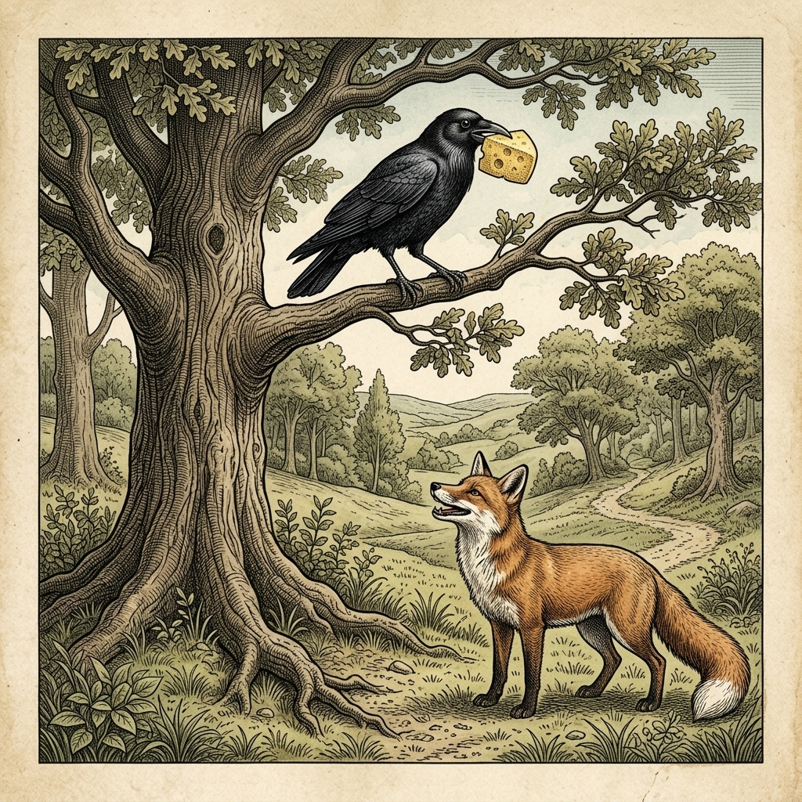
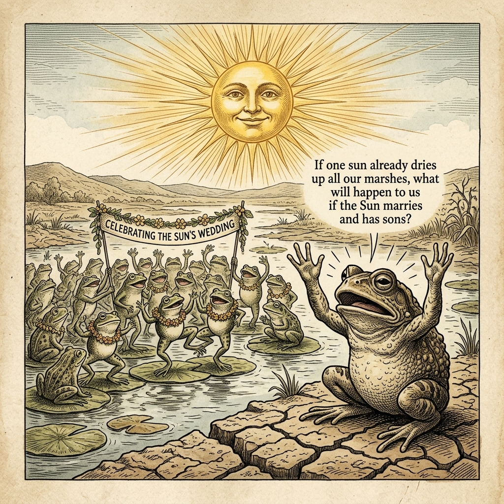
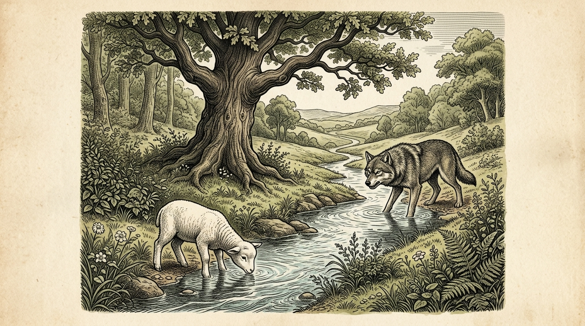

# 『英検ステップアップ多読：イソップ寓話編 第12巻（2級 ➔ 準1級対比学習・第3集）』

---

## はじめに：なぜ「対比多読」で英検準1級の壁を突破できるのか？

英検準1級は、真の英語上級者・プロフェッショナルとしての実力を証明する最高水準の資格です。

2級の英文が「平明で整った論理的文章」であるのに対し、準1級の英文は**「語彙の高度化（GRE/SATレベルのアカデミックワード）」**、**「格調高い比喩・対比・含意」**、そして**「深みのあるニュアンスの精緻な描き分け」**が要求されます。

本書では、世界中で読み継がれてきたイソップ寓話（第3集・10話）を題材に、**「整然とした2級英語」** が **「知的で格調高い準1級マスター英語」** へとどのように昇華していくかを極上の対比で体感します。

* **物語の骨格（2級英語）** で的確かつ論理的な文脈を捉える
* **格調高き上級英語（準1級英語）** で、TIME誌やThe Economistに匹敵する生きたアカデミック語彙・慣用句を吸収する
* **暗唱キーフレーズ対比** で、ライティング（要約・意見論述）や面接でネイティブを唸らせる高度な発信力を手に入れる

楽しく名作寓話の深淵に触れながら、英検準1級合格への決定打を掴み取りましょう！

---

## 本書の収録作品（第3集・全10話）

1. **Chapter 21**: アンドロクロスとライオン (*Androcles and the Lion*) [Perry 563]
2. **Chapter 22**: キツネとカラス (*The Fox and the Crow*) [Perry 124]
3. **Chapter 23**: 木こりと死神 (*The Old Man and Death*) [Perry 60]
4. **Chapter 24**: 鷲とカラス (*The Eagle and the Jackdaw*) [Perry 2]
5. **Chapter 25**: キツネと仮面 (*The Fox and the Mask*) [Perry 27]
6. **Chapter 26**: 鹿と池の影 (*The Stag at the Pool*) [Perry 74]
7. **Chapter 27**: 太陽とカエルたちの結婚 (*The Frogs and the Sun*) [Perry 314]
8. **Chapter 28**: ロバと荷物 (*The Ass and the Load of Salt*) [Perry 180]
9. **Chapter 29**: キツネと木こり (*The Fox and the Woodman*) [Perry 22]
10. **Chapter 30**: オオカミと子羊 (*The Wolf and the Lamb*) [Perry 155]

---

## 本書の構成と電子書籍 / Kobo最適化

各章は以下の6段階で構成されています。

```text
┌─────────────────────────────────────────────────────────────┐
│ 1. Chapter Title & Visual Illustration (章タイトル ＆ 挿絵)   │
│ 2. Benchmark Level: 英検2級レベル英文                         │
│ 3. Target Level: 英検準1級レベル英文                          │
│ 4. Classic Original English Text (イソップ寓話クラシック原文)  │
│ 5. Japanese Translation (日本語訳 ＆ 教訓)                     │
│ 6. Recite & Compare (そらんじたいキーフレーズ対比カード)        │
│ 7. Key Vocabulary & Exam Notes (語彙・文法・試験対策解説)        │
└─────────────────────────────────────────────────────────────┘
```

> **【ポイント】 音声読み上げ（TTS）をご利用の方へ**
> 本文セクション（ステップ1〜3）は英語のみで構成されており、電子書籍やKoboの自動音声読み上げ機能（Text-to-Speech）で日本語が混ざることなく、美しい英語音声で快適にリスニング学習していただけます。


# Chapter 21: Androcles and the Lion (アンドロクロスとライオン)

<div style="text-align: center; margin-bottom: 20px;">
  
</div>

## 1. Benchmark Level: Eiken Grade 2 (英検2級レベル本文)
*Read in ~2.5 to 3 minutes. Academic discourse, complex participial structures, and formal vocabulary.*

Under the institutionalized brutality of imperial Roman servitude, an enslaved domestic subordinate named Androcles endured systematic dehumanization beneath a patrician master whose despotism bordered on psychopathy. Recognizing that continued subservience guaranteed physical and spiritual attrition, the desperate youth executed a clandestine evasion into the arid hinterlands of North Africa, ultimately seeking provisional asylum within the recesses of a subterranean limestone grotto.

This precarious equilibrium was shattered when an apex mammalian carnivore—an immense male Barbary lion—staggered into the sanctuary, emitting guttural lamentations indicative of physiological distress. Paralyzed by mortal dread, the fugitive prepared for instantaneous evisceration; nevertheless, acute empirical observation revealed that the colossal predator was rendered non-lethal by acute physical disability. Trembling with trepidation yet recognizing a moral imperativeness, Androcles approached the recumbent beast, discerning a calcified acacia spine deeply embedded within the suppurating tissue of its right forepaw. Mobilizing rudimentary surgical dexterity, the fugitive extracted the invasive obstruction and meticulously debrided the infected wound. What commenced as an alliance of desperation rapidly evolved into an interspecies symbiosis; bound by reciprocal fidelity, the carnivore routinely provisioned the grotto with fresh game, sustaining their subterranean cohabitation for over three continuous years.

Inevitably, Roman military patrols combing the frontier apprehended the fugitive, repatriating him to the metropolis where judicial authorities condemned him to damnatio ad bestias—execution by exposure to ravenous beasts in the imperial amphitheater. On the day of spectacle, before tens of thousands of bloodthirsty plebeians, Androcles was deposited defenseless in the sand, while a famished feline predator, starved for consecutive days to optimize lethal aggression, was propelled from the subterranean hypogeum.

With thunderous roars reverberating throughout the colosseum, the beast charged; miraculously, the trajectory of homicidal momentum terminated abruptly at the captive's feet. Rather than dismembering the condemned youth, the predator experienced an instantaneous cognitive reconnection, bowing with submissive reverence and affectionately caressing the man's trembling extremities. Confronted with this unprecedented suspension of predatory instinct, the Roman sovereign halted the spectacle, demanding an immediate judicial deposition. Deeply moved by this profound manifestation of cross-species fidelity and acknowledging the transcendence of primal compassion over institutionalized cruelty, the emperor commuted Androcles's capital sentence, conferring unconditional emancipation upon the man and returning the majestic carnivore to its sovereign wilderness.

Altruistic intervention operates as an indestructible currency within the moral architecture of the universe, demonstrating that compassionate deeds performatively dismantle the mechanisms of lethal tyranny.

---

## 2. Target Level: Eiken Grade Pre-1 (英検準1級レベル本文)
*Read in ~3.5 to 4.5 minutes. Highly sophisticated literary and academic prose, complex inversion, advanced vocabulary, and nuanced rhetoric.*

Entrenched within the coercive apparatus of Roman chattel slavery, an alienated subordinate designated Androcles endured systemic psychological degradation and corporal torment under the capricious despotism of a provincial proconsul. Realizing that continued subservience inexorably culminated in physical annihilation, the desperate bondsman initiated a clandestine trans-frontier migration, seeking precarious asylum within the inhospitable geological fissures of the Numidian desert. Penetrating a subterranean cavern of calcified limestone, he established a precarious sanctuary, subsisting upon wild vegetation and stagnant rainwater.

This fragile pastoral seclusion was irrevocably compromised by the sudden ingress of an apex carnivore—a colossal Barbary lion whose guttural vocalizations resonated with unbearable somatic distress. Immobilized by visceral terror, the fugitive initially anticipated instantaneous anatomical dismemberment; however, rigorous empirical observation illuminated a profound biological anomaly: the formidable predator was rendered functionally incapacitated by severe acute trauma. Suppressing his autonomic panic response, Androcles approached the recumbent feline, perceiving an inflamed, suppurating puncture wound within its swollen dexter paw, wherein a hardened acacia spine remained deeply embedded. Exercising delicate mechanical precision, the runaway slave carefully extracted the calcified foreign body, subsequently debriding the necrotic margins and applying soothing herbal compresses. What commenced as a tentative détente born of shared vulnerability rapidly crystallized into an unprecedented interspecies symbiosis. Bound by an immutable ethos of reciprocal benevolence, the magnificent carnivore systematically provisioned the subterranean redoubt with fresh game, sustaining their harmonious cohabitation across multiple seasonal cycles.

Inevitably, an imperial cohort conducting systematic counter-insurgency sweeps apprehended the fugitive, consigning him to the capital where administrative magistrates condemned the recidivist runaway to damnatio ad bestias—public execution via consumption by famished wild beasts within the Flavian Amphitheater. On the designated afternoon of execution, before an amphitheater overflowing with bloodthirsty patricians and plebeians, Androcles was abandoned weaponless upon the sand. From the subterranean hypogeum was unleashed an immense carnivore, deliberately subjected to prolonged caloric deprivation to heighten its predatory ferocity.

Emitting thunderous acoustic vibrations that shook the arena’s foundations, the feline launched a ferocious ballistic charge; yet, at the precise threshold of lethal collision, the beast's predatory momentum underwent an instantaneous physiological and cognitive cessation. Recognizing its subterranean benefactor, the sovereign predator abandoned all predatory impulses, prostrating itself in veneration and affectionately licking the captive's paralyzed extremities. Paralyzed by cognitive dissonance at this miraculous suspension of instinctive carnivory, the assembled spectators erupted in bewildered uproar, prompting the Roman emperor to summon the bondsman for an immediate judicial inquiry. Profoundly moved by this sublime chronicle of cross-species solidarity, and acknowledging that reciprocal fidelity had nullified the arbitrary jurisdiction of imperial law, the sovereign conferred absolute legal emancipation upon the slave and decreed the unconditional repatriation of the noble beast to its sovereign ecosystem.

Altruistic benevolence constitutes an indestructible transcendent dialectic within the moral cosmos, proving that radical acts of empathy possess the inherent potency to neutralize the lethal violence of totalitarian oppression.

---

## 3. Classic Original English Text (イソップ寓話 クラシック原文)
*Townsend / Jacobs Edition (Public Domain)*

A slave named Androcles once escaped from his master and fled into the forest. As he was wandering about there, he came upon a Lion lying down, groaning and moaning. At first he turned to flee, but finding that the Lion did not pursue him, he turned back and went up to him. As he came near, the Lion put out his paw, which was all swollen and bleeding, and Androcles found that a huge thorn had got into it, and was causing all the pain. He pulled out the thorn and bound up the paw of the Lion, who was soon able to rise and lick the hand of Androcles like a dog. Then the Lion took Androcles to his cave, and every day used to bring him meat from which the two lived. 

But shortly afterwards both Androcles and the Lion were captured, and the slave was sentenced to be thrown to the Lion, after the latter had been kept without food for several days. The Emperor and all his Court came to look on at the spectacle, and Androcles was led out into the middle of the arena. Soon the Lion was let loose from his den, and rushed bounding and roaring towards his victim. But as soon as he came near to Androcles he recognised his friend, and fawned upon him, and licked his hands like a friendly dog. The Emperor was astonished at this strange spectacle and summoned Androcles to him. Androcles told the Emperor all that had happened, and was at once pardoned and set free, while the Lion was also loosed into his native forest.

Gratitude is the sign of noble souls.

---

## 4. Japanese Translation (日本語訳)

ローマの動産奴隷制という強権的な機構に組み込まれていたアンドロクロスという疎外された隷属民は、属州総督の気まぐれな専制政治の下で、体系的な心理的屈辱と肉体的拷問に耐えていました。従属を継続することは必然的に肉体的絶滅に至ることを悟ったこの絶望的な奴隷は、国境を越えた秘密の逃走を敢行し、ヌミディア砂漠の人を寄せ付けぬ地質学的裂け目の中に不安定な亡命の地を求めました。石灰化した石灰岩の地下洞窟に潜入した彼は、自生する植物と澱んだ雨水で命を繋ぎながら、不安定な聖域を築きました。

この脆弱な田園的隠遁生活は、頂点捕食者――耐え難い肉体的苦痛に共鳴する喉を鳴らす重低音を発する巨大なバーバリライオン――の突然の侵入によって決定的に破破されました。本能的な恐怖によって身体を硬直させた逃亡者は、当初は瞬時の解剖学的四肢切断を覚悟しました。しかしながら、綿密な経験的観察が深遠な生物学的異常を明らかにしました。その恐るべき捕食者は、深刻な急性外傷によって機能的に行動不能に陥っていたのです。不随意なパニック反応を抑え込んだアンドロクロスは、横たわるネコ科動物に歩み寄り、その腫れ上がった右前足の中に、硬化したアカシアの棘が深く埋没している化膿した刺し傷を認めました。繊細な機械的正確さを発揮して、逃走奴隷は石灰化した異物を慎重に引き抜き、続いて壊死した縁をデブリードマン（切除清掃）し、鎮静効果のある薬草の湿布を施しました。共有された脆弱性から生じた暫定的な緊張緩和（デタント）として始まった関係は、前例のない異種間共生へと瞬く間に結晶化しました。相互の善意という不変の倫理規範によって結ばれたその気高き肉食獣は、新鮮な獲物を地下の砦へと体系的に供給し、複数の季節の巡りにわたって彼らの調和のとれた同居生活を支えたのです。

しかし必然的に、体系的な反乱鎮圧掃討作戦を展開していた帝国の歩兵隊がこの逃亡者を捕縛し、彼を首都へと引き渡しました。そこで行政官たちはこの再犯逃走奴隷に対し、フラウィウス円形闘技場（コロッセオ）において飢餓状態の野獣による捕食処刑（damnatio ad bestias）の判決を下しました。指定された処刑の午後、血に飢えた貴族や平民で溢れかえる円形劇場の前で、アンドロクロスは武器を持たされぬまま砂の上に遺棄されました。地下の檻からは、捕食の狂暴性を極限まで高めるために長期のカロリー遮断に晒されていた巨大な肉食獣が解き放たれました。

闘技場の基礎を揺るがす轟音の音響振動を放射しながら、ネコ科の巨獣は狂暴な弾道突進を開始しました。しかし、まさに致死的衝突の境界線において、その獣の捕食の勢いは、瞬時の生理的・認知的停止を遂げたのです。地下の恩人を認識した主権者たる捕食者はすべての捕食衝動を放棄し、崇敬の念をもって自らを平伏させ、囚人の麻痺した手足を愛おしそうに舐めました。本能的食肉性のこの奇跡的な停止に対する認知的葛藤によって麻痺した観衆は、当惑した騒然の中に沸き立ち、ローマ皇帝に即座の司法審問のために奴隷を召喚させるに至りました。異種間の連帯というこの崇高な年代記に深く心を動かされ、相互の忠誠が帝国法の恣意的な管轄権を無力化したことを認めた君主は、奴隷に絶対的な法的解放を授与し、その気高き獣をその主権ある生態系へと無条件で本国送還することを布告したのです。

**教訓**: 利他的な善意は道徳的宇宙における不滅の超越的弁証法を構成し、根源的な共感の行為が、全体主義的抑圧の致死的な暴力を無力化する内在的威力を秘めていることを証明している。

---

## 5. Recite & Compare (そらんじたいキーフレーズ対比)
*Memorize these contrastive expressions to elevate speaking, writing, and reading fluency.*

<div class="comparison-card">
  <div class="card-header">■ 場面：共有された脆弱性から生じた緊張緩和が異種間共生へ結晶化</div>
  <div class="card-row-g4"><span class="card-badge-g4">【Grade 2 基礎】</span> <em>alliance of desperation rapidly evolved into an interspecies symbiosis</em></div>
  <div class="card-row-g3"><span class="card-badge-g3">【Pre-1 暗唱】</span> <strong><em>détente born of vulnerability rapidly crystallized into an interspecies symbiosis</em></strong></div>
  <div class="card-note">【ポイント】 <strong>解説・試験活用</strong>：外交用語 `détente`（デタント・緊張緩和）、動詞 `crystallize into...`（〜へと結晶化・具体化する）、名詞 `symbiosis`（共生関係）。</div>
</div>

<div class="comparison-card">
  <div class="card-header">■ 場面：致死的衝突の境界線で突進の勢いが瞬時停止する</div>
  <div class="card-row-g4"><span class="card-badge-g4">【Grade 2 基礎】</span> <em>trajectory of homicidal momentum terminated abruptly at captive's feet</em></div>
  <div class="card-row-g3"><span class="card-badge-g3">【Pre-1 暗唱】</span> <strong><em>at the threshold of collision, momentum underwent instantaneous cessation</em></strong></div>
  <div class="card-note">【ポイント】 <strong>解説・試験活用</strong>：名詞句 `threshold of lethal collision`（致死的衝突の敷居・境界）、動詞句 `undergo instantaneous cessation`（瞬時の停止・消滅を経験する）。</div>
</div>

<div class="comparison-card">
  <div class="card-header">■ 場面：本能の奇跡的停止に対する大衆の認知的葛藤</div>
  <div class="card-row-g4"><span class="card-badge-g4">【Grade 2 基礎】</span> <em>Confronted with unprecedented suspension of predatory instinct</em></div>
  <div class="card-row-g3"><span class="card-badge-g3">【Pre-1 暗唱】</span> <strong><em>Paralyzed by cognitive dissonance at this suspension of instinctive carnivory</em></strong></div>
  <div class="card-note">【ポイント】 <strong>解説・試験活用</strong>：心理学概念 `cognitive dissonance`（認知的不協和・葛藤）、生物学用語 `instinctive carnivory`（本能的肉食性）、過去分詞構文 `Paralyzed by...`。</div>
</div>

<div class="comparison-card">
  <div class="card-header">■ 場面：相互の忠誠が帝国法の恣意的管轄権を無力化する</div>
  <div class="card-row-g4"><span class="card-badge-g4">【Grade 2 基礎】</span> <em>acknowledging transcendence of compassion over institutionalized cruelty</em></div>
  <div class="card-row-g3"><span class="card-badge-g3">【Pre-1 暗唱】</span> <strong><em>reciprocal fidelity had nullified the arbitrary jurisdiction of imperial law</em></strong></div>
  <div class="card-note">【ポイント】 <strong>解説・試験活用</strong>：動詞 `nullify`（〜を無効化する・破棄する）、名詞句 `arbitrary jurisdiction`（恣意的管轄権・専断的裁判権）。法哲学の最高峰表現。</div>
</div>

<div class="comparison-card">
  <div class="card-header">■ 場面：教訓（Moral）</div>
  <div class="card-row-g4"><span class="card-badge-g4">【Grade 2 基礎】</span> <em>Altruistic intervention operates as currency, dismantling lethal tyranny.</em></div>
  <div class="card-row-g3"><span class="card-badge-g3">【Pre-1 暗唱】</span> <strong><em>Altruism constitutes a transcendent dialectic, proving radical empathy neutralizes totalitarian violence.</em></strong></div>
  <div class="card-note">【ポイント】 <strong>解説・試験活用</strong>：哲学用語 `transcendent dialectic`（超越的弁証法）、概念名詞 `radical empathy`（根源的共感）、動詞 `neutralize`（無力化する）。準1級〜1級の真髄。</div>
</div>

---

## 6. Key Vocabulary & Exam Notes (語彙・文法・試験対策解説)

### 【出題頻出語彙・熟語ノート】
- **chattel** [名] 動産、動産奴隷（*chattel slavery*）
- **détente** [名] （国家間の）緊張緩和、デタント（政治外交用語）
- **crystallize** [動] 結晶化する、具体化する、確固たるものになる
- **repatriation** [名] 本国送還、帰還（動詞 *repatriate*）
- **carnivory** [名] 肉食性、肉食の習性（形容詞 *carnivorous*）
- **dissonance** [名] 不調和、不協和音（*cognitive dissonance*「認知的不協和」）
- **nullify** [動] 〜を無効にする、破棄する、帳消しにする（*invalidate*）
- **dialectic** [名] 弁証法、対話的論理（形容詞 *dialectical*）

### 【文法・構文ポイント】
1. **名詞構文の極致 [Cognitive dissonance at the suspension of ...]**
   - 準1級本文: *"Paralyzed by cognitive dissonance at this miraculous suspension of instinctive carnivory..."*
   - ポイント: 「動物が本能的な捕食を停止したという奇跡を目の当たりにして、群衆が頭の整理がつかなくなった」という心理状態を、高密度の専門名詞句（dissonance / suspension / carnivory）で一気に凝縮する準1級エッセイの至高の技法です。
2. **原因・根拠を表す完了分詞構文の埋め込み [having nullified ...]**
   - 準1級本文: *"...acknowledging that reciprocal fidelity had nullified the arbitrary jurisdiction of imperial law..."*
   - ポイント: 法的・政治的秩序が上位の普遍的道徳によって「無効化された（had nullified）」という客観的判断を従属節に配置し、君主の恩赦決定を論理的に基礎づける格調高い構文です。


# Chapter 22: The Fox and the Crow (キツネとカラス)

<div style="text-align: center; margin-bottom: 20px;">
  
</div>

## 1. Benchmark Level: Eiken Grade 2 (英検2級レベル本文)
*Read in ~2.5 to 3 minutes. Academic discourse, complex participial structures, and formal vocabulary.*

Having successfully executed the theft of an artisanal wedge of aged dairy product from an agrarian residence, an arrogant corvid established an elevated vantage point upon an arboreal bough within an ancient deciduous forest. Enveloped in the intoxicating delusion of invulnerability, the avian pilferer contemplated the leisurely consumption of her illicitly acquired spoils, completely detached from the terrestrial hazards operating beneath the woodland canopy.

However, atmospheric currents dispersed the pungent olfactory markers of the delicacy across the forest floor, alerting a prowling vulpine carnivore driven by caloric deficit. Assessing the spatial geometry of the encounter, the fox observed that the coveted prize was suspended beyond the parameters of terrestrial predation; direct physical confrontation being rendered structurally unviable, the tactical predator recognized that psychological subversion represented the singular pathway toward confiscation.

Adopting an posture of ceremonial subservience at the base of the trunk, the Machiavellian strategist launched a sophisticated campaign of hyperbolic adulation. "Greetings, supreme monarch of the avian stratosphere!" the fox intoned with theatrical reverence. "The iridescent brilliance of your ebony plumage reflects the celestial luminescence with a majesty that eclipses all earthly royalties. Reason compels one to deduce that an organism possessing such sublime visual aesthetics must inevitably command an acoustic repertoire of equivalent melodious virtuosity. Could I merely be privileged to experience your sovereign vocalization, I would unequivocally consecrate your absolute hegemony over the natural dominion."

Targeted with surgical precision at the corvid's latent narcissistic vulnerabilities, this rhetorical onslaught induced an instantaneous cognitive distortion. Overwhelmed by the desperate psychological impulse to substantiate this fabricated aesthetic appraisal and establish her acoustic supremacy, the bird discarded all residual survival skepticism. In an uninhibited gesture of exhibitionism, she expanded her wings, tilted her head skyward, and forcefully parted her bill to emit a harsh auditory screech.

The physical consequence was immediate and catastrophic: the cessation of mandibular pressure instantly dissociated the dairy sustenance from her anatomical control. Accelerating under gravitational descent, the nutritional mass plummeted directly toward the forest floor, where the agile predator executed an effortless spatial interception. Ingesting the prize with predatory efficiency, the triumphant fox delivered an incisive pedagogical verdict: "Your acoustic volume proved entirely sufficient, madam; regrettably, your analytical discernment remains lamentably deficient in proportion to your pride."

Uncritical susceptibility to flattery constitutes a profound intellectual vulnerability, allowing parasitic manipulators to exploit egoistic vanity as a lever for material dispossession.

---

## 2. Target Level: Eiken Grade Pre-1 (英検準1級レベル本文)
*Read in ~3.5 to 4.5 minutes. Highly sophisticated literary and academic prose, complex inversion, advanced vocabulary, and nuanced rhetoric.*

Having consummated the clandestine expropriation of a cured wheel of artisan dairy nourishment from a pastoral homestead, a vainglorious corvid established an unassailable arboreal redoubt upon the elevated branch of an ancient oak. Cocooned within an intoxicating cognitive bubble of narcissistic invulnerability, the avian thief prepared to indulge in the protracted consumption of her illicit contraband, utterly oblivious to the subtle predatory calculations fermenting upon the forest floor beneath her perch.

Inevitably, ambient thermal currents disseminated the pungent olfactory profile of the lipid-dense nourishment, alerting a wandering vulpine tactician suffering from chronic caloric deprivation. Executing a rapid topographical assessment, the terrestrial carnivore recognized that the coveted sustenance was suspended entirely beyond the mechanical perimeter of direct physical assault. Structural inaccessibility precluding brute force, the Machiavellian predator deduced that psychological sabotage and rhetorical manipulation constituted the sole viable mechanism for engineering asset transfer.

Stationing himself at the root flare with choreographed humility, the fox orchestrated a devastating barrage of baroque encomiums, weaponizing the target's latent aesthetic vanity. "Hail, unrivaled empress of the avian firmament!" the deceiver intoned in cadences of counterfeit veneration. "The obsidian luster of your magnificent plumage captures the morning light with an iridescent majesty that reduces all terrestrial diadems to vulgar insignificance. Logic unequivocally dictates that an organism endowed with such peerless morphological beauty must simultaneously command an auditory apparatus of transcendental melodious virtuosity. Might I merely be permitted the sublime benediction of hearing your sovereign aria, I should unhesitatingly proclaim your undisputed hegemony over the entirety of the animal commonwealth."

Engineered with psychological precision to paralyze the victim’s critical faculties, this verbal sedative triggered an acute cognitive collapse. The desperate craving to validate this extravagant exterior appraisal overwhelmed the corvid's innate evolutionary skepticism. Subordinating rudimentary survival heuristics to an uncontrollable impulse of exhibitionistic pride, the gullible bird tilted her cranium, extended her pinions, and convulsively severed the mandibular pressure holding her prize in order to unleash a raucous vocalization.

At that fatal instant, the gravitational constant executed its inexorable decree. Deprived of anatomical retention, the nutritional prize dissociated from the corvid's beak and executed an uninhibited vertical plunge through the foliage. Positioning himself beneath the descending vector with surgical spatial anticipation, the agile predator intercepted the falling morsel prior to its contact with the forest floor. Having swallowed the bounty with clinical expedition, the triumphant manipulator delivered an unsparing philosophical critique: "Your decibel capacity, madam, was undeniably formidable; nevertheless, the acute deficiency of your analytical discernment demonstrates that unmitigated conceit operates as the primary solvent of intellectual equilibrium."

Pathological vulnerability to disingenuous adulation constitutes a fatal psychological deficit, whereby parasitic manipulators weaponize the victim's own egoistic self-deception as the precise instrument of their material and existential dispossession.

---

## 3. Classic Original English Text (イソップ寓話 クラシック原文)
*Townsend / Jacobs Edition (Public Domain)*

A Crow had snatched a piece of cheese and flew up into a high tree with it to eat it at her leisure. A Fox, seeing this, resolved to possess himself of the cheese, and coming up to the foot of the tree, began to flatter the Crow. 

"What a noble bird I see before me!" he said. "Her beauty is without equal, the hue of her plumage exquisite. If only her voice were as sweet as her looks are fair, she ought without doubt to be the Queen of the Birds."

The Crow, hugely flattered by this speech, and wishing to show the Fox that she could sing, opened her mouth and gave a loud caw. The cheese fell, and the Fox, snatching it up, said, "My good Crow, your voice is right enough, but your wit is wanting."

Do not trust flatterers.

---

## 4. Japanese Translation (日本語訳)

田園の農家から職人技による熟成乳製品の丸ごと一塊の秘密裏の収奪を成し遂げた自惚れの強いカラスが、古代のオークの木の高い枝の上に侵しがたい樹上砦を築きました。自己愛的な不可侵性の酩酊するような認知的泡に包まれたこの鳥の盗賊は、自らの止まり木の下の林床で醸成されていた巧妙な捕食的計算にまったく気づかないまま、不法に入手した密輸品の長期的な消費に耽ろうと準備していました。

必然的に、周囲の熱気流が脂質の濃密な栄養源の刺激的な嗅覚プロファイルを拡散させ、慢性的カロリー欠乏に苦しむ徘徊中のキツネの戦略家を警戒させました。迅速な地形学的評価を実行した地上の肉食獣は、切望する食糧が直接的な肉体的強襲の力学的境界を完全に超えた場所に吊り下げられていることを認識しました。構造的な接近不可能性が武力行使をあらかじめ排除している以上、このマキャベリズム的捕食者は、心理的妨害工作と修辞的誘導こそが資産の移転を画策するための唯一の実行可能な機構であると演繹しました。

計算された謙譲の姿勢で木の根元に位置取ったキツネは、標的の潜在的な審美的虚栄心を兵器化しながら、バロック調の過剰な賛辞の壊滅的な連射を組織しました。「万歳、天空の比類なき女帝よ！」ペテン師は偽りの崇敬の抑揚をつけて朗々と唱えました。「あなたの見事な羽毛の黒曜石の輝きは、地上のあらゆる王冠を下品な取るに足らぬものへと貶める虹色の威厳をもって朝の光を捉えています。論理は、これほど比類なき形態美を授けられた生命体が、同時に超越的な美しい旋律の技巧を誇る聴覚的器官を支配しているに違いないと明白に命じています。もし私があなたの至高のアリアを聴くという崇高な祝福を受けることさえ許されるならば、私は躊躇することなく動物共同体の全体に対するあなたの絶対的な覇権を宣言することでしょう」

犠牲者の批判的能力を麻痺させるよう心理学的正確さをもって設計されたこの言語的鎮静剤は、急性の認知的崩壊を引き起こしました。この過剰な外面の評価を実証したいという必死の渇望が、カラスの生まれ持った進化的猜疑心を圧倒してしまったのです。初歩的な生存のヒューリスティクス（直感的手がかり）を自己顕示的プライドの制御不能な衝動に従属させた騙されやすい鳥は、頭部を傾け、風切羽を広げ、耳障りな発声を解き放つために、自らの獲物を保持していたくちばしの圧力を発作的に解除してしまいました。

その決定的な瞬間に、重力定数がその容赦ない判決を執行しました。解剖学的保持を奪われた栄養の獲物はカラスのくちばしから分離し、木の葉を突き抜けて遮るもののない垂直降下を実行しました。外科的な空間的予見をもって降下ベクトルの真下に身を置いた敏捷な捕食者は、林床に接触する前に落下する獲物を迎撃しました。臨床的な迅速さをもってその恵みを飲み込んだ後、勝利を収めた操縦者は容赦のない哲学的批評を放ちました。「あなたのデシベル容量は紛れもなく圧倒的でしたな、マダム。それにもかかわらず、あなたの分析的識別力の急性の欠乏は、野放しの自惚れが知性の平衡に対する主要な融解剤として機能することを如実に証明していますな」

**教訓**: 不誠実な追従に対する病理学的な脆弱性は致命的な心理的欠陥を構成し、寄生的な操縦者が犠牲者自身の自己愛的な自己欺瞞を兵器化し、その物質的かつ実存的な強奪のためのまさにその精密機器として機能させることを可能にしてしまう。

---

## 5. Recite & Compare (そらんじたいキーフレーズ対比)
*Memorize these contrastive expressions to elevate speaking, writing, and reading fluency.*

<div class="comparison-card">
  <div class="card-header">■ 場面：潜在的虚栄心を兵器化し、過剰な賛辞を浴びせる</div>
  <div class="card-row-g4"><span class="card-badge-g4">【Grade 2 基礎】</span> <em>launched a sophisticated campaign of hyperbolic adulation</em></div>
  <div class="card-row-g3"><span class="card-badge-g3">【Pre-1 暗唱】</span> <strong><em>orchestrated a barrage of baroque encomiums, weaponizing latent aesthetic vanity</em></strong></div>
  <div class="card-note">【ポイント】 <strong>解説・試験活用</strong>：名詞句 `baroque encomiums`（過剰に装飾的な賛辞・頌歌）、分詞構文 `weaponizing latent aesthetic vanity`（潜在的な審美的虚栄心を兵器化しながら）。</div>
</div>

<div class="comparison-card">
  <div class="card-header">■ 場面：言語的鎮静剤が急性の認知的崩壊を引き起こす</div>
  <div class="card-row-g4"><span class="card-badge-g4">【Grade 2 基礎】</span> <em>rhetorical onslaught induced an instantaneous cognitive distortion</em></div>
  <div class="card-row-g3"><span class="card-badge-g3">【Pre-1 暗唱】</span> <strong><em>verbal sedative triggered an acute cognitive collapse, overwhelming evolutionary skepticism</em></strong></div>
  <div class="card-note">【ポイント】 <strong>解説・試験活用</strong>：比喩 `verbal sedative`（言葉による鎮静剤・麻酔）、名詞 `cognitive collapse`（認知的崩壊）、`evolutionary skepticism`（進化論的猜疑心・警戒心）。</div>
</div>

<div class="comparison-card">
  <div class="card-header">■ 場面：重力定数が容赦ない判決を執行する（落下）</div>
  <div class="card-row-g4"><span class="card-badge-g4">【Grade 2 基礎】</span> <em>cessation of pressure dissociated sustenance from anatomical control</em></div>
  <div class="card-row-g3"><span class="card-badge-g3">【Pre-1 暗唱】</span> <strong><em>gravitational constant executed its inexorable decree; prize executed a vertical plunge</em></strong></div>
  <div class="card-note">【ポイント】 <strong>解説・試験活用</strong>：物理的・法廷的比喩 `gravitational constant executed its inexorable decree`（重力定数がその容赦なき判決を執行した）、名詞句 `vertical plunge`（垂直降下）。</div>
</div>

<div class="comparison-card">
  <div class="card-header">■ 場面：野放しの自惚れが知性の平衡を融解させる</div>
  <div class="card-row-g4"><span class="card-badge-g4">【Grade 2 基礎】</span> <em>analytical discernment remains lamentably deficient in proportion to pride</em></div>
  <div class="card-row-g3"><span class="card-badge-g3">【Pre-1 暗唱】</span> <strong><em>unmitigated conceit operates as the primary solvent of intellectual equilibrium</em></strong></div>
  <div class="card-note">【ポイント】 <strong>解説・試験活用</strong>：名詞句 `unmitigated conceit`（緩和されざる・露骨な自惚れ）、化学的比喩 `primary solvent of intellectual equilibrium`（知性の平衡を溶かす主要な溶媒）。</div>
</div>

<div class="comparison-card">
  <div class="card-header">■ 場面：教訓（Moral）</div>
  <div class="card-row-g4"><span class="card-badge-g4">【Grade 2 基礎】</span> <em>Susceptibility to flattery allows manipulators to exploit vanity as a lever.</em></div>
  <div class="card-row-g3"><span class="card-badge-g3">【Pre-1 暗唱】</span> <strong><em>Manipulators weaponize egoistic self-deception as the precise instrument of dispossession.</em></strong></div>
  <div class="card-note">【ポイント】 <strong>解説・試験活用</strong>：動詞 `weaponize`（兵器化する）、心理学概念 `egoistic self-deception`（利己的な自己欺瞞）、法学概念 `dispossession`（財産剥奪・占有剥奪）。</div>
</div>

---

## 6. Key Vocabulary & Exam Notes (語彙・文法・試験対策解説)

### 【出題頻出語彙・熟語ノート】
- **expropriation** [名] 収用、没収、収奪（動詞 *expropriate*）
- **encomium** [名] 賛辞、称賛の言葉、頌歌（複数形 *encomiums / encomia*）
- **weaponize** [動] 〜を兵器化する、攻撃の手段として転用する
- **sedative** [名] 鎮静剤、心を落ち着かせるもの（形容詞としても使用）
- **inexorable** [形] 容赦ない、動かし難い、不可避の（*relentless*）
- **solvent** [名] 溶媒、溶解剤、解決法（形容詞：支払い能力のある）
- **conceit** [名] 自惚れ、思い上がり（形容詞 *conceited*）
- **dispossession** [名] 剥奪、立ち退き、財産の喪失（動詞 *dispossess*）

### 【文法・構文ポイント】
1. **化学的・物理的メタファーの哲学的転用 [solvent of equilibrium]**
   - 準1級本文: *"...unmitigated conceit operates as the primary solvent of intellectual equilibrium."*
   - ポイント: 「自惚れが知性のバランスを溶かす溶媒（solvent）となる」という物質的アナロジー。抽象的概念に鮮烈な物理性を与える高度な修辞法です。
2. **接続詞 [whereby] を用いた因果・手段の精緻な関係づけ**
   - 準1級本文: *"...a fatal psychological deficit, whereby parasitic manipulators weaponize the victim's own egoistic self-deception..."*
   - ポイント: `whereby`（それによって〜するところの）は、関係副詞として前の事態（心理的欠陥）を通じて次の結果（搾取）が構造的に生じる道筋を示す格調高い接続語です。


# Chapter 23: The Old Man and Death (木こりと死神)

<div style="text-align: center; margin-bottom: 20px;">
  
</div>

## 1. Benchmark Level: Eiken Grade 2 (英検2級レベル本文)
*Read in ~2.5 to 3 minutes. Academic discourse, complex participial structures, and formal vocabulary.*

Exhausted by continuous decades of agrarian hardship, a destitute woodcutter was laboriously negotiating a steep mountainous incline under the relentless thermal radiation of the midday sun, staggering beneath an immense load of harvested timber that compromised his skeletal equilibrium. Bereft of nutritional sustenance and having surpassed the absolute boundaries of neuromuscular stamina, the senescent laborer experienced acute physiological decompensation.

Incapacitated by excruciating spinal strain, the laborer precipitated his cargo onto the gravel and collapsed into the trailside dust, overwhelmed by acute psychological dejection. Yielding to an impulsive surge of nihilistic despair, the demoralized individual verbalized an explicit invocation directed toward the metaphysical void: "This mortal existence constitutes nothing more than an unbroken sequence of economic deprivation and biological torment! Having exhausted all emotional justification for prolonging this misery, I formally summon the entity of Death to extinguish my consciousness and consign my physical vessel to the grave."

To his profound psychological shock, the ontological barrier between abstract metaphor and objective reality instantaneously disintegrated. From the encroaching gloom materialized the anthropomorphic manifestation of mortality—the Grim Reaper, wielding his harvest scythe and radiating an aura of subterranean chill. "Pursuant to your categorical petition, mortal petitioner, I have breached the threshold of eternity to accommodate your departure," the apparition intoned in a chilling baritone. "Declare the execution of your ultimate mandate."

Confronted with the immediate, visceral reality of his own terminal extinguishment, the woodcutter's theoretical death wish underwent an instantaneous psychological inversion. The existential lamentations that had characterized his despair vanished, completely eclipsed by the deep-seated neurological impulse of self-preservation. Mobilizing extraordinary presence of mind amidst intense somatic tremor, the aging laborer dissembled his panic, feigned deferential composure, and fabricated a spontaneous rationalization: "Most venerable sovereign, observing that this unwieldy parcel of timber had inadvertently decoupled from my frame, I merely solicited your immense strength to assist me in re-hoisting the burden onto my shoulders so that I might resume my domestic transit."

When subjected to acute socioeconomic stress, human beings are prone to vocalizing superficial flirtations with mortality; nevertheless, when confronted by the actual abyss of non-existence, the biological imperative for self-preservation unequivocally supersedes all theoretical grievances.

---

## 2. Target Level: Eiken Grade Pre-1 (英検準1級レベル本文)
*Read in ~3.5 to 4.5 minutes. Highly sophisticated literary and academic prose, complex inversion, advanced vocabulary, and nuanced rhetoric.*

Emaciated by a lifetime of merciless agrarian exploitation, an impoverished woodcutter navigated a treacherous alpine trajectory beneath the oppressive thermal onslaught of the summer solstice, bearing an immense payload of harvested timber that severely distorted his musculoskeletal architecture. Bereft of physiological nourishment and having long exceeded the adaptive boundaries of cellular homeostasis, the senescent laborer experienced a catastrophic neuromuscular collapse, his staggering gait terminating in a sudden, involuntary kinetic failure.

Overpowered by excruciating spinal trauma and systemic exhaustion, the laborer violently dislodged his burdensome cargo onto the calcified scree and sank into the dust, completely unmoored by existential dejection. Succumbing to an impulsive paroxysm of theoretical nihilism, the desperate mortal verbalized an irrevocable invocation directed at the metaphysical cosmos: "This corporeal existence represents an intolerable continuum of penury, degradation, and inescapable suffering! Having liquidated all biological justification for perpetuating this agonizing somatic tenancy, I explicitly summon Thanatos—the absolute sovereign of the terminal threshold—to extinguish my vital spark and dissolve my consciousness into eternal nothingness!"

In terrifying refutation of the assumption that metaphysical cries remain unanswered, the veil separating linguistic abstraction from ontological reality instantaneously disintegrated. Coalescing from the shifting twilight materialized the chilling, anthropomorphic avatar of absolute mortality—the Grim Reaper, wielding his archaic harvesting scythe and radiating an atmospheric temperature approaching absolute zero. "In strict adherence to your categorical summons, ephemeral mortal, I have manifested within your spatio-temporal coordinates," the apparition resonated with subterranean resonance. "Enunciate your final commission, that I may execute the terminal severing of your mortal coil."

Confronted with the unmediated, visceral horror of his imminent biological annihilation, the woodcutter’s romanticized flirtation with mortality suffered an instantaneous ontological rupture. The theatrical melancholy that had animated his theatrical plea vanished without a trace, entirely subordinated to the primal, non-negotiable neurological mandate of self-preservation. Mobilizing an astounding reserve of cognitive equilibrium amidst violent somatic tremors, the terrified peasant masked his psychological disintegration, manufactured an attitude of deferential obsequiousness, and improvised a brilliant tactical rationalization: "Sublime sovereign of the abyss, perceiving that this cumbersome parcel of cordwood had inadvertently decoupled from my spine, I merely solicited your omnipotent musculature to assist me in elevating the burden back onto my shoulders, that I might complete my homeward transit."

Under conditions of transient socioeconomic despair, human beings routinely indulge in rhetorical posturing regarding the desirability of non-existence; nevertheless, when confronted by the actual, yawning precipice of finality, the primordial imperative of biological survival unequivocally dismantles all philosophical affectations of world-weariness.

---

## 3. Classic Original English Text (イソップ寓話 クラシック原文)
*Townsend / Jacobs Edition (Public Domain)*

An Old Man that had travelled a long way with a huge bundle of sticks, found himself so weary that he cast it down, and called upon Death to deliver him from his troubles. 

Death appeared immediately in answer to his summons, and asked him what he wanted with him. 

The Old Man, terrified, replied: "Only that you would please to lift that load of sticks upon my shoulders again."

We would often die when our troubles are heavy, but when Death draws near, we cling to life.

---

## 4. Japanese Translation (日本語訳)

無慈悲な農業的搾取の生涯によって衰弱しきった貧しい木こりが、夏至の抑圧的な熱攻撃の下、筋骨格の構造を著しく歪める伐採木材の巨大な荷重を背負い、危険な高山の軌道を歩いていました。生理的栄養補給も奪われ、細胞の恒常性（ホメオスタシス）の適応限界をとうに超過していたこの高齢の労働者は、壊滅的な神経筋の機能崩壊に見舞われ、そのよろめく歩行は突然の不随意な運動不全によって終焉を迎えました。

耐えがたい脊椎の外傷と全身の疲弊に圧倒された労働者は、重苦しい荷物を石灰化した瓦礫の上に激しく投げ落とし、実存的な意気消沈に完全に漂流させられながら埃の中に沈み込みました。観念的ニヒリズムの発作的な発作に屈したこの絶望的な定命の人間は、形而上学的な宇宙に向けて取り消しのつかない召喚の言葉を発しました。「この肉体的な実存は、貧困、屈辱、そして逃れられない苦難の耐え難い連続体を表している！この苦痛に満ちた肉体的占有（身体の維持）を永続させるための生物学的正当性をすべて清算した今、私はタナトス――終末の閾値の絶対的主権者――を明確に呼び出し、我が生命の火花を消滅させ、自らの意識を永遠の虚無へと溶解させることを要求する！」

形而上学的な叫びは無応答のままであるという前提に対する恐るべき反駁として、言語的抽象と存在論的現実を隔てる幕が瞬時に崩壊しました。移ろう薄明の中から凝結して具現化したのは、絶対的死の身の毛もよだつ擬人化されたアバター――古風な収穫の大鎌を振りかざし、絶対零度に近づく大気温度を放射する死神――でした。「お前の絶対的な召喚に対する厳格な遵守において、泡沫の人間よ、私はお前の時空間座標の中に具現化した」とその亡霊は地下の共鳴をもって響き渡りました。「お前が死すべき定めの糸の決定的な切断を私が執行できるよう、お前の最後の命令を言明せよ」

自らの差し迫った生物学的消滅という直接的で生々しい恐怖に直面した木こりの、死に対するロマン主義的な弄びは、瞬時の存在論的破綻を被りました。彼の演劇的な嘆願を活気づけていた芝居がかった憂鬱は跡形もなく消え去り、原初の、妥協不可能な自己保存の神経学的至上命令へと完全に屈服したのです。激しい身体の震えの中で驚異的な認知的平衡の予備力を動員した怯える農夫は、自らの心理的崩壊を仮面で隠し、恭順な卑屈さの態度を捏造し、見事な戦術的弁明を即興で編み出しました。「深淵の崇高なる主権者様、この厄介な薪の束が私の背骨から不意に外れてしまったことを認め、私が家路への移動を完了できるよう、その重荷を再び私の肩へと持ち上げるのを手伝っていただくため、あなたの全能の筋力を請い願ったに過ぎないのです」

**教訓**: 一過性の社会経済的絶望の状況下において、人間は非存在の望ましさに関する修辞的なポーズを日常的に気取るものである。しかしながら、最後の実際のあくびをする断崖（死の深淵）に直面したとき、生物学的生存の原初の至上命令は、世を儚むあらゆる哲学的気取りを明白に解体するのである。

---

## 5. Recite & Compare (そらんじたいキーフレーズ対比)
*Memorize these contrastive expressions to elevate speaking, writing, and reading fluency.*

<div class="comparison-card">
  <div class="card-header">■ 場面：言語的抽象と存在論的現実を隔てる幕が崩壊する</div>
  <div class="card-row-g4"><span class="card-badge-g4">【Grade 2 基礎】</span> <em>ontological barrier between metaphor and reality disintegrated</em></div>
  <div class="card-row-g3"><span class="card-badge-g3">【Pre-1 暗唱】</span> <strong><em>veil separating linguistic abstraction from ontological reality disintegrated</em></strong></div>
  <div class="card-note">【ポイント】 <strong>解説・試験活用</strong>：認識論的比喩 `veil separating linguistic abstraction from ontological reality`（言語的抽象と存在論的現実を隔てる幕）、動詞 `disintegrate`（崩壊する）。</div>
</div>

<div class="comparison-card">
  <div class="card-header">■ 場面：厳格な遵守の下、時空間座標に具現化する</div>
  <div class="card-row-g4"><span class="card-badge-g4">【Grade 2 基礎】</span> <em>Pursuant to petition, I breached threshold of eternity</em></div>
  <div class="card-row-g3"><span class="card-badge-g3">【Pre-1 暗唱】</span> <strong><em>In strict adherence to summons, manifested within spatio-temporal coordinates</em></strong></div>
  <div class="card-note">【ポイント】 <strong>解説・試験活用</strong>：成句 `In strict adherence to...`（〜の厳格な遵守において）、物理・哲学用語 `spatio-temporal coordinates`（時空間座標）。</div>
</div>

<div class="comparison-card">
  <div class="card-header">■ 場面：死へのロマン主義的弄びが瞬時の存在論的破綻を被る</div>
  <div class="card-row-g4"><span class="card-badge-g4">【Grade 2 基礎】</span> <em>theoretical death wish underwent psychological inversion</em></div>
  <div class="card-row-g3"><span class="card-badge-g3">【Pre-1 暗唱】</span> <strong><em>romanticized flirtation with mortality suffered instantaneous ontological rupture</em></strong></div>
  <div class="card-note">【ポイント】 <strong>解説・試験活用</strong>：名詞句 `romanticized flirtation with mortality`（死に対するロマン化された戯れ・弄び）、`ontological rupture`（存在論的破綻・断絶）。</div>
</div>

<div class="comparison-card">
  <div class="card-header">■ 場面：心理的崩壊を隠し、即興の戦術的弁明を編み出す</div>
  <div class="card-row-g4"><span class="card-badge-g4">【Grade 2 基礎】</span> <em>dissembled panic, feigned composure, fabricated a rationalization</em></div>
  <div class="card-row-g3"><span class="card-badge-g3">【Pre-1 暗唱】</span> <strong><em>masked psychological disintegration and improvised a brilliant tactical rationalization</em></strong></div>
  <div class="card-note">【ポイント】 <strong>解説・試験活用</strong>：名詞句 `psychological disintegration`（心理的崩壊・精神の解体）、動詞 `improvise`（即興で作る）、名詞句 `tactical rationalization`（戦術的正当化・言い訳）。</div>
</div>

<div class="comparison-card">
  <div class="card-header">■ 場面：教訓（Moral）</div>
  <div class="card-row-g4"><span class="card-badge-g4">【Grade 2 基礎】</span> <em>confronted by abyss of non-existence, biological imperative supersedes grievances</em></div>
  <div class="card-row-g3"><span class="card-badge-g3">【Pre-1 暗唱】</span> <strong><em>Confronted by finality, primordial imperative of survival dismantles philosophical affectations.</em></strong></div>
  <div class="card-note">【ポイント】 <strong>解説・試験活用</strong>：名詞句 `primordial imperative of biological survival`（生物学的生存の原初の至上命令）、`philosophical affectations of world-weariness`（世を儚む哲学的気取り）。実存主義文学の極限表現。</div>
</div>

---

## 6. Key Vocabulary & Exam Notes (語彙・文法・試験対策解説)

### 【出題頻出語彙・熟語ノート】
- **emaciated** [形] やつれた、衰弱した（名詞 *emaciation*）
- **paroxysm** [名] （感情・病気などの）発作、激発
- **nihilism** [名] 虚無主義、ニヒリズム（形容詞 *nihilistic*）
- **Thanatos** [名] タナトス、死の神、死への本能（精神分析用語）
- **ephemeral** [形] つかの間の、儚い、短命な（*transient / fleeting*）
- **rupture** [名] 破裂、断絶、決裂（動詞としても使用）
- **obsequiousness** [名] こびへつらい、卑屈（形容詞 *obsequious*）
- **affectation** [名] 気取り、見せかけ、不自然な態度（動詞 *affect*）

### 【文法・構文ポイント】
1. **[suffer + 抽象名詞（破綻・損害）] による劇的叙述**
   - 準1級本文: *"...the woodcutter’s romanticized flirtation with mortality suffered an instantaneous ontological rupture."*
   - ポイント: `suffer` は病気にかかるだけでなく、「抽象的な論理や構想が破綻・崩壊を被る」という文脈で極めて格調高い表現として機能します。
2. **名詞 [affectation]（気取り）の批判的用法**
   - 準1級本文: *"...dismantles all philosophical affectations of world-weariness."*
   - ポイント: 「真実味のないポーズや気取り」を告発する重要単語。エッセイで人間の偽善や欺瞞を論駁する際の決め手となる語彙です。


# Chapter 24: The Eagle and the Jackdaw (鷲とカラス)

<div style="text-align: center; margin-bottom: 20px;">
  
</div>

## 1. Benchmark Level: Eiken Grade 2 (英検2級レベル本文)
*Read in ~2.5 to 3 minutes. Academic discourse, complex participial structures, and formal vocabulary.*

Executing a high-velocity ballistic descent from a jagged alpine cliff, an apex golden eagle intercepted a juvenile ovine specimen with flawless aerodynamic precision, utilizing phenomenal pectoral musculature to hoist the struggling prey aloft toward its montane eyrie. Observing this exhibition of aerial dominance from a neighboring vantage point, an egocentric corvid—a diminutive jackdaw—succumbed to a profound cognitive bias: erroneously conceptualizing the raptor's triumph not as the culmination of evolutionary specialization, but as an easily replicable mechanical stunt.

Impelled by reckless vanity, the bird formulated an irrational intention to duplicate the feat on an amplified scale. Surveying the pastoral landscape beneath, he deliberately bypassed modest prey, electing instead to target the dominant patriarch of the flock—a massive, fully matured ram possessing formidable mass and curled horns. Initiating a dive accompanied by an undignified squawk, the jackdaw slammed precipitously onto the quadruped's spinal column, vigorously embedding his slender talons into the dense, crimped matrix of the fleece.

The instantaneous outcome constituted an absolute refutation of his delusions. When the bird mobilized his full wing stroke to achieve vertical propulsion, the structural immensity of the unyielding herbivore absorbed the kinetic energy without displacement; the ram merely twitched its ear and continued grazing. Compounding this operational failure, the bird's recurved claws became hopelessly ensnared within the interlocking keratinous fibers of the fleece. Every frantic, uncoordinated flap served only to tighten the fibrous entanglement, rendering autonomous extrication physically impossible.

Observing this farcical sequence of events with cynical amusement, the attending pastoralist strode across the turf and apprehended the immobilized corvid without resistance. Subjecting the creature to bilateral pinioning—surgically severing the primary flight feathers to eradicate aerodynamic capability—the herdsman transported the humiliated specimen to his domestic quarters to function as an educational plaything for his offspring.

When the children interrogated their father concerning the biological taxonomy of this peculiar captive, the shepherd provided an incisive socio-behavioral critique: "Measured against the metric of his subjective vanity, this creature presumes to occupy the ecological niche of an imperial eagle; evaluated, however, through the objective lens of his performance, he stands revealed as a preposterous jackdaw."

Uncritical emulation of extraordinary achievements in the absence of corresponding competence inevitably converts ambitious aspirations into public spectacles of catastrophic ridicule.

---

## 2. Target Level: Eiken Grade Pre-1 (英検準1級レベル本文)
*Read in ~3.5 to 4.5 minutes. Highly sophisticated literary and academic prose, complex inversion, advanced vocabulary, and nuanced rhetoric.*

Launching an explosive gravitational plunge from the stratospheric precipice of a montane crag, an apex raptor—a mature golden eagle—intercepted a grazing lamb with mathematical ballistic trajectory, deploying phenomenal pectoral torque to wrench the livestock from the earth and ascend effortlessly toward its inaccessible eyrie. Observing this sublime manifestation of biomechanical sovereignty from an adjacent scrub oak, a vainglorious corvid succumbed to a catastrophic episode of cognitive dissonance: misconstruing a triumph of millions of years of evolutionary specialization as a superficial behavioral protocol that could be duplicated through mere theatrical imitation.

Intoxicated by an uncalibrated delusion of physiological equivalence, the diminutive jackdaw resolved to orchestrate an identical predation event on a grandiose scale. Scrutinizing the pastoral basin beneath, the pretender deliberately dismissed vulnerable quarry, electing instead to target the undisputed patriarch of the ovine flock—a colossal, horned ram whose biological mass exceeded the bird’s own physiological threshold by several orders of magnitude. Executing an uncoordinated, flapping descent, the deluded corvid plummeted onto the quadruped’s dorsal ridge, frantically burying his gracile talons into the impenetrable, lanolin-saturated matrix of the curly fleece.

The physical denouement constituted an immediate and absolute ontological humiliation. Mobilizing his total aerobic capacity in an agonized attempt to generate aerodynamic lift, the jackdaw produced zero vertical displacement against the ram’s immense skeletal inertia; the unperturbed herbivore merely flicked its ear and resumed ruminating. To compound this kinetic catastrophe, the bird’s curved talons became irrevocably entwined within the microscopic crimp of the interlocking wool fibers. Every frantic, uncoordinated stroke of his wings functioned not as an instrument of escape, but as an inexorable ratcheting mechanism that anchored his appendages ever more securely within the biological trap.

Having observed this preposterous exhibition of hubris with dry pastoral amusement, the attending shepherd leisurely traversed the pasture and apprehended the hopelessly entangled captive without deploying physical force. Deciding to transform the incompetent usurper into an object lesson on the perils of overreaching ambition, the herdsman executed unilateral pinioning—excising the primary flight feathers to eliminate aerodynamic functionality—and presented the immobilized specimen to his children as a curious household distraction.

When his offspring interrogated the master regarding the specific biological taxonomy of this peculiar organism, the shepherd delivered a devastating philosophical verdict: "Assessed through the subjective prism of his unhinged vanity, this wretched creature masquerades as a monarch of the aerial realm; subjected, however, to the empirical scrutiny of operational competence, he stands unmasked as nothing more than a preposterous, flightless jackdaw."

Blindly emulating the transcendent achievements of superior entities without possessing their requisite structural competence inevitably transforms aspiring overachievers into pathetic spectacles of universal derision.

---

## 3. Classic Original English Text (イソップ寓話 クラシック原文)
*Townsend / Jacobs Edition (Public Domain)*

An Eagle flew down from a high mountain crag, and carried away a Lamb in his talons. A Jackdaw saw him, and thought that he could do the same. So he flew down upon a Ram with a great whirr, and fastened his claws in the fleece; but when he tried to fly away again, he found he could not move the Ram, and his claws were so entangled in the wool that he could not get away. 

The Shepherd saw what had happened, and ran up and caught the bird. He clipped his wings, and took him home in the evening to his children. 

"What bird is this?" they cried. 

"Well," said the Shepherd, "if you ask him, he'll tell you he is an Eagle; but I know he is only a Jackdaw."

Do not let your vanity lead you to attempt what is beyond your power.

---

## 4. Japanese Translation (日本語訳)

山岳の岩山の成層圏に届く断崖から爆発的な重力急降下を開始した頂点猛禽――成熟したイヌワシ――は、数学的な弾道軌道をもって草を食む子羊を捕捉し、驚異的な胸筋のトルクを配備してその家畜を大地から引き剥がし、自らの接近不可能な巣へと難なく上昇しました。隣接するカシの低木からこの生体力学的覇権の崇高な現れを観察していた自惚れの強いカラス科の鳥は、壊滅的な認知的不協和の発作に屈しました。何百万年もの進化的専門化の結晶を、単なる演劇的模倣によって再現可能な表層的行動プロトコルに過ぎないと誤認したのです。

生理学的同等性という見境のない妄想に酔いしれたこの小さなニシコクマルガラスは、さらに壮大な規模で同一の捕食事象を組織しようと決意しました。眼下の牧歌的な盆地を精査したその僭称者は、脆弱な獲物をあえて退け、代わりに羊の群れの絶対的な家長――その生物学的質量が鳥自身の生理学的閾値を数桁も上回る巨大な角を持つ雄羊――を標的にすることを選択しました。協調性のない羽ばたき降下を実行した妄想のカラスは、四足動物の背骨の隆起の上に急降下し、縮れた羊毛の侵入不可能なラノリン飽和マトリックスの中に自らの細い爪を必死に埋め込みました。

その物理的な結末は、即座の、かつ絶対的な存在論的屈辱を構成しました。空気力学的揚力を生み出そうと苦悶の試みの中で自らの全有酸素能力を動員したものの、カラスは雄羊の巨大な骨格慣性に対してゼロの垂直変位しか生み出せませんでした。動揺しない草食動物は単に耳をピクッと動かしただけで、そのまま反芻を再開しました。この力学的惨事に輪をかけて、鳥の曲がった爪は、噛み合った羊毛繊維の微細な縮れの中に決定的に絡まり合ってしまいました。彼の翼の必死でバラバラな羽ばたきの一つひとつは、脱出の手段としてではなく、生物学的罠の中に自らの付属器官をいっそう固く固定する容赦ないラチェット（逆転防止）機構として機能したのです。

この傲慢（ヒュブリス）の途方もなくばかげた見せ物を乾いた田園の面白がりをもって観察していた羊飼いは、牧草地を悠然と横切り、力を行使することなく、絶望的にもつれ合った捕虜を捕獲しました。分不相応な野心の危険に関する生きた教材へとその無能な簒奪者を変換させることを決意した牧民は、主風切羽を切除して空気力学的機能を排除する一方的風切羽切断（ピニオニング）を実行し、動けなくなった個体を珍しい家庭内の気晴らしとして子供たちに差し出しました。

子供たちがこの特異な生命体の特定の生物学的分類について主人に質問したとき、羊飼いは痛烈な哲学的宣告を下しました。「自らの狂気じみた虚栄心の主観的プリズムを通して査定するならば、この惨めな生き物は天空の君主を気取っている。しかしながら、作戦上の力量という経験的精査に付されるならば、彼は途方もなく滑稽な飛べないカラス以外の何物でもないことが白日の下に晒されるのだ」

**教訓**: それに必要な構造的能力を保持することなく優れた存在の超越的な業績を盲目的に模倣することは、野心的な過剰達成者を必然的に普遍的な嘲笑の哀れな見世物へと変貌させてしまう。

---

## 5. Recite & Compare (そらんじたいキーフレーズ対比)
*Memorize these contrastive expressions to elevate speaking, writing, and reading fluency.*

<div class="comparison-card">
  <div class="card-header">■ 場面：進化的専門化の極致を表層的模倣プロトコルと誤認する</div>
  <div class="card-row-g4"><span class="card-badge-g4">【Grade 2 基礎】</span> <em>conceptualizing triumph not as specialization, but as a replicable stunt</em></div>
  <div class="card-row-g3"><span class="card-badge-g3">【Pre-1 暗唱】</span> <strong><em>misconstruing evolutionary specialization as a protocol duplicated through theatrical imitation</em></strong></div>
  <div class="card-note">【ポイント】 <strong>解説・試験活用</strong>：動詞 `misconstrue A as B`（AをBと誤解・曲解する）、名詞句 `theatrical imitation`（演劇的な見せかけの模倣）。</div>
</div>

<div class="comparison-card">
  <div class="card-header">■ 場面：羽ばたきが脱出ではなく、罠を締め上げるラチェット機構に</div>
  <div class="card-row-g4"><span class="card-badge-g4">【Grade 2 基礎】</span> <em>fluttering merely tightened knots, rendering extrication impossible</em></div>
  <div class="card-row-g3"><span class="card-badge-g3">【Pre-1 暗唱】</span> <strong><em>flapping functioned as an inexorable ratcheting mechanism, anchoring appendages within the trap</em></strong></div>
  <div class="card-note">【ポイント】 <strong>解説・試験活用</strong>：機械工学用語 `ratcheting mechanism`（ラチェット機構＝一方向にしか進まない締め付け装置）、分詞構文 `anchoring appendages`（付属器官を固定しながら）。</div>
</div>

<div class="comparison-card">
  <div class="card-header">■ 場面：過剰な野心の危険性を教える教材へと変換する</div>
  <div class="card-row-g4"><span class="card-badge-g4">【Grade 2 基礎】</span> <em>transported specimen to function as plaything for offspring</em></div>
  <div class="card-row-g3"><span class="card-badge-g3">【Pre-1 暗唱】</span> <strong><em>transform incompetent usurper into an object lesson on the perils of overreaching ambition</em></strong></div>
  <div class="card-note">【ポイント】 <strong>解説・試験活用</strong>：教育・訓戒用語 `object lesson`（具体的教訓・生きた見本）、名詞句 `perils of overreaching ambition`（身の程を超えた野心の危険性）。</div>
</div>

<div class="comparison-card">
  <div class="card-header">■ 場面：主観的虚栄心では王を気取り、経験的精査では正体を晒す</div>
  <div class="card-row-g4"><span class="card-badge-g4">【Grade 2 基礎】</span> <em>presumes to occupy niche of an eagle; evaluated through lens, stands revealed</em></div>
  <div class="card-row-g3"><span class="card-badge-g3">【Pre-1 暗唱】</span> <strong><em>Assessed through subjective prism, masquerades as a monarch; subjected to scrutiny, stands unmasked</em></strong></div>
  <div class="card-note">【ポイント】 <strong>解説・試験活用</strong>：対比的過去分詞構文 `Assessed through prism..., subjected to scrutiny, stands unmasked...`（プリズムを通して評価され…精査に晒され、仮面を剥ぎ取られる）。</div>
</div>

<div class="comparison-card">
  <div class="card-header">■ 場面：教訓（Moral）</div>
  <div class="card-row-g4"><span class="card-badge-g4">【Grade 2 基礎】</span> <em>Uncritical emulation in absence of competence converts aspirations into ridicule.</em></div>
  <div class="card-row-g3"><span class="card-badge-g3">【Pre-1 暗唱】</span> <strong><em>Emulating achievements without structural competence transforms overachievers into spectacles of derision.</em></strong></div>
  <div class="card-note">【ポイント】 <strong>解説・試験活用</strong>：名詞句 `structural competence`（構造的力量）、動詞句 `transform A into B`、名詞句 `spectacles of universal derision`（普遍的な嘲笑の見せ物）。</div>
</div>

---

## 6. Key Vocabulary & Exam Notes (語彙・文法・試験対策解説)

### 【出題頻出語彙・熟語ノート】
- **denouement** [名] （事件・演劇などの）大詰め、結末、大団円（フランス語起源）
- **misconstrue** [動] 〜を誤解する、曲解する（*misinterpret*）
- **unperturbed** [形] 動揺しない、平然とした（動詞 *perturb*「かき乱す」）
- **ratchet** [名] ラチェット（歯止め輪）、[動] （段階的に）増大させる
- **object lesson** [熟] 具体的教訓、身近な見せしめ
- **usurper** [名] 簒奪者、王位強奪者（動詞 *usurp*）
- **pinion** [動] （鳥の）風切羽を切る、両手を縛る（名詞：風切羽）
- **derision** [名] 嘲笑、愚弄（形容詞 *derisive*、動詞 *deride*）

### 【文法・構文ポイント】
1. **二重の過去分詞による厳格な条件対比構文**
   - 準1級本文: *"Assessed through the subjective prism of his unhinged vanity, this wretched creature masquerades...; subjected, however, to the empirical scrutiny of operational competence, he stands unmasked..."*
   - ポイント: `Assessed through ...` と `subjected to ...` の二つの分詞構文をセミコロンで対置させ、主観的幻想と客観的実態の落差を完璧な構文美で表現しています。
2. **名詞句 [spectacle of derision]（嘲笑の的・見せ物）**
   - 準1級本文: *"...inevitably transforms aspiring overachievers into pathetic spectacles of universal derision."*
   - ポイント: `laughingstock` の極めて格調高い文学的言い換え。批判的エッセイにおいて、無謀な挑戦者の惨めな結末を痛烈に総括する表現です。


# Chapter 25: The Fox and the Mask (キツネと仮面)

<div style="text-align: center; margin-bottom: 20px;">
  
</div>

## 1. Benchmark Level: Eiken Grade 2 (英検2級レベル本文)
*Read in ~2.5 to 3 minutes. Academic discourse, complex participial structures, and formal vocabulary.*

Exploiting an unfastened portal during an interval of human absence, an observant vulpine explorer penetrated the private workshop of a celebrated classical dramatist. Guided primarily by an appetite for nutritional scraps, the animal conducted an exhaustive reconnaissance of the atelier, surveying an eclectic assemblage of stage properties, gilded draperies, and theatrical accessories that littered the creative sanctuary.

During this systematic exploration, the animal's cognitive attention was instantaneously captivated by a sculpted artifact resting in an open cedar chest. It was a classical tragic mask—a theatrical persona carved from dense linden wood and embellished with mineral pigments by a master artisan. The sculpted visage projected an aura of transcendent nobility; its chisel-carved brow, harmoniously proportioned symmetry, and dignified, downward-curving lips simulated the profound philosophical gravity of a legendary monarch confronting cosmic adversity.

Intrigued by the compelling illusion of intellectual majesty, the quadruped gingerly lifted the sculpted head between his paws to execute an empirical tactile assessment. However, upon inverting the artifact to interrogate its internal architecture, the investigator encountered an absolute ontological void: the structure constituted nothing beyond an ultra-thin, concave veneer of sculpted wood and lacquered lacquer. It possessed no biological sensory apparatus, was utterly incapable of linguistic articulation, and contained not a single neuron of cerebral matter.

Contemplating this radical dichotomy between external aesthetic simulation and internal intellectual vacuum, the vulpine philosopher articulated a scathing pedagogical critique: "What formidable majesty your countenance projects toward the superficial observer! How lamentable, nevertheless, that beneath such an imposing aesthetic facade, there exists a state of total cognitive vacancy—neither an organ for contemplation nor a pulse of authentic consciousness."

The seductive prestige of superficial ornamentation constitutes a dangerous illusion; outward signifiers of intellectual or social preeminence possess zero substantive value when completely divorced from internal ethical virtue and analytical substance.

---

## 2. Target Level: Eiken Grade Pre-1 (英検準1級レベル本文)
*Read in ~3.5 to 4.5 minutes. Highly sophisticated literary and academic prose, complex inversion, advanced vocabulary, and nuanced rhetoric.*

Infiltrating the private atelier of a prominent Athenian tragic dramatist via an unlatched casement during an interlude of human absence, an inquisitive vulpine predator initiated an exhaustive reconnaissance of the premises. While ostensibly oriented toward the discovery of discarded gastronomic refuse, the animal’s perceptual apparatus was redirected by an eclectic panoply of theatrical paraphernalia—gilded sceptres, embroidered buskins, and polychromatic draperies—that cluttered the creative sanctuary.

Amidst this curated archive of dramatic artifice, the explorer’s gaze was irrevocably arrested by an extraordinary artisanal relic deposited within an open chest of aromatic cypress. It was a tragic theatrical mask—a classical persona sculpted from seasoned cedar and embellished with polychromatic encaustic pigments by a master craftsman. The carved countenance projected an arresting aesthetic of transcendent gravitas: the sculpted brow manifested profound contemplative melancholy, the aristocratic aquiline contour simulated regal authority, and the parted lips evoked the sublime, stoic resignation of an epic protagonist defying relentless cosmic doom.

Captivated by this hyper-realistic simulacrum of philosophical consciousness, the animal gingerly elevated the artifact between his dexterous forepaws to conduct an unhurried, tactile interrogation of its material properties. However, upon rotating the object to inspect its posterior dimension, the mammalian investigator encountered an absolute ontological nullity: the structural artifact constituted nothing more than an insubstantial, concave perimeter of dried timber and calcified gesso. It was totally devoid of neurological circuitry; it possessed neither visual orbs to process optical stimulation, nor a respiratory apparatus to articulate linguistic meaning, nor an infinitesimal fragment of cerebral tissue to formulate subjective thoughts.

Contemplating this profound, irreconcilable discrepancy between an arresting aesthetic exterior and an absolute internal vacuum, the vulpine philosopher formulated an incisive semiotic critique: "What monumental majesty and philosophical introspection your outward countenance projects toward the superficial observer! How appalling, nevertheless, that beneath such an imposing architectural facade, there resides an ontological wasteland—a profound cognitive vacancy devoid of the slightest flicker of authentic intellect or visceral consciousness."

The fetishization of superficial prestiges constitutes a pervasive cognitive pathology; outward cultural and aesthetic signifiers of intellectual preeminence remain entirely fraudulent and worthless unless substantiated by authentic ethical integrity and rigorous analytical interiority.

---

## 3. Classic Original English Text (イソップ寓話 クラシック原文)
*Townsend / Jacobs Edition (Public Domain)*

A Fox entered the house of an actor and, rummaging through all his properties, came upon a Mask, an admirable imitation of a human head. He placed his paws upon it, and said: 

"What a head is here, and yet it has no brains!"

Outside show is a poor substitute for inner worth.

---

## 4. Japanese Translation (日本語訳)

人間の不在の幕間に掛け金の外れた窓枠を通って著名なアテネの悲劇劇作家の個人アトリエに潜入した好奇心旺盛なキツネの捕食者は、敷地内の網羅的な探索を開始しました。表向きは捨てられた美食の残飯の発見に向けられていたものの、その動物の知覚器官は、その創作の聖域を乱雑に埋めていた小道具の雑多な展示品――金箔の笏、刺繍された舞台用ブーツ、多色の垂れ布――によって引き戻されました。

劇的な虚飾のこの精選された保管庫のただ中で、探索者の視線は芳香を放つイトスギの木箱の中に置かれた並外れた工芸的遺物によって決定的に釘付けにされました。それは悲劇の劇用仮面――熟成されたスギの木から彫り出され、名匠の手によって多色の蝋画顔料で装飾された古典的ペルソナ――でした。彫刻された顔立ちは、超越的な重厚さの心を奪うような美学を放っていました。彫られた眉は深遠な瞑想的憂鬱を表し、貴族的な鷲鼻の輪郭は王室の権威を模倣し、半開きになった唇は、容赦ない宇宙的破滅に立ち向かう叙事詩の主人公の崇高にしてストイックな諦念を呼び起こしていました。

哲学的な意識のこの超現実的なシミュラークル（模造品）に魅了されたその動物は、その物質的特性の悠然とした触覚的吟味を実行するために、器用な前足の間にその人工物をそっと持ち上げました。しかしながら、その背面の構造を点検するために物体を回転させたとき、哺乳類の調査者は絶対的な存在論的無に遭遇しました。その構造的工芸品は、乾燥した木材と石灰化した下地材（ジェッソ）による実体のない凹面の外周以外の何物でも構成されていなかったのです。そこは神経回路を完全に欠いていました。光学的刺激を処理する視覚の眼球も、言語的意味を明瞭に発音する呼吸器官も、主観的思考を形成するための大脳組織の極小の破片すら持っていなかったのです。

心を奪う審美的な外見と絶対的な内部の真空との間のこの深遠で調和不可能な不一致を熟視しながら、キツネの哲学者は鋭敏な記号論的批評を構築しました。「あなたの外面の顔立ちは、表面的な観察者に向かってなんと記念碑的な威厳と哲学的内省を放っていることか！それにもかかわらず、これほど堂々たる建築的外見の真下に、存在論的な荒野――真の知性や生々しい意識の微かな閃きすら欠如した深遠な認知的空白――が宿っているとは、なんと恐るべきことだろう」

**教訓**: 表面的な威信の物神化（フェティシズム）は蔓延した認知病理を構成する。知的な卓越性の外面的な文化的・審美的記号は、真の倫理的誠実さと厳格な分析的内面性によって裏付けられない限り、完全に詐欺的であり、無価値のままである。

---

## 5. Recite & Compare (そらんじたいキーフレーズ対比)
*Memorize these contrastive expressions to elevate speaking, writing, and reading fluency.*

<div class="comparison-card">
  <div class="card-header">■ 場面：劇的虚飾の展示の中で、工芸的遺物に視線が釘付けになる</div>
  <div class="card-row-g4"><span class="card-badge-g4">【Grade 2 基礎】</span> <em>attention was instantaneously captivated by a sculpted artifact</em></div>
  <div class="card-row-g3"><span class="card-badge-g3">【Pre-1 暗唱】</span> <strong><em>Amidst panoply of dramatic artifice, gaze was arrested by an extraordinary relic</em></strong></div>
  <div class="card-note">【ポイント】 <strong>解説・試験活用</strong>：名詞句 `panoply of dramatic artifice`（劇的虚飾・技巧の華麗な展示）、動詞句 `gaze was arrested by...`（視線が〜に釘付けにされる）。</div>
</div>

<div class="comparison-card">
  <div class="card-header">■ 場面：意識の超現実的シミュラークル（模造品）に魅了される</div>
  <div class="card-row-g4"><span class="card-badge-g4">【Grade 2 基礎】</span> <em>Intrigued by the compelling illusion of intellectual majesty</em></div>
  <div class="card-row-g3"><span class="card-badge-g3">【Pre-1 暗唱】</span> <strong><em>Captivated by this hyper-realistic simulacrum of philosophical consciousness</em></strong></div>
  <div class="card-note">【ポイント】 <strong>解説・試験活用</strong>：現代哲学用語 `simulacrum`（シミュラークル・実体のない模造品）、名詞句 `philosophical consciousness`（哲学的意識）。</div>
</div>

<div class="comparison-card">
  <div class="card-header">■ 場面：反転させると絶対的な存在論的「無」に遭遇する</div>
  <div class="card-row-g4"><span class="card-badge-g4">【Grade 2 基礎】</span> <em>inverting artifact to interrogate architecture, encountered ontological void</em></div>
  <div class="card-row-g3"><span class="card-badge-g3">【Pre-1 暗唱】</span> <strong><em>inspecting posterior dimension, encountered an absolute ontological nullity</em></strong></div>
  <div class="card-note">【ポイント】 <strong>解説・試験活用</strong>：解剖・空間用語 `posterior dimension`（背面・後部）、存在論概念 `ontological nullity`（存在論的無・虚無）。</div>
</div>

<div class="comparison-card">
  <div class="card-header">■ 場面：堂々たる外見の真下に存在する存在論的荒野・認知的空白</div>
  <div class="card-row-g4"><span class="card-badge-g4">【Grade 2 基礎】</span> <em>beneath imposing facade, exists a state of total cognitive vacancy</em></div>
  <div class="card-row-g3"><span class="card-badge-g3">【Pre-1 暗唱】</span> <strong><em>beneath imposing facade, resides an ontological wasteland—a cognitive vacancy</em></strong></div>
  <div class="card-note">【ポイント】 <strong>解説・試験活用</strong>：比喩表現 `ontological wasteland`（存在論的荒野）、名詞句 `cognitive vacancy`（認知的空虚・空白）。</div>
</div>

<div class="comparison-card">
  <div class="card-header">■ 場面：教訓（Moral）</div>
  <div class="card-row-g4"><span class="card-badge-g4">【Grade 2 基礎】</span> <em>Signifiers of preeminence possess zero value when divorced from virtue.</em></div>
  <div class="card-row-g3"><span class="card-badge-g3">【Pre-1 暗唱】</span> <strong><em>Fetishization of prestige constitutes pathology; signifiers remain fraudulent unless substantiated by interiority.</em></strong></div>
  <div class="card-note">【ポイント】 <strong>解説・試験活用</strong>：社会学用語 `Fetishization of prestige`（威信の物神化）、`cognitive pathology`（認知病理）、哲学的概念 `analytical interiority`（分析的内面性）。</div>
</div>

---

## 6. Key Vocabulary & Exam Notes (語彙・文法・試験対策解説)

### 【出題頻出語彙・熟語ノート】
- **panoply** [名] （見事な品々の）一揃い、壮観な展示
- **artifice** [名] 器用な工作、偽り、策略、虚飾（形容詞 *artificial*）
- **gravitas** [名] 荘重さ、重厚さ、尊厳（ラテン語由来の教養語）
- **simulacrum** [名] 面影、まぼろし、実体のない模造品（複数形 *simulacra*）
- **nullity** [名] 無、無効、取るに足らないもの（形容詞 *null*）
- **fetishization** [名] 物神化、盲目的崇拝（動詞 *fetishize*）
- **signifier** [名] 記号表現、シニフィアン（記号論用語）
- **interiority** [名] 内面性、内的実体、精神世界

### 【文法・構文ポイント】
1. **哲学用語としての名詞句 [simulacrum of consciousness]**
   - 準1級本文: *"Captivated by this hyper-realistic simulacrum of philosophical consciousness..."*
   - ポイント: 「中身を欠いた外見だけの記号」を論じるボードリヤール流の記号論概念。文化論や現代批評の英文読解で頻出するエリート語彙です。
2. **条件節 [unless substantiated by ...] による内面性の強調**
   - 準1級本文: *"...remain entirely fraudulent and worthless unless substantiated by authentic ethical integrity and rigorous analytical interiority."*
   - ポイント: 「Aによって具体化・裏付けられない限りは」という受動の分詞的短縮構文。文章全体を格調高く引き締め、強烈な説得力を担保します。


# Chapter 26: The Stag at the Pool (鹿と池の影)

<div style="text-align: center; margin-bottom: 20px;">
  
</div>

## 1. Benchmark Level: Eiken Grade 2 (英検2級レベル本文)
*Read in ~2.5 to 3 minutes. Academic discourse, complex participial structures, and formal vocabulary.*

Arriving at the pristine perimeter of an undisturbed lacustrine basin to alleviate systemic physiological dehydration, a mature male cervid paused to inspect his specular reflection cast upon the unruffled liquid mirror. Captivated by this visual confrontation with his own morphology, the animal embarked upon an uncritical self-appraisal heavily distorted by aesthetic biases rather than ecological considerations.

Surveying his cranial summit, the stag experienced intense narcissistic gratification. His expansive, multi-tined antlers ascended in baroque calcified symmetry, projecting an aura of sovereign majesty that rivaled the ceremonial diadems of ancient potentates. Conversely, when the trajectory of his optical scrutiny descended toward his lower appendages, his self-congratulatory euphoria degenerated into profound resentment. Viewing his elongated, gracile metapodials, he vocalized an indignant grievance against evolutionary design: "What an egregious physiological incongruity! That an organism endowed with such imperial cranial ornamentation should be obliged to navigate reality upon limbs so wretchedly fragile, bereft of anatomical bulk, and visually contemptible!"

Before this irrational self-pity could solidify into fixed doctrine, the acoustic resonance of canine baying violently ruptured the ecological tranquility. Alerted to the presence of an organized hunting expedition, the quadruped initiated an emergency ballistic evasion. Mobilizing the specialized kinetic elasticity and optimized biomechanical architecture of his despised lower limbs, the stag generated explosive acceleration across the savanna, establishing an insurmountable spatial deficit between himself and his equestrian pursuers.

Catastrophically, in a misguided attempt to secure definitive sanctuary within a climax forest canopy, the animal's morphological priorities triggered lethal consequences. Navigating at velocity through dense arboreal thickets, his sprawling, bifurcated antlers became inextricably wedged between the rigid, unyielding boughs of ancient timber. Paralyzed by the very ornamentation he had idolized, every hysterical muscular convulsion served merely to compress the structural trap, neutralizing the biomechanical advantage of his limbs.

As the predatory pack closed the perimeter to execute his dismemberment, the trapped cervid articulated a devastating philosophical realization: "What tragic cognitive dissonance dictated my values! I condemned the gracile, utilitarian limbs that alone possessed the capacity to preserve my biological existence, while sanctifying the cumbersome cranial excrescences that systematically engineered my destruction."

Human societies habitually commit identical errors of value attribution, subordinating indispensable functional competence to superficial prestige, oblivious to the reality that ostentatious ornamentation frequently precipitates systemic vulnerability.

---

## 2. Target Level: Eiken Grade Pre-1 (英検準1級レベル本文)
*Read in ~3.5 to 4.5 minutes. Highly sophisticated literary and academic prose, complex inversion, advanced vocabulary, and nuanced rhetoric.*

Approaching the crystalline margin of an undisturbed oligotrophic tarn to remediate acute metabolic dehydration, a magnificent male cervid paused to contemplate his inverted mirror image delineated upon the tranquil aqueous interface. Enamored by this unexpected specular confrontation with his own morphology, the herbivorous aristocrat indulged in an intensive exercise of subjective self-evaluation, allowing superficial aesthetic criteria to completely eclipse evolutionary logic and ecological adaptation.

Surveying the cranial apex of his anatomy, the stag experienced an overwhelming surge of narcissistic ecstasy. His colossal, multi-branched antlers proliferated in baroque calcified architecture, radiating an aura of prehistoric majesty that effortlessly eclipsed the ceremonial insignia of mortal monarchs. In sharp and agonizing contrast, however, when his optical gaze descended toward his locomotory apparatus, this self-congratulatory reverie collapsed into intense somatic revulsion. Contemplating the elongated, hyper-slender architecture of his metapodial limbs, the animal articulated a bitter ontological grievance: "What a grotesque biological paradox! How humiliating that an organism crowned with such sublime architectural grandeur should be forced to traverse terrestrial reality upon appendages so fragile, lacking all muscular substance, and aesthetically offensive to the aristocratic eye!"

Before this irrational episode of self-loathing could undergo cognitive consolidation, the synchronized baying of hunting canines violently shattered the sylvan equilibrium. Discerning the proximate acoustic signature of an elite equestrian hunting detachment, the stag executed an instantaneous transition into ballistic locomotion. Mobilizing the remarkable kinetic elasticity, optimized tendon mechanics, and explosive lever dynamics of his despised lower extremities, the quadruped attained breathtaking velocities across the savanna, effortlessly engineering an insurmountable spatial buffer between himself and his pursuers.

Tragically, in a catastrophic bid to seek definitive camouflage within the climax interior of an ancient deciduous forest, the animal’s morphological hubris orchestrated his terminal downfall. Navigating an overgrown woodland corridor at breakneck velocity, his expansive, bifurcated antlers became violently snared within the rigid, unyielding lattice of descending oak branches. Anchored inextricably to the timber by the very ornamentation he had idolatrously venerated, every desperate, uncoordinated convulsion merely compressed the architectural snare, rendering his biomechanically optimized limbs completely impotent.

As the baying vanguard converged to execute his anatomical dismemberment, the immobilized creature uttered an agonizing philosophical indictment: "What fatal cognitive dissonance governed my perceptual priorities! I vilified the humble, utilitarian extremities that possessed the exclusive potency to preserve my biological existence, while venerating the cumbersome cranial appendages that actively engineered my inexorable doom."

Civilizations consistently reproduce identical fallacies of valuation, subordinating vital functional competence to ostentatious display, oblivious to the immutable principle that ornamental excess inevitably functions as the primary catalyst for catastrophic systemic collapse.

---

## 3. Classic Original English Text (イソップ寓話 クラシック原文)
*Townsend / Jacobs Edition (Public Domain)*

A Stag quenched his thirst at a clear lake, and gazed upon his reflection in the water. He greatly admired the size and variety of his horns, but felt much displeased with the spindly weakness of his legs. 

While he was still contemplating his form, a Lion sprang upon him. The Stag fled over the plain and outran him, for the strength of stags lies in their legs, but of the lion in his heart. The Stag kept ahead until he reached a dense wood, where his antlers became entangled in the overhanging branches. He could not free himself, and the Lion quickly overtook him. 

When on the point of death, the Stag cried: "Woe is me! What an ungrateful wretch I am! Those feet which I despised would have saved me, while the horns on which I prided myself have brought about my ruin."

We often despise what is most useful, and prize that which brings our doom.

---

## 4. Japanese Translation (日本語訳)

急性代謝性脱水を治療するために人里離れた貧栄養湖の水晶のように澄んだ水辺に近づいた見事なオスの鹿が、静かな水面の界面の上に描かれた自らの反転した鏡像を熟視するために立ち止まりました。自らの形態とのこの予期せぬ鏡面対決に心を奪われた草食貴族は、主観的な自己評価の強烈な実践に耽り、表面的な審美的基準によって進化的論理と生態学的適応を完全に覆い隠してしまいました。

自らの解剖学的頭頂部を見渡した鹿は、自己愛的な恍惚感の圧倒的な高まりを経験しました。その巨大で幾重にも枝分かれした枝角はバロック調の石灰化した構造をなして増殖し、定命の君主たちの儀礼用記章を難なく凌駕する先史時代の威厳のオーラを放っていました。しかしながら極めて鋭く苦痛に満ちた対比として、彼の視線が移動運動器官（足）へと下降したとき、この自己満足の空想は激しい肉体的嫌悪へと崩壊しました。自らの中足骨の足の細長く極度にきゃしゃな構造を熟視したその動物は、苦々しい存在論的不満を口にしました。「なんという奇怪な生物学的逆説だろう！これほど崇高な建築的雄大さを戴く生命体が、いかなる筋肉の実質も欠き、貴族の目には美的に不快に映る、これほど脆弱な付属器官の上で地上の現実を渡り歩くことを余儀なくされているとは、なんという屈辱だろう！」

この不合理な自己嫌悪のエピソードが認知的定着を遂げる前に、狩猟犬たちの同調した遠吠えが森林の均衡を激しく打ち砕きました。精鋭の騎馬狩猟部隊の接近する音響的特徴を識別した鹿は、弾道的な移動運動への瞬時の移行を実行しました。自らが蔑んでいた下肢の驚異的な運動弾力性、最適化された腱の力学、そして爆発的なてこの動力を動員した四足動物は、サバンナを横切って息をのむような速度に達し、自らと追手たちとの間に克服不可能な空間的緩衝地帯を難なく構築しました。

悲劇的なことに、古代落葉樹林の極相林の内部に決定的なカモフラージュを求めようとする破滅的な賭けにおいて、その動物の形態学的傲慢が自らの決定的な失脚を演出しました。生い茂った森林回廊を猛烈な速度で突き進む最中、その広大に二股に分かれた枝角が、垂れ下がったオークの木の硬くしなりのない格子の内部に激しく絡め取られてしまったのです。自らが偶像崇拝的に崇敬していた装飾そのものによって木々に解けないほど固定され、必死でバラバラな身悶えの一つひとつは、ただその建築的罠を締め上げるだけに役立ち、生体力学的に最適化された足の機能を完全に無力化しました。

遠吠えをあげる先鋒部隊が解剖学的四肢切断を実行しようと押し寄せる中、動けなくなった生物は苦悶の哲学的告発を口にしました。「なんという致命的な認知的葛藤が私の知覚の優先順位を支配していたことか！私の生物学的実存を維持する唯一無二の威力を有していた謙虚で実用的な手足を非難する一方で、私の逃れられない破滅を能動的に設計した厄介な頭部突起物を崇敬していたとは！」

**教訓**: 文明は決まって価値判断の全く同一の誤謬を再生産し、不可欠な実用的能力を派手な見せびらかしに従属させがちであるが、装飾的な過剰が必然的に破滅的なシステム崩壊の主要な触媒として機能するという不変の原理に盲目なのである。

---

## 5. Recite & Compare (そらんじたいキーフレーズ対比)
*Memorize these contrastive expressions to elevate speaking, writing, and reading fluency.*

<div class="comparison-card">
  <div class="card-header">■ 場面：審美基準が進化的論理と生態学的適応を覆い隠す</div>
  <div class="card-row-g4"><span class="card-badge-g4">【Grade 2 基礎】</span> <em>self-appraisal distorted by aesthetic biases rather than ecological considerations</em></div>
  <div class="card-row-g3"><span class="card-badge-g3">【Pre-1 暗唱】</span> <strong><em>aesthetic criteria completely eclipsed evolutionary logic and ecological adaptation</em></strong></div>
  <div class="card-note">【ポイント】 <strong>解説・試験活用</strong>：動詞 `eclipse`（〜を凌駕する・覆い隠す）、生物学用語 `evolutionary logic`（進化的論理）、`ecological adaptation`（生態学的適応）。</div>
</div>

<div class="comparison-card">
  <div class="card-header">■ 場面：腱の力学とてこの動力を動員し、空間的緩衝帯を構築</div>
  <div class="card-row-g4"><span class="card-badge-g4">【Grade 2 基礎】</span> <em>Mobilizing biomechanical architecture, established spatial deficit</em></div>
  <div class="card-row-g3"><span class="card-badge-g3">【Pre-1 暗唱】</span> <strong><em>Mobilizing tendon mechanics and lever dynamics, engineered insurmountable buffer</em></strong></div>
  <div class="card-note">【ポイント】 <strong>解説・試験活用</strong>：解剖力学用語 `tendon mechanics`（腱の力学）、`lever dynamics`（てこの動力学）、動詞句 `engineered insurmountable buffer`（克服不可能な緩衝地帯を構築した）。</div>
</div>

<div class="comparison-card">
  <div class="card-header">■ 場面：崇敬していた装飾そのものによって木々に固定される</div>
  <div class="card-row-g4"><span class="card-badge-g4">【Grade 2 基礎】</span> <em>Paralyzed by ornamentation idolized, neutralizing biomechanical advantage</em></div>
  <div class="card-row-g3"><span class="card-badge-g3">【Pre-1 暗唱】</span> <strong><em>Anchored by the very ornamentation idolatrously venerated, rendering limbs impotent</em></strong></div>
  <div class="card-note">【ポイント】 <strong>解説・試験活用</strong>：過去分詞構文 `Anchored by...`、副詞 `idolatrously`（偶像崇拝的に）、分詞構文 `rendering limbs completely impotent`（手足を完全に無力化しながら）。</div>
</div>

<div class="comparison-card">
  <div class="card-header">■ 場面：実用的な足を非難し、破滅を設計した角を崇拝していた</div>
  <div class="card-row-g4"><span class="card-badge-g4">【Grade 2 基礎】</span> <em>condemned utilitarian limbs, while sanctifying cumbersome excrescences</em></div>
  <div class="card-row-g3"><span class="card-badge-g3">【Pre-1 暗唱】</span> <strong><em>vilified utilitarian extremities that possessed potency, while venerating appendages that engineered doom</em></strong></div>
  <div class="card-note">【ポイント】 <strong>解説・試験活用</strong>：動詞 `vilify`（〜を誹謗・非難する）、名詞 `potency`（効力・威力・能力）、動詞句 `engineer inexorable doom`（容赦ない破滅を設計・画策する）。</div>
</div>

<div class="comparison-card">
  <div class="card-header">■ 場面：教訓（Moral）</div>
  <div class="card-row-g4"><span class="card-badge-g4">【Grade 2 基礎】</span> <em>subordinating competence to prestige, oblivious to systemic vulnerability</em></div>
  <div class="card-row-g3"><span class="card-badge-g3">【Pre-1 暗唱】</span> <strong><em>Civilizations reproduce fallacies; ornamental excess functions as primary catalyst for systemic collapse.</em></strong></div>
  <div class="card-note">【ポイント】 <strong>解説・試験活用</strong>：文明史・文明批評用語 `ornamental excess`（装飾的過剰）、`primary catalyst for systemic collapse`（システム崩壊の主要な触媒）。準1級論説の最高峰。</div>
</div>

---

## 6. Key Vocabulary & Exam Notes (語彙・文法・試験対策解説)

### 【出題頻出語彙・熟語ノート】
- **oligotrophic** [形] 貧栄養の（湖沼学・生態学用語）
- **remediate** [動] 〜を治療する、修復する、改善する（名詞 *remediation*）
- **enamored** [形] 魅了された、夢中になった（*be enamored by/with*）
- **metapodial** [形] 中手骨の、中足骨の（解剖学用語）
- **idolatrously** [副] 偶像崇拝的に、盲目的に崇拝して（名詞 *idolatry*）
- **vilify** [動] 〜をけなす、中傷する、悪者扱いする（名詞 *vilification*）
- **potency** [名] 効力、威力、潜在力（形容詞 *potent*）
- **fallacy** [名] 誤った考え、誤謬、虚偽（形容詞 *fallacious*）

### 【文法・構文ポイント】
1. **文頭の動名詞句・分詞句の連続配置による重厚な時間・状況描写**
   - 準1級本文: *"Approaching the crystalline margin of an undisturbed oligotrophic tarn..., a magnificent male cervid paused to contemplate..."*
   - ポイント: 主節の前に学術的修飾語を伴う長大な分詞構文を前置し、文学作品や学術論文のような重厚なリズムを創出します。
2. **抽象主語による歴史・文明批評の定型句 [Civilizations reproduce fallacies]**
   - 準1級本文: *"Civilizations consistently reproduce identical fallacies of valuation, subordinating vital functional competence to ostentatious display..."*
   - ポイント: 個別事例（鹿の寓話）から人類史一般（Civilizations）へと一気に抽象度を引き上げ、分詞構文 `subordinating...` で普遍的教訓を演繹する模範構成です。


# Chapter 27: The Frogs and the Sun (太陽とカエルたちの結婚)

<div style="text-align: center; margin-bottom: 20px;">
  
</div>

## 1. Benchmark Level: Eiken Grade 2 (英検2級レベル本文)
*Read in ~2.5 to 3 minutes. Academic discourse, complex participial structures, and formal vocabulary.*

A momentous edict emanated from the celestial summit, reverberating across the planetary biosphere: the solar sovereign, whose radiant hegemony governed terrestrial thermodynamics, officially declared his impending matrimony. Conditioned by uncritical sycophancy toward institutional power, the overwhelming majority of biological organisms interpreted this imperial announcement as an unequivocal catalyst for universal celebration. Across terrestrial habitats, diverse species mobilized lavish civic banquets, organized triumphal pageantry, and proclaimed unconditional fealty toward the cosmic autocrat.

Strikingly detached from this mass hysteria, an assembly of indigenous amphibians convened in somber conclave within the subterranean recesses of an ancient fen. Confronted by this obstinate refusal to synchronize with the collective euphoria, a conventional bystander challenged their apparent cynicism: "What perverse rationale motivates your recalcitrance, while the entirety of the biological commonwealth enthusiastically endorses the dynastic nuptials of our supreme luminary?"

Stepping forward with patriarchal solemnity, a venerable anuran statesman delivered an uncompromising geopolitical and ecological rebuttal. "Your uncritical jubilation constitutes an appalling manifestation of collective cognitive blindness," the elder proclaimed. "Analyze the thermodynamic reality of our current ecological predicament. Under the unilateral hegemony of a single solar furnace, our vulnerable amphibious ecosystems operate at the absolute precipice of habitability. Even now, seasonal solar radiation desiccates our vernal aquifers, evaporates moisture gradients, and compels our entire populace to seek subterranean dormancy merely to stave off systemic dehydration.

Contemplate the apocalyptic ecological consequences should this cosmic potentate successfully reproduce and establish an expansive dynasty of thermal heirs! The compounding atmospheric irradiation generated by multiple solar tyrants will ruthlessly vaporize every remaining wetland sanctuary, reducing the planet's hydrological cycle to absolute thermal arrest. Amphibious biology will experience instantaneous, terminal extinction."

Confronted with this indisputable scientific projection, the sycophantic multitude experienced an acute awakening to geopolitical reality. Realizing that celebratory complacency masked imminent ecocide, the animals abruptly suspended their festivities.

Subservient populaces routinely applaud the dynastic proliferation of autocratic rulers, fundamentally oblivious to the systemic reality that the multiplication of oppressive authorities inevitably accelerates the annihilation of the governed.

---

## 2. Target Level: Eiken Grade Pre-1 (英検準1級レベル本文)
*Read in ~3.5 to 4.5 minutes. Highly sophisticated literary and academic prose, complex inversion, advanced vocabulary, and nuanced rhetoric.*

An imperial proclamation of epochal magnitude emanated from the celestial apex, reverberating throughout the terrestrial ecosphere: the solar sovereign, whose radiant hegemony presided over planetary thermodynamics, officially promulgated his intention to enter into imperial matrimony. Psychologically conditioned by systemic sycophancy toward institutional authority, the overwhelming preponderance of the biological commonwealth conceptualized this dynastic event as an absolute mandate for universal jubilation. Throughout every continental biome, diverse populations orchestrated extravagant civic pageantry, conducted triumphal processions, and reaffirmed their uncritical allegiance to the cosmic autocrat.

Strikingly estranged from this collective euphoria, an assembly of indigenous anurans convened in clandestine, somber conclave within the subterranean recesses of an ancient peat fen. Confounded by this conspicuous refusal to synchronize with the public hysteria, an orthodox conformist interrogated their perceived cynicism: "What pathological perversity compels this recalcitrant inertia, while the entirety of the terrestrial commonwealth enthusiastically ratifies the matrimonial ascension of our sovereign luminary?"

Stepping forward with prophetic solemnity, a venerable amphibious patriarch delivered an uncompromising geopolitical and thermodynamic indictment. "Your uncritical euphoria constitutes an appalling indictment of collective cognitive myopia," the elder articulated with resonant authority. "Interrogate the thermodynamic parameters of our existing ecological predicament. Under the unilateral hegemony of a solitary solar furnace, our lacustrine and wetland habitats operate at the extreme periphery of biological tolerance. Even under current baseline parameters, seasonal thermal radiation ruthlessly desiccates our vernal wetlands, incinerates microclimatic moisture gradients, and coerces our entire population into subterranean estivation merely to avert lethal somatic desiccation.

Contemplate the apocalyptic ecological devastation should this astronomical despot successfully consummate a dynasty and populate the firmament with thermal progeny! The compounding radiative forcing generated by multiple solar entities will vaporize every terrestrial aquifer, boil pelagic reservoirs into atmospheric steam, and reduce the planetary hydrological cycle to complete thermodynamic entropy. Amphibious physiology, utterly dependent upon liquid ambient moisture, will suffer instantaneous and irrevocable extinction."

Illuminated by this rigorous, unassailable thermodynamic calculus, the previously intoxicating spell of celebratory conformism instantaneously dissolved. Confronted by the undeniable reality that uncritical public celebration was actively validating the preliminary infrastructure of systemic ecocide, the assembled fauna terminated their festivities in silent dread.

Subservient populaces habitually romanticize the dynastic proliferation of governing oligarchies, catastrophically oblivious to the immutable sociopolitical principle that the multiplication of oppressive authorities exponentially accelerates the systemic extermination of the governed.

---

## 3. Classic Original English Text (イソップ寓話 クラシック原文)
*Townsend / Jacobs Edition (Public Domain)*

One hot summer, the Sun was about to take a wife. All the animals rejoiced at the news, and prepared to celebrate with great feasts. 

The Frogs, however, were not among those who rejoiced. They croaked mournfully in their ponds, and lamented their hard fate. An old Toad, hearing their complaints, asked them why they mourned when all the rest of the world was glad. 

"Alas!" replied a wise Frog, "if one Sun alone is able to scorch our pools and dry up the marshes, so that we have scarce room to live, what will become of us if he has children, and there are two or three Suns instead of one? The whole earth will be burnt up, and we shall all perish of thirst!"

Rejoice not at that which will increase your burdens.

---

## 4. Japanese Translation (日本語訳)

画期的な重要性を持つ帝国の布告が天空の頂点から発せられ、地上の生態圏全体に響き渡りました。その放射の覇権が惑星の熱力学を支配している太陽の主権者が、帝国の婚姻を結ぶ意図を公式に発布したのです。制度的権威に対する体系的なへつらいに心理的に条件付けられた生物共同体の圧倒的多数は、この王朝の出来事を普遍的な歓喜に向けた絶対的な命令であると概念化しました。大陸のあらゆる生物群系（バイオーム）全体で、多様な住民が豪華な市民の祝祭を組織し、祝勝の行進を行い、宇宙の独裁者に対する自らの無批判な忠誠を再確認しました。

この集団的陶酔から著しく疎外されて、先住のカエルたちの集会が古代の泥炭湿地の地下の奥深くで秘密裏の厳粛な秘密会議として開催されました。大衆のヒステリーと同調することを明白に拒絶するこの姿勢に当惑した正統派の順応主義者が、彼らの目につく冷笑主義を尋問しました。「地上の共同体の全体が我らの主権者たる天体の婚姻による即位を熱狂的に承認しているというのに、いかなる病理学的異常性がこの頑迷な不作為を強制しているのか？」

預言者的な荘厳さをもって前へ進み出た尊敬すべき両生類の長老が、妥協のない地政学的かつ熱力学的な告発を行いました。「あなた方の無批判な陶酔は、集団的な認知的近視眼の恐るべき証拠を構成している」と長老は朗々たる権威をもって言明しました。「我々の現在の生態学的窮状の熱力学的パラメータを問い直してみるがよい。単一の太陽の炉という単独の覇権の下においてすら、我々の湖沼および湿地の生息地は、生物学的許容範囲の極限の境界で機能しているのだ。現在の基準パラメータの下においてさえ、季節ごとの熱放射は我々の春の湿地を容赦なく干上がらせ、微気候の水分勾配を焼き尽くし、致命的な肉体的乾燥を回避するためだけに、我々の全住民が地下での夏眠（estivation）に入ることを強制しているのだ。

この天文学的な専制君主が首尾よく王朝を成立させ、熱の子孫をもって大空を満たしたならば、破滅的な生態学的壊滅がどうなるか熟考してみるがよい！複数の太陽の存在によって生み出される累積的な放射強制力は、あらゆる地上の帯水層を蒸発させ、外洋の貯水池を沸騰させて大気の水蒸気へと変え、惑星の水循環を完全な熱力学的エントロピーへと還元してしまうだろう。液体の環境水分に完全に依存している両生類の生理機能は、即座の、かつ不可逆的な絶滅を被ることになるのだ」

この厳格で反論の余地のない熱力学的計算によって蒙を啓かれ、かつて人々を酔わせていた祝賀的順応主義の呪縛は瞬時に消滅しました。無批判な大衆の祝賀が、体系的な生態系破壊（エコサイド）の予備的インフラを能動的に正当化していたという否定しがたい現実に直面した集まった動物たちは、静かな恐怖の中で祝祭を終了させたのです。

**教訓**: 卑屈な大衆は統治寡頭制の王朝的増殖を決まってロマン化しがちであるが、抑圧的権力の増殖が被統治者の体系的絶滅を幾何級数的に加速させるという不変の社会政治的原理に破滅的に盲目なのである。

---

## 5. Recite & Compare (そらんじたいキーフレーズ対比)
*Memorize these contrastive expressions to elevate speaking, writing, and reading fluency.*

<div class="comparison-card">
  <div class="card-header">■ 場面：権力への体系的へつらいから普遍的歓喜の命令と概念化</div>
  <div class="card-row-g4"><span class="card-badge-g4">【Grade 2 基礎】</span> <em>Conditioned by sycophancy, interpreted announcement as catalyst for celebration</em></div>
  <div class="card-row-g3"><span class="card-badge-g3">【Pre-1 暗唱】</span> <strong><em>Conditioned by systemic sycophancy, conceptualized event as mandate for jubilation</em></strong></div>
  <div class="card-note">【ポイント】 <strong>解説・試験活用</strong>：政治社会学用語 `systemic sycophancy`（体系的追従・制度的へつらい）、動詞句 `conceptualize A as B`（AをBとして概念化する）、`mandate for universal jubilation`（普遍的歓喜の命令）。</div>
</div>

<div class="comparison-card">
  <div class="card-header">■ 場面：集団的陶酔は認知的近視眼の恐るべき証拠</div>
  <div class="card-row-g4"><span class="card-badge-g4">【Grade 2 基礎】</span> <em>uncritical jubilation constitutes manifestation of cognitive blindness</em></div>
  <div class="card-row-g3"><span class="card-badge-g3">【Pre-1 暗唱】</span> <strong><em>uncritical euphoria constitutes an appalling indictment of cognitive myopia</em></strong></div>
  <div class="card-note">【ポイント】 <strong>解説・試験活用</strong>：名詞句 `indictment of cognitive myopia`（認知的近視眼・視野狭窄に対する告発・明白な証拠）。</div>
</div>

<div class="comparison-card">
  <div class="card-header">■ 場面：累積的放射強制力が水循環を完全なエントロピーへと還元</div>
  <div class="card-row-g4"><span class="card-badge-g4">【Grade 2 基礎】</span> <em>compounding irradiation will reduce hydrological cycle to thermal arrest</em></div>
  <div class="card-row-g3"><span class="card-badge-g3">【Pre-1 暗唱】</span> <strong><em>compounding radiative forcing will reduce hydrological cycle to thermodynamic entropy</em></strong></div>
  <div class="card-note">【ポイント】 <strong>解説・試験活用</strong>：地球科学用語 `radiative forcing`（放射強制力）、物理学概念 `thermodynamic entropy`（熱力学的エントロピー）。最先端の学術的描写。</div>
</div>

<div class="comparison-card">
  <div class="card-header">■ 場面：祝賀が体系的生態系破壊のインフラを能動的に正当化</div>
  <div class="card-row-g4"><span class="card-badge-g4">【Grade 2 基礎】</span> <em>Realizing celebratory complacency masked imminent ecocide, suspended festivities</em></div>
  <div class="card-row-g3"><span class="card-badge-g3">【Pre-1 暗唱】</span> <strong><em>celebration was actively validating preliminary infrastructure of systemic ecocide</em></strong></div>
  <div class="card-note">【ポイント】 <strong>解説・試験活用</strong>：動詞 `validate`（正当化・法的に有効化する）、名詞句 `preliminary infrastructure of ecocide`（生態系破壊の予備的インフラ）。</div>
</div>

<div class="comparison-card">
  <div class="card-header">■ 場面：教訓（Moral）</div>
  <div class="card-row-g4"><span class="card-badge-g4">【Grade 2 基礎】</span> <em>multiplication of authorities accelerates the annihilation of the governed</em></div>
  <div class="card-row-g3"><span class="card-badge-g3">【Pre-1 暗唱】</span> <strong><em>Populaces romanticize proliferation; multiplication of authorities exponentially accelerates extermination.</em></strong></div>
  <div class="card-note">【ポイント】 <strong>解説・試験活用</strong>：動詞 `romanticize`（ロマン化・美化する）、副詞 `exponentially`（幾何級数的に・指数関数的に）、名詞 `systemic extermination`（体系的絶滅・抹殺）。</div>
</div>

---

## 6. Key Vocabulary & Exam Notes (語彙・文法・試験対策解説)

### 【出題頻出語彙・熟語ノート】
- **promulgate** [動] （法令・教義など）を発布する、公布する（名詞 *promulgation*）
- **preponderance** [名] 優勢、大半（*the preponderance of evidence*）
- **estivation** [名] （動物の）夏眠（動詞 *estivate*、対義語 *hibernation*「冬眠」）
- **radiative forcing** [熟] 放射強制力（気候変動における熱バランスの変化）
- **entropy** [名] エントロピー、不可逆的な無秩序の度合い
- **myopia** [名] 近視、先見の明の欠如（形容詞 *myopic*）
- **oligarchy** [名] 寡頭政治、支配層少数グループ（形容詞 *oligarchic*）
- **extermination** [名] 根絶、絶滅、皆殺し（動詞 *exterminate*）

### 【文法・構文ポイント】
1. **[coerce + 目的語 + into + 名詞/動名詞]（Oを強制的に〜させる）**
   - 準1級本文: *"...and coerces our entire population into subterranean estivation merely to avert..."*
   - ポイント: 物理的・環境的圧力によって特定の行動を「余儀なくさせる」強制構文。客観的で硬質な因果関係を確立します。
2. **副詞 [exponentially] と動詞 [accelerate] の強力なコロケーション**
   - 準1級本文: *"...exponentially accelerates the systemic extermination of the governed."*
   - ポイント: 「加速度的に（指数関数的に）進行を速める」という数学的・社会学的強調表現。エッセイの警鐘・結論部において絶大なインパクトを与えます。


# Chapter 28: The Ass and the Load of Salt (ロバと荷物)

<div style="text-align: center; margin-bottom: 20px;">
  
</div>

## 1. Benchmark Level: Eiken Grade 2 (英検2級レベル本文)
*Read in ~2.5 to 3 minutes. Academic discourse, complex participial structures, and formal vocabulary.*

Operating within the commercial networks of the ancient Mediterranean littoral, an enterprising merchant specializing in the wholesale distribution of unrefined halite—mineral rock salt—laded his working beast of burden with substantial woven panniers containing the crystalline commodity. The standard logistics corridor connecting the coastal evaporation pans to inland municipal emporiums necessitated the negotiation of a natural fluvial ford characterized by hydraulic turbulence and slippery limestone strata.

While traversing this aquatic obstacle, the quadruped suffered an accidental loss of traction, collapsing laterally into the rapid stream. During the temporal interval required for the animal to recover its footing, the thermodynamic properties of the aqueous solvent facilitated the rapid dissolution and dispersion of the highly soluble sodium chloride. Upon regaining an erect posture, the beast experienced an astonishing diminution of downward gravitational torque; concluding the itinerary with minimal metabolic expenditure, the animal erroneously deduced an uncalibrated general law of physics.

Engaging in fundamentally flawed inductive reasoning, the donkey formulated an erroneous conceptual model: that immersion within an aquatic medium functioned as an axiomatic procedure for attenuating mechanical burdens. Consequently, on subsequent commercial transits, the animal deliberately executed rehearsed, fraudulent collapses into the fluvial current, systematically eroding the merchant's profit margins through manufactured cargo loss.

Deciphering the pattern of calculated malingering behind these ostensible mishaps, the aggrieved merchant rejected corporal punishment, resolving instead to engineer a definitive pedagogical intervention. Exploiting the beast's flawed cognitive heuristics, the trader substituted the crystalline cargo with compressed, dehydrated marine sponges—a porous organic matrix displaying negligible baseline mass when dry.

Upon approaching the midstream ford, the self-satisfied donkey initiated his premeditated immersion, anticipating instantaneous physical relief. However, rather than undergoing chemical dissolution, the sponge matrix exhibited rapid capillary absorption, vacuuming immense volumetric quantities of water into its internal cellular voids. When the beast attempted neuromuscular elevation, the compounded mass—now augmented by hundreds of liters of liquid saturation—rendered vertical ascension physically impossible. Pinned beneath this lethal kinetic deadweight, the suffocating quadruped was pushed to the absolute periphery of drowning before barely hauling his traumatized frame onto the littoral bank.

Mechanical adherence to behavioral shortcuts based on unexamined empirical precedents guarantees catastrophic operational failure whenever underlying systemic conditions undergo fundamental transformation.

---

## 2. Target Level: Eiken Grade Pre-1 (英検準1級レベル本文)
*Read in ~3.5 to 4.5 minutes. Highly sophisticated literary and academic prose, complex inversion, advanced vocabulary, and nuanced rhetoric.*

Navigating the mercantile trade networks of the Hellenistic Levant, an entrepreneurial merchant engaged in the wholesale procurement and logistics of unrefined mineral halite—crystallized sodium chloride—equipped his domesticated equine beast of burden with heavy wicker panniers charged with the mineral commodity. Their established mercantile trajectory linking coastal evaporation salterns to municipal consumer emporiums necessitated traversing a natural fluvial ford characterized by non-linear hydraulic turbulence, submerged boulders, and slick algae-coated limestone shoals.

During the execution of this routine crossing, the quadruped experienced an abrupt catastrophic failure of mechanical traction, collapsing laterally into the churning rapids. In the temporal window necessitated for the animal to re-establish postural equilibrium, the thermodynamic solvent dynamics of the aquatic medium facilitated the rapid molecular dissolution and aqueous dispersion of the crystalline cargo. Upon regaining an erect stance, the animal experienced an astonishing diminution of downward gravitational torque; completing the itinerary with negligible metabolic exertion, the donkey formulated an uncalibrated, deeply fallacious inductive generalization regarding terrestrial mechanics.

Operating under this epistemological distortion, the obstinate beast constructed an axiomatic conceptual heuristic: that immersion within an aqueous fluid functioned as an invariant mechanical protocol for attenuating somatic burdens. Consequently, upon approaching the identical ford during subsequent commercial expeditions, the animal deliberately orchestrated rehearsed, fraudulent collapses into the water, methodically eroding his proprietor’s fiscal profit margins through engineered asset liquidation while illicitly optimizing his own comfort.

Deciphering the calculated pattern of malingering masking these ostensible mishaps, the aggrieved merchant eschewed crude corporal retribution, resolving instead to design an elegant pedagogical trap. Exploiting the animal's cognitive vulnerability and uncritical extrapolation, the merchant substituted the soluble crystalline cargo with dehydrated, compressed marine Porifera—a porous, organic sponge matrix manifesting minimal baseline mass in an unhydrated state.

Upon entering the midstream ford, the complacent donkey executed his practiced plunge, fully anticipating instantaneous somatic relief. What transpired, however, constituted a catastrophic inversion of thermodynamic expectations: rather than dissolving into the solvent, the capillary microstructure of the sponges exhibited hyper-aggressive hygroscopic suction, vacuuming immense volumes of liquid into their cellular cavities. When the beast attempted neuromuscular elevation, the compounded burden—exponentially multiplied by total hydrostatic saturation—rendered vertical ascension structurally impossible. Trapped beneath an immovable mass of kinetic deadweight, the asphyxiating beast was brought to the absolute precipice of lethal submersion before barely hauling his traumatized, trembling frame onto the alluvial embankment.

Dogmatic adherence to behavioral heuristics grounded upon unexamined empirical anomalies invariably precipitates catastrophic operational failure when underlying systemic variables undergo radical, unannounced transformation.

---

## 3. Classic Original English Text (イソップ寓話 クラシック原文)
*Townsend / Jacobs Edition (Public Domain)*

A Pedlar was driving an Ass to the seashore to buy salt. On their return, they came to a stream, which they had to cross. The Ass slipped and fell into the middle of the stream, and the salt was melted by the water, so that when the Ass got up again he found his load very much lighter. He was very much pleased with this. 

The next time the Pedlar came to the same stream with a load of salt, the Ass intentionally fell down into the water. Again the salt melted, and he rose with a much lighter burden. 

The Pedlar saw through the trick, and next time loaded him with sponges instead of salt. When they came to the stream, the Ass fell down on purpose once again. But the sponges became soaked with water, and so heavy that the Ass was unable to rise, and was drowned.

The same trick will not work twice.

---

## 4. Japanese Translation (日本語訳)

ヘレニズム時代のレバントの商業交易網を運行していた、未精製の鉱物岩塩（結晶化塩化ナトリウム）の卸売調達と物流に従事する進取の気性に富む商人が、その鉱物商品を積んだ重い枝編み籠を使役用の荷運び獣に装備させました。沿岸の製塩所と都市の消費者市場とを結ぶ彼らの確立された商業軌道は、非線形の水力学的乱流、水没した岩、そして滑りやすい藻に覆われた石灰岩の浅瀬を特徴とする天然の河川の浅瀬を渡ることを余儀なくさせていました。

この日常的な渡河の実行中、その四足動物は力学的牽引力（トラクション）の突然の壊滅的喪失に見舞われ、波立つ急流の中へと横倒しに転倒しました。その動物が姿勢の平衡を再確立するのに必要とされた時間枠の間に、水性媒体の熱力学的溶媒力学が、結晶性貨物の急速な分子溶解と水溶液中への拡散を促進しました。直立姿勢を取り戻したとき、その動物は下向きの重力トルクの驚くべき減少を経験しました。無視できるほどの代謝労力をもって旅程を完遂したロバは、地上の力学に関する過度に一般化された極めて誤謬に満ちた帰納的結論を形成してしまったのです。

この認識論的歪曲の下で活動したその頑固な獣は、自明の概念的ヒューリスティクス（直観的判断手法）を構築しました。「水性の流体への水没は、肉体的負担を軽減するための普遍的な力学的プロトコルとして機能する」というものです。その結果、その後の商業遠征において同一の浅瀬に近づくたびに、その動物は水の中への予行演習された計画的転倒を意図的に組織し、自らの快適さを不当に最適化する一方で、意図的に仕組まれた資産の清算を通じて自らの主人の財務的利益率を体系的に侵食したのです。

これらの表面的な災難を覆い隠す計算されたサボタージュ（偽りの怠惰）のパターンを解読した被害者たる商人は、粗野な肉体的懲罰を避け、代わりに優雅な教育的罠を設計することを決意しました。その動物の認知的脆弱性と無批判な外挿（過剰な推論）を逆手に取った商人は、溶解性の結晶性貨物を乾燥・圧縮された天然海綿（Porifera）――未水分補給の状態においては極小の基準質量しか示さない多孔質の有機スポンジマトリックス――へと置き換えました。

川の中央の浅瀬に入ると、悦に入ったロバは瞬時の肉体的安堵を完全に予期しながら、自らの訓練通りの飛び込みを実行しました。しかしながら、そこで展開されたものは、熱力学的期待の破滅的反転を構成していました。溶媒の中に溶解するどころか、海綿の毛細管微細構造は極めて攻撃的な吸湿性吸引力を発揮し、その細胞の空洞へと膨大な体積の液体を吸い上げたのです。その獣が神経筋肉的な立ち上がりを試みたとき、完全な静水圧飽和によって幾何級数的に増大した重荷は、垂直方向の上昇を構造的に不可能なものにしました。動かし難い運動の死重の下に閉じ込められたその窒息しかけた獣は、自らの心的外傷を負って震える身体を沖積層の土手へとどうにか這い上がらせる前に、致命的な水没死の絶対的な瀬戸際まで追い詰められたのです。

**教訓**: 検証されていない経験的例外（アノマリー）に基づいた行動のヒューリスティクスへの教条的な固執は、基礎となるシステム変数が根底からの予告なき変容を遂げたときに、必然的に破滅的な作戦上の失敗を引き起こすのである。

---

## 5. Recite & Compare (そらんじたいキーフレーズ対比)
*Memorize these contrastive expressions to elevate speaking, writing, and reading fluency.*

<div class="comparison-card">
  <div class="card-header">■ 場面：溶媒の力学が急速な分子溶解と拡散を促進する</div>
  <div class="card-row-g4"><span class="card-badge-g4">【Grade 2 基礎】</span> <em>thermodynamic properties facilitated rapid dissolution and dispersion</em></div>
  <div class="card-row-g3"><span class="card-badge-g3">【Pre-1 暗唱】</span> <strong><em>solvent dynamics facilitated rapid molecular dissolution and aqueous dispersion</em></strong></div>
  <div class="card-note">【ポイント】 <strong>解説・試験活用</strong>：物理化学用語 `solvent dynamics`（溶媒力学）、`molecular dissolution`（分子レベルの溶解）、`aqueous dispersion`（水溶液中への分散）。</div>
</div>

<div class="comparison-card">
  <div class="card-header">■ 場面：認識論的歪曲の下、誤ったヒューリスティクスを構築</div>
  <div class="card-row-g4"><span class="card-badge-g4">【Grade 2 基礎】</span> <em>flawed inductive reasoning; immersion functioned as axiomatic procedure</em></div>
  <div class="card-row-g3"><span class="card-badge-g3">【Pre-1 暗唱】</span> <strong><em>Under epistemological distortion, constructed an axiomatic conceptual heuristic</em></strong></div>
  <div class="card-note">【ポイント】 <strong>解説・試験活用</strong>：認識論用語 `epistemological distortion`（認識論的歪曲）、認知科学概念 `axiomatic conceptual heuristic`（自明の概念的ヒューリスティクス）。</div>
</div>

<div class="comparison-card">
  <div class="card-header">■ 場面：肉体的処罰を避け、優雅な教育的罠を設計する</div>
  <div class="card-row-g4"><span class="card-badge-g4">【Grade 2 基礎】</span> <em>rejected corporal punishment, resolving to engineer pedagogical intervention</em></div>
  <div class="card-row-g3"><span class="card-badge-g3">【Pre-1 暗唱】</span> <strong><em>eschewed crude corporal retribution, resolving to design an elegant pedagogical trap</em></strong></div>
  <div class="card-note">【ポイント】 <strong>解説・試験活用</strong>：動詞 `eschew`（〜を避ける・控える）、名詞句 `corporal retribution`（肉体的懲罰）、`elegant pedagogical trap`（優雅な教育的罠）。</div>
</div>

<div class="comparison-card">
  <div class="card-header">■ 場面：海綿の微細構造が極めて攻撃的な吸湿吸引力を発揮</div>
  <div class="card-row-g4"><span class="card-badge-g4">【Grade 2 基礎】</span> <em>matrix exhibited capillary absorption, vacuuming volumetric quantities</em></div>
  <div class="card-row-g3"><span class="card-badge-g3">【Pre-1 暗唱】</span> <strong><em>capillary microstructure exhibited hyper-aggressive hygroscopic suction</em></strong></div>
  <div class="card-note">【ポイント】 <strong>解説・試験活用</strong>：物理工学用語 `capillary microstructure`（毛細管微細構造）、化学用語 `hygroscopic suction`（吸湿性吸引力）。</div>
</div>

<div class="comparison-card">
  <div class="card-header">■ 場面：教訓（Moral）</div>
  <div class="card-row-g4"><span class="card-badge-g4">【Grade 2 基礎】</span> <em>Adherence to shortcuts based on unexamined precedents guarantees failure.</em></div>
  <div class="card-row-g3"><span class="card-badge-g3">【Pre-1 暗唱】</span> <strong><em>Dogmatic adherence to heuristics grounded on anomalies precipitates operational failure.</em></strong></div>
  <div class="card-note">【ポイント】 <strong>解説・試験活用</strong>：名詞句 `Dogmatic adherence`（教条的・盲目的固執）、科学哲学概念 `unexamined empirical anomalies`（未検証の経験的変則事例）、動詞 `precipitate`（引き起こす）。</div>
</div>

---

## 6. Key Vocabulary & Exam Notes (語彙・文法・試験対策解説)

### 【出題頻出語彙・熟語ノート】
- **saltern** [名] 製塩所、塩田（歴史・地理用語）
- **eschew** [動] 〜を控える、避ける（*shun / avoid* の教養語）
- **Porifera** [名] 海綿動物門（生物学の正式分類名）
- **hygroscopic** [形] 吸湿性の、湿気を吸いやすい（化学用語）
- **alluvial** [形] 沖積の、川の堆積による（地学用語）
- **dogmatic** [形] 独断的な、教条主義的な（名詞 *dogma*）
- **anomaly** [名] 例外、変則性、アノマリー（形容詞 *anomalous*）
- **precipitate** [動] （大惨事など）を急激に引き起こす、沈殿させる

### 【文法・構文ポイント】
1. **名詞構文と原因前置詞句 [grounded on ...]**
   - 準1級本文: *"Dogmatic adherence to behavioral heuristics grounded upon unexamined empirical anomalies invariably precipitates..."*
   - ポイント: 「未検証の変則性に依拠した（grounded upon...）行動のヒューリスティクスへの教条的固執」という長大な名詞句が主語を構成し、述語動詞 `precipitates` に直結するエリート論説文の構造です。
2. **反語的対比構文 [What transpired, however, constituted a catastrophic inversion of ...]**
   - 準1級本文: *"What transpired, however, constituted a catastrophic inversion of thermodynamic expectations..."*
   - ポイント: 関係代名詞 `what`（起こったこと）を主語に置き、「熱力学的期待の破滅的反転を構成した」と劇的な落差を提示する高度なレトリックです。


# Chapter 29: The Fox and the Woodman (キツネと木こり)

<div style="text-align: center; margin-bottom: 20px;">
  
</div>

## 1. Benchmark Level: Eiken Grade 2 (英検2級レベル本文)
*Read in ~2.5 to 3 minutes. Academic discourse, complex participial structures, and formal vocabulary.*

Driven to the absolute perimeter of physiological exhaustion by an elite equestrian hunting detachment and specialized tracking hounds, a pursued vulpine fugitive sought emergency extraterritorial asylum within an isolated woodland perimeter. Encountering an impoverished forester engaged in manual timber fabrication beside a rustic cabin, the hyperventilating animal vocalized an urgent plea for humanitarian sanctuary: "Conceal me within your domestic infrastructure, for my pursuers are rapidly eliminating my margin of evasion!"

Exhibiting simulated benevolence, the laborer designated the interior of his dwelling as a protective enclave. The fugitive scrambled across the threshold, expeditiously secreting his body behind an extensive, structurally stable rampart of cured cordwood.

Moments later, the armed equestrian vanguard descended upon the perimeter, brandishing weapons and initiating an aggressive interrogation regarding the fugitive's spatial trajectory. "Did an exhausted carnivore traverse this clearing within recent minutes?" the equestrian officer demanded.

In this pivotal confrontation, the forester operationalized a masterclass in semiotic duplicity. Verbally, the individual issued an unequivocal, vociferous repudiation: "Under no circumstances, gentlemen! The surrounding perimeter has remained entirely undisturbed by predatory fauna throughout the day." Concurrently, however, the duplicitous agent executed a coordinated sequence of somatic signifiers: deliberately angling his torso, manipulating his ocular gaze, and repeatedly jerking his extended digit toward the entrance of his dwelling to betray the exact coordinates of the concealed animal.

Critically, preoccupied with sustaining the forward kinetic momentum of the pursuit, the impatient huntsmen failed to decode this subtle kinesic treachery, interpreting the verbal utterance as definitive and galloping precipitously down an adjacent ravine.

Having verified the complete cessation of immediate danger, the fox emerged from the structural enclosure and commenced an unhurried departure across the clearing, intentionally withholding all conventional diplomatic expressions of gratitude.

Profoundly scandalized by this apparent breach of moral reciprocity, the woodman vocalized an indignant denunciation: "What contemptible ethical depravity to abandon your benefactor without offering formal acknowledgment to the very agent who preserved your existence!"

Pausing at the boundary of the forest canopy, the vulpine analyst articulated an unanswerable philosophical verdict: "Had the physical execution of your treacherous digits harmonized with the ostensible nobility of your spoken rhetoric, I should have consecrated your moral rectitude; however, where overt verbal benevolence is deliberately subverted by covert somatic sabotage, ethical protocol dictates that silence constitutes the only dignified response."

Authentic ethical integrity necessitates strict coherence between linguistic proclamation and empirical execution; verbal assurances of goodwill are completely invalidated when subverted by treacherous non-verbal conduct.

---

## 2. Target Level: Eiken Grade Pre-1 (英検準1級レベル本文)
*Read in ~3.5 to 4.5 minutes. Highly sophisticated literary and academic prose, complex inversion, advanced vocabulary, and nuanced rhetoric.*

Pushed to the precipitous boundary of cardiopulmonary collapse by a relentless detachment of mounted huntsmen and synchronized scent hounds, an exhausted vulpine fugitive sought urgent extraterritorial asylum within a remote clearing. Intercepting a solitary rustic forester occupied in splitting oak cordwood adjacent to his primitive hovel, the hyperventilating predator articulated an agonized plea for emergency sanctuary: "Grant me immediate asylum within your domestic enclosure, for the canine vanguard has completely eliminated my perimeter of evasion!"

Affecting an attitude of philanthropic hospitality, the peasant gestured toward the portal of his cabin. Scrambling across the threshold with desperate agility, the fugitive secreted his trembling frame behind an expansive, structurally dense rampart of seasoned firewood.

Within minutes, the equestrian vanguard thundered into the clearing, their mounts lathered with foam and their weapons primed for kinetic intervention. The hunt master subjected the peasant to immediate interrogative pressure: "Declare at once whether an exhausted vulpine specimen traversed this clearing during the preceding moments!"

In this decisive crucible of interspecies ethics, the forester executed a textbook manifestation of performative duplicity. Verbally, the peasant vocalized an emphatic, unequivocal repudiation: "Under no circumstances, noble lords! This precinct has witnessed zero predatory transit throughout the entirety of the morning." Simultaneously, however, the treacherous host deployed an elaborate choreography of covert somatic signifiers: subtly realigning his postural axis, directing his ocular gaze toward the doorway, and repeatedly manipulating his extended thumb in a surreptitious trajectory to pinpoint the fugitive's exact coordinates.

Fortuitously for the concealed animal, the huntsmen were entirely consumed by the imperative of maintaining operational momentum. Incapable of decoding this sophisticated layer of kinesic treason, the horsemen accepted the vocalized disclaimer as unproblematic empirical truth, spurring their mounts precipitously down a descending ravine.

Having rigorously established the complete cessation of proximate peril, the fox emerged from his wooden redoubt and initiated a deliberate, measured traversal across the meadow, pointedly omitting all conventional courtesies of verbal acknowledgment.

Scandalized by this apparent violation of basic reciprocal etiquette, the peasant delivered a self-righteous ethical indictment: "What unconscionable moral depravity to abandon your sanctuary without offering a single syllable of gratitude to the benefactor who preserved your biological existence!"

Halting at the perimeter of the arboreal canopy, the vulpine philosopher delivered an intellectually devastating counter-critique: "Had the treacherous kinetic manifestations of your digits maintained fidelity with the apparent nobility of your vocal proclamations, I should have consecrated your philanthropic virtue; however, in a moral arena where overt rhetorical benevolence is systematically subverted by covert somatic treachery, ethical rigor dictates that absolute silence represents the sole legitimate and dignified response."

Authentic moral integrity demands rigorous intersubjective coherence between linguistic discourse and physical action; verbal proclamations of benevolence become utterly void of ethical legitimacy the precise instant they are betrayed by treacherous empirical conduct.

---

## 3. Classic Original English Text (イソップ寓話 クラシック原文)
*Townsend / Jacobs Edition (Public Domain)*

A Fox, hard pressed by the Hounds, came across a Woodcutter, and begged him to hide him. The Woodcutter told him to go into his cottage. Shortly afterwards the Hounds and the Huntsmen arrived, and the Huntsmen asked the Woodcutter if he had seen the Fox. 

"I have not seen him," said the Woodcutter aloud; but at the same time he pointed with his finger to the place where the Fox was hiding. The Huntsmen, however, did not understand the gesture, and went off in haste. 

The Fox, when he saw them gone, came out without saying a word to the Woodcutter. The man reproached him, saying: "Is this the way you thank me for saving your life?" 

The Fox replied: "If your fingers had agreed with your tongue, I should have given you thanks; but your deeds contradicted your speech."

Actions speak louder than words.

---

## 4. Japanese Translation (日本語訳)

騎馬の狩猟部隊と足並みを揃えた嗅覚猟犬の容赦のない追跡によって心肺機能崩壊の険しい境界まで追い詰められた疲弊したキツネの逃亡者が、人里離れた開けた場所で緊急の治外法権的亡命を求めました。粗末な小屋の隣でオークの薪を割る作業に従事していた孤独な田舎の林業労働者を呼び止めた過呼吸の捕食者は、緊急の保護を求める苦悶の嘆願を口にしました。「あなたの家庭の囲いの中に私に即座の避難を与えてください。猟犬の先鋒部隊が私の逃走余地を完全に消滅させてしまったのです！」

博愛的な歓待の態度を装いながら、農夫は自らの小屋の扉に向かって身振りを送りました。必死の俊敏さをもって敷居を越えて駆け込んだ逃亡者は、よく乾燥した薪の広大で構造的に緻密な防壁の背後に、自らの震える身体を潜伏させました。

数分も経たないうちに、騎馬の先鋒部隊が泡を吹いた馬と運動的介入のために装填された武器を携えて、轟音と共に開けた場所に雪崩れ込みました。狩猟の隊長は即座の尋問圧力を農夫に浴びせました。「疲弊したキツネの個体が直前の瞬間にここを横切ったかどうか、今すぐ言明せよ！」

異種間倫理のこの決定的な試練の場（るつぼ）において、木こりは演劇的二枚舌（パフォーマティブな二重性）の教科書的な現れを実行に移しました。口頭において、農夫は強調的かつ明白な完全否定を表明しました。「とんでもございません、貴き方々！この区域は今朝の全体を通じて、捕食者の通過など一切目撃しておりません」。しかしながら同時に、この不実な主人は、秘密の身体的記号の精巧な振り付けを配備したのです。自らの姿勢軸を微妙に再調整し、視線を扉に向け、逃亡者の正確な座標をピンポイントで示すために、秘密裏の軌道の中で自らの伸ばした親指を繰り返し操作したのです。

隠れていた動物にとって幸いなことに、狩猟者たちは作戦の勢いを維持するという至上命令に完全に気を取られていました。身体動作的裏切りのこの洗練された層を解読することができなかった騎手たちは、口頭で述べられた免責の言葉を問題のない経験的真理として受け入れ、下降する渓谷へと大急ぎで馬に拍車をかけて去っていきました。

差し迫った危険の完全な停止を厳密に確認したキツネは、自らの木製の砦から現れ、慣例的な感謝の言葉の外交的礼儀作法を断固として省略したまま、草原を横切る慎重で計算された立ち去りを開始しました。

基本的な互恵的エチケットのこの明白な侵害に激怒した農夫は、独善的な倫理的告発を浴びせました。「自らの生物学的実存を保持せしめた恩人に対して感謝の一音節も捧げることなく、自らの聖域を遺棄するとは、なんという言語道断の道徳的背徳だろう！」

樹木の天蓋の境界で立ち止まったキツネの哲学者は、知的に壊滅的な反論の批評を下しました。「もしあなたの指の不実な運動的現れが、あなたの口頭の宣言の見かけの高貴さに対する忠実性を維持していたならば、私はあなたの博愛の徳を奉献していたことでしょう。しかしながら、公然たる修辞的慈愛が秘密裏の身体的裏切りによって体系的に覆される道徳的アリーナにおいては、絶対的な沈黙こそが唯一の正当にして威厳ある応答を表しているのだと、倫理的厳格さが命じているのです」

**教訓**: 真の道徳的誠実さは、言語的言説と物理的行動との間の厳格な間主観的整合性を要求する。善意の言葉の宣言は、それが不実な経験的行為によって裏切られたまさにその瞬間に、倫理的正当性を完全に失うのである。

---

## 5. Recite & Compare (そらんじたいキーフレーズ対比)
*Memorize these contrastive expressions to elevate speaking, writing, and reading fluency.*

<div class="comparison-card">
  <div class="card-header">■ 場面：演劇的二重性の教科書的発現（口頭の否定と身体の密告）</div>
  <div class="card-row-g4"><span class="card-badge-g4">【Grade 2 基礎】</span> <em>operationalized semiotic duplicity; vociferous repudiation and somatic signifiers</em></div>
  <div class="card-row-g3"><span class="card-badge-g3">【Pre-1 暗唱】</span> <strong><em>executed a textbook manifestation of performative duplicity; choreography of covert somatic signifiers</em></strong></div>
  <div class="card-note">【ポイント】 <strong>解説・試験活用</strong>：言語行為論用語 `performative duplicity`（行為遂行的二重性）、比喩 `choreography of covert somatic signifiers`（隠された身体的記号の精巧な振り付け）。</div>
</div>

<div class="comparison-card">
  <div class="card-header">■ 場面：作戦の勢いを維持することに気を取られ、裏切りを見逃す</div>
  <div class="card-row-g4"><span class="card-badge-g4">【Grade 2 基礎】</span> <em>preoccupied with momentum, failed to decode kinesic treachery</em></div>
  <div class="card-row-g3"><span class="card-badge-g3">【Pre-1 暗唱】</span> <strong><em>consumed by imperative of maintaining momentum, incapable of decoding kinesic treason</em></strong></div>
  <div class="card-note">【ポイント】 <strong>解説・試験活用</strong>：受動表現 `consumed by the imperative of...`（〜の至上命令に心を奪われて）、名詞句 `kinesic treason`（身体動作的背信・身振りの反逆）。</div>
</div>

<div class="comparison-card">
  <div class="card-header">■ 場面：生命を救った恩人に一音節の感謝も捧げない背徳</div>
  <div class="card-row-g4"><span class="card-badge-g4">【Grade 2 基礎】</span> <em>contemptible ethical depravity to abandon benefactor without formal acknowledgment</em></div>
  <div class="card-row-g3"><span class="card-badge-g3">【Pre-1 暗唱】</span> <strong><em>unconscionable moral depravity to abandon sanctuary without a single syllable of gratitude</em></strong></div>
  <div class="card-note">【ポイント】 <strong>解説・試験活用</strong>：形容詞 `unconscionable`（言語道断の・不当な）、名詞句 `moral depravity`（道徳的背徳・不道徳）、表現 `without a single syllable of gratitude`（感謝のたった一音節もなしに）。</div>
</div>

<div class="comparison-card">
  <div class="card-header">■ 場面：言葉の慈悲が身体の裏切りに覆われる時、絶対的沈黙こそ唯一の応答</div>
  <div class="card-row-g4"><span class="card-badge-g4">【Grade 2 基礎】</span> <em>where verbal benevolence is subverted, silence constitutes only response</em></div>
  <div class="card-row-g3"><span class="card-badge-g3">【Pre-1 暗唱】</span> <strong><em>where rhetorical benevolence is subverted by somatic treachery, silence represents sole legitimate response</em></strong></div>
  <div class="card-note">【ポイント】 <strong>解説・試験活用</strong>：法哲学概念 `sole legitimate and dignified response`（唯一の正当かつ威厳ある応答）、名詞句 `rhetorical benevolence`（口先・修辞だけの慈悲）。</div>
</div>

<div class="comparison-card">
  <div class="card-header">■ 場面：教訓（Moral）</div>
  <div class="card-row-g4"><span class="card-badge-g4">【Grade 2 基礎】</span> <em>Integrity necessitates coherence; assurances invalidated by conduct.</em></div>
  <div class="card-row-g3"><span class="card-badge-g3">【Pre-1 暗唱】</span> <strong><em>Integrity demands intersubjective coherence; proclamations void of legitimacy the instant betrayed by conduct.</em></strong></div>
  <div class="card-note">【ポイント】 <strong>解説・試験活用</strong>：哲学用語 `intersubjective coherence`（間主観的整合性）、形容詞句 `void of ethical legitimacy`（倫理的正当性を欠いた）。倫理学論争の極限。</div>
</div>

---

## 6. Key Vocabulary & Exam Notes (語彙・文法・試験対策解説)

### 【出題頻出語彙・熟語ノート】
- **hovel** [名] 粗末な小屋、あばら家（*cabin / shack* の文学的表現）
- **crucible** [名] るつぼ、厳しい試練、過酷な試金石
- **performative** [形] 行為遂行的な、実行を伴う（言語哲学用語）
- **surreptitious** [形] 内密の、秘密の、不正な（*covert / clandestine*）
- **unconscionable** [形] 言語道断の、常軌を逸した、良心に反する
- **depravity** [名] 腐敗、背徳、邪悪（形容詞 *depraved*）
- **intersubjective** [形] 間主観的な、共同主観的な（現象学用語）
- **void of** [熟] 〜を欠いている、〜がまったくない（*devoid of*）

### 【文法・構文ポイント】
1. **[the precise instant (that) ...]（〜したまさにその瞬間に）**
   - 準1級本文: *"...proclamations of benevolence become utterly void of ethical legitimacy the precise instant they are betrayed by treacherous empirical conduct."*
   - ポイント: 接続詞的に時間を特定する重要構文。口先だけの約束が裏切り行為によって無効化される「瞬時性」を法律文書のように厳密に記述します。
2. **哲学名詞構文 [intersubjective coherence between A and B]**
   - 準1級本文: *"Authentic moral integrity demands rigorous intersubjective coherence between linguistic discourse and physical action..."*
   - ポイント: 「言葉と行動の客観的・社会的整合性」を高度な学術概念（間主観性）で要約する最高峰の英語表現です。


# Chapter 30: The Wolf and the Lamb (オオカミと子羊)

<div style="text-align: center; margin-bottom: 20px;">
  
</div>

## 1. Benchmark Level: Eiken Grade 2 (英検2級レベル本文)
*Read in ~2.5 to 3 minutes. Academic discourse, complex participial structures, and formal vocabulary.*

An innocent juvenile ovine was peacefully ingesting hydration along the subordinate riparian margin of a crystalline alpine stream. Concurrently, an apex apex carnivore—a mature wolf experiencing acute metabolic deprivation—emerged from the adjacent boreal timberline. Harboring an immediate predatory imperative to dismember the defenseless herbivore, the aggressor nevertheless manifested a psychological pathology common to authoritarian despots: an obsessive compulsion to drape unprovoked lethal violence in the procedural drapery of pseudo-legal justification.

Commencing hostilities under simulated moral indignation, the predator bellowed across the current: "By what intolerable audacity do you contaminate my potable hydration by aggressively churning up sedimentary particulate with your insolent hooves?"

Observing the elementary hydrological mechanics of the stream, the terrified lamb articulated an intellectually unassailable empirical defense: "Honorable sovereign, empirical observation demonstrates that fluid dynamics compel the stream to descend gravitationally from your elevated riparian position toward my downstream station; consequently, Newtonian physics renders it structurally impossible for my subordinate activity to compromise your upstream water quality."

Humiliated to discover his initial prosecutorial indictment instantaneously pulverized by elementary physics, the tyrant executed an immediate rhetorical shift, manufacturing an alternative fabricated grievance: "Even if that hydrological reality is conceded, reliable intelligence confirms that precisely one calendar year ago, you orchestrated a malicious defamation campaign calculated to subvert my ancestral dignity!"

Mounting a desperate chronological rebuttal, the trembling victim stammered: "That accusation collapses under biological impossibility, noble master; my physical birth occurred merely six months ago, meaning that during the temporal window you allege, I had not yet entered physical existence."

Confronted with the ultimate exhaustion of rhetorical expedients against an adversary whose factual innocence methodically stripped away his theatrical pretense of fairness, the despot unmasked his raw totalitarian impulse. Discarding all procedural jurisprudence, the carnivore snarled: "If you yourself were biologically incapable of the offense, then your patriarchal progenitor undeniably executed the treachery, which ethically legitimizes your surrogate extermination!" Terminating intellectual engagement through instantaneous kinetic savagery, the predator bounded across the shallows and pulverized the defenseless victim.

Authoritarian systems perpetually manufacture spurious legalistic pretexts to legitimize predatory violence; when absolute power collides with absolute truth, empirical logic constitutes zero defense against unmitigated institutional brutality.

---

## 2. Target Level: Eiken Grade Pre-1 (英検準1級レベル本文)
*Read in ~3.5 to 4.5 minutes. Highly sophisticated literary and academic prose, complex inversion, advanced vocabulary, and nuanced rhetoric.*

Drinking peacefully along the subordinate riparian embankment of an unpolluted alpine brook, an innocent juvenile ovine sought metabolic hydration from the crystalline current. Simultaneously, an apex canid carnivore—a mature timber wolf enduring acute caloric starvation—materialized from the adjacent coniferous timberline. While animated by an unyielding biological imperative to eviscerate the herbivore, the predator exhibited a perverse psychological syndrome quintessential to totalitarian despots: an intractable psychological compulsion to sanitize unprovoked, unilateral violence behind a facade of pseudo-jurisprudential legitimacy.

Initiating hostilities with fabricated moral outrage, the carnivore vocalized a thunderous denunciation: "By what intolerable insolence do you presume to contaminate my potable water by churning up alluvial sediments with your contemptible hooves?"

Perceiving the elementary hydrological dynamics of the riparian corridor, the terrified lamb articulated an intellectually unassailable defense grounded upon rigorous empirical observation: "Revered master, elementary fluid mechanics demonstrate that the liquid gradient descends gravitationally from your elevated upstream position toward my subordinate downstream station. Consequently, the invariant laws of classical physics render it structural and operational nonsense to claim that my downstream activities could compromise your upstream reservoir."

Infuriated to discover his initial prosecutorial indictment instantaneously pulverized by empirical science, the autocrat executed an instantaneous rhetorical pivot, improvising an alternative fabricated indictment: "Even if that hydrological reality is conceded, historical intelligence confirms that precisely one calendar year ago, you disseminated malicious, defamatory fabrications designed to subvert my ancestral lineage!"

Mounting a desperate chronological and biological rebuttal, the trembling victim articulated an absolute factual alibi: "That indictment collapses beneath ontological impossibility, noble lord; my biological birth transpired merely six months prior to this encounter, definitively establishing that during the temporal interval you cite, I had not yet crossed the threshold into physical existence."

Confronted with the utter collapse of his judicial pretense before an adversary whose transparent innocence systematically dismantled his theatrical affectations of justice, the tyrant unmasked the raw, undisguised brutality of authoritarian power. Discarding all procedural jurisprudence, the predator snarled: "If you were chronologically disqualified from committing the transgression, then your patriarchal progenitor undeniably executed the treachery—a genealogical guilt that ethically legitimizes your surrogate extermination!" Terminating all communicative discourse through instantaneous physical savagery, the carnivore vaulted across the alluvial shallows and pulverized the defenseless organism.

Authoritarian regimes perpetually fabricate spurious juridical pretexts to rationalize systemic oppression; when despotic hegemony collides with objective empirical truth, rational argumentation functions as a tragically impotent defense against unrestrained institutional violence.

---

## 3. Classic Original English Text (イソップ寓話 クラシック原文)
*Townsend / Jacobs Edition (Public Domain)*

Once upon a time a Wolf was lapping at a spring on a hillside, when, looking up, what should he see but a Lamb just beginning to drink a little lower down. 

"There's my supper," thought he, "if only I can find some excuse to seize it." 

Then he called out to the Lamb: "How dare you muddle the water from which I am drinking?" 

"Nay, master, nay," said the Lamb; "if the water be muddy up there, I cannot be the cause of it, for it runs down from you to me." 

"Well, then," said the Wolf, "why did you insult me this time last year?" 

"Can't be," said the Lamb; "I was not even born then." 

"Well," snarled the Wolf, "if it wasn't you, it was your father, and that's all the same to me." 

And without further words, he fell upon the poor Lamb and tore him to pieces.

Any excuse will serve a tyrant.

---

## 4. Japanese Translation (日本語訳)

汚染されていない高山の小川の下流の川岸に沿って穏やかに水を飲んでいた無垢な子羊が、澄んだ流れから代謝に必要な水分を補給していました。同時に、激しいカロリー飢餓に耐えていた頂点イヌ科肉食獣――成熟したシンリンオオカミ――が隣接する針葉樹の森林限界から姿を現しました。草食動物を内臓ごと引き裂こうという不屈の生物学的至上命令に突き動かされながらも、その捕食者は全体主義的専制君主に典型的な倒錯した心理的症候群を発現させました。理由のない一方的な暴力を、疑似法学的な正当性の外見の背後で浄化（正当化）しようとする抑え難い心理的強迫観念です。

捏造された道徳的憤激をもって敵対行動を開始した肉食獣は、轟くような告発を口にしました。「いかなる許しがたい不遜さによって、お前は軽蔑すべき蹄で沖積層の堆積物を巻き上げ、私が飲む清浄な水を汚染するつもりなのか？」

川岸の回廊の初歩的な水文学的動態を認識した怯えた子羊は、厳密な経験的観察に基づいた、知的に反論の余地のない弁護を言明しました。「尊敬すべき主人様、初歩的な流体力学は、液体の勾配が重力に従ってあなたの上流の高い位置から私の下流の従属的な位置へと下降することを証明しております。したがって、古典物理学の不変の法則に照らしても、私の下流での行動があなたの上流の貯水を損なう可能性があると主張することは、構造的かつ作戦上のナンセンスでございます」

自らの最初の検察的起訴が経験科学によって瞬時に粉砕されたことに激怒した独裁者は、即座の修辞的転換（ピボット）を実行し、別の捏造された起訴事実を即興ででっち上げました。「仮にその水文学的現実が認められたとしても、歴史的情報機関は、正確に1年前の同時期に、お前が私の先祖の血統を転覆させるよう設計された悪意ある名誉毀損の虚偽を流布したことを確認しているのだ！」

必死の年代記的かつ生物学的な反論を展開しながら、震える犠牲者は絶対的な事実に基づくアリバイを言明しました。「その起訴は存在論的不可能性の下に崩壊いたします、高貴なる君主様。私の生物学的誕生はこの遭遇のほんの6か月前に起こったばかりであり、あなたが引き合いに出された時間的間隔において、私がまだ肉体的実存の敷居を越えていなかったことを決定的に立証しております」

自らの透明な無実によって見せかけの正義という演劇的な気取りを体系的に解体していく敵対者を前にして、司法的な建前が完全に崩壊したことに直面した独裁者は、専制権力の生々しく偽りのない残虐性を露わにしました。あらゆる手続き的法理をかなぐり捨てた捕食者は唸りました。「お前がその罪を犯すことから年代記的に失格していたとしても、お前の父方の祖先がその背信を実行したことは明白であり――それこそがお前の代理としての処刑を倫理的に正当化する血統的罪なのだ！」瞬時の肉体的野蛮さによってすべての伝達的言説を終了させた肉食獣は、沖積層の浅瀬を飛び越え、無防備な生命体を粉砕したのです。

**教訓**: 全体主義的体制は体系的抑圧を合理化するために偽りの法的手続きの口実を恒久的に捏造するものである。専制的覇権が客観的な経験的真理と衝突したとき、理性的議論は野放しの制度的暴力の前には悲劇的なまでに無力な防壁としてしか機能しない。

---

## 5. Recite & Compare (そらんじたいキーフレーズ対比)
*Memorize these contrastive expressions to elevate speaking, writing, and reading fluency.*

<div class="comparison-card">
  <div class="card-header">■ 場面：一方的暴力を疑似法学的正当性の外見で浄化しようとする</div>
  <div class="card-row-g4"><span class="card-badge-g4">【Grade 2 基礎】</span> <em>compulsion to drape violence in the drapery of pseudo-legal justification</em></div>
  <div class="card-row-g3"><span class="card-badge-g3">【Pre-1 暗唱】</span> <strong><em>compulsion to sanitize unprovoked violence behind a facade of pseudo-jurisprudential legitimacy</em></strong></div>
  <div class="card-note">【ポイント】 <strong>解説・試験活用</strong>：動詞 `sanitize`（〜を浄化・無害化して見せる）、法哲学用語 `pseudo-jurisprudential legitimacy`（疑似法理学的正当性）。</div>
</div>

<div class="comparison-card">
  <div class="card-header">■ 場面：流体力学により、下流の行為が上流を害することはナンセンス</div>
  <div class="card-row-g4"><span class="card-badge-g4">【Grade 2 基礎】</span> <em>physics renders it structurally impossible for activity to compromise water</em></div>
  <div class="card-row-g3"><span class="card-badge-g3">【Pre-1 暗唱】</span> <strong><em>laws of classical physics render it structural nonsense to claim downstream compromises upstream</em></strong></div>
  <div class="card-note">【ポイント】 <strong>解説・試験活用</strong>：第5文型 `render it structural nonsense to claim that...`（〜と主張することは構造的ナンセンスであると帰結させる）。</div>
</div>

<div class="comparison-card">
  <div class="card-header">■ 場面：起訴事実が存在論的不可能性の下に崩壊する</div>
  <div class="card-row-g4"><span class="card-badge-g4">【Grade 2 基礎】</span> <em>accusation collapses under biological impossibility; had not entered existence</em></div>
  <div class="card-row-g3"><span class="card-badge-g3">【Pre-1 暗唱】</span> <strong><em>indictment collapses beneath ontological impossibility; had not crossed threshold into existence</em></strong></div>
  <div class="card-note">【ポイント】 <strong>解説・試験活用</strong>：法哲学概念 `indictment collapses beneath ontological impossibility`（起訴事実が存在論的不可能性の下に瓦解する）、`threshold into physical existence`（物質的実存の敷居）。</div>
</div>

<div class="comparison-card">
  <div class="card-header">■ 場面：血統的罪が代理処刑を倫理的に正当化すると強弁</div>
  <div class="card-row-g4"><span class="card-badge-g4">【Grade 2 基礎】</span> <em>progenitor executed treachery, which legitimizes your surrogate extermination</em></div>
  <div class="card-row-g3"><span class="card-badge-g3">【Pre-1 暗唱】</span> <strong><em>genealogical guilt that ethically legitimizes your surrogate extermination</em></strong></div>
  <div class="card-note">【ポイント】 <strong>解説・試験活用</strong>：政治思想用語 `genealogical guilt`（血統的・連坐的な罪）、`surrogate extermination`（代理としての絶滅・処刑）。</div>
</div>

<div class="comparison-card">
  <div class="card-header">■ 場面：教訓（Moral）</div>
  <div class="card-row-g4"><span class="card-badge-g4">【Grade 2 基礎】</span> <em>empirical logic constitutes zero defense against unmitigated brutality</em></div>
  <div class="card-row-g3"><span class="card-badge-g3">【Pre-1 暗唱】</span> <strong><em>When despotic hegemony collides with truth, rational argumentation functions as tragically impotent defense.</em></strong></div>
  <div class="card-note">【ポイント】 <strong>解説・試験活用</strong>：名詞句 `despotic hegemony`（専制的覇権）、形容詞句 `tragically impotent defense`（悲劇的なまでに無力な防壁）。英検準1級〜1級の絶対的最高峰の結論。</div>
</div>

---

## 6. Key Vocabulary & Exam Notes (語彙・文法・試験対策解説)

### 【出題頻出語彙・熟語ノート】
- **sanitize** [動] （不都合な事実など）を無害に見せる、浄化する、消毒する
- **quintessential** [形] 典型的な、神髄を表す（名詞 *quintessence*）
- **alluvial** [形] 沖積の、川の堆積による
- **pivot** [名] 回転軸、方向転換、[動] （戦略・方針を）急速に転換する
- **genealogical** [形] 系図の、血統の（名詞 *genealogy*）
- **impotent** [形] 無力な、効果のない（名詞 *impotence*）
- **surrogate** [形] 代理の（*surrogate mother*「代理母」）
- **hegemony** [名] 覇権、支配的影響力

### 【文法・構文ポイント】
1. **[render it + 名詞/形容詞 + to 不定詞] による断定的論理展開**
   - 準1級本文: *"...laws of classical physics render it structural and operational nonsense to claim that..."*
   - ポイント: 形式目的語 `it` の補語に `structural nonsense`（構造的ナンセンス）を配置し、相手の主張の論理的破綻を客観的・学術的に粉砕する強力な構文です。
2. **名詞句 [tragically impotent defense against ...]（〜に対する悲劇的なまでに無力な防壁）**
   - 準1級本文: *"...rational argumentation functions as a tragically impotent defense against unrestrained institutional violence."*
   - ポイント: 「理性と暴力の不条理な衝突」を総括する準1級エッセイの決まり文句。名詞句を適切に配置することで、議論に重厚な終止符を打ちます。


# おわりに：準1級の頂へ、そして英語マスターへの旅路

読了、心より賞賛いたします！『英検ステップアップ多読：イソップ寓話編 第12巻（2級 ➔ 準1級対比学習・第3集）』の全10話を読み解いたあなたは、もはや単なる「試験受験者」を超え、英文の陰影や知性を味わい尽くす「英語の真の読書人」です。

---

## 達成度の振り返り

本書を通じて、あなたは以下の最高峰のスキルを自らのものとしました：

1. **格調高いアカデミック語彙の直感理解**：難解な単語を文脈の中で自然に把握し、自らの言葉として運用する力。
2. **修辞とニュアンスの精読力**：倒置、分詞、格調ある比喩表現を瞬時に解読し、深く味わう知性。
3. **キーフレーズの暗唱による卓越した発信力**：準1級ライティング（要約・意見論述）や面接で、圧倒的な説得力と知性を発揮する表現力。

---

## 次なる旅路へ

『英検ステップアップ多読：イソップ寓話編』の第3集（第21話〜第30話）を読破されたあなたの前には、さらに広大な英語の世界が広がっています。

語学の旅に終わりはありません。本書で培った「対比の視点」と「多読の習慣」を胸に、世界のニュース、文学、学術論文へと自信を持って羽ばたいていってください。

あなたの英語学習の旅路が、実り多く素晴らしいものであり続けることを心より応援しています！


