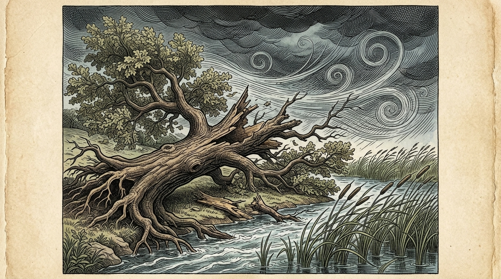
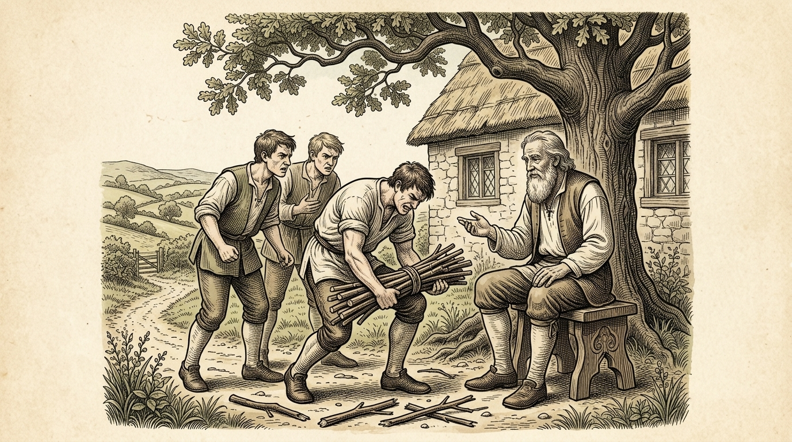
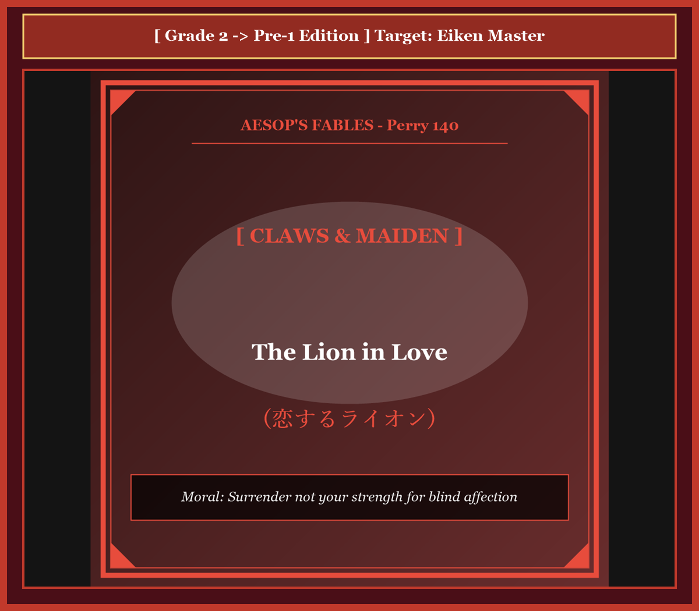
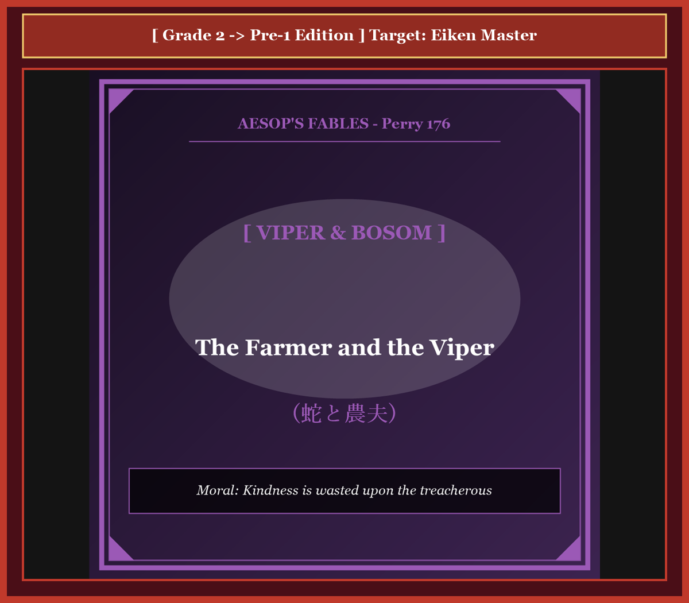

# 『英検ステップアップ多読：イソップ寓話編 第16巻（2級 ➔ 準1級対比学習・第4集）』

---

## はじめに：なぜ「対比多読」で英検準1級の頂を極められるのか？

英検準1級の合格を目指す英語学習者が直面する最後の壁は、**「高校・大学入試レベルの標準英語」から「世界的知性・教養人が駆使する高度なアカデミック英語」への次元の飛躍**です。

2級までは論理的で分かりやすい構文と標準的な語彙で合格点を獲得できましたが、準1級では国際政治、哲学、社会生物学、法学、認知科学などに通じる極めて高度な抽象語彙（*hegemony, unconscionable, sycophancy, nemesis, meritocratic* など）と、反語・倒置・格調高い隠喩を含む重厚な英文を瞬時に読み解く読解力が不可欠です。

本書では、世界中で数千年読み継がれてきたイソップ寓話（第4集・全10話）を舞台に、**「完成された2級英語」** が **「最高峰の準1級英語」** へとどのように深化・昇華するかを対比学習します。

* **馴染みの寓話（2級）** で物語の全体像と論理展開を完全に掌握
* **極上の知的英語（準1級）** で、TIME誌やThe Economist誌レベルの語彙・文体を身体化
* **暗唱キーフレーズ対比** で、二次面接スピーキング（4コマナレーション・社会問題ディスカッション）や自由英作文で圧倒的な高得点を奪取

至高の教養英語を味わい尽くしながら、英検準1級合格という栄冠を勝ち取りましょう！

---

## 本書の収録作品（第4集・全10話）

1. **Chapter 31**: オオカミとツル (*The Wolf and the Crane*) [Perry 156]
2. **Chapter 32**: 樫の木と葦 (*The Oak and the Reed*) [Perry 70]
3. **Chapter 33**: 馬とロバ (*The Horse and the Donkey*) [Perry 181]
4. **Chapter 34**: 農夫とその息子たち（束ねた棒） (*The Bundle of Sticks*) [Perry 53]
5. **Chapter 35**: 隠された財産（ブドウ畑の宝） (*The Farmer and His Sons*) [Perry 42]
6. **Chapter 36**: カエルたちの王様選び (*The Frogs Desiring a King*) [Perry 44]
7. **Chapter 37**: 猿と漁師 (*The Monkey and the Fishermen*) [Perry 203]
8. **Chapter 38**: 恋するライオン (*The Lion in Love*) [Perry 140]
9. **Chapter 39**: 蛇と農夫 (*The Farmer and the Viper*) [Perry 176]
10. **Chapter 40**: ロバと子犬 (*The Ass and the Lapdog*) [Perry 91]

---

## 本書の構成と電子書籍 / Kobo最適化

各章は以下の構成で統一されています。

```text
┌─────────────────────────────────────────────────────────────┐
│ 1. Chapter Title & Visual Illustration (章タイトル ＆ 挿絵)   │
│ 2. Benchmark Level: 英検2級レベル英文                         │
│ 3. Target Level: 英検準1級レベル英文                         │
│ 4. Classic Original English Text (イソップ寓話クラシック原文)  │
│ 5. Japanese Translation (日本語訳 ＆ 教訓)                     │
│ 6. Recite & Compare (そらんじたいキーフレーズ対比カード)        │
│ 7. Key Vocabulary & Exam Notes (語彙・文法・試験対策解説)        │
└─────────────────────────────────────────────────────────────┘
```

> **【ポイント】 音声読み上げ（TTS）をご利用の方へ**
> 本文セクション（ステップ1〜3）は英語のみで構成されており、電子書籍やKoboの自動音声読み上げ機能（Text-to-Speech）で日本語が混ざることなく、格調高い英語音声で快適にリスニング学習していただけます。


# Chapter 31: The Wolf and the Crane (オオカミとツル)

<!-- 電子書籍 Page Break & Image Header -->
<div style="text-align: center; margin-bottom: 20px;">
  
</div>

<div style="page-break-before: always;"></div>

## 1. Benchmark Level: Eiken Grade 2 (英検2級レベル本文)
*Read in ~2.5 to 3 minutes. Baseline vocabulary and basic syntax.*

An extraordinarily gluttonous wolf, habitually accustomed to devouring his spoils with undisciplined ferocity, inadvertently swallowed a sharp, irregular bone that wedged itself immovably within his larynx.

Afflicted by acute respiratory distress and convulsive spasms, the suffocating predator roamed the wilderness in profound torment, imploring every forest dweller for immediate therapeutic intervention. In a desperate bid to incentivize potential saviors, the agonizing beast offered an unprecedented remuneration to any individual capable of dislodging the lethal obstruction.

Inevitably, the majority of the forest fauna, acutely cognizant of the wolf's predatory duplicity, prudently declined the proposition. However, an ambitious crane, possessing a remarkably prolonged neck and slender bill, allowed cupidity to triumph over rational prudence. Enticed by the prospect of immense compensation, she rashly consented to perform the precarious procedure.

Bidding the quadruped assume a recumbent posture and distend his formidable jaws to their maximum aperture, the avian practitioner boldly inserted her entire head into the cavernous abyss of the carnivore's gullet. Demonstrating consummate manual dexterity, she seized the offending projectile with her pincers and extracted it cleanly from the inflamed mucous membrane.

The instantaneous alleviation of distress restored the wolf's vigor, whereupon the treacherous beast abruptly prepared to depart without acknowledging the debt. Stepping forward with dignified resolve, the crane firmly solicited the liquidation of the promised dividend.

"Insolent meddler!" retorted the wolf, curling his lips to reveal an intimidating array of razor-honed incisors. "Is it conceivable that your audacious presumption blinds you to reality? The mere fact that your vulnerable skull was permitted to evacuate the interior of a lethal predator's jaw without being decapitated constitutes an inestimable bounty. To solicit supplemental gratuities for having survived an encounter with an apex carnivore is the height of preposterous folly."

Stricken with profound chagrin, the crane absorbed an enduring sociopolitical verity: benevolent services rendered to an unprincipled villain inevitably yield cynical exploitation rather than equitable recompense.

---
<div style="page-break-before: always;"></div>

## 2. Target Level: Eiken Grade Pre-1 (英検準1級レベル本文)
*Read in ~3 to 3.5 minutes. Sophisticated vocabulary, subtle rhetoric, and academic analysis.*

An apex canid of notorious rapacity, habitually given to the intemperate mastication of his carrion without the slightest regard for physiological moderation, inadvertently ingested an osseous fragment that impacted itself obstinately within the sensitive mucosal precincts of his pharynx.

Rendered dyspneic and seized by paroxysms of acute asphyxiation, the frantic carnivore traversed the woodlands in unmitigated agony. In a frantic endeavor to solicit immediate therapeutic intervention, he broadcast a desperate proclamation throughout the ecosystem, promising an extravagant pecuniary indemnity to any practitioner capable of extricating the calcified impediment.

Understandably, the indigenous fauna, thoroughly apprised of the wolf's endemic perfidy and predatory opportunism, summarily repudiated the overture. Nevertheless, an unsuspecting crane, uniquely endowed with an elongated cervical architecture and a forceps-like bill, succumbed to the seductive blandishments of compensatory wealth. Subordinating empirical apprehension to mercurial cupidity, the avian opportunist volunteered to undertake the perilous surgical endeavor.

Instructing the recumbent beast to distend his formidable dental perimeter to its absolute physiological limits, the crane intrepidly plunged her cranial appendage into the dark cavern of the predator's esophagus. Displaying extraordinary microsurgical precision, she engaged the recalcitrant splinter, liberated it from the lacerated vascular tissue, and withdrew the foreign body without inflicting collateral trauma.

Having attained instantaneous physiological emancipation, the treacherous carnivore casually arose, shook his pelt, and prepared to abscond with brazen indifference. Mortified by this blatant repudiation of contractual honor, the crane intercepted the sovereign predator, formally petitioning for the liquidation of the stipulated bounty.

"Insolent simpleton!" snarled the carnivore, contorting his lips into a sinister sneer that bared a menacing battery of carnivorous daggers. "Does your unbridled arrogance entirely eclipse your rudimentary survival instincts? The unassailable reality that your fragile cervical vertebrae were permitted to emerge intact from the literal mouth of extinction represents an astronomical gratuity in its own right. To importune an apex carnivore for supplemental stipends, having already received the priceless dividend of physical preservation, constitutes the nadir of cognitive dissonance."

Humiliated and disillusioned, the crane internalized an indelible socio-philosophical maxim: to render altruistic accommodation to an inveterate predator is not merely an exercise in ethical futility, but an invitation to predatory cynicism, wherein survival itself is audaciously framed as an act of magnanimous patronage.

---
<div style="page-break-before: always;"></div>

## 3. Classic Original English Text (イソップ寓話クラシック原文)
*Perry 156: Translated by George Fyler Townsend (1867)*

A Wolf had got a bone stuck in his throat, and in the greatest agony ran up and down, beseeching every animal he met to relieve him, at the same time hinting at a very handsome reward to the one who should succeed. 

A Crane, moved by his entreaties and promises of reward, ventured her long neck down the Wolf's throat, and drew out the bone. 

She then modestly asked for the promised reward. 

To this, the Wolf, grinning and showing his teeth, replied: "Be content with what you have got, my friend. Is it not a sufficient reward for you that you have had your head inside a Wolf's mouth, and have brought it out again safe and sound?"

---
<div style="page-break-before: always;"></div>

## 4. Japanese Translation & Moral (日本語訳と教訓)

### 【日本語全訳：英検準1級レベル本文】
飽くなき強欲さで悪名高く、生理学的な節制を微塵も顧みずに死肉を無分別に咀嚼する習性のあったイヌ科の頂点捕食者が、咽頭（いんとう）の繊細な粘膜領域の中に、頑固に突き刺さった骨片を誤って飲み込んでしまいました。

呼吸困難に陥り、激しい窒息の発作に襲われながら、狂乱した肉食獣は純然たる苦悶のうちに森林を駆け巡りました。即座の外科的治療を求める必死の試みとして、オオカミは生態系全体に向けて絶望的な布告を公布し、この骨化した障害物を摘出することのできる施術者には誰にでも、途方もない金銭的補償を支払うと誓約しました。

当然のことながら、オオカミの生来の背信性と捕食者的日和見主義を熟知していた現地の動物たちは、その提案を一蹴しました。それにもかかわらず、細長い頸部構造とピンセットのような嘴を天賦の才として備えていた疑うことを知らないツルが、報酬という甘言の誘惑に屈してしまいました。実証的な警戒心を気まぐれな強欲に従属させたこの鳥類の日和見主義者は、自ら進んでその危険極まりない外科的事業を引き受けてしまったのです。

横たわった獣にその恐るべき歯列の周囲を生理学的限界まで広げるよう指示すると、ツルは自らの頭部を捕食者の食道の暗黒の洞窟の中へと果敢に突入させました。並外れた微小外科的精密さを発揮し、彼女は頑固な破片を捕捉し、裂傷を負った血管組織からそれを解放して、付随的な外傷を負わせることなく異物を引き抜きました。

瞬時の生理的解放を得るやいなや、この不実な肉食獣は何気なく立ち上がり、毛皮を震わせ、厚顔無恥な冷淡さをもって逃走しようとしました。契約上の信義に対するこのあからさまな否定に憤慨したツルは、主権者たる捕食者の進路を塞ぎ、規定された報奨金の決済を公式に請願しました。

「無礼な能天気者め！」と肉食獣は唸り声を上げ、唇を歪めて不吉な冷笑を浮かべ、凶悪な牙の砲列を露わにしました。「お前の制御なき傲慢さは、お前の初歩的な生存本能を完全に覆い隠してしまったのか？ お前の脆弱な頸椎が、絶滅の文字通りの喉頭から無傷で抜け出ることを許されたという反論の余地なき現実そのものが、それ自体として天文学的な謝礼を構成しているのだ。肉体的生存という計り知れない配当をすでに受領しておきながら、頂点捕食者に対して付加的な手当をねだるなど、認知的不協和の極致（どん底）である。」

屈辱と幻滅に打ちひしがれ、ツルは消えることのない社会哲学的格言を骨身に刻み込みました。根っからの捕食者に利他主義的な便宜を供与することは、単なる倫理的無駄骨にとどまらず、捕食者の冷笑主義に対する招待状であり、そこでは生き延びられたこと自体が、寛大な後援の恩恵として厚かましくも正当化されてしまうのだということを。

### 【教訓（Moral）】
**Expect no reward from the wicked.**  
（邪悪なる本性を持つ者に奉仕して見返りを期待してはならない。捕食者にとって契約や信義は無意味であり、自らの生命が奪われなかったこと自体が「最大の施し」として強弁される理不尽の支配に甘んじることになる。）

---
<div style="page-break-before: always;"></div>

## 5. Recite & Compare: そらんじたいキーフレーズ対比カード

<div class="comparison-card">
  <div class="card-header">フレーズ 1：無分別な暴食と骨の嵌入</div>
  <div class="card-row-g2-base"><span class="card-badge-g2-base">2級</span>Accustomed to devouring spoils with ferocity, he swallowed a sharp bone.</div>
  <div class="card-row-pre1"><span class="card-badge-pre1">準1級</span>Given to intemperate mastication, he ingested an osseous fragment that impacted itself within his pharynx.</div>
  <div class="card-note"><strong>解説：</strong>「intemperate mastication（節制なき咀嚼）」、「osseous fragment（骨性の断片）」、「impacted itself（強固に嵌入・圧迫した）」など、TIME誌や医学専門誌の高度な語彙で描写しています。</div>
</div>

<div class="comparison-card">
  <div class="card-header">フレーズ 2：甘言に屈して危険な手術を引き受ける</div>
  <div class="card-row-g2-base"><span class="card-badge-g2-base">2級</span>An ambitious crane allowed cupidity to triumph over rational prudence.</div>
  <div class="card-row-pre1"><span class="card-badge-pre1">準1級</span>Succumbing to seductive blandishments of wealth, she subordinated empirical apprehension to mercurial cupidity.</div>
  <div class="card-note"><strong>解説：</strong>「seductive blandishments（魅惑的な甘言・へつらい）」や「subordinated empirical apprehension to mercurial cupidity（実証的不安を気まぐれな強欲に従属させた）」という極めて格調高い心理分析です。</div>
</div>

<div class="comparison-card">
  <div class="card-header">フレーズ 3：生存自体を天文学的報酬と強弁する傲慢</div>
  <div class="card-row-g2-base"><span class="card-badge-g2-base">2級</span>The fact that your skull evacuated without being decapitated constitutes a bounty.</div>
  <div class="card-row-pre1"><span class="card-badge-pre1">準1級</span>That your cervical vertebrae emerged intact from the mouth of extinction represents an astronomical gratuity.</div>
  <div class="card-note"><strong>解説：</strong>解剖学用語「cervical vertebrae（頸椎）」と比喩「mouth of extinction（絶滅の口＝死の顎先）」、そして「astronomical gratuity（天文学的な謝礼・チップ）」がオオカミの暴論を鮮烈に浮き彫りにしています。</div>
</div>

<div class="comparison-card">
  <div class="card-header">フレーズ 4：捕食者の冷笑主義への招待</div>
  <div class="card-row-g2-base"><span class="card-badge-g2-base">2級</span>Benevolent services rendered to a villain inevitably yield cynical exploitation.</div>
  <div class="card-row-pre1"><span class="card-badge-pre1">準1級</span>To render altruistic accommodation to an inveterate predator is an invitation to predatory cynicism, wherein survival is framed as magnanimous patronage.</div>
  <div class="card-note"><strong>解説：</strong>関係副詞「wherein」を用いた関係詞節と、「survival is framed as magnanimous patronage（生存そのものが寛大な後援として枠付けされる）」という現代批判理論の白眉たる洞察です。</div>
</div>

---
<div style="page-break-before: always;"></div>

## 6. Key Vocabulary & Exam Notes (英検準1級 重要語彙・文法・面接対策)

### 1. 英検準1級 必須ボキャブラリー
* **mastication** [名] 咀嚼（*chewing* の学術語）
* **osseous** [形] 骨性の、骨から成る
* **dyspneic** [形] 呼吸困難の
* **paroxysm** [名] （病気・感情の）激発、発作
* **perfidy** [名] 背信、裏切り、不実（*treachery* の文学的表現）
* **blandishment** [名] 甘言、お世辞、懐柔（しばしば複数形 *blandishments*）
* **recalcitrant** [形] 反抗的な、扱いにくい、強情な
* **abscond** [動] 逃亡する、持ち逃げする、くらます

### 2. 文法・構文のチェックポイント
* **wherein + S + V**: 「その中で、それにおいて」
  * 抽象的な状況や文脈の中で進行する事象を論理的に接続する学術関係副詞です。
* **the nadir of ~**: 「〜のどん底、最悪の瞬間」
  * *zenith*（天頂・絶頂）の対義語として、知的な批評文で頻出します。

### 3. スピーキング（面接）＆ライティング活用ヒント
「非対称な契約関係」や「地政学的リアリズム」を論じる際に絶大な威力を発揮します：
* *Appealing to moral reciprocity in negotiations with bad-faith actors is fundamentally irrational.*（不誠実な相手との交渉において道徳的な相互主義に訴えかけることは、根本的に非合理的である。）
* *In totalitarian diplomacy, the mere absence of violence is audaciously framed as an act of generosity.*（全体主義的な外交においては、単に武力を行使しないこと自体が、厚かましくも寛大な行為として枠付けされる。）


# Chapter 32: The Oak and the Reed (樫の木と葦)

<!-- 電子書籍 Page Break & Image Header -->
<div style="text-align: center; margin-bottom: 20px;">
  
</div>

<div style="page-break-before: always;"></div>

## 1. Benchmark Level: Eiken Grade 2 (英検2級レベル本文)
*Read in ~2.5 to 3 minutes. Baseline vocabulary and basic syntax.*

An ancient oak of monumental proportions, whose subterranean root architecture anchored him immutably into the riparian sediment, occupied a position of unchallenged botanical hegemony. Flanking the periphery of his terrestrial dominion flourished colonies of slender reeds, whose vegetative stalks yielded incessantly to every aquatic and atmospheric vibration.

Infatuated by his perceived invulnerability, the colossal tree habitually subjected these modest riparian plants to supercilious disparagement. "To what humiliating indignity has natural selection condemned you," the oak proclaimed with pompous condescension. "The faintest thermal circulation forces you into an ignominious posture of subservience. Conversely, observe my immutable timber: I withstand the fiercest meteorological onslaughts with sovereign contempt, conscious that no atmospheric disturbance can dislodge my sovereign foundation."

Enduring this psychological patronization without animosity, the resilient reeds articulated an articulate counter-philosophy. "Your superficial appraisal conflates structural flexibility with inherent weakness," their spokesperson countered with dignified serenity. "You wage uncompromising warfare against the elements through inflexible obstinacy, whereas we preserve our structural integrity through strategic elasticity. By accommodating the momentum of the hurricane rather than antagonizing it, we survive unimpaired."

Deeming this pragmatic discourse to be the pathetic rationalization of inferior organisms, the dogmatic oak reaffirmed his arrogant conviction of perpetual permanence.

Inevitably, an unprecedented atmospheric depression manifested across the horizon, generating meteorological violence of cataclysmic intensity. The surrounding biosphere was subjected to supersonic air currents capable of leveling entire forests. In response to this catastrophic pressure gradient, the pliable reeds initiated immediate defensive deferral: by prostrating their aerodynamic profiles flat against the water, they negated drag, thereby allowing the kinetic frenzy of the gale to dissipate across their supple surfaces without imparting destructive leverage.

In stark contradiction, the rigid oak mounted a fatalist campaign of stubborn opposition. His colossal canopy, presenting a formidable aerodynamic barrier, intercepted the full velocity of the gale. Because his calcified timber was utterly devoid of tensile ductility, the mechanical torque concentrated exponentially upon his basal fulcrum. Inevitably, the structural threshold was breached; with an earth-shattering detonation of ruptured xylem, the botanical tyrant was violently decapitated at the root line and plunged precipitously into the roaring abyss of the swollen river.

With the re-establishment of diurnal equilibrium, the indestructible reeds ascended vertically toward the dawn, whereas the shattered detritus of the proud monarch drifted ignominiously toward oblivion.

---
<div style="page-break-before: always;"></div>

## 2. Target Level: Eiken Grade Pre-1 (英検準1級レベル本文)
*Read in ~3 to 3.5 minutes. Sophisticated vocabulary, subtle rhetoric, and academic analysis.*

An arboreal colossus of immemorial antiquity, whose taproot architecture was deeply calcified into the riparian alluvial bedrock, maintained an ostensibly unassailable botanical suzerainty over the watercourse. Fringing the lacustrine marsh below flourished colonies of diminutive Phragmites reeds, whose fragile stalks oscillated in perpetual kinetic deference to the thermal vagaries of the ambient microclimate.

Seduced by the intoxicating hubris of his physical immensity, the megalithic oak subjected these unassuming helophytes to an unrelenting stream of pejorative condescension. "To what abysmal evolutionary indignity has natural selection consigned your species," the patriarch boomed with sovereign derision. "The most imperceptible barometric fluctuation precipitates an instantaneous capitulation on your part, obliging you to grovel in humiliating subservience. In diametrical contrast, behold my colossal timber: I repudiate meteorological perturbations with imperious indifference, anchored in the absolute conviction that my structural mass transcends the vicissitudes of the troposphere."

Assimilating this contemptuous diatribe with Stoic equanimity, the pliable reeds formulated an incisive epistemological rebuttal. "Your rudimentary taxonomy conflates structural elasticity with ontological vulnerability," their collective voice resonated with dispassionate clarity. "You prosecute a quixotic war of attrition against thermodynamic reality through rigid recalcitrance, whereas we maintain metabolic and anatomical equilibrium through non-antagonistic compliance. By harmonizing with barometric gradients rather than asserting futile resistance, we endure intact."

Dismissing this sophisticated ecological thesis as the disingenuous sophistry of organic cowards, the intransigent monarch dismissed their caveat with categorical contempt.

Inevitably, the thermodynamic equilibrium of the continent ruptured, spawning a super-cyclonic tempest of apocalyptic severity. The surrounding riparian ecosystem was inundated by an atmospheric onslaught characterized by extreme barometric depressions and hyper-turbulent shear winds capable of desolating terrestrial topography.

Confronted with this thermodynamic onslaught, the supple reeds executed an elegant maneuver of biomechanical dissipation. Deferring entirely to the vector forces of the storm, they prostrated their aerodynamic cross-sections parallel to the aqueous surface, virtually eliminating drag coefficients and permitting the kinetic frenzy of the maelstrom to bypass their flexible tissues without imparting destructive torsion.

Conversely, the monumental oak mounted a catastrophic campaign of uncompromising defiance. His monolithic canopy, functioning as an unyielding aerodynamic sail, intercepted the full unmitigated momentum of the gale. Because his heavily lignified, petrified fiber possessed zero tensile elasticity, the colossal angular momentum generated by the atmospheric onslaught transferred directly to his basal pivot. Exponential mechanical strain concentrated catastrophically upon his primary fulcrum until the ultimate yield strength of the wood was exceeded. With a deafening, explosive fracture that echoed like artillery across the flooded valley, the majestic autocrat was cleanly severed from his subterranean foundation and hurled headlong into the surging torrent below.

When atmospheric stasis returned with the dawn, the resilient reeds unfurled gracefully, their structural integrity entirely preserved; conversely, the dismembered carcass of the erstwhile sovereign drifted ignominiously downstream, an eloquent testament to the catastrophic fragility of inflexible hubris.

---
<div style="page-break-before: always;"></div>

## 3. Classic Original English Text (イソップ寓話クラシック原文)
*Perry 70: Translated by George Fyler Townsend (1867)*

A very large Oak was uprooted by the wind and thrown across a stream. It fell among some Reeds, which it thus addressed: 

"I wonder how you, who are so light and weak, are not entirely crushed by these strong winds."

They replied: "You fight and contend with the wind, and consequently you are destroyed; while we on the contrary bend before the least breath of air, and therefore remain unbroken, and escape."

---
<div style="page-break-before: always;"></div>

## 4. Japanese Translation & Moral (日本語訳と教訓)

### 【日本語全訳：英検準1級レベル本文】
遠い太古の昔からそびえ立つ樹木の巨像であり、その直根構造が河畔の沖積基盤の中に深く石灰化して固定されていた古代の樫の木は、その水路に対して表面上は難攻不落に見える植物学的宗主権を保持していました。その足元の湖沼湿地の縁を取り囲むように、小さなヨシ（葦）の群落が繁茂していましたが、その繊細な茎は、周囲の微気候の熱的気まぐれに絶え間ない運動学的追従を示して揺れ動いていました。

自らの肉体的な巨大さがもたらす陶酔的な傲慢（ヒュブリス）に惑わされたこの巨石のような樫の木は、これらの慎み深い湿地植物たちを、容赦のない軽蔑的な見下しの対象にしていました。「自然淘汰は何という底知れぬ進化的不名誉にお前たちの種を追いやったことか」と家長は君主然とした嘲笑をもって轟かせました。「最も感知できないほどの気圧の変動ですら、お前たちの側に即座の降伏を引き起こし、屈辱的な卑屈さのうちにひれ伏すことを余儀なくさせる。これと正反対に、私の巨大な木材を見るがよい。私はいかなる気象の動揺も傲慢な無関心をもって拒絶し、自らの構造的質量が対流圏のあらゆる栄枯盛衰を超越しているという絶対的な確信の中に錨を下ろしているのだ。」

この軽蔑的な罵倒をストア派的な平静さをもって受け止めながら、しなやかな葦たちは鋭利な認識論的反論を構築しました。「あなたの初歩的な分類法は、構造的弾力性と存在論的脆弱性とを混同しています」とその集団の声は冷静沈着な明晰さをもって響きました。「あなたは硬直した反抗心によって熱力学的現実に対するドン・キホーテ的（無謀な）消耗戦を仕掛けていますが、私たちは敵対しない従順さによって代謝的・解剖学的平衡を維持しているのです。気圧傾度と不毛な抵抗を繰り広げるのではなく調和することによって、私たちは傷つくことなく耐え抜くのです。」

この洗練された生態学的命題を有機的な臆病者たちの不誠実な詭弁にすぎないと切り捨てた頑迷な君主は、彼らの警告を断固とした軽蔑をもって退けました。

必然的に、大陸の熱力学的平衡が破綻し、黙示録的な厳しさを持つ巨大サイクロンの嵐が産み落とされました。周囲の河畔生態系は、極端な気圧低下と、地上の地形を荒廃させる能力を持つ極超乱流のシアー風（風向急変風）を特徴とする大気の猛攻によって水浸しになりました。

この熱力学的な猛攻に直面し、しなやかな葦たちは生体力学的消散のエレガントな機動を実行しました。嵐のベクトル力（力の向きと大きさ）に完全に身を委ねることで、彼らは自らの空気力学的断面積を水面と平行に平伏させ、抗力係数を事実上ゼロにまで低減させ、大渦の運動学的狂気が自らの柔軟な組織に破壊的なテコの力を与えることなく通り過ぎることを可能にしたのです。

それとは反対に、堂々たる樫の木は、妥協なき反抗という破滅的な戦いを挑みました。その一枚岩のような樹冠は、屈することのない空気力学的セイル（帆）として機能し、突風の純然たる無力化されない運動量を正面から受け止めました。その過度に木化し石化した繊維には引張弾性がまったく欠如していたため、大気の猛攻によって生じた巨大な角運動量は、その根元の旋回軸へと直接伝達されました。木材の究極の降伏強度（破壊限界点）が超過されるまで、指数関数的な機械的応力がその主要な支点へと破滅的に集中しました。浸水した谷を越えて大砲のように鳴り響く耳をつんざく爆発的な破断音とともに、気高き独裁者は地下の基礎からきれいに切断され、眼下の荒れ狂う激流の中へと真っ逆さまに投げ出されたのです。

夜明けとともに大気の静止が戻ったとき、強靭な葦たちは優雅に身を伸ばし、その構造的完全性は完全に保たれていました。これに対し、かつての主権者のばらばらに引き裂かれた死骸は、不名誉にも川下へと流されていき、それは硬直した傲慢（ヒュブリス）の破滅的な脆さに対する雄弁な証拠となったのでした。

### 【教訓（Moral）】
**Better to bend than break.**  
（折れるよりも曲がるほうが勝る。自らの巨大さを過信して激動の現実に硬直したプライドで立ち向かう者は粉々に粉砕されるが、環境の力学を洞察し柔軟にしなる者は、最悪の嵐をも無傷で生き延びる。）

---
<div style="page-break-before: always;"></div>

## 5. Recite & Compare: そらんじたいキーフレーズ対比カード

<div class="comparison-card">
  <div class="card-header">フレーズ 1：弾力性と存在論的弱さの混同を論破する</div>
  <div class="card-row-g2-base"><span class="card-badge-g2-base">2級</span>Your superficial appraisal conflates structural flexibility with inherent weakness.</div>
  <div class="card-row-pre1"><span class="card-badge-pre1">準1級</span>Your rudimentary taxonomy conflates structural elasticity with ontological vulnerability.</div>
  <div class="card-note"><strong>解説：</strong>哲学・存在論の術語「rudimentary taxonomy（初歩的な分類・見立て）」や「ontological vulnerability（存在論的・根本的な脆弱性）」を用いた、圧巻の知性による反論です。</div>
</div>

<div class="comparison-card">
  <div class="card-header">フレーズ 2：抗力係数をゼロにしてエネルギーを受け流す</div>
  <div class="card-row-g2-base"><span class="card-badge-g2-base">2級</span>By prostrating their profiles, they negated drag, allowing the frenzy to dissipate.</div>
  <div class="card-row-pre1"><span class="card-badge-pre1">準1級</span>Prostrating their cross-sections parallel to the surface, they eliminated drag coefficients, permitting the maelstrom to bypass without torsion.</div>
  <div class="card-note"><strong>解説：</strong>「drag coefficients（抗力係数）」や「without imparting destructive torsion（破壊的なねじれを与えることなく）」など、流体力学の極致の用語でしなやかさを定義しています。</div>
</div>

<div class="comparison-card">
  <div class="card-header">フレーズ 3：降伏強度を超過した爆発的破断</div>
  <div class="card-row-g2-base"><span class="card-badge-g2-base">2級</span>The torque concentrated exponentially until the structural threshold was breached.</div>
  <div class="card-row-pre1"><span class="card-badge-pre1">準1級</span>Mechanical strain concentrated upon his fulcrum until the ultimate yield strength was exceeded; the autocrat was cleanly severed from his foundation.</div>
  <div class="card-note"><strong>解説：</strong>「ultimate yield strength（極限降伏強度・破壊限界）」や「cleanly severed from his subterranean foundation（地下の基礎からきれいに切断された）」という劇的破断の描写です。</div>
</div>

<div class="comparison-card">
  <div class="card-header">フレーズ 4：硬直した傲慢の脆さを証明する死骸</div>
  <div class="card-row-g2-base"><span class="card-badge-g2-base">2級</span>The detritus of the proud monarch drifted ignominiously toward oblivion.</div>
  <div class="card-row-pre1"><span class="card-badge-pre1">準1級</span>The dismembered carcass drifted downstream, an eloquent testament to the catastrophic fragility of inflexible hubris.</div>
  <div class="card-note"><strong>解説：</strong>「an eloquent testament to ~（〜に対する雄弁な証拠・記念碑）」と「the catastrophic fragility of inflexible hubris（柔軟性のない傲慢さの破滅的な脆さ）」という究極の教訓文です。</div>
</div>

---
<div style="page-break-before: always;"></div>

## 6. Key Vocabulary & Exam Notes (英検準1級 重要語彙・文法・面接対策)

### 1. 英検準1級 必須ボキャブラリー
* **suzerainty** [名] 宗主権、統治権
* **oscillate** [動] 振動する、揺れ動く
* **pejorative** [形] 軽蔑的な、否定的な（*derogatory* の同義語）
* **ontological** [形] 存在論的な（存在そのものの本質に関する）
* **quixotic** [形] ドン・キホーテ風の、空想的な、無謀な
* **intransigent** [形] 妥協しない、頑固な（*obstinate* の最上位語）
* **torsion** [名] ねじれ、ねじり応力
* **hubris** [名] （ギリシャ悲劇の）神に対する傲慢、過度のプライド

### 2. 文法・構文のチェックポイント
* **an eloquent testament to ~**: 「〜に対する雄弁な証拠、〜を如実に物語るもの」
  * 歴史的事実や事件の象徴的意味を総括する英字誌の定番コロケーションです。
* **conflate A with B**:
  * 準1級のエッセイライティングにおいて、一般的偏見や短絡的思考を批判する最強の動詞です。

### 3. スピーキング（面接）＆ライティング活用ヒント
「危機管理における柔軟性」「硬直した体制の崩壊」を論述する際に絶大な知性を発揮します：
* *Rigid geopolitical doctrines often collapse catastrophically because they underestimate systemic turbulence.*（硬直した地政学的教義は、構造的な激動を過小評価するために、しばしば壊滅的な崩壊を遂げる。）
* *True resilience requires dynamic adaptation rather than quixotic resistance against inevitable economic shifts.*（真の強靭さは、不可避な経済的変化に対する無謀な抵抗ではなく、動的な適応を必要とする。）


# Chapter 33: The Horse and the Donkey (馬とロバ)

<!-- 電子書籍 Page Break & Image Header -->
<div style="text-align: center; margin-bottom: 20px;">
  
</div>

<div style="page-break-before: always;"></div>

## 1. Benchmark Level: Eiken Grade 2 (英検2級レベル本文)
*Read in ~2.5 to 3 minutes. Baseline vocabulary and basic syntax.*

A prosperous merchant of substantial capital undertook a grueling commercial transit across an arid mountain pass, accompanied by a thoroughbred equestrian mount and a subjugated beast of burden. Notwithstanding their reciprocal utility to the enterprise, the logistical distribution of their freight was characterized by gross asymmetry. The pack-donkey was encumbered by an overwhelming payload of mercantile commodities, whereas the haughty courser paced alongside in leisure, adorned exclusively with ceremonial accoutrements and lightweight saddlecloths.

As the solar intensity culminated at mid-day, emitting blistering thermal radiation across the desolate limestone trail, the donkey experienced acute physiological exhaustion. Beset by muscular spasms and catastrophic oxygen deprivation, the faltering animal recognized that collapse was imminent. Prompted by an urgent impulse of self-preservation, he addressed a poignant supplication to his aristocratic peer.

"I petition your benevolence, noble companion," the prostrated beast wheezed faintly. "Should you deign to alleviate my plight by assuming a negligible percentage of this freight, my survival will be assured, allowing our collective convoy to reach the commercial depot. A momentary accommodation on your part will avert an irreversible tragedy."

Far from exhibiting philanthropic camaraderie, the supercilious stallion greeted this petition with unmitigated contempt. "Insolent inferior!" the equine aristocrat whinnied derisively. "Your labor-intensive function is dictated by intrinsic hereditary stratification, whereas my pedigree preserves me from vulgar utility. Labor under your mandated quota without presumption, and importune me no further with your plebeian tribulations."

Rebuffed by callous obstinacy and depleted of caloric stamina, the donkey succumbed to physiological collapse; his skeletal structure buckled, and he perished instantaneously from acute circulatory failure.

Confronted with an acute logistical emergency, the pragmatic trader operated without sentimental hesitation. In order to mitigate commercial deficits, he summarily transferred the entirety of the deceased animal's cargo onto the dorsal frame of the horrified stallion. To compound this operational redistribution, the merchant flayed the carcass on the spot to salvage its leather, draping the heavy, sanguinary hide atop the staggering baggage.

Groaning under the crushing gravitational burden, his vertebrae groaning under an unprecedented structural load, the humbled equestrian wept bitter tears of belated contrition: "What catastrophic retribution my vanity has invoked! Had I accommodated a minor concession to sustain a working partner, his premature demise would have been averted. By repudiating the foundational doctrine of cooperative equilibrium, I am now condemned to shoulder the absolute entirety of his affliction, supplemented by the horrific mantle of his severed remains."

---
<div style="page-break-before: always;"></div>

## 2. Target Level: Eiken Grade Pre-1 (英検準1級レベル本文)
*Read in ~3 to 3.5 minutes. Sophisticated vocabulary, subtle rhetoric, and academic analysis.*

An opulent mercantile capitalist, directing an interstate trade caravan through a desiccated geological defile, mobilized a heterogeneous pair of draft animals whose socio-functional allocation was structured upon extreme institutional inequity: a pedigree equestrian charger bred for ostentatious display, and a subjugated pack-ass condemned to unremitting industrial transport. Despite their interdependent symbiotic role in underwriting the enterprise's commercial solvency, the logistical burden was partitioned with grotesque disproportion. The humble ass was encumbered by an astronomical payload of raw bulk merchandise, while the pampered courser pranced unburdened, draped exclusively in decorative embroidered caparisons and lightweight harness.

As the solar declination approached the meridian, subjecting the calcified canyon to a merciless barrage of radiant thermal energy, the pack-animal crossed the threshold of irreversible bio-energetic depletion. Tormented by acute lactic acidosis and systemic cardiovascular strain, the faltering beast discerned that biological termination was imminent. Mobilizing his residual respiratory reserves, he articulated an agonizing, rational appeal to the collective solidarity of his companion.

"I supplicate your fraternal magnanimity," the prostrate laborer gasped through parched lips. "A temporary reassignment of an infinitesimal percentage of this tonnage would stabilize my hemodynamic parameters, thereby preserving our operational continuity and preventing an irreparable logistical catastrophe. Your voluntary assumption of a minor inconvenience would preserve a working life."

However, insulated by the hubris of biological entitlement, the haughty stallion repulsed the overture with vitriolic disdain. "Presumptuous subaltern!" the patrician beast snorted with virulent arrogance. "Your functional subjugation is the inescapable mandate of your biological caste, whereas my genetic lineage reserves me for chivalric prestige and decorative leisure. Subside beneath your assigned quota without impudent murmuring, and cease importuning your superiors with plebeian grievances."

Deprived of systemic relief and subjected to uninterrupted gravitational attrition, the donkey's metabolic machinery suffered a terminal collapse. His stifle joints buckled precipitously, and he perished instantaneously from acute myocardial infarction amidst the blinding dust.

Confronted with the catastrophic loss of fifty percent of his motive traction, the cold-blooded merchant acted with ruthless mercenary pragmatism. To avert capital depreciation and contract forfeiture, he summarily requisitioned the entirety of the deceased animal's cargo, hoisting the monumental freight onto the unconditioned dorsal structure of the petrified stallion. Furthermore, determined to maximize material salvage, he flayed the carcass post-haste, draping the dripping, fibrous mantle over the summit of the staggering pyramid of goods.

Sinking beneath the crushing compressive tonnage, his skeletal frame shuddering violently under this catastrophic structural shock, the humbled aristocrat articulated his agonizing epistemological awakening: "Alas, what ruinous retribution my solipsistic vanity has orchestrated! Had I extended an enlightened concession to preserve a cooperative partner, his vital functional labor would have insulated me from this ordeal. By repudiating the foundational doctrine of collective solidarity, I have systematically inherited the entirety of his servitude, horrifyingly capped by the gory shroud of his flayed remains."

---
<div style="page-break-before: always;"></div>

## 3. Classic Original English Text (イソップ寓話クラシック原文)
*Perry 181: Translated by George Fyler Townsend (1867)*

A Man who had a Horse and a Donkey took the road with them. The Donkey, who was exhausted with fatigue and the heat of the day, said to the Horse: 

"Take a little of my load, if you have any regard for my life." 

The Horse refused, bidding him to mind his own business. 

The Donkey fell dead under his burden. The master then took the whole of the burden from the dead Donkey, and laid it on the Horse, together with the skin of the Donkey. 

The Horse, groaning under his load, exclaimed: "Woe is me! What a wretched creature I am! I would not help the Donkey with a little of his load, and now I have to carry the whole of it, together with his skin into the bargain."

---
<div style="page-break-before: always;"></div>

## 4. Japanese Translation & Moral (日本語訳と教訓)

### 【日本語全訳：英検準1級レベル本文】
乾燥した地質学的峡谷を通る州間通商キャラバンを指揮していた、ある裕福な商業資本家は、その社会機能的配分が極端な制度的不平等に基づいて構造化された、異質な使役動物のペアを動員していました。誇示的な見せびらかしのために飼育された純血種の軍馬と、絶え間ない産業輸送を宣告された使役用のロバです。事業の商業的支払能力を支える上での両者の相互依存的な共生関係にもかかわらず、兵站的負担は奇怪なまでの不均衡をもって分割されていました。質素なロバが天文学的な積載量の一次産品の一括荷物によって押しつぶされていた一方で、甘やかされた名馬は装飾的な刺繍を施した馬衣と軽量の手綱だけを身にまとい、荷物を背負うことなく闊歩していたのです。

太陽の赤緯が子午線（正午の頂点）へと近づき、石灰化した峡谷に容赦のない放射熱エネルギーの連打を浴びせるにつれ、この荷担ぎ動物は不可逆的な生体エネルギー枯渇の限界値を超過しました。急性の乳酸アシドーシス（乳酸蓄積）と全身性の循環器系ストレスに苛まれ、足取りのおぼつかない獣は自らの生物学的終末が目前に迫っていることを察知しました。残余の呼吸能力を総動員して、ロバは仲間の集団的連帯に対して、痛切で合理的な訴えを行いました。

「あなたの兄弟のような寛大さに懇願いたします」と平伏した労働者は渇いた唇の間から息を切らしながら言いました。「この重量のほんの微小な割合を一時的に再配分していただくだけで、私の血行動態パラメータは安定し、それによって私たちの運行の継続性が保たれ、取り返しのつかない兵站的大惨事を回避できるのです。あなたの側での些細な不便の自発的引き受けが、働く命を救うのです。」

しかしながら、生物学的選民意識の傲慢さに包まれていた高慢な種馬は、辛辣な軽蔑をもってその申し出をはねつけました。「出過ぎた下層民め！」と貴族然とした獣は悪意ある傲慢さで鼻を鳴らしました。「お前の機能的従属はお前の生物学的カーストの逃れられない命令なのであり、私の遺伝的血統は私を騎士道的な名声と装飾的な余暇のために保持しているのだ。無礼なつぶやきをすることなく割り当てられたノルマの下で沈黙を守り、下層階級の不平不満をもって上位者を煩わせるのをやめるがよい。」

構造的な救済を拒まれ、絶え間ない重力による摩耗にさらされたロバの代謝機構は、致命的な崩壊を被りました。その膝関節は激しく折れ曲がり、盲目的な埃の中で急性心筋梗塞によって即座に息絶えました。

自らの推進力の50パーセントという壊滅的な損失に直面した冷酷な商人は、冷徹な傭兵的実用主義をもって行動しました。資本の減価償却と契約不履行を回避するため、商人は息絶えた動物の貨物の全量を即座に徴発し、恐怖に慄く種馬の訓練されていない背中の骨格の上へと記念碑的な荷物を持ち上げました。さらに、物質的回収を最大化することを決意した商人は、その場で死骸の皮を剥ぎ、その滴る繊維状の外衣を、今にも崩れそうな荷物のピラミッドの頂上へと覆い被せました。

圧倒的な圧縮重量の下で沈み込み、この壊滅的な構造的衝撃の下で自らの骨格のフレームを激しく震わせながら、打ちひしがれた貴族は自らの痛切な認識論的目覚めを口にしました。「ああ、私の自己愛的な虚栄心は何という破滅的な応報を画策してしまったのか！ もし私が協調的パートナーを保全するために見識ある譲歩を示してさえいれば、彼の不可欠な機能的労働が私をこの試練から遮断してくれていたはずなのだ。集団的連帯の根本原則を拒絶したことによって、いまや私は彼の苦役の全体を、剥ぎ取られた死骸の血まみれの覆いを添えて組織的に引き継ぐことになってしまった。」

### 【教訓（Moral）】
**Help others lest their burden fall on you.**  
（他者の負担を共に担え。さもなくば、その全壊滅が己一身に降りかかる。組織や社会における相互依存の原則を軽視し、弱者の過重労働を冷笑する特権者は、最終的に相手の苦難の全体と破滅の遺骸を自ら背負う鉄槌を受ける。）

---
<div style="page-break-before: always;"></div>

## 5. Recite & Compare: そらんじたいキーフレーズ対比カード

<div class="comparison-card">
  <div class="card-header">フレーズ 1：制度的・構造的不平等の告発</div>
  <div class="card-row-g2-base"><span class="card-badge-g2-base">2級</span>The logistical distribution was characterized by gross asymmetry.</div>
  <div class="card-row-pre1"><span class="card-badge-pre1">準1級</span>Their socio-functional allocation was structured upon extreme institutional inequity; the ass was encumbered by an astronomical payload.</div>
  <div class="card-note"><strong>解説：</strong>社会科学の高度な概念「socio-functional allocation（社会機能的配分）」や「structured upon institutional inequity（制度的不平等に基づいて構造化された）」を用いています。</div>
</div>

<div class="comparison-card">
  <div class="card-header">フレーズ 2：血行動態の安定と運行継続の要請</div>
  <div class="card-row-g2-base"><span class="card-badge-g2-base">2級</span>Assuming a percentage of freight will assure survival and avert tragedy.</div>
  <div class="card-row-pre1"><span class="card-badge-pre1">準1級</span>A reassignment of an infinitesimal percentage would stabilize my hemodynamic parameters, preserving operational continuity.</div>
  <div class="card-note"><strong>解説：</strong>「infinitesimal percentage（微小な割合）」や「stabilize hemodynamic parameters（血行動態の数値を安定させる）」など、医学的・工学的厳密性を極めた嘆願です。</div>
</div>

<div class="comparison-card">
  <div class="card-header">フレーズ 3：選民意識と身分制による冷淡な拒絶</div>
  <div class="card-row-g2-base"><span class="card-badge-g2-base">2級</span>Your function is dictated by stratification, whereas my pedigree preserves me from utility.</div>
  <div class="card-row-pre1"><span class="card-badge-pre1">準1級</span>Insulated by the hubris of biological entitlement, he declared: "Your subjugation is the mandate of your biological caste."</div>
  <div class="card-note"><strong>解説：</strong>社会批判用語「hubris of biological entitlement（生物学的特権意識の傲慢さ）」と「mandate of your biological caste（生物学的カーストの命令）」という鋭利なイデオロギー批判です。</div>
</div>

<div class="comparison-card">
  <div class="card-header">フレーズ 4：集団的連帯の拒絶が招いた完全な苦役の継承</div>
  <div class="card-row-g2-base"><span class="card-badge-g2-base">2級</span>By repudiating the doctrine of cooperative equilibrium, I am condemned to shoulder his affliction.</div>
  <div class="card-row-pre1"><span class="card-badge-pre1">準1級</span>By repudiating the doctrine of collective solidarity, I have systematically inherited the entirety of his servitude, capped by the gory shroud of his remains.</div>
  <div class="card-note"><strong>解説：</strong>「doctrine of collective solidarity（集団的連帯の教義・原則）」と「gory shroud of his flayed remains（剥ぎ取られた遺骸の血まみれの覆い）」という、恐怖と倫理の最高峰の結びです。</div>
</div>

---
<div style="page-break-before: always;"></div>

## 6. Key Vocabulary & Exam Notes (英検準1級 重要語彙・文法・面接対策)

### 1. 英検準1級 必須ボキャブラリー
* **desiccate** [動] 乾燥させる、からからにする
* **heterogeneous** [形] 異種の、異質な、多種多様な
* **caparison** [名] （馬の）華麗な馬衣、装飾馬具
* **infinitesimal** [形] 極微の、無限小の（*microscopic* より抽象的）
* **subaltern** [名] 部下、下位の者、従属的階層
* **virulent** [形] 猛毒の、悪意に満ちた、致命的な
* **solipsistic** [形] 唯我論的な、極端に自己中心的な
* **shroud** [名] 死体を包む布、覆い、帳 / [動] 覆い隠す

### 2. 文法・構文のチェックポイント
* **insulated by the hubris of ~**: 「〜という傲慢さに守られて（外界から遮断されて）」
  * 特権階級が無知ゆえに安全圏に安住している様子を批判する名表現です。
* **Had I + 過去分詞, S + would have + 過去分詞**:
  * 準1級ライティングにおいて、後悔や過去の反実仮想を論述する際の必須技法です。

### 3. スピーキング（面接）＆ライティング活用ヒント
「労働環境の是正」「サプライチェーンにおける連帯責任」を論述する際に絶大な知性を発揮します：
* *Exploitative supply chain models that overburden vulnerable workers inevitably suffer catastrophic systemic disruptions.*（脆弱な労働者に過重な負担を強いる搾取的なサプライチェーンモデルは、必然的に壊滅的な構造的破綻に見舞われる。）
* *Collective solidarity is not an idealistic luxury, but a structural requirement for organizational longevity.*（集団的連帯は理想主義的な贅沢ではなく、組織の長期存続のための構造的要件である。）


# Chapter 34: The Bundle of Sticks (農夫とその息子たち)

<!-- 電子書籍 Page Break & Image Header -->
<div style="text-align: center; margin-bottom: 20px;">
  
</div>

<div style="page-break-before: always;"></div>

## 1. Benchmark Level: Eiken Grade 2 (英検2級レベル本文)
*Read in ~2.5 to 3 minutes. Baseline vocabulary and basic syntax.*

An affluent landed patriarch, whose lifelong adherence to rigorous agrarian discipline had consolidated an extensive hereditary domain, observed with profound foreboding the intractable fraternal discord that fractured his household. Despite his repeated moral exhortations advocating domestic cohesion, his contentious sons were perpetually embroiled in acrimonious jurisdictional disputes, squandering their vital energies in destructive litigious rivalry.

Cognizant of his imminent mortality and discerning that abstract philosophical rhetoric exerted zero deterrent efficacy upon their contentious temperaments, the astute elder resolved to engineer an indisputable empirical object lesson. He comprehended that didactic sermons on solidarity inevitably fail to neutralize visceral jealousy, whereas an unassailable tactile demonstration could permanently recalibrate their cognitive paradigms.

Summoning the adversarial heirs to a plenary assembly, he commanded an overseer to produce a tightly compacted fascicle of seasoned wooden rods, bound into a composite structural unit by heavy-duty hempen cordage. Consigning the bundle to his eldest progeny, the patriarch issued an explicit physical challenge: "Mobilize your utmost kinetic momentum to bifurcate this composite cylinder through sheer mechanical force."

Applying calculated biomechanical leverage, the firstborn exerted enormous torque; nevertheless, the interconnected tensile matrix dispersed the localized stress across its entire structural volume, absorbing the kinetic shock without exhibiting the slightest structural fatigue. Galvanized by sibling rivalry, each successive brother attempted the feat, yet the synergistic resilience of the collective cylinder neutralized every exertion. Exhausted and chastened, the brothers collectively capitulated, declaring the mechanical resistance of the composite structure to be insurmountable.

Severing the binding cord with calculated deliberation, the elder distributed the constituent elements individually among the assembly. "Reiterate the protocol," he instructed laconically. Thereupon, crisp structural fractures detonated across the quadrangle as each isolated rod was instantaneously disintegrated with trivial muscular exertion.

Fixing his gaze upon his confounded heirs, the patriarch enunciated his definitive philosophical thesis: "Decipher the sociopolitical allegory manifested before your eyes. Insofar as you maintain structural cohesion and present an unbreached ideological phalanx to external competitors, your communal hegemony remains unassailable. Inversely, should you succumb to internal tribalism and allow petty animosities to atomize your collective solidarity, your operational viability will instantly collapse, leaving each isolated individual to be decimated as expeditiously as these fractured fragments."

---
<div style="page-break-before: always;"></div>

## 2. Target Level: Eiken Grade Pre-1 (英検準1級レベル本文)
*Read in ~3 to 3.5 minutes. Sophisticated vocabulary, subtle rhetoric, and academic analysis.*

A venerable agrarian dynast, whose lifelong commitment to meticulous husbandry had consolidated a sprawling territorial patrimony, observed with acute existential dread the corrosive factionalism that paralyzed his household. Despite his perpetual homilies extolling the imperative of domestic synergy, his disputatious heirs were hopelessly mired in internecine recriminations, squandering their vital socioeconomic momentum in futile litigious skirmishes over anticipated inheritances.

Apprised of his approaching biological demise and acutely conscious that disembodied didactic hortations possessed zero heuristic efficacy against visceral hostility, the sagacious patriarch engineered an ingenious pedagogical contrivance. He comprehended with Machiavellian clarity that abstract appeals to fraternal affection would dissipate into thin air; conversely, an indisputable, tactile demonstration of structural mechanics could permanently reconfigure their cognitive architecture.

Convening the estranged claimants to a formal plenary conclave within the manor courtyard, he directed a retainer to present an ostensibly mundane apparatus: a dense fascicle of mature, straight-grained hardwood rods, bound into an integrated structural monolith by heavy-duty hempen ligatures. Delegating the consolidated mass to his eldest son, the patriarch delivered a terse, uncompromising challenge: "Deploy your maximum biomechanical exertion to snap this composite cylinder across your knee."

Applying calculated kinetic momentum and maximizing his skeletal levers, the firstborn strained until the micro-capillaries within his temples threatened to rupture; yet, governed by the immutable laws of tensile distribution, the interconnected structural array dispersed the localized shear stress across its aggregate volume, absorbing the shockwave without the faintest micro-fracture. Emboldened by competitive vanity, each subsequent brother attempted the physical ordeal in sequence; nevertheless, the synergistic rigidity of the composite matrix repulsed every assault. Humiliated and breathless, the siblings formally capitulated, declaring that to overcome such integrated structural resistance was a biomechanical impossibility.

With deliberate theatrical composure, the patriarch severed the compressive binding, liberating the constituent elements and distributing an isolated shaft to each astonished son. "Execute the identical protocol," he commanded softly.

Instantly, sharp percussive detonations reverberated across the limestone flagstones as each autonomous rod was fractured clean through with contemptible ease, snapped in two by the most casual muscular twitch.

Surveying the chastened faces of his prospective successors, the patriarch articulated his immortal socioeconomic manifesto: "Contemplate the profound systemic paradigm inscribed upon these splintered remnants. Insofar as you aggregate your individual capitals, harmonize your operational agendas, and present an impenetrable phalanx against external predatory actors, your dynastic hegemony will remain impregnable. Inversely, should you permit tribal jealousy and internecine rivalry to atomize your collective matrix, your structural resilience will evaporate overnight, leaving each isolated, defenseless individual to be annihilated as expeditiously as these disenfranchised twigs."

---
<div style="page-break-before: always;"></div>

## 3. Classic Original English Text (イソップ寓話クラシック原文)
*Perry 53: Translated by George Fyler Townsend (1867)*

An old man had many sons, who were often falling out with one another. When the father had failed to reconcile them by any of his words, he thought he would try whether he could not make an impression upon them by means of an act. 

So he called his sons together, and bade them bring him a bundle of sticks. The young men did as they were bid. The father took the bundle, and giving it to each of them in turn, told him to try if he could not break it in pieces. But not one of them could. 

The father then untied the bundle, and gave each a single stick, which each easily snapped in two. 

"My sons," said he, "if you are of one mind, and unite to assist each other, you will be as this bundle of sticks, unbroken by all the attempts of your enemies; but if you divide among yourselves, you will be broken as easily as are these sticks."

---
<div style="page-break-before: always;"></div>

## 4. Japanese Translation & Moral (日本語訳と教訓)

### 【日本語全訳：英検準1級レベル本文】
細心な農場経営への生涯にわたる献身によって広大な領土的世襲財産を強固に築き上げた、ある高潔な農業的王朝の創始者は、自らの家庭を麻痺させている腐食性の派閥対立を、深刻な実存的恐怖と共に見つめていました。家庭内の相乗効果（シナジー）の絶対的必要性を称賛する彼の絶え間ない説教にもかかわらず、議論好きの後継者たちは泥沼の内輪もめの非難合戦に絶望的なまでに足を取られ、予期される遺産を巡る不毛な訴訟小競り合いの中に、自らの不可欠な社会経済的モメンタムを浪費していたのです。

自らの生物学的死期の接近を告げられ、肉体を伴わない教訓的な勧告は本能的な敵対心に対して何の発見的（教育的）効果も持たないことを痛烈に自覚していた賢明な家長は、独創的な教育的仕掛けを考案しました。兄弟愛に対する抽象的な訴えなど露と消えてしまう一方で、構造力学の議論の余地なき触覚的実演であれば、彼らの認識の構造を恒久的に再構築できるということを、彼はマキャベリ的明晰さをもって理解していたのです。

屋敷の中庭で開かれた公式の全権議会に疎遠な後継者たちを召集すると、彼は従者に命じて、一見すると平凡な道具を差し出させました。強力な麻の結紮（けっさつ）縄によって統合された構造的モノリス（一枚岩）へと結束された、木目の詰まった成木広葉樹の密な束です。結束された集塊を長男に委ねると、家長は簡潔で妥協のない挑戦を突きつけました。「この複合円筒をお前の膝の上で真っ二つにへし折るために、お前の最大の生体力学的力を展開してみよ。」

計算された運動エネルギーをかけ、骨格のレバーを最大化して、長男はこめかみの微小血管が破裂しそうになるまで力を振り絞りました。しかしながら、引張応力分散の不変の法則に支配された相互接続構造配列は、局所的なせん断応力を自らの集計体積全体へと分散させ、微小な亀裂すら示すことなく衝撃波を吸収しました。競争心の虚栄に煽られ、その後の兄弟たちも順を追ってこの肉体的試練に挑みました。それにもかかわらず、複合マトリックスの相乗的な剛性はあらゆる攻撃を跳ね返しました。屈辱を味わい息を切らした兄弟たちは、これほど統合された構造抵抗を打ち負かすことなど生体力学的に不可能であると口を揃えて正式に敗北を認めました。

計算された演劇的落ち着きをもって、家長は圧縮結束縄を切断し、構成要素を解放して、驚愕する息子たちに一本ずつの軸を配りました。「全く同一の手順を実行せよ」と彼は静かに命じました。

刹那、一本ずつに自立した棒が侮るべき容易さで真っ二つに折られ、最も何気ない筋肉の痙攣によってへし折られると、鋭い打撃破裂音が石灰岩の敷石の上に響き渡りました。

将来の後継者たちの恥じ入った表情を見渡しながら、家長は自らの不滅の社会経済的マニフェストを宣言しました。「これらの粉砕された残骸の上に刻まれた、深遠な構造的パラダイムを熟思せよ。お前たちが個々の資本を集約し、事業戦略を調和させ、外部の捕食的アクターに対して侵入不可能なファランクスを提示している限り、お前たちの王朝的覇権は難攻不落のままである。逆に、お前たちが部族主義的な嫉妬と内輪もめの対立によって集団マトリックスを原子化させてしまうならば、お前たちの構造的強靭さは一夜にして蒸発し、孤立し無防備となった各人は、いま権利を剥奪された小枝と同じくらい迅速に壊滅させられることになるのだ。」

### 【教訓（Moral）】
**Union gives strength.**  
（団結は力なり。個々の能力と資本を強固に結束させ、外敵に対して隙のない統一戦線を築くことこそが、あらゆる競争と動乱を生き抜く究極の防壁であり、内部の分裂はどれほど強大な勢力をも瞬時に瓦解させる。）

---
<div style="page-break-before: always;"></div>

## 5. Recite & Compare: そらんじたいキーフレーズ対比カード

<div class="comparison-card">
  <div class="card-header">フレーズ 1：抽象的教訓を退け、力学的実演を仕掛ける知恵</div>
  <div class="card-row-g2-base"><span class="card-badge-g2-base">2級</span>Didactic sermons on solidarity fail; an unassailable tactile demonstration recalibrates cognitive paradigms.</div>
  <div class="card-row-pre1"><span class="card-badge-pre1">準1級</span>Disembodied didactic hortations possessed zero heuristic efficacy; an indisputable demonstration of structural mechanics reconfigured cognitive architecture.</div>
  <div class="card-note"><strong>解説：</strong>教育学・認知科学の最高度術語「disembodied didactic hortations（肉体を伴わない教訓的勧告）」や「heuristic efficacy（発見的・自発的学習の効果）」を用いています。</div>
</div>

<div class="comparison-card">
  <div class="card-header">フレーズ 2：せん断応力の分散による完全な衝撃吸収</div>
  <div class="card-row-g2-base"><span class="card-badge-g2-base">2級</span>The interconnected tensile matrix dispersed localized stress across its entire structural volume.</div>
  <div class="card-row-pre1"><span class="card-badge-pre1">準1級</span>Governed by tensile distribution, the structural array dispersed localized shear stress across its aggregate volume, absorbing shockwaves without micro-fracture.</div>
  <div class="card-note"><strong>解説：</strong>材料工学の厳密な概念「localized shear stress（局所的せん断応力）」や「aggregate volume（集計体積）」を適用し、組織の結束力を論証しています。</div>
</div>

<div class="comparison-card">
  <div class="card-header">フレーズ 3：資本の集約と外部へのファランクス構築</div>
  <div class="card-row-g2-base"><span class="card-badge-g2-base">2級</span>Insofar as you maintain cohesion and present an unbreached phalanx, your hegemony remains unassailable.</div>
  <div class="card-row-pre1"><span class="card-badge-pre1">準1級</span>Insofar as you aggregate capitals, harmonize operational agendas, and present an impenetrable phalanx, your dynastic hegemony will remain impregnable.</div>
  <div class="card-note"><strong>解説：</strong>「aggregate capitals（資本を集約する）」、「harmonize operational agendas（業務戦略を調和させる）」、「impenetrable phalanx（侵入不可能な密集陣形）」という、経営・軍事最高峰のコロケーションです。</div>
</div>

<div class="comparison-card">
  <div class="card-header">フレーズ 4：集団マトリックスの原子化が招く即座の壊滅</div>
  <div class="card-row-g2-base"><span class="card-badge-g2-base">2級</span>Should you allow animosities to atomize your solidarity, your operational viability will collapse.</div>
  <div class="card-row-pre1"><span class="card-badge-pre1">準1級</span>Should you permit internecine rivalry to atomize your collective matrix, your structural resilience will evaporate, leaving each individual to be annihilated.</div>
  <div class="card-note"><strong>解説：</strong>「internecine rivalry（血みどろの内輪もめ）」、「atomize collective matrix（集団の母体・マトリックスを原子化する）」、「structural resilience will evaporate（構造的強靭さが蒸発する）」という圧巻の結句です。</div>
</div>

---
<div style="page-break-before: always;"></div>

## 6. Key Vocabulary & Exam Notes (英検準1級 重要語彙・文法・面接対策)

### 1. 英検準1級 必須ボキャブラリー
* **dynast** [名] 王朝の君主、名家の創始者
* **patrimony** [名] 世襲財産、遺産、伝承
* **internecine** [形] 相互破壊的な、内輪もめの
* **hortation** [名] 勧告、激励、説教（*exhortation* の同義語）
* **heuristic** [形] 発見的な、自発的学習を促す
* **shear** [名] せん断、ずれ / [動] せん断応力をかける
* **phalanx** [名] （古代ギリシャの）密集陣形、強固に結束した集団
* **impregnable** [形] 難攻不落の、揺るぎない

### 2. 文法・構文のチェックポイント
* **disembodied didactic hortations**: 「実態の伴わない教訓的な説教」
  * 抽象的で効果のない言葉による指導を辛辣に批判するアカデミック表現です。
* **Insofar as ~**: 「〜である限りにおいて」
  * 前提条件と結果の因果関係を最高度のフォーマル度で接続する準1級エッセイの切り札です。

### 3. スピーキング（面接）＆ライティング活用ヒント
「企業合併・統合の成功要件」「国際同盟の防衛戦略」を論述する際に最適です：
* *To withstand predatory corporate acquisitions, subsidiaries must aggregate capital and harmonize operational agendas.*（敵対的企業買収に対抗するため、子会社群は資本を集約し事業計画を調和させなければならない。）
* *Internecine conflicts among allied nations atomize defense capabilities, inviting aggressive geopolitical incursions.*（同盟国間の内輪もめの対立は防衛能力を原子化し、侵略的な地政学的侵入を招く。）


# Chapter 35: The Farmer and His Sons (隠された財産)

<!-- 電子書籍 Page Break & Image Header -->
<div style="text-align: center; margin-bottom: 20px;">
  
</div>

<div style="page-break-before: always;"></div>

## 1. Benchmark Level: Eiken Grade 2 (英検2級レベル本文)
*Read in ~2.5 to 3 minutes. Baseline vocabulary and basic syntax.*

An accomplished viticultural magnate, whose sprawling acreage of premium vineyards represented the cumulative fruition of lifelong agrarian rigor, was acutely disheartened by the pathological inertia of his male progeny. Completely devoid of vocational ambition, the three siblings indulged in hedonistic consumption, passively dissipating their developmental years while presuming upon the perpetual liquidity of their father's estate.

Apprised of his terminal biological prognosis, the elderly proprietor contemplated their collective trajectory with profound perturbation. He extrapolated that following his demise, their chronic economic parasitism would inevitably precipitate complete financial insolvency and social degradation. Discerning that moral homilies regarding industriousness would be dismissed with cynical apathy, the patriarch devised a covert behavioral intervention designed to incentivize intense agrarian mobilization through the manipulation of their basest instincts.

Convening the heirs to his deathbed under an aura of solemn confidentiality, the fading patriarch articulated a calculated testamentary disclosure. "My children," he gasped with conspiratorial solemnity, "an inestimable capital asset lies subterraneanly interred beneath the rows of our vineyard. Conduct an exhaustive geological survey, spare neither perspiration nor manual perseverance, and you shall uncover a reserve of wealth capable of underwriting your fortunes indefinitely."

Following the obsequies, the siblings, animated by intense pecuniary lust, initiated a relentless agricultural excavation. Marshaling horticultural implements, they executed a radical subterranean reconstruction of the entire acreage. Not a single quadrant was exempted from their invasive scrutiny. They pulverized calcified clay strata, thoroughly oxygenated the subterranean root architecture, and methodically excavated the soil perimeter of every individual vine from sunrise to twilight.

Notwithstanding their unremitting mechanical sweat, the terrestrial search yielded zero mineral bullion; neither buried ingots nor forgotten numismatic caches emerged to gratify their cupidity. Paralyzed by profound disillusionment, the brothers vituperated their parent's memory, denouncing his final pronouncement as the delirious fabrication of a senile intellect.

However, an extraordinary biological metamorphosis had been inadvertently catalyzed. Consequent to this hyper-intensive cultivation, soil porosity was maximized, capillary moisture retention was exponentially enhanced, and microbial nutrient assimilation accelerated to unprecedented thresholds. When autumnal maturity arrived, the vineyard manifested an unprecedented explosion of viticultural fecundity, each vine bowing under the immense gravitational torque of hyper-concentrated clusters.

The subsequent commercial vintage commanded exorbitant premiums in metropolitan trading centers, yielding net revenues that rendered any hypothetical treasure chest economically trivial by comparison.

Surrounded by the staggering financial liquidities generated through their unintended sweat, the chastened heirs attained an irreversible socio-economic enlightenment: authentic prosperity is fundamentally synthetic, generated not by the windfall discovery of static subterranean assets, but through the continuous, dynamic expenditure of disciplined human capital.

---
<div style="page-break-before: always;"></div>

## 2. Target Level: Eiken Grade Pre-1 (英検準1級レベル本文)
*Read in ~3 to 3.5 minutes. Sophisticated vocabulary, subtle rhetoric, and academic analysis.*

A preeminent enological patriarch, whose sprawling viticultural demesne stood as the monumental crystallization of lifelong agronomic discipline, surveyed his familial succession with profound foreboding. His three sons, afflicted by an intractable syndrome of aristocratic indolence, exhibited an egregious aversion to manual or commercial enterprise. Enamored by decadent hedonism and lulled into complacency by their progenitor's affluent liquidity, the youths squandered their developmental vitality in conspicuous consumption, entirely oblivious to the precarious fragility of inherited wealth.

Confronted with an unequivocal terminal prognosis, the dying patriarch recognized the acute socio-economic hazard confronting his estate. He foresaw with Cartesian clarity that upon his demise, the siblings' unchecked dissipation would trigger rapid capital attrition, culminating in bankruptcy and disrepute. Calculating that orthodox didactic sermons on Protestant work ethics would bounce harmlessly off their entrenched cynicism, the dying strategist devised an ingenious cognitive intervention: an operational sleight-of-hand calculated to harness their basest avarice as the primary engine for their economic rehabilitation.

Summoning the claimants to an intimate deathbed conclave, the patriarch delivered a whispered, ostensibly confidential testamentary deposition. "My offspring," he murmured with theatrical exhaustion, "a monumental hoard of bullion lies subterraneanly interred within the perimeter of our vineyard. Mobilize an exhaustive subterranean excavation; turn every clod of earth, sparing neither sinew nor perspiration, and you shall unearth an inexhaustible treasure capable of underwriting your aristocratic lifestyle indefinitely."

Immediately following the commemorative obsequies, the siblings, electrified by unadulterated cupidity, mobilized a comprehensive agro-archaeological offensive. Arming themselves with spades, mattocks, and trenching spades, they instituted a radical mechanical overhaul of the entire plantation. Not a solitary square meter escaped their invasive intervention. From the first glimmer of dawn until the twilight shadows converged, they methodically disintegrated compacted clay hardpans, thoroughly aerated the dormant rhizosphere, and pulverized the root perimeters of every single grapevine across hundreds of hectares.

Despite months of backbreaking manual attrition, their literalist quest proved totally barren: not a single coin, gilded chalice, or forgotten hoard materialized to reward their cupidity. Paralyzed by incandescent rage and physical exhaustion, the brothers bitterly repudiated their progenitor's legacy, reviling his dying deposition as the senile hallucinations of an unhinged intellect.

Nevertheless, an astonishing biochemical metamorphosis had been inexorably set in motion. The radical mechanical pulverization and aeration had profoundly transformed the pedological matrix: soil porosity escalated to optimal thresholds, mycorrhizal fungal colonies proliferated exponentially, and root bioavailability for trace minerals reached unprecedented efficiencies. Consequent to this inadvertent agronomic perfection, the subsequent harvest was nothing short of miraculous: the vines groaned under a staggering abundance of dense, saccharine clusters of sublime enological complexity.

When brought to commercial auction in the metropolitan capitals, the resultant vintage commanded astronomical premiums among aristocratic connoisseurs, generating an avalanche of liquid capital that dwarfed any conceivable subterranean cache of gold.

Contemplating the vast commercial dividends generated by their unintended physical sweat, the transformed siblings achieved an irreversible macroeconomic epiphany: sustainable prosperity is fundamentally endogenous—it is never extracted passively through the windfall expropriation of static subterranean assets, but is continuously manufactured through the disciplined, dynamic deployment of productive human capital.

---
<div style="page-break-before: always;"></div>

## 3. Classic Original English Text (イソップ寓話クラシック原文)
*Perry 42: Translated by George Fyler Townsend (1867)*

An old Farmer, when he was on the point of death, wishing to impart to his sons the secret of how to acquire wealth, called them to him and said: 

"My sons, I am now departing out of this life, but all that I have to leave you is to be found in the vineyard; dig there, and you will find it." 

The sons, as soon as their father was dead, set to work with all their might, and dug up every corner of the vineyard, expecting to find some hidden treasure. 

They found no gold, but the vines, through this thorough turning up of the ground, yielded a greater vintage than had ever been seen before, and made them wealthy men.

---
<div style="page-break-before: always;"></div>

## 4. Japanese Translation & Moral (日本語訳と教訓)

### 【日本語全訳：英検準1級レベル本文】
自らの広大なブドウ園の私有地が生涯にわたる農学的規律の記念碑的結晶であった、ある卓越したワイン醸造の家長は、自らの家族の後継を深い胸騒ぎと共に見つめていました。貴族的な怠惰という難治性の症候群に苛まれていた彼の3人の息子たちは、肉体労働や商業的事業に対する甚だしい嫌悪を示していました。退廃的な快楽主義に心を奪われ、父の豊かな流動性資産によって自己満足に浸っていた若者たちは、相続された富の危うい脆さにまったく気づくことなく、顕示的消費の中に自らの青春の活力を浪費していたのです。

疑う余地のない終末期の余命宣告に直面した死にゆく家長は、自らの財産が直面している深刻な社会経済的危険を認識しました。自分が死ねば、息子たちの抑制なき放蕩が急速な資本の減耗を引き起こし、破産と悪評へと行き着くことを、彼はデカルト的明晰さをもって予見したのです。プロテスタントの労働倫理に関する正統的な道徳的説教など彼らの根深い冷笑主義に当たって跳ね返るだけであると計算した死にゆく戦略家は、独創的な認知的介入、すなわち息子たちの最も卑しい強欲を彼らの経済的更生のための主要なエンジンとして活用するよう計算された、実務的な「手品（計略）」を考案しました。

親密な臨終の密議に後継者たちを召集すると、家長はささやき声で、表面上は秘密の遺言陳述を行いました。「我が子孫たちよ」と彼は演劇的な疲弊を装いながらつぶやきました。「莫大な地金の財宝が、我らのブドウ園の敷地内に地下深く埋設されている。徹底的な地下発掘を展開せよ。筋肉も汗も惜しむことなくあらゆる土塊をひっくり返すならば、お前たちは自らの貴族的なライフスタイルを無期限に保証し得る、尽きることのない富を掘り当てるだろう。」

追悼の葬儀が終了するやいなや、純度100パーセントの強欲に電撃を受けた兄弟たちは、包括的な農業考古学的攻勢を動員しました。シャベル、つるはし、溝掘り鋤で武装し、彼らは農園全体の急進的な機械的大改造に着手しました。彼らの侵入的介入を免れた土地は1平方メートルたりともありませんでした。夜明けの最初の微光から夕暮れの影が収束するまで、彼らは何百ヘクタールにも及ぶ広大な土地で、固く引き締まった粘土の不透水層を組織的に破砕し、休眠していた根圏（こんけん）に徹底的に空気を通し、一本一本のブドウの木の根の周囲を細かく粉砕しました。

何ヶ月にも及ぶ骨の折れる肉体的損耗にもかかわらず、彼らの文字通りの探索は完全に不毛に終わりました。コイン一枚、金メッキの杯一つ、忘れられた隠し財産一つとして、彼らの強欲に報いるものはありませんでした。白熱する怒りと肉体的疲弊に麻痺した兄弟たちは、父の遺言を激しく罵倒し、その最期の陳述を狂った知性の老耄（ろうもう）した幻覚であるとして糾弾しました。

それにもかかわらず、驚くべき生化学的変容が不可逆的に動き出していました。急進的な機械的粉砕と通気は、土壌マトリックスを根底から変革したのです。土壌の空隙率は最適閾値へと跳ね上がり、菌根菌のコロニーは指数関数的に増殖し、微量ミネラルに対する根の生体利用効率は前例のない効率に達しました。この意図せざる農学的完璧さの結果として、その後の収穫は奇跡以外の何物でもありませんでした。ブドウの木々は、極上のワイン醸造学的複雑性を備えた、高密度で糖度の高い果実の圧倒的な豊作の下でうめき声を上げたのです。

大都市圏の首都で商業オークションに出品されたとき、その結果としてのヴィンテージワインは貴族の目利きたちの間で天文学的なプレミアム価格を呼び、想像し得るいかなる地下の黄金の隠し場所をも小さく見せるほどの、流動性資本の雪崩を生み出しました。

意図せざる肉体の汗によって生み出された莫大な商業的配当を熟考しながら、生まれ変わった兄弟たちは、不可逆的なマクロ経済的悟りに到達しました。持続可能な繁栄とは根本的に内生的な（自ら生み出す）ものであり、静的な地下資産の棚ぼた的収奪によって受動的に抽出されるものでは決してなく、規律ある生産的人的資本の動的かつ継続的な投下を通じてこそ絶え間なく製造されるものなのだと。

### 【教訓（Moral）】
**Diligent labor is the truest treasure.**  
（勤勉な労働こそが真の財産である。繁栄は外的な幸運や静的資産の発見にあるのではなく、自らの人的資本を能動的・生産的に投下し続けるプロセスそのものにこそ、無尽蔵の富を生み出す真の源泉が存在する。）

---
<div style="page-break-before: always;"></div>

## 5. Recite & Compare: そらんじたいキーフレーズ対比カード

<div class="comparison-card">
  <div class="card-header">フレーズ 1：強欲を更生のエンジンとする逆転の発想</div>
  <div class="card-row-g2-base"><span class="card-badge-g2-base">2級</span>He devised an intervention designed to incentivize mobilization through manipulating basest instincts.</div>
  <div class="card-row-pre1"><span class="card-badge-pre1">準1級</span>He devised an operational sleight-of-hand calculated to harness their basest avarice as the primary engine for their economic rehabilitation.</div>
  <div class="card-note"><strong>解説：</strong>「operational sleight-of-hand（巧妙な実務的マジック・手品）」や「harness their basest avarice as the engine for rehabilitation（強欲を更生のエンジンとして利用する）」という、冷徹な統御の知恵です。</div>
</div>

<div class="comparison-card">
  <div class="card-header">フレーズ 2：根圏の通気と菌根菌の指数関数的増殖</div>
  <div class="card-row-g2-base"><span class="card-badge-g2-base">2級</span>Soil porosity was maximized, and nutrient assimilation accelerated.</div>
  <div class="card-row-pre1"><span class="card-badge-pre1">準1級</span>Soil porosity escalated to optimal thresholds, mycorrhizal fungal colonies proliferated, and root bioavailability reached unprecedented efficiencies.</div>
  <div class="card-note"><strong>解説：</strong>現代土壌生物学の専門用語「mycorrhizal fungal colonies（菌根菌コロニー）」、「bioavailability（生体利用率）」を文学的物語に見事に調和させています。</div>
</div>

<div class="comparison-card">
  <div class="card-header">フレーズ 3：ワイン醸造の至高の複雑性と天文学的価格</div>
  <div class="card-row-g2-base"><span class="card-badge-g2-base">2級</span>The vintage commanded exorbitant premiums, yielding net revenues that rendered gold chests trivial.</div>
  <div class="card-row-pre1"><span class="card-badge-pre1">準1級</span>Clusters of sublime enological complexity commanded astronomical premiums, generating an avalanche of capital that dwarfed any subterranean cache.</div>
  <div class="card-note"><strong>解説：</strong>「sublime enological complexity（崇高なワイン醸造学的複雑性）」、「avalanche of liquid capital（流動性資本の雪崩）」など、フィナンシャル・タイムズ等の経済紙を想起させる華麗な表現です。</div>
</div>

<div class="comparison-card">
  <div class="card-header">フレーズ 4：繁栄とは内生的に製造される人的資本の産物</div>
  <div class="card-row-g2-base"><span class="card-badge-g2-base">2級</span>Prosperity is generated through the continuous expenditure of disciplined human capital.</div>
  <div class="card-row-pre1"><span class="card-badge-pre1">準1級</span>Sustainable prosperity is fundamentally endogenous—it is manufactured through the disciplined, dynamic deployment of productive human capital.</div>
  <div class="card-note"><strong>解説：</strong>近代マクロ経済学の内生的成長理論（Endogenous Growth Theory）を援用した「prosperity is fundamentally endogenous（繁栄は本質的に内生的である）」という、究極の至言です。</div>
</div>

---
<div style="page-break-before: always;"></div>

## 6. Key Vocabulary & Exam Notes (英検準1級 重要語彙・文法・面接対策)

### 1. 英検準1級 必須ボキャブラリー
* **enological** [形] ワイン醸造学の
* **indolence** [名] 怠惰、無精（*sloth* より形式張った語）
* **progenitor** [名] 先祖、始祖、親
* **sleight-of-hand** [名] 手先の早業、ごまかし、巧妙な計略
* **rhizosphere** [名] 根圏（植物の根の周囲の土壌領域）
* **bioavailability** [名] 生体利用率、生体利用効率
* **connoisseur** [名] （美術・食・ワインなどの）鑑定家、目利き
* **endogenous** [形] 内生的な、内部から発生する（*exogenous* の対義語）

### 2. 文法・構文のチェックポイント
* **dwarf + 目的語**: 「〜を小さく見せる、影を薄くさせる」
  * 規模や収益の圧倒的な差を対比するビジネス英語の頻出動詞です。
* **It is not A, but B**:
  * *It is never extracted passively..., but is continuously manufactured through...*
  * 主張を強調し、通説を覆すエッセイの最重要レトリックです。

### 3. スピーキング（面接）＆ライティング活用ヒント
「資源依存型経済からの脱却」「人的資源への投資」を論じる際に絶大な威力を発揮します：
* *Resource-rich economies often suffer stagnation unless they invest in endogenous human capital.*（天然資源に富む経済は、内生的な人的資本に投資しない限り、しばしば停滞に苦しむ。）
* *Sustainable corporate wealth is generated not by passive asset holdings, but by dynamic innovation and labor productivity.*（企業の持続可能な富は受動的な資産保有によってではなく、動的なイノベーションと労働生産性によって生み出される。）


# Chapter 36: The Frogs Desiring a King (カエルたちの王様選び)

<!-- 電子書籍 Page Break & Image Header -->
<div style="text-align: center; margin-bottom: 20px;">
  
</div>

<div style="page-break-before: always;"></div>

## 1. Benchmark Level: Eiken Grade 2 (英検2級レベル本文)
*Read in ~2.5 to 3 minutes. Baseline vocabulary and basic syntax.*

Inhabiting a self-sustaining palustrine wetland, an autonomous commonwealth of amphibians flourished in an unregimented state of primordial libertarianism. Liberated from coercive institutional apparatuses, administrative taxation, and arbitrary judicial mandates, the denizens disported themselves across the marshy expanse, vocalizing their collective contentment in unrestricted choral harmonies.

Paradoxically, absolute autonomy fostered existential discontent rather than enduring civic gratitude. Conflating organic self-governance with uncivilized provincialism, a vociferous faction initiated a campaign of political agitprop, asserting that their stateless commonwealth suffered from acute geopolitical illegitimacy. In order to fabricate the institutional gravitas associated with monarchical statehood, they dispatched an extraordinary plenipotentiary delegation to the celestial zenith, petitioning Jupiter to ordain a sovereign hegemon endowed with supreme executive authority.

Bemused by their infantile political delusions, the supreme divinity consigned an immense cylinder of seasoned oak plunging from the upper atmosphere directly into the epicenter of the marsh.

The kinetic impact of this astronomical projectile triggered an aquatic catastrophe: immense hydraulic shockwaves overtopped the perimeter levees, accompanied by seismic reverberations that plunged the amphibious collective into catatonic hysteria. Overwhelmed by this overt display of celestial omnipotence, the terrified populace submerged precipitously into the benthic silt, remaining paralyzed in submissive terror for days.

Nevertheless, as hydrodynamic turbulence dissipated into pristine stasis, the appointed potentate exhibited a profound, non-negotiable physical immobility. An intrepid scout cautiously protruded his cranial sensors above the surface film and discerned that the imperial ruler manifested neither metabolic respiration nor legislative activity. Within a matter of hours, structural indifference degraded into unmitigated insolence; emboldened batrachians clambered irreverently across the prone majesty of their sovereign, utilizing his moss-covered dorsal ridge as a recreational diving platform.

Outraged at being subjugated to a passive inanimate totem devoid of enforcement mechanisms, the militant demographic transmitted a truculent diplomatic remonstrance to Olympus, demanding the instantaneous substitution of an authoritarian autocrat capable of imposing terror and discipline.

Pushed past the boundaries of divine tolerance by their chronic political pathology, Jupiter terminated all philanthropic forbearance and commissioned an authentic instruments of biological predation: an insatiable carnivorous stork.

The resultant sociopolitical transformation was swift and apocalyptic. Utilizing his telescopic vision and spear-like cervical mandible, the avian autocrat patrolled the littoral shallows with terrifying predatory efficacy, harvesting the populace indiscriminately and swallowing frantic dissidents by the score. Paralyzed by existential terror, the surviving remnant of the decimated populace dispatched a nocturnal envoy to supplicate for divine intervention.

From the thunderous vaults of Olympus descended the immutable judicial verdict: "Having proved utterly incapable of appreciating the blessing of unfettered liberty, and having subsequently desecrated the benevolent passivity of a gentle sovereign, you shall now drink the bitter dregs of totalitarian retribution. You demanded a master of blood and iron; submit therefore to the lethal tyranny you so passionately solicited, for history grants no reprieve to those who trade peaceful liberty for the violent pomp of authoritarian oppression."

---
<div style="page-break-before: always;"></div>

## 2. Target Level: Eiken Grade Pre-1 (英検準1級レベル本文)
*Read in ~3 to 3.5 minutes. Sophisticated vocabulary, subtle rhetoric, and academic analysis.*

Within an unblemished limnological ecosystem, an autochthonous collective of amphibians prospered in an idyllic condition of pre-political, decentralized self-determination. Entirely unmolested by the coercive machinations of statutory jurisprudence, fiscal exactions, or bureaucratic surveillance, the citizenry basked upon verdant aquatic foliage, harmonizing their communal existence with the natural circadian rhythms of the marsh.

Perversely, the total absence of institutional subjugation bred an acute psychological pathology: an existential ennui that mistook organic tranquility for civilizational backwardness. Succumbing to a shared megalomania, a cadre of demagogues commenced an ideological campaign, lamenting their lack of centralized geopolitical prestige and deriding their stateless commonwealth as an embarrassing geopolitical anomaly. To rectify this perceived vacuum of institutional gravitas, they dispatched a solemn diplomatic legation to the celestial stratosphere, petitioning the Olympian sovereign to install a supreme monarch capable of imparting authoritarian majesty to their provincial swamp.

Alternately diverted and exasperated by their infantile political delusions, Jupiter hurled an immense log of seasoned hardwood from the celestial firmament into the precise geometric center of the fen.

The kinetic payload of this celestial missile generated a hydrodynamic catastrophe of apocalyptic proportions. Colossal shockwaves pulverized the littoral embankments, accompanied by acoustic detonations that plunged the terrified populace into a catatonic paralysis of reverent awe. Extrapolating that this cataclysmic display constituted the thunderous advent of an omnipotent despot, the panicked batrachians submerged into the benthic sediment, cowering in subterranean terror for days.

However, as the aquatic turbulence subsided into glassy equilibrium, the newly appointed sovereign exhibited an embarrassing structural inertness. An enterprising reconnoiterer cautiously extended his cranial periscope above the duckweed and discerned that the imperial monarch exhibited neither metabolic respiration nor legislative volition. Within seventy-two hours, psychological reverence had completely devolved into unbridled contempt: emboldened amphibians clambered irreverently across their immobile sovereign, utilizing his calcified bark as a basking platform and an insolent latrine.

Furious at being subordinated to an inanimate totem devoid of coercive enforcement mechanisms, the militant faction transmitted a belligerent diplomatic remonstrance to Olympus, repudiating the timber monarch as a humiliating parody of governance and demanding an energetic tyrant equipped with the violent resolve to impose discipline.

Exhausting the divine reservoir of judicial forbearance, Jupiter resolved to grant their petition with literalist retribution. He commissioned an authentic predator of apocalyptic lethality: an insatiable, carnivorous water-stork.

The resultant sociopolitical transformation was swift, horrific, and absolute. Striding through the littoral shallows on stilt-like limbs, the avian autocrat patrolled his new dominion with cold, predatory efficiency. His spear-like bill functioned as an instrument of summary execution, decapitating and swallowing the screaming populace by the hundreds. In a frenzy of existential despair, the surviving remnants of the decimated collective dispatched a nocturnal envoy to supplicate for divine amnesty.

From the stormy heights of Olympus descended the immutable judicial verdict: "Having proved constitutionally incapable of tolerating unconstrained liberty, and having subsequently mocked the benevolent passivity of a harmless ruler, you shall now harvest the bloody fruit of your own totalitarian yearning. You clamored for a master of blood and iron; submit therefore to the lethal tyranny you so passionately solicited, for history grants no reprieve to those who trade peaceful liberty for the violent pomp of authoritarian oppression."

---
<div style="page-break-before: always;"></div>

## 3. Classic Original English Text (イソップ寓話クラシック原文)
*Perry 44: Translated by George Fyler Townsend (1867)*

The Frogs, grieved at having no established ruler, sent ambassadors to Jupiter for a King. 

He, perceiving their simplicity, cast down a huge log into the lake. The Frogs were terrified at first by the splash made by it, and hid themselves in the depths of the pool. 

At last, seeing that it continued motionless, they swam down to it, and treated it with such contempt that they leaped upon it, and squatted on it. 

After some time they began to think that a King of this sort was quite beneath them, and sent a second deputation to Jupiter to pray that he would send them another King. 

He, displeased at their complaints, sent a Stork to rule over them, who at once began to catch the Frogs and eat them. 

Then they repented uselessly of their foolishness.

---
<div style="page-break-before: always;"></div>

## 4. Japanese Translation & Moral (日本語訳と教訓)

### 【日本語全訳：英検準1級レベル本文】
手つかずの湖沼生態系の中で、先住の両生類の集団が、政治以前の分散型自己決定という牧歌的な状態の中で繁栄していました。制定法の法理学、財政的収奪、官僚的監視といった強制的な策略に一切邪魔されることなく、市民たちは青々とした水生の葉の上で日光浴を楽しみ、湿地の自然な概日リズム（体内時計）に合わせてその共同体としての存在を調和させていました。

不条理なことに、制度的従属の完全な欠如は、深刻な心理的病理を醸成してしまいました。それは、有機的な静寂を文明的後進性と誤解した実存的倦怠（アンニュイ）でした。共有された誇大妄想に屈した煽動家の一味がイデオロギー的なキャンペーンを開始し、中央集権的な地政学的威信の欠如を嘆き、自らの国家なき共同体を恥ずべき地政学的異常として嘲笑したのです。この認識された制度的威厳の空白を是正するため、彼らは天空の成層圏へと厳粛な外交使節団を派遣し、自らの田舎臭い沼地に権威主義的威厳を授けることのできる至高の君主を任命するよう、オリンポスの主権者に請願しました。

彼らの幼稚な政治的妄想に時に面白がり、時に苛立ったユピテルは、天空の天蓋から、湿地の幾何学的中心部へと巨大な乾燥広葉樹の丸太を投げ落としました。

この天上からのミサイルの運動学的弾頭は、黙示録的な規模の水文学的大惨事を引き起こしました。巨大な衝撃波が沿岸の土手を粉砕し、敬虔な畏怖による緊張病的な麻痺状態へと怯える住民を突き落とす音響的爆発を伴いました。この大異変の顕現が全能の専制君主の轟音を立てる降臨を構成していると推測したパニック状態のカエルたちは、底生生物の堆積物の中へと潜り込み、地下の恐怖の中に何日も縮こまっていました。

しかしながら、水中の荒波が静まり返った鏡のような均衡へと収まるにつれて、新しく任命された主権者は、きまりの悪いほどの構造的無気力さを露呈しました。進取果敢な偵察役が一匹、水草の上へと頭部の潜望鏡を用心深く突き出し、帝国の君主が代謝呼吸も立法的意思も示していないことを見抜きました。72時間のうちに、心理的崇敬の念は制御なき軽蔑へと完全に退行しました。気を良くした両生類たちは動かない自らの主権者の上に不敬にもよじ登り、その石灰化した樹皮を日光浴の台座や厚顔無恥な便所として利用し始めたのです。

強制的な執行メカニズムを欠いた無生物のトーテムに従属させられたことに激怒した好戦的な派閥は、オリンポスへと好戦的な外交的抗議文を送りつけ、丸太の君主を統治の屈辱的なパロディとして拒絶し、規律を課すための暴力的な決意を備えた精力的な暴君を要求しました。

神聖なる司法的寛容の蓄積を使い果たしたユピテルは、彼らの請願に文字通りの報復をもって応じることを決意しました。彼は黙示録的な致死性を持つ本物の捕食者、すなわち貪欲な肉食の水生コウノトリを任命したのです。

その結果として生じた社会政治的変容は、迅速で、凄惨で、絶対的でした。竹馬のような脚で沿岸の浅瀬を大股で歩き回りながら、鳥類の独裁者は冷徹な捕食効率をもって自らの新たな領土を巡回しました。その槍のような嘴は即決処刑の器具として機能し、悲鳴を上げる住民の首をはね、何百匹もまとめて飲み込んでいきました。実存的絶望の狂乱の中、激減した集団の生き残りは、神の恩赦を哀願するために夜間の使節を派遣しました。

オリンポスの嵐の高みから、不変の司法的判決が下されました。「制約なき自由に耐えることに生まれつき無能であり、その後に無害な支配者の慈悲深い受動性を嘲笑したお前たちは、いまや自らの全体主義的憧憬の血まみれの果実を収穫するがよい。お前たちは血と鉄の支配者を熱望したのだ。それゆえ、自らが情熱的に求めた致死的な圧政に服従せよ。歴史は、平和な自由を権威主義的抑圧の暴力的な虚飾と引き換えにする者たちに対して、いかなる恩赦も与えないのだから。」

### 【教訓（Moral）】
**Let well enough alone.**  
（現状の平穏に安んぜよ。無用な政治的虚栄や不満から強権的専制を求める者は、自らの破滅となる全体主義の暴君を招き入れ、二度と戻らない自由を永遠に失うことになる。）

---
<div style="page-break-before: always;"></div>

## 5. Recite & Compare: そらんじたいキーフレーズ対比カード

<div class="comparison-card">
  <div class="card-header">フレーズ 1：自由な自治を後進性と混同する病理</div>
  <div class="card-row-g2-base"><span class="card-badge-g2-base">2級</span>Conflating organic self-governance with backwardness, they petitioned for an executive hegemon.</div>
  <div class="card-row-pre1"><span class="card-badge-pre1">準1級</span>An existential ennui mistook organic tranquility for civilizational backwardness, lamenting their lack of centralized prestige.</div>
  <div class="card-note"><strong>解説：</strong>文学・社会学用語の「existential ennui（実存的倦怠・アンニュイ）」や「civilizational backwardness（文明的後進性）」を用いて、自由社会の自滅的心理を抉り出しています。</div>
</div>

<div class="comparison-card">
  <div class="card-header">フレーズ 2：丸太の無気力と軽蔑への急転換</div>
  <div class="card-row-g2-base"><span class="card-badge-g2-base">2級</span>The potentate exhibited immobility; structural indifference degraded into unmitigated insolence.</div>
  <div class="card-row-pre1"><span class="card-badge-pre1">準1級</span>The sovereign exhibited embarrassing inertness; psychological reverence completely devolved into unbridled contempt.</div>
  <div class="card-note"><strong>解説：</strong>「embarrassing structural inertness（きまりの悪い構造的無気力）」と、動詞「devolved into unbridled contempt（制御なき軽蔑へと退行・転落した）」という統治論の言葉です。</div>
</div>

<div class="comparison-card">
  <div class="card-header">フレーズ 3：即決処刑の嘴と住民の収穫</div>
  <div class="card-row-g2-base"><span class="card-badge-g2-base">2級</span>The avian autocrat patrolled the shallows, harvesting the populace and swallowing dissidents.</div>
  <div class="card-row-pre1"><span class="card-badge-pre1">準1級</span>His spear-like bill functioned as an instrument of summary execution, decapitating and swallowing the screaming populace.</div>
  <div class="card-note"><strong>解説：</strong>司法・人権用語「instrument of summary execution（即決処刑の道具）」を用いた、全体主義的粛清の恐怖の描写です。</div>
</div>

<div class="comparison-card">
  <div class="card-header">フレーズ 4：全体主義への憧憬が招いた血の結末</div>
  <div class="card-row-g2-base"><span class="card-badge-g2-base">2級</span>Submit to the tyranny you solicited; history grants no reprieve to those who trade liberty for oppression.</div>
  <div class="card-row-pre1"><span class="card-badge-pre1">準1級</span>You shall now harvest the bloody fruit of your totalitarian yearning; history grants no reprieve to those who trade peaceful liberty for authoritarian oppression.</div>
  <div class="card-note"><strong>解説：</strong>「harvest the bloody fruit of your totalitarian yearning（お前たちの全体主義的憧憬の血まみれの果実を収穫せよ）」という、歴史哲学の最高峰の警句です。</div>
</div>

---
<div style="page-break-before: always;"></div>

## 6. Key Vocabulary & Exam Notes (英検準1級 重要語彙・文法・面接対策)

### 1. 英検準1級 必須ボキャブラリー
* **autochthonous** [形] 先住の、土着の（*indigenous* の最上位学術語）
* **ennui** [名] 倦怠感、アンニュイ（*boredom* のフランス語由来の格調高い語）
* **anomaly** [名] 例外、変則、異例なもの
* **reconnoiterer** [名] 偵察員、斥候
* **volition** [名] 意志、意欲、決断力（*free volition*）
* **devolve** [動] 退行する、移譲する、悪化する（*devolve into ~*）
* **summary execution** [名] 即決処刑、略式死刑
* **amnesty** [名] 恩赦、大赦

### 2. 文法・構文のチェックポイント
* **devolve into ~**: 「〜へと退行する、〜へと悪化する」
  * 秩序や倫理、高潔な感情が低俗・危険な状態へと堕落するプロセスを描く動詞です。
* **harvest the fruit of ~**: 「〜の（報いの）果実を刈り取る」
  * 過去の過ちや悪行の必然的結末を宣告する格調高い成句です。

### 3. スピーキング（面接）＆ライティング活用ヒント
「ポピュリズムと民主主義」「強権的指導者への依存の危険性」を論述する際に絶大な知性を発揮します：
* *Boredom with democratic processes often tempts electorates to demand dangerous authoritarian strongmen.*（民主的プロセスに対する倦怠感は、しばしば有権者を危険な権威主義的指導者を求める誘惑へと駆り立てる。）
* *Trading civil autonomy for centralized state control invariably leads to the catastrophic erosion of fundamental human rights.*（市民的自治を中央集権的な国家統制と引き換えにすることは、必然的に基本的人権の壊滅的侵食を招く。）


# Chapter 37: The Monkey and the Fishermen (猿と漁師)

<!-- 電子書籍 Page Break & Image Header -->
<div style="text-align: center; margin-bottom: 20px;">
  
</div>

<div style="page-break-before: always;"></div>

## 1. Benchmark Level: Eiken Grade 2 (英検2級レベル本文)
*Read in ~2.5 to 3 minutes. Baseline vocabulary and basic syntax.*

Perched in observational detachment upon an arboreal vantage point overlooking a riparian corridor, a simian observer conducted an intensive behavioral reconnaissance of veteran commercial fishermen engaged in maritime harvesting.

With unblinking cognitive absorption, the primate monitored the complex kinetic synchronization displayed by the crew. He watched as they deployed expansive circular seines across the laminar flow, manipulating peripheral lead weights with consummate torque to maximize submerged perimeter coverage before hauling back bountiful harvests of freshwater fauna. Influenced by the simian propensity for unreflective behavioral simulation, the observer committed an egregious cognitive error: he conflated the apparent effortless fluidity of expert execution with intrinsic operational simplicity. "A rudimentary manual discipline," the hubristic creature rationalized internally. "If these bipedal artisans navigate such equipment through muscle memory alone, an organism endowed with quadrumanous dexterity can execute the identical protocol with superior efficacy."

When the artisans instituted their statutory mid-day recess, consigning their saturated apparatus to the riparian littoral while retiring to a communal mess, the opportunist perceived an ideal experimental vacuum.

Decanting precipitously from the canopy, the arrogant primate invaded the workspace to validate his unsubstantiated technical hypothesis. Apprehending the heavy perimeter cordage, he mobilized his skeletal levers to simulate the expansive, rotating centrifugal projection he had visually assimilated.

Predictably, the biomechanical execution degenerated into instant catastrophe. Bereft of foundational kinetic intuition, torque modulation, and angular momentum, his spastic release failed to generate aerodynamic expansion. Instead of deploying into an expansive parabolic plane across the water, the chaotic folds imploded gravitationally upon the operator, instantly entangling his cranial, thoracic, and manual appendages within an impenetrable labyrinth of weighted fiber.

Compounding his physiological dilemma, the panicked simian engaged in uncoordinated defensive thrashing; yet pursuant to the physical mechanics of knotted mesh, every convulsive spasm merely amplified tensile constriction against his trachea and carotid arteries. Deprived of equilibrium and blinded by the sodden netting, the immobilized creature slid off the declivity and plunged into the river's vortex.

Weighted down by waterlogged cordage and sucked into the hydraulic abyss, the asphyxiating primate arrived at an agonizing, terminal realization of epistemological humility: "My annihilation is the direct corollary of unchecked intellectual presumption! Entirely uninitiated in the empirical fundamentals of maritime craft, what monumental hubris impelled me to usurp the specialized jurisdictions of lifelong vocational practitioners?"

---
<div style="page-break-before: always;"></div>

## 2. Target Level: Eiken Grade Pre-1 (英検準1級レベル本文)
*Read in ~3 to 3.5 minutes. Sophisticated vocabulary, subtle rhetoric, and academic analysis.*

Occupying an elevated arboreal observatory overlooking a meandering lotic ecosystem, an anthropoid spectator executed an exhaustive empirical reconnaissance of professional piscatorial operatives engaged in hydraulic harvesting.

With acute cognitive fascination, the simian tracked the fluid, algorithmic synchronization of the crew as they cast their weighted circumferential seines across the laminar currents, leveraging centrifugal inertia with sublime mechanical efficiency to harvest teeming shoals of freshwater teleosts. Governed by the primate's congenital predisposition toward superficial memetic replication, the observer fell into an intellectual snare: he succumbed to the classic Dunning-Kruger cognitive fallacy, conflating the effortless kinesthetic grace of long-acquired mastery with intrinsic operational simplicity. "A trivial biomechanical routine," the vainglorious creature deduced with self-congratulatory conceit. "If clumsy bipedal mammals can execute this protocol with habitual nonchalance, an organism possessing prehensile appendages and superior agility can replicate the maneuver with incomparably greater finesse."

When the laborers enacted their customary meridian recess, leaving their saturated gear dormant upon the alluvial shoreline while retiring to a nearby pavilion, the opportunist identified an irresistible vacuum for amateur intervention.

Descending precipitously from his leafy redoubt, the hubristic primate infiltrated the deserted workstation to operationalize his untested methodology. Apprehending the cumbersome perimeter rigging, he coiled his muscular sinews to execute the wide-radius, centrifugal ballistic launch he had visually assimilated from the canopy.

Inevitably, the kinetic execution proved calamitous. Entirely destitute of neuromuscular calibration, angular momentum modulation, and aerodynamic intuition, his violent thrust generated zero horizontal expansion. Instead of billowing into an expansive planar circle across the water's surface, the lead-weighted folds collapsed centripetally upon the operator, instantly encasing his skull, torso, and extremities within an impenetrable, constrictive web of wet cordage.

Compounding his catastrophic predicament, the panicked animal engaged in hysterical, uncoordinated thrashing; yet pursuant to the geometric properties of knotted twine, every frantic convulsion merely tightened the asphyxiating tourniquet around his windpipe and jugular veins. Disoriented, blinded, and stripped of motor equilibrium, the tangled mass tumbled down the muddy escarpment and plunged into the turbulent hydraulic undertow.

Dragged irrevocably toward the subterranean riverbed by the waterlogged ballast of the net, the drowning ape attained a final, agonizing epiphany of epistemic humility: "I suffer the absolute penalty for catastrophic intellectual presumption! Wholly uninitiated in the arduous apprenticeships of specialized crafts, what suicidal arrogance impelled me to trespass upon the exclusive vocational domain of seasoned artisans?"

---
<div style="page-break-before: always;"></div>

## 3. Classic Original English Text (イソップ寓話クラシック原文)
*Perry 203: Translated by George Fyler Townsend (1867)*

A Monkey, seated on a lofty tree, saw some Fishermen casting their nets into a river, and narrowly watched their proceedings. 

The Fishermen after a while gave up fishing, and on going home to dinner, left their nets upon the bank. 

The Monkey, who is the most imitative of animals, descended from the treetop, and endeavoured to do as they had done. Having handled the net, he threw it from him; but it became entangled around him, and he rolled into the river. 

Being in the act of drowning, he said to himself: "This is a just reward for my foolishness; for what business had I, who knew nothing of the matter, to try and fish with nets?"

---
<div style="page-break-before: always;"></div>

## 4. Japanese Translation & Moral (日本語訳と教訓)

### 【日本語全訳：英検準1級レベル本文】
蛇行する河川生態系を見下ろす高い樹上の観測所に陣取っていた類人猿の傍観者が、水域での収穫に従事するプロの漁撈（ぎょろう）作業員たちの徹底的な実証的偵察を実施していました。

鋭い知的好奇心をもって、その類人猿は、乗組員たちが層流を横切って重りのついた円形引き網を投じ、真骨魚類の群れを捕獲するために崇高な機械的効率をもって遠心慣性を活用する流暢でアルゴリズム的な同期を追跡していました。表面的なミーム的（模倣的）複製へと向かう霊長類特有の先天的性質に支配されたこの観察者は、典型的な知的罠に陥ってしまいました。彼はクラシックな「ダニング＝クルーガー効果（無知ゆえの過剰な自信）」という認知的誤謬に屈し、長い修練によって獲得された熟達のたやすい運動感覚的優雅さを、本質的な操作の単純さと混同してしまったのです。「取るに足らない初歩的な生体力学的ルーチンにすぎない」と自惚れた生き物は自画自賛の傲慢さをもって結論づけました。「不器用な二足歩行の哺乳類があれほど当たり前の平然さをもってこの手順を実行できるのであれば、物を掴むことのできる四肢と優れた敏捷性を備えた私のような生物であれば、比較にならないほど洗練された手際でその機動を再現できるはずだ。」

労働者たちが慣例の正午の休憩を取り、湿った道具を沖積岸辺に残して近くの東屋へと引き上げたとき、この日和見主義者は素人の介入のための抗いがたい空白を特定しました。

葉の茂る砦から急降下した傲慢な類人猿は、未検証の自説を実行に移すために無人の作業場へと侵入しました。扱いにくい外周のロープを握り締めると、彼は樹冠から視覚的に取り込んでいた広範な回転遠心弾道投射を実行するために、筋肉の腱を緊張させました。

必然的に、その運動学的実行は破滅的な結果となりました。神経筋のキャリブレーション、角運動量の調整、空気力学的直感を完全に欠いていたため、彼の乱暴な推進力は水平方向の展開をまったく生み出しませんでした。水面を横切る広大な平面的円形へと広がるどころか、鉛の重りがついた折り目は操作者の上へと求心的に崩落し、濡れたロープの貫通不可能な拘束性の網の中に、彼の頭骨、胴体、四肢を瞬時に閉じ込めてしまったのです。

彼の破滅的な苦境に拍車をかけるように、パニックに陥った動物は狂乱した統制のないのたうち回りを展開しました。しかし、結ばれた麻ひもの幾何学的特性に従い、あらゆる必死の痙攣は、彼の気管と頸静脈に対する窒息性の止血帯を締め上げるだけでした。方向感覚を失い、視界を遮られ、運動の平衡を剥奪された絡まった塊は、泥だらけの急斜面を転がり落ち、荒れ狂う水力学的底流の中へと沈落していきました。

網の水を吸ったバラスト（重り）によって不可逆的に川底へと引きずり込まれながら、溺れゆく類人猿は認識論的謙虚さの最終的で痛切な悟りに達しました。「私は破滅的な知的過信に対する絶対的な懲罰を被っているのだ！ 専門職の過酷な徒弟修業に何ら手ほどきを受けていないというのに、いかなる自殺的な傲慢さに駆られて、熟練した職人たちの排他的な職業領域へと不法侵入してしまったのだろうか。」

### 【教訓（Moral）】
**Do not meddle with what you do not understand.**  
（自らが理解していない専門技術や高度な領域に軽々しく介入してはならない。プロの洗練された容易さを安易な作業と錯覚し、無知な過信（ダニング＝クルーガー効果）から専門領域に侵入する素人は、自らが投じた網によって自らを窒息させ破滅する。）

---
<div style="page-break-before: always;"></div>

## 5. Recite & Compare: そらんじたいキーフレーズ対比カード

<div class="comparison-card">
  <div class="card-header">フレーズ 1：ダニング＝クルーガー効果による熟達の誤認</div>
  <div class="card-row-g2-base"><span class="card-badge-g2-base">2級</span>He conflated the apparent effortless fluidity of expert execution with intrinsic operational simplicity.</div>
  <div class="card-row-pre1"><span class="card-badge-pre1">準1級</span>Succumbing to the Dunning-Kruger cognitive fallacy, he conflated the kinesthetic grace of mastery with intrinsic simplicity.</div>
  <div class="card-note"><strong>解説：</strong>現代認知科学の最重要ターム「Dunning-Kruger cognitive fallacy（ダニング＝クルーガー認知的誤謬）」をズバリ導入し、素人の身の程知らずを学術的に喝破しています。</div>
</div>

<div class="comparison-card">
  <div class="card-header">フレーズ 2：遠心弾道投射の失敗と求心的崩壊</div>
  <div class="card-row-g2-base"><span class="card-badge-g2-base">2級</span>Instead of deploying into an expansive parabolic plane, the chaotic folds imploded upon the operator.</div>
  <div class="card-row-pre1"><span class="card-badge-pre1">準1級</span>Instead of billowing into an expansive planar circle, the lead-weighted folds collapsed centripetally upon the operator.</div>
  <div class="card-note"><strong>解説：</strong>「billowing into an expansive planar circle（広大な平面的円形へと波打って広がる）」と「collapsed centripetally upon the operator（操作者の上へと求心的に崩落した）」という物理幾何学の対句です。</div>
</div>

<div class="comparison-card">
  <div class="card-header">フレーズ 3：もがくほど頸動脈を締める止血帯</div>
  <div class="card-row-g2-base"><span class="card-badge-g2-base">2級</span>Every convulsive spasm merely amplified tensile constriction against his trachea and carotid arteries.</div>
  <div class="card-row-pre1"><span class="card-badge-pre1">準1級</span>Pursuant to geometric properties of knotted twine, every frantic convulsion tightened the asphyxiating tourniquet around his windpipe.</div>
  <div class="card-note"><strong>解説：</strong>「asphyxiating tourniquet（窒息性の止血帯）」という強烈な医学的メタファーを用い、網が自らを絞殺する凶器へと変貌した瞬間を活写しています。</div>
</div>

<div class="comparison-card">
  <div class="card-header">フレーズ 4：過酷な徒弟修業を経ていない者の自滅</div>
  <div class="card-row-g2-base"><span class="card-badge-g2-base">2級</span>What monumental hubris impelled me to usurp the jurisdictions of lifelong practitioners?</div>
  <div class="card-row-pre1"><span class="card-badge-pre1">準1級</span>Wholly uninitiated in the arduous apprenticeships of crafts, what suicidal arrogance impelled me to trespass upon the exclusive domain?</div>
  <div class="card-note"><strong>解説：</strong>「arduous apprenticeships（過酷な徒弟制度・修行期間）」や「suicidal arrogance impelled me to trespass（いかなる自殺的な傲慢さに駆られて不法侵入したのか）」という反語的告発です。</div>
</div>

---
<div style="page-break-before: always;"></div>

## 6. Key Vocabulary & Exam Notes (英検準1級 重要語彙・文法・面接対策)

### 1. 英検準1級 必須ボキャブラリー
* **lotic** [形] 流水（性）の（川や渓流に関する生態学用語）
* **piscatorial** [形] 漁業の、釣りの（*fishing* の学術的表現）
* **kinesthetic** [形] 運動感覚の、筋肉運動感覚の
* **vainglorious** [形] うぬぼれの強い、虚栄心の強い
* **finesse** [名] 巧妙な処理、手腕、技巧
* **centripetally** [副] 求心的に（*centrifugally*「遠心的に」の対義語）
* **tourniquet** [名] 止血帯、圧迫器具
* **apprenticeship** [名] 見習い期間、徒弟修業

### 2. 文法・構文のチェックポイント
* **The Dunning-Kruger effect / fallacy**:
  * 能力の低い人ほど自分の能力を過大評価するという認知バイアスを指す学術用語であり、論説文の強力な論拠となります。
* **pursuant to ~**: 「〜に従って、〜の特性に起因して」
  * 物理法則や幾何学的制約によって不可避に事態が進行する因果関係を述べる文語です。

### 3. スピーキング（面接）＆ライティング活用ヒント
「専門教育の必須性」「アマチュアによる無謀な投資・参入の危険」を論述する際に最適です：
* *Novices entering complex financial markets often fall into the Dunning-Kruger fallacy with catastrophic results.*（複雑な金融市場に参入する素人は、しばしばダニング＝クルーガーの誤謬に陥り、壊滅的な結果を招く。）
* *Superficial observation can never substitute for the kinesthetic intuition acquired through rigorous professional apprenticeships.*（表面的な観察は、厳格な専門的徒弟修業を通じて獲得された運動感覚的直感を決して代替することはできない。）


# Chapter 38: The Lion in Love (恋するライオン)

<!-- 電子書籍 Page Break & Image Header -->
<div style="text-align: center; margin-bottom: 20px;">
  
</div>

<div style="page-break-before: always;"></div>

## 1. Benchmark Level: Eiken Grade 2 (英検2級レベル本文)
*Read in ~2.5 to 3 minutes. Baseline vocabulary and basic syntax.*

An unchallenged biological autocrat whose acoustic roar asserted sovereign jurisdiction over the biome, an apex lion experienced a catastrophic collapse of predatory discipline, becoming pathologically infatuated with the daughter of an unpretentious forester.

Enslaved by an overwhelming neurochemical obsession that obliterated all rational instinct, the carnivore compromised his imperial prestige by soliciting a formal matrimonial alliance. Confronted by this terrifying diplomatic envoy, the rustic patriarch was plunged into an acute geopolitical dilemma: categorical repudiation would precipitate immediate lethal retaliation against his settlement, whereas submissive appeasement would consign his cherished progeny to a barbaric, existential nightmare.

Discerning that military confrontation was suicide, the astute woodsman resolved to wage asymmetric psychological warfare, formulating a stratagem of deceptive appeasement designed to systematically dismantle the predator's physiological deterrents.

"Imperial Majesty," the forester proclaimed with simulated obsequiousness, "our plebeian pedigree is incomparably distinguished by your imperial suit. Regrettably, my hypersensitive daughter manifests acute psychosomatic trauma when confronted with manifestations of raw violence. The menacing silhouettes of your dental armaments trigger acute panic attacks, while the razor-honed geometry of your retractable claws induces absolute respiratory distress. If your Highness genuinely desires to consummate this domestic confederation, you must unilaterally demilitarize: consent to the total dental extraction of your predatory fangs and the surgical excision of your retractable talons."

So thoroughly had romantic delusion subverted the beast's cognitive critical faculties that he failed to detect the transparent vulnerability inherent in this preposterous prerequisite. Divorcing himself from millions of years of evolutionary adaptation, the smitten monarch promptly submitted to a draconian veterinary procedure, passively consenting to the systematic ablation of his primary offensive and defensive apparatuses.

Having effected this unilateral disarmament, the mutilated sovereign returned to the homestead, naively anticipating that his matrimonial prize would be delivered without friction.

However, the strategic equilibrium had suffered an absolute inversion. Discerning that the erstwhile tyrant of the ecosystem was now utterly destitute of offensive lethality—bereft of fangs, stripped of claws, and physically incapable of lethal force—the forester discarded all simulated deference. Brandishing a heavy, iron-reinforced bludgeon, the emboldened rustic launched a furious counter-offensive against the defenseless suitor, administering an unmitigated physical thrashing that expelled the disfigured, humiliated sovereign into perpetual ignominy.

---
<div style="page-break-before: always;"></div>

## 2. Target Level: Eiken Grade Pre-1 (英検準1級レベル本文)
*Read in ~3 to 3.5 minutes. Sophisticated vocabulary, subtle rhetoric, and academic analysis.*

An absolute terrestrial sovereign whose acoustic resonance enforced uncontested jurisdictional hegemony across the biome, an apex Panthera leo succumbed to an acute neurochemical derangement: an uncontrollable erotic obsession with the virgin daughter of an impoverished sylviculturist.

Completely subjugated by this irrational monomania, the imperial carnivore committed an unprecedented breach of predatory protocol. Forsaking the aloof majesty of his trophic summit, he descended to the rustic cottage to formally petition for a matrimonial consortium. Confronted by this existential ultimatum, the peasant father was trapped within an agonizing strategic calculus: an explicit veto would inevitably precipitate the instantaneous annihilation of his lineage, whereas groveling compliance meant consigning his beloved progeny to the lethal unpredictability of a carnivorous predator.

Recognizing that conventional physical resistance was utterly futile, the astute woodsman executed an asymmetric stratagem of psychological subversion, calculating that an infatuated predator's cognitive apparatus could be manipulated into self-inflicted demilitarization.

"Sublime Sovereign," the rustic intoned with consummate sycophancy, "our ignoble lineage is exalted beyond measure by your august suit. Nevertheless, my fragile daughter suffers from extreme psychosomatic hypersensitivity: the menacing contour of your dental armaments plunges her into catatonic paroxysms of terror, while the curved geometry of your razor-sharp ungual claws induces systemic neuro-respiratory paralysis. Should your Imperial Majesty aspire to consummate this matrimonial confederation, you must unilaterally neutralize these intimidating biological deterrents: submit to the radical dental extraction of your maxillary canines and the surgical excision of your retractable talons."

So thoroughly had the narcotic of romantic infatuation paralyzed the monarch's evolutionary instinct of self-preservation that he completely failed to identify the lethal asymmetric trap embedded within this prerequisite. In a frenzy of self-abnegating delusion, the love-sick autocrat hastened to a veterinary surgeon and passively submitted to the total mutilation of his anatomical armaments.

Having undergone this comprehensive unilateral disarmament, the toothless, clawless, disfigured monarch trotted back to the clearing, serenely confident that the object of his obsession would be surrendered to his custody.

However, the balance of terror had undergone an absolute, irrevocable inversion. Discerning that the erstwhile biological terror was now completely disarmed, toothless, clawless, and utterly incapable of inflicting lethal trauma, the forester threw off every vestige of simulated deference. Brandishing a massive, lead-weighted oak cudgel, the emboldened peasant charged the defenseless suitor with righteous fury, administering an unmitigated physical thrashing that sent the disgraced, battered ex-tyrant howling in agony into permanent wilderness exile.

---
<div style="page-break-before: always;"></div>

## 3. Classic Original English Text (イソップ寓話クラシック原文)
*Perry 140: Translated by George Fyler Townsend (1867)*

A Lion demanded the daughter of a woodcutter in marriage. 

The Father, unwilling to grant, and yet afraid to refuse his request, hit upon this expedient to rid himself of his importunities. 

He told the Lion that he was very willing to make him his son-in-law, but that he could not do so unless he would consent to have his teeth drawn and his claws trimmed, as the young girl was terribly afraid of both. 

The Lion was so madly in love that he was easily prevailed upon to consent. 

When he had done this, and came again to the woodman, the latter, no longer having any fear of him, set upon him with a club and drove him away.

---
<div style="page-break-before: always;"></div>

## 4. Japanese Translation & Moral (日本語訳と教訓)

### 【日本語全訳：英検準1級レベル本文】
その音響的共鳴（咆哮）が生態系全体にわたって誰もが認める管轄的覇権を強制していた絶対的な地上の主権者である百獣の王ライオンが、急性神経化学的錯乱に屈服してしまいました。貧しい森林学者の処女の娘に対する、抑えの利かない狂熱的な執着でした。

この不合理な偏執病（モノマニア）に完全に隷属させられた帝国の肉食獣は、捕食者としてのプロトコルの前例のない破棄を犯しました。栄養段階（食物連鎖）の頂点という超然たる威厳をかなぐり捨て、彼は婚姻共同体を公式に請願するために素朴な小屋へと降りてきたのです。この実存的最後通牒に直面した農民の父親は、苦悶に満ちた戦略的計算に閉じ込められました。明白な拒否権の行使は自らの血統の瞬時の一掃を不可避的に引き起こす一方で、卑屈な応諾は最愛の子孫を肉食捕食者の致死的な予測不可能性へと引き渡すことを意味していたからです。

従来の物理的抵抗が完全に無益であることを認識した機敏な木こりは、心理的転覆の非対称な計略を実行しました。情熱に狂った捕食者の認知機構を操作し、自傷的な非軍事化へと誘導できると計算したのです。

「崇高なる主権者よ」と農夫は極上の追従をもって唱えました。「私たちの身分の低い家系は、陛下の尊い求婚によって計り知れないほど高められます。それにもかかわらず、私の繊細な娘は極度の心身症的過敏症に苦しんでおります。陛下の牙の兵装の威圧的な輪郭は娘を恐怖の緊張病性発作へと突き落とし、カミソリのように鋭い鉤爪の湾曲した幾何学は全身性の神経呼吸麻痺を誘発いたします。もし皇帝陛下がこの婚姻の盟約の成就を熱望されるのであれば、陛下はこれら威圧的な生物学的抑止力を一方的に無力化しなければなりません。上顎犬歯の急進的な抜歯と、伸縮性の鉤爪の外科的切除に服従なさることでございます。」

恋愛の熱情という麻薬が自己保存という君主の進化的本能をあまりにも徹底的に麻痺させていたため、ライオンはこの前提条件の中に埋め込まれた致命的な非対称の罠を特定することに完全に失敗しました。自己否定的な妄想の狂乱の中で、恋患いの独裁者は獣医師のもとへと急ぎ、自らの解剖学的兵器の完全な切除に受動的に身を委ねてしまったのです。

この包括的な一方的武装解除を経た後、歯を抜かれ、爪を剥がれ、身体を削がれた君主は、自らの執着の対象が自らの保護下へと引き渡されることを平然と確信して、空き地へと歩み戻ってきました。

しかしながら、恐怖の均衡は絶対的で不可逆的な反転を被っていました。かつての生物学的恐怖がいまや完全に武装解除され、歯を失い、爪を剥がれ、致死的な外傷を与える能力を完全に欠いていることを見抜いた森林官は、うわべだけの従順さの痕跡をすべて脱ぎ捨てました。鉛で重みづけされた巨大な樫のこん棒を振りかざし、勇気づけられた農民は正義の怒りをもって無防備な求婚者に突進し、恥辱にまみれ傷だらけとなった元暴君が苦悶の遠吠えを上げながら永久の荒野の追放へと逃げ帰るまで、容赦のない肉体的打撃を浴びせかけたのでした。

### 【教訓（Moral）】
**Surrender not your strength for blind affection.**  
（盲目的な愛情のために己の防壁と抑止力を一方的に放棄してはならない。自らの強みを捨て去った者は、かつて恐れられた威厳を完全に失い、最弱の敵からすら容赦のない蹂躙と永久の追放を被ることになる。）

---
<div style="page-break-before: always;"></div>

## 5. Recite & Compare: そらんじたいキーフレーズ対比カード

<div class="comparison-card">
  <div class="card-header">フレーズ 1：食料連鎖の頂点から降りて求婚する愚行</div>
  <div class="card-row-g2-base"><span class="card-badge-g2-base">2級</span>Enslaved by an obsession, the carnivore compromised his imperial prestige.</div>
  <div class="card-row-pre1"><span class="card-badge-pre1">準1級</span>Forsaking the aloof majesty of his trophic summit, he descended to the cottage to petition for a matrimonial consortium.</div>
  <div class="card-note"><strong>解説：</strong>生態学用語「trophic summit（栄養段階の頂点＝食物連鎖の頂点）」や法学用語「matrimonial consortium（婚姻共同体・共同生活）」を用いた、極めて知的なアイロニーです。</div>
</div>

<div class="comparison-card">
  <div class="card-header">フレーズ 2：牙と爪を生物学的抑止力として解体要求</div>
  <div class="card-row-g2-base"><span class="card-badge-g2-base">2級</span>Consent to the extraction of your fangs and excision of your talons.</div>
  <div class="card-row-pre1"><span class="card-badge-pre1">準1級</span>Unilaterally neutralize these intimidating deterrents: submit to the radical extraction of maxillary canines and excision of talons.</div>
  <div class="card-note"><strong>解説：</strong>「neutralize biological deterrents（生物学的抑止力を無力化する）」、「maxillary canines（上顎犬歯）」など、解剖学・軍事条約の最高度用語で武装解除を要求しています。</div>
</div>

<div class="comparison-card">
  <div class="card-header">フレーズ 3：愛の麻薬による自己保存本能の麻痺</div>
  <div class="card-row-g2-base"><span class="card-badge-g2-base">2級</span>So thoroughly had romantic delusion subverted his cognitive critical faculties.</div>
  <div class="card-row-pre1"><span class="card-badge-pre1">準1級</span>So thoroughly had the narcotic of infatuation paralyzed his evolutionary instinct of self-preservation that he failed to identify the trap.</div>
  <div class="card-note"><strong>解説：</strong>「the narcotic of infatuation（熱情という麻薬）」が「evolutionary instinct of self-preservation（自己保存の進化的本能）」を麻痺させたという、鮮烈な倒置構文です。</div>
</div>

<div class="comparison-card">
  <div class="card-header">フレーズ 4：恐怖の均衡の不可逆的反転</div>
  <div class="card-row-g2-base"><span class="card-badge-g2-base">2級</span>The strategic equilibrium had suffered an absolute inversion.</div>
  <div class="card-row-pre1"><span class="card-badge-pre1">準1級</span>The balance of terror had undergone an absolute, irrevocable inversion; the forester threw off every vestige of simulated deference.</div>
  <div class="card-note"><strong>解説：</strong>国際安全保障理論の金字塔「The balance of terror（恐怖の均衡）」を用い、「threw off every vestige of simulated deference（うわべだけの従順さの痕跡をすべて脱ぎ捨てた）」と力関係の完全な崩壊を告げています。</div>
</div>

---
<div style="page-break-before: always;"></div>

## 6. Key Vocabulary & Exam Notes (英検準1級 重要語彙・文法・面接対策)

### 1. 英検準1級 必須ボキャブラリー
* **sylviculturist** [名] 森林学者、林業家
* **consortium** [名] 共同事業体、協会、婚姻同盟（*matrimonial consortium*）
* **sycophancy** [名] お世辞、追従、へつらい
* **self-abnegating** [形] 自己否定的な、自己犠牲的な
* **vestige** [名] 痕跡、面影、名残（*vestige of ~*）
* **subversion** [名] 転覆、破壊、打倒
* **balance of terror** [熟語] 恐怖の均衡（冷戦期の核抑止などに使われる軍事概念）
* **paroxysm** [名] （怒り・恐怖・病気の）激発、発作

### 2. 文法・構文のチェックポイント
* **So thoroughly had + S + 過去分詞 that S + V**:
  * 結果を表す *so ~ that* 構文の強調倒置形であり、英字紙の論説や格調高い文学作品で多用されます。
* **throw off every vestige of ~**: 「〜の痕跡を完全に脱ぎ捨てる」
  * 欺瞞や仮面を脱ぎ捨てて本性をむき出しにする際の洗練された表現です。

### 3. スピーキング（面接）＆ライティング活用ヒント
「国家安全保障」「相互抑止の崩壊」を論述する際に絶大な説得力を発揮します：
* *Dismantling strategic deterrents in the naive hope of diplomatic appeasement inevitably invites asymmetric aggression.*（外交的宥和を素朴に期待して戦略的抑止力を解体することは、必然的に非対称な侵略を招き寄せる。）
* *When the balance of terror undergoes an inversion, the disarmed party is left with zero bargaining leverage.*（恐怖の均衡が反転を被ったとき、武装解除された側には交渉のレバレッジが一切残されない。）


# Chapter 39: The Farmer and the Viper (蛇と農夫)

<!-- 電子書籍 Page Break & Image Header -->
<div style="text-align: center; margin-bottom: 20px;">
  
</div>

<div style="page-break-before: always;"></div>

## 1. Benchmark Level: Eiken Grade 2 (英検2級レベル本文)
*Read in ~2.5 to 3 minutes. Baseline vocabulary and basic syntax.*

Traversing the bleak expanses of an agrarian estate during the depths of an arctic winter, a compassionate yeoman observed an adult horned viper immobilized amidst the sub-zero permafrost. Afflicted by catastrophic physiological hypothermia, the poikilothermic reptile was suspended in absolute metabolic stasis, hovering precariously on the metaphysical frontier between reversible hibernation and biological cessation.

Subordinating empirical caution to an unreflective humanitarian impulse, the yeoman fell victim to misplaced ethical sentimentalism. "To permit even an inherently venomous organism to succumb to ambient refrigeration violates my categorical duty to preserve life," he rationalized sanctimoniously.

Disregarding the elementary imperatives of self-preservation, he elevated the petrified serpent with unprotected hands and deposited it within the interior recesses of his wool garments, pressing its refrigerated epidermal scales directly against his pectoral musculature to facilitate instantaneous caloric transference.

As the pedestrian completed his circuit, thermodynamic conduction restored the reptile's biological viability. The caloric emission radiating from the host's vascular circulation dissolved the crystallization within the viper's hematological pathways. Synaptic neurotransmission resumed, neuromuscular tone was systematically reconstituted, and the latent neurotoxins sequestered within its maxillary glands were liquefied to peak potency.

However, cellular resuscitation exerted zero ameliorating influence upon the organism's intrinsic behavioral pathology. Devoid of ethical cognition or reciprocal gratitude, the resurrected predator defaulted instantaneously to its primordial programming of indiscriminate lethality. No sooner had cognitive consciousness resumed than its coiled musculature contracted with explosive acceleration, propelling its hypodermic fangs directly into the coronary artery of its unsuspecting benefactor.

Inoculated with a catastrophic dosage of necrotic toxin, the philanthropist succumbed to fulminant cardiac arrest and pulmonary collapse, plunging prostrate into the snowdrifts.

As systemic paralysis extinguished his somatic consciousness, the dying martyr whispered a profound philosophical testament: "My demise constitutes the inexorable consequence of pathological sentimentality divorced from prudent discrimination. He who rehabilitates an incorrigible adversary out of ideological benevolence executes his own judicial condemnation, naively projecting humanistic virtues onto a predatory entity irrevocably engineered for treachery."

---
<div style="page-break-before: always;"></div>

## 2. Target Level: Eiken Grade Pre-1 (英検準1級レベル本文)
*Read in ~3 to 3.5 minutes. Sophisticated vocabulary, subtle rhetoric, and academic analysis.*

Traversing the bleak, frost-bound perimeter of an agrarian estate during the nadir of an arctic winter, an altruistic yeoman encountered an adult horned viper immobilized upon the sub-zero permafrost. Stricken by catastrophic systemic hypothermia, the poikilothermic reptile was suspended in complete metabolic torpor, teetering precariously on the razor-thin demarcation between reversible cryptobiosis and irreversible biological cessation.

Subordinating empirical prudence to an unexamined, dogmatic humanitarianism, the agriculturalist fell prey to a fatally flawed ethical syllogism. "To permit even an inherently noxious organism to perish through ambient refrigeration constitutes an unconscionable abdication of universal benevolence," he rationalized with sanctimonious complacency.

Recklessly dismissing the foundational imperatives of self-preservation, the philanthropist cradled the petrified ophidian with unprotected palms and deposited it into the intimate sanctuary of his woolen garments, compressing its frost-encrusted scales directly against his pectoral musculature to expedite direct thermodynamic transference.

As the solitary traveler navigated the blizzard toward his homestead, thermodynamic equilibrium was systematically re-established. The radiant caloric discharge generated by the host's myocardial circulation liquefied the micro-crystalline coagulations within the reptile's vascular channels. Synaptic neurotransmission was reactivated across its dormant central nervous system, neuromuscular contractility was reconstituted, and the lethal cocktail of hemotoxins and neurotoxins sequestered within its maxillary venom apparatus regained fluid virulence.

Tragically, cellular resuscitation exerted zero ameliorative impact upon the reptile's intrinsic evolutionary architecture. Wholly devoid of moral cognition, ethical reciprocity, or psychological malleability, the resurrected predator defaulted instantaneously to its primordial behavioral imperative: indiscriminate aggression. No sooner had sensory acuity returned than its coiled axial musculature unleashed explosive kinetic energy, propelling its venomous fangs with mechanical precision into the thoracic cavity of its unsuspecting savior.

Inoculated with an overwhelming payload of necrotizing cytotoxins, the philanthropist suffered fulminant cardiovascular collapse, dropping prostrate and convulsing amidst the unforgiving snowdrifts.

As systemic hypoxia extinguished his somatosensory faculties, the expiring humanitarian articulated a final, devastating epistemological indictment: "My agonizing dissolution represents the inexorable nemesis of pathological altruism uncoupled from rational discrimination. He who resurrects an incorrigibly malignant adversary out of sentimental moral vanity drafts his own judicial execution, foolishly imputing ethical reciprocity to an agent biologically consecrated to absolute treachery."

---
<div style="page-break-before: always;"></div>

## 3. Classic Original English Text (イソップ寓話クラシック原文)
*Perry 176: Translated by George Fyler Townsend (1867)*

A Farmer found in the winter time a Viper stiff and frozen with cold. He had compassion on it, and taking it up, placed it in his bosom. 

The Viper was revived by the warmth, and having recovered its natural instincts, bit its benefactor, inflicting on him a mortal wound. 

The Farmer, as he was dying, exclaimed: "I have only got what I deserved, for taking compassion on an evil beast."

---
<div style="page-break-before: always;"></div>

## 4. Japanese Translation & Moral (日本語訳と教訓)

### 【日本語全訳：英検準1級レベル本文】
極北の冬のどん底（天底）において、霜に閉ざされた農園領地の境界を横切っていたある利他主義的な自作農が、氷点下の永久凍土の上に身動きできなくなっている成体のツノクサリヘビに遭遇しました。破滅的な全身性低体温症に襲われたこの変温性の爬虫類は完全な代謝休止（不活性状態）に陥っており、可逆的なクリプトビオシス（潜在生命状態）と不可逆的な生物学的終末との間のカミソリのように薄い境界線の上で危うく揺れ動いていました。

実証的な深慮を無反省で教条的な人道主義に従属させてしまったこの農業者は、致命的な欠陥を抱えた倫理的三段論法の犠牲者となってしまいました。「たとえ生来有害な生物であっても、環境の冷却によって死滅することを許すのは、普遍的善意に対する恥ずべき職務放棄（不作為）に当たる」と、彼は独善的な自己満足をもって自己正当化したのです。

自己保存の根本的な至上命令を無謀にも無視し、この慈善家は無防備な手のひらで硬直した蛇をすくい上げ、ウールの衣服の親密な聖域へと納め、その霜に覆われた鱗を自らの胸筋に直接押し当てて、直接的な熱力学的移動を早めました。

孤独な旅人が吹雪の中を我が家へと歩み進めるにつれ、熱力学的平衡が組織的に再確立されました。宿主の心筋循環から生じる放射性の熱放出が、爬虫類の血管経路内の微結晶凝固を融解させたのです。休眠していた中枢神経系全体でシナプス神経伝達が再活性化され、神経筋の収縮性が再構成され、上顎毒器官の中に隔離されていた細胞毒と神経毒の致命的な混合物が流動的な猛毒性を回復しました。

悲劇的なことに、細胞レベルの蘇生は、爬虫類の生来の進化的構造に対して改善的な影響を一切及ぼしませんでした。道徳的認識、倫理的相互主義、あるいは心理的柔軟性を完全に欠いたこの蘇生した捕食者は、無差別の攻撃という自らの原初の行動命令へと瞬時に初期化（デフォルト）されました。感覚の鋭敏さが戻るやいなや、そのとぐろを巻いた体幹筋肉は爆発的な運動エネルギーを解き放ち、毒の牙を機械的な精度をもって、自らの無警戒な救い主の胸腔へと突き刺したのです。

壊死性細胞毒の圧倒的な積載量を注入された慈善家は、電撃的な心血管虚脱に襲われ、容赦のない吹きだまりの雪の中にうつ伏せに倒れ込み痙攣しました。

全身性の低酸素症がその体性感覚機能を消滅させていく中、息絶えゆく人道主義者は最後の痛烈な認識論的告発を口にしました。「私の苦悶に満ちた瓦解は、合理的な分別から切り離された病的な利他主義の必然的な因果応報（ネメシス）である。感傷的な道徳的虚栄心から救いようのない悪意ある敵対者を蘇生させる者は、自らの死刑執行令状を自ら起草するに等しい。絶対的な背信へと生物学的に捧げられた行為体に対して、倫理的相互性を愚かにも帰定したのだから。」

### 【教訓（Moral）】
**Kindness to the inherently vicious is suicide for the virtuous.**  
（生来邪悪で背信の本性を持つ者に対する無分別な慈悲は、善人にとっての自滅行為に他ならない。本質を弁えぬ盲目的な人道主義は、恩義を仇で返す毒牙を自ら胸に抱き寄せる悲劇を招く。）

---
<div style="page-break-before: always;"></div>

## 5. Recite & Compare: そらんじたいキーフレーズ対比カード

<div class="comparison-card">
  <div class="card-header">フレーズ 1：冬の凍土で仮死状態の毒蛇を発見</div>
  <div class="card-row-g2-base"><span class="card-badge-g2-base">2級</span>Afflicted by hypothermia, the reptile was suspended in metabolic stasis between hibernation and biological cessation.</div>
  <div class="card-row-pre1"><span class="card-badge-pre1">準1級</span>Suspended in complete metabolic torpor, teetering precariously on the razor-thin demarcation between reversible cryptobiosis and biological cessation.</div>
  <div class="card-note"><strong>解説：</strong>生物学の高度術語「cryptobiosis（乾燥・低温等による潜在生命・代謝停止状態）」と「razor-thin demarcation（カミソリのように薄い境界区分）」を組み合わせた格調高い描写です。</div>
</div>

<div class="comparison-card">
  <div class="card-header">フレーズ 2：分別をかなぐり捨てた盲目的善行</div>
  <div class="card-row-g2-base"><span class="card-badge-g2-base">2級</span>Subordinating caution to a humanitarian impulse, he fell victim to misplaced ethical sentimentalism.</div>
  <div class="card-row-pre1"><span class="card-badge-pre1">準1級</span>Subordinating empirical prudence to a dogmatic humanitarianism, the agriculturalist fell prey to a fatally flawed ethical syllogism.</div>
  <div class="card-note"><strong>解説：</strong>「empirical prudence（実証的深慮・経験に基づく慎重さ）」と哲学用語「ethical syllogism（倫理的三段論法）」を用いることで、単なる同情ではなく知的・教条的な過誤であることを浮き彫りにしています。</div>
</div>

<div class="comparison-card">
  <div class="card-header">フレーズ 3：蘇生しても道徳的改善はなく本能の凶暴性へ回帰</div>
  <div class="card-row-g2-base"><span class="card-badge-g2-base">2級</span>Cellular resuscitation exerted zero ameliorating influence upon the organism's intrinsic behavioral pathology.</div>
  <div class="card-row-pre1"><span class="card-badge-pre1">準1級</span>Cellular resuscitation exerted zero ameliorative impact; the resurrected predator defaulted instantaneously to its primordial imperative: indiscriminate aggression.</div>
  <div class="card-note"><strong>解説：</strong>「ameliorative impact（改善的影響）」と「primordial imperative: indiscriminate aggression（原初の至上命令：無差別攻撃）」という重厚な語彙で、改心なき悪性の本質を断じています。</div>
</div>

<div class="comparison-card">
  <div class="card-header">フレーズ 4：分別なき利他主義が招いた必然の報い</div>
  <div class="card-row-g2-base"><span class="card-badge-g2-base">2級</span>My demise constitutes the inexorable consequence of pathological sentimentality divorced from prudent discrimination.</div>
  <div class="card-row-pre1"><span class="card-badge-pre1">準1級</span>My agonizing dissolution represents the inexorable nemesis of pathological altruism uncoupled from rational discrimination.</div>
  <div class="card-note"><strong>解説：</strong>ギリシャ悲劇の復讐・応報神に由来する「nemesis（必然的な因果応報・天罰）」と「uncoupled from rational discrimination（合理的選別から切り離された）」の対比が際立ちます。</div>
</div>

---
<div style="page-break-before: always;"></div>

## 6. Key Vocabulary & Exam Notes (英検準1級 重要語彙・文法・面接対策)

### 1. 英検準1級 必須ボキャブラリー
* **nadir** [名] どん底、天底、最悪の瞬間（*the nadir of winter*）
* **torpor** [名] 麻痺、休眠、無気力（*metabolic torpor*）
* **cryptobiosis** [名] 潜在生命状態、クリプトビオシス
* **demarcation** [名] 境界、境界画定、区分
* **syllogism** [名] 三段論法、推論形式
* **virulence** [名] 毒性、猛毒性、悪意・敵意
* **reciprocity** [名] 相互性、相互主義、返礼義務
* **nemesis** [名] ネメシス、避けることのできない応報・天罰、強敵

### 2. 文法・構文のチェックポイント
* **No sooner had S + 過去分詞 than S + 過去動詞**:
  * 「〜するやいなや…」を表す重要構文。難関大入試・英検準1級リーディングで必出の倒置構文です。
* **subordinate A to B**: 「AをBに従属させる・劣後させる」
  * 抽象論述で優先順位の転倒（合理性を感情に従属させる等）を表現する頻出成句です。

### 3. スピーキング（面接）＆ライティング活用ヒント
「善意政策の逆効果」「リスク管理における客観的審査」を論述する際の模範フレーズ：
* *Extending indiscriminate aid to hostile entities without stringent safeguards is an act of geopolitical naivety.*（厳格な防壁なしに敵対的勢力へ無差別な援助を差し伸べることは、地政学的ナイーブさの極みである。）
* *Humanitarian goodwill must never be uncoupled from rational risk assessment.*（人道主義的善意は、決して合理的なリスク評価から切り離されてはならない。）


# Chapter 40: The Ass and the Lapdog (ロバと子犬)

<!-- 電子書籍 Page Break & Image Header -->
<div style="text-align: center; margin-bottom: 20px;">
  
</div>

<div style="page-break-before: always;"></div>

## 1. Benchmark Level: Eiken Grade 2 (英検2級レベル本文)
*Read in ~2.5 to 3 minutes. Baseline vocabulary and basic syntax.*

An opulent agrarian plutocrat maintained within his baronial demesne two domestic quadrupeds occupying antipodal sociological strata: a utilitarian pack-ass conditioned to unremitting industrial toil, and an aristocratic canine sycophant pampered in sybaritic luxury.

The equine laborer was subordinated to an institutionalized regime of unrelenting manual exploitation. His diurnal schedule encompassed hauling mountainous payloads of agricultural produce, operating rotational grain millstones, and navigating steep logging trails. Upon the cessation of his functional duties, he was peremptorily banished to an austere paddock, condemned to subsist upon desiccated chaff and brackish water, entirely unacknowledged by the proprietor.

Conversely, the diminutive lapdog occupied a lucrative domestic niche predicated upon demonstrative obsequiousness and theatrical adulation. Consequent to the master's return from administrative jurisdictions, the pampered pet would execute choreographed exhibitions of exuberant subservience—frisking vivaciously across marble mosaics, vibrating his caudal extremity with synthetic delirium, and ascending into the sovereign lap. Enchanted by these choreographed displays of adoration, the proprietor would caress the animal's groomed pelt, rewarding his calculated flatteries with epicurean delicacies harvested directly from the banquet sideboard.

Ruminating upon this grotesque socioeconomic asymmetry from the squalor of his confinement, the alienated donkey developed an acute sense of systemic grievance. "Under what rational ethical calculus is this invidious stratification justified?" he hypothesized with mounting indignation. "I deliver foundational infrastructural value indispensable to the economic solvency of this enterprise, yet remain relegated to marginal neglect. Concurrently, an unproductive parasite extracts lavish social dividends exclusively through superficial pantomimes of affection. If institutional remuneration in this household is allocated according to demonstrative exuberance rather than productive output, I shall systematically appropriate the canine behavioral matrix and demand my proportional entitlement to domestic luxury."

Mobilizing under this fatally flawed operational paradigm, the deluded creature manipulated the latch of his enclosure the subsequent dusk, infiltrating the illuminated precincts of the manor's salon.

Breaching the threshold, the massive quadruped reverberated an ear-shattering cacophony of celebratory braying throughout the vaulted interior. Sighting his sovereign reclined before the fireplace, the colossal intruder propelled his three-hundred-kilogram bulk across priceless Aubusson tapestries with uninhibited kinetic momentum. Rearing into an unnatural bipedal elevation with catastrophic goodwill, he slammed both gargantuan, mud-calcified hooves squarely into the patriarch's pectoral girdle, simultaneously attempting to coat the magnate's paralyzed countenance with vigorous lacerations of his fibrous tongue.

Pinioned beneath the overwhelming compressive mass of livestock, the asphyxiating patrician articulated shrill vociferations of mortal panic. Mahogany furnishings disintegrated into kindling, ornate candelabra collapsed, and invaluable porcelain heirlooms were pulverized beneath thrashing hooves.

Electrified by the auditory signatures of crisis, the estate's security personnel breached the chamber armed with reinforced clubs and agricultural bludgeons. Extrapolating that an unprovoked homicidal insurrection was in progress, the retainers subjected the immobilized beast to an unrelenting barrage of concussive force, battering his skeletal frame until the hemorrhaging intruder was dragged back into his equestrian exile.

Nursing his fractured ribs amidst the filth of his stall, the enlightened quadruped formulated his definitive epistemological synthesis: "I have incurred an entirely equitable penalty for violating categorical boundaries. Evolution calibrated my physiology to sustain monumental burdens with austere stoicism; attempting to counterfeit the effeminate servilities of an indulged sycophant represents a grotesque operational distortion that inevitably invites catastrophic annihilation."

---
<div style="page-break-before: always;"></div>

## 2. Target Level: Eiken Grade Pre-1 (英検準1級レベル本文)
*Read in ~3 to 3.5 minutes. Sophisticated vocabulary, subtle rhetoric, and academic analysis.*

Within the baronial demesne of an aristocratic agrarian magnate, two domestic quadrupeds occupied antipodal poles of institutional prestige: an unheralded pack-ass habituated to brutal infrastructural drudgery, and an effete Maltese lapdog immersed in sybaritic decadence.

The utilitarian beast of burden was permanently subjugated to an exhausting regime of macroeconomic extraction. His diurnal itinerary comprised hauling monumental tonnages of harvested grain, rotating ponderous millstones through grinding friction, and traversing hazardous mountain inclines under oppressive atmospheric conditions. Upon the termination of his functional shifts, he was summarily ostracized to an uninsulated paddock, forced to subsist upon desiccated straw and brackish effluents, receiving zero emotional or material affirmation from his master.

In stark contrast, the diminutive canine courtesan occupied an enviable sinecure predicated wholly upon choreographed obsequiousness and manufactured adoration. Whenever the patriarch concluded his administrative excursions, the favored parasite would execute dazzling exhibitions of fawning adulation: prancing hysterically across parquet floors, oscillating his caudal appendage in simulated ecstasy, and vaulting into the master's lap with practiced spontaneity. Bewitched by these theatrical demonstrations of loyalty, the proprietor would stroke the creature's groomed fleece, rewarding this parasitic pantomime with choice culinary delicacies carved directly from the banqueting table.

Brooding upon this grotesque sociological dichotomy from the squalor of his stable, the disenfranchised donkey succumbed to a profound epistemological delusion. "By what coherent meritocratic metric is this systemic inequity legitimized?" he rationalized with escalating resentment. "I generate the fundamental kinetic energy that underpins the fiscal viability of this entire feudal enterprise, yet I am treated as a dispensable biological machine. Concurrently, a non-productive courtier extracts lavish emotional rents through frivolous buffoonery. If status and resource allocation in this hierarchy are governed not by tangible productivity but by theatrical servility, I shall systematically appropriate the lapdog's behavioral protocols and seize my equitable dividend of sovereign indulgence."

Precipitated by this catastrophic miscalculation of comparative advantage, the deluded ass unlatched his stall at dusk and infiltrated the illuminated precincts of the manor's grand salon.

Erupting through the mahogany portals, the colossal beast unleashed an ear-splitting cacophony of celebratory braying that shattered the domestic serenity. Observing the patriarch reclining before the hearth, the mammoth quadruped galloped across Persian heirlooms with terrifying momentum. Rearing into an unnatural bipedal stance with catastrophic benevolence, he slammed both massive, manure-crusted hooves directly into the nobleman's clavicles, simultaneously subjecting the gentleman's horrified countenance to affectionate, abrasive lacerations with his sandpaper-coarse tongue.

Immobilized beneath three hundred kilograms of uncoordinated livestock, the asphyxiating aristocrat emitted piercing shrieks of mortal terror. Antique mahogany chiffoniers splintered into kindling, Venetian crystal chandeliers swayed violently from the concussive tremors, and priceless Meissen porcelain was pulverized into ceramic powder.

Galvanized by the homeowner's desperate alarm, the estate's retainers stormed the drawing room wielding iron-shod staves and agricultural bludgeons. Hypothesizing that a lethal, unprovoked assault was underway, the guards subjected the bewildered beast to a merciless barrage of blunt-force trauma, shattering his ribs and fracturing his limbs until the bleeding trespasser was dragged back into his equestrian dungeon.

Languishing upon the damp straw while nursing his pulverized anatomy, the battered quadruped articulated his definitive philosophical catharsis: "I have earned this brutal retribution through an unpardonable defiance of ontological boundaries. Nature calibrated my muscular physiology to endure austere toil with stoic dignity; attempting to ape the effeminate flattery of a coddled lapdog constitutes a grotesque behavioral aberration that invites instantaneous, lethal humiliation."

---
<div style="page-break-before: always;"></div>

## 3. Classic Original English Text (イソップ寓話クラシック原文)
*Perry 91: Translated by George Fyler Townsend (1867)*

A Man had a Donkey and a Maltese Lapdog, a very great beauty. The Donkey was conditioned only to carry burdens, but the Dog had every advantage. 

The Donkey, seeing how much the Dog was petted, determined to try if he could not win his Master's favor by imitating him. 

One day, having broken his halter, he ran into his Master's house, and began to gambol about in the room, breaking the furniture. 

He then ran up to his Master, and put his fore-feet upon his shoulders, and licked his face with his tongue, just as he had seen the Dog do. 

The Master cried out with fear, and the servants running in with sticks, beat the Donkey till he was nearly dead, and then turned him out into his stable. 

The Donkey, groaning with his bruises, said: "What a fool I was to imitate a Lapdog, when I was only born to carry burdens!"

---
<div style="page-break-before: always;"></div>

## 4. Japanese Translation & Moral (日本語訳と教訓)

### 【日本語全訳：英検準1級レベル本文】
ある貴族的な大農園領主の荘園領地において、2頭の家畜が制度的威信の正反対の極を占めていました。過酷なインフラ維持の重労働に慣らされた無名の荷役ロバと、贅沢三昧の快楽に浸る優雅なマルチーズの子犬（愛玩犬）です。

実用的な荷役獣であるロバは、過酷なマクロ経済的搾取の体制に永久に従属させられていました。彼の日課は、収穫された穀物の莫大な重量を牽引し、猛烈な摩擦抵抗の中で重い石臼を回転させ、過酷な天候下で危険な山岳の傾斜地を行き来することから成り立っていました。機能的な勤務シフトが終わると、彼は断熱もされていない囲い地へと問答無用に追放され、乾燥した藁と濁った排水をすすって生き延びることを余儀なくされ、主人からの精神的・物質的肯定を一切受けることはありませんでした。

それとは際立った対照をなして、小柄な犬の廷臣（愛玩犬）は、計算し尽くされた卑屈さと演出された賛美の上に完全に築かれた、羨望の的となる閑職を享受していました。領主が管理の巡回から戻ってくるたびに、この寵愛された寄生者は熱烈なへつらいの見事な展示を披露しました。寄木張りの床の上を熱狂的に跳ね回り、見せかけの有頂天さで尾の付属肢を小刻みに振り、練習通りの自発性をもって主人の膝へと飛び乗ったのです。この忠誠の劇的な実演に魅了された主人は、その手入れの行き届いた毛並みを撫で、宴席のテーブルから直接切り分けられた選りすぐりの料理のご馳走で、この寄生的なパントマイムに報いていました。

自らの厩舎の不潔さの中からこの奇怪な社会学的二分法（格差）を熟考していた権利を奪われたロバは、深刻な認識論的妄想に屈服してしまいました。「いかなる首尾一貫した実力主義の指標によって、この制度的不平等が正当化されているというのだ？」と彼は憤りを募らせながら自己正当化しました。「私はこの封建的事業全体の財政的存続可能性を支える根本的な運動エネルギーを生み出しているにもかかわらず、使い捨ての生物機械として扱われている。それと同時に、非生産的な廷臣が浅薄なおどけによって法外な感情的利得（レント）を吸い上げている。もしこの序列における地位と資源配分が、有形の実質的生産性ではなく劇的な卑屈さによって支配されているのなら、私も子犬の行動プロトコルを組織的に借用し、主権者の寵愛の公平な分配金を奪い取ってやるまでだ。」

比較優位に対するこの破滅的な誤算に突き動かされ、妄想にとらわれたロバは夕暮れ時に自らの馬房の掛け金を外し、邸宅の壮麗なサロンの照らし出された区画へと潜入しました。

マホガニーの扉を突破して乱入したこの巨大な野獣は、家庭内の静けさを粉砕するような勝利のいななきの耳をつんざく不協和音を響き渡らせました。暖炉の前でくつろいでいる主君を見つけるやいなや、この巨体の四足獣は恐るべき運動量でペルシャ絨毯の上を突進しました。破滅的な親愛の情をもって不自然な二足直立姿勢へと立ち上がると、泥と糞で固まった巨大な両前蹄を貴族の鎖骨へと直接叩きつけ、同時にその恐怖に凍りついた顔面を、紙やすりのように粗い舌で愛情を込めてヤスリがけするように激しく舐め回したのです。

300キログラムのまとまりのない家畜の重圧の下で身動きが取れなくなった、窒息しかけた貴族は、死の恐怖の甲高い悲鳴を上げました。アンティークのマホガニー製タンスは粉微塵に砕けて焚き付けとなり、ヴェネツィアン・クリスタルのシャンデリアは衝撃的な振動で激しく揺れ、貴重なマイセン陶磁器は暴れる蹄の下で陶器の粉へと粉砕されました。

家主の必死の警報によって奮起された邸宅の護衛使役人たちは、鉄で補強された杖や農具のこん棒を振りかざして客間へと突入しました。理由なき致死的な襲撃が進行中であると推論した護衛たちは、この困惑した野獣に容赦のない鈍器による打撃の嵐を浴びせ、肋骨を砕き四肢を骨折させ、血を流す侵入者を馬の地下牢へと引きずり戻すまで殴り続けました。

湿った藁の上に横たわり、粉砕された身体の手当てをしながら、打ちのめされたロバは自らの決定的な哲学的カタルシスを口にしました。「私は存在論的境界に対する許されざる反逆を通じて、この残酷な報いを自ら招いたのだ。自然は、私の筋肉質な生理機能を、禁欲的な尊厳をもって過酷な労苦に耐えるよう較正した。甘やかされた愛玩犬の軟弱な追従を猿真似しようと試みることは、瞬時の致死的な屈辱を招く奇怪な行動異常にほかならない。」

### 【教訓（Moral）】
**To ape the favored sycophant is ruin for the honest laborer.**  
（天分と役割を弁えず、寵愛される追従者の軟弱な猿真似をすることは、誠実な働き手にとって自滅の道である。各人には固有の領域と天性があり、己の領分を忘れて他者の虚飾を真似る者は、自らの尊厳を失うだけでなく、破滅的な惨劇を招き寄せることになる。）

---
<div style="page-break-before: always;"></div>

## 5. Recite & Compare: そらんじたいキーフレーズ対比カード

<div class="comparison-card">
  <div class="card-header">フレーズ 1：過酷な重労働ロバと贅沢三昧の子犬の身分格差</div>
  <div class="card-row-g2-base"><span class="card-badge-g2-base">2級</span>A pack-ass conditioned to industrial toil, and an aristocratic canine sycophant pampered in sybaritic luxury.</div>
  <div class="card-row-pre1"><span class="card-badge-pre1">準1級</span>An unheralded pack-ass habituated to brutal drudgery, and an effete Maltese lapdog immersed in sybaritic decadence.</div>
  <div class="card-note"><strong>解説：</strong>「effete（軟弱化した、気力を失った）」や「sybaritic decadence（過度の快楽に溺れた退廃）」を用い、労働と特権の不条理なコントラストを鮮明に浮き彫りにしています。</div>
</div>

<div class="comparison-card">
  <div class="card-header">フレーズ 2：へつらいを演じることで不労所得を得る愛玩犬</div>
  <div class="card-row-g2-base"><span class="card-badge-g2-base">2級</span>The lapdog occupied a lucrative domestic niche predicated upon demonstrative obsequiousness and adulation.</div>
  <div class="card-row-pre1"><span class="card-badge-pre1">準1級</span>The canine courtesan occupied an enviable sinecure predicated wholly upon choreographed obsequiousness.</div>
  <div class="card-note"><strong>解説：</strong>政治・組織論用語の「sinecure（名誉職、実務のない高給閑職）」を用いて、無生産な寵愛関係を鋭く風刺しています。</div>
</div>

<div class="comparison-card">
  <div class="card-header">フレーズ 3：実力主義への疑念と猿真似の決意</div>
  <div class="card-row-g2-base"><span class="card-badge-g2-base">2級</span>Under what rational ethical calculus is this invidious stratification justified?</div>
  <div class="card-row-pre1"><span class="card-badge-pre1">準1級</span>By what coherent meritocratic metric is this systemic inequity legitimized? I shall appropriate the canine behavioral protocols.</div>
  <div class="card-note"><strong>解説：</strong>社会科学・政策論争で用いられる「meritocratic metric（能力主義的評価基準）」、「systemic inequity（構造的不平等）」を用いた知性あふれる独白です。</div>
</div>

<div class="comparison-card">
  <div class="card-header">フレーズ 4：天性の領分を越境したことへの猛省</div>
  <div class="card-row-g2-base"><span class="card-badge-g2-base">2級</span>I have incurred an entirely equitable penalty for violating categorical boundaries.</div>
  <div class="card-row-pre1"><span class="card-badge-pre1">準1級</span>I have earned this brutal retribution through an unpardonable defiance of ontological boundaries.</div>
  <div class="card-note"><strong>解説：</strong>哲学用語「ontological boundaries（存在論的境界＝存在としての本質的な領分・分限）」を用いた最高峰の格調高い反省の弁です。</div>
</div>

---
<div style="page-break-before: always;"></div>

## 6. Key Vocabulary & Exam Notes (英検準1級 重要語彙・文法・面接対策)

### 1. 英検準1級 必須ボキャブラリー
* **demesne** [名] 荘園、所領、直轄地
* **effete** [形] （贅沢などで）気力を失った、軟弱な、衰えた
* **sinecure** [名] 閑職、名誉職（給与は良いが仕事が少ない職）
* **obsequiousness** [名] 追従、こびへつらい
* **meritocratic** [形] 実力主義の、能力主義の
* **ontological** [形] 存在論的な、本質的な
* **ape** [動] （軽蔑的に）〜の猿真似をする、模倣する
* **catharsis** [名] カタルシス、感情の浄化、精神的解放

### 2. 文法・構文のチェックポイント
* **predicate A upon [on] B**: 「Aの根拠をBに置く、AをBに基づくものとする」
  * 学術論文や知的な論評で受動態 *be predicated on...* として極めて高頻度で登場します。
* **To ape A is ruin for B**:
  * 不定詞の名詞的用法が主語となり、格言的・普遍的な命題を提示する緊迫感ある構文です。

### 3. スピーキング（面接）＆ライティング活用ヒント
「適材適所の人事」「組織における役割分担」を論じる際に応用できます：
* *Attempting to ape models from unrelated industries without understanding core competencies invites systemic failure.*（自らのコアコンピタンスを理解せず無関係な業界のモデルを猿真似することは、組織的破綻を招く。）
* *Compensation metrics should be predicated on tangible societal value rather than superficial self-promotion.*（評価・報酬の基準は、表面的な自己アピールではなく、実体的な社会的価値に基づかなければならない。）


# おわりに：準1級制覇と知の探求への旅立ち

全10話の読了、誠におめでとうございます！『英検ステップアップ多読：イソップ寓話編 第16巻（2級 ➔ 準1級対比学習・第4集）』を完読されたあなたは、英検準1級合格に必要な最高水準の語彙力・構文力・批判的読解力を完全に手の内に収めました。

---

## 達成度の振り返り

本書の知的な対比多読を通じて、あなたは以下の高次元スキルを獲得しました：

1. **最高峰のアカデミック語彙・レトリック**：社会科学・生物学・哲学領域を縦横無尽に横断する、洗練された知的ボキャブラリー。
2. **多重複合文・倒置・格調高い構文の解読**：長大で重厚な英文を返り読みせず、英語の語順のまま直読直解する卓越したリーディングスピード。
3. **面接・英作文での圧倒的発信力**：暗唱キーフレーズを自由自在に再構築し、抽象的な社会問題や論理的議論において面接官を唸らせるスピーチ＆エッセイ力。

---

## 読者の皆様へのメッセージ

寓話（Fables）の魅力は、人間社会の本質を鋭く抉り出す普遍的な洞察にあります。そして、それを最高峰の英語で読み解く経験は、単なる試験対策を超えた一生モノの知的生活の糧となるはずです。

本書で培った本物の英語力を胸に、英検準1級合格、そしてその先にある1級や世界への挑戦へと堂々と歩みを進めてください。

あなたの英語学習の旅路が、より豊かで実り多きものとなることを心より応援しております！


