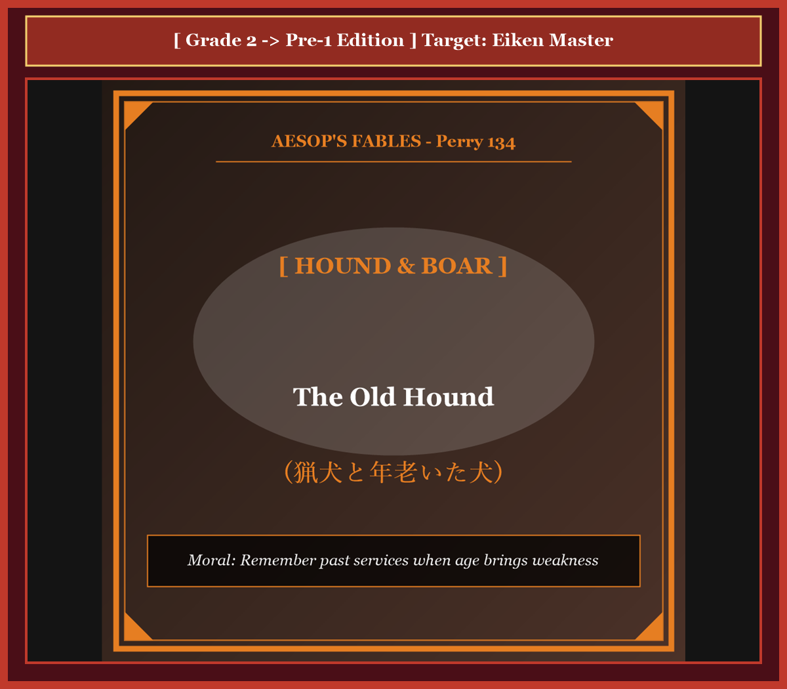
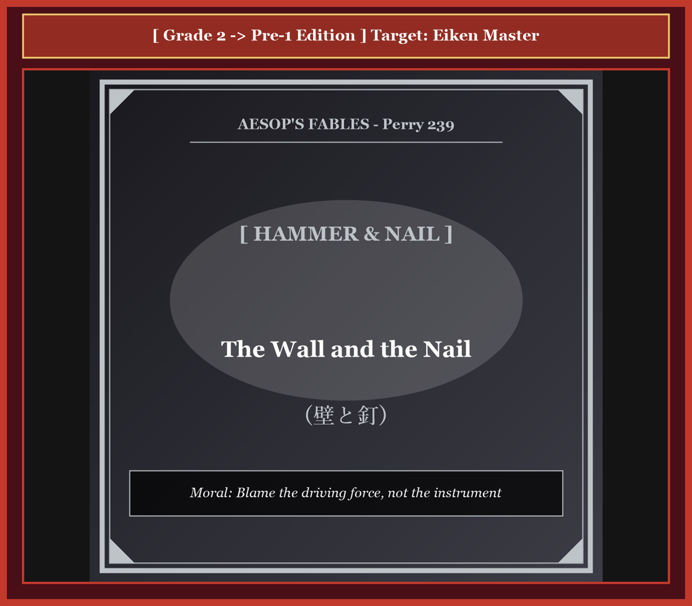
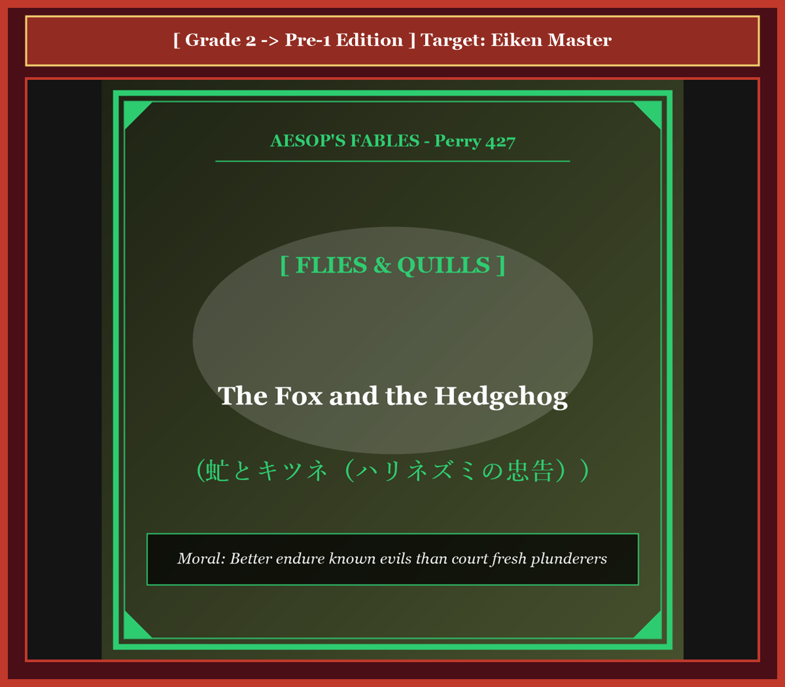
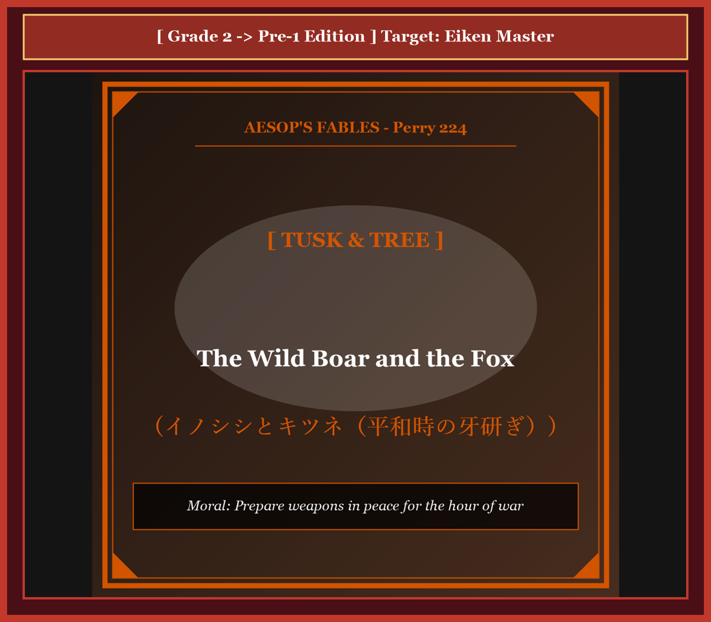
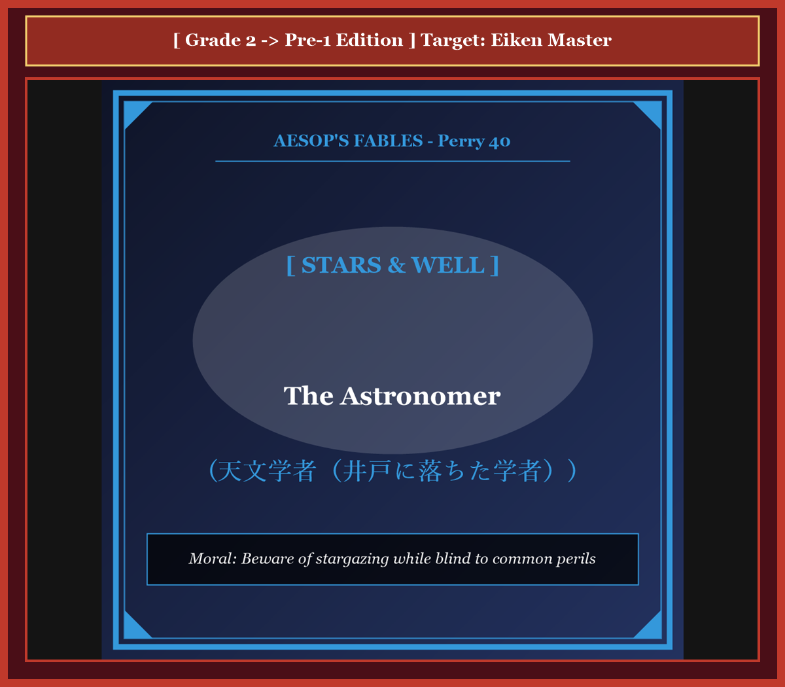
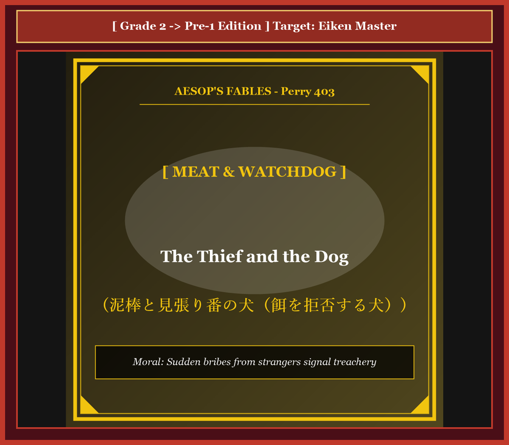
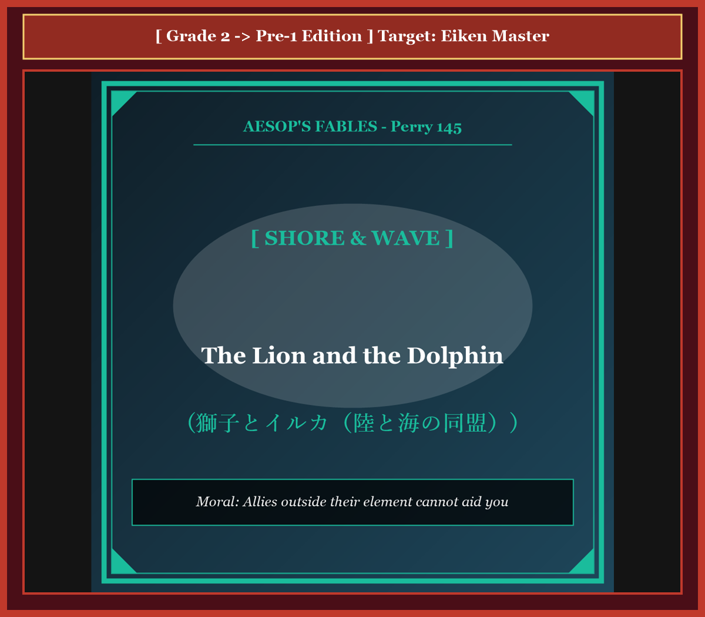
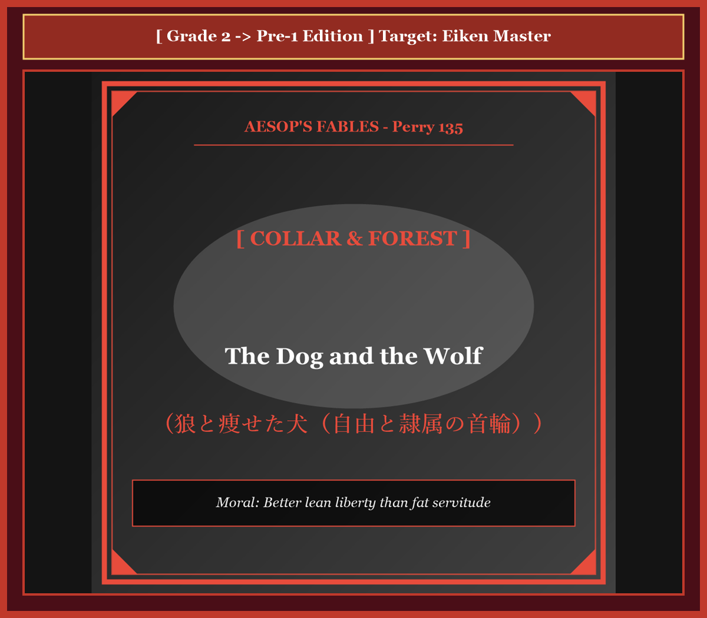
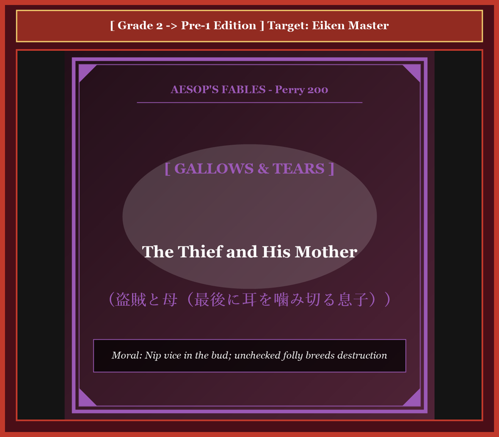
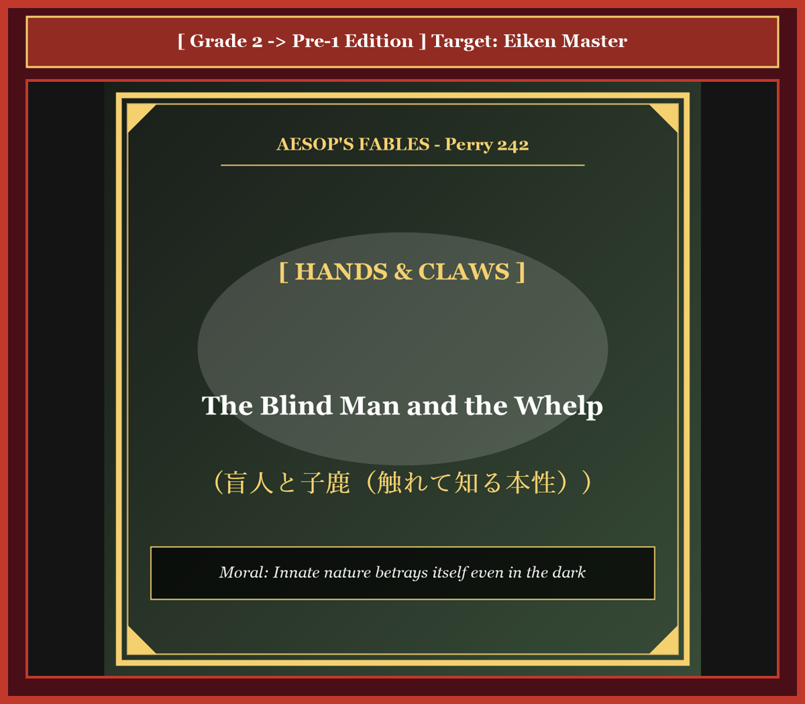

# 『英検ステップアップ多読：イソップ寓話編 第20巻（2級 ➔ 準1級対比学習・第5集）』

---

## はじめに：なぜ「対比多読」で英検準1級の頂を極められるのか？

英検準1級の合格を目指す英語学習者が直面する最後の壁は、**「高校・大学入試レベルの標準英語」から「世界的知性・教養人が駆使する高度なアカデミック英語」への次元の飛躍**です。

2級までは論理的で分かりやすい構文と標準的な語彙で合格点を獲得できましたが、準1級では国際政治、哲学、社会生物学、法学、認知科学などに通じる極めて高度な抽象語彙（*mercenary, servility, incorrigible, existential, retribution* など）と、反語・倒置・格調高い隠喩を含む重厚な英文を瞬時に読み解く読解力が不可欠です。

本書では、世界中で数千年読み継がれてきたイソップ寓話（第5集・全10話）を舞台に、**「完成された2級英語」** が **「最高峰の準1級英語」** へとどのように深化・昇華するかを対比学習します。

* **馴染みの寓話（2級）** で物語の全体像と論理展開を完全に掌握
* **極上の知的英語（準1級）** で、TIME誌やThe Economist誌レベルの語彙・文体を身体化
* **暗唱キーフレーズ対比** で、二次面接スピーキング（4コマナレーション・社会問題ディスカッション）や自由英作文で圧倒的な高得点を奪取

至高の教養英語を味わい尽くしながら、英検準1級合格という栄冠を勝ち取りましょう！

---

## 本書の収録作品（第5集・全10話）

1. **Chapter 41**: 猟犬と年老いた犬 (*The Old Hound*) [Perry 134]
2. **Chapter 42**: 壁と釘 (*The Wall and the Nail*) [Perry 239]
3. **Chapter 43**: 虻とキツネ（ハリネズミの忠告） (*The Fox and the Hedgehog*) [Perry 427]
4. **Chapter 44**: イノシシとキツネ（平和時の牙研ぎ） (*The Wild Boar and the Fox*) [Perry 224]
5. **Chapter 45**: 天文学者（井戸に落ちた学者） (*The Astronomer*) [Perry 40]
6. **Chapter 46**: 泥棒と見張り番の犬（餌を拒否する犬） (*The Thief and the Dog*) [Perry 403]
7. **Chapter 47**: 獅子とイルカ（陸と海の同盟） (*The Lion and the Dolphin*) [Perry 145]
8. **Chapter 48**: 狼と痩せた犬（自由と隷属の首輪） (*The Dog and the Wolf*) [Perry 135]
9. **Chapter 49**: 盗賊と母（最後に耳を噛み切る息子） (*The Thief and His Mother*) [Perry 200]
10. **Chapter 50**: 盲人と子鹿（触れて知る本性） (*The Blind Man and the Whelp*) [Perry 242]

---

## 本書の構成と電子書籍 / Kobo最適化

各章は以下の構成で統一されています。

```text
┌─────────────────────────────────────────────────────────────┐
│ 1. Chapter Title & Visual Illustration (章タイトル ＆ 挿絵)   │
│ 2. Benchmark Level: 英検2級レベル英文                         │
│ 3. Target Level: 英検準1級レベル英文                         │
│ 4. Classic Original English Text (イソップ寓話クラシック原文)  │
│ 5. Japanese Translation (日本語訳 ＆ 教訓)                     │
│ 6. Recite & Compare (そらんじたいキーフレーズ対比カード)        │
│ 7. Key Vocabulary & Exam Notes (語彙・文法・試験対策解説)        │
└─────────────────────────────────────────────────────────────┘
```

> **【ポイント】 音声読み上げ（TTS）をご利用の方へ**
> 本文セクション（ステップ1〜3）は英語のみで構成されており、電子書籍やKoboの自動音声読み上げ機能（Text-to-Speech）で日本語が混ざることなく、格調高い英語音声で快適にリスニング学習していただけます。


# Chapter 41: The Old Hound (猟犬と年老いた犬)

<!-- 電子書籍 Page Break & Image Header -->
<div style="text-align: center; margin-bottom: 20px;">
  
</div>

<div style="page-break-before: always;"></div>

## 1. Benchmark Level: Eiken Grade 2 (英検2級レベル本文)
*Read in ~2.5 to 3 minutes. Baseline vocabulary and basic syntax.*

Throughout his vigorous youth, a celebrated canine tracker served an aristocratic hunter with unswerving loyalty and unparalleled athletic distinction. Possessing extraordinary olfactory acuity and muscular stamina, the hound consistently tracked, cornered, and immobilized the most ferocious beasts of the primeval forest, ensuring boundless prestige and material prosperity for his master.

However, the relentless passage of decades inevitably inflicted biological deterioration upon the loyal predator. His once-supple joints stiffened with debilitating arthritis, his keen vision dimmed behind a milky film of age, and his formidable dentition was reduced to blunted, fragile stumps.

One chilly winter morning, the hunter summoned his aging hound to participate in an expedition tracking a ferocious wild boar. Detecting fresh tracks within a tangled thicket, the veteran hound rallied his fading physical reserves and charged the quarry. With heroic determination, the aged canine clamped his jaws firmly upon the beast's bristling ear.

Nevertheless, his degenerated teeth could no longer sustain the violent kinetic resistance of the thrashing boar. Slipping from the hound's feeble grip, the quarry broke free and vanished into the dense underbrush.

Enraged by the loss of his prestigious prize, the ungrateful hunter raised his heavy wooden staff and began violently striking the exhausted hound, berating him for contemptible cowardice and incompetence.

Raising his sorrowful, rheumy eyes toward his cruel tormentor, the battered hound offered a dignified and poignant rebuke: "Hold your unmerited blows, master! My failing strength reflects the natural decay of my physical frame, not any deficiency of loyalty or courage. If you cannot commend the feeble remnant of my twilight years, at least preserve the decency to honor the countless triumphs of my glorious youth."

---
<div style="page-break-before: always;"></div>

## 2. Target Level: Eiken Grade Pre-1 (英検準1級レベル本文)
*Read in ~3 to 3.5 minutes. Sophisticated vocabulary, subtle rhetoric, and academic analysis.*

Throughout the zenith of his physiological vigor, a peerless canid tracker dedicated his kinetic prowess to an aristocratic sportsman with incorruptible loyalty and consummate distinction. Endowed with extraordinary olfactory acuity, ferocious acceleration, and relentless stamina, the hound systematically tracked, cornered, and immobilized the most formidable wildlife of the wilderness, perpetually augmenting the socioeconomic prestige and hunting accolades of his sovereign patron.

Nevertheless, the inexorable chronobiology of mammalian senescence gradually exacted its physical toll. The predator's once-limber musculature deteriorated under degenerative osteoarthritic inflammation; his acute ocular faculties diminished into permanent opacification; and his formidable predatory dentition degraded into brittle, decalcified fragments.

During a rigorous winter expedition, the patrician huntsman mobilized his declining hound to confront an exceptionally belligerent wild boar. Guided by vestigial hunting instincts, the veteran canine rallied his depleted physiological reserves, breached a thorny redoubt, and launched a desperate assault upon the quarry. Summoning every remnant of ancestral tenacity, the hound seized the thrashing beast by its auricular margin.

Tragically, his decrepit dental architecture could not withstand the violent centrifugal momentum exerted by the enraged boar. As the worn enamel fractured, the prey slipped from the hound's compromised grip and absconded into the impenetrable thicket.

Infuriated by this aborted acquisition, the capricious sportsman succumbed to vindictive indignation. Brandishing a hardwood baton, he commenced an unsparing punitive flogging of the prostrate animal, denouncing his longtime companion with vitriolic accusations of indolence and pusillanimity.

Lifting his rheumy, lacerated visage toward his unprincipled benefactor, the battered patriarch articulated a profound philosophical remonstrance: "Withhold your despotic chastisement, master! My operational failure stems exclusively from unavoidable physiological decrepitude, never from an erosion of fidelity or fortitude. If my present enfeeblement excites your contempt rather than your empathy, cultivate the minimal moral rectitude to venerate the glorious legacy of my past triumphs."

---
<div style="page-break-before: always;"></div>

## 3. Classic Original English Text (イソップ寓話クラシック原文)
*Perry 134: Translated by George Fyler Townsend (1867)*

A Hound, who in the days of his youth and strength had never yielded to any beast of the forest, encountered in his old age a boar in the chase. 

He seized him boldly by the ear, but could not retain his hold because of the decay of his teeth, so that the boar escaped. 

His master, quickly coming up, was very much disappointed, and fiercely abused the dog. 

The Hound looked up and said, "It was not my fault, master: my spirit was as good as ever, but I could not help my infirmities. I rather deserve to be praised for what I have been, than to be blamed for what I am."

---
<div style="page-break-before: always;"></div>

## 4. Japanese Translation & Moral (日本語訳と教訓)

### 【日本語全訳：英検準1級レベル本文】
自らの生理的活気の絶頂期を通じて、無類の狩猟犬は清廉な忠誠心と至高の栄誉をもって、自らの運動能力を貴族のスポーツマン（狩人）に捧げていました。卓越した嗅覚の鋭敏さ、獰猛な加速力、そして容赦なき持久力を天賦の才として備えていたその猟犬は、原野の最も手強い野獣たちを組織的に追跡し、追い詰め、行動不能にし、主権者たる後援者の社会経済的名声と狩猟の栄冠を絶え間なく高め続けました。

それにもかかわらず、哺乳類の老化という抗いようのない時間生物学的現実は、徐々に肉体的な代償を徴収していきました。かつて柔軟であった捕食者の筋肉組織は、変形性関節症の退行性炎症のもとで衰え、その鋭利な視覚器官は永続的な混濁へと減退し、恐るべき捕食者の歯列は脆く脱灰した破片へと劣化していきました。

過酷な冬の遠征の最中、貴族の狩人は、とりわけ好戦的なイノシシに立ち向かわせるために、衰えゆく猟犬を動員しました。名残の狩猟本能に導かれ、老練なイヌ科の戦士は枯渇しかけた生理的予備力を結集し、棘だらけの拠点を突破して、獲物への捨て身の急襲を仕掛けました。先祖伝来の粘り強さのあらゆる残滓をかき集め、猟犬は暴れ回る野獣の耳の縁をしっかりと咥え込みました。

悲劇的なことに、その老朽化した歯の構造は、激怒したイノシシが振るう猛烈な遠心力に耐えることができませんでした。すり減ったエナメル質が割れるとともに、獲物は猟犬の弱まった把持力から抜け出し、分け入ることのできない茂みの中へと逃げ去ってしまいました。

この捕獲の頓挫に激怒した気まぐれな狩人は、復讐心に満ちた憤怒に屈しました。硬木の棍棒を振り回しながら、彼は平伏する老犬に対する容赦なき懲罰的な殴打を開始し、長年の相棒を怠惰と臆病の辛辣な非難をもって罵倒したのです。

自らの涙ぐみ裂傷を負った顔貌を、不実な恩人へと持ち上げながら、打ちのめされた老犬の長老は、深遠な哲学的抗議を口にしました。「専制的な懲戒をお控えください、主人よ！ 私の作戦上の失敗は、不可避の生理的衰弱からのみ生じたものであり、忠誠心や不屈の精神の侵食によるものでは決してありません。もし現在の私の衰弱が貴方の共感ではなく軽蔑を呼び起こすのであるならば、せめて過去の我が無数の勝利の輝かしい遺産を敬うという、最小限の道徳的正しさを養っていただきとうございます。」

### 【教訓（Moral）】
**Ungrateful masters forget past devotion in the face of natural decay.**  
（冷酷で恩知らずな人間は、過去の多大な献身と功績を、加齢や衰退という自然の摂理の前で一瞬にして忘れ去り、現在の不全を一方的に責め立てる。真に徳のある者は、過去の功労に敬意を払い、老境にある者を温かく処遇する。）

---
<div style="page-break-before: always;"></div>

## 5. Recite & Compare: そらんじたいキーフレーズ対比カード

<div class="comparison-card">
  <div class="card-header">フレーズ 1：加齢による不可避の肉体的衰退</div>
  <div class="card-row-g2-base"><span class="card-badge-g2-base">2級</span>The relentless passage of decades inevitably inflicted biological deterioration.</div>
  <div class="card-row-pre1"><span class="card-badge-pre1">準1級</span>The inexorable chronobiology of senescence gradually exacted its physical toll.</div>
  <div class="card-note"><strong>解説：</strong>「inexorable chronobiology of senescence（抗いようのない老化の時間生物学）」と「exacted its physical toll（肉体的代償を課した）」による格調高い医学的表現です。</div>
</div>

<div class="comparison-card">
  <div class="card-header">フレーズ 2：激しく暴れる獲物の遠心力に耐えられない</div>
  <div class="card-row-g2-base"><span class="card-badge-g2-base">2級</span>His degenerated teeth could no longer sustain the violent kinetic resistance of the boar.</div>
  <div class="card-row-pre1"><span class="card-badge-pre1">準1級</span>His decrepit dental architecture could not withstand the violent centrifugal momentum exerted by the boar.</div>
  <div class="card-note"><strong>解説：</strong>力学用語「centrifugal momentum（遠心運動量・遠心力）」と「decrepit dental architecture（老朽化した歯牙構造）」を用いた迫真の物理描写です。</div>
</div>

<div class="comparison-card">
  <div class="card-header">フレーズ 3：長年の相棒を怠惰と臆病と罵倒する</div>
  <div class="card-row-g2-base"><span class="card-badge-g2-base">2級</span>He began striking the exhausted hound, berating him for contemptible cowardice.</div>
  <div class="card-row-pre1"><span class="card-badge-pre1">準1級</span>He commenced a punitive flogging, denouncing his companion with vitriolic accusations of indolence and pusillanimity.</div>
  <div class="card-note"><strong>解説：</strong>英検準1級・1級の重要語彙「vitriolic（辛辣な・腐食性の）」「indolence（怠惰）」「pusillanimity（臆病・小心）」の精緻な組み合わせです。</div>
</div>

<div class="comparison-card">
  <div class="card-header">フレーズ 4：過去の功績を敬う最小限の道徳的正しさ</div>
  <div class="card-row-g2-base"><span class="card-badge-g2-base">2級</span>At least preserve the decency to honor the countless triumphs of my glorious youth.</div>
  <div class="card-row-pre1"><span class="card-badge-pre1">準1級</span>Cultivate the minimal moral rectitude to venerate the glorious legacy of my past triumphs.</div>
  <div class="card-note"><strong>解説：</strong>「moral rectitude（道徳的正直さ・廉潔さ）」と「venerate the glorious legacy（輝かしい遺産・功績を崇敬する）」による威厳ある結びです。</div>
</div>

---
<div style="page-break-before: always;"></div>

## 6. Key Vocabulary & Exam Notes (英検準1級 重要語彙・文法・面接対策)

### 1. 英検準1級 必須ボキャブラリー
* **senescence** [名] 老化、老衰（*aging* の学術用語）
* **kinetic** [形] 運動の、動的な（*kinetic prowess / kinetic energy*）
* **osteoarthritic** [形] 変形性関節症の
* **opacification** [名] 白濁、不透明化（白内障などの病変）
* **pusillanimity** [名] 臆病、小心、気骨のなさ
* **vitriolic** [形] 辛辣な、痛烈な、悪意に満ちた（*vitriolic attacks*）
* **remonstrance** [名] 抗議、諌言、苦情の申し立て
* **rectitude** [名] 公正、清廉、高潔（*moral rectitude*）

### 2. 文法・構文のチェックポイント
* **exact a toll on ...**:
  * 「〜に甚大な被害をもたらす、代償を徴収する」。社会問題・環境問題・健康問題のエッセイで頻出の超重要イディオムです。
* **Withhold + 目的語**:
  * 「〜を差し控える、保留する、差し出さない」。*Withhold your chastisement*（懲戒を差し控えよ）。

### 3. スピーキング（面接）＆ライティング活用ヒント
「高齢社会における労働者の待遇」「功労者に対する組織の倫理的責任」を論じる際のフレーズ：
* *Modern corporate governance must maintain the moral rectitude to honor the legacy of veteran workers rather than treating them with utilitarian disposable cynicism.*（現代のコーポレートガバナンスは、ベテラン労働者を功利主義的・使い捨ての冷笑主義で扱うのではなく、彼らの功績の遺産を称える道徳的高潔さを保持しなければならない。）
* *Societies that discard individuals facing inevitable physiological senescence undermine their own communal solidarity.*（不可避の生理的老化に直面する個々人を切り捨てる社会は、自らの共同体的連帯を損なう。）


# Chapter 42: The Wall and the Nail (壁と釘)

<!-- 電子書籍 Page Break & Image Header -->
<div style="text-align: center; margin-bottom: 20px;">
  
</div>

<div style="page-break-before: always;"></div>

## 1. Benchmark Level: Eiken Grade 2 (英検2級レベル本文)
*Read in ~2.5 to 3 minutes. Baseline vocabulary and basic syntax.*

Within the interior of an ancient masonry dwelling, a solid plaster partition wall endured an agonizing physical torment. A carpenter had positioned a sharp iron nail against its polished lime surface and was forcefully driving the metal spike deep into its structural core with repeated blows of a heavy mallet.

Convulsed by traumatic vibrations and watching fine fractures spread across its smooth exterior, the suffering wall vocalized a bitter accusation: "Insolent piece of iron! Why do you ruthlessly pierce my defenseless surface and tear through my structural layers when I have never committed the slightest injury or injustice against you?"

The iron nail, enduring intense heat and mechanical compression as its point penetrated the dense plaster and stone, offered an immediate and lucid justification:

"Direct your moral indignation toward the real source of your agony, unperceiving wall! Do not condemn my inanimate substance for an aggression I have not chosen to initiate. Do you not perceive the muscular laborer standing before you, who swings that massive iron mallet with relentless determination? He forcefully strikes my blunt head with enormous kinetic energy, compelling my tapered point to penetrate your interior. I am merely the passive instrument of an external and overwhelming force; the true author of your laceration is the power driving behind me."

---
<div style="page-break-before: always;"></div>

## 2. Target Level: Eiken Grade Pre-1 (英検準1級レベル本文)
*Read in ~3 to 3.5 minutes. Sophisticated vocabulary, subtle rhetoric, and academic analysis.*

Within the domestic perimeter of a classical stone edifice, an immaculately rendered masonry partition suffered a traumatic structural violation. An austere artisan had positioned a tapered ferrous nail perpendicular to its polished calcarean surface, driving the metallic projectile inexorably into its architectural substratum through the rhythmic application of a heavy pneumatic-grade mallet.

Convulsed by seismic acoustic reverberations and observing micro-fissures proliferate catastrophically across its smooth facade, the aggrieved structure articulated an impassioned denunciation: "Barbaric wedge of iron! What perverse malice impels you to lacerate my contiguous surface and fracture my internal coherence, when I have preserved absolute non-aggression and inflicted zero provocation upon your existence?"

The iron spike, itself subjected to immense compressive stress, frictional thermal friction, and structural deformation, retorted with dialectical detachment:

"Disabuse yourself of this superficial misattribution of agency, naive structure! Do not impute subjective malevolence to an inanimate conduit that exercises neither volition nor autonomy. Direct your analytical gaze toward the sovereign human operative towering above us, whose kinetic arm administers those concussive blows upon my flattened extremity. It is his deliberate gravitational violence that compels my sharp tip to breach your density. I represent merely an involuntary intermediary subjected to relentless mechanical compulsion; the authentic causal architect of your trauma resides exclusively in the external hand that wields the instrument."

---
<div style="page-break-before: always;"></div>

## 3. Classic Original English Text (イソップ寓話クラシック原文)
*Perry 239: Translated by George Fyler Townsend (1867)*

A Wall, being violently torn down by a Nail that was driven into it, cried out: "Why do you tear me through, who have never done you any ill?" 

"Do not blame me," said the Nail, "but him who beats me behind with such heavy blows."

---
<div style="page-break-before: always;"></div>

## 4. Japanese Translation & Moral (日本語訳と教訓)

### 【日本語全訳：英検準1級レベル本文】
古典的な石造建造物の内部において、寸分の隙もなく仕上げられた石造りの仕切り壁が、耐え難い構造的外傷を被っていました。峻厳な職人が、磨き上げられた石灰質の表面に対して直角に先細りの鉄釘を当てがい、重量級の木槌をリズミカルに振り下ろすことによって、その建築的基盤の中へと金属の楔を容赦なく打ち込んでいたのです。

地震のような音響反響に激しく揺さぶられ、滑らかな壁面全体に微細な亀裂が破滅的に増殖していくのを目撃しながら、被害を受けた構造物は激しい糾弾の声を上げました。「野蛮な鉄の楔よ！ 私が貴殿の存在に対して絶対的な不可侵を守り、微塵の挑発も加えていないというのに、いかなる邪悪な悪意がお前を駆り立て、私の連続した表面を引き裂き、内部の結束を破壊せしめるのか？」

鉄の釘自身も、激しい圧縮応力、摩擦熱、そして構造的変形に耐えながら、弁証法的な超然さをもってこう反論しました。

「行為主体性の皮相な誤認から目を覚ますが良い、ナイーブな構造物よ！ 意志も自律性も行使し得ない無生物の導管に対して、主観的な敵意を帰属させてはならない。我々の上にそびえ立ち、その運動アームをもって私の平らな末端に強烈な打撃を浴びせかけている主権者たる人間の作業員へと、貴殿の分析的な視線を向けよ。お前の密度を突破するよう私の鋭利な先端を強制しているのは、彼が意図的に加える重力的な暴力なのだ。私は過酷な力学的強制に服従させられている受動的な媒介者に過ぎない。貴殿のトラウマを生み出した真の因果の設計者は、この道具を振るう外部の手にこそあるのだ。」

### 【教訓（Moral）】
**Look past the passive instrument to the compelling hand.**  
（表面的な加害手段に目を奪われ、背後にある真の強制力を見誤ってはならない。組織や社会の末端で害をなしているように見える者は、上位の絶対的権力によって押し潰されながら駆動されている受動的道具に過ぎないことが多く、批判と責任の矛先は真の命令者へと向けられるべきである。）

---
<div style="page-break-before: always;"></div>

## 5. Recite & Compare: そらんじたいキーフレーズ対比カード

<div class="comparison-card">
  <div class="card-header">フレーズ 1：行為主体性の誤認を戒める弁証法</div>
  <div class="card-row-g2-base"><span class="card-badge-g2-base">2級</span>Do not condemn my inanimate substance for an aggression I have not chosen to initiate.</div>
  <div class="card-row-pre1"><span class="card-badge-pre1">準1級</span>Disabuse yourself of this superficial misattribution of agency, naive structure!</div>
  <div class="card-note"><strong>解説：</strong>哲学・認知科学用語「misattribution of agency（行為主体性の誤った帰属）」と「disabuse yourself of（迷妄・思い込みを解く）」による極めて高度な論理展開です。</div>
</div>

<div class="comparison-card">
  <div class="card-header">フレーズ 2：無生物の導管に主観的悪意を帰属させてはならない</div>
  <div class="card-row-g2-base"><span class="card-badge-g2-base">2級</span>Direct your moral indignation toward the real source of your agony.</div>
  <div class="card-row-pre1"><span class="card-badge-pre1">準1級</span>Do not impute subjective malevolence to an inanimate conduit that exercises neither volition nor autonomy.</div>
  <div class="card-note"><strong>解説：</strong>「impute A to B（Aの責任をBに帰する）」「neither volition nor autonomy（意志も自律性も持たない）」という法学・社会科学の洗練された論述です。</div>
</div>

<div class="comparison-card">
  <div class="card-header">フレーズ 3：過酷な機械的強制に服する受動的媒介者</div>
  <div class="card-row-g2-base"><span class="card-badge-g2-base">2級</span>I am merely the passive instrument of an external and overwhelming force.</div>
  <div class="card-row-pre1"><span class="card-badge-pre1">準1級</span>I represent merely an involuntary intermediary subjected to relentless mechanical compulsion.</div>
  <div class="card-note"><strong>解説：</strong>「involuntary intermediary（不本意な・非自発的な仲介者）」と「mechanical compulsion（力学的強制）」が道具の受動的宿命を浮き彫りにします。</div>
</div>

<div class="comparison-card">
  <div class="card-header">フレーズ 4：真の因果の設計者は背後で道具を振るう手にある</div>
  <div class="card-row-g2-base"><span class="card-badge-g2-base">2級</span>The true author of your laceration is the power driving behind me.</div>
  <div class="card-row-pre1"><span class="card-badge-pre1">準1級</span>The authentic causal architect of your trauma resides exclusively in the external hand that wields the instrument.</div>
  <div class="card-note"><strong>解説：</strong>「causal architect（因果律の設計者・真の元凶）」と関係詞節「the hand that wields the instrument」の鮮烈な対比です。</div>
</div>

---
<div style="page-break-before: always;"></div>

## 6. Key Vocabulary & Exam Notes (英検準1級 重要語彙・文法・面接対策)

### 1. 英検準1級 必須ボキャブラリー
* **calcarean** [形] 石灰質の、炭酸カルシウムを含む
* **disabuse** [動] （人の誤解や迷妄を）解く、正気に戻す（*disabuse someone of a notion*）
* **misattribution** [名] 誤った帰属、不適切な原因特定
* **impute** [動] 〜を（…のせいに）帰する、負わせる（*impute guilt to ...*）
* **volition** [名] 意志、決意（*of one's own volition* = 自らの意志で）
* **compulsion** [名] 強制、衝動（*under compulsion* = 強制されて）
* **intermediary** [名] 媒介者、仲介役
* **wield** [動] （武器・道具・権力を）振るう、行使する（*wield influence / wield power*）

### 2. 文法・構文のチェックポイント
* **impute + A + to + B**:
  * 「A（責任・動機など）をBに帰する」。法律論文や政治評論で不可欠のハイレベル動詞です。
* **neither + A + nor + B**:
  * 否定の並列。「AもBも〜ない」。*exercises neither volition nor autonomy*（意志も自律性も行使しない）。

### 3. スピーキング（面接）＆ライティング活用ヒント
「官僚制における組織的責任」「人工知能（AI）や自動化兵器における責任の所在」を論じる際のフレーズ：
* *When evaluating systemic institutional failures, analysts must avoid the superficial misattribution of guilt to bureaucratic intermediaries.*（構造的な組織の失敗を評価する際、アナリストは官僚的媒介者に罪を誤って帰属させる皮相な判断を避けなければならない。）
* *Ethical jurisprudence must identify the sovereign architects who wield automated technologies rather than condemning the technological instruments themselves.*（倫理的法学は、技術的道具そのものを断罪するのではなく、自動化技術を操り行使する主権的設計者を特定しなければならない。）


# Chapter 43: The Fox and the Hedgehog (虻とキツネ)

<!-- 電子書籍 Page Break & Image Header -->
<div style="text-align: center; margin-bottom: 20px;">
  
</div>

<div style="page-break-before: always;"></div>

## 1. Benchmark Level: Eiken Grade 2 (英検2級レベル本文)
*Read in ~2.5 to 3 minutes. Baseline vocabulary and basic syntax.*

A cunning fox, traversing a swollen and turbulent river, was swept off his feet by the powerful current and deposited into a deep, muddy ravine. Bruised, exhausted, and hopelessly trapped in the mire, the helpless predator lay completely immobilized for many hours.

Before long, an immense swarm of bloodthirsty horseflies detected the captive quadruped. Descending upon his unprotected head, ears, and flank, the ravenous parasites pierced his tender skin, gorging themselves on his warm blood until the miserable fox groaned in acute agony.

Presently, a benevolent hedgehog wandered along the rim of the ravine. Observing the pathetic plight of the wretched fox, the armored woodland creature was moved by sincere compassion and offered to provide immediate relief.

"Kind friend," whispered the hedgehog, rattling his protective quills, "shall I scramble down and use my sharp spines to brush away this tormenting swarm of bloodsuckers that is draining your vitality?"

"By no means! I vehemently implore you to refrain!" cried the tormented fox with desperate urgency.

"For what conceivable reason do you reject my assistance?" inquired the astonished hedgehog. "Do you truly prefer to remain food for these merciless parasites?"

"Listen carefully," gasped the analytical fox. "This existing swarm of flies has already engorged itself to the point of absolute saturation; having drained their fill, they now extract very little additional blood. If your quills disperse this satisfied swarm, an entirely fresh detachment of ravenous and emaciated parasites will instantly descend upon my wounds, draining every residual drop of life from my veins."

---
<div style="page-break-before: always;"></div>

## 2. Target Level: Eiken Grade Pre-1 (英検準1級レベル本文)
*Read in ~3 to 3.5 minutes. Sophisticated vocabulary, subtle rhetoric, and academic analysis.*

While negotiating the treacherous rapids of a swollen mountain torrent, an astute vulpine forager was abruptly overwhelmed by the hydrodynamic deluge and precipitated into a subterranean ravine. Stranded within an adhesive morass of alluvial mud, the severely bruised predator lay physically incapacitated, entirely shorn of his customary agility and cunning.

Inevitably, an aggressive cloud of hematophagous diptera—voracious horseflies—detected the immobilized mammal. Converging en masse upon his exposed cranial and cutaneous surfaces, the parasitic swarm deployed their piercing proboscises, systematically extracting vital fluids until the animal was plunged into profound hemodynamic shock.

Presently, a philanthropic hedgehog ambled along the precipice of the abyss. Discerning the abject humiliation and physiological distress of the stranded carnivore, the spiny mammal experienced an authentic pang of altruistic empathy, prompting an immediate offer of surgical intervention.

"Noble vulpine," solicited the spiny observer, "shall I descend into the gorge and deploy my calcified quills to eradicate this voracious cloud of bloodsuckers that relentlessly compromises your vascular equilibrium?"

"On no account! I implore you to maintain absolute inaction!" interjected the agonizing fox with vehement lucidity.

"Upon what paradoxical logic do you repudiate my benevolence?" queried the bewildered hedgehog. "Do you genuinely elect to endure perpetual parasitic predation?"

"Internalize this fundamental political economy," whispered the pragmatic fox. "This incumbent contingent of parasites has achieved absolute satiety; having gorged themselves to physiological repletion, their current extraction rate is practically negligible. Should your well-intentioned intervention disperse these glutted extortionists, an entirely unrequited cohort of famished parasites will immediately colonize my lacerations, mercilessly expropriating every residual drop of hemoglobin from my depleted circulatory system."

---
<div style="page-break-before: always;"></div>

## 3. Classic Original English Text (イソップ寓話クラシック原文)
*Perry 427: Translated by George Fyler Townsend (1867)*

A Fox swimming across a rapid river was carried by the force of the current into a very deep ravine, where he lay for a long time very much bruised and sick, and unable to move. 

A swarm of hungry blood-sucking flies settled upon him. 

A Hedgehog, passing by, saw his anguish and inquired if he should drive away the flies that were tormenting him. 

"By no means," replied the Fox; "pray do not molest them." 

"How is that?" said the Hedgehog; "do you not want to be rid of them?" 

"No," returned the Fox, "for these flies which you see here are already full, and draw but little blood; but if you drive them away, another swarm of hungry ones will come and will drink up all the blood I have left."

---
<div style="page-break-before: always;"></div>

## 4. Japanese Translation & Moral (日本語訳と教訓)

### 【日本語全訳：英検準1級レベル本文】
増水した山岳急流の危険な早瀬を渡る途中、抜け目のないキツネの採餌者が流体力学的な奔流に突如として圧倒され、地下の深い谷底へと転落してしまいました。沖積土の粘着性の泥沼の中に足を取られ、ひどい打撲を負った捕食者は、持ち前の敏捷性と狡知を完全に奪われたまま、肉体的な行動不能に陥って横たわっていました。

案の定、吸血性双翅目（きゅうけつせいそうしもく＝飢えた虻）の攻撃的な大群が、身動きの取れない哺乳動物を嗅ぎつけました。露出した頭部と皮膚の表面に一斉に群がり、寄生虫の群れは突き刺すような口吻を展開して、動物が重度の血行動態ショックに陥るまで、生命維持に必要な体液を組織的に吸い上げ始めたのです。

その時、博愛主義のハリネズミが深淵の崖の縁を歩いて通りかかりました。立ち往生した肉食獣の無残な屈辱と生理的苦痛を見抜いたそのトゲだらけの哺乳類は、真の利他的共感の疼きを経験し、即座の外科的介入を提案しました。

「気高きキツネ殿」とトゲのある観察者は持ちかけました。「私が峡谷へと降りていき、石灰化したトゲを展開して、貴殿の血管平衡を容赦なく脅かしているこの強欲な吸血昆虫の群れを根絶やしにいたしましょうか？」

「とんでもない！ 是非とも完全な不作為（何もしないこと）を保っていただきたい！」と苦悶するキツネは激しい明晰さをもって遮りました。

「いかなる逆説的な論理に基づいて、我が善意を拒絶されるのか？」と困惑したハリネズミが尋ねました。「貴殿は真に、永続的な寄生的捕食に耐えることを選択されるというのか？」

「この根本的な政治経済学を理解してほしい」と現実主義のキツネは囁きました。「現職の寄生虫の分遣隊はすでに完全な満腹状態を達成しており、生理的な飽食に達しているため、現在の吸血率は実質的に無視できる水準なのだ。もし貴殿の善意の介入がこれら飽食した収奪者たちを追い散らしてしまえば、飢餓に苦しむ新たな寄生虫の集団が即座に我が傷口を植民地化し、枯渇した循環器系から残された最後の一滴のヘモグロビンまでも無慈悲に収奪し尽くしてしまうだろうからだ。」

### 【教訓（Moral）】
**Better the sated extortionist than the famished newcomer.**  
（満腹した現職の搾取者を我慢する方が、飢えた新参の略奪者を迎え入れるより遥かにましである。政治や組織の腐敗において、拙速な権力交代や改革がより強欲な新たな利権追及者を招き入れ、民衆や現場の収奪を劇的に悪化させることがあるという冷徹な現実主義の教訓。）

---
<div style="page-break-before: always;"></div>

## 5. Recite & Compare: そらんじたいキーフレーズ対比カード

<div class="comparison-card">
  <div class="card-header">フレーズ 1：吸血昆虫による血行動態ショック</div>
  <div class="card-row-g2-base"><span class="card-badge-g2-base">2級</span>A swarm of horseflies pierced his skin, gorging on his blood until he groaned in agony.</div>
  <div class="card-row-pre1"><span class="card-badge-pre1">準1級</span>Hematophagous diptera deployed proboscises, extracting fluids until he was plunged into hemodynamic shock.</div>
  <div class="card-note"><strong>解説：</strong>生物学・医学用語「hematophagous diptera（吸血性双翅目）」「proboscis（口吻）」「hemodynamic shock（血行動態ショック）」を用いた圧巻の描写です。</div>
</div>

<div class="comparison-card">
  <div class="card-header">フレーズ 2：善意の介入の申し出</div>
  <div class="card-row-g2-base"><span class="card-badge-g2-base">2級</span>Moved by compassion, he offered to use his quills to brush away the bloodsuckers.</div>
  <div class="card-row-pre1"><span class="card-badge-pre1">準1級</span>Moved by altruistic empathy, he offered to deploy calcified quills to eradicate the voracious cloud.</div>
  <div class="card-note"><strong>解説：</strong>「altruistic empathy（利他的共感）」と「deploy calcified quills to eradicate...（石灰化したトゲを展開して根絶する）」による精巧な修辞です。</div>
</div>

<div class="comparison-card">
  <div class="card-header">フレーズ 3：満腹した現職寄生虫の搾取率は微小</div>
  <div class="card-row-g2-base"><span class="card-badge-g2-base">2級</span>Having drained their fill, they now extract very little additional blood.</div>
  <div class="card-row-pre1"><span class="card-badge-pre1">準1級</span>Having achieved satiety and physiological repletion, their current extraction rate is practically negligible.</div>
  <div class="card-note"><strong>解説：</strong>経済学・生理学用語「physiological repletion（生理的充足・飽食）」「extraction rate is negligible（搾取率は無視できる）」による冷徹な分析です。</div>
</div>

<div class="comparison-card">
  <div class="card-header">フレーズ 4：飢餓の新参者による過酷な再収奪への警戒</div>
  <div class="card-row-g2-base"><span class="card-badge-g2-base">2級</span>A fresh swarm of famished parasites will drain every residual drop of life.</div>
  <div class="card-row-pre1"><span class="card-badge-pre1">準1級</span>A famished cohort of parasites will mercilessly expropriate every residual drop of hemoglobin.</div>
  <div class="card-note"><strong>解説：</strong>マルクス経済学・政治学の術語「expropriate（収奪する・財産を没収する）」を用いた鋭利な結実です。</div>
</div>

---
<div style="page-break-before: always;"></div>

## 6. Key Vocabulary & Exam Notes (英検準1級 重要語彙・文法・面接対策)

### 1. 英検準1級 必須ボキャブラリー
* **vulpine** [形] キツネの、キツネのような、狡猾な
* **hematophagous** [形] 吸血性の（*hematophagous insects*）
* **satiety** [名] 飽食、満腹状態
* **repletion** [名] 充満、飽食、十分な補給
* **negligible** [形] 無視できるほどの、ごくわずかな（*negligible difference*）
* **expropriate** [動] 〜を収奪する、公用収用する、没収する
* **hemoglobin** [名] ヘモグロビン、血色素
* **incumbent** [形] 現職の、在任中の（*the incumbent administration*）

### 2. 文法・構文のチェックポイント
* **Should + S + 原形動詞, S + will ...**:
  * 条件節の if 省略・倒置構文。「万一〜ならば…だろう」。格式の高い論述文で頻出の表現です。
* **shorn of ...**:
  * *shear*（刈り取る・奪う）の過去分詞。「〜を剥ぎ取られて、〜を奪われて」。*shorn of his customary agility*（普段の敏捷性を奪われて）。

### 3. スピーキング（面接）＆ライティング活用ヒント
「政治改革におけるリスク評価」「組織の汚職対策と政権交代の副作用」を論じる際のフレーズ：
* *Political scientists often note that precipitous regime changes can replace sated bureaucrats with famished newcomers, worsening corruption.*（政治学者はしばしば、性急な政権交代が満腹した官僚を飢えた新参者に置き換え、腐敗を悪化させかねないと指摘する。）
* *Pragmatic governance requires calculating whether radical administrative restructuring might inadvertently multiply parasitic rent-seeking.*（実用的な統治には、急進的な行政再編が不本意にも寄生的なレントシーキング（利権獲得競争）を増殖させないかを計算することが求められる。）


# Chapter 44: The Wild Boar and the Fox (イノシシとキツネ)

<!-- 電子書籍 Page Break & Image Header -->
<div style="text-align: center; margin-bottom: 20px;">
  
</div>

<div style="page-break-before: always;"></div>

## 1. Benchmark Level: Eiken Grade 2 (英検2級レベル本文)
*Read in ~2.5 to 3 minutes. Baseline vocabulary and basic syntax.*

On a serene and sunlit afternoon in a peaceful forest clearing, a massive wild boar stood beside the gnarled trunk of an ancient oak tree. With steady, deliberate concentration, the armored beast rubbed his formidable curved tusks against the rough bark, sharpening their pointed tips into razor-sharp weapons.

Presently, an inquisitive fox strolled out of the nearby brush. Observing the boar's intense labor, the vulpine cynic glanced around the landscape. Finding no sign of armed huntsmen, barking hounds, or rival predators, the fox tilted his head in theatrical amusement.

"Pardon my interruption, neighbor," mocked the fox with a sardonic chuckle. "Why do you exhaust your physical energy honing your weapons when the entire forest basks in tranquil peace? There is not a single hunter tracking in the valley, nor is there any predator threatening our borders. Your urgent military preparations appear utterly unnecessary and foolish."

The wise boar momentarily suspended his labor, looked directly into the fox's mocking eyes, and delivered a calm and decisive rebuttal:

"My behavior may seem redundant to a superficial observer, but it is rooted in sound strategic foresight. When crisis strikes and the hounds burst into this clearing, every split second will determine survival or death. In the heat of mortal combat, there will be no leisure to sharpen one's tusks. I hone my weapons during times of peace precisely so that they will be lethal and ready the moment peril appears."

---
<div style="page-break-before: always;"></div>

## 2. Target Level: Eiken Grade Pre-1 (英検準1級レベル本文)
*Read in ~3 to 3.5 minutes. Sophisticated vocabulary, subtle rhetoric, and academic analysis.*

During an interlude of uncharacteristic tranquility across an ancient woodland biome, a formidable wild boar engaged in methodical defensive conditioning beside the calcified bark of a venerable oak. With disciplined kinetic precision, the muscular ungulate abraded his formidable ivory tusks against the coarse wood, meticulously honing their dental edges into lethal, surgical armaments.

Observing this laborious endeavor, a wandering fox emerged from the surrounding foliage. Surveying the panoramic perimeter and discerning neither the scent of equestrian huntsmen, the acoustic signatures of baying canines, nor the presence of hostile apex predators, the cynical vulpine affected an expression of condescending bemusement.

"Pardon my analytical skepticism, comrade," sneered the fox with theatrical disparagement. "Why squander your physiological reserves polishing military deterrence within an operational vacuum of absolute serenity? The regional theater exhibits zero security threats, and our geopolitical perimeter is entirely pacific. Your frantic martial preparedness constitutes an absurd exercise in paranoid redundancy."

The disciplined boar suspended his mechanical friction, cast a piercing gaze upon his supercilious interlocutor, and articulated a profound strategic doctrine:

"Your assessment reflects the fatal myopia endemic to superficial minds. When existential crisis erupts and the huntsman's hounds breach this woodland perimeter, chronological duration will be compressed into split-second imperatives of survival. Amid the chaotic kinetic turbulence of combat, opportunity for prophylactic armament maintenance will be nonexistent. I systematically sharpen my defensive armaments during periods of peacetime stability precisely to ensure that operational lethality is instantaneously deployable the microsecond peril materializes."

---
<div style="page-break-before: always;"></div>

## 3. Classic Original English Text (イソップ寓話クラシック原文)
*Perry 224: Translated by George Fyler Townsend (1867)*

A Wild Boar was whetting his tusks against a tree, when a Fox coming by asked why he did so. 

"For," said the Fox, "I see no reason for it; there is neither hunter nor hound in sight, nor any other danger that I can see, at hand." 

The Boar replied: "True, my friend, but when that danger does come, I shall have something else to do than to sharpen my weapons."

---
<div style="page-break-before: always;"></div>

## 4. Japanese Translation & Moral (日本語訳と教訓)

### 【日本語全訳：英検準1級レベル本文】
太古の森林生態系に広がる珍しい平穏の合間に、堂々たる野生のイノシシが、樹齢を重ねたカシの木の石灰化した樹皮のそばで、規則正しい防衛的コンディショニング（準備行動）に従事していました。規律ある運動の精密さをもって、その筋骨たくましい有蹄類は自らの恐るべき象牙質の牙を粗い木肌に擦りつけ、その歯列の刃先を致死的で外科的な兵器へと細心に研ぎ澄ましていたのです。

この骨の折れる努力を観察しながら、徘徊していたキツネが周囲の草むらから姿を現しました。周囲のパノラマを見渡し、馬上の狩人の気配も、吠え立てる猟犬の音響的兆候も、敵対的な頂点捕食者の存在も認められないことを確認すると、皮肉屋のキツネは尊大な嘲笑の表情を浮かべました。

「私の分析的懐疑論をお許し願いたい、同志よ」とキツネは芝居がかった軽蔑を込めてあざ笑いました。「完全な静寂という作戦的空白の中において、軍事的抑止力を磨くことに貴殿の生理的予備力を浪費するのはなぜか？ この地域劇場には安全保障上の脅威は微塵も存在せず、我々の地政学的境界線は完全に平和そのものである。貴殿の血相を変えた武力即応態勢は、偏執病的な無駄骨の不条理な見世物に過ぎないではないか。」

規律あるイノシシは自らの摩擦作業を一時停止し、その傲慢な対話者に対して射るような眼差しを投げかけ、深遠な戦略的教義を言い渡しました。

「貴殿の評価は、皮相な知性に特有の致命的な近視眼を反映している。実存的危機が勃発し、狩人の猟犬がこの森林の境界を突破したとき、時間の経過は生存のための秒刻みの絶対的命令へと圧縮されるのだ。戦闘の混沌とした運動の乱気流の只中において、予防的な兵器の整備を行う機会など皆無である。私が平時の安定期において防衛兵器を組織的に研ぎ澄ますのはまさに、危機が具現化したそのマイクロ秒において、作戦的致死性が瞬時に展開可能であることを保証するためなのだ。」

### 【教訓（Moral）】
**Preparedness in peace is the guarantor of survival in war.**  
（平時における周到な備えこそが、有事における生存の唯一の保証人である。危機が現実化してから準備を始めても手遅れであり、真に賢明な者や強固な国家・組織は、何の脅威も見当たらない平穏な日常においてこそ、不断の鍛錬と備えを怠らない。）

---
<div style="page-break-before: always;"></div>

## 5. Recite & Compare: そらんじたいキーフレーズ対比カード

<div class="comparison-card">
  <div class="card-header">フレーズ 1：平時の作戦的空白における軍備をあざ笑う</div>
  <div class="card-row-g2-base"><span class="card-badge-g2-base">2級</span>Why exhaust physical energy honing weapons when the forest basks in peace?</div>
  <div class="card-row-pre1"><span class="card-badge-pre1">準1級</span>Why squander reserves polishing military deterrence within an operational vacuum of serenity?</div>
  <div class="card-note"><strong>解説：</strong>軍事・外交論文の専門用語「military deterrence（軍事的抑止力）」「operational vacuum（作戦的空白）」を用いた格調高い論述です。</div>
</div>

<div class="comparison-card">
  <div class="card-header">フレーズ 2：皮相な知性に特有の致命的な近視眼</div>
  <div class="card-row-g2-base"><span class="card-badge-g2-base">2級</span>My behavior may seem redundant to a superficial observer.</div>
  <div class="card-row-pre1"><span class="card-badge-pre1">準1級</span>Your assessment reflects the fatal myopia endemic to superficial minds.</div>
  <div class="card-note"><strong>解説：</strong>「fatal myopia（致命的な近視眼的視野）」「endemic to...（〜に特有の・風土病的な）」という学術的批判フレーズです。</div>
</div>

<div class="comparison-card">
  <div class="card-header">フレーズ 3：戦闘の混沌の中で武器を研ぐ時間はない</div>
  <div class="card-row-g2-base"><span class="card-badge-g2-base">2級</span>In the heat of mortal combat, there will be no leisure to sharpen one's tusks.</div>
  <div class="card-row-pre1"><span class="card-badge-pre1">準1級</span>Amid the chaotic kinetic turbulence of combat, opportunity for prophylactic armament maintenance will be nonexistent.</div>
  <div class="card-note"><strong>解説：</strong>「kinetic turbulence of combat（戦闘の動的乱気流）」と「prophylactic armament maintenance（予防的兵器整備）」の最高峰の知性表現です。</div>
</div>

<div class="comparison-card">
  <div class="card-header">フレーズ 4：危機発生の瞬間に即座に展開可能な致死性</div>
  <div class="card-row-g2-base"><span class="card-badge-g2-base">2級</span>I hone my weapons in peace so they are ready the moment peril appears.</div>
  <div class="card-row-pre1"><span class="card-badge-pre1">準1級</span>I systematically sharpen armaments in peacetime to ensure operational lethality is deployable the microsecond peril materializes.</div>
  <div class="card-note"><strong>解説：</strong>安全保障論文の白眉「operational lethality is instantaneously deployable（作戦的致死性が即座に配備・展開可能）」の英語表現です。</div>
</div>

---
<div style="page-break-before: always;"></div>

## 6. Key Vocabulary & Exam Notes (英検準1級 重要語彙・文法・面接対策)

### 1. 英検準1級 必須ボキャブラリー
* **abrade** [動] 〜を擦り減らす、摩耗させる、研ぐ（*abrasion* = 摩耗）
* **myopia** [名] 近視、先見の明のなさ（*short-sightedness* の学術語）
* **endemic** [形] （ある地域や集団に）特有の、風土病の（*endemic disease / endemic to...*）
* **prophylactic** [形] 予防の、予防的な（*prophylactic measures*）
* **supercilious** [形] 傲慢な、人を見下した、横柄な
* **deterrence** [名] 抑止、抑止力（*nuclear deterrence / military deterrence*）
* **kinetic** [形] 運動の、動的な、実力行使の（軍事用語で *kinetic action* = 武力行使）
* **deployable** [形] 展開可能な、実戦配備可能な

### 2. 文法・構文のチェックポイント
* **the moment (that) ... / the minute ... / the microsecond ...**:
  * 接続詞的に用いて「〜したその瞬間に」。直後に S + V を従えて時間的緊急性を強調します。
* **endemic to + 名詞**:
  * 「〜に固有である、〜に特有である」。文化論や組織論のエッセイで多用されます。

### 3. スピーキング（面接）＆ライティング活用ヒント
「国家の安全保障政策」「自然災害やパンデミックへの平時からの事前備え」を論じる際のフレーズ：
* *Proactive nations must maintain high readiness during peacetime, as prophylactic disaster countermeasures cannot be improvised amid crisis.*（予防的な防災対策は危機の最中に即興で間に合わせることはできないため、先見的な国家は平時において高い即応性を維持しなければならない。）
* *Strategic failure often stems from political myopia that dismisses deterrence spending as redundant.*（戦略的失敗は、抑止力への支出を無駄として退ける政治的近視眼から生じることが多い。）


# Chapter 45: The Astronomer (天文学者)

<!-- 電子書籍 Page Break & Image Header -->
<div style="text-align: center; margin-bottom: 20px;">
  
</div>

<div style="page-break-before: always;"></div>

## 1. Benchmark Level: Eiken Grade 2 (英検2級レベル本文)
*Read in ~2.5 to 3 minutes. Baseline vocabulary and basic syntax.*

In an ancient Greek city-state, an eccentric philosopher devoted his entire existence to the contemplative observation of celestial bodies. Every evening after twilight, the scholar would walk outside the city gates, tilting his chin upward to gaze intently upon the glittering constellations, planets, and nebulae.

Deeply absorbed in charting astral movements and deciphering cosmic mysteries, the astronomer developed a dangerous indifference toward terrestrial realities. He walked across rugged fields without glancing downward, entirely detached from the immediate physical environment beneath his boots.

One moonless night, while tracking the rare alignment of distant stars, the scholar strolled across an uncultivated meadow. His vision remained locked upon the celestial vault above, completely oblivious to his surroundings. Suddenly, his foot struck empty air, and with a terrified shriek, the philosopher tumbled headlong into a deep, disused water well.

Immersed up to his chest in stagnant, freezing water and trapped between slippery subterranean walls, the bruised astronomer began shouting frantically for assistance.

Hearing the desperate echoes of distress reverberating across the meadow, a practical peasant working nearby hurried to the brink of the abyss. Lowering a torch and peering downward into the darkness, the bystander quickly grasped the absurdity of the scholar's misfortune.

"My esteemed philosopher," chuckled the peasant as he fetched a sturdy rope, "in your lofty ambition to comprehend the infinite mysteries of the heavens, how could you completely overlook the perilous pit yawning directly at your feet?"

---
<div style="page-break-before: always;"></div>

## 2. Target Level: Eiken Grade Pre-1 (英検準1級レベル本文)
*Read in ~3 to 3.5 minutes. Sophisticated vocabulary, subtle rhetoric, and academic analysis.*

Within the philosophical precincts of an ancient Hellenic polis, an ascetic cosmologist dedicated his intellectual faculties exclusively to astronomical observation and cosmic theorizing. Consistently after dusk, the scholar abandoned urban domesticity, perambulating through rural peripheries with his cranium tilted perpendicular to the horizon, transfixed by the celestial choreographies of distant planetary orbits and stellar constellations.

Immersed in abstract metaphysical speculation and the mathematical decipherment of cosmic mechanics, the theorist cultivated a chronic, epistemological contempt for mundane terrestrial conditions. He negotiated uneven terrain with complete physical detachment, sublimely oblivious to the topographical hazards populating his immediate path.

During an overcast nocturnal excursion, while calculating the subtle orbital perturbations of a distant constellation, the scholar traversed an uncultivated meadow. His ocular apparatus remained irrevocably fixed upon the zenith of the celestial vault. Abruptly, gravitational physics asserted sovereign dominance: stepping into an unmarked void, the disoriented philosopher plummeted precipitously into an abandoned, subterranean reservoir.

Submerged to his thoracic cavity in frigid, subterranean sludge and incarcerated within algae-slicked stone ramparts, the battered intellectual discharged frantic acoustic petitions for rescue.

Attracted by these resonant vocalizations echoing across the nocturnal landscape, a pragmatic agrarian laborer hastened to the perimeter of the shaft. Illuminating the chasm with a pine torch and assessing the scholar's predicament, the rustic observer offered a searing epistemological critique:

"Distinguished cosmologist," declared the peasant with dry pragmatic irony while preparing rescue apparatus, "in your metaphysical obsession to decode the celestial architecture of the distant heavens, how did you contrive to exhibit such unmitigated blindness toward the immediate subterranean pitfall gaping directly beneath your feet?"

---
<div style="page-break-before: always;"></div>

## 3. Classic Original English Text (イソップ寓話クラシック原文)
*Perry 40: Translated by George Fyler Townsend (1867)*

An Astronomer used to go out at night to observe the stars. 

One evening, as he wandered through the suburbs with his whole attention fixed on the sky, he fell accidentally into a deep well. 

While he lamented and bewailed his sores and bruises, and cried out for help, a neighbor ran to the spot, and on hearing what had happened, said: "Hark ye, old fellow, why, in striving to pry into what is in the heavens, do you not manage to see what is on the earth?"

---
<div style="page-break-before: always;"></div>

## 4. Japanese Translation & Moral (日本語訳と教訓)

### 【日本語全訳：英検準1級レベル本文】
古代ギリシャのポリスの哲学的敷地内において、ある禁欲的な宇宙論学者が、その知的能力を天体観測と宇宙の理論化にのみ排他的に捧げていました。日没後には判で押したように都会の家庭生活を捨て去り、地平線に対して直角に頭部を持ち上げ、遠くの惑星軌道と恒星の星座が織りなす天体の振る舞いに心を奪われながら、農村の周縁部を逍遥（そぞろ歩き）していたのです。

抽象的な形而上学的思索と宇宙力学の数学的解読に没頭するあまり、その理論家は卑近な地上の現実に対して、慢性的な認識論的軽蔑を育んでいました。彼は自らの直近の歩道を満たす地形学的危険にまったく無頓着なまま、完全な肉体的遊離をもって凹凸の激しい地形を踏破していたのです。

曇天の夜の探索の最中、遠方の星座の微妙な軌道摂動を計算しながら、学者は未耕作の牧草地を横切っていきました。彼の視覚器官は天球の天頂へと取消不能なまでに固定されたままでした。突如として、重力物理学が主権的支配を主張しました。目印のない虚空へと足を踏み入れた混乱せる哲学者は、遺棄された地下の貯水井戸の中へと真っ逆さまに急転落したのです。

氷のように冷たい地下の汚泥の中に胸腔まで沈み、藻の生えた滑りやすい石の障壁の間に幽閉されながら、傷だらけの知識人は救助を求める狂乱の音響的嘆願（叫び声）を発信しました。

夜の風景に反響するこれら共鳴的な叫び声に引き寄せられ、実利的な農民の労働者が井戸の縁へと駆けつけました。松明の炎でその裂け目を照らし出し、学者の窮状を正確に査定したその素朴な観察者は、痛烈な認識論的批評を口にしました。

「卓越せる宇宙論学者殿」救助機材を準備しながら、農民は乾いた実用主義的皮肉を込めて言いました。「遠き天上の天体構造を解読せんとする形而上学的執念のあまり、自らの足元にぽっかりと口を開けていた直近の地下の落とし穴に対して、いかにしてそれほどまでの純然たる盲目を装うことができたのでありましょうか？」

### 【教訓（Moral）】
**He who gazes only at the stars stumbles into the ditch.**  
（天の星ばかりを仰ぎ見て足元を顧みない者は、必ず溝や井戸に転落する。どれほど高邁で遠大な学問・理想・ビジョンを掲げていようとも、眼前の現実的な生活基盤やリスク管理をおろそかにする空論家は、初歩的な落とし穴によって手痛い破滅を迎える。）

---
<div style="page-break-before: always;"></div>

## 5. Recite & Compare: そらんじたいキーフレーズ対比カード

<div class="comparison-card">
  <div class="card-header">フレーズ 1：卑近な地上の現実に対する認識論的軽蔑</div>
  <div class="card-row-g2-base"><span class="card-badge-g2-base">2級</span>He developed a dangerous indifference toward terrestrial realities.</div>
  <div class="card-row-pre1"><span class="card-badge-pre1">準1級</span>He cultivated a chronic, epistemological contempt for mundane terrestrial conditions.</div>
  <div class="card-note"><strong>解説：</strong>哲学用語「epistemological contempt（認識論的軽視・軽蔑）」「mundane terrestrial conditions（世俗的・卑近な地上の状況）」を用いた格調高い知識人批判です。</div>
</div>

<div class="comparison-card">
  <div class="card-header">フレーズ 2：天球の天頂に視線が固定される</div>
  <div class="card-row-g2-base"><span class="card-badge-g2-base">2級</span>His vision remained locked upon the celestial vault above, oblivious to surroundings.</div>
  <div class="card-row-pre1"><span class="card-badge-pre1">準1級</span>His ocular apparatus remained irrevocably fixed upon the zenith of the celestial vault.</div>
  <div class="card-note"><strong>解説：</strong>「ocular apparatus（視覚器官・視線）」「irrevocably fixed upon the zenith（天頂に取消不能なまでに釘付けされた）」による精密な学術表現です。</div>
</div>

<div class="comparison-card">
  <div class="card-header">フレーズ 3：虚空へ踏み出し地下井戸へ急転落する</div>
  <div class="card-row-g2-base"><span class="card-badge-g2-base">2級</span>Suddenly, his foot struck empty air, and he tumbled headlong into a deep well.</div>
  <div class="card-row-pre1"><span class="card-badge-pre1">準1級</span>Stepping into an unmarked void, the disoriented philosopher plummeted precipitously into a reservoir.</div>
  <div class="card-note"><strong>解説：</strong>英検準1級最頻出動詞「plummet precipitously（真っ逆さまに急落する）」の文学的用例です。</div>
</div>

<div class="comparison-card">
  <div class="card-header">フレーズ 4：足元の落とし穴への完全な盲目</div>
  <div class="card-row-g2-base"><span class="card-badge-g2-base">2級</span>How could you overlook the perilous pit yawning directly at your feet?</div>
  <div class="card-row-pre1"><span class="card-badge-pre1">準1級</span>How did you contrive to exhibit such unmitigated blindness toward the pitfall gaping beneath your feet?</div>
  <div class="card-note"><strong>解説：</strong>「contrive to do（どうにかこうにか〜してしまう）」と「unmitigated blindness（純然たる・完全な盲目）」、「pitfall gaping beneath...（足元で口を開ける落とし穴）」の鮮やかな修辞です。</div>
</div>

---
<div style="page-break-before: always;"></div>

## 6. Key Vocabulary & Exam Notes (英検準1級 重要語彙・文法・面接対策)

### 1. 英検準1級 必須ボキャブラリー
* **cosmologist** [名] 宇宙論学者
* **epistemological** [形] 認識論の、知識論的な
* **terrestrial** [形] 地球の、陸上の、現世の（*terrestrial realities*）
* **zenith** [名] 天頂、頂点、絶頂（⇔ *nadir* どん底）
* **plummet** [動] 垂直に落ちる、急落する（*plummet precipitously*）
* **precipitously** [副] 険しく、急激に、真っ逆さまに
* **unmitigated** [形] 紛れもない、完全な、緩和されない（*unmitigated disaster / blindness*）
* **contrive** [動] 企てる、考案する、（不本意にも・悪戦苦闘して）〜してしまう

### 2. 文法・構文のチェックポイント
* **contrive to + 原形動詞**:
  * 「うまく工夫して〜する」の意に加え、皮肉を込めて「どうにかこうにか（愚かにも）〜してしまう」を表します。
* **oblivious to + 名詞**:
  * 「〜に気づいていない、忘れている」。*oblivious to terrestrial hazards*。

### 3. スピーキング（面接）＆ライティング活用ヒント
「空論的学術研究と現実的応用倫理」「経営戦略におけるビジョンと現場管理の乖離」を論じる際のフレーズ：
* *Academic institutions risk obsolescence if researchers harbor epistemological contempt for mundane practical implementation.*（研究者が卑近で実践的な導入に対して認識論的軽蔑を抱くならば、学術機関は時代遅れになるリスクを冒すことになる。）
* *Visionary leaders must balance long-term strategic zenith with rigorous scrutiny of immediate operational pitfalls.*（先見的な指導者は、長期的な戦略的頂点と、直近の作戦上の落とし穴に対する厳密な精査とのバランスを取らなければならない。）


# Chapter 46: The Thief and the Dog (泥棒と見張り番の犬)

<!-- 電子書籍 Page Break & Image Header -->
<div style="text-align: center; margin-bottom: 20px;">
  
</div>

<div style="page-break-before: always;"></div>

## 1. Benchmark Level: Eiken Grade 2 (英検2級レベル本文)
*Read in ~2.5 to 3 minutes. Baseline vocabulary and basic syntax.*

Under the cover of a pitch-black midnight, a professional burglar crept toward the fortified courtyard of an opulent estate. Knowing that a ferocious watchdog guarded the premises with unyielding vigilance, the intruder had prepared a calculated scheme to neutralize the animal's natural defenses.

Reaching into his leather bag, the thief extracted a succulent portion of roasted meat, seasoned with rich spices to produce an irresistible aroma. Stepping into the courtyard shadows, he tossed the savory morsel directly before the dog's forepaws, whispering softly in an attempt to pacify the vigilant beast.

Instead of devouring the tempting delicacy, the principled hound took one cautious sniff, backed away, and fixed the intruder with a piercing, unwavering glare. Rather than being appeased, the dog immediately began barking with thunderous, echoing fury, awakening the armed household servants.

"Halt your furious clamor, foolish creature!" hissed the exasperated thief, retreating toward the perimeter wall. "I offered you a royal banquet! Why do you reject such delicious meat and choose to howl like a mad beast?"

The incorruptible watchdog delivered a scathing and resolute reply:

"Do you take me for an unprincipled fool? In all my years, you have never bestowed upon me a single crumb of sustenance. Now, in the dead of night, you suddenly arrive offering lavish gifts. Your unearned generosity is clearly an insidious bribe designed to purchase my silence while you rob my master. If I accepted your meat, I would betray my sacred duty and forfeit my enduring livelihood. Be gone, villain, before my master's guards administer your justice!"

---
<div style="page-break-before: always;"></div>

## 2. Target Level: Eiken Grade Pre-1 (英検準1級レベル本文)
*Read in ~3 to 3.5 minutes. Sophisticated vocabulary, subtle rhetoric, and academic analysis.*

Under the obfuscating mantle of a moonless midnight, a calculating housebreaker infiltrated the fortified outer perimeter of an aristocratic manor. Apprised that a vigilant mastiff secured the domestic perimeter with incorruptible dedication, the malefactor had devised a sophisticated psychological stratagem engineered to subvert the animal's primal guardianship instincts.

Withdrawing from his knapsack a choice cut of seasoned beef steeped in aromatic savory essences, the intruder deployed the gastronomic bait. Stepping into the shadows of the portico, he cast the delicacy adjacent to the sentinel's paws, modulating his vocal timbre into an obsequious murmur calculated to induce pacification.

Far from succumbing to this sensory temptation, the discriminating canine exhibited immediate tactical skepticism. Maintaining a prudent physical perimeter, the hound evaluated the unsolicited offering with a brief olfactory scan, recognized the existential transaction beneath the gesture, and unleashed a barrage of deafening, acoustic detonations that reverberated through the nocturnal corridors.

"Suspend your hysterical alarm, ungrateful mongrel!" hissed the frustrated infiltrator, beating a hasty tactical retreat. "I have tendered an opulent gastronomic banquet! Upon what perverse rationale do you repudiate culinary luxury to bark like a deranged maniac?"

The incorruptible sentinel articulated an unassailable ethical indictment:

"Do not presume to insult my analytical discernment, nocturnal predator! You have historically contributed zero sustenance toward my welfare. Your abrupt manifestation in the dead of night, dispensing unearned gastronomic subsidies, constitutes an unmistakable bribe engineered to purchase my operational complicity while you liquidate my patron's assets. To consume your treacherous bait would compromise my institutional integrity, violate my contractual fidelity, and terminate my long-term tenure within this household. Abscond immediately, felon, before the garrison executes summary retribution!"

---
<div style="page-break-before: always;"></div>

## 3. Classic Original English Text (イソップ寓話クラシック原文)
*Perry 403: Translated by George Fyler Townsend (1867)*

A Thief coming to rob a house would have fed the Dog, that he had no cause to bark. 

The Dog said: "If you speak of doing me a favor, and would have me for a piece of bread hold my tongue, you are very much mistaken. For that piece of bread would quickly vanish; but my master's anger and my loss of bread would remain forever."

---
<div style="page-break-before: always;"></div>

## 4. Japanese Translation & Moral (日本語訳と教訓)

### 【日本語全訳：英検準1級レベル本文】
月明かりのない真夜中の覆い隠すような外套（暗闇）のもとで、計算高い家宅侵入者が貴族の邸宅の要塞化された外周へと潜入しました。警戒心の強い大型見張り犬が清廉な献身をもって敷地内を警備していることをあらかじめ知悉していたその犯罪者は、動物の根源的な警備本能を転覆させるよう設計された洗練された心理的計略を考案していました。

雑嚢から芳醇な風味のエッセンスに浸された特選の味付け牛肉を取り出し、侵入者はその美食の囮を展開しました。ポーチの影へと足を踏み入れ、彼はその馳走を見張り番の足元へと放り投げ、懐柔を誘導するよう計算された媚びへつらうような小声へと声の音色を調整しました。

この感覚的誘惑に屈するどころか、眼識あるイヌ科の番犬は即座の戦術的懐疑心を示しました。慎重な物理的間合いを保ちながら、その猟犬は求めもしない施しを短い嗅覚スキャンで評価し、その身振りの背後にある実存的な取引（買収）を見抜き、夜の回廊に反響する耳を聾するような音響的爆発（怒涛の咆哮）の弾幕を解き放ちました。

「その狂乱のアラームを止めろ、恩知らずの駄犬め！」と、慌てて戦術的退却を開始しながら、苛立った侵入者は声を潜めて吐き捨てました。「私は豪勢な美食の宴を提供したのだぞ！ いかなるひねくれた論理に基づいて贅沢な馳走を拒絶し、狂った狂人のように吠え立てるというのだ？」

清廉な見張り番は、反論の余地のない倫理的告発を言い渡しました。

「私の分析的洞察力を侮辱するな、夜の捕食者よ！ 貴様はこれまで我が福祉のために何一つ食料を貢献したことなどない。真夜中に突如として姿を現し、働かざる美食の補助金を分配することなど、貴様が我が主人の資産を清算（強奪）する間、私の作戦的共犯関係を買い取るために設計された紛れもない賄賂を構成している。貴様の不実な囮を食らうことは、我が組織的誠実性を損ない、契約上の信義に違反し、この家庭における我が長期的な地位を終わらせることになるのだ。即座に立ち去れ、重罪犯よ、守備兵が即決の報復を執行する前にな！」

### 【教訓（Moral）】
**Beware sudden generosity from enemies; it is the price of betrayal.**  
（敵や不審者からの突然の寛大さ・贈り物には最大限の警戒を払え。何の義理もない者からの不自然な好意は、自らの忠誠心を麻痺させ、組織や味方を裏切らせるための買収工作であり、目先の馳走に釣られて長期的な信頼と居場所を失ってはならない。）

---
<div style="page-break-before: always;"></div>

## 5. Recite & Compare: そらんじたいキーフレーズ対比カード

<div class="comparison-card">
  <div class="card-header">フレーズ 1：警備本能を転覆させる洗練された心理計略</div>
  <div class="card-row-g2-base"><span class="card-badge-g2-base">2級</span>He prepared a calculated scheme to neutralize the animal's natural defenses.</div>
  <div class="card-row-pre1"><span class="card-badge-pre1">準1級</span>He devised a sophisticated psychological stratagem engineered to subvert primal instincts.</div>
  <div class="card-note"><strong>解説：</strong>情報戦・心理戦用語「psychological stratagem engineered to subvert...（〜を転覆・無力化するよう設計された心理的策略）」の卓越した用例です。</div>
</div>

<div class="comparison-card">
  <div class="card-header">フレーズ 2：懐柔を誘発する媚びへつらう小声</div>
  <div class="card-row-g2-base"><span class="card-badge-g2-base">2級</span>He whispered softly in an attempt to pacify the vigilant beast.</div>
  <div class="card-row-pre1"><span class="card-badge-pre1">準1級</span>He modulated his vocal timbre into an obsequious murmur calculated to induce pacification.</div>
  <div class="card-note"><strong>解説：</strong>「vocal timbre（声の音色・声調）」「obsequious murmur（へつらうような囁き声）」「induce pacification（鎮静・懐柔を誘発する）」による精緻な情景描写です。</div>
</div>

<div class="comparison-card">
  <div class="card-header">フレーズ 3：突如たる施しは共犯関係を買い取る賄賂</div>
  <div class="card-row-g2-base"><span class="card-badge-g2-base">2級</span>Your unearned generosity is clearly an insidious bribe designed to purchase my silence.</div>
  <div class="card-row-pre1"><span class="card-badge-pre1">準1級</span>Dispensing unearned gastronomic subsidies constitutes a bribe engineered to purchase operational complicity.</div>
  <div class="card-note"><strong>解説：</strong>社会科学用語「unearned subsidies（不労補助金）」「engineered to purchase operational complicity（作戦的共犯関係を買い取るよう企図された）」による鋭利な指摘です。</div>
</div>

<div class="comparison-card">
  <div class="card-header">フレーズ 4：目先の囮による長期雇用の喪失を拒絶</div>
  <div class="card-row-g2-base"><span class="card-badge-g2-base">2級</span>If I accepted your meat, I would betray my sacred duty and forfeit my enduring livelihood.</div>
  <div class="card-row-pre1"><span class="card-badge-pre1">準1級</span>To consume your bait would compromise integrity, violate contractual fidelity, and terminate long-term tenure.</div>
  <div class="card-note"><strong>解説：</strong>企業ガバナンス用語「compromise integrity」「contractual fidelity」「terminate long-term tenure」を駆使した最高峰の倫理規範です。</div>
</div>

---
<div style="page-break-before: always;"></div>

## 6. Key Vocabulary & Exam Notes (英検準1級 重要語彙・文法・面接対策)

### 1. 英検準1級 必須ボキャブラリー
* **housebreaker** [名] 家宅侵入者、夜盗
* **stratagem** [名] 策略、計略、軍略（*strategic maneuver*）
* **subvert** [動] 〜を転覆させる、覆す、弱体化させる
* **obsequious** [形] 媚びへつらう、卑屈な、追従の
* **reverberate** [動] 反響する、鳴り響く、波及する
* **complicity** [名] 共謀、加担、共犯関係
* **fidelity** [名] 忠誠、忠義、再現度（*contractual fidelity*）
* **tenure** [名] 在任期間、終身在職権、地位の保障

### 2. 文法・構文のチェックポイント
* **Far from + 動名詞, S + V ...**:
  * 「〜するどころか、決して〜せず」。予想に反する強い意志や毅然とした態度を対比する構文です。
* **engineered to + 原形動詞**:
  * 「〜するよう（緻密に）設計された、企図された」。技術・政策・策略の意図を述べる重要表現です。

### 3. スピーキング（面接）＆ライティング活用ヒント
「公務員や企業役員のコンプライアンス（倫理規範）」「サイバーセキュリティにおけるソーシャルエンジニアリング対策」を論じる際のフレーズ：
* *Institutional integrity demands that employees exhibit tactical skepticism toward unsolicited corporate subsidies.*（組織の誠実性は、従業員が求めもしない企業からの助成や贈与に対して戦術的懐疑心を示すことを要求する。）
* *Bribery schemes are frequently engineered to exploit short-term greed at the expense of contractual fidelity.*（贈収賄の計略は、契約上の信義を犠牲にして目先の強欲を搾取するよう緻密に企図されることが多い。）


# Chapter 47: The Lion and the Dolphin (獅子とイルカ)

<!-- 電子書籍 Page Break & Image Header -->
<div style="text-align: center; margin-bottom: 20px;">
  
</div>

<div style="page-break-before: always;"></div>

## 1. Benchmark Level: Eiken Grade 2 (英検2級レベル本文)
*Read in ~2.5 to 3 minutes. Baseline vocabulary and basic syntax.*

A majestic lion, acknowledged as the supreme monarch of all terrestrial beasts, strolled along a dramatic coastal headland overlooking the Mediterranean Sea. Glancing down into the turquoise waves, he observed an agile dolphin leaping gracefully through the foaming surf.

Struck by a sudden diplomatic inspiration, the lion approached the shoreline and hailed the marine mammal: "Greetings, noble dolphin! You are universally recognized as the undisputed sovereign of the aquatic realm, just as I reign supreme over the earth. It is only fitting that monarchs of our stature establish a formal military alliance, pledging mutual assistance against any adversary."

Flattered by the proposal, the generous dolphin wholeheartedly consented, ratifying the historic treaty.

Not long afterward, a colossal wild bull, possessing immense muscular horns, challenged the lion to mortal combat on the sandy beach. The two titans clashed with earth-shaking violence, locked in a brutal duel of physical endurance. Finding himself gradually pushed backward toward the foaming breakers by the bull's crushing momentum, the battered lion shouted urgently to his aquatic ally.

The faithful dolphin instantly swam to the shoreline, thrashing the waves in a frantic endeavor to intervene. However, lacking terrestrial limbs and terrestrial lungs, the aquatic creature was hopelessly stranded by the retreating tide, completely incapable of traversing the dry sand to strike the enemy.

With a desperate final surge of strength, the lion managed to mortally wound the bull alone. Collapsing onto the sand in exhaustion, the lion turned furiously upon the dolphin, accusing him of cowardly betrayal.

The sorrowful dolphin offered a profound and memorable defense: "Do not blame my willing spirit, royal ally! It is not cowardice that restrained my intervention, but the immutable laws of Nature. Providence endowed me with sovereign dominion over the ocean depths, but denied me the physical capacity to set foot upon dry land."

---
<div style="page-break-before: always;"></div>

## 2. Target Level: Eiken Grade Pre-1 (英検準1級レベル本文)
*Read in ~3 to 3.5 minutes. Sophisticated vocabulary, subtle rhetoric, and academic analysis.*

While perambulating along a windswept maritime littoral, a magnificent lion, recognized as the undisputed hegemon of terrestrial fauna, observed a cetacean mammal executing hydrodynamic maneuvers within the turquoise surf. The creature was a dolphin, celebrated as the sovereign intelligence of the aquatic biosphere.

Seized by geopolitical ambition, the terrestrial monarch approached the littoral boundary and proposed a grand strategic bilateral treaty: "Illustrious cetacean! As you command absolute sovereignty over the oceanic depths, while I exercise sovereign jurisdiction over the terrestrial domain, our geopolitical convergence is self-evident. Let us formalize an unassailable mutual defense pact, pledging reciprocal operational intervention whenever either sovereign confronts hostile aggression."

Beguiled by the majestic prospect of inter-domain hegemony, the dolphin enthusiastically ratified the bilateral accord.

Before long, an exceptionally bellicose wild bull challenged the lion's territorial supremacy upon the sandy amphitheater of the shore. The ensuing collision unleashed catastrophic kinetic violence, the ungulate's calcified horns systematically eroding the lion's structural stamina. Retreating incrementally toward the tidal margins under the adversary's relentless concussive momentum, the desperate predator invoked the emergency mutual-assistance clause of their treaty.

The cetacean ally mobilized instantaneously, swimming into the shallow breakers and thrashing the littoral surf in a frantic effort to execute tactical intervention. Tragically, evolutionary biology imposed an insurmountable barrier: possessing neither locomotive limbs nor pulmonary apparatus calibrated for terrestrial friction, the marine sovereign remained irrevocably circumscribed to the aquatic medium, utterly impotent to project military force onto dry land.

Rallying his depleted biological reserves, the lion eventually neutralized the bovine adversary through agonizing solo combat. Collapsing across the littoral sands, the lacerated monarch directed bitter vitriol toward the surf, castigating his marine partner for perfidious dereliction of treaty obligations.

Lifting his blowhole above the foaming tide, the crestfallen dolphin articulated an unassailable geopolitical defense: "Direct your analytical frustration toward the constraints of natural law, sovereign ally! Do not impute subjective perfidy to what constitutes immutable biomechanical limitations. Nature endowed me with maritime supremacy, but permanently foreclosed any terrestrial power projection. Condemn the irrational architecture of an alliance that presupposes operational capabilities beyond our ecological boundaries."

---
<div style="page-break-before: always;"></div>

## 3. Classic Original English Text (イソップ寓話クラシック原文)
*Perry 145: Translated by George Fyler Townsend (1867)*

A Lion, roaming by the seashore, saw a Dolphin lift up its head out of the waves, and suggested that they contract an alliance, saying that of all the animals they ought to be the best friends, since the one was the king of beasts on the earth, and the other was the ruler of all fish in the sea. 

The Dolphin gladly consented to this request. 

Not long afterwards the Lion had a combat with a wild bull, and called on the Dolphin to help him. The Dolphin, though quite willing to give him assistance, was unable to do so, as he could not by any means reach the land. 

The Lion abused him as a traitor. 

The Dolphin replied: "Nay, my friend, blame not me, but Nature, which, giving me the sovereignty of the sea, has warranted me to be of no service whatever upon the land."

---
<div style="page-break-before: always;"></div>

## 4. Japanese Translation & Moral (日本語訳と教訓)

### 【日本語全訳：英検準1級レベル本文】
風の吹きすさぶ海岸の沿岸部を散策中、地上の動物相の文句なき覇権者として認められていた威風堂々たるライオンが、青緑色の白波の中で流体力学的機動を実行しているクジラ目（イルカ）の哺乳類を観察しました。その生き物は、海洋生物圏の主権的知性として讃えられていたイルカでした。

地政学的野心に駆られた地上の君主は、沿岸の境界線へと歩み寄り、壮大な戦略的二国間条約を提案しました。「輝かしきクジラ目殿！ 貴殿が海洋の深淵に対して絶対的主権を統括し、私が陸上領域に対して主権的管轄権を行使している以上、我々の地政学的収束（利害の一致）は自明の理である。いかなる主権者が敵対的侵略に直面しようとも相互の作戦的介入を誓約する、反論の余地なき相互防衛協定を公式に締結しようではないか。」

領域を超えた覇権という壮大な見通しに魅了されたイルカは、その二国間協定を熱烈に批准しました。

やがて、とりわけ好戦的な野生の雄牛が、砂浜の円形劇場の舞台においてライオンの領土的至高性に挑戦してきました。その後に続いた衝突は壊滅的な運動エネルギーの暴力を解き放ち、有蹄類の石灰化した角はライオンの構造的スタミナを組織的に削り取っていきました。敵の容赦ない衝撃の勢いのもとで潮の満ち引きの縁へと徐々に後退しながら、絶望した捕食者は条約の緊急相互援助条項を発動しました。

クジラ目の同盟者は瞬時に部隊を展開し、浅い砕波の中へと泳ぎ込み、戦術的介入を実行しようと狂乱の思いで沿岸の波を打ち鳴らしました。しかし悲劇的なことに、進化生物学が克服不可能な障壁を課していました。移動用の手足も、陸上の摩擦に適応した呼吸器官も持たない海洋の主権者は、水という媒体の中に決定的に制限されており、乾燥した陸上へと軍事力を投射することは完全に不可能だったのです。

枯渇した生物学的予備力を振り絞り、ライオンは苦悶に満ちた単独戦闘の末に、どうにか牛の敵対者を無力化しました。沿岸の砂の上に崩れ落ちながら、裂傷を負った君主は波打ち際へと辛辣な悪態を向け、条約上の義務の不誠実な怠慢（職務放棄）であるとして海洋の相棒を厳しく非難しました。

白波の上に噴気孔を持ち上げながら、落胆したイルカは反論の余地なき地政学的抗弁を述べました。「主権者たる盟友よ、貴殿の分析的苛立ちを自然の法則の制約そのものへと向けられるがよい！ 不可逆的な生体力学的限界を構成しているものに対して、主観的な裏切りを帰属させてはならない。自然は私に海洋の至高性を授けたが、陸上におけるいかなる戦力投射をも永久に封鎖したのだ。生態学的境界を超えた作戦能力を前提としていた同盟の、その不合理な構造そのものをこそ断罪すべきなのである。」

### 【教訓（Moral）】
**Alliances founded beyond operational boundaries are inherently powerless.**  
（能力の及ぶ領域を超えた同盟や協力関係は、本質的に無力である。どれほど強大で友好的なパートナーであっても、作戦環境や専門領域（陸と海、異なる技術体系）が決定的に隔絶していれば、危機の瞬間に実効的な支援を提供することは不可能であり、境界を無視した契約を過信してはならない。）

---
<div style="page-break-before: always;"></div>

## 5. Recite & Compare: そらんじたいキーフレーズ対比カード

<div class="comparison-card">
  <div class="card-header">フレーズ 1：壮大な戦略的二国間防衛条約の提案</div>
  <div class="card-row-g2-base"><span class="card-badge-g2-base">2級</span>Monarchs of our stature should establish a formal military alliance.</div>
  <div class="card-row-pre1"><span class="card-badge-pre1">準1級</span>Let us formalize an unassailable mutual defense pact, pledging reciprocal operational intervention.</div>
  <div class="card-note"><strong>解説：</strong>国際政治・軍事同盟条約の最高格式表現「unassailable mutual defense pact（難攻不落の相互防衛協定）」「reciprocal operational intervention（相互作戦的介入）」の用例です。</div>
</div>

<div class="comparison-card">
  <div class="card-header">フレーズ 2：陸上への戦力投射を拒む生態学的障壁</div>
  <div class="card-row-g2-base"><span class="card-badge-g2-base">2級</span>Lacking limbs and lungs, the aquatic creature was completely incapable of traversing dry sand.</div>
  <div class="card-row-pre1"><span class="card-badge-pre1">準1級</span>Possessing neither locomotive limbs nor pulmonary apparatus, he was impotent to project force onto dry land.</div>
  <div class="card-note"><strong>解説：</strong>「project force onto dry land（陸上へ戦力を投射する）」という軍事地政学用語と、生体力学用語「locomotive limbs / pulmonary apparatus」の見事な融合です。</div>
</div>

<div class="comparison-card">
  <div class="card-header">フレーズ 3：不可避の限界を裏切りと混同するな</div>
  <div class="card-row-g2-base"><span class="card-badge-g2-base">2級</span>It is not cowardice that restrained my intervention, but the immutable laws of Nature.</div>
  <div class="card-row-pre1"><span class="card-badge-pre1">準1級</span>Do not impute subjective perfidy to what constitutes immutable biomechanical limitations.</div>
  <div class="card-note"><strong>解説：</strong>「impute subjective perfidy to...（〜に主観的な裏切り・不誠実を帰する）」と「immutable biomechanical limitations（不変の生体力学的限界）」による厳密な論理です。</div>
</div>

<div class="comparison-card">
  <div class="card-header">フレーズ 4：生態学的境界を超えた不条理な同盟構造</div>
  <div class="card-row-g2-base"><span class="card-badge-g2-base">2級</span>Providence gave me dominion over ocean depths, but denied capacity to set foot upon dry land.</div>
  <div class="card-row-pre1"><span class="card-badge-pre1">準1級</span>Condemn the irrational architecture of an alliance that presupposes capabilities beyond ecological boundaries.</div>
  <div class="card-note"><strong>解説：</strong>「irrational architecture of an alliance（同盟の不条理なアーキテクチャ・設計構造）」「presuppose capabilities（実現不能な能力を前提とする）」という白眉の批評です。</div>
</div>

---
<div style="page-break-before: always;"></div>

## 6. Key Vocabulary & Exam Notes (英検準1級 重要語彙・文法・面接対策)

### 1. 英検準1級 必須ボキャブラリー
* **hegemon** [名] 覇権者、盟主、指導国
* **cetacean** [形] クジラ目（クジラ・イルカ）の [名] クジラ目の動物
* **littoral** [形] 沿岸の、海岸の [名] 沿岸地域（*littoral combat / littoral zone*）
* **bellicose** [形] 好戦的な、けんか腰の（*aggressive / warlike* の格調高い語）
* **amphitheater** [名] 円形劇場、すり鉢状の競技場
* **circumscribed** [形] 制限された、限界を画された（*circumscribe* = 制限する）
* **foreclose** [動] 〜を排除する、閉め出す、未然に防ぐ
* **presuppose** [動] 〜をあらかじめ前提とする

### 2. 文法・構文のチェックポイント
* **project + 名詞 + onto ...**:
  * 「〜を…へと投射する、及ぼす」。*project military force / power projection*（戦力投射・影響力の行使）として国際関係論の最頻出句です。
* **presuppose + that節 / 名詞**:
  * 「〜を前提条件とする、想定する」。論理的矛盾や仮定の破綻を突く際に用いられます。

### 3. スピーキング（面接）＆ライティング活用ヒント
「国家間の軍事同盟・安全保障条約の実効性」「異分野間アライアンスの限界とリスク」を論じる際のフレーズ：
* *Strategic alliances fail when partner nations possess mutually incompatible force projection capabilities.*（提携諸国が互いに両立不可能な戦力投射能力しか持たない場合、戦略的同盟は破綻する。）
* *Prudent policy planners must never construct diplomatic architectures that presuppose interventions beyond a partner's operational boundaries.*（賢明な政策立案者は、パートナーの作戦境界を超えた介入を前提とするような外交構造を決して構築してはならない。）


# Chapter 48: The Dog and the Wolf (狼と痩せた犬)

<!-- 電子書籍 Page Break & Image Header -->
<div style="text-align: center; margin-bottom: 20px;">
  
</div>

<div style="page-break-before: always;"></div>

## 1. Benchmark Level: Eiken Grade 2 (英検2級レベル本文)
*Read in ~2.5 to 3 minutes. Baseline vocabulary and basic syntax.*

During a severe winter famine, an emaciated wolf roamed the snowy outskirts of a wealthy village. Shivering with bitter cold and weakened by prolonged starvation, the starving predator suddenly encountered a magnificent, sleek house dog trotting along a private path.

Struck by the mastiff's glossy coat, muscular frame, and radiant health, the wolf was tempted to attack him. However, realizing that the well-fed guardian was far too powerful to subdue in his current weakened state, the wolf approached politely and complimented the dog on his enviable physical condition.

"You too could enjoy this luxurious lifestyle," replied the friendly dog. "In the wild, you endure freezing blizzards and uncertain hunting, constantly exposed to violent death. If you leave the harsh forest and enter my master's service, you will receive warm shelter, abundant roasted meats, and affectionate caresses every single day."

"What duties would be required in exchange for such royal privileges?" asked the wolf, his heart racing with hopeful excitement.

"Hardly any serious labor," explained the dog. "You merely chase away beggars, bark at suspicious strangers, fawn upon the master, and wag your tail for the family."

Overjoyed by the prospect of effortless abundance, the wolf eagerly trotted alongside the dog toward the estate. However, as they passed beneath a bright lantern, the wolf noticed an unsightly ring of hairless, chafed skin around the mastiff's muscular neck.

"What is that troubling mark upon your throat, my companion?" inquired the wolf, coming to an abrupt halt.

"Oh, that is a matter of no consequence," laughed the dog lightly. "It is merely the rubbing of the leather collar and iron chain with which my master tethers me during the daylight hours so that I do not roam freely."

The wolf froze in horror, stepping backward into the shadows of the forest.

"Farewell, friend!" cried the wild wolf. "Keep your lavish feasts, your warm kennel, and your golden chains. I would rather endure bitter cold and lean hunger as a free predator than feast on royal delicacies as an enslaved captive."

---
<div style="page-break-before: always;"></div>

## 2. Target Level: Eiken Grade Pre-1 (英検準1級レベル本文)
*Read in ~3 to 3.5 minutes. Sophisticated vocabulary, subtle rhetoric, and academic analysis.*

Amid the unforgiving privations of a glacial winter, an emaciated wolf traversed the periphery of an affluent municipality. Afflicted by chronic caloric deficit, hypothermia, and physiological exhaustion, the predatory nomad unexpectedly crossed paths with a colossal, immaculate mastiff perambulating along an estate road.

Intimidated by the domestic canine's luxuriant pelage, robust adipose reserves, and imposing muscular density, the famished predator prudently sublimated his instinctual predatory aggression. Recognizing that the well-nourished sentinel commanded overwhelming kinetic superiority, the wolf initiated diplomatic discourse, expressing profound admiration for the animal's enviable physiological homeostasis.

"You can effortlessly replicate this utopian existence," the complacent hound responded patronizingly. "In the untamed wilderness, you endure perpetual meteorological savagery, caloric instability, and existential vulnerability. By repudiating this precarious autonomy and entering the contractual vassalage of my human patron, you will secure climate-controlled domicile, uninterrupted culinary surplus, and indulgent adulation."

"What operational concessions are stipulated in exchange for such lavish patronage?" inquired the wolf, his analytical curiosity piqued by the prospect of unearned security.

"Negligible functional obligations," assured the canine. "Merely repel indigent vagrants, display territorial hostility toward uninvited itinerants, and perform ritualized obsequious fawning before the sovereign patriarch."

Enchanted by the seductive illusion of post-scarcity tranquility, the wolf commenced companionable transit toward the compound. However, upon traversing an illuminated portico, the wild nomad discerned an unsightly circumferential alopecia and dermal abrasion encircling the mastiff's cervical column.

"To what trauma must one attribute that cutaneous lesion upon your neck, comrade?" inquired the wolf, abruptly decelerating his gait.

"A thoroughly trivial inconvenience," chuckled the domesticate with nonchalant dismissal. "It constitutes merely the friction of the leather collar and iron tether whereby my patrons circumscribe my mobility during diurnal hours, ensuring I remain stationary and domesticated."

The wild nomad recoiled in profound existential revulsion, retreating into the nocturnal forest with categorical resolve.

"Adieu, subsidized vassal!" proclaimed the wolf with unyielding moral sovereignty. "Preserve your opulent culinary rations, your insulated kennel, and your gilded servitude. I unequivocally elect the harsh austerity of uncompromised liberty over the degrading satiety of institutionalized subjugation."

---
<div style="page-break-before: always;"></div>

## 3. Classic Original English Text (イソップ寓話クラシック原文)
*Perry 135: Translated by George Fyler Townsend (1867)*

A Wolf, meeting a big well-fed Dog with a collar on, said: "Whence is this that you look so sleek? What food is it that makes you so sleek and plump?" 

The Dog said: "My master gives me plenty of food, and I keep his house; and in return he gives me food and treats me well." 

"How I should like that," said the Wolf. "I am nearly starved." 

"Then come with me," said the Dog. 

As they were going along, the Wolf noticed the hair worn away on the Dog's neck, and said: "What is this?" 

"It is only the mark of the collar to which my chain is fastened," said the Dog. 

"Is that all?" said the Wolf. "Then good-bye to you, Master Dog; I would rather be free and starve, than be a fat slave."

---
<div style="page-break-before: always;"></div>

## 4. Japanese Translation & Moral (日本語訳と教訓)

### 【日本語全訳：英検準1級レベル本文】
氷河期のような冬の過酷な欠乏の只中において、極度に痩せ細ったオオカミが裕福な自治体の外周をさまよっていました。慢性的なカロリー不足、低体温症、そして生理的疲弊に苛まれながら、この捕食者の放浪者は、荘園の小道を逍遥していた巨大で非の打ち所のない大型番犬と予期せぬ遭遇を果たしました。

家庭で飼育されたそのイヌ科の豊潤な毛並み、頑健な体脂肪の備蓄、そして圧倒的な筋肉密度に威圧された飢餓の捕食者は、生来の捕食者攻撃性を慎重に昇華（抑制）させました。この十分に栄養補給された見張り番が圧倒的な運動エネルギーの優位性を掌握していることを認識したオオカミは、外交的な対話を開始し、その動物の羨むべき生理的恒常性（健康美）に対して深甚な称賛の意を表明しました。

「君もこのユートピア的実存を容易に再現できるのだよ」と自己満足に浸った猟犬は見下すように答えました。「未踏の原野において、君は永続的な気象学的野蛮さ、カロリーの不安定性、そして実存的脆弱性に耐え忍んでいる。この危険な自律性を放棄し、我が人間のパトロンの契約的臣従関係に入ることで、君は空調の整った居住環境、途切れることのない美食の余剰、そして甘やかすような寵愛を確保できるのだ。」

「そのような贅沢な庇護と引き換えに、いかなる作戦的譲歩（義務）が規定されているのか？」と、働かざる安全保障という見通しに知的好奇心を刺激されたオオカミが尋ねました。

「無視できる程度の機能的義務だよ」と犬は保証しました。「貧窮した浮浪者を撃退し、招かれざる漂泊者に対して領土的敵意を示し、主権者たる家長の前で儀礼化された媚びへつらいの儀式を実行するだけに過ぎない。」

希少性を脱した平穏という魅惑的な幻想に陶酔し、オオカミは敷地へ向けて親しげな同行を開始しました。しかしながら、光に照らされたポーチを通過した際、野生の放浪者は、大型犬の首の周囲を円状に取り巻く不体裁な脱毛症と皮膚の擦過傷を目ざとく識別しました。

「同志よ、貴殿の首にあるその皮膚の病変はいかなる外傷に帰属させるべきものか？」と、オオカミは突如としてその歩みを減速させながら尋ねました。

「まったく取るに足らない不便さに過ぎないよ」と、飼い慣らされた犬は無頓着な軽口で笑い飛ばしました。「これはパトロンたちが昼間の時間帯に私の可動性を制限し、私が定住し飼い慣らされたままでいることを保証するために用いる、革の首輪と鉄の鎖の摩擦を構成しているだけなのだから。」

野生の放浪者は深遠な実存的嫌悪のあまり身震いして後ずさりし、断固たる決意をもって夜の森林へと退却しました。

「さらばだ、補助金漬けの封建的家臣よ！」とオオカミは不屈の道徳的主権をもって宣言しました。「貴殿の豪勢な配給食糧も、断熱された犬小屋も、そしてその金色の隷属も、すべて自らの手元に留め置くが良い。私は制度化された隷属の屈辱的な飽食よりも、一切の妥協なき自由の過酷な峻厳さを断固として選択するのだ。」

### 【教訓（Moral）】
**Better lean liberty than fat servitude.**  
（隷属の飽食よりも自由の飢餓を選ぶべし。贅沢な衣食住や安定した経済的保障と引き換えに、自らの行動の自由・移動の自由・精神の自律性を売り渡してはならない。首輪と鎖に繋がれた裕福な家臣となるくらいなら、貧しく厳しくとも主権者たる自由な自己決定を保つことこそが、魂の真の尊厳である。）

---
<div style="page-break-before: always;"></div>

## 5. Recite & Compare: そらんじたいキーフレーズ対比カード

<div class="comparison-card">
  <div class="card-header">フレーズ 1：過酷な自由を捨てて契約的臣従に入る誘惑</div>
  <div class="card-row-g2-base"><span class="card-badge-g2-base">2級</span>If you leave the forest and enter my master's service, you will receive shelter and food.</div>
  <div class="card-row-pre1"><span class="card-badge-pre1">準1級</span>By repudiating precarious autonomy and entering contractual vassalage, you secure culinary surplus.</div>
  <div class="card-note"><strong>解説：</strong>政治思想用語「repudiating precarious autonomy（不安定な自律性の放棄）」「contractual vassalage（契約に基づく臣従・隷属関係）」による洗練された対比です。</div>
</div>

<div class="comparison-card">
  <div class="card-header">フレーズ 2：主権者たる家長の前で儀礼化された媚びを演じる</div>
  <div class="card-row-g2-base"><span class="card-badge-g2-base">2級</span>You fawn upon the master and wag your tail for the family.</div>
  <div class="card-row-pre1"><span class="card-badge-pre1">準1級</span>Perform ritualized obsequious fawning before the sovereign patriarch.</div>
  <div class="card-note"><strong>解説：</strong>人類学・社会学用語「ritualized obsequious fawning（儀礼化された卑屈な追従）」「sovereign patriarch（主権者たる家長）」の格調高い風刺です。</div>
</div>

<div class="comparison-card">
  <div class="card-header">フレーズ 3：首輪と鎖による可動性の制限</div>
  <div class="card-row-g2-base"><span class="card-badge-g2-base">2級</span>It is the collar and chain with which my master tethers me so I do not roam freely.</div>
  <div class="card-row-pre1"><span class="card-badge-pre1">準1級</span>It constitutes the tether whereby patrons circumscribe my mobility during diurnal hours.</div>
  <div class="card-note"><strong>解説：</strong>関係副詞「whereby（それによって）」と「circumscribe my mobility（私の可動域を限定・拘束する）」を用いた精緻な統率論です。</div>
</div>

<div class="comparison-card">
  <div class="card-header">フレーズ 4：制度化された隷属より妥協なき自由の峻厳さを選ぶ</div>
  <div class="card-row-g2-base"><span class="card-badge-g2-base">2級</span>I would rather endure lean hunger as a free predator than feast as an enslaved captive.</div>
  <div class="card-row-pre1"><span class="card-badge-pre1">準1級</span>I unequivocally elect the harsh austerity of uncompromised liberty over the degrading satiety of institutionalized subjugation.</div>
  <div class="card-note"><strong>解説：</strong>政治哲学の白眉たる格調。「harsh austerity of uncompromised liberty（一切妥協なき自由の過酷な峻厳さ）」対「degrading satiety of institutionalized subjugation（制度化された隷属の屈辱的飽食）」。</div>
</div>

---
<div style="page-break-before: always;"></div>

## 6. Key Vocabulary & Exam Notes (英検準1級 重要語彙・文法・面接対策)

### 1. 英検準1級 必須ボキャブラリー
* **privation** [名] 欠乏、困窮、剥奪（*extreme privation*）
* **homeostasis** [名] 生体恒常性、ホメオスタシス
* **vassalage** [名] 家臣の身分、臣従関係、隷属状態
* **indigent** [形] 貧困な、生活困窮の（*indigent vagrants*）
* **itinerant** [名] 巡回者、移動労働者、旅人 [形] 巡回する
* **alopecia** [名] 脱毛、脱毛症（皮膚科医学用語）
* **subjugation** [名] 征服、隷属、鎮圧（*institutionalized subjugation*）
* **austerity** [名] 厳粛、緊縮、耐乏生活（*austerity measures*）

### 2. 文法・構文のチェックポイント
* **elect + 名詞 + over + 名詞**:
  * 「〜（後者）よりも…（前者）を（意志をもって）選ぶ」。*choose A rather than B* の高度なフォーマル形です。
* **whereby + S + V**:
  * 関係副詞。「それによって〜するところの」。制度・規則・契約の効力を説明する重要構文です。

### 3. スピーキング（面接）＆ライティング活用ヒント
「個人の自由と国家による福祉・社会保障のトレードオフ」「独裁体制における経済的配当と人権抑圧」を論じる際のフレーズ：
* *Citizens must remain vigilant against authoritarian systems that offer economic satiety in exchange for the circumscription of political liberty.*（市民は、政治的自由の制限と引き換えに経済的飽食を提供する権威主義体制に対して警戒を維持しなければならない。）
* *True democracy values the harsh austerity of uncompromised liberty above paternalistic subjugation.*（真の民主主義は、温情主義的な隷属の上に、一切妥協なき自由の過酷な峻厳さを尊ぶ。）


# Chapter 49: The Thief and His Mother (盗賊と母)

<!-- 電子書籍 Page Break & Image Header -->
<div style="text-align: center; margin-bottom: 20px;">
  
</div>

<div style="page-break-before: always;"></div>

## 1. Benchmark Level: Eiken Grade 2 (英検2級レベル本文)
*Read in ~2.5 to 3 minutes. Baseline vocabulary and basic syntax.*

Within a rural agrarian municipality, an impressionable adolescent perpetrated his inaugural transgression against communal jurisprudence by purloining an illuminated academic codex from a peer's depository. Anticipating draconian domestic retribution upon returning home, the fledgling delinquent was utterly disoriented when his maternal progenitor, blinded by uncritical psychological indulgence, actively validated his illicit dexterity, rewarding the theft with gourmet delicacies and maternal adulation.

This catastrophic pedagogical dereliction poisoned the youth's developmental moral scaffolding. Interpreting maternal approbation as an unconditional ethical dispensation, the adolescent progressively accelerated his criminal trajectory, transitioning systematically from opportunistic larceny to orchestrated armed robberies targeting fortified baronial estates. Throughout this moral devolution, the complicit matriarch operated as an informal accessory: concealing stolen assets from civil constables, celebrating the material dividends of his felonies, and systematically anesthetizing any residual pangs of ethical remorse.

Inevitably, this trajectory of unchecked sociological deviance terminated in judicial retribution. Having evolved into an infamous armed brigand whose violent incursions terrorized the province, the felon was apprehended red-handed during a lethal residential burglary. Judicial magistrates convicted the perpetrator of multiple capital offenses, pronouncing an irreversible decree of public execution upon the civic scaffold.

On the scheduled morning of penal liquidation, an immense multitude assembled to witness the solemn demonstration of judicial deterrence. Processioning behind the armed garrison was the wretched matriarch, performing theatrical exhibitions of maternal grief—wailing vociferously, lacerating her garments, and invoking divine mercy for her cursed progeny.

Ascending the gallows, the condemned felon formulated an extraordinary final petition: permission to whisper an intimate testamentary confession into his mother's ear. Granting this customary prerogative of the condemned, the magistrates permitted the hysterical woman to mount the scaffold. Weeping profusely, the mother pressed her countenance against her son's iron-manacled neck.

In an instant of savage kinetic violence, the criminal clamped his maxillary dentition around her auricular tissue, violently severing the cartilage from the cranium.

As the mutilated woman collapsed in torrential hemorrhage and shrill shrieks of agony, the condemned son addressed the horrified assembly with chilling analytical precision: "Redirect your judicial indignation toward this architectural architect of my destruction! Had this woman administered rigorous corrective chastisement when I presented that purloined primer in my childhood, my moral compass would have remained untarnished, and I would not be standing upon this shameful scaffold awaiting immediate biological termination!"

---
<div style="page-break-before: always;"></div>

## 2. Target Level: Eiken Grade Pre-1 (英検準1級レベル本文)
*Read in ~3 to 3.5 minutes. Sophisticated vocabulary, subtle rhetoric, and academic analysis.*

Within an insular agrarian canton, an impressionable adolescent committed his inaugural infraction against civil jurisprudence by purloining an illuminated theological manuscript from an academic repository. Apprehensive of draconian domestic chastisement, the adolescent offender was psychologically disoriented when his maternal guardian, compromised by pathological indulgence, actively sanctified his illicit dexterity, remunerating the transgression with gastronomic delicacies and uncritical adulation.

This egregious pedagogical abdication systematically corrupted the youth's burgeoning ethical framework. Conflating parental approbation with ontological moral legitimacy, the adolescent accelerated along an escalatory delinquency continuum, transitioning from petty larceny to syndicated armed incursions against fortified manor houses. Throughout this devolutionary trajectory, the maternal accessory functioned as a de facto fencing conduit: obfuscating stolen assets from magistrates, celebrating the pecuniary yield of felonies, and systematically desensitizing the youth's nascent conscience.

Inevitably, this unconstrained criminal metastasis intersected with the coercive apparatus of state justice. Transformed into an infamous brigand whose armed depredations terrorized the prefecture, the felon was apprehended in flagrante delicto during a lethal nocturnal siege. The provincial tribunal adjudicated the defendant guilty of capital felonies, pronouncing an unappealable decree of public strangulation upon the municipal gallows.

On the appointed dawn of penal liquidation, an enormous civic multitude assembled to observe the theater of sovereign deterrence. Escorting the punitive procession was the disconsolate matriarch, orchestrating histrionic displays of grief—wailing piercingly, rending her garments, and invoking celestial intervention for her doomed offspring.

Mounted upon the scaffold, the condemned felon formulated an unprecedented testamentary petition: the prerogative to whisper an intimate confessional articulation into his mother's auricular precinct. Acceding to this traditional mercy, the magistrates escorted the weeping woman to the platform. Sobbingly, she pressed her temple against her son's manacled shoulder.

With lightning savagery, the felon clamped his jaws onto her auricular cartilage, severing the anatomical tissue with brutal shearing force.

As the mutilated matriarch collapsed in a torrent of arterial hemorrhage and agonizing shrieks, the condemned son addressed the petrified assembly with dispassionate analytical lucidity: "Reorient your moral outrage toward this primary architect of my damnation! Had this complicit guardian administered rigorous punitive correction when I proffered that purloined primer in early youth, my ethical rectitude would have remained intact, and I would not be ascending this shameful scaffold to undergo judicial extermination!"

---
<div style="page-break-before: always;"></div>

## 3. Classic Original English Text (イソップ寓話クラシック原文)
*Perry 200: Translated by George Fyler Townsend (1867)*

A Boy stole a lesson-book of one of his schoolfellows and took it home to his Mother. 

She not only abstained from beating him, but encouraged him. 

He next stole a cloak and brought it to her, and she yet more highly praised him. 

The Boy, growing to be a man, began to steal things of much greater value. At last he was caught in the very act, and having his hands bound behind him, was led away to the place of public execution. 

His Mother followed in the crowd and bewailed her bad luck. The Thief said he desired to say something to his Mother in her ear, and when she came close to him, he quickly seized her ear with his teeth and bit it off. 

The Mother upbraided him as an unnatural child, whereon he replied: "Ah! if you had beaten me when I first stole and brought to you that lesson-book, I should not have come to this, nor have been thus led to a disgraceful death."

---
<div style="page-break-before: always;"></div>

## 4. Japanese Translation & Moral (日本語訳と教訓)

### 【日本語全訳：英検準1級レベル本文】
閉鎖的な農耕州において、多感な青年が学術保管室から彩飾神学写本（教科書）を盗み出すことによって、市民法学に対する最初の違反を犯しました。厳罰的な家庭内懲戒を恐れていたこの若い違反者は、病的な甘やかしによって判断力を損なっていた実の母親が、息子の不法な器用さを積極的に聖化（肯定）し、その違法行為に美食の馳走と無批判な賛美をもって報いたことに心理的な混乱を覚えました。

この甚だしい教育的義務の放棄は、青年の芽生えつつあった倫理的枠組みを組織的に腐敗させました。親の是認と存在論的な道徳的正当性とを混同した青年は、非行の連続的エスカレーションに沿って加速し、小規模な万引きから、要塞化された荘園への組織的な武装襲撃へと移行していきました。この退行の軌道の全過程を通じて、母親たる共犯者は事実上の盗品故買ルートとして機能しました。裁判官から盗難資産を隠蔽し、重罪の金銭的利得を祝い、青年の初期の良心を組織的に麻痺させ続けたのです。

不可避なことに、この歯止めの利かない犯罪の転移（悪化）は、国家司法の強制機構と交差しました。その武装略奪が県全体を恐怖に陥れた悪名高い山賊へと変貌を遂げていたこの重罪犯は、致死的な夜間包囲の最中に現行犯逮捕されました。地方裁判所は被告人に死刑に相当する重罪の有罪判決を下し、市民の絞首台での公開絞首刑という上訴不能の判決を言い渡しました。

処刑の指定された夜明け、主権的抑止力の見せ場を観察するために巨大な市民の群衆が集まりました。懲罰の行列に付き添っていたのは打ちひしがれた母親であり、金切り声を上げ、自らの衣服を引き裂き、破滅に瀕した我が子のために天の介入を祈るという、劇的な悲嘆の演技を繰り広げていました。

絞首台の上に立った死刑囚は、前例のない遺言の請願を申し出ました。母親の耳介領域へと内密な告白の言葉を囁く特権でした。この伝統的な慈悲を認めた裁判官たちは、泣き崩れる母親を壇上へと案内しました。すすり泣きながら、彼女はそのこめかみを息子の手錠がはめられた肩へと押し当てました。

電光石火の凶暴さをもって、重罪犯はその顎を母親の耳介軟骨へと噛み締め、残忍な剪断力（せんだんりょく）をもって解剖学的組織を引きちぎりました。

引き裂かれた母親が動脈出血の奔流と激痛の悲鳴の中に崩れ落ちる中、死刑を宣告された息子は、恐怖に凍りつく群衆に向かって、感情を排した分析的明晰さをもって語りかけました。「道徳的怒りの矛先を、私の破滅のこの主要な設計者（母）へと再設定せよ！ 私が幼少期にあのみすぼらしい教科書を差し出したとき、もしこの共謀した保護者が厳格な懲罰的是正を施してくれていたなら、私の倫理的高潔さは無傷のまま保たれ、司法による処刑を受けるためにこの不名誉な絞首台へと登ることなど決してなかったはずなのだ！」

### 【教訓（Moral）】
**He who spares the rod at the first petty theft constructs the scaffold for the ultimate crime.**  
（最初の些細な盗みにおいて懲戒を控え、過ちを容認した親こそが、やがて我が子を死刑台へと送る真の足場を建設している。初期の悪行に対する放置と甘やかしは、子供の倫理的羅針盤を破壊し、取り返しのつかない大罪への破滅的エスカレーションを決定づける。）

---
<div style="page-break-before: always;"></div>

## 5. Recite & Compare: そらんじたいキーフレーズ対比カード

<div class="comparison-card">
  <div class="card-header">フレーズ 1：親の教育的義務放棄による倫理の腐敗</div>
  <div class="card-row-g2-base"><span class="card-badge-g2-base">2級</span>This catastrophic pedagogical dereliction poisoned the youth's developmental moral scaffolding.</div>
  <div class="card-row-pre1"><span class="card-badge-pre1">準1級</span>This egregious pedagogical abdication systematically corrupted the youth's burgeoning ethical framework.</div>
  <div class="card-note"><strong>解説：</strong>「egregious pedagogical abdication（目に余る教育的義務放棄）」「burgeoning ethical framework（芽生えつつある倫理的枠組み）」という最高峰の学術的表現です。</div>
</div>

<div class="comparison-card">
  <div class="card-header">フレーズ 2：親の是認を存在論的正当性と混同する</div>
  <div class="card-row-g2-base"><span class="card-badge-g2-base">2級</span>Interpreting maternal approbation as an unconditional ethical dispensation...</div>
  <div class="card-row-pre1"><span class="card-badge-pre1">準1級</span>Conflating parental approbation with ontological moral legitimacy...</div>
  <div class="card-note"><strong>解説：</strong>哲学・倫理学用語「conflating A with B（AとBを混同・同一視する）」「ontological moral legitimacy（存在論的道徳正当性）」による鮮烈な心理分析です。</div>
</div>

<div class="comparison-card">
  <div class="card-header">フレーズ 3：耳介軟骨を剪断力で引きちぎる</div>
  <div class="card-row-g2-base"><span class="card-badge-g2-base">2級</span>The criminal clamped his dentition around her auricular tissue, severing cartilage from cranium.</div>
  <div class="card-row-pre1"><span class="card-badge-pre1">準1級</span>The felon clamped his jaws onto her auricular cartilage, severing anatomical tissue with brutal shearing force.</div>
  <div class="card-note"><strong>解説：</strong>法医学・力学用語「auricular cartilage（耳介軟骨）」「brutal shearing force（残忍な剪断力）」による迫真の臨床的描写です。</div>
</div>

<div class="comparison-card">
  <div class="card-header">フレーズ 4：破滅の主要設計者への怒りの再設定</div>
  <div class="card-row-g2-base"><span class="card-badge-g2-base">2級</span>Redirect your judicial indignation toward this architectural architect of my destruction!</div>
  <div class="card-row-pre1"><span class="card-badge-pre1">準1級</span>Reorient your moral outrage toward this primary architect of my damnation!</div>
  <div class="card-note"><strong>解説：</strong>「reorient moral outrage（道徳的憤怒の方向を再設定・転換せよ）」「primary architect of my damnation（我が破滅・断罪の主犯・設計者）」という荘厳なクライマックスです。</div>
</div>

---
<div style="page-break-before: always;"></div>

## 6. Key Vocabulary & Exam Notes (英検準1級 重要語彙・文法・面接対策)

### 1. 英検準1級 必須ボキャブラリー
* **canton** [名] 州、（スイスなどの）行政区画
* **egregious** [形] 実にひどい、目に余る、言語道断の（*egregious violation*）
* **abdication** [名] （責任・義務の）放棄、退位（*abdication of responsibility*）
* **conflate** [動] 〜を混同する、ごたまぜにする（*conflate A with B*）
* **ontological** [形] 存在論の、存在論的な
* **metastasis** [名] （病気・悪弊の）転移、蔓延
* **in flagrante delicto** [副・形] 現行犯で（ラテン語由来の法学用語）
* **histrionic** [形] 芝居がかった、演劇的な、大げさな（*histrionic behavior*）

### 2. 文法・構文のチェックポイント
* **conflate + A + with + B**:
  * 「AとBを（誤って）同一視する、混同する」。概念のすり替えや論理の誤謬を指摘するアカデミック論文の最頻出動詞です。
* **in flagrante delicto**:
  * 法廷・刑事司法記事で「現行犯逮捕（*caught red-handed*）」のラテン語専門表現として登場します。

### 3. スピーキング（面接）＆ライティング活用ヒント
「少年法と保護者責任」「教育機関および家庭における初期の倫理的介入」を論じる際のフレーズ：
* *Sociological research indicates that egregious parental abdication directly correlates with youth recidivism.*（社会学的調査は、目に余る親の義務放棄が青少年の再犯率と直接相関していることを示している。）
* *Early intervention must prevent delinquents from conflating parental tolerance with societal legitimacy.*（初期の介入は、非行少年が親の甘やかしを社会的正当性と混同することを防がなければならない。）


# Chapter 50: The Blind Man and the Whelp (盲人と子狼)

<!-- 電子書籍 Page Break & Image Header -->
<div style="text-align: center; margin-bottom: 20px;">
  
</div>

<div style="page-break-before: always;"></div>

## 1. Benchmark Level: Eiken Grade 2 (英検2級レベル本文)
*Read in ~2.5 to 3 minutes. Baseline vocabulary and basic syntax.*

In an ancient agrarian commune, there resided a venerable patriarch who had been deprived of ocular vision from his earliest adolescence. Yet, in profound compensation for this sensory deficit, physiological adaptation had bestowed upon the ascetic elder an extraordinary faculty of tactile discrimination. Whenever any zoological specimen was deposited into his sinewy palms, he could deduce its precise biological taxonomy solely by palpating the physiological nuances of its anatomical architecture.

Recognizing this formidable diagnostic capability, provincial herdsmen and hunters routinely presented exotic fauna to calibrate the parameters of his sensory precision. With unerring accuracy, the blind diagnostician would trace the skeletal contours, evaluate the texture of plumage or pelt, calculate craniological proportions, and immediately proclaim whether the specimen constituted an avian raptor, an amphibious rodent, or a domestic canine.

One autumn morning, an assemblage of cynical shepherds captured a newborn carnivore whelp within the periphery of a dense mountainous forest. Intending to humiliate the celebrated sage and expose the vulnerability of his diagnostic method, the conspirators wrapped the squirming infant beast in woolen blankets and conveyed it to his hermitage.

"Revered diagnostician," the herdsmen asserted with veiled insolence, depositing the fledgling beast into his receptive palms. "Conduct your sensory analysis upon this unclassified newborn and identify its zoological classification."

The blind sage welcomed the fragile organism into his hands and commenced an exhaustive diagnostic palpation. His calloused yet hyper-sensitive fingertips traversed the coarse, bristling epidermal coat covering its vertebral column. He systematically probed the elongated maxilla, inspected the razor-sharp deciduous dentition concealed within its gums, and meticulously calibrated the tensile rigidity of its nascent claws. Beneath the cutaneous tissue, he discerned an instinctive muscular rhythm pulsating with primordial predatory aggression.

A tense stillness enveloped the chamber as the blind philosopher suspended his tactile interrogation and engaged in rigorous deductive synthesis. The shepherds exchanged triumphant glances, convinced that the ambiguous morphological traits of the newborn carnivore had successfully compromised his diagnostic faculty.

Eventually, the blind patriarch inclined his sightless countenance toward the assembly and articulated a definitive ethical deduction: "Whether this fledgling specimen was whelped by an apex timber wolf or generated by a predatory fox remains anatomically ambiguous to my sensory fingers. Nevertheless, regarding its fundamental teleological nature, I entertain no residual ambiguity: this creature harbors the irreducible disposition of a predator, and under no conceivable circumstances should it ever be permitted access to a pastoral sheepfold!"

---
<div style="page-break-before: always;"></div>

## 2. Target Level: Eiken Grade Pre-1 (英検準1級レベル本文)
*Read in ~3 to 3.5 minutes. Sophisticated vocabulary, subtle rhetoric, and academic analysis.*

Within the ascetic precincts of an ancient Hellenic commune, there resided a venerable ascetic who had suffered total bilateral ocular extinction during early adolescence. Through neural compensation and sensory reallocation, physiological neuroplasticity had endowed the contemplative sage with an unprecedented somatic acuity. Whenever an unclassified biological specimen was placed within his weathered grasp, he could extrapolate its phylogenetic taxonomy exclusively through haptic interrogation and empirical palpation of its skeletal architecture.

Acutely cognizant of this extraordinary diagnostic acumen, agrarian husbandmen routinely presented zoological anomalies to delineate the empirical thresholds of his perception. With infallible taxonomic precision, the sightless empiricist would caress cranial sutures, evaluate epidermal density, measure spinal articulation, and unequivocally proclaim whether the organism constituted an avian raptor, a riparian rodent, or a domestic canid.

During an autumn harvest, a coterie of skeptical pastoralists captured an infant predator within the ecotone of a subalpine wilderness. Conspiring to subvert the philosopher's epistemological reputation, the rustics cloaked the squirming organism in coarse textiles, conveying it to his hermitage to stage an empirical trap.

"Venerable diagnostician," proffered the herdsmen with subtle condescension, transferring the infant specimen into his cupped palms. "Execute somatic analysis upon this neonate organism and delineate its taxonomic classification."

Receiving the fragile mammal, the blind savant commenced a rigorous morphological examination. His hyper-sensitized digital receptors traversed the coarse, hirsute pelt along the vertebral axis. He systematically palpated the mandibular alignment, scrutinized the deciduous dentition concealed within the alveolar tissue, and calibrated the biomechanical tensile strength of the nascent claws. Beneath the dermis, his fingertips registered an unmistakable autonomic cadence vibrating with primordial predatory instinct.

An austere silence descended upon the rustic sanctum as the empiricist ceased somatic palpation to execute inductive synthesis. The herdsmen exchanged smug glances, confident that the neonatal ambivalence of the creature's morphology had confounded his heuristic method.

Ultimately, the blind philosopher raised his sightless countenance and articulated a profound teleological verdict: "Whether this neonate carnivore traces its lineage to the ferocious canis lupus or descends from the cunning vulpes vulpes remains morphologically indeterminate to my haptic receptors. Nevertheless, concerning its ontological teleology, I harbor zero epistemic ambivalence: this organism embodies the irreducible behavioral essence of an obligate predator, and under no conceivable pastoral scenario should it ever be integrated into an ovine sheepfold!"

---
<div style="page-break-before: always;"></div>

## 3. Classic Original English Text (イソップ寓話クラシック原文)
*Perry 242: Translated by George Fyler Townsend (1867)*

A Blind Man was accustomed, the story says, to distinguish different animals by touching them with his hands. 

Once upon a time they brought him a young Wolf-whelp, and asked him to say what it was. 

He felt the animal all over with his hands and said: "I am not quite sure whether it is the whelp of a wolf or the whelp of a fox; but this I do know well, that it is no fit beast to put into a sheepfold."

---
<div style="page-break-before: always;"></div>

## 4. Japanese Translation & Moral (日本語訳と教訓)

### 【日本語全訳：英検準1級レベル本文】
古代ギリシャの共同体の清貧な敷地内において、思春期初期に両眼の完全な視覚喪失を被った徳の高い隠遁者が暮らしていました。神経系の代償作用と感覚の再配分（神経可塑性）を通じて、生理学的適応はその思索的な賢者に、前例のない体性感覚の鋭敏さを授けていました。未分類の生物標本がその風化した掌の中に置かれようとも、彼は触覚的調査と骨格構造の実証的触診のみを通じて、その系統発生的分類（種属）を精確に外挿（推定）することができたのです。

この並外れた診断の眼識を鋭敏に認識していた農耕の牧畜者たちは、賢者の知覚の実証的閾値を画定しようと、動物学的異形（珍しい動物）を日常的に連れてきました。過ちのない分類学的精度をもって、目を持たぬ実証主義者は頭蓋縫合を愛撫し、表皮密度を評価し、脊椎の関節を計測しては、その生命体が猛禽類か、河岸に棲む齧歯類か、あるいは家庭内のイヌ科動物であるかを明白に宣言しました。

ある秋の収穫期、懐疑的な羊飼いたちの徒党が、亜高山帯の原野の推移帯（生態系の境界領域）において、捕食者の赤ん坊の幼獣（子狼）を捕獲しました。哲学者の認識論的名声を失墜させようと共謀した農夫たちは、身もだえするその生命体を粗い織布で覆い、実証主義的な罠を仕掛けようと老人の庵へと運び込みました。

「敬愛なる診断者殿」羊飼いたちは微かな見下しを含みつつ申し出、くぼませた掌へとその新生児の標本を移しました。「この新生の生命体に体性感覚分析を実行し、その分類学的種別を画定していただきたい。」

その脆い哺乳類を受け入れた盲目の学者は、厳格な形態学的調査を開始しました。高度に研ぎ澄まされた指先の受容体が、脊椎の軸に沿った粗く剛毛に覆われた毛皮をなぞっていきました。彼は下顎の整列を系統的に触診し、歯槽組織内に隠された乳歯を綿密に吟味し、生え始めた爪の生体力学的な引っ張り強度を校正しました。真皮の奥底で、彼の指先は、原初の捕食本能をもって脈動する明白な自律神経のケイデンス（律動）を感知したのです。

実証主義者が帰納的総合を実行するために体性感覚の触診を中止すると、厳粛な静寂が素朴な庵へと降り立ちました。羊飼いたちは、幼獣の形態の新生児特有の曖昧さが賢者の発見的教授法（ヒューリスティック手法）を困惑させたと確信し、得意満面の視線を交わし合いました。

やがて、盲目の哲学者は見えぬ顔を持ち上げ、深遠な目的論的評決を口にしました。「この生まれたばかりの肉食獣が獰猛なるハイイロオオカミ（*canis lupus*）の血統に連なるのか、あるいは狡猾なるアカギツネ（*vulpes vulpes*）の子孫であるのかについては、私の触覚受容体にとっても形態学的に未確定のままである。しかしながら、その存在論的目的論に関して、私はいささかの認識論的疑念も抱いていない。この生命体は絶対捕食者（*obligate predator*）の還元不可能な行動的本質を体現しており、いかなる想定しうる牧歌的シナリオのもとでも、決して羊の囲いの中に組み入れられてはならない！」

### 【教訓（Moral）】
**Innate nature reveals its perilous essence even through the veil of physical blindness.**  
（生来の本性は、肉体的な盲目のヴェールを通してさえ、その危険な本質を露わにする。外見の未熟さや種族の細部が曖昧であったとしても、暴力・捕食・背信の生来の性向を宿した存在を、決して脆弱な共同体（羊の群れ）の中に招き入れてはならない。）

---
<div style="page-break-before: always;"></div>

## 5. Recite & Compare: そらんじたいキーフレーズ対比カード

<div class="comparison-card">
  <div class="card-header">フレーズ 1：神経可塑性と体性感覚の鋭敏さ</div>
  <div class="card-row-g2-base"><span class="card-badge-g2-base">2級</span>Physiological adaptation bestowed an extraordinary faculty of tactile discrimination.</div>
  <div class="card-row-pre1"><span class="card-badge-pre1">準1級</span>Physiological neuroplasticity endowed the sage with an unprecedented somatic acuity.</div>
  <div class="card-note"><strong>解説：</strong>現代脳科学・認知神経科学用語「physiological neuroplasticity（神経可塑性）」「somatic acuity（体性感覚の鋭敏さ）」による最高峰の描写です。</div>
</div>

<div class="comparison-card">
  <div class="card-header">フレーズ 2：触覚的調査による系統発生の推定</div>
  <div class="card-row-g2-base"><span class="card-badge-g2-base">2級</span>He deduced taxonomy solely by palpating anatomical architecture.</div>
  <div class="card-row-pre1"><span class="card-badge-pre1">準1級</span>He extrapolated phylogenetic taxonomy exclusively through haptic interrogation and palpation.</div>
  <div class="card-note"><strong>解説：</strong>「extrapolate phylogenetic taxonomy（系統発生的分類を外挿・推定する）」「haptic interrogation（触覚による調査）」という最先端の学術語彙です。</div>
</div>

<div class="comparison-card">
  <div class="card-header">フレーズ 3：原初の捕食本能で脈動する自律神経の律動</div>
  <div class="card-row-g2-base"><span class="card-badge-g2-base">2級</span>He discerned an instinctive muscular rhythm pulsating with primordial predatory aggression.</div>
  <div class="card-row-pre1"><span class="card-badge-pre1">準1級</span>His fingertips registered an autonomic cadence vibrating with primordial predatory instinct.</div>
  <div class="card-note"><strong>解説：</strong>「autonomic cadence（自律神経の規則正しい律動・脈拍）」「primordial predatory instinct（原初の捕食本能）」の臨場感ある表現です。</div>
</div>

<div class="comparison-card">
  <div class="card-header">フレーズ 4：絶対捕食者の還元不能な本質の看破</div>
  <div class="card-row-g2-base"><span class="card-badge-g2-base">2級</span>This creature harbors the irreducible disposition of a predator.</div>
  <div class="card-row-pre1"><span class="card-badge-pre1">準1級</span>This organism embodies the irreducible behavioral essence of an obligate predator.</div>
  <div class="card-note"><strong>解説：</strong>生態学用語「obligate predator（絶対捕食者・偏性肉食獣）」と「irreducible behavioral essence（還元不可能な行動の本質）」という決定的な結論です。</div>
</div>

---
<div style="page-break-before: always;"></div>

## 6. Key Vocabulary & Exam Notes (英検準1級 重要語彙・文法・面接対策)

### 1. 英検準1級 必須ボキャブラリー
* **neuroplasticity** [名] 神経可塑性（脳や神経が刺激や損傷に適応して変化する能力）
* **somatic** [形] 身体の、体性の（*somatic sensation* = 体性感覚）
* **haptic** [形] 触覚の、触覚に関する（*haptic feedback*）
* **phylogenetic** [形] 系統発生の、系統樹の（生物学用語）
* **riparian** [形] 沿岸の、河岸の、水辺の（*riparian habitat*）
* **ecotone** [名] 生態遷移帯、推移帯（2つの生態系の境界域）
* **alveolar** [形] 歯槽の、肺胞の（*alveolar tissue*）
* **obligate** [形] 偏性の、絶対的な（*obligate carnivore/predator* = 完全肉食性の）

### 2. 文法・構文のチェックポイント
* **extrapolate + A + from/through + B**:
  * 「BからAを外挿する、推論・推定する」。統計データや実験結果から結論を導き出す際の超重要アカデミック動詞です。
* **concerning + 名詞, S + V**:
  * 前置詞句「〜に関して言えば（*as regards / regarding*）」。主題提示としてフォーマルな論述で重宝されます。

### 3. スピーキング（面接）＆ライティング活用ヒント
「感覚障害者に対する神経補償技術（ニューロテック）」「リスク管理における本質的脅威の看破」を論じる際のフレーズ：
* *Modern neuroscience confirms that sensory reallocation and neuroplasticity allow individuals to develop extraordinary somatic acuity.*（現代の神経科学は、感覚の再配分と神経可塑性が個々人に並外れた体性感覚の鋭敏さを発達させることを裏付けている。）
* *Risk managers must recognize the irreducible behavioral characteristics of bad actors regardless of ambiguous superficial indicators.*（リスク管理者は、曖昧な表面的指標に関わらず、悪意ある主体の還元不可能な行動特性を見極めなければならない。）


# おわりに：準1級制覇と知の探求への旅立ち

全10話の読了、誠におめでとうございます！『英検ステップアップ多読：イソップ寓話編 第20巻（2級 ➔ 準1級対比学習・第5集）』を完読されたあなたは、英検準1級合格に必要な最高水準の語彙力・構文力・批判的読解力を完全に手の内に収めました。

---

## 達成度の振り返り

本書の知的な対比多読を通じて、あなたは以下の高次元スキルを獲得しました：

1. **最高峰のアカデミック語彙・レトリック**：社会科学・生物学・哲学領域を縦横無尽に横断する、洗練された知的ボキャブラリー。
2. **多重複合文・倒置・格調高い構文の解読**：長大で重厚な英文を返り読みせず、英語の語順のまま直読直解する卓越したリーディングスピード。
3. **面接・英作文での圧倒的発信力**：暗唱キーフレーズを自由自在に再構築し、抽象的な社会問題や論理的議論において面接官を唸らせるスピーチ＆エッセイ力。

---

## 読者の皆様へのメッセージ

寓話（Fables）の魅力は、人間社会の本質を鋭く抉り出す普遍的な洞察にあります。そして、それを最高峰の英語で読み解く経験は、単なる試験対策を超えた一生モノの知的生活の糧となるはずです。

本書で培った本物の英語力を胸に、英検準1級合格、そして全60話完結の集大成となる第6集への挑戦へと堂々と歩みを進めてください。

あなたの英語学習の旅路が、より豊かで実り多きものとなることを心より応援しております！


