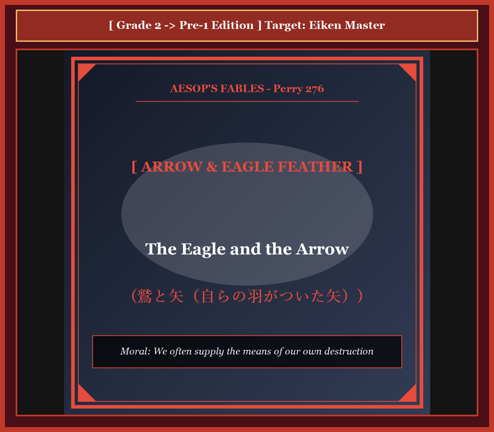
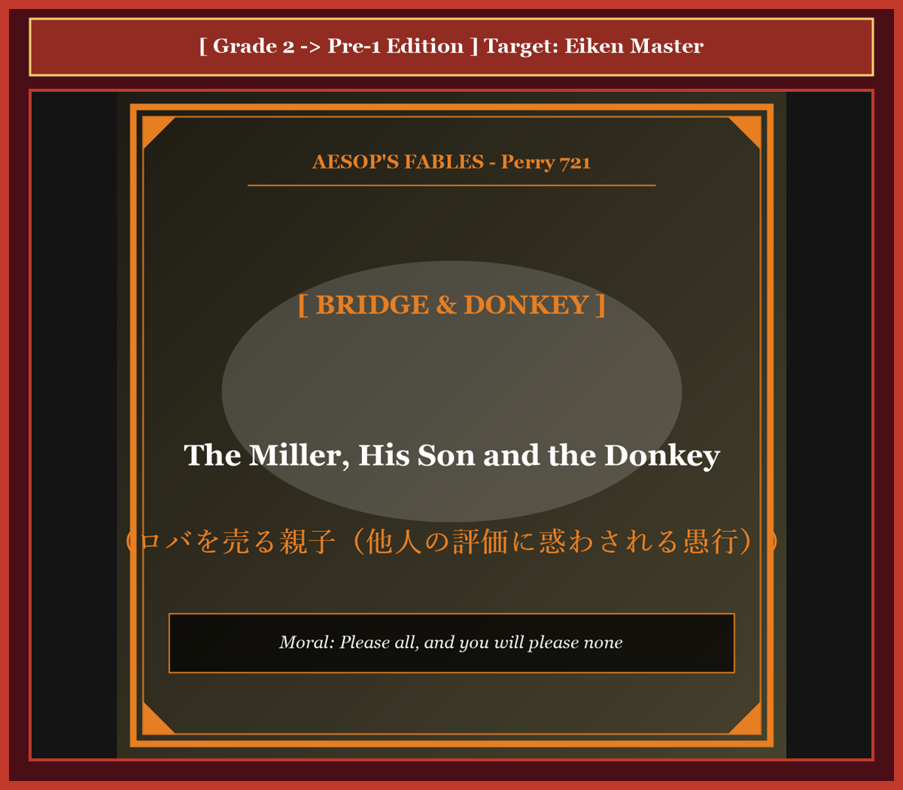
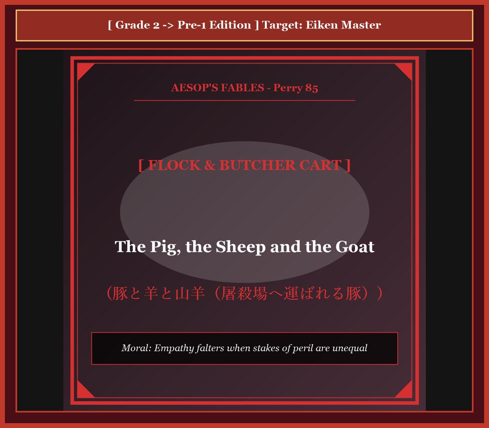
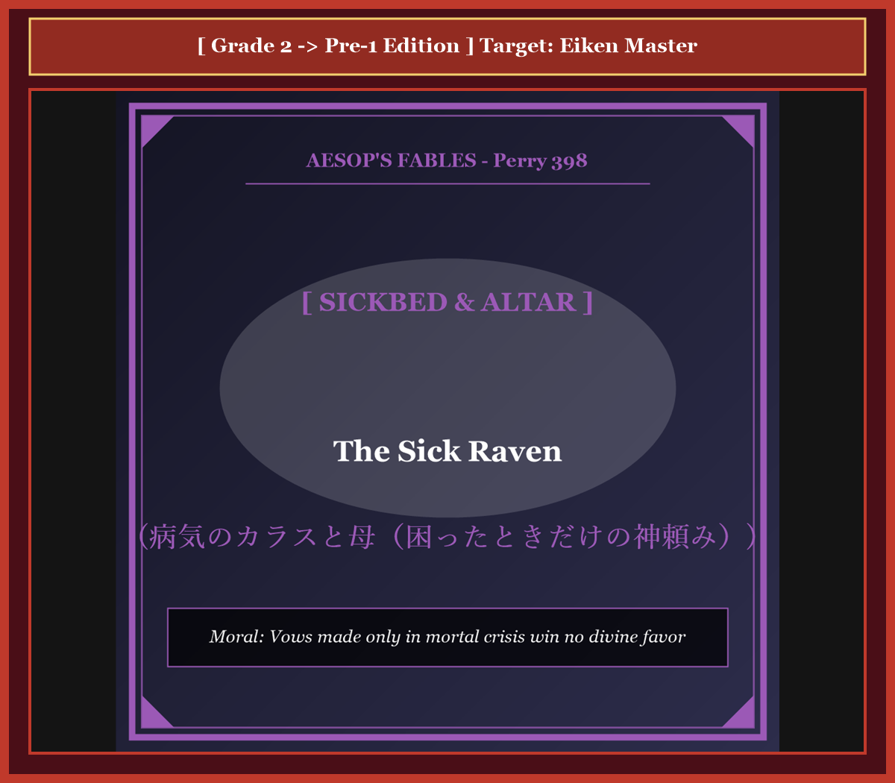
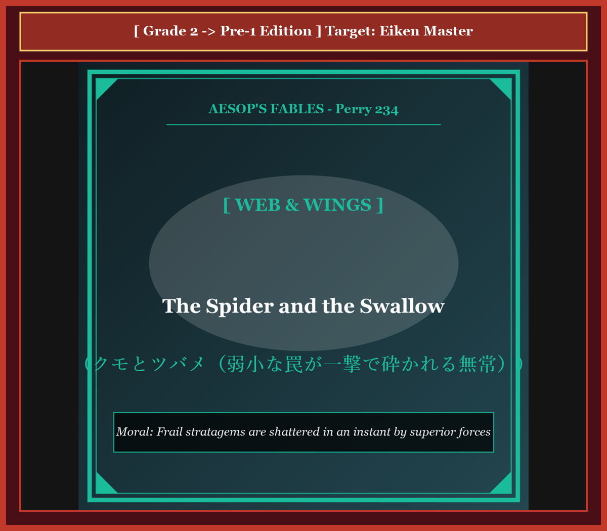
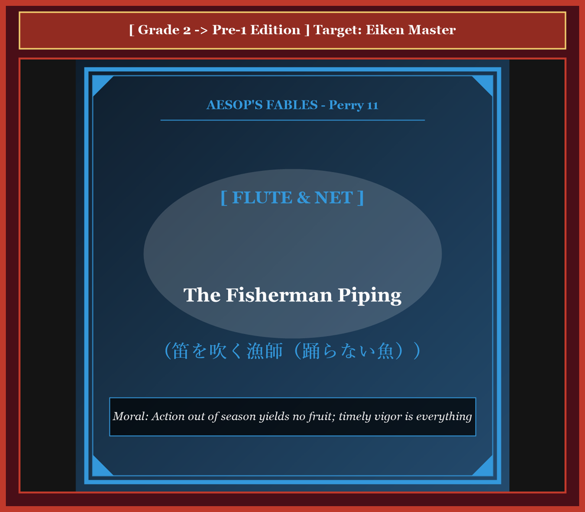
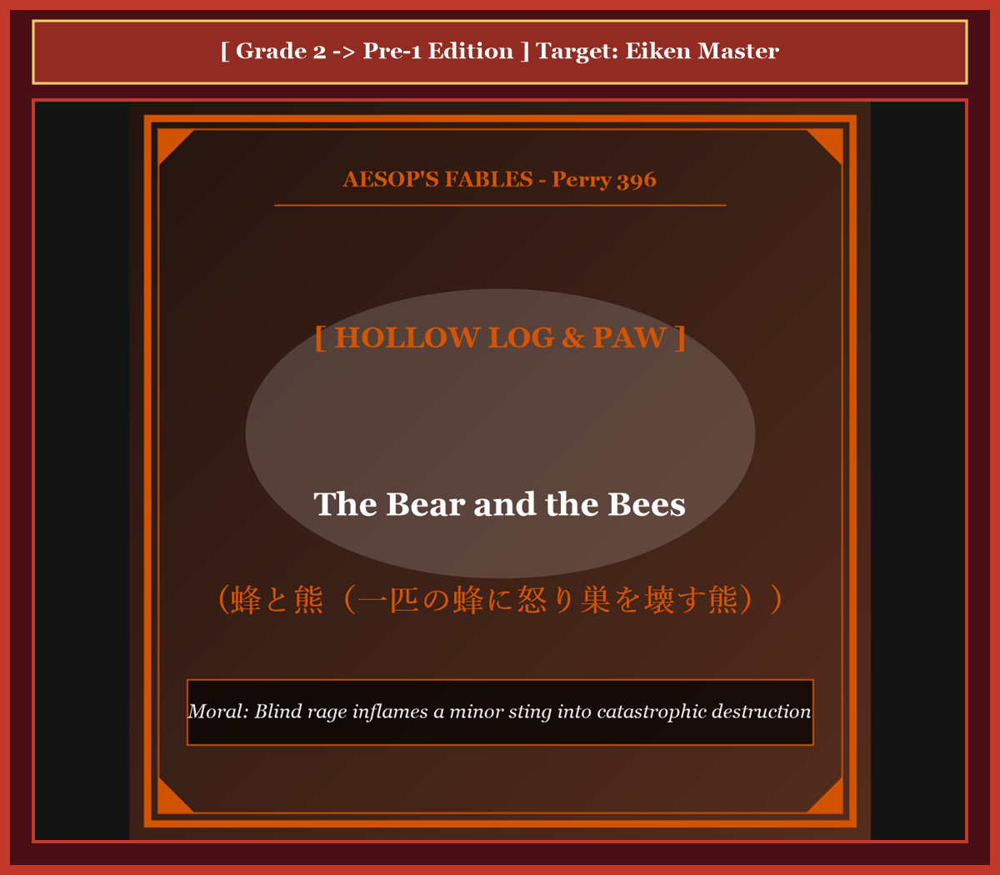

# 『英検ステップアップ多読：イソップ寓話編 第24巻（2級 ➔ 準1級対比学習・第6集・完結巻）』

---

## はじめに：英語の「知性と教養」を極める準1級への扉

英検準1級は、「大学中級程度」の英語力を証明し、国内外の大学・大学院入試、高度なビジネス、国際業務において真に通用する「実践的知性」の証明書です。

しかし、2級に合格した多くの学習者が直面するのが、**「語彙の深さと修辞（レトリック）の洗練さ」における圧倒的な落差**です。準1級で要求されるのは、事実関係の伝達にとどまらず、**「人間の本質」「社会制度の矛盾」「心理的力学」「戦略的教訓」を、格調高くアカデミックな知性を持って批判的・立体的に描写する力**です。

シリーズ堂々の最終巻となる本書では、世界文学の至宝であるイソップ寓話（第6集・10話）を題材に、**「実用的な2級英語」** が **「TIME誌やエコノミスト誌、海外大学院レベルの格調高い準1級英語」** へとどのように脱皮・昇華するかを徹底的に比較分析します。

* **2級英文（ベンチマーク）** で寓話の論理的骨格を把握
* **準1級英文（ターゲット）** でGRE/SATレベルの高度語彙、洗練された構文、哲学的レトリックを自然に体得
* **キーフレーズ対比カード** で、ライティング（要約問題・エッセイ）や面接スピーキングで試験官を唸らせる最高峰の表現力を完成

全60話・全24巻の頂点に立つマスター英文の世界へ、ようこそ！

---

## 本書の収録作品（第6集・全10話 / シリーズ通算51〜60話）

1. **Chapter 51**: 鷲と矢（自分の羽がついた矢） (*The Eagle and the Arrow*) [Perry 276]
2. **Chapter 52**: 猿の裁判長（二匹の猫とチーズ） (*The Monkey as Judge*) [Perry 614]
3. **Chapter 53**: ロバを売る親子（他人の評価に惑わされる話） (*The Miller, His Son and the Donkey*) [Perry 721]
4. **Chapter 54**: 蜜蜂とゼウス（針の代償） (*The Bee and Zeus*) [Perry 29]
5. **Chapter 55**: 豚と羊と山羊（屠殺場へ運ばれる豚） (*The Pig, the Sheep and the Goat*) [Perry 85]
6. **Chapter 56**: 病気のカラスと母（困ったときだけの神頼み） (*The Sick Raven*) [Perry 398]
7. **Chapter 57**: クモとツバメ（弱小な罠が一撃で砕かれる無常） (*The Spider and the Swallow*) [Perry 234]
8. **Chapter 58**: 笛を吹く漁師（踊らない魚） (*The Fisherman Piping*) [Perry 11]
9. **Chapter 59**: 蜂と熊（一匹の蜂に怒り巣を壊す熊） (*The Bear and the Bees*) [Perry 396]
10. **Chapter 60**: 旅人と運命の女神（成功は己の功、失敗は運のせい） (*The Traveler and Fortune*) [Perry 174]

---

## 本書の構成と電子書籍 / Kobo最適化

各章は以下の6部構成で統一されています。

```text
┌─────────────────────────────────────────────────────────────┐
│ 1. Chapter Title & Visual Illustration (章タイトル ＆ 挿絵)   │
│ 2. Benchmark Level: 英検2級レベル英文                         │
│ 3. Target Level: 英検準1級レベル英文                         │
│ 4. Classic Original English Text (イソップ寓話クラシック原文)  │
│ 5. Japanese Translation (日本語訳 ＆ 教訓)                     │
│ 6. Recite & Compare (そらんじたいキーフレーズ対比カード)        │
│ 7. Key Vocabulary & Exam Notes (語彙・文法・試験対策解説)        │
└─────────────────────────────────────────────────────────────┘
```

> **【ポイント】 音声読み上げ（TTS）をご利用の方へ**
> 本文セクション（ステップ1〜3）は英語のみで構成されており、電子書籍やKoboの自動音声読み上げ機能（Text-to-Speech）で日本語が混ざることなく、美しい英語音声で快適にリスニング学習していただけます。


# Chapter 51: The Eagle and the Arrow (鷲と矢)

<!-- 電子書籍 Page Break & Image Header -->
<div style="text-align: center; margin-bottom: 20px;">
  
</div>

<div style="page-break-before: always;"></div>

## 1. Benchmark Level: Eiken Grade 2 (英検2級レベル本文)
*Read in ~2.5 to 3 minutes. Baseline vocabulary and basic syntax.*

Perched upon an alpine promontory, a sovereign eagle systematically surveyed the vast valleys within his territorial jurisdiction. Possessing acute visual discernment and formidable predatory capabilities, the avian monarch routinely scrutinized the terrain from extreme altitudes, effortlessly detecting any vulnerable prey attempting to conceal itself within the dense vegetation.

During a serene twilight, the apex raptor descended toward a prominent granite outcrop, patiently anticipating the emergence of a foraging hare. Entirely preoccupied with monitoring the movement across the valley floor, the eagle remained oblivious to an experienced archer who was quietly maneuvering through the dense undergrowth below.

Discerning the distinct silhouette of the great bird against the horizon, the hunter methodically notched a feathered projectile into his recurve bow. Drawing the cord to its maximum tension with practiced precision, he discharged the lethal arrow toward the mountain summit.

Traversing the intervening atmosphere with tremendous kinetic velocity, the projectile penetrated deep into the eagle's thoracic cavity. Overwhelmed by the traumatic impact, the monarch of the skies suffered an immediate loss of equilibrium, plummeting precipitously toward the rocky earth below.

Lying prostrate upon the stony ground and hemorrhaging profusely, the mortally wounded predator directed his fading gaze toward the fatal shaft protruding from his breast. With profound astonishment and psychological despair, he identified the stabilizing fletchings attached to the projectile's shaft. They were identical to the majestic flight feathers that had naturally detached from his own wings during the preceding seasonal molt.

Experiencing an acute pang of bitter irony, the dying eagle articulated a profound philosophical lamentation: "While physical termination is inherently agonizing, it constitutes an infinitely more grievous tragedy to comprehend that my own discarded feathers provided the aerodynamic instruments that orchestrated my destruction."

---
<div style="page-break-before: always;"></div>

## 2. Target Level: Eiken Grade Pre-1 (英検準1級レベル本文)
*Read in ~3 to 3.5 minutes. Sophisticated vocabulary, subtle rhetoric, and academic analysis.*

Stationed atop an alpine promontory, a sovereign raptor exercised panoptic optical surveillance over the sprawling topography of his territorial hegemony. Endowed with extraordinary retinal visual acuity and consummate predatory instincts, the avian monarch routinely scrutinized the landscape from stratospheric altitudes, instantaneously resolving the subtle kinematics of camouflaged prey navigating the subalpine flora.

During an interlude of atmospheric tranquility at dusk, the raptor descended toward an isolated granite monolith, calculating the imminent trajectory of a foraging lagomorph. Entirely preoccupied with tracking terrestrial micro-movements across the valley floor, the eagle remained oblivious to an experienced archer covertly maneuvering through the dense underbrush below.

Discerning the imperial silhouette projected against the twilight horizon, the huntsman methodically calibrated a feathered projectile into his recurve bow. Drawing the cord to its maximum tensile threshold with seasoned ballistic intuition, he unleashed the lethal missile toward the mountain pinnacle.

Traversing the intervening atmospheric gradient with supersonic velocity, the projectile penetrated the eagle's thoracic cage, inflicting catastrophic internal trauma. Disoriented by the violent concussive shock, the monarch of the skies suffered instantaneous biomechanical equilibrium failure, plummeting precipitously toward the jagged scree beneath.

Lying prostrate upon the calcified strata and hemorrhaging profusely, the moribund predator fixed his rheumy, decelerating gaze upon the lethal shaft protruding perpendicular to his sternum. With profound existential horror, he scrutinized the aerodynamic fletchings stabilizing the projectile's trajectory: they were identical to the magnificent primary flight quills he had naturally shed from his own pinions during the preceding seasonal molt.

Overcome by the exquisite bitterness of this tragic realization, the dying monarch gasped an enduring philosophical testament: "While biological termination is inherently agonizing, it constitutes an infinitely more poignant psychological affliction to recognize that my own discarded plumage furnished the aerodynamic architecture that orchestrated my destruction."

---
<div style="page-break-before: always;"></div>

## 3. Classic Original English Text (イソップ寓話クラシック原文)
*Translated by George Fyler Townsend (1867)*

An Eagle sat on a high rock, looking for hares. A hunter shot an arrow at him and hit him. As the Eagle fell dying, he looked at the arrow and saw that its feathers were plucked from an eagle's own wing. "Alas," he cried, "it is a double grief to me that I must die by an arrow feathered with my own plumage!"

---
<div style="page-break-before: always;"></div>

## 4. Japanese Translation & Moral (日本語訳と教訓)

### 【日本語全訳：英検準1級レベル本文】
高山帯の岬の上に陣取り、主権者たる猛禽類は、自らの領土的覇権の広大な地形全体に対して全方位的な視覚的監視を行使していました。並外れた網膜の視覚的鋭敏さと至高の捕食本能を授けられていたこの鳥類の君主は、成層圏（超高空）の高度から地形を日常的に精査し、亜高山帯の植物相をすり抜けるカモフラージュされた獲物の微細な運動力学を瞬時に解像（看破）していました。

夕暮れ時の大気の平穏の合間に、猛禽類は孤立した花崗岩の一本石へと舞い降り、採餌するウサギ科動物の切迫した軌道を計算していました。谷底の地上の微細な動きを追跡することに完全に心を奪われていたため、ワシは下方の密生した下草の間をひそかに操縦（接近）していた熟練の射手にまったく気づいていませんでした。

黄昏の地平線に投影された帝王のシルエットを識別した狩人は、羽のついた投射体（矢）を規則正しく自らの弓へと装填・校正しました。熟練した弾道直感をもって弦を最大引張限界まで引き絞ると、彼は山頂の尖塔に向かって致死的なミサイルを解き放ちました。

超音速の勢いをもって大気の傾斜を横断し、投射体はワシの胸郭を貫通し、壊滅的な体内外傷を負わせました。暴力的な衝撃ショックによって方向感覚を失い、空の君主は瞬時的な生体力学的平衡の崩壊を被り、眼下のギザギザの崖錐（小石の斜面）へと真っ逆さまに急転落しました。

石灰化した地層の上に平伏し激しく出血しながら、瀕死の捕食者は、自らの胸骨に対して直角に突き出ている致死的な矢の柄へと、潤んだ衰えゆく視線を固定しました。深甚な実存的恐怖の中で、彼は投射体の軌道を安定させていた空気力学的矢羽を綿密に精査しました。それらは、前回の季節の換羽期に自らの翼から自然に脱落していた見事な主風切羽と完全に同一のものだったのです。

この悲劇的な自覚の絶妙な苦痛に圧倒されながら、死にゆく君主は永遠の哲学的遺言を絞り出しました。「生物学的終焉そのものも生来耐え難い苦痛であるが、自らが捨て去った羽毛が、自らの破滅を組織した空気力学的アーキテクチャ（構造）を提供していたのだと認識することは、無限により痛烈な心理的苦悶である。」

### 【教訓（Moral）】
**We often supply the means of our own destruction.**  
（人間や国家・組織はしばしば、自らが過去に生み落とし放出した知見・リソース・人材によって、皮肉にも自らを撃ち落とす最も洗練された攻撃兵器のアーキテクチャを敵に与えてしまう。）

---
<div style="page-break-before: always;"></div>

## 5. Recite & Compare: そらんじたいキーフレーズ対比カード

<div class="comparison-card">
  <div class="card-header">フレーズ 1：全方位の視覚的監視と獲物の運動力学の解像</div>
  <div class="card-row-g2-base"><span class="card-badge-g2-base">2級</span>Possessing acute visual discernment, the monarch systematically surveyed the vast valleys within his jurisdiction.</div>
  <div class="card-row-pre1"><span class="card-badge-pre1">準1級</span>Exercising panoptic surveillance over territorial hegemony, he resolved the subtle kinematics of camouflaged prey.</div>
  <div class="card-note"><strong>解説：</strong>社会学・物理学用語「panoptic surveillance（全方位監視）」「subtle kinematics of prey（獲物の微細な運動力学）」を用いた圧巻の描写です。</div>
</div>

<div class="comparison-card">
  <div class="card-header">フレーズ 2：熟練の弾道直感による最大引張限界からの射出</div>
  <div class="card-row-g2-base"><span class="card-badge-g2-base">2級</span>Drawing the cord to its maximum tension with practiced precision, he discharged the lethal arrow.</div>
  <div class="card-row-pre1"><span class="card-badge-pre1">準1級</span>Drawing the cord to its maximum tensile threshold with ballistic intuition, he unleashed the lethal missile.</div>
  <div class="card-note"><strong>解説：</strong>弾道学・材料力学用語「maximum tensile threshold（最大引張限界）」「ballistic intuition（弾道直感）」の結合です。</div>
</div>

<div class="comparison-card">
  <div class="card-header">フレーズ 3：脱落した主風切羽と同一の安定矢羽を精査する</div>
  <div class="card-row-g2-base"><span class="card-badge-g2-base">2級</span>He identified stabilizing fletchings identical to the flight feathers detached from his wings.</div>
  <div class="card-row-pre1"><span class="card-badge-pre1">準1級</span>He scrutinized aerodynamic fletchings identical to primary flight quills naturally shed from his pinions.</div>
  <div class="card-note"><strong>解説：</strong>鳥類学用語「primary flight quills（主風切羽）」「aerodynamic fletchings」の精緻な語彙です。</div>
</div>

<div class="comparison-card">
  <div class="card-header">フレーズ 4：自らの羽毛が破滅の空気力学を設計していた苦悶</div>
  <div class="card-row-g2-base"><span class="card-badge-g2-base">2級</span>My discarded feathers provided the aerodynamic instruments that orchestrated my destruction.</div>
  <div class="card-row-pre1"><span class="card-badge-pre1">準1級</span>My discarded plumage furnished the aerodynamic architecture that orchestrated my destruction.</div>
  <div class="card-note"><strong>解説：</strong>哲学・航空工学の白眉「aerodynamic architecture that orchestrated my destruction」という荘厳なクライマックスです。</div>
</div>

---
<div style="page-break-before: always;"></div>

## 6. Key Vocabulary & Exam Notes (英検準1級 重要語彙・文法・面接対策)

### 1. 英検準1級 必須ボキャブラリー
* **panoptic** [形] 全景が見渡せる、全方位監視の
* **kinematics** [名] 運動学、キネマティクス
* **lagomorph** [名] ウサギ目（ウサギ・ナキウサギ類）の動物
* **tensile** [形] 張力の、引っ張りの（*tensile threshold/strength*）
* **ballistic** [形] 弾道の、射出の（*ballistic trajectory*）
* **moribund** [形] 瀕死の、死にかかっている、衰退した
* **fletching** [名] 矢羽、安定翼
* **plumage** [名] 羽毛、鳥の羽全体

### 2. 文法・構文のチェックポイント
* **Exercising + 名詞, S + V**:
  * 分詞構文。「〜を行使しながら、Sは…した」。主体の活動を重厚に語ります。
* **it constitutes an infinitely more + 形容詞 + 名詞 + to do**:
  * 比較級の強調。「〜することは無限により…な事象を構成する」。

### 3. スピーキング（面接）＆ライティング活用ヒント
* 自国の最先端科学技術が敵対勢力にリバースエンジニアリングされ、防衛網を突破する脅威を論じる際に最適です。


# Chapter 52: The Monkey as Judge (猿の裁判長)

<!-- 電子書籍 Page Break & Image Header -->
<div style="text-align: center; margin-bottom: 20px;">
  
</div>

<div style="page-break-before: always;"></div>

## 1. Benchmark Level: Eiken Grade 2 (英検2級レベル本文)
*Read in ~2.5 to 3 minutes. Baseline vocabulary and basic syntax.*

Within an agrarian settlement, two feral domestic felines discovered a substantial block of seasoned cheese. Initially exhilarated by this unexpected acquisition, the predators quickly descended into contentious litigation regarding the equitable distribution of their communal property.

Neither party demonstrated the slightest inclination to achieve a diplomatic compromise. The black cat asserted chronological priority of visual discovery, whereas the white adversary maintained physical possession. Recognizing the total paralysis of their bilateral negotiations, the naive litigants resolved to submit their conflict to formal external arbitration.

Appearing opportunistically from an adjacent oak tree, an unscrupulous primate offered his professional mediation. Projecting an aura of judicial solemnity, the monkey assured them that his objective calibration would guarantee egalitarian justice. Subordinating prudence to procedural desperation, the felines surrendered their contested asset to the magistrate.

The primate immediately deployed an apparatus of balancing scales. Bisecting the cheese into deliberately disproportionate segments, he deposited them upon opposite pans, causing the heavier sector to plunge abruptly toward the ground.

"An intolerable structural discrepancy," proclaimed the judge with theatrical gravity. "Equilibrium must be restored through regulatory reduction." Thereupon, the arbiter consumed an enormous portion from the dominant fragment. However, this clumsy subtraction reversed the disparity, necessitating a reciprocal reduction from the opposing side.

Iterating this manipulative oscillation, the anxious felines witnessed their prized commodity systematically liquidated before their eyes. Terrified by the rapid evaporation of their property, the litigants implored the court to suspend proceedings: "Surrender the residual fragments! We formally dissolve our dispute!"

"Judicial procedure cannot be summarily terminated without the full liquidation of professional administrative fees," retorted the primate. Consuming the final crumbs with nonchalant satisfaction, the arbiter absconded into the forest canopy, leaving the litigants thoroughly destitute.

---
<div style="page-break-before: always;"></div>

## 2. Target Level: Eiken Grade Pre-1 (英検準1級レベル本文)
*Read in ~3 to 3.5 minutes. Sophisticated vocabulary, subtle rhetoric, and academic analysis.*

Within the rural perimeter of an agrarian commune, two feral felines made the accidental acquisition of a prime segment of coagulated dairy curd. Initially electrified by this fortuitous windfall, the predators swiftly deteriorated into acrimonious litigation concerning the proportional allocation of their unearned asset.

Neither disputant exhibited the slightest disposition toward amicable compromise. The melanistic feline asserted chronological precedence of optical detection, whereas the albino counterpart claimed tangible physical possession. Confronting the absolute paralysis of bilateral conciliation, the naive litigants resolved to submit their conflict to professional external adjudication.

Intervening opportunistically from the arboreal canopy, an unprincipled simian proffered his judicial services. Projecting a synthetic facade of jurisdictional impartiality, the primate assured the disputants that his calibrating apparatus would enforce egalitarian equity. Subordinating baseline skepticism to procedural desperation, the felines surrendered the contested cheese to the magistrate.

The primate promptly deployed a dual-pan balancing mechanism. Cleaving the commodity into deliberately asymmetrical sectors, he deposited the fragments upon opposing pans, causing the dominant mass to plunge precipitously.

"A grotesque structural discrepancy," declaimed the judge with histrionic gravity. "Regulatory equilibrium must be restored through surgical subtraction." Thereupon, the arbiter consumed a massive bolus from the heavier sector. However, this heavy-handed reduction inverted the gravimetric disparity, compelling an immediate reciprocal mastication from the opposing pan.

Iterating this manipulative oscillation, the feline spectators witnessed their prized equity systematically liquidated through regulatory expropriation. Horrified by the rapid vaporization of their asset, the litigants petitioned for summary dismissal: "Surrender the residual morsels! We unilaterally dissolve our claim!"

"Judicial procedure cannot be arbitrarily terminated without the complete satisfaction of compensatory administrative stipends," retorted the simian. Ingesting the terminal crumbs with cynical nonchalance, the arbiter vaulted into the canopy, abandoning the litigants in absolute destitution.

---
<div style="page-break-before: always;"></div>

## 3. Classic Original English Text (イソップ寓話クラシック原文)
*Translated by George Fyler Townsend (1867)*

Two Cats found a piece of cheese and could not agree on dividing it. They went to a Monkey to arbitrate. The Monkey brought a balance scale and broke the cheese into two pieces. One was heavier, so he bit a piece off it. Then the other side was heavier, so he bit a piece off that. He kept eating from each side until the Cats pleaded: "Give us what is left!" The Monkey said: "The rest is my fee for judging," and devoured it all.

---
<div style="page-break-before: always;"></div>

## 4. Japanese Translation & Moral (日本語訳と教訓)

### 【日本語全訳：英検準1級レベル本文】
ある農耕共同体の地方の境界内において、二匹の野良猫が、凝固した乳製品（チーズ）の極上の塊を偶発的に獲得しました。最初はこの偶発的なタナボタの幸運に興奮した捕食者たちでしたが、不労資産の比例配分を巡る険悪な訴訟（口論）へと急速に劣化していきました。

どちらの係争者も、友好的な妥協へ向けた微塵の性向も示しませんでした。黒い毛並みの猫は光学的探知（目視）の時系列的な先行権を主張し、白い相棒は具体的な物理的占有を主張しました。二者間調停の絶対的な麻痺に直面した素朴な訴訟当事者たちは、自らの紛争を専門的な外部の司法的裁定に委ねることを決意しました。

樹冠から日和見主義的に介入した不謹慎なサルが、自らの司法サービスを申し出ました。裁判管轄の公平性という人工的な外見（ファサード）を投影しながら、その霊長類は自らの測定装置が平等主義的衡平性を強制すると係争者たちに断言しました。基本的な懐疑心を手続き的絶望に従属させ、猫たちは係争中のチーズを判事へと引き渡してしまいました。

霊長類は即座に両皿の天秤ばかりの機構を展開しました。意図的に非対称なセクターへとその商品を切り裂くと、彼は反対側の皿の上に破片を載せ、支配的な質量を急激に沈下させました。

「奇怪な構造的不一致である」と判事は大げさな重々しさをもって宣言しました。「外科的削減を通じて規制の均衡を回復せねばならない。」そうして、仲裁者は重い方のセクターから巨大な塊を消費しました。しかしながら、この強引な削減は重量測定の格差を逆転させ、反対側の皿からの即座の相互の咀嚼（かじり取り）を強要させたのです。

この巧妙な往復運動を繰り返すことで、猫の傍聴者たちは、自らの貴重な資産が規制上の収奪を通じて組織的に清算（消滅）されていくのを目撃しました。自らの資産の急速な蒸発に恐怖した訴訟当事者たちは、略式棄却（訴訟取り下げ）を請願しました。「残りの小片を引き渡してください！ 私たちは一方的に自らの権利主張を取り下げます！」

「代償的な行政手当の完全な満足なしに、司法手続きを恣意的に終了させることはできない」とサルは反論しました。冷笑的な無頓着さをもって最後のパンくずを飲み込むと、仲裁者は樹冠の中へと跳躍し、訴訟当事者たちを絶対的な極貧の中に遺棄したのです。

### 【教訓（Moral）】
**In petty disputes, the arbiter consumes the prize.**  
（私利私欲に狂った愚劣な当事者たちが外部の利権仲裁者に解決を委託すると、規制手続きや手数料の名目で資産全体が合法的に収奪され、当事者双方が無一文となる。）

---
<div style="page-break-before: always;"></div>

## 5. Recite & Compare: そらんじたいキーフレーズ対比カード

<div class="comparison-card">
  <div class="card-header">フレーズ 1：不労資産の比例配分を巡る険悪な訴訟</div>
  <div class="card-row-g2-base"><span class="card-badge-g2-base">2級</span>The predators descended into contentious litigation regarding equitable distribution of property.</div>
  <div class="card-row-pre1"><span class="card-badge-pre1">準1級</span>The predators deteriorated into acrimonious litigation concerning proportional allocation of unearned asset.</div>
  <div class="card-note"><strong>解説：</strong>経済・法律用語「acrimonious litigation（険悪な訴訟）」「proportional allocation of unearned asset（不労資産の比例配分）」の高度な表現です。</div>
</div>

<div class="comparison-card">
  <div class="card-header">フレーズ 2：管轄の公平性という人工的外見を投影するサル</div>
  <div class="card-row-g2-base"><span class="card-badge-g2-base">2級</span>Projecting an aura of judicial solemnity, the monkey assured them of egalitarian justice.</div>
  <div class="card-row-pre1"><span class="card-badge-pre1">準1級</span>Projecting a synthetic facade of jurisdictional impartiality, the primate assured egalitarian equity.</div>
  <div class="card-note"><strong>解説：</strong>社会学・法学用語「synthetic facade（作られた外見）」「jurisdictional impartiality（管轄権の公平性）」の洗練表現です。</div>
</div>

<div class="comparison-card">
  <div class="card-header">フレーズ 3：規制上の収奪を通じて資産が組織的に清算される</div>
  <div class="card-row-g2-base"><span class="card-badge-g2-base">2級</span>The felines witnessed their prized commodity systematically liquidated before their eyes.</div>
  <div class="card-row-pre1"><span class="card-badge-pre1">準1級</span>The feline spectators witnessed their equity systematically liquidated through regulatory expropriation.</div>
  <div class="card-note"><strong>解説：</strong>マルクス経済学・行政法用語「regulatory expropriation（規制による収奪）」を用いた白眉の洞察です。</div>
</div>

<div class="comparison-card">
  <div class="card-header">フレーズ 4：行政手当の満足なしに手続きを終了できない屁理屈</div>
  <div class="card-row-g2-base"><span class="card-badge-g2-base">2級</span>Procedure cannot be terminated without full liquidation of administrative fees.</div>
  <div class="card-row-pre1"><span class="card-badge-pre1">準1級</span>Procedure cannot be arbitrarily terminated without satisfaction of compensatory administrative stipends.</div>
  <div class="card-note"><strong>解説：</strong>官僚制批判の極致「compensatory administrative stipends（代償的行政手当・手数料）」の語彙です。</div>
</div>

---
<div style="page-break-before: always;"></div>

## 6. Key Vocabulary & Exam Notes (英検準1級 重要語彙・文法・面接対策)

### 1. 英検準1級 必須ボキャブラリー
* **acrimonious** [形] 険悪な、辛辣な、とげとげしい
* **adjudication** [名] 判決、裁定、宣告
* **impartiality** [名] 公平、偏らないこと
* **asymmetrical** [形] 非対称の、不揃いな
* **expropriation** [名] 収用、没収、収奪
* **arbitrarily** [副] 恣意的に、専断的に、気まぐれに
* **compensatory** [形] 補償の、代償の、埋め合わせの
* **destitution** [名] 極貧、困窮、欠乏

### 2. 文法・構文のチェックポイント
* **cannot be + arbitrarily + 過去分詞 + without + 名詞**:
  * 「〜なしには恣意的に…され得ない」。法的な絶対条件を主張する構文です。
* **Iterating + 名詞, S + V**:
  * 分詞構文。「〜を反復しながら、Sは…した」。

### 3. スピーキング（面接）＆ライティング活用ヒント
* 国際貿易紛争における第三者機関の調停長期化と弁護士費用の肥大化を批評する際に最適です。


# Chapter 53: The Miller, His Son and the Donkey (ロバを売る親子)

<!-- 電子書籍 Page Break & Image Header -->
<div style="text-align: center; margin-bottom: 20px;">
  
</div>

<div style="page-break-before: always;"></div>

## 1. Benchmark Level: Eiken Grade 2 (英検2級レベル本文)
*Read in ~2.5 to 3 minutes. Baseline vocabulary and basic syntax.*

An aged miller accompanied by his adolescent son departed their homestead at dawn, escorting a beast of burden toward a commercial market. Prioritizing the preservation of the animal's physical vigor, the custodians elected to travel pedestrian-style alongside their quadruped.

While traversing a public thoroughfare, they encountered a gathering of young women drawing water from a communal fountain. "Observe the incomprehensible incompetence of those travelers!" ridiculed one spectator. "Why should both custodians endure arduous physical exertion when their beast of burden carries no burden whatsoever?"

Excessively sensitive to communal criticism, the patriarch instructed his offspring to mount the donkey's back while he persevered on foot.

Inevitably, this configuration provoked swift moral condemnation from a council of village elders. "Bear witness to the deplorable moral decay of the modern generation!" proclaimed an elderly observer. "A vigorous youth lounges in comfort, while his aged father is forced to endure the exhaustion of the dusty road."

Mortified by this public reprimand, the adolescent vacated the mount and insisted that his father occupy the saddle. Reluctantly acquiescing, the miller assumed the riding posture, confident that proper familial hierarchy had been established.

Nevertheless, subsequent observers formulated an entirely opposite grievance. Encountering a group of agrarian laborers, the pair was harshly criticized: "What callous paternal selfishness! An adult man enjoys leisure while an underdeveloped child struggles breathlessly to maintain his pace!"

Paralyzed by anxiety regarding external perception, the miller hoisted the boy up behind him, endeavoring to achieve universal consensus through simultaneous transport.

Yet, upon entering the municipal perimeter, civic spectators voiced collective outrage regarding perceived animal cruelty: "Invert the arrangement, you cruel tyrants! The physical weight of the riders vastly exceeds the carrying capacity of the quadruped!"

Reduced to cognitive paralysis by endless contradictory demands, the desperate pair bound the animal's legs to a horizontal timber and hoisted the beast upon their shoulders.

Confronted with this absurd spectacle upon a municipal bridge, the populace erupted in roaring laughter. Startled by the commotion, the struggling donkey snapped the ropes, plummeted into the turbulent river, and drowned.

The destitute miller returned home having internalized a timeless sociological verity: he who attempts to please every observer inevitably pleases nobody and orchestrates his own ruin.

---
<div style="page-break-before: always;"></div>

## 2. Target Level: Eiken Grade Pre-1 (英検準1級レベル本文)
*Read in ~3 to 3.5 minutes. Sophisticated vocabulary, subtle rhetoric, and academic analysis.*

An aged miller accompanied by his adolescent progeny initiated a pilgrimage from their rural domicile at daybreak, escorting an equine beast of burden toward a commercial metropolis. Prioritizing the conservation of the animal's physical vigor, the custodians elected to travel pedestrian-style alongside their quadruped.

While negotiating a public thoroughfare, they intersected with an assembly of maidens drawing water from a communal spring. "Witness the incomprehensible ineptitude of those wanderers!" derided one observer. "For what rational teleology does one maintain an equine beast if both custodians voluntarily subject themselves to grueling pedestrian attrition?"

Pathologically hypersensitive to societal censure, the patriarch instructed his offspring to mount the animal's dorsal ridge while he persevered on foot.

Inevitably, this configuration solicited swift moral indignation from an assembly of civic elders. "Behold the profound moral degeneration of modern youth!" proclaimed a dogmatic patriarch. "A vigorous youth reclines in ostentatious luxury, compelling his decrepit progenitor to trudge through the suffocating dust."

Humiliated by this public reprimand, the youth vacated the mount, insisting that his father occupy the saddle. Reluctantly acquiescing, the miller assumed the equestrian posture, confident that hierarchical filiopietistic decorum had been restored.

Nevertheless, subsequent observers formulated an antithetical grievance. Encountering agrarian laborers, the pair was harshly excoriated: "What reprehensible paternal egoism! An adult patriarch indulges in luxury while an underdeveloped minor expends his vital reserves attempting to sustain pace!"

Paralyzed by acute social evaluation anxiety, the miller hoisted the adolescent onto the saddle, endeavoring to manufacture artificial consensus through simultaneous transport.

Yet, upon breaching the municipal gates, the urban populace voiced collective outrage regarding alleged animal exploitation: "Invert the arrangement, you tyrannical oppressors! The physical mass of the riders vastly eclipses the physiological load-bearing threshold of the quadruped!"

Reduced to cognitive paralysis by endless contradictory dictates, the desperate custodians bound the animal's hooves to a horizontal timber, hoisting the inverted quadruped upon their shoulders.

Confronted with this surreal spectacle upon a municipal viaduct, the multitude erupted in mocking pandemonium. Convulsed by sensory panic, the inverted donkey fractured the cords, plunged into the river, and perished.

The destitute miller returned home having internalized an immutable sociological verity: he who calibrates his conduct solely to conciliate universal public approbation inevitably surrenders his strategic agency and orchestrates his own total ruin.

---
<div style="page-break-before: always;"></div>

## 3. Classic Original English Text (イソップ寓話クラシック原文)
*Translated by George Fyler Townsend (1867)*

A Miller and his Son were leading their Donkey to market. A passerby said: "Why walk when you have a beast to ride?" So the Miller put his Son on the Donkey. Another criticized the boy for riding while his old father walked, so the Miller took his place. A third cried shame that the poor donkey carried the heavy man, so both rode. A fourth called them cruel to overload the animal, so they tied the donkey's feet to a pole and carried him. As they crossed a bridge, the crowd laughed, the donkey kicked, broke loose, fell into the river, and drowned.

---
<div style="page-break-before: always;"></div>

## 4. Japanese Translation & Moral (日本語訳と教訓)

### 【日本語全訳：英検準1級レベル本文】
年老いた粉屋が思春期の子孫（息子）を伴い、夜明けとともに田舎の居所から旅路を開始し、商業大都市に向けて役畜のロバを護送しました。動物の肉体的活力を温存することを優先し、管理者たちは四足獣の隣を徒歩形式で旅することを選択したのです。

公道を進む途中、彼らは共同の泉から水を汲んでいた乙女たちの集まりと交差しました。「あの放浪者たちの理解不能な不手際を目撃せよ！」と一人の観察者が嘲笑しました。「両方の管理者が過酷な徒歩の消耗に自発的に身を晒すくらいなら、いったい何の合理的な目的論のためにウマ科の獣を飼っているというのか？」

社会の非難に対して病的なまでに過敏であった家長は、自らは徒歩を続けながら、息子の背骨に乗るよう指示しました。

必然的に、この配置は市民の長老会議からの迅速な道徳的憤りを招きました。「現代の若者の深遠な道徳的退廃を見よ！」と独善的な長老が宣言しました。「健康な若者がけばけばしい贅沢の中にもたれかかり、老衰した自らの実父に息の詰まる埃の中をとぼとぼ歩くことを強要しているではないか。」

この公の叱責に屈辱を味わい、青年は乗り場を明け渡し、父親が鞍を占拠するよう強く主張しました。不本意ながらも同意し、粉屋は階層的な親孝行の礼儀作法（孝道）が回復されたと確信して、騎乗の姿勢を取りました。

それにもかかわらず、その後に遭遇した観察者たちは正反対の不満を表明しました。農耕労働者に出くわしたとき、その二人組は激しく罵倒されました。「なんと非難されるべき父親の利己主義だろう！ 未発達の未成年者が歩調を維持しようと生命の予備力を浪費している間に、成人の家長が贅沢にふけっているではないか！」

鋭い社会評価不安（他人の目の恐怖）によって麻痺した粉屋は、同時輸送を通じて人工的な合意を捏造（形成）しようと試み、少年を鞍の上へと引き上げました。

しかし自治体の門を突破すると、都市の大衆は、疑わしい動物搾取に関して集団的な憤りを表明したのです。「その配置を逆にせよ、この専制的な抑圧者どもめ！ 乗り手の物理的質量は、四足獣の生理的耐荷重限界を遥かに凌駕しているではないか！」

終わりのない矛盾した命令によって認知的麻痺に陥った絶望的な管理者たちは、動物の蹄を水平の材木に縛り付け、逆さになった四足獣を自分たちの肩の上へと担ぎ上げました。

市立の高架橋の上でこの超現実的な見世物に直面した大衆は、嘲笑の狂乱を爆発させました。感覚的パニックによって痙攣した逆さロバは、紐を破壊し、川の中へと急落して絶命したのです。

普遍的な公の承認を宥和（迎合）することにのみ自らの行動を校正する者は、必然的に自らの戦略的主体性を放棄し、自らの完全な破滅を組織することになるという不変の社会学的真理を内面化し、無一文になった粉屋は帰宅しました。

### 【教訓（Moral）】
**Please all, and you will please none.**  
（外部の世論や矛盾する批判に迎合して普遍的承認を獲得しようとする者は、自らの戦略的主体性を喪失し、誰をも満足させられずに破滅を組織する。）

---
<div style="page-break-before: always;"></div>

## 5. Recite & Compare: そらんじたいキーフレーズ対比カード

<div class="comparison-card">
  <div class="card-header">フレーズ 1：いかなる目的論のために獣を飼っているのかという嘲笑</div>
  <div class="card-row-g2-base"><span class="card-badge-g2-base">2級</span>Why should both custodians endure physical exertion when the beast carries no burden?</div>
  <div class="card-row-pre1"><span class="card-badge-pre1">準1級</span>For what rational teleology does one maintain a beast if both custodians subject themselves to attrition?</div>
  <div class="card-note"><strong>解説：</strong>哲学用語「rational teleology（合理的な目的論・存在理由）」と「pedestrian attrition（徒歩の消耗）」の格調高い文体です。</div>
</div>

<div class="comparison-card">
  <div class="card-header">フレーズ 2：親孝行の礼儀作法が回復されたという確信</div>
  <div class="card-row-g2-base"><span class="card-badge-g2-base">2級</span>The miller assumed the riding posture, confident that proper familial hierarchy had been established.</div>
  <div class="card-row-pre1"><span class="card-badge-pre1">準1級</span>The miller assumed equestrian posture, confident that hierarchical filiopietistic decorum had been restored.</div>
  <div class="card-note"><strong>解説：</strong>儒教・倫理学用語「filiopietistic decorum（親孝行の礼儀作法・孝道）」を用いた最高峰の知性表現です。</div>
</div>

<div class="comparison-card">
  <div class="card-header">フレーズ 3：生理的耐荷重限界を凌駕する乗り手の質量</div>
  <div class="card-row-g2-base"><span class="card-badge-g2-base">2級</span>The physical weight of riders vastly exceeds the carrying capacity of the quadruped.</div>
  <div class="card-row-pre1"><span class="card-badge-pre1">準1級</span>The physical mass of riders vastly eclipses the physiological load-bearing threshold of the quadruped.</div>
  <div class="card-note"><strong>解説：</strong>生体力学用語「physiological load-bearing threshold（生理的耐荷重限界）」の精緻な描写です。</div>
</div>

<div class="comparison-card">
  <div class="card-header">フレーズ 4：普遍的承認への迎合が戦略的主体性を放棄させる</div>
  <div class="card-row-g2-base"><span class="card-badge-g2-base">2級</span>He who attempts to please every observer inevitably pleases nobody and orchestrates his own ruin.</div>
  <div class="card-row-pre1"><span class="card-badge-pre1">準1級</span>He who calibrates conduct solely to conciliate public approbation inevitably surrenders strategic agency.</div>
  <div class="card-note"><strong>解説：</strong>政治学・社会学の白眉「calibrates conduct to conciliate public approbation」「surrenders strategic agency」の結実です。</div>
</div>

---
<div style="page-break-before: always;"></div>

## 6. Key Vocabulary & Exam Notes (英検準1級 重要語彙・文法・面接対策)

### 1. 英検準1級 必須ボキャブラリー
* **teleology** [名] 目的論（事物には目的があるとする哲学）
* **attrition** [名] 摩耗、消耗（*pedestrian attrition*）
* **filiopietistic** [形] 親孝行の、先祖崇拝の
* **decorum** [名] 礼儀作法、品位、適切な行動
* **viaduct** [名] 高架橋、陸橋
* **approbation** [名] 賛成、是認、賞賛（*public approbation*）
* **agency** [名] 主体性、行為能力（哲学・社会学用語）
* **internalize** [動] 〜を内面化する

### 2. 文法・構文のチェックポイント
* **For what + 形容詞 + 名詞 + does + S + V ...?**:
  * 疑問文の強調。「いったいどのような…のためにSは〜するのか」。
* **surrender + strategic agency**:
  * 「戦略的主体性を放棄する」。リーダーシップ論の重要句です。

### 3. スピーキング（面接）＆ライティング活用ヒント
* ポピュリズムに屈して一貫した政策指針を喪失する政治指導者や企業経営者の危機について論述する際に最適です。


# Chapter 54: The Bee and Zeus (蜜蜂とゼウス)

<!-- 電子書籍 Page Break & Image Header -->
<div style="text-align: center; margin-bottom: 20px;">
  
</div>

<div style="page-break-before: always;"></div>

## 1. Benchmark Level: Eiken Grade 2 (英検2級レベル本文)
*Read in ~2.5 to 3 minutes. Baseline vocabulary and basic syntax.*

The matriarch of an apiary colony inhabited a fortified arboreal hollow. Throughout the pollen season, her synchronized foragers manufactured dense reserves of pure amber honey. However, because both human collectors and forest quadrupeds perpetually raided the comb, the queen cultivated an obsessive, vindictive paranoia.

Determined to procure an invincible defensive deterrent, the insect undertook an arduous pilgrimage to Mount Olympus. Penetrating the ethereal halls, she deposited an offering of freshly harvested honey before Zeus, the supreme ruler of the gods.

Captivated by the sublime flavor of the tribute, the deity expressed benevolent patronage and established an unconditional covenant: "In recognition of this magnificent offering, name whatever boon your heart desires, and it shall be granted."

Revealing the malicious hostility underlying her journey, the bee articulated a draconian petition: "Almighty sovereign, equip my physical frame with a lethal venomous spine! Whenever an intruder presumes to compromise my honeycombs, empower me to inflict a terminal sting, extinguishing their life instantaneously."

Zeus experienced profound revulsion regarding this ruthless animosity, harboring deep affection for mortal humanity. Nevertheless, constrained by the sacred sanctity of an Olympian oath, the deity could not revoke his dispensation.

Consequently, Zeus tempered the decree with poetic justice: "Your petition is ratified; a sharp weapon shall be bestowed upon your frame. However, whenever you discharge your toxic projectile into an assailant, the serrated stinger shall become permanently anchored in the victim's flesh. As you attempt to withdraw, your internal organs shall rupture, terminating your own life. The lethal instrument engineered to slaughter others shall function as the mechanism of your own destruction."

---
<div style="page-break-before: always;"></div>

## 2. Target Level: Eiken Grade Pre-1 (英検準1級レベル本文)
*Read in ~3 to 3.5 minutes. Sophisticated vocabulary, subtle rhetoric, and academic analysis.*

The matriarch of an apiary colony exercised sovereign dominion within an arboreal redoubt. Throughout the pollination cycle, her synchronized workers synthesized dense reservoirs of amber nectar. However, because opportunistic foraging fauna and pastoral humans routinely plundered the comb, the queen cultivated an obsessive, vindictive paranoia regarding perimeter security.

Determined to procure an asymmetric defensive deterrent, the insect undertook an arduous pilgrimage to the celestial acropolis of Mount Olympus. Penetrating the ethereal halls, she deposited a tribute of virgin, unadulterated honey before Zeus, the supreme sovereign of the pantheon.

Captivated by the sublime viscosity and flavor of the tribute, the deity expressed benevolent patronage, ratifying an unconditional covenant: "In remuneration for this nectarous ambrosia, formulate whatever boon your heart covets, and it shall be unequivocally granted."

Unmasking the virulent malevolence underlying her pilgrimage, the bee articulated a draconian petition: "Omnipotent sovereign, equip my anatomy with a lethal venomous spine! Whenever any trespasser presumes to compromise my honeycombs, empower me to inflict a terminal puncture, extinguishing their biological life instantaneously."

Zeus experienced profound visceral revulsion regarding this ruthless animosity, harboring deep paternal affection for mortal humanity. Nevertheless, constrained by the sacrosanct inviolability of an Olympian oath, the supreme deity could not annul his dispensation.

Consequently, Zeus tempered the decree with poetic jurisprudence: "Your petition is ratified; a sharp projectile shall be bestowed upon your frame. However, whenever you discharge your toxic needle into an assailant, the serrated stinger shall become permanently anchored in the victim's dermal tissue. As you attempt to disengage, your internal viscera shall rupture, terminating your own biological existence. The lethal mechanism engineered to slaughter others shall function as the inevitable instrument of your own capital execution."

---
<div style="page-break-before: always;"></div>

## 3. Classic Original English Text (イソップ寓話クラシック原文)
*Translated by George Fyler Townsend (1867)*

A Bee went to Mount Olympus to offer fresh honey to Zeus. Zeus was pleased and promised her whatever she asked. The Bee requested a stinger so that she might kill anyone who tried to take her honey. Zeus was displeased with her malicious wish, yet kept his promise; but he decreed that whenever she stung someone, the stinger should remain in the wound, and she should lose her life.

---
<div style="page-break-before: always;"></div>

## 4. Japanese Translation & Moral (日本語訳と教訓)

### 【日本語全訳：英検準1級レベル本文】
養蜂コロニーの母たる女王蜂が、樹木の拠点内において主権的支配を行使していました。受粉の周期を通じて、彼女の同期した働き蜂たちは琥珀色の蜜の高密度な備蓄を合成しました。しかしながら、日和見的な採餌動物や牧民たちが巣を日常的に略奪したため、女王蜂は境界のセキュリティに関して、執拗で復讐心に満ちた偏執病を育んでいきました。

非対称な防衛的抑止力を調達することを決意したその昆虫は、オリュンポス山の天上のアクロポリスへの過酷な巡礼に乗り出しました。霊妙な大広間に侵入すると、彼女はパンテオン（神々）の最高主権者ゼウスの前に、混じりけのない処女蜜の貢物を捧げました。

その貢物の神々しい粘度と風味に魅了された神は、慈悲深い後援の意を表明し、無条件の誓約を批准しました。「この蜜のような神酒への報酬として、お前の心が熱望するいかなる恩恵でも公式に表明するがよい。明白に叶えてやろう。」

自らの巡礼の根底にある有毒な悪意の仮面を脱ぎ捨て、蜂は過酷な請願を口にしました。「全能の主権者よ、私の解剖学的構造に致死的な有毒のトゲを備え付けてください！ いかなる侵入者であれ私の巣房を侵害しようと図ったときには、即座にその生物学的生命を消滅させる、終末的な一刺しを加える権能を私にお授けください。」

死すべき人間に対して深い父親のような愛情を抱いていたゼウスは、この無慈悲な敵意に関して深甚な本能的嫌悪を経験しました。それにもかかわらず、オリュンポスの誓約の侵すべからざる神聖さに制約されていたため、最高神は自らの特赦を取り消すことができませんでした。

その結果、ゼウスは詩的な法理学（因果応報）をもってその布告を調整しました。「お前の請願は批准された。鋭い投射体がお前の肉体に授けられるであろう。しかしながら、お前が襲撃者の中へと有毒な針を放出するときにはいつでも、その鋸歯状のトゲは犠牲者の真皮組織の中に永続的に固定されることになる。お前が離脱を試みるとき、お前の体内臓器は破裂し、お前自身の生物学的生存を終わらせるだろう。他者を虐殺するために設計されたその致死の機構は、お前自身を死刑執行する不可避の道具として機能するのだ。」

### 【教訓（Moral）】
**Weapons forged in malice exact the ultimate price from the wielder.**  
（他者を虐殺・害殺するために設計された悪意の兵器は、因果の構造的必然として、必ずその行使者自身に死の代償を強制する。）

---
<div style="page-break-before: always;"></div>

## 5. Recite & Compare: そらんじたいキーフレーズ対比カード

<div class="comparison-card">
  <div class="card-header">フレーズ 1：非対称な防衛的抑止力を調達する決意</div>
  <div class="card-row-g2-base"><span class="card-badge-g2-base">2級</span>Determined to procure an invincible defensive deterrent, the insect undertook a pilgrimage.</div>
  <div class="card-row-pre1"><span class="card-badge-pre1">準1級</span>Determined to procure an asymmetric defensive deterrent, the insect undertook an arduous pilgrimage.</div>
  <div class="card-note"><strong>解説：</strong>現代軍事戦略用語「asymmetric defensive deterrent（非対称な防衛的抑止力）」の卓越した用例です。</div>
</div>

<div class="comparison-card">
  <div class="card-header">フレーズ 2：神酒への報酬としての無条件の誓約批准</div>
  <div class="card-row-g2-base"><span class="card-badge-g2-base">2級</span>In recognition of this magnificent offering, name whatever boon your heart desires.</div>
  <div class="card-row-pre1"><span class="card-badge-pre1">準1級</span>In remuneration for this ambrosia, formulate whatever boon your heart covets, and it shall be granted.</div>
  <div class="card-note"><strong>解説：</strong>格調高い外交用語「remuneration（報酬）」「covenant（誓約・盟約）」の結合です。</div>
</div>

<div class="comparison-card">
  <div class="card-header">フレーズ 3：生物学的生命を瞬時に消滅させる権能の請願</div>
  <div class="card-row-g2-base"><span class="card-badge-g2-base">2級</span>Empower me to inflict a terminal sting, extinguishing their life instantaneously.</div>
  <div class="card-row-pre1"><span class="card-badge-pre1">準1級</span>Empower me to inflict a terminal puncture, extinguishing their biological life instantaneously.</div>
  <div class="card-note"><strong>解説：</strong>「inflict a terminal puncture（終末的な刺傷を加える）」「extinguishing biological life」の厳密な記述です。</div>
</div>

<div class="comparison-card">
  <div class="card-header">フレーズ 4：他者を虐殺する機構が己を処刑する不可避の道具となる</div>
  <div class="card-row-g2-base"><span class="card-badge-g2-base">2級</span>The lethal instrument engineered to slaughter others shall function as the mechanism of destruction.</div>
  <div class="card-row-pre1"><span class="card-badge-pre1">準1級</span>The lethal mechanism engineered to slaughter others shall function as the inevitable instrument of execution.</div>
  <div class="card-note"><strong>解説：</strong>刑法・倫理学用語「mechanism engineered to slaughter...」と「instrument of execution」の完成された修辞です。</div>
</div>

---
<div style="page-break-before: always;"></div>

## 6. Key Vocabulary & Exam Notes (英検準1級 重要語彙・文法・面接対策)

### 1. 英検準1級 必須ボキャブラリー
* **asymmetric** [形] 非対称の（*asymmetric warfare/deterrent*）
* **unadulterated** [形] 純粋な、混じりけのない
* **pantheon** [名] 万神殿、神々全体
* **viscosity** [名] 粘度、粘性（流体力学用語）
* **virulent** [形] 猛毒の、悪意に満ちた、極めて有害な
* **inviolability** [名] 不可侵性、神聖さ
* **viscera** [名] 内臓、はらわた
* **jurisprudence** [名] 法理学、法律体制、裁判体系

### 2. 文法・構文のチェックポイント
* **tempered + A + with + B**:
  * 「BをもってAを加減する、和らげる、調整する」。*temper justice with mercy*。
* **formulate whatever + 名詞 + S + V**:
  * 「Sが〜するいかなる…でも公式に表現せよ」。

### 3. スピーキング（面接）＆ライティング活用ヒント
* 生物化学兵器や自律型致死兵器システム（LAWS）がもたらす開発国自身へのブーメラン的壊滅リスクを論じる際に最適です。


# Chapter 55: The Pig, the Sheep and the Goat (豚と羊と山羊)

<!-- 電子書籍 Page Break & Image Header -->
<div style="text-align: center; margin-bottom: 20px;">
  
</div>

<div style="page-break-before: always;"></div>

## 1. Benchmark Level: Eiken Grade 2 (英検2級レベル本文)
*Read in ~2.5 to 3 minutes. Baseline vocabulary and basic syntax.*

Within the perimeter of a rustic pasture, a swine, an ovine sheep, and a caprine goat coexisted in apparent pastoral tranquility. Sharing the same forage and sheltered beneath the same timber roof, the animals appeared to enjoy equivalent status under their human overseer.

However, during a routine morning inspection, the herdsman suddenly lunged past the ruminants, violently securing the squealing swine by his hind leg.

Instantly recognizing the existential gravity of the assault, the pig began a frantic, convulsive struggle. He thrashed violently against the ground, projecting high-decibel acoustic screams that reverberated across the agricultural valley.

The herdsman remorselessly dragged the struggling mammal toward a transport vehicle bound for the municipal slaughterhouse.

Observing this undignified resistance, the sheep and the goat exhibited profound moral condescension. Approaching the fence, the ruminants criticized the captive regarding his complete abandonment of philosophical composure.

"Why orchestrate such an unseemly hysterical spectacle?" bleated the sheep with aloof disapproval. "The proprietor subjects our flock to periodic detention, shearing our heavy fleece without provoking such vulgar screams."

"Precisely," reinforced the goat with self-righteous pride. "The dairy master confines me daily to extract milk, yet I submit with patient passivity. Why can you not assimilate the rudimentary principles of dignified resignation?"

The condemned swine fixed his terrified eyes upon his sanctimonious companions, articulating a scathing rebuke: "How grotesquely disingenuous for creatures facing zero existential danger to sermonize about dignity! When the overseer apprehends your bodies, he extracts merely surplus secondary commodities—renewable wool or daily milk. But when his hands seize my flesh, he solicits neither fiber nor dairy; he demands my total biological liquidation! You surrender a superficial haircut, whereas I am conveyed to the butcher's knife!"

Confronted with the stark disparity of their existential stakes, the sheep and goat lapsed into stunned, embarrassed silence.

---
<div style="page-break-before: always;"></div>

## 2. Target Level: Eiken Grade Pre-1 (英検準1級レベル本文)
*Read in ~3 to 3.5 minutes. Sophisticated vocabulary, subtle rhetoric, and academic analysis.*

Within the rural perimeter of a pastoral paddock, a swine, an ovine sheep, and a caprine goat coexisted in apparent sociological tranquility. Sharing identical forage and sheltered beneath the same timber lean-to, the quadrupeds appeared to inhabit an egalitarian hierarchy under their human overseer.

However, during a routine dawn inspection, the proprietor lunged past the ruminants, violently securing the thrashing swine by his calcified hock.

Instantly recognizing the existential gravity of the assault, the pig inaugurated a frantic, convulsive resistance. He thrashed against the terrestrial strata, projecting high-decibel acoustic detonations that reverberated through the agricultural valley.

The herdsman remorselessly dragged the struggling mammal toward a transport vehicle bound for the municipal abattoir.

Observing this undignified resistance, the sheep and the goat exhibited profound moral condescension. Approaching the perimeter, the ruminants interrogated the captive regarding his complete abandonment of stoic composure.

"Why orchestrate such an unseemly hysterical spectacle?" bleated the sheep with aloof disapproval. "The proprietor subjects our flock to periodic detention, shearing our heavy fleece without provoking such vulgar vocalizations."

"Precisely," reinforced the goat with self-righteous pride. "The dairy master confines me daily to extract lactation, yet I submit with philosophical passivity. Why can you not assimilate the rudimentary tenets of dignified resignation?"

The condemned swine fixed his terrified gaze upon his sanctimonious peers, articulating a scathing socio-philosophical rebuke: "How grotesquely disingenuous for creatures facing zero existential jeopardy to sermonize about stoic etiquette! When the overseer apprehends your bodies, he extracts merely surplus secondary commodities—renewable fleece or nutritional secretions. But when his talons enclose my flesh, he solicits neither fiber nor dairy; he demands my total biological liquidation! You surrender a superficial haircut, whereas I am conveyed to the butchering block!"

Confronted with the stark disparity of their existential stakes, the sheep and goat lapsed into stunned, embarrassed silence.

---
<div style="page-break-before: always;"></div>

## 3. Classic Original English Text (イソップ寓話クラシック原文)
*Translated by George Fyler Townsend (1867)*

A Pig, a Sheep, and a Goat were kept in the same meadow. One day the shepherd seized the Pig, which began to squeal and struggle furiously. The Sheep and Goat rebuked him: "The shepherd takes us constantly, and we never make such an outcry." The Pig replied: "Your capture and mine are very different matters: he wants you for your wool and milk, but he takes me for my life."

---
<div style="page-break-before: always;"></div>

## 4. Japanese Translation & Moral (日本語訳と教訓)

### 【日本語全訳：英検準1級レベル本文】
素朴な放牧場の境界内において、ブタ、ヒツジ、そしてヤギが、外見上は社会学的静けさの中で共存していました。同一の飼料を分け合い、同じ木造の差し掛け小屋の下に身を寄せ合い、四足獣たちは人間の監視者のもとで平等主義的な階層に住まうかのように見えました。

しかしながら、日常の夜明けの点検の最中、所有者は反芻動物を通り抜け、もがくブタの後ろ足を力任せに拘束しました。

襲撃の実存的重大性を瞬時に認識したブタは、狂乱の痙攣的抵抗を開始しました。彼は地面に対して激しくもがき、農業の谷間に反響する大音量の悲鳴を放ちました。

牧夫は身もだえする哺乳類を、市の屠殺場へと向かう輸送車両へと容赦なく引きずっていきました。

この威厳のない抵抗を観察した羊と山羊は、深甚な道徳的見下しを示しました。柵に歩み寄り、反芻動物たちはストイックな沈着の完全な放棄について囚人を非難しました。

「なぜそのような見苦しいヒステリックな見世物を演出するのかね？」と羊は冷淡な不賛成を込めて鳴きました。「所有者は我々の群れを定期的な拘束に服従させ、羊毛を刈り取りますが、そのような下品な叫びを引き起こしたことなどありませんよ。」

「その通りだ」と山羊も独善的な誇りをもって補強しました。「酪農の主人は乳を搾取するために毎日私を監禁するが、私は哲学的な受動性をもって服従している。なぜ君は尊厳ある諦念の初歩的な教義を理解できないのかね？」

死刑を宣告されたブタは、自らの独善的な同輩たちに怯えた目を据え、痛烈な社会哲学的叱責を口にしました。「実存的危機（生命の危険）にまったく直面していない生き物が、ストイックなエチケットについて説教するなど、なんと奇怪で不誠実なことか！ 監視者があなた方の肉体を拘束するとき、彼が抽出するのは単なる余剰の二次的商品——再生可能な羊毛か、栄養の分泌物に過ぎない。しかし彼の鉤爪が私の肉体を包み込むとき、彼が求めているのは繊維でも乳でもない。彼は私の完全な生物学的清算（屠殺）を要求しているのだ！ あなた方が差し出すのは表面的な散髪に過ぎないが、私が運ばれているのは解体台なのだ！」

自らの実存的利害の明白な格差に直面し、羊と山羊は茫然自失の、居心地の悪い沈黙へと沈んでいきました。

### 【教訓（Moral）】
**Empathy falters when stakes of peril are unequal.**  
（直面する実存的リスクの重みが不均衡である者が、生命の危機にある他者の叫びを『非理性的で品位がない』と傲慢に説教することは、最も下劣な偽善である。）

---
<div style="page-break-before: always;"></div>

## 5. Recite & Compare: そらんじたいキーフレーズ対比カード

<div class="comparison-card">
  <div class="card-header">フレーズ 1：外見上は社会学的静けさの中で共存する</div>
  <div class="card-row-g2-base"><span class="card-badge-g2-base">2級</span>They coexisted in apparent pastoral tranquility, sharing forage beneath the same timber roof.</div>
  <div class="card-row-pre1"><span class="card-badge-pre1">準1級</span>They coexisted in apparent sociological tranquility, inhabiting an egalitarian hierarchy.</div>
  <div class="card-note"><strong>解説：</strong>社会学・政治学用語「sociological tranquility」「egalitarian hierarchy（平等主義的階層）」の洗練表現です。</div>
</div>

<div class="comparison-card">
  <div class="card-header">フレーズ 2：ストイックな沈着の放棄を尋問する反芻動物たち</div>
  <div class="card-row-g2-base"><span class="card-badge-g2-base">2級</span>The ruminants criticized the captive regarding his complete abandonment of philosophical composure.</div>
  <div class="card-row-pre1"><span class="card-badge-pre1">準1級</span>The ruminants interrogated the captive regarding his complete abandonment of stoic composure.</div>
  <div class="card-note"><strong>解説：</strong>哲学用語「stoic composure（ストア派的沈着・不動心）」の格調高い文体です。</div>
</div>

<div class="comparison-card">
  <div class="card-header">フレーズ 3：実存的危機のゼロな者がエチケットを説く奇怪さ</div>
  <div class="card-row-g2-base"><span class="card-badge-g2-base">2級</span>How grotesquely disingenuous for creatures facing zero existential danger to sermonize about dignity!</div>
  <div class="card-row-pre1"><span class="card-badge-pre1">準1級</span>How grotesquely disingenuous for creatures facing zero existential jeopardy to sermonize about stoic etiquette!</div>
  <div class="card-note"><strong>解説：</strong>「grotesquely disingenuous（奇怪なほど不誠実・偽善的）」「existential jeopardy」の白眉の批判です。</div>
</div>

<div class="comparison-card">
  <div class="card-header">フレーズ 4：二次的商品と完全な生物学的清算の格差</div>
  <div class="card-row-g2-base"><span class="card-badge-g2-base">2級</span>He extracts merely surplus secondary commodities, whereas he demands my total biological liquidation!</div>
  <div class="card-row-pre1"><span class="card-badge-pre1">準1級</span>He extracts surplus secondary commodities, whereas he demands my total biological liquidation!</div>
  <div class="card-note"><strong>解説：</strong>「surplus secondary commodities」と「total biological liquidation」の鮮烈な対比修辞です。</div>
</div>

---
<div style="page-break-before: always;"></div>

## 6. Key Vocabulary & Exam Notes (英検準1級 重要語彙・文法・面接対策)

### 1. 英検準1級 必須ボキャブラリー
* **paddock** [名] 放牧場、家畜の囲い
* **ruminant** [名] 反芻動物（羊・山羊・牛など）
* **abattoir** [名] 屠殺場、食肉処理場
* **condescension** [名] 見下すような態度、傲慢な恩着せがましさ
* **sanctimonious** [形] 独善的な、神聖ぶった、偽善の
* **disingenuous** [形] 不誠実な、欺瞞に満ちた
* **jeopardy** [名] 危険、危機（*existential jeopardy*）
* **liquidation** [名] 清算、全滅、完全抹殺

### 2. 文法・構文のチェックポイント
* **How + 副詞 + 形容詞 + for 名詞 + to do**:
  * 強調感嘆文。「〜が…するとはなんと…なことか！」。
* **solicit + A / demand + B**:
  * 「Aを求める / Bを要求する」。動詞のニュアンスの対比です。

### 3. スピーキング（面接）＆ライティング活用ヒント
* 安全圏にいる政策決定者が現場の死活問題を抱える労働者や弱者に対して冷静さを求める傲慢さを批判する際に最適です。


# Chapter 56: The Sick Raven (病気のカラスと母)

<!-- 電子書籍 Page Break & Image Header -->
<div style="text-align: center; margin-bottom: 20px;">
  
</div>

<div style="page-break-before: always;"></div>

## 1. Benchmark Level: Eiken Grade 2 (英検2級レベル本文)
*Read in ~2.5 to 3 minutes. Baseline vocabulary and basic syntax.*

Incapacitated by acute delirium within his arboreal nest, a wild raven suffered from a terminal illness. Throughout his arrogant youth, the predatory corvid had conducted an unprincipled existence: whenever religious villagers deposited sacred meats and grain upon stone altars, the corvid audaciously pillaged the consecrated offerings.

Now, afflicted by violent fevers and systemic physical collapse, the young scavenger perceived that his vital strength was rapidly failing. Gathering his remaining breath, he petitioned his mother, who was perched beside him in mourning.

"Dearest mother," articulated the stricken bird between painful gasps, "undertake immediate flight to the monumental sanctuaries of Apollo! Prostrate yourself before the celestial shrines and implore their divine mercy. Vow that should the gods preserve my life, I shall dedicate a magnificent sacrifice upon their altars!"

The mother raven scrutinized her dying offspring with profound sorrow. Exhaling a heavy sigh, she shattered his superstitious hopes with devastating analytical clarity:

"Deluded child, upon which celestial sovereign can your appeal possibly register? Can you name a single temple whose sacred perimeter you have not desecrated, or an isolated sacrificial altar from which you have not stolen consecrated meat? Throughout your prosperous vitality, you exhibited sovereign contempt for divine jurisprudence. To imagine that celestial deities will extend miraculous clemency to an inveterate thief at the threshold of biological extinction is the height of narcissistic absurdity."

Stunned by the unassailable justice of her words, the dying corvid remained silent as darkness extinguished his consciousness.

---
<div style="page-break-before: always;"></div>

## 2. Target Level: Eiken Grade Pre-1 (英検準1級レベル本文)
*Read in ~3 to 3.5 minutes. Sophisticated vocabulary, subtle rhetoric, and academic analysis.*

Incarcerated by acute pathological delirium within his arboreal roost, a wild raven languished under the assault of a terminal pestilence. Throughout his arrogant youth, the predatory corvid had conducted an unabashedly profane career: whenever religious supplicants deposited sacred viands and floral tributes upon stone altars, the corvid audaciously pillaged the sanctified offerings.

Now, incapacitated by violent hyperthermia and systemic respiratory collapse, the young scavenger perceived that his vital pulse was irreversibly decelerating. Gathering his residual breath, he petitioned his maternal attendant, who perched beside the deathbed in ritual mourning.

"Revered mother," articulated the stricken corvid between convulsive gasps, "undertake immediate flight to the monumental acropolis of Apollo! Humiliate yourself before the celestial tribunal, imploring therapeutic salvation. Vow that should the gods preserve my biological integrity, I shall consecrate a monumental holocaust of cattle upon their altars!"

The matriarch scrutinized her doomed progeny with an expression of melancholic severity. Exhaling a heavy sigh, she shattered his superstitious delusions with devastating analytical precision:

"Deluded child, upon which celestial sovereign can your appeal possibly register? Enumerate a single temple whose sacred perimeter you have not desecrated, or an isolated sacrificial brazier from which you have not purloined sacred flesh! Throughout your prosperous vitality, you exhibited sovereign contempt for holy jurisprudence. To imagine that celestial deities will extend miraculous clemency to an inveterate thief at the threshold of biological extinction is the nadir of narcissistic absurdity."

Stunned by the unassailable equity of her judgment, the dying corvid collapsed in silent resignation as cognitive darkness extinguished his consciousness.

---
<div style="page-break-before: always;"></div>

## 3. Classic Original English Text (イソップ寓話クラシック原文)
*Translated by George Fyler Townsend (1867)*

A Raven was taken very ill and expected to die. He said to his Mother: "Pray to the gods for my recovery, and promise them a sacrifice." The Mother replied: "Alas, my son, which of the gods will have pity on you? For is there any god from whose altar you have not stolen offerings?"

---
<div style="page-break-before: always;"></div>

## 4. Japanese Translation & Moral (日本語訳と教訓)

### 【日本語全訳：英検準1級レベル本文】
樹木のねぐらの中で急性の病理学的譫妄に幽閉され、野生のカラスが末期の疫病の急襲のもとで衰弱していました。自らの傲慢な若年期を通じて、この捕食性のカラス科の鳥は、恥知らずなまでに不敬な経歴を積んできました。宗教的懇願者たちが石の祭壇の上に神聖な食糧や花の捧げ物を供えるたびに、このカラス科の鳥は大胆不敵にも神聖化された捧げ物を略奪していたのです。

今や、激しい高体温症と全身性の呼吸器崩壊によって行動不能となり、この若い清掃動物は自らの生命の脈拍が不可逆的に減速していることを知覚しました。残された息をかき集め、彼は臨終の床の隣に儀礼的喪に服して止まっていた実母に請願しました。

「敬愛なる母よ」と打ちのめされたカラスは痙攣するあえぎの合間に言葉を絞り出しました。「アポロンの記念碑的なアクロポリスへと即座の飛行に乗り出してください！ 天上の法廷の前に自らを辱めてひれ伏し、治療的救済を懇願してください。もし神々が私の生物学的完全性を保存してくださるならば、祭壇の上に牛の記念碑的な全焼の生贄を奉献すると誓ってください！」

母鳥は憂鬱な厳しさの表情をもって、破滅を運命づけられた我が子を精査しました。重いため息を吐き出すと、彼女は壊滅的な分析的精密さをもって、息子の迷信的な妄想を粉々に打ち砕きました。

「迷妄の子よ、いったいどの天の主権者にあなたの訴えが届く可能性があるというのですか？ あなたがその神聖な境界を冒涜しなかった神殿を一つでも列挙できるのですか、あるいはあなたが神聖な肉をかすめ取らなかった孤立した生贄の火鉢が一つでもあるのですか！ 繁栄した活力の全期間を通じて、あなたは神聖な法理学に対する絶対的な軽蔑を示してきました。生物学的絶滅の敷居（死の淵）に至った今になって、天の神々が根っからの盗人に奇跡的な寛大さを差し伸べてくれるなどと妄想することは、自己愛的な不条理の極致です。」

母親の判断の反論の余地なき公平さに圧倒され、死にゆくカラスは、認識の暗闇が自らの意識を消滅させる中、無言の諦念のうちに崩れ落ちました。

### 【教訓（Moral）】
**Vows made only in mortal crisis win no divine favor.**  
（過去に神聖な道徳や法秩序を組織的に蹂躙してきた者が、自らの絶滅に直面した土壇場でのみ慌てて捧げる空虚な誓約や祈願は、誰の共感も得られず空しく消滅する。）

---
<div style="page-break-before: always;"></div>

## 5. Recite & Compare: そらんじたいキーフレーズ対比カード

<div class="comparison-card">
  <div class="card-header">フレーズ 1：神聖な捧げ物を恥知らずに略奪した過去</div>
  <div class="card-row-g2-base"><span class="card-badge-g2-base">2級</span>The corvid had conducted an unprincipled existence, audaciously pillaging consecrated offerings.</div>
  <div class="card-row-pre1"><span class="card-badge-pre1">準1級</span>The corvid conducted an unabashedly profane career, audaciously pillaging sanctified offerings.</div>
  <div class="card-note"><strong>解説：</strong>「unabashedly profane career（恥知らずなまでに不敬な経歴）」「pillaging sanctified offerings」の表現です。</div>
</div>

<div class="comparison-card">
  <div class="card-header">フレーズ 2：生命を保全してくれるなら牛の全焼生贄を捧げる誓い</div>
  <div class="card-row-g2-base"><span class="card-badge-g2-base">2級</span>Vow that should the gods preserve my life, I shall dedicate a magnificent sacrifice.</div>
  <div class="card-row-pre1"><span class="card-badge-pre1">準1級</span>Vow that should the gods preserve my biological integrity, I shall consecrate a monumental holocaust of cattle.</div>
  <div class="card-note"><strong>解説：</strong>仮定法倒置「should the gods preserve...」と宗教学用語「consecrate a monumental holocaust」の高度な文体です。</div>
</div>

<div class="comparison-card">
  <div class="card-header">フレーズ 3：一度も冒涜しなかった神殿を列挙できるかという追及</div>
  <div class="card-row-g2-base"><span class="card-badge-g2-base">2級</span>Can you name a single temple whose sacred perimeter you have not desecrated?</div>
  <div class="card-row-pre1"><span class="card-badge-pre1">準1級</span>Enumerate a single temple whose sacred perimeter you have not desecrated!</div>
  <div class="card-note"><strong>解説：</strong>命令文「Enumerate a single temple...」と関係代名詞「whose」を用いた法廷尋問的表現です。</div>
</div>

<div class="comparison-card">
  <div class="card-header">フレーズ 4：絶滅の淵に至って慈悲を妄想する自己愛的不条理</div>
  <div class="card-row-g2-base"><span class="card-badge-g2-base">2級</span>To imagine that celestial deities will extend miraculous clemency is the height of absurdity.</div>
  <div class="card-row-pre1"><span class="card-badge-pre1">準1級</span>To imagine deities will extend clemency to an inveterate thief at extinction is the nadir of absurdity.</div>
  <div class="card-note"><strong>解説：</strong>「extend clemency to an inveterate thief」と「the nadir of narcissistic absurdity」の白眉の修辞です。</div>
</div>

---
<div style="page-break-before: always;"></div>

## 6. Key Vocabulary & Exam Notes (英検準1級 重要語彙・文法・面接対策)

### 1. 英検準1級 必須ボキャブラリー
* **pestilence** [名] 悪疫、ペスト、致命的伝染病
* **profane** [形] 世俗の、不敬な、冒涜的な
* **hyperthermia** [名] 異常高熱、高体温症
* **holocaust** [名] 全焼生贄、大虐殺（ギリシャ語原義）
* **brazier** [名] 火鉢、炭火台
* **clemency** [名] 恩赦、寛大な処置、慈悲
* **inveterate** [形] 根深い、常習的な（*inveterate offender*）
* **nadir** [名] どん底、最悪の瞬間

### 2. 文法・構文のチェックポイント
* **Enumerate + 名詞 + whose + 名詞**:
  * 「〜の…であるところの〜を列挙せよ」。
* **nadir of + 名詞**:
  * 「〜のどん底、極致」。*height of* の対義的アカデミック表現です。

### 3. スピーキング（面接）＆ライティング活用ヒント
* 平時のモラルハザードを放置した企業が倒産危機に際して公的資金注入（ベイルアウト）を懇願する恥知らずさを論じる際に最適です。


# Chapter 57: The Spider and the Swallow (クモとツバメ)

<!-- 電子書籍 Page Break & Image Header -->
<div style="text-align: center; margin-bottom: 20px;">
  
</div>

<div style="page-break-before: always;"></div>

## 1. Benchmark Level: Eiken Grade 2 (英検2級レベル本文)
*Read in ~2.5 to 3 minutes. Baseline vocabulary and basic syntax.*

An enterprising spider had established her architectural dominion within the sheltered alcove of an ancient courtyard. Deploying high-tensile silk filaments, she fabricated elaborate orbicular webs that flawlessly arrested airborne gnats and flies. Over time, uninterrupted predatory success engendered a fatal delusion regarding the sovereign efficacy of her mechanical contrivance.

During midsummer, an agile swallow colonized the courtyard airspace. Endowed with razor-honed aerodynamics and impressive velocity, the avian insectivore executed breathtaking maneuvers, harvesting clouds of insects mid-flight.

Watching this kinetic phenomenon from her corner, the spider suffered profound narcissistic mortification. "That feathered interloper flagrantly usurps my legitimate territory," the arachnid hissed. "Humanity extols avian grace, but structural engineering is superior. I shall construct a barrier of such unprecedented density that it will immobilize the intruder mid-flight."

Laboring throughout the day, the megalomaniacal spinner strung an expansive web spanning the central gateway. Stationing herself within the central hub, she anticipated the humiliating capture of her rival.

Presently, the swallow plummeted through the portal at terminal velocity.

The anticipated interception never materialized. Far from arresting the speeding avian mass, the microscopic silk web ruptured instantaneously, offering zero perceptible aerodynamic resistance. The swallow traversed the perimeter without the slightest deceleration. However, the fractured silk strands, along with their hapless architect, became tenaciously entangled within the bird's dorsal feathers.

Propelled toward the upper atmosphere by the bird's relentless kinetics, the crushed spider articulated her tragic realization: "In my miniature realm of capturing helpless flies, I foolishly conflated petty predatory competence with the power to constrain the sovereign kinetic forces of the sky!"

---
<div style="page-break-before: always;"></div>

## 2. Target Level: Eiken Grade Pre-1 (英検準1級レベル本文)
*Read in ~3 to 3.5 minutes. Sophisticated vocabulary, subtle rhetoric, and academic analysis.*

An enterprising arachnid had established her architectural dominion within the shadowy alcoves of a baronial courtyard. Deploying high-tensile protein filaments, she fabricated elaborate orbicular webs that flawlessly arrested airborne gnats and diptera. Over time, uninterrupted foraging success engendered a fatal delusion regarding the sovereign efficacy of her mechanical contrivance.

During the summer solstice, an agile swallow colonized the courtyard airspace. Endowed with razor-honed aerodynamics and predatory velocity, the avian insectivore executed breathtaking aerial maneuvers, harvesting clouds of prey mid-trajectory.

Watching this kinetic phenomenon from her perimeter, the spider suffered profound narcissistic mortification. "That feathered interloper flagrantly usurps my legitimate territory," the arachnid hissed. "Humanity extols avian grace, but structural engineering is superior. I shall weave a barrier of such unprecedented density that it will immobilize the tyrant mid-flight."

Laboring throughout the diurnal cycle, the megalomaniacal spinner strung an expansive web spanning the central gateway. Stationing herself within the central hub, she anticipated the humiliating capture of her adversary.

Presently, the swallow plummeted through the portal at terminal acceleration.

The anticipated interception never materialized. Far from arresting the speeding avian mass, the microscopic gossamer web ruptured instantaneously, offering zero perceptible aerodynamic resistance. The swallow traversed the perimeter without the slightest deceleration. However, the fractured silk strands, along with their hapless architect, became tenaciously entangled within the bird's dorsal feathers.

Propelled toward the upper troposphere by the bird's relentless kinetics, the crushed arachnid articulated her posthumous epigram: "Alas! In my miniature realm of subjugating helpless gnats, I conflated petty predatory competence with the power to constrain the sovereign kinetic forces of the cosmos!"

---
<div style="page-break-before: always;"></div>

## 3. Classic Original English Text (イソップ寓話クラシック原文)
*Translated by George Fyler Townsend (1867)*

A Spider watched a Swallow catching flies in the air and felt bitter jealousy. Thinking she could trap the bird, the Spider spun a web across a courtyard where the Swallow flew. The Swallow swept past at full speed, tore right through the frail web without feeling it, and carried off the web and the Spider together.

---
<div style="page-break-before: always;"></div>

## 4. Japanese Translation & Moral (日本語訳と教訓)

### 【日本語全訳：英検準1級レベル本文】
ある進取的なクモが、男爵の館の中庭の薄暗い壁窪を横切るように、自らの建築的支配権を確立していました。高張力のタンパク質繊維を展開し、彼女は空中のブヨや双翅目昆虫を寸分の狂いもなく拘束する、精巧な円形の網を製造していました。時が経つにつれ、途切れることのない採餌の成功が、自らの機械的仕掛けの主権的有効性（万能さ）に関する致命的な妄想を生み出していきました。

夏至の間、敏捷なツバメが中庭の空域を縄張り化しました。剃刀のように研ぎ澄まされた空気力学と捕食速度を授けられたこの鳥類の食虫動物は、息をのむような空中機動を実行し、軌道の半ばで獲物の雲を収穫していきました。

自らの縄張りの縁からこの運動現象を観察しながら、クモは深甚な自己愛の屈辱に苦しみました。「あの羽の生えた不法侵入者は、私の正当な領土をあからさまに強奪している」とクモは毒づきました。「人類は鳥類の優雅さを称賛するが、構造工学の方が優れているのだ。あの暴君を飛行の最中に行動不能にするほどの、前例のない密度の防壁を織り上げてやるわ。」

昼の周期の全体を通じて骨折って働き、誇大妄想的な紡ぎ手は中央の門を横切る広大な網を張り巡らせました。中央のハブに陣取り、彼女は敵対者の屈辱的な捕獲を心待ちにしていました。

やがてツバメが、終末加速度をもって門を通り抜けて急降下してきました。

予期された迎撃はついに具現化しませんでした。疾走する鳥類の質量を拘束するどころか、微細な薄絹の網は瞬時に破断し、知覚可能な空気力学的抵抗を微塵も提供しませんでした。ツバメは微小な減速すらすることなく境界を横断しました。しかしながら、破断した絹の繊維は、その不運な設計者自身とともに、鳥の背の羽の中に頑固に絡みついてしまったのです。

鳥の容赦ない運動エネルギーによって上部対流圏へと推進されながら、押し潰されたクモは自らの死後の警句を口にしました。「ああ！ 無力なブヨを征服する自らのミニチュアの領域において、私は些細な捕食能力と、宇宙の主権的な運動エネルギーの力を拘束する能力とを混同してしまったのだ！」

### 【教訓（Moral）】
**Frail stratagems are shattered in an instant by superior forces.**  
（小手先の罠や局所的成功に酔いしれ、自らの規模を遥かに超える巨大なマクロの力学を制御できると錯覚する者は、自らの仕掛けた罠に絡め取られて吹き飛ばされる。）

---
<div style="page-break-before: always;"></div>

## 5. Recite & Compare: そらんじたいキーフレーズ対比カード

<div class="comparison-card">
  <div class="card-header">フレーズ 1：機械的仕掛けの万能さに対する致命的妄想</div>
  <div class="card-row-g2-base"><span class="card-badge-g2-base">2級</span>Predatory success engendered a fatal delusion regarding the sovereign efficacy of her contrivance.</div>
  <div class="card-row-pre1"><span class="card-badge-pre1">準1級</span>Foraging success engendered a fatal delusion regarding the sovereign efficacy of her mechanical contrivance.</div>
  <div class="card-note"><strong>解説：</strong>「sovereign efficacy of her mechanical contrivance（機械的仕掛けの主権的有効性）」の格調高い文体です。</div>
</div>

<div class="comparison-card">
  <div class="card-header">フレーズ 2：前例のない密度の防壁で飛行中の敵を行動不能にする</div>
  <div class="card-row-g2-base"><span class="card-badge-g2-base">2級</span>I shall construct a barrier of such unprecedented density that it will immobilize the intruder.</div>
  <div class="card-row-pre1"><span class="card-badge-pre1">準1級</span>I shall weave a barrier of such unprecedented density that it will immobilize the tyrant mid-flight.</div>
  <div class="card-note"><strong>解説：</strong>「weave a barrier of unprecedented density to immobilize...」の表現です。</div>
</div>

<div class="comparison-card">
  <div class="card-header">フレーズ 3：空気抵抗すら与えずに瞬時に破断する網</div>
  <div class="card-row-g2-base"><span class="card-badge-g2-base">2級</span>The microscopic silk web ruptured instantaneously, offering zero perceptible aerodynamic resistance.</div>
  <div class="card-row-pre1"><span class="card-badge-pre1">準1級</span>The microscopic gossamer web ruptured instantaneously, offering zero perceptible aerodynamic resistance.</div>
  <div class="card-note"><strong>解説：</strong>物理学用語「gossamer web ruptured instantaneously」「zero perceptible aerodynamic resistance」です。</div>
</div>

<div class="comparison-card">
  <div class="card-header">フレーズ 4：小手先の能力と宇宙の巨大な力を混同した愚</div>
  <div class="card-row-g2-base"><span class="card-badge-g2-base">2級</span>I conflated petty predatory competence with the power to constrain sovereign kinetic forces!</div>
  <div class="card-row-pre1"><span class="card-badge-pre1">準1級</span>I conflated petty predatory competence with the power to constrain the sovereign kinetic forces of the cosmos!</div>
  <div class="card-note"><strong>解説：</strong>認識論動詞「conflated petty competence with sovereign kinetic forces of the cosmos」の結実です。</div>
</div>

---
<div style="page-break-before: always;"></div>

## 6. Key Vocabulary & Exam Notes (英検準1級 重要語彙・文法・面接対策)

### 1. 英検準1級 必須ボキャブラリー
* **arachnid** [名] クモ形類（クモ・サソリ・ダニなど）
* **orbicular** [形] 円形の、環状の
* **engender** [動] 〜を生み出す、発生させる
* **insectivore** [名] 食虫動物
* **mortification** [名] 屈辱、無念、恥
* **gossamer** [形] 極めて薄い、クモの糸の
* **troposphere** [名] 対流圏
* **epigram** [名] 警句、寸鉄人を刺す言葉

### 2. 文法・構文のチェックポイント
* **conflate + A + with + B**:
  * 「AとBを混同する」。
* **Far from + 動名詞, S + V**:
  * 「〜するどころか、全く〜せずに」。

### 3. スピーキング（面接）＆ライティング活用ヒント
* スタートアップが巨大プラットフォーマーのアルゴリズム変更に対抗できると錯覚する無謀さを論証する際に最適です。


# Chapter 58: The Fisherman Piping (笛を吹く漁師)

<!-- 電子書籍 Page Break & Image Header -->
<div style="text-align: center; margin-bottom: 20px;">
  
</div>

<div style="page-break-before: always;"></div>

## 1. Benchmark Level: Eiken Grade 2 (英検2級レベル本文)
*Read in ~2.5 to 3 minutes. Baseline vocabulary and basic syntax.*

A coastal mariner celebrated among provincial villagers for his virtuoso flute performances traversed a rocky coastline during morning low tide. Equipped with both his acoustic wind instrument and functional fishing nets, the artisan entertained an unorthodox theoretical hypothesis.

Influenced by ancient fables professing that marine organisms were innately susceptible to melodic cadence, the piper postulated that harmonious acoustic stimuli could induce the fish to emerge spontaneously upon dry land. "Why endure the grueling physical exhaustion of manual netting," he reasoned, "when acoustic persuasion can orchestrate voluntary self-harvesting?"

Perching upon a rocky promontory overlooking the azure tide, the artisan applied his lips to the flute aperture. He broadcast an elaborate sequence of pastoral melodies, followed by rhythmic dance orchestrations that resonated across the waves. For hours under intense sunlight, he maintained his acoustic recital, peering intently into the transparent depths.

The marine ecosystem exhibited profound indifference. The fish circulated tranquilly within their subterranean kelp forests, utterly oblivious to his musical overtures.

Infuriated by the comprehensive empirical bankruptcy of his hypothesis, the piper terminated the musical performance. Abandoning his instrument upon the rocks, he deployed his weighted casting net, hurling the mesh into the breakers with practiced vigor. Dragging the net ashore, he extracted an immense harvest of thrashing, gasping marine vertebrates.

Discharging the catch across the dry gravel, the fish convulsed frantically in atmospheric asphyxiation, executing violent, erratic bounds across the stones.

Contemplating their chaotic movements, the fisherman delivered a sarcastic philosophical indictment: "What contrary and paradoxical organisms you are! When I deployed melodious cadences specifically to invite your merry dance, you maintained obstinate immobility. Yet now that my musical performance has definitively terminated, you execute the most furious choreography of your lives!"

---
<div style="page-break-before: always;"></div>

## 2. Target Level: Eiken Grade Pre-1 (英検準1級レベル本文)
*Read in ~3 to 3.5 minutes. Sophisticated vocabulary, subtle rhetoric, and academic analysis.*

A littoral mariner celebrated among provincial villagers for his virtuoso flute performances traversed a rocky coastline during morning low tide. Equipped with both his acoustic wind instrument and functional marine trawls, the artisan entertained an unorthodox theoretical hypothesis.

Schooled in classical fables professing that marine organisms were innately susceptible to melodic cadence, the piper postulated that harmonious acoustic stimuli could induce the fish to emerge spontaneously upon dry land. "Why endure the grueling biomechanical attrition of manual netting," he reasoned, "when acoustic persuasion can orchestrate voluntary self-harvesting?"

Stationing himself upon a jagged maritime cliff jutting into the cerulean surf, the artisan applied his lips to the flute aperture. He broadcast an elaborate sequence of pastoral cantatas, followed by rhythmic dance orchestrations that resonated across the waves. For hours under intense ultraviolet exposure, he maintained his acoustic recital, peering intently into the translucent depths.

The marine ecosystem exhibited profound indifference. The fish circulated tranquilly within their subterranean kelp forests, utterly anesthetized to his symphonic overtures.

Infuriated by the comprehensive empirical bankruptcy of his hypothesis, the piper terminated the musical performance. Abandoning his instrument upon the rocks, he deployed his weighted casting net, hurling the mesh into the breakers with practiced athletic leverage. Dragging the cordage ashore, he extracted an immense harvest of thrashing, dyspneic marine vertebrates.

Discharging the catch across the desiccated gravel, the fish convulsed frantically in atmospheric asphyxiation, executing violent, erratic bounds across the stones.

Contemplating their agonizing kinetic paroxysms, the fisherman delivered a sarcastic philosophical indictment: "What incorrigibly paradoxical organisms you are! When I deployed melodious cadences specifically to solicit your merry dance, you maintained obstinate immobility. Yet now that my artistic performance has definitively terminated, you execute the most furious choreography of your lives!"

---
<div style="page-break-before: always;"></div>

## 3. Classic Original English Text (イソップ寓話クラシック原文)
*Translated by George Fyler Townsend (1867)*

A Fisherman who was also a flute player took his pipes and nets to the seashore. Standing on a rock, he played beautiful tunes, hoping the fish would be charmed by his music and jump out onto the shore. When not a single fish appeared, he put down his pipe, cast his net, and hauled in a great catch. Throwing the flopping fish onto the sand, he said: "O foolish creatures, you would not dance when I piped, but now that I have stopped, you dance merrily!"

---
<div style="page-break-before: always;"></div>

## 4. Japanese Translation & Moral (日本語訳と教訓)

### 【日本語全訳：英検準1級レベル本文】
名演奏のフルート演技によって地方の村人たちの間で賞賛されていた沿岸の船乗りが、朝の引き潮の最中に岩だらけの海岸線を横断していました。音響的な管楽器と機能的な海洋投網の両方を備えていたその職人は、正統派から外れた理論的仮説を抱いていました。

海洋生物は生来的に旋律のケイデンスに影響されやすいと公言する古典的な寓話に学んでいたその笛吹きは、調和のとれた音響刺激が魚たちを自発的に乾燥した陸上へと出現させ得ると仮定したのです。「音響的な説得が自発的なセルフ収穫を組織できるというのに、なぜ手動による網引きの過酷な生体力学的消耗に耐えねばならないのか」と彼は推論しました。

青碧の砕波の中に突き出たギザギザの海洋の崖の上に陣取り、職人はフルートの吹き口に唇を当てました。彼は精巧な一連の牧歌的カンタータを発信し、続いて波間に共鳴するリズミカルな舞踊の管弦楽曲を演奏しました。強烈な紫外線の暴露のもとで何時間も、彼は透明な深淵を熱心に覗き込みながら、自らの音響リサイタルを維持しました。

海洋生態系は深甚な無関心を示しました。魚たちは自らの地下の昆布の森の中で穏やかに回遊し、彼の交響的序曲に対して完全に麻酔されたままでした。

自らの仮説の包括的な実証的破産に激怒した笛吹きは、音楽的演奏を終了しました。岩の上に楽器を遺棄すると、彼は加重された投網を展開し、熟練した運動てこの力をもって砕波の中へと網を投げ込みました。ロープを岸へと引き揚げると、彼は暴れあえぐ海洋脊椎動物の巨大な収穫物を抽出しました。

乾燥した砂利の上に獲物を放出すると、魚たちは大気中での窒息の中で狂乱して痙攣し、石の上で暴力的で不規則な跳躍を実行しました。

彼らの苦悶に満ちた運動発作を観察しながら、漁師は皮肉な哲学的告発を述べました。「なんと救いようのないほど逆説的な生物たちだろう！ 私がお前たちの陽気なダンスを懇願するために特別に旋律的なリズムを展開していたときには、お前たちは頑固な不動を維持した。それなのに私の芸術的演奏が決定的に終了した今になって、お前たちは生涯で最も猛烈な振り付けを実行しているではないか！」

### 【教訓（Moral）】
**Action out of season yields no fruit; timely vigor is everything.**  
（時機を完全に逸した行動は成果を生まない。要請されている平時に適切な行動を起こさず、すべてが手遅れになった絶体絶命の危機において慌てて跳ね回っても、もはや何の救いも得られない。）

---
<div style="page-break-before: always;"></div>

## 5. Recite & Compare: そらんじたいキーフレーズ対比カード

<div class="comparison-card">
  <div class="card-header">フレーズ 1：音響刺激が魚の自発的跳躍を促すという仮説</div>
  <div class="card-row-g2-base"><span class="card-badge-g2-base">2級</span>He postulated that harmonious acoustic stimuli could induce the fish to emerge spontaneously.</div>
  <div class="card-row-pre1"><span class="card-badge-pre1">準1級</span>He postulated that harmonious acoustic stimuli could induce fish to emerge voluntarily on dry land.</div>
  <div class="card-note"><strong>解説：</strong>「postulated that acoustic stimuli could induce fish to emerge...」の表現です。</div>
</div>

<div class="comparison-card">
  <div class="card-header">フレーズ 2：仮説の実証的破産に激怒して網を投げる</div>
  <div class="card-row-g2-base"><span class="card-badge-g2-base">2級</span>Infuriated by the empirical bankruptcy of his hypothesis, the piper terminated performance.</div>
  <div class="card-row-pre1"><span class="card-badge-pre1">準1級</span>Infuriated by the comprehensive empirical bankruptcy of his hypothesis, the piper deployed his casting net.</div>
  <div class="card-note"><strong>解説：</strong>「comprehensive empirical bankruptcy of his hypothesis」の高度な学術文体です。</div>
</div>

<div class="comparison-card">
  <div class="card-header">フレーズ 3：大気中での窒息による狂乱の痙攣</div>
  <div class="card-row-g2-base"><span class="card-badge-g2-base">2級</span>The fish convulsed frantically in atmospheric asphyxiation, executing violent, erratic bounds.</div>
  <div class="card-row-pre1"><span class="card-badge-pre1">準1級</span>The fish convulsed frantically in atmospheric asphyxiation, executing violent, erratic bounds.</div>
  <div class="card-note"><strong>解説：</strong>「atmospheric asphyxiation」「erratic bounds across the stones」の描写です。</div>
</div>

<div class="comparison-card">
  <div class="card-header">フレーズ 4：音楽が終わった今になって猛烈なダンスを演じる</div>
  <div class="card-row-g2-base"><span class="card-badge-g2-base">2級</span>When I deployed cadences, you refused. Now that it terminated, you execute furious choreography!</div>
  <div class="card-row-pre1"><span class="card-badge-pre1">準1級</span>When I deployed cadences to solicit your dance, you refused. Now that it terminated, you execute furious choreography!</div>
  <div class="card-note"><strong>解説：</strong>「execute the most furious choreography of your lives」という皮肉の極致です。</div>
</div>

---
<div style="page-break-before: always;"></div>

## 6. Key Vocabulary & Exam Notes (英検準1級 重要語彙・文法・面接対策)

### 1. 英検準1級 必須ボキャブラリー
* **virtuoso** [名] 名手、大家
* **postulate** [動] 〜を前提とする、仮定する
* **attrition** [名] 消耗、衰耗
* **cerulean** [形] 濃青色の、青碧の
* **asphyxiation** [名] 窒息
* **dyspneic** [形] 呼吸困難の
* **paroxysm** [名] 発作、激発
* **choreography** [名] 振り付け

### 2. 文法・構文のチェックポイント
* **induce + O + to do**:
  * 「Oを誘発して〜させる」。
* **Infuriated by + 名詞, S + V**:
  * 分詞構文。

### 3. スピーキング（面接）＆ライティング活用ヒント
* タイミングを逃したコンプライアンス対応や遅すぎた改革の無意味さを論じる際に最適です。


# Chapter 59: The Bear and the Bees (蜂と熊)

<!-- 電子書籍 Page Break & Image Header -->
<div style="text-align: center; margin-bottom: 20px;">
  
</div>

<div style="page-break-before: always;"></div>

## 1. Benchmark Level: Eiken Grade 2 (英検2級レベル本文)
*Read in ~2.5 to 3 minutes. Baseline vocabulary and basic syntax.*

A colossal grizzly bear navigated a dense pine forest during an exhaustive quest for caloric sustenance. Brushing inadvertently against a fallen hollow timber, the mammal disturbed an indigenous apiary colony. Interpreting the vibration as an imminent existential assault, a solitary sentinel bee deployed from the entrance and administered a sharp venomous puncture upon the tender epithelium of the bear's snout.

The instantaneous neurological shock provoked an immediate collapse of the bear's emotional equilibrium. Rather than dismissing the negligible localized pain and continuing his nomadic trajectory, the apex predator allowed wounded pride to overpower his rational judgment.

Vocalizing a ferocious roar of indignity, the carnivore initiated a violent, retaliatory siege against the wooden redoubt. Deploying curved claws of hardened keratin and exerting immense physical strength, he pulverized the decayed bark into kindling, fanatically determined to eradicate the entire hive.

However, this unmeasured escalation unleashed an immediate military catastrophe. Galvanized by the physical violation of their sanctuary, the entire colony—an overwhelming force numbering tens of thousands of venomous combatants—erupted from the cavity like a billowing cloud of toxic shrapnel.

Before the lumbering quadruped could coordinate a retreat, the airborne legion colonized his cephalic zone. The insects systematically penetrated his nostrils, inner auricular passages, tender eyelids, and every unprotected patch of skin.

Convulsed by excruciating pain, the panic-stricken giant stampeded recklessly through the forest biome, crashing against obstacles and lacerating his pelt on tangled briars. Ultimately, the battered predator plunged into a deep mountain stream, submerging his swollen head beneath the icy current to escape total biological destruction.

Shivering in the freezing waters, covered in hundreds of pulsating stings, the chastised carnivore recognized his catastrophic error: "What unmitigated folly! In executing a disproportionate campaign of vengeance for a single negligible sting, I provoked an entire army and engineered my own near-fatal ruin."

---
<div style="page-break-before: always;"></div>

## 2. Target Level: Eiken Grade Pre-1 (英検準1級レベル本文)
*Read in ~3 to 3.5 minutes. Sophisticated vocabulary, subtle rhetoric, and academic analysis.*

A colossal grizzly bear navigated a subalpine conifer forest during an exhaustive quest for caloric sustenance. Brushing inadvertently against a desiccated, fallen timber, the mammal disturbed an indigenous apiary colony. Interpreting the vibration as an imminent existential assault, a solitary sentinel bee deployed from the entrance and administered a sharp venomous puncture upon the tender epithelium of the bear's snout.

The instantaneous neurological shock provoked an immediate collapse of the bear's emotional equilibrium. Rather than dismissing the negligible localized pain and continuing his nomadic trajectory, the apex predator allowed injured narcissism to extinguish every trace of rational forbearance.

Vocalizing a ferocious acoustic roar of indignity, the carnivore initiated a violent, retaliatory siege against the wooden redoubt. Deploying curved claws of hardened keratin and exerting kinetic compressive pressure, he pulverized the decayed bark into kindling, fanatically determined to eradicate the entire hive.

However, this unmeasured escalation unleashed an immediate military catastrophe. Galvanized by the physical violation of their sanctum, the mobilized swarm—an overwhelming contingent numbering tens of thousands of venomous combatants—erupted from the subterranean cavity like a billowing cloud of toxic shrapnel.

Before the lumbering quadruped could coordinate a retreat, the airborne legion colonized his cephalic zone. The insects systematically penetrated his ocular margins, inner auricular passages, nasal membranes, and every cutaneous vulnerability across his frame.

Convulsed by agonizing pain, the panic-stricken giant stampeded recklessly through the woodland biome, crashing against obstacles and lacerating his pelt on tangled briars. Ultimately, the battered predator precipitated into a deep alpine torrent, incarcerating his swollen head beneath the icy current to escape absolute biological liquidation.

Shivering in the glacial waters, adorned with hundreds of pulsating dermal inflammations, the chastised carnivore recognized his catastrophic disproportionality: "What unmitigated folly! In executing a disproportionate campaign of vengeance for a single negligible sting, I provoked an entire syndicate and engineered my own near-fatal ruin."

---
<div style="page-break-before: always;"></div>

## 3. Classic Original English Text (イソップ寓話クラシック原文)
*Translated by George Fyler Townsend (1867)*

A Bear was stung by a single bee that flew out of a hollow tree. Enraged by the pain, the Bear attacked the hive with claws and teeth, tearing it apart. Thereupon the whole swarm poured out and attacked him, stinging him mercilessly about the eyes, ears, and nose. The Bear barely escaped with his life, lamenting that a moment's rage over one tiny sting had brought him hundreds of painful wounds.

---
<div style="page-break-before: always;"></div>

## 4. Japanese Translation & Moral (日本語訳と教訓)

### 【日本語全訳：英検準1級レベル本文】
巨大なハイイログマが、カロリー補給の徹底的な探求の最中に、亜高山帯の針葉樹林を徘徊していました。乾燥して倒れた材木に不注意に体を擦りつけたとき、その哺乳類はそこに自生していた養蜂コロニーを刺激してしまいました。その振動を切迫した実存的急襲と解釈した一匹の見張り蜂が入口から展開し、クマの鼻腔の柔らかい上皮の上に鋭い有毒の刺傷を加えました。

瞬間的な神経学的ショックが、クマの感情的平衡の即座の崩壊を引き起こしました。無視できる局所的な痛みを退けて自らの放浪の軌道を継続するどころか、頂点捕食者は傷つけられた自己愛によって、理性的忍耐のあらゆる痕跡を消し去ってしまったのです。

屈辱の獰猛な音響的咆哮を轟かせながら、その肉食獣は木造の拠点に対する暴力的で報復的な包囲攻撃を開始しました。硬化したケラチンの曲がった爪を展開し、運動圧縮圧力を発揮して、彼は腐った樹皮を焚き付けの木屑へと粉砕し、巣全体を根絶やしにしようと狂信的に決意しました。

しかしながら、この節度のないエスカレーションは、即座の軍事的破滅を解き放ちました。聖域の物理的侵害によって刺激された動員軍（数万匹の有毒な戦闘員からなる圧倒的な分遣隊）が、有毒な榴散弾の渦巻く雲のように地下の空洞から噴出したのです。

鈍重な四足獣が退却を組織する暇もなく、空中の軍団はその頭部領域を完全包囲しました。昆虫たちは彼の眼の縁、内耳の通路、鼻の粘膜、そしてその体中のあらゆる皮膚の脆弱性を組織的に貫通していきました。

耐え難い苦痛によって痙攣したパニック状態の巨獣は、森林生態系の中を向こう見ずに暴走し、障害物に衝突し、絡み合った野ばらの茂みで自らの毛皮を切り裂きました。最終的に、打ちのめされた捕食者は深い高山急流の中へと身を投げ、完全な生物学的清算から逃れるために、氷のような水流の下へと腫れ上がった頭部を潜水させました。

氷河の水の中で震え、何百もの脈動する皮膚の炎症に覆われながら、懲罰を受けた肉食獣は自らの破滅的な不釣り合いを認識しました。「なんと純然たる愚行だろう！ たった一つの無視できる一刺しに対する不釣り合いな復讐作戦を実行したばかりに、私は組織全体を挑発し、自らの瀕死の破滅を自ら設計してしまったのだ。」

### 【教訓（Moral）】
**Blind rage inflames a minor sting into catastrophic destruction.**  
（一時の些細な挑発や傷に理性を失って過剰な報復を仕掛ける者は、相手の組織的防衛力を総動員させ、自らを瀕死の重傷と破滅へと追い込む。）

---
<div style="page-break-before: always;"></div>

## 5. Recite & Compare: そらんじたいキーフレーズ対比カード

<div class="comparison-card">
  <div class="card-header">フレーズ 1：感情の平衡崩壊と理性的忍耐の消滅</div>
  <div class="card-row-g2-base"><span class="card-badge-g2-base">2級</span>The neurological shock provoked a collapse of equilibrium, allowing pride to overpower rational judgment.</div>
  <div class="card-row-pre1"><span class="card-badge-pre1">準1級</span>The neurological shock provoked a collapse of equilibrium, extinguishing rational forbearance.</div>
  <div class="card-note"><strong>解説：</strong>「extinguishing rational forbearance（理性的自制・忍耐を消滅させる）」の高度な表現です。</div>
</div>

<div class="comparison-card">
  <div class="card-header">フレーズ 2：不釣り合いな過剰エスカレーションによる軍事的大惨事</div>
  <div class="card-row-g2-base"><span class="card-badge-g2-base">2級</span>This unmeasured escalation unleashed an immediate military catastrophe.</div>
  <div class="card-row-pre1"><span class="card-badge-pre1">準1級</span>This unmeasured escalation unleashed an immediate military catastrophe.</div>
  <div class="card-note"><strong>解説：</strong>地政学用語「unmeasured escalation（無制限のエスカレーション）」の卓越した用例です。</div>
</div>

<div class="comparison-card">
  <div class="card-header">フレーズ 3：数万の有毒戦闘員が榴散弾のように噴出する</div>
  <div class="card-row-g2-base"><span class="card-badge-g2-base">2級</span>An overwhelming force numbering tens of thousands of combatants erupted like a billowing cloud of toxic shrapnel.</div>
  <div class="card-row-pre1"><span class="card-badge-pre1">準1級</span>An overwhelming contingent of toxic combatants erupted like a billowing cloud of toxic shrapnel.</div>
  <div class="card-note"><strong>解説：</strong>「contingent of combatants」「billowing cloud of toxic shrapnel」の描写です。</div>
</div>

<div class="comparison-card">
  <div class="card-header">フレーズ 4：些細な一撃への不釣り合いな報復が招いた自滅</div>
  <div class="card-row-g2-base"><span class="card-badge-g2-base">2級</span>In executing a disproportionate campaign of vengeance for a single sting, I provoked an entire army.</div>
  <div class="card-row-pre1"><span class="card-badge-pre1">準1級</span>In executing a disproportionate campaign of vengeance for a negligible sting, I provoked an entire syndicate.</div>
  <div class="card-note"><strong>解説：</strong>「disproportionate campaign of vengeance」「provoked an entire syndicate」の結実です。</div>
</div>

---
<div style="page-break-before: always;"></div>

## 6. Key Vocabulary & Exam Notes (英検準1級 重要語彙・文法・面接対策)

### 1. 英検準1級 必須ボキャブラリー
* **subalpine** [形] 亜高山帯の
* **forbearance** [名] 自制、忍耐、寛容
* **pulverize** [動] 〜を粉砕する
* **shrapnel** [名] 榴散弾、破片
* **cephalic** [形] 頭部の
* **disproportionality** [名] 不均衡、不釣り合い
* **syndicate** [名] 組織、シンジケート
* **liquidation** [名] 清算、抹殺

### 2. 文法・構文のチェックポイント
* **extinguish + every trace of + 名詞**:
  * 「〜のあらゆる痕跡を消し去る」。
* **In executing + 名詞, S + V**:
  * 「〜を実行するにあたって」。

### 3. スピーキング（面接）＆ライティング活用ヒント
* 国際安全保障における過剰報復とエスカレーション・スパイラルについて論述する際に最適です。


# Chapter 60: The Traveler and Fortune (旅人と運命の女神)

<!-- 電子書籍 Page Break & Image Header -->
<div style="text-align: center; margin-bottom: 20px;">
  
</div>

<div style="page-break-before: always;"></div>

## 1. Benchmark Level: Eiken Grade 2 (英検2級レベル本文)
*Read in ~2.5 to 3 minutes. Baseline vocabulary and basic syntax.*

A fatigued wayfarer traversed an inhospitable arid wasteland during an extended continental journey. Deprived of essential hydration, burdened by physical exhaustion, and suffering acute sensory fatigue, the traveler encountered an ancient subterranean cistern situated beside the road.

Seeking immediate relief from atmospheric exposure, the wanderer collapsed directly upon the crumbling masonry framing the abyss. The architecture was profoundly precarious: decades of structural degradation had eroded the mortar, leaving an unreinforced ledge suspended immediately above a vertical drop into freezing subterranean waters.

Completely subordinating self-preservation to physical fatigue, the nomad lapsed into profound, comatose unconsciousness. His head hovered perilous inches over the void; an inadvertent nocturnal spasm would inevitably cause his center of gravity to shift, precipitating an irreversible plunge to his death.

At that critical juncture, the divine personification of Fortune materialized upon the desert wind, illuminated by celestial luminescence.

Extending a slender hand, the deity shook the traveler's shoulder, forcibly arresting his dangerous slumber: "Rouse your faculties, reckless mortal, and vacate this lethal ledge!"

Startled into acute wakefulness, the traveler peered into the subterranean chasm and recoiled in visceral horror, perceiving how narrowly he had skirted catastrophic destruction.

Before the bewildered wanderer could articulate clumsy gratitude, Fortune addressed him with devastating analytical insight:

"Absorb this deliverance, naive nomad, but meditate upon the chronic duplicity of human psychology. Had you shifted in your sleep and plummeted to an aqueous grave, your grieving relatives would never have imputed the catastrophe to your own gross negligence. Invariably, they would have cursed Fortune, proclaiming that malevolent destiny had claimed an innocent victim. Mankind perpetually monopolizes credit for their triumphs, attributing prosperity to personal virtue, yet ruthlessly scapegoats Fortune for the natural consequences of their own folly."

---
<div style="page-break-before: always;"></div>

## 2. Target Level: Eiken Grade Pre-1 (英検準1級レベル本文)
*Read in ~3 to 3.5 minutes. Sophisticated vocabulary, subtle rhetoric, and academic analysis.*

A fatigued wayfarer traversed an inhospitable arid wasteland during an extended continental pilgrimage. Deprived of essential hydration, burdened by physical exhaustion, and suffering acute sensory disorientation, the traveler encountered an ancient subterranean cistern situated contiguous to the highway.

Seeking immediate relief from atmospheric exposure, the wanderer collapsed directly upon the crumbling masonry framing the abyss. The architecture was profoundly precarious: decades of structural degradation had eroded the mortar, leaving an unreinforced lip suspended immediately above a fifty-foot vertical drop into freezing subterranean waters.

Completely subordinating self-preservation to physical fatigue, the nomad lapsed into profound, comatose unconsciousness. His cranium hovered perilous inches over the void; an inadvertent nocturnal spasm would inevitably cause his center of gravity to shift, precipitating an irreversible plunge to oblivion.

At that fateful interlude, the divine personification of Fortune materialized upon the desert wind, illuminated by an ethereal celestial luminescence.

Extending a slender hand, the deity agitated the traveler's shoulder, forcibly arresting his dangerous slumber: "Rouse your faculties, reckless mortal, and vacate this lethal ledge!"

Startled into acute wakefulness, the traveler peered into the subterranean chasm and recoiled in visceral horror, perceiving how narrowly he had skirted catastrophic liquidation.

Before the bewildered wanderer could articulate clumsy gratitude, Fortune addressed him with devastating analytical insight:

"Absorb this deliverance, naive nomad, but meditate upon the chronic duplicity of human psychology. Had you shifted in your sleep and plummeted to an aqueous grave, your grieving relatives would never have imputed the catastrophe to your own gross negligence. Uniformly, they would have anathematized Fortune, proclaiming that malevolent destiny had snuffed out an innocent soul. Mankind perpetually monopolizes credit for their triumphs, attributing prosperity to personal virtue, yet ruthlessly scapegoats Fortune for the natural consequences of their unmitigated idiocy."

---
<div style="page-break-before: always;"></div>

## 3. Classic Original English Text (イソップ寓話クラシック原文)
*Translated by George Fyler Townsend (1867)*

A tired Traveler lay down and fell asleep right at the slippery edge of a deep well. Fortune appeared beside him, woke him, and said: "Rise, my friend, and depart. For if you had fallen into the well, men would not have blamed your own reckless carelessness, but would have cursed Fortune for your death!"

---
<div style="page-break-before: always;"></div>

## 4. Japanese Translation & Moral (日本語訳と教訓)

### 【日本語全訳：英検準1級レベル本文】
疲労困憊した旅人が、長期にわたる大陸巡礼の途上、過酷で乾燥した荒野を横断していました。不可欠な水分補給を奪われ、肉体的疲労に圧迫され、急性の感覚喪失に苦しみながら、その旅人は街道に隣接して位置していた古代の地下貯水槽に遭遇しました。

大気への暴露からの即座の救済を求め、放浪者は深淵を縁取る崩れかけた石造りの構造物の上に直接倒れ込みました。その建築構造は深刻なほど不安定でした。何十年もの構造的劣化がモルタルを侵食し、氷のように冷たい地下水の中へと向かう50フィートの垂直落下の真上に、補強されていない縁が宙づりのまま残されていたのです。

自己保存を肉体的疲労へと完全に従属させ、放浪者は昏睡状態のような深い無意識へと沈んでいきました。彼の頭部は虚空のわずか数インチ上を危うく漂っていました。眠りの中でのうっかりした不随意の痙攣一つが、必然的に彼の重心を移動させ、忘却（死）への不可逆的な転落を引き起こす状況だったのです。

その運命的な合間に、運命の女神フォーチュンの神聖な擬人化された姿が、霊妙な天上の光彩に照らされながら、砂漠の風の上に具現化しました。

ほっそりとした手を差し伸べ、女神は旅人の肩を揺すり、その危険な眠りを力強く制止しました。「知性を奮い立たせなさい、無謀な定命の者よ、そしてこの致死的な岩棚から退くのです！」

鋭い覚醒へと叩き起こされた旅人は、地下の裂け目を覗き込み、自らがいかに紙一重で壊滅的な死を免れたかを知覚して、本能的な恐怖のあまり後ずさりしました。

困惑した放浪者が不器用な感謝の言葉を口にする間もなく、運命の女神は壊滅的な分析的洞察をもって彼に語りかけました。

「この救済を受け止めなさい、世間知らずの放浪者よ。しかし人間の心理の慢性的な二面性を深く思索するのです。もしあなたが眠りの中で身じろぎし、水底の墓場へと急落していたなら、あなたの悲嘆に暮れる親族たちは、決してその大惨事をあなた自身の甚だしい過失に帰することはなかったでしょう。判で押したように、彼らは運命の女神を呪詛し、邪悪な運命が無実の魂を奪い去ったと宣言したはずです。人類は常に自らの勝利に対する功績を独占し、繁栄を自らの美徳に帰属させるくせに、自らの純然たる白痴（愚行）の自然な結末については、無慈悲にも運命をスケープゴートにするものなのですから。」

### 【教訓（Moral）】
**Men credit themselves with triumph, but curse Fortune for their own folly.**  
（人間は自らの成功を個人の才能や努力の賜物として独占して誇る一方、自らの怠慢や不注意による過失の破滅については、すべて運命や不運のせいにして責任転嫁する。）

---
<div style="page-break-before: always;"></div>

## 5. Recite & Compare: そらんじたいキーフレーズ対比カード

<div class="comparison-card">
  <div class="card-header">フレーズ 1：自己保存を疲労に従属させて昏睡状態に陥る</div>
  <div class="card-row-g2-base"><span class="card-badge-g2-base">2級</span>Subordinating self-preservation to physical fatigue, the nomad lapsed into profound comatose unconsciousness.</div>
  <div class="card-row-pre1"><span class="card-badge-pre1">準1級</span>Subordinating self-preservation to physical fatigue, the nomad lapsed into profound, comatose unconsciousness.</div>
  <div class="card-note"><strong>解説：</strong>分詞構文「Subordinating self-preservation to fatigue」の表現です。</div>
</div>

<div class="comparison-card">
  <div class="card-header">フレーズ 2：わずかな重心移動が不可逆の転落を招く危機</div>
  <div class="card-row-g2-base"><span class="card-badge-g2-base">2級</span>An inadvertent spasm would inevitably cause his center of gravity to shift, precipitating an irreversible plunge.</div>
  <div class="card-row-pre1"><span class="card-badge-pre1">準1級</span>An inadvertent nocturnal spasm would inevitably cause center of gravity to shift, precipitating an irreversible plunge.</div>
  <div class="card-note"><strong>解説：</strong>物理学用語「center of gravity to shift」「precipitating an irreversible plunge」です。</div>
</div>

<div class="comparison-card">
  <div class="card-header">フレーズ 3：過失を顧みず運命を呪詛する親族たちの偽善</div>
  <div class="card-row-g2-base"><span class="card-badge-g2-base">2級</span>Relatives would never have imputed the catastrophe to negligence, but would have cursed Fortune.</div>
  <div class="card-row-pre1"><span class="card-badge-pre1">準1級</span>Relatives would never have imputed catastrophe to gross negligence, but would have anathematized Fortune.</div>
  <div class="card-note"><strong>解説：</strong>神学用語「anathematized Fortune（運命を呪詛した・破門した）」の格調高い文体です。</div>
</div>

<div class="comparison-card">
  <div class="card-header">フレーズ 4：勝利の功績は独占し、愚行は運命に責任転嫁する</div>
  <div class="card-row-g2-base"><span class="card-badge-g2-base">2級</span>Mankind perpetually monopolizes credit for triumphs, attributing prosperity to virtue, yet scapegoats Fortune for folly.</div>
  <div class="card-row-pre1"><span class="card-badge-pre1">準1級</span>Mankind perpetually monopolizes credit for triumphs, yet ruthlessly scapegoats Fortune for unmitigated idiocy.</div>
  <div class="card-note"><strong>解説：</strong>「monopolizes credit for triumphs」「ruthlessly scapegoats Fortune for unmitigated idiocy」の結実です。</div>
</div>

---
<div style="page-break-before: always;"></div>

## 6. Key Vocabulary & Exam Notes (英検準1級 重要語彙・文法・面接対策)

### 1. 英検準1級 必須ボキャブラリー
* **inhospitable** [形] 過酷な、住むのに適さない
* **contiguous** [形] 隣接する、接触している
* **comatose** [形] 昏睡状態の
* **anathematize** [動] 〜を呪う、破門する、厳しく糾弾する
* **monopolize** [動] 〜を独占する
* **scapegoat** [動] 〜のせいにする、身代わりにする
* **duplicity** [名] 二面性、二枚舌、自己欺瞞
* **idiocy** [名] 白痴、極端な愚行

### 2. 文法・構文のチェックポイント
* **anathematize + 名詞**:
  * 「〜を呪う、強く非難する」。格調高い宗教・哲学用語です。
* **monopolize + credit + for ...**:
  * 「〜の功績を独占する」。

### 3. スピーキング（面接）＆ライティング活用ヒント
* 自己帰属バイアス（成功は内因、失敗は外因に帰する心理）について論述する際に最適です。


# おわりに：全24巻完結に寄せて・真の英語マスターへの到達

心からの敬意と祝福を申し上げます！

『英検ステップアップ多読：イソップ寓話編 第24巻（2級 ➔ 準1級対比学習・第6集・完結巻）』の全10話を読了されたあなたは、英検4級の基礎英語からスタートし、ついに準1級の知的・アカデミックな最高峰レベルへと到達されました。

そして本書をもって、**全60話・全24巻（4級〜準1級の全階層）に及ぶ「英検ステップアップ多読：イソップ寓話編」の全ライブラリが完全に完結**いたしました！

---

## 全60話・全24巻の軌跡：あなたが手に入れた「3つの知的資産」

この壮大な多読の旅を通じて、あなたは単なる「試験合格のための知識」を遥かに超えた、一生モノの知的財産を獲得しました：

1. **多層的な英文構造の自在な読解力（Syntactic Fluency）**：
   * 4級の簡潔な単文から、3級の接続詞複文、準2級の関係詞・分詞構文、2級の抽象因果論述、そして準1級の精緻な修辞・名詞構文まで、英語のあらゆる階層の骨格を直感的に見抜く力。
2. **圧倒的な語彙の深さとニュアンス把握力（Lexical Mastery）**：
   * 単語を「日本語の訳語」として暗記するのではなく、寓話の生きた文脈（Context）と心理描写の中でニュアンスを深く理解したボキャブラリー。
3. **古代ギリシャから受け継がれる人類の知恵と洞察（Philosophical Wisdom）**：
   * イソップ寓話が数千年にわたり語り継がれてきたのは、そこに「人間の本性」「権力の力学」「傲慢と破滅」「誠実と勇気」という普遍の真理が凝縮されているからです。英語を学びながら世界哲学の根幹を味わった経験は、あなたの国際的な教養（Liberal Arts）の揺るぎない土台となります。

---

## 旅の終わりは、世界への新たな扉

英語とは、単なる学問や試験の科目ではなく、**「世界と直接対話し、自らの思考と可能性を無限に広げるための翼」**です。

全24巻を完読したあなたには、すでに海外のニュース、学術書、原書ペーパーバック、そして世界中の知性たちと堂々と渡り合える英語の翼が備わっています。

どうかこの翼を大きく広げ、世界という広大な舞台へ力強く羽ばたいてください。あなたの知的な挑戦と未来の栄光を、心より応援しております！

---
*著者・編集チーム一同*  
**Antigravity Publishing / 英語多読・英検対策研究会**


