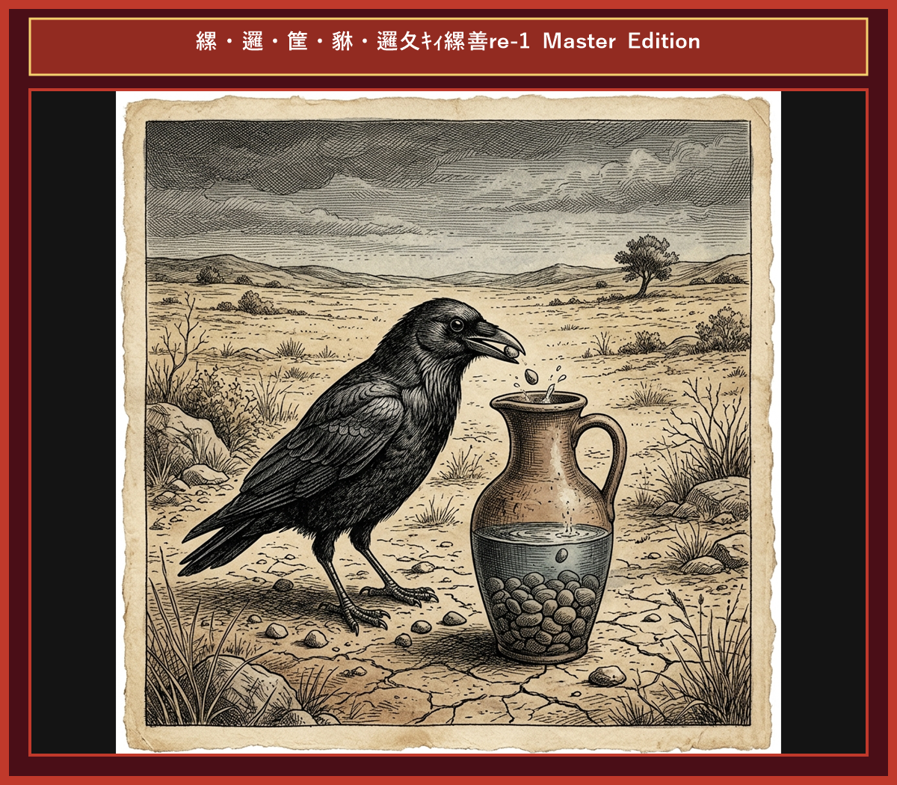

# 『英検ステップアップ多読：イソップ寓話編 第4巻（2級 ➔ 準1級対比学習）』

---

## はじめに：なぜ「対比多読」で英検準1級の壁を打破できるのか？

英検準1級は、大学中級〜社会人レベルの洗練された英語力の証であり、多くの学習者にとって最高峰の目標の一つです。2級から準1級へのステップアップにおいて立ちはだかる最大の壁は**「抽象的・学術的な単語力の急激なレベルアップ」**と**「長文読解・英作文（要約・意見論述）における高度な論理構文力」**です。

2級までは一般的な論理構成で対応できましたが、準1級からは政治・経済・歴史・心理学・人間社会の本質に迫る格調高い語彙（*ostentatious*, *tenacity*, *indolence*, *veracity*, *impetuous*, *subvert*）と複文・分詞構文・倒置を自由自在に読みこなし、表現する力が不可欠となります。

本書では、世界中で愛されるイソップ寓話（全10話）を題材に、**「知っている2級英語」** が **「合格レベルの準1級英語」** へとどのように洗練されていくかを対比学習します。

* **馴染みのあるストーリー（2級）** で文脈を完全に把握する
* **最高峰の洗練表現（準1級）** でアカデミックな論理構文・上級語彙を吸収する
* **そらんじたいキーフレーズ対比** でライティング・二次試験（面接）で圧倒的な評価を得る表現力を定着させる

楽しく寓話を読みながら、英検準1級合格に直結する本物の英語力を手に入れましょう！

---

## 本書の構成と学習フロー

本書の各章は、スモールステップ学習と電子書籍読書に最適化された6つのセクションで構成されています。

```text
┌─────────────────────────────────────────────────────────────┐
│ 1. Chapter Title & Visual Illustration (章タイトル ＆ 挿絵)   │
│ 2. Benchmark Level: 英検2級レベル英文                         │
│ 3. Target Level: 英検準1級レベル英文                         │
│ 4. Classic Original English Text (イソップ寓話クラシック原文)  │
│ 5. Japanese Translation (日本語訳 ＆ 教訓)                     │
│ 6. Recite & Compare (そらんじたいキーフレーズ対比カード)        │
│ 7. Key Vocabulary & Exam Notes (語彙・文法・試験対策解説)        │
└─────────────────────────────────────────────────────────────┘
```

> **【ポイント】 音声読み上げ機能 (TTS) 読み上げ機能をご利用の方へ**
> 前半のステップ2〜4は純粋な英文のみで構成されているため、音声読み上げ機能をONにすると、2級英文・準1級英文・クラシック原文が日本語に邪魔されることなく、自然なネイティブ発音で連続朗読されます。

---

## 英検準1級合格のための「効果的な4ステップ学習法」

### ■ STEP 1: 【2級英文でストーリー把握】（目標時間：1.5分）
まず章頭の挿絵を眺め、**「1. Benchmark Level（2級英文）」** を読みます。
ストーリーの展開と論理関係を頭に入れましょう。

### ■ STEP 2: 【準1級英文で最高峰のフォーマル表現を体感】（目標時間：2.5分）
次に **「2. Target Level（準1級英文）」** を読みます。
2級本文と比べて「どのように語彙が抽象化・学術化されているか」「複雑な分詞構文や高度な接続詞がどう使われているか」を意識します。

### ■ STEP 3: 【電子書籍読み上げ機能で耳からインプット】
電子書籍の朗読（TTS）機能を活用し、英文を聴きながら目で購入・声に出して追う**「シャドーイング（音読）」**を行います。
仕上げに **「3. Classic Original English Text（クラシック原文）」** の本格的な英文の響きを楽しみましょう。

### ■ STEP 4: 【暗唱カードで「そらんじる」＆ 語彙・文法解説】
後半の **「5. そらんじたいキーフレーズ対比カード」** で、準1級のターゲット表現を何度も声に出して暗唱します。英作文や面接でそのまま使える自分の表現ストックにしましょう！

---

## 収録ストーリー一覧（全10話）

* **Chapter 1**: The Tortoise and the Hare（ウサギとカメ）
* **Chapter 2**: The Boy Who Cried Wolf（オオカミ少年）
* **Chapter 3**: The North Wind and the Sun（北風と太陽）
* **Chapter 4**: The Lion and the Mouse（ライオンとネズミ）
* **Chapter 5**: The Ant and the Grasshopper（アリとキリギリス）
* **Chapter 6**: The Fox and the Grapes（キツネとブドウ）
* **Chapter 7**: The Town Mouse and the Country Mouse（田舎のネズミと街のネズミ）
* **Chapter 8**: The Crow and the Pitcher（カラスと水つぼ）
* **Chapter 9**: The Dog and His Shadow（欲張りな犬）
* **Chapter 10**: The Milkmaid and Her Pail（ミルク搾りの娘）


# Chapter 1: The Tortoise and the Hare (ウサギとカメ)

<div style="text-align: center; margin-bottom: 20px;">
  
</div>

<!-- Video Learning Link Start -->
<div style="text-align: center; margin: 18px 0; padding: 12px 16px; background-color: #f6f8fa; border: 1px solid #d0d7de; border-radius: 8px;">
  <a href="https://youtu.be/mock_tortoise_and_hare_ch01" style="color: #0969da; font-weight: bold; text-decoration: none; font-size: 1.05em; display: inline-block;">
    🎬 【動画で聴く・シャドーイング】ネイティブ朗読＆カラオケ字幕付き動画（YouTube）▶
  </a>
  <div style="font-size: 0.82em; color: #57606a; margin-top: 4px;">
    ※ タップするとYouTubeが開き、発音に合わせて光るカラオケ字幕で学習できます。
  </div>
</div>
<!-- Video Learning Link End -->


## 1. Benchmark Level: Eiken Grade 2 (英検2級レベル本文)
*Read in ~2.5 to 3 minutes. Academic discourse and formal vocabulary.*

A notoriously boastful hare perpetually ridiculed the sluggish movement of a tortoise, repeatedly asserting his own unexcelled swiftness before the woodland community. "Regardless of who dares to challenge me," declared the hare with supreme arrogance, "my natural velocity remains entirely insurmountable."

Unfazed by the hare's pompous declaration, the tortoise calmly offered a counter-proposal. "Notwithstanding your remarkable speed, I am prepared to engage in a competitive race to the designated hilltop."

Deeming the challenge absurdly amusing, the hare readily accepted, anticipating an inevitable triumph. At the commencement of the race, the hare burst forward with extraordinary acceleration, swiftly establishing a formidable lead that rendered his competitor virtually invisible.

Having traversed half the distance in mere minutes, the hare paused to assess his progress. Perceiving that the tortoise was lagging far behind, the hare succumbed to complacency. "Inasmuch as the gap between us is immense," he calculated, "a temporary respite will in no way compromise my impending victory." Consequently, he reclined beneath the dense foliage of a venerable oak and lapsed into an unalterable sleep.

In sharp contrast, the tortoise exhibited unwavering determination. Advancing with relentless continuity, he traversed the rugged terrain without succumbing to fatigue or distraction.

When the hare eventually awakened, nightfall was imminently approaching. Panic-stricken upon discovering the tortoise's proximity to the finish line, the hare exerted his maximum capacity in a desperate pursuit. Nevertheless, his delayed effort proved futile; the tortoise had already crossed the boundary, securing an unprecedented triumph.

Indolence and unwarranted self-assurance inevitably culminate in failure, whereas relentless perseverance consistently surpasses raw talent.

---

## 2. Target Level: Eiken Grade Pre-1 (英検準1級レベル本文)
*Read in ~3.5 to 4.5 minutes. Highly sophisticated literary and academic prose, complex inversion, advanced vocabulary, and nuanced rhetoric.*

An ostentatious hare habitually demeaned the sluggish gait of a tortoise, relentlessly proclaiming his own athletic preeminence to the forest fauna. "Should any creature presume to contest my velocity," the hare boasted with pompous disdain, "such an endeavor is preordained to fail, for my swiftness is fundamentally unassailable."

Impervious to the hare's supercilious bravado, the tortoise articulated a measured proposition. "Notwithstanding your heralded agility, I hereby challenge you to a footrace terminating at the mountain summit."

Deriding the proposal as a preposterous delusion, the hare acquiesced with patronizing enthusiasm. Upon the signal, the hare bounded forth with phenomenal momentum, establishing a colossal chasm between himself and his adversary within seconds.

Having covered half the course, the hare paused to survey the distance. Observing the tortoise far in the rear, the hare succumbed to fatalistic complacency. "Given the insurmountable magnitude of my lead," he rationalized, "a brief interlude of slumber shall not jeopardize my triumph." Whereupon, he sought refuge beneath a canopy of leaves and lapsed into a profound coma.

Conversely, the tortoise displayed unyielding tenacity. Maintaining an unhurried yet unrelenting cadence, he negotiated the treacherous incline without a single moment of hesitation.

By the time the hare emerged from his torpor, twilight had enveloped the horizon. Espying his rival adjacent to the finish line, the hare sprinted with frenecy; nevertheless, his belated surge proved entirely ineffectual. The tortoise had already crossed the threshold, achieving an historic victory.

Haughty indolence and premature triumph subvert inherent superiority, whereas steadfast tenacity inexorably eclipses uncultivated genius.

---

## 3. Classic Original English Text (イソップ寓話 クラシック原文)
*Townsend / Jacobs Edition (Public Domain)*

A Hare was one day making fun of the short feet and slow pace of the Tortoise, who retorted: "Though you be swift as the wind, I will beat you in a race." The Hare, believing her assertion to be simply impossible, agreed to the proposal; and they agreed that the Fox should choose the course and fix the goal. On the day appointed for the race the two started together. The Tortoise never for a moment stopped, but went on with a slow but steady pace straight to the end of the course. The Hare, lying down by the wayside, fell asleep. At last waking up, and moving as fast as he could, he saw the Tortoise had reached the goal, and was comfortably resting after her fatigue.

Slow and steady wins the race.

---

### 🏛️ 【英検2級レベルで読み解く！クラシック原文の重要構文・英文法ノート】
1. **1. 分詞構文（Participle Clause: 付帯状況・理由）**
   - **原文**: *"The Hare, believing her assertion to be simply impossible, agreed to the proposal..."*
   - **解説**: 「〜と信じ込んでいたので」という理由を表す分詞構文。英検2級の長文読解・ライティングの最頻出構文です。
1. **2. 古典的仮定法現在（Subjunctive Mood）**
   - **原文**: *"Though you be swift as the wind, I will beat you in a race."*
   - **解説**: 譲歩節 `Though` の中で原形 `be` を用いる古典的な仮定法現在（現代英語の `Though you are...`）。格調高い古典の響きを持ちます。
1. **3. 過去分詞の後置修飾（Postpositive Participle）**
   - **原文**: *"On the day appointed for the race the two started together."*
   - **解説**: `appointed`（定められた・指定された）が直前の名詞 `the day` を後ろから修飾する構文です。

### 📜 【クラシック原文の重要語彙・古風表現（Classic Antique Vocabulary）】
- **retort** [動] 2級 **（機転を利かせて）言い返す、反論する**（現代の reply sharp/wittily に相当）
- **assertion** [名] 2級/準1級 **主張、断言**（動詞 assert の名詞形。2級長文定番）
- **wayside** [名] 2級 **道端、沿道**（by the wayside（道端に、途中で））
- **fatigue** [名] 2級 **（心身の）極度の疲労、疲れ**（tiredness の上位フォーマル語）

---
<div style="page-break-before: always;"></div>

## 4. Japanese Translation (日本語訳)

ある高慢な野ウサギがカメの足の遅さを絶えず馬鹿にし、森の動物たちに向かって自らの並外れた速さを大威張りで主張していました。カメは動じることなく「あなたがどれほど速くとも、山頂までの駆けっこなら私が勝ちますよ」と言い返しました。ウサギはその挑戦をバカげた戯言と笑い飛ばして同意し、スタートと同時に猛烈な加速でカメをはるか後方に置き去りにしました。しかし途中で十分な差がついたと油断したウサギは木陰で深い眠りに落ちてしまいました。一方のカメは一瞬たりとも立ち止まることなく、不屈の粘り強さで歩み続けました。ウサギが目を覚ました時、カメはすでにゴールラインを越えて歴史的な勝利を収めていました。

**教訓**: 傲慢な怠惰と油断は本来の優位性を根底から覆すが、不屈の粘り強さは生来の天才をも不可避的に凌駕する。

---

## 5. Recite & Compare (そらんじたいキーフレーズ対比)
*Memorize these contrastive expressions to elevate speaking, writing, and reading fluency.*

<div class="comparison-card">
  <div class="card-header">■ 場面：過剰な自慢と相手への蔑視</div>
  <div class="card-row-g4"><span class="card-badge-g4">【Grade 2 基礎】</span> <em>boastful hare ridiculed sluggish movement... asserted unexcelled swiftness...</em></div>
  <div class="card-row-g3"><span class="card-badge-g3">【Pre-1 暗唱】</span> <strong><em>ostentatious hare demeaned sluggish gait... proclaimed athletic preeminence...</em></strong></div>
  <div class="card-note">【ポイント】 <strong>解説・試験活用</strong>：`ostentatious`（見せびらかす・誇示する）、`demean`（〜を貶める）、`gait`（歩調・足取り）、`preeminence`（卓越・至高）。準1級語彙問題の定番。</div>
</div>

<div class="comparison-card">
  <div class="card-header">■ 場面：挑発に対する冷静な対応</div>
  <div class="card-row-g4"><span class="card-badge-g4">【Grade 2 基礎】</span> <em>Unfazed by pompous declaration, calmly offered counter-proposal...</em></div>
  <div class="card-row-g3"><span class="card-badge-g3">【Pre-1 暗唱】</span> <strong><em>Impervious to supercilious bravado, articulated a measured proposition...</em></strong></div>
  <div class="card-note">【ポイント】 <strong>解説・試験活用</strong>：`Impervious to...`（〜に動じない・影響されない）、`supercilious`（横柄な・見下す）、`bravado`（強がり・ハッタリ）。準1級・1級長文の人物描写。</div>
</div>

<div class="comparison-card">
  <div class="card-header">■ 場面：膨大な差と油断</div>
  <div class="card-row-g4"><span class="card-badge-g4">【Grade 2 基礎】</span> <em>succumbed to complacency... temporary respite will not compromise...</em></div>
  <div class="card-row-g3"><span class="card-badge-g3">【Pre-1 暗唱】</span> <strong><em>succumbed to fatalistic complacency... brief interlude shall not jeopardize...</em></strong></div>
  <div class="card-note">【ポイント】 <strong>解説・試験活用</strong>：`interlude`（合間・インターバル）、`jeopardize`（〜を危険に晒す）。英検準1級英作文（要約・意見論述）で絶対的に必要な動詞。</div>
</div>

<div class="comparison-card">
  <div class="card-header">■ 場面：不屈の粘り強さ</div>
  <div class="card-row-g4"><span class="card-badge-g4">【Grade 2 基礎】</span> <em>exhibited unwavering determination, advancing with relentless continuity...</em></div>
  <div class="card-row-g3"><span class="card-badge-g3">【Pre-1 暗唱】</span> <strong><em>displayed unyielding tenacity, maintaining an unrelenting cadence...</em></strong></div>
  <div class="card-note">【ポイント】 <strong>解説・試験活用</strong>：`unyielding tenacity`（屈しない粘り強さ・不撓不屈）、`cadence`（歩調・リズム）。準1級ライティングの努力・事業成功エッセイで圧倒的な加点。</div>
</div>

<div class="comparison-card">
  <div class="card-header">■ 場面：教訓（Moral）</div>
  <div class="card-row-g4"><span class="card-badge-g4">【Grade 2 基礎】</span> <em>Indolence culminates in failure, whereas perseverance surpasses talent...</em></div>
  <div class="card-row-g3"><span class="card-badge-g3">【Pre-1 暗唱】</span> <strong><em>Haughty indolence subverts superiority, whereas tenacity inexorably eclipses genius...</em></strong></div>
  <div class="card-note">【ポイント】 <strong>解説・試験活用</strong>：`subvert`（〜を根底から覆す・打倒する）、`inexorably`（不可避的に・容赦なく）、`eclipse`（〜の存在感を薄れさせる・凌駕する）。準1級・1級論文の神フレーズ。</div>
</div>

---

## 6. Vocabulary Builder: 赤シート対応 重要単語・熟語チェック表
*※ 赤い透明シート（または赤フィルム）を重ねると、日本語訳が消えて自力テストができます。*

| No. | 見出し語 / イディオム | 品詞 / レベル | 日本語の意味（赤シートで消える） | 本文での使われ方・コロケーション |
|:---:|---|:---:|---|---|
| **01** | **proud** | [形] 4級 | <span style="color: #d90429; font-weight: bold;">誇り高い、傲慢な</span> | *a proud hare (自惚れたウサギ)* |
| **02** | **boast (about...)** | [動] 3級 | <span style="color: #d90429; font-weight: bold;">〜を自慢する、誇る</span> | *was always boasting about his speed* |
| **03** | **make fun of...** | [熟] 3級 | <span style="color: #d90429; font-weight: bold;">〜をからかう、嘲笑する</span> | *making fun of a slow tortoise* |
| **04** | **challenge** | [名/動] 3級 | <span style="color: #d90429; font-weight: bold;">挑戦、課題 / 挑む</span> | *I accept your challenge.* |
| **05** | **accept** | [動] 3級 | <span style="color: #d90429; font-weight: bold;">受け入れる、受諾する</span> | *accept the proposal (提案を受諾する)* |
| **06** | **dash** | [動] 3級 | <span style="color: #d90429; font-weight: bold;">勢いよく走る、突進する</span> | *dashed forward (前方へ駆け出した)* |
| **07** | **leave ~ behind** | [熟] 3級 | <span style="color: #d90429; font-weight: bold;">〜を置き去りにする</span> | *left the tortoise far behind* |
| **08** | **visible** | [形] 準2級 | <span style="color: #d90429; font-weight: bold;">目に見える、視認できる</span> | *was barely visible in the distance* |
| **09** | **catch up (with...)** | [熟] 3級 | <span style="color: #d90429; font-weight: bold;">〜に追いつく</span> | *before he catches up* |
| **10** | **slumber** | [名/動] 準2級 | <span style="color: #d90429; font-weight: bold;">深い眠り / 眠る</span> | *fell into a profound slumber* |
| **11** | **sprint** | [動] 3級 | <span style="color: #d90429; font-weight: bold;">全力疾走する</span> | *sprinted toward the finish line* |
| **12** | **persistence** | [名] 準2級/2級 | <span style="color: #d90429; font-weight: bold;">粘り強さ、不屈の継続</span> | *persistence and hard work will bring success* |


### 【出題傾向・文法解説ノート】

### 【出題頻出語彙・熟語ノート】
- **ostentatious** [形] これよがしの、自慢げな（*ostentatious display/lifestyle*）
- **preeminence** [名] 卓越、至高の地位（形容詞 *preeminent* 「卓越した」）
- **impervious** [形] （批判・感情などに）動じない、影響されない（*impervious to criticism*）
- **supercilious** [形] 横柄な、見下すような（*supercilious attitude/smile*）
- **jeopardize** [動] 〜を危険に晒す、台無しにする（準1級最頻出動詞 *jeopardize safety/success*）
- **tenacity** [名] 粘り強さ、不撓不屈（形容詞 *tenacious* 「粘り強い」）
- **eclipse** [動] 〜を凌駕する、陰らせる（*eclipse rivals/achievements*）

### 【文法・構文ポイント】
1. **[Should + 主語 + 動詞の原形...]（仮定法倒置：万一〜ならば）**
   - 準1級本文: *"Should any creature presume to contest my velocity..."*
   - ポイント: `If any creature should presume...` の `if` が省略された仮定法倒置構文。準1級ライティングや長文読解で格調高い仮定を表現する際に必須です。
2. **[Impervious to ...]（形容詞句の文頭前置構文）**
   - 準1級本文: *"Impervious to the hare's supercilious bravado, the tortoise articulated..."*
   - ポイント: 形容詞句を文頭に置く補語前置構文。主語の状態や心理特性を冒頭で鮮やかに際立たせる上級テクニックです。


# Chapter 2: The Boy Who Cried Wolf (オオカミ少年)

<div style="text-align: center; margin-bottom: 20px;">
  
</div>

## 1. Benchmark Level: Eiken Grade 2 (英検2級レベル本文)
*Read in ~2.5 to 3 minutes. Academic discourse and formal vocabulary.*

A juvenile shepherd tasked with safeguarding a village's livestock was stationed on a solitary hillside adjacent to a dense forest. Growing thoroughly disillusioned with the monotony of his solitary duties, he devised an unethical scheme to alleviate his boredom at the expense of the community.

"Wolf! A fierce predator is devouring the flock!" shouted the youth with simulated hysteria.

Distressed by his urgent alarm, the villagers instantaneously suspended their daily labor and ascended the slope, armed with improvised weapons to repel the perceived threat. Upon reaching the pasture, however, they discovered that the crisis was entirely fabricated. The boy stood amidst the grazing sheep, reveling in the success of his deceit. Indignant at his frivolous disregard for their safety, the villagers reprimanded him sternly, warning that civic trust should never be compromised for entertainment.

Regrettably, the boy failed to internalize their caution. Within a week, he fabricated the identical false alarm, causing another unwarranted disruption. Consequently, the villagers' residual trust dissolved entirely into profound skepticism.

Subsequently, a ravenous wolf actually descended from the timberland and launched a violent assault on the herd. Overwhelmed by genuine terror, the youth shouted desperately for assistance. "I implore you to believe me! A real wolf is slaughtering the livestock!"

Judging his pleas to be yet another manipulative fabrication, the villagers disregarded his distress signals completely. Deprived of external intervention, the boy watched helplessly as the predator decimated the entire flock.

Repeated dishonesty irreparably erodes personal integrity and public trust; hence, a proven deceiver will be met with skepticism even when uttering the absolute truth.

---

## 2. Target Level: Eiken Grade Pre-1 (英検準1級レベル本文)
*Read in ~3.5 to 4.5 minutes. Highly sophisticated literary and academic prose, complex inversion, advanced vocabulary, and nuanced rhetoric.*

An impetuous young shepherd, commissioned to tend a communal flock on a secluded ridge, succumbed to intense ennui induced by the tedious isolation of his assignment. To break the oppressive monotony, he conceived a malevolent deception, recklessly exploiting the villagers' protective instincts for his own perverse amusement.

"Wolf! A predatory beast is decimating our livestock!" he ejaculated with simulated panic.

Galvanized by this alarming outcry, the villagers immediately abandoned their vocations and rushed up the steep terrain, equipped with agricultural implements to neutralize the menace. Upon their arrival, however, the alleged emergency evaporated into a malicious hoax. The youth exulted in his successful manipulation, openly deriding their gullibility. Incensed by his callous breach of communal trust, the elders sternly admonished him, warning that veracity is the indispensable foundation of social cohesion.

Notwithstanding their solemn reproof, the incorrigible youth reiterated the identical subterfuge a fortnight later. This second instance of frivolous duplicity completely eroded whatever vestige of credibility he retained, solidifying a consensus of profound cynicism among the populace.

Inevitably, a formidable wolf emerged from the forest and commenced a catastrophic slaughter of the helpless flock. Paralyzed by authentic dread, the youth shrieked frantic appeals for succor. "I beseech your intervention! This is no fabrication!"

Surmising his frantic supplications to be merely another manifestation of his inveterate deceit, the villagers maintained absolute indifference. Bereft of succor, the youth witnessed the total annihilation of the flock.

Perpetual deceit irreparably subverts personal veracity and communal solidarity; consequently, even authentic testimony from a confirmed impostor will be rejected with unyielding skepticism.

---

## 3. Classic Original English Text (イソップ寓話 クラシック原文)
*Townsend / Jacobs Edition (Public Domain)*

A Shepherd Boy tended his flock near a dark forest, and used to amuse himself by crying out, "Wolf! Wolf!" The villagers would come running to help him, only to find that he had tricked them. He did this several times. But one day a real Wolf came out of the forest and attacked the sheep. The Boy cried out louder than ever, "Wolf! Wolf!" but the villagers, thinking he was fooling them again, paid no attention. The Wolf killed many sheep and destroyed the flock.

There is no believing a liar, even when he speaks the truth.

---

### 🏛️ 【英検2級レベルで読み解く！クラシック原文の重要構文・英文法ノート】
1. **1. 分詞構文（Time / Attendant Circumstance）**
   - **原文**: *"A Shepherd-boy, who watched a flock of sheep near a village, brought out the villagers three or four times by crying out..."*
   - **解説**: `by crying out`（叫ぶことによって）という手段の動名詞句と関係代名詞の継続用法が組み合わさった2級頻出の複文構造です。
1. **2. 結果・目的を表す不定詞（Infinitive: Result）**
   - **原文**: *"...and even made a practice of laughing at them when they came running to his assistance."*
   - **解説**: `came running`（走ってやって来た：come + 現在分詞）の付帯状況表現です。
1. **3. 譲歩の従属接続詞 `even when`**
   - **原文**: *"Nobody believes a liar, even when he tells the truth."*
   - **解説**: 「〜の時でさえ」という譲歩条件を表す接続詞構文。英作文で高い説得力を生み出します。

### 📜 【クラシック原文の重要語彙・古風表現（Classic Antique Vocabulary）】
- **assistance** [名] 2級 **援助、手助け**（come to one's assistance（助けに駆けつける））
- **earnest** [名/形] 2級 **本気、真剣 / 真面目な**（in earnest（本気で、真剣に））
- **dismay** [名/動] 準1級 **狼狽、落胆 / うろたえさせる**（cried out in dismay）
- **trustworthy** [形] 2級 **信頼できる、頼りになる**（a liar is never deemed trustworthy）

---
<div style="page-break-before: always;"></div>

## 4. Japanese Translation (日本語訳)

羊飼いの少年が村の羊の群れを一人で守る任に就いていましたが、仕事の過酷な孤独感と退屈に耐えかね、村人の防衛本能を悪用する悪質な悪戯を考案しました。「オオカミだ！家畜が全滅させられる！」と偽りのパニックで叫び、村人たちが仕事を放り出して駆けつけると、少年は騙された彼らを嘲笑しました。村人たちは社会的信頼の重要性を厳しく訓戒しましたが、懲りない少年は二度目の狂言を行いました。これにより彼の信頼性は完全に崩壊しました。やがて本物のオオカミが現れて羊を惨殺し始めた時、少年が悲痛な助けを求めて叫んだものの、村人はこれを虚言と断定して完全に無視しました。助けを得られず、羊の群れは全滅してしまいました。

**教訓**: 絶え間ない欺瞞は個人の誠実さと共同体の連帯を根底から打ち砕く。故に、一度虚偽の烙印を押された者の言葉は、たとえ真実であっても容赦ない懐疑によって退けられる。

---

## 5. Recite & Compare (そらんじたいキーフレーズ対比)
*Memorize these contrastive expressions to elevate speaking, writing, and reading fluency.*

<div class="comparison-card">
  <div class="card-header">■ 場面：退屈と悪意ある騙しの発案</div>
  <div class="card-row-g4"><span class="card-badge-g4">【Grade 2 基礎】</span> <em>disillusioned with monotony... devised an unethical scheme...</em></div>
  <div class="card-row-g3"><span class="card-badge-g3">【Pre-1 暗唱】</span> <strong><em>succumbed to intense ennui... conceived a malevolent deception...</em></strong></div>
  <div class="card-note">【ポイント】 <strong>解説・試験活用</strong>：`ennui`（倦怠感・退屈）、`malevolent`（悪意のある・害を及ぼす）。準1級・1級心理学・小説問題の必須上位語彙。</div>
</div>

<div class="comparison-card">
  <div class="card-header">■ 場面：社会の怒りと信頼の軽視</div>
  <div class="card-row-g4"><span class="card-badge-g4">【Grade 2 基礎】</span> <em>Indignant at disregard... trust should never be compromised...</em></div>
  <div class="card-row-g3"><span class="card-badge-g3">【Pre-1 暗唱】</span> <strong><em>Incensed by callous breach... veracity is the foundation of social cohesion...</em></strong></div>
  <div class="card-note">【ポイント】 <strong>解説・試験活用</strong>：`callous`（冷酷な・無感覚な）、`veracity`（真実性・誠実さ）、`social cohesion`（社会的結束）。準1級社会・政治エッセイの決まり文句。</div>
</div>

<div class="comparison-card">
  <div class="card-header">■ 場面：二度目の二重性と信用の喪失</div>
  <div class="card-row-g4"><span class="card-badge-g4">【Grade 2 基礎】</span> <em>same false alarm... residual trust dissolved into skepticism...</em></div>
  <div class="card-row-g3"><span class="card-badge-g3">【Pre-1 暗唱】</span> <strong><em>identical subterfuge... frivolous duplicity eroded whatever vestige of credibility...</em></strong></div>
  <div class="card-note">【ポイント】 <strong>解説・試験活用</strong>：`subterfuge`（口実・詐術）、`duplicity`（二重性・不誠実）、`vestige`（面影・痕跡）。準1級長文の核心概念。</div>
</div>

<div class="comparison-card">
  <div class="card-header">■ 場面：切迫した援助の要請と冷絶</div>
  <div class="card-row-g4"><span class="card-badge-g4">【Grade 2 基礎】</span> <em>shouted desperately... implore you to believe... disregarded signals...</em></div>
  <div class="card-row-g3"><span class="card-badge-g3">【Pre-1 暗唱】</span> <strong><em>shrieked frantic appeals for succor... beseech intervention... absolute indifference...</em></strong></div>
  <div class="card-note">【ポイント】 <strong>解説・試験活用</strong>：`succor`（援助・救済）、`beseech`（〜を深く懇願する）。古典・歴史問題における最上級のレスキュー単語。</div>
</div>

<div class="comparison-card">
  <div class="card-header">■ 場面：教訓（Moral）</div>
  <div class="card-row-g4"><span class="card-badge-g4">【Grade 2 基礎】</span> <em>Repeated dishonesty erodes integrity... deceiver met with skepticism...</em></div>
  <div class="card-row-g3"><span class="card-badge-g3">【Pre-1 暗唱】</span> <strong><em>Perpetual deceit subverts veracity; authentic testimony from impostor rejected...</em></strong></div>
  <div class="card-note">【ポイント】 <strong>解説・試験活用</strong>：`subvert`（〜を失墜させる・覆す）、`veracity`（誠実さ）、`testimony`（証言）、`impostor`（詐欺師・騙し屋）。準1級・1級論文の満点締結構文。</div>
</div>

---

## 6. Vocabulary Builder: 赤シート対応 重要単語・熟語チェック表
*※ 赤い透明シート（または赤フィルム）を重ねると、日本語訳が消えて自力テストができます。*

| No. | 見出し語 / イディオム | 品詞 / レベル | 日本語の意味（赤シートで消える） | 本文での使われ方・コロケーション |
|:---:|---|:---:|---|---|
| **01** | **shepherd** | [名] 3級 | <span style="color: #d90429; font-weight: bold;">羊飼い</span> | *a young shepherd boy* |
| **02** | **bored** | [形] 4級 | <span style="color: #d90429; font-weight: bold;">退屈した、飽きた</span> | *felt bored on the hill* |
| **03** | **mischievous** | [形] 準2級 | <span style="color: #d90429; font-weight: bold;">いたずら好きな</span> | *with a mischievous smile* |
| **04** | **shout** | [動] 4級 | <span style="color: #d90429; font-weight: bold;">大声を出す、叫ぶ</span> | *shouted at the top of his lungs* |
| **05** | **villager** | [名] 3級 | <span style="color: #d90429; font-weight: bold;">村人</span> | *the villagers rushed to help* |
| **06** | **rush** | [動] 3級 | <span style="color: #d90429; font-weight: bold;">急いで駆けつける</span> | *rushed to the rescue* |
| **07** | **trick** | [名/動] 3級 | <span style="color: #d90429; font-weight: bold;">いたずら、企み / だます</span> | *play a trick on someone* |
| **08** | **emerge** | [動] 準2級/2級 | <span style="color: #d90429; font-weight: bold;">現れる、姿を現す</span> | *a fierce wolf emerged from the woods* |
| **09** | **panic** | [名/動] 3級 | <span style="color: #d90429; font-weight: bold;">パニック、大混乱</span> | *cried in pure panic* |
| **10** | **scatter** | [動] 準2級 | <span style="color: #d90429; font-weight: bold;">散り散りになる、まき散らす</span> | *the sheep scattered in all directions* |
| **11** | **deceive** | [動] 準2級/2級 | <span style="color: #d90429; font-weight: bold;">だます、欺く</span> | *deceive others for amusement* |
| **12** | **trustworthy** | [形] 2級 | <span style="color: #d90429; font-weight: bold;">信頼できる、頼もしい</span> | *a liar is never considered trustworthy* |


### 【出題傾向・文法解説ノート】

### 【出題頻出語彙・熟語ノート】
- **ennui** [名] 倦怠感、退屈（*succumb to ennui*）
- **malevolent** [形] 悪意のある、邪悪な（*malevolent intention/hoax*）
- **veracity** [名] 真実性、誠実さ（*question the veracity of statement*）
- **subterfuge** [名] 策略、ごまかし、口実（*resort to subterfuge*）
- **duplicity** [名] 二枚舌、表裏のあること（形容詞 *duplicitous*）
- **succor** [名] 援助、救助（動詞 *bring succor to refugees*）
- **impostor** [名] 詐欺師、偽物（*unmask the impostor*）

### 【文法・構文ポイント】
1. **[Bereft of ...]（形容詞句前置構文：〜を完全に奪われて）**
   - 準1級本文: *"Bereft of succor, the youth witnessed the total annihilation..."*
   - ポイント: `Bereft of money/hope/succor` は完全な喪失を示す格調高い表現。準1級長文の悲劇的・破滅的状況で使用されます。
2. **[whatever + 名詞 + 主語 + 動詞]（どれほどの〜であろうと）**
   - 準1級本文: *"eroded whatever vestige of credibility he retained..."*
   - ポイント: 譲歩・限定の複合関係限定詞構文。わずかに残った信用を強調して描写する際に非常に有効です。


# Chapter 3: The North Wind and the Sun (北風と太陽)

<div style="text-align: center; margin-bottom: 20px;">
  
</div>

## 1. Benchmark Level: Eiken Grade 2 (英検2級レベル本文)
*Read in ~2.5 to 3 minutes. Academic discourse and formal vocabulary.*

A fierce contest for supremacy erupted between the North Wind and the Sun, each asserting absolute dominance over the natural elements. To resolve their intractable conflict, they agreed to abide by an objective trial of strength.

Spotting a solitary traveler traversing a mountain path enveloped in a heavy winter garment, the North Wind proposed a definitive criterion. "Whichever of us compels that traveler to divest himself of his cloak shall be conceded the title of supreme power."

Concurring with the terms, the Sun yielded the initial attempt. Instantly, the North Wind unleashed a ferocious gale, howling across the terrain with violent velocity. Contrary to his expectations, however, the relentless onslaught merely impelled the traveler to grasp his attire with redoubled firmness to shield himself from the tempestuous climate. Despite exerting his maximum capacity, the Wind's aggressive tactics proved entirely counterproductive.

Thereupon, the Sun emerged, radiating mild and soothing warmth across the atmosphere. Gradually escalating the solar intensity, he transformed the frigid environment into a pleasant climate. Overwhelmed by the mounting heat, the traveler voluntarily unfastened his heavy garment and discarded it beside the pathway.

Coercion and hostility inevitably breed resistance, whereas gentle persuasion and warmth consistently prevail over brute force.

---

## 2. Target Level: Eiken Grade Pre-1 (英検準1級レベル本文)
*Read in ~3.5 to 4.5 minutes. Highly sophisticated literary and academic prose, complex inversion, advanced vocabulary, and nuanced rhetoric.*

An unyielding hegemony dispute materialized between the North Wind and the Sun, both claiming absolute sovereignty over the atmospheric realm. To adjudicate their intractable rivalry, they pledged to submit to an empirical test of efficacy.

Observing a solitary wayfarer negotiating an exposed ridge wrapped in a heavy mantle, the North Wind stipulated the precise challenge. "Whichever entity forces that traveler to strip off his garment shall be acknowledged as possessing paramount potency."

Assenting to the protocol, the Sun granted priority to his adversary. Instantly, the North Wind generated a tempestuous blizzard, unleashing furious gusts designed to tear the cloak away. Contrary to his calculation, the belligerent assault merely impelled the wayfarer to clutch his garment with desperate tenacity to ward off the hypothermic peril. Notwithstanding his maximum expenditure of force, the Wind's coercive methodology produced an entirely antithetical outcome.

Whereupon, the Sun stepped forth, diffusing benevolent warmth throughout the biosphere. Incrementally augmenting the thermal emission, he ameliorated the hostile atmosphere. Incapable of enduring the mounting solar radiance, the traveler voluntarily shed his burdensome attire and rested in the shade.

Brutal coercion and aggressive hostility inexorably provoke intransigent resistance, whereas subtle benevolence and persuasive warmth invariably vanquish raw force.

---

## 3. Classic Original English Text (イソップ寓話 クラシック原文)
*Townsend / Jacobs Edition (Public Domain)*

The North Wind and the Sun had a dispute as to which was the stronger, when a traveler came along wrapped in a warm cloak. They agreed that the one who first succeeded in making the traveler take his cloak off should be considered stronger than the other. Then the North Wind blew as hard as he could, but the more he blew the more closely did the traveler fold his cloak around him; and at last the North Wind gave up the attempt. Then the Sun shone out warmly, and immediately the traveler took off his cloak. And so the North Wind was obliged to confess that the Sun was the stronger of the two.

Persuasion is better than force.

---

### 🏛️ 【英検2級レベルで読み解く！クラシック原文の重要構文・英文法ノート】
1. **1. 比較級 + 比較級（The + 比較級 ..., the + 比較級 ... 構文）**
   - **原文**: *"The harder the Wind blew, the more closely did the Traveler wrap his cloak around him."*
   - **解説**: 「〜すればするほど、ますます…」を表す英検2級・準1級の最重要構文。後半に倒置（`did the Traveler wrap`）が起きています。
1. **2. 形式主語構文・合意の受動態**
   - **原文**: *"It was agreed between them that whichever first made the traveler take off his cloak should be held the stronger."*
   - **解説**: `whichever first made...`（どちらが先に〜させようとも）という複合関係代名詞節と使役動詞 `make + O + 原形不定詞` の融合。
1. **3. 比較を表す上級形容詞 `superior to`**
   - **原文**: *"Persuasion is often superior to force."*
   - **解説**: ラテン比較（*superior to* = 〜より優れている）。*than* ではなく *to* を取る重要文法ポイントです。

### 📜 【クラシック原文の重要語彙・古風表現（Classic Antique Vocabulary）】
- **dispute** [名/動] 2級 **論争、口論 / 争う**（a dispute arose between A and B）
- **cloak** [名] 準2級/2級 **外套、マント**（wrap one's cloak tightly）
- **persuasion** [名] 2級 **説得、説得力**（動詞 persuade の名詞形）
- **superior to** [熟] 2級 **〜より優れている**（反意語: inferior to）

---
<div style="page-break-before: always;"></div>

## 4. Japanese Translation (日本語訳)

気象圏における絶対的な覇権を巡り、北風と太陽の間で妥協のない主導権争いが発生しました。この解決不能な対立を決定するため、二者は実験的な検証実験を行うことに合意しました。分厚い外套を着た旅人を見つけた北風は「相手に外套を剥ぎ取らせた方を、より強大な力を持つ者と認める」という条件を提示しました。太陽がこれを承諾すると、北風は猛烈な吹雪を放ちましたが、その侵略的な猛威は旅人に自己防衛の固い握りを強いるだけであり、高圧的な手法は完全に逆効果となりました。続いて太陽が穏やかな暖かさを放ち、徐々に熱量を高めると、旅人は自ら外套を脱ぎ捨てました。

**教訓**: 粗暴な威圧と敵意は不可避的に妥協のない反発を誘発するが、繊細な慈愛と説得力ある温和さは常に野蛮な力に勝利する。

---

## 5. Recite & Compare (そらんじたいキーフレーズ対比)
*Memorize these contrastive expressions to elevate speaking, writing, and reading fluency.*

<div class="comparison-card">
  <div class="card-header">■ 場面：覇権争いと客観的試練</div>
  <div class="card-row-g4"><span class="card-badge-g4">【Grade 2 基礎】</span> <em>contest for supremacy erupted... abide by objective trial...</em></div>
  <div class="card-row-g3"><span class="card-badge-g3">【Pre-1 暗唱】</span> <strong><em>hegemony dispute materialized... submit to an empirical test of efficacy...</em></strong></div>
  <div class="card-note">【ポイント】 <strong>解説・試験活用</strong>：`hegemony`（覇権・主導権）、`empirical test`（経験的・実験的検証）、`efficacy`（効能・効力）。準1級政治・科学長文のキー概念。</div>
</div>

<div class="comparison-card">
  <div class="card-header">■ 場面：最高の権力の提示</div>
  <div class="card-row-g4"><span class="card-badge-g4">【Grade 2 基礎】</span> <em>compels traveler to divest... conceded supreme power...</em></div>
  <div class="card-row-g3"><span class="card-badge-g3">【Pre-1 暗唱】</span> <strong><em>forces wayfarer to strip off... acknowledged as possessing paramount potency...</em></strong></div>
  <div class="card-note">【ポイント】 <strong>解説・試験活用</strong>：`wayfarer`（旅人・歩行者）、`paramount`（最高の・最重要な）、`potency`（効力・権力）。準1級・1級文章における上位語。</div>
</div>

<div class="comparison-card">
  <div class="card-header">■ 場面：攻撃的行動の正反対の結果</div>
  <div class="card-row-g4"><span class="card-badge-g4">【Grade 2 基礎】</span> <em>relentless onslaught impelled... proved counterproductive...</em></div>
  <div class="card-row-g3"><span class="card-badge-g3">【Pre-1 暗唱】</span> <strong><em>belligerent assault impelled... produced an antithetical outcome...</em></strong></div>
  <div class="card-note">【ポイント】 <strong>解説・試験活用</strong>：`belligerent`（好戦的な・攻撃的な）、`antithetical`（正反対の・対立する）。要約問題で展開の逆転をまとめる神語彙。</div>
</div>

<div class="comparison-card">
  <div class="card-header">■ 場面：気候の改善と自発的放棄</div>
  <div class="card-row-g4"><span class="card-badge-g4">【Grade 2 基礎】</span> <em>radiating soothing warmth... voluntarily unfastened...</em></div>
  <div class="card-row-g3"><span class="card-badge-g3">【Pre-1 暗唱】</span> <strong><em>diffusing benevolent warmth... ameliorated atmosphere... shed burdensome attire...</em></strong></div>
  <div class="card-note">【ポイント】 <strong>解説・試験活用</strong>：`diffuse`（〜を拡散・放射する）、`ameliorate`（状況・環境を改善する）。準1級環境・社会課題の最最重要動詞。</div>
</div>

<div class="comparison-card">
  <div class="card-header">■ 場面：教訓（Moral）</div>
  <div class="card-row-g4"><span class="card-badge-g4">【Grade 2 基礎】</span> <em>Coercion breeds resistance, warmth prevails over brute force...</em></div>
  <div class="card-row-g3"><span class="card-badge-g3">【Pre-1 暗唱】</span> <strong><em>Brutal coercion provokes intransigent resistance, subtle benevolence vanquishes raw force...</em></strong></div>
  <div class="card-note">【ポイント】 <strong>解説・試験活用</strong>：`intransigent`（非妥協的な・難硬な）、`vanquish`（〜を打ち破る・征服する）。準1級・1級論説・外交エッセイの最高の締め。</div>
</div>

---

## 6. Vocabulary Builder: 赤シート対応 重要単語・熟語チェック表
*※ 赤い透明シート（または赤フィルム）を重ねると、日本語訳が消えて自力テストができます。*

| No. | 見出し語 / イディオム | 品詞 / レベル | 日本語の意味（赤シートで消える） | 本文での使われ方・コロケーション |
|:---:|---|:---:|---|---|
| **01** | **dispute** | [名/動] 準2級/2級 | <span style="color: #d90429; font-weight: bold;">論争、争い / 言い争う</span> | *a fierce dispute arose* |
| **02** | **claim** | [動] 3級 | <span style="color: #d90429; font-weight: bold;">主張する、言い張る</span> | *claimed to be stronger* |
| **03** | **traveler** | [名] 3級 | <span style="color: #d90429; font-weight: bold;">旅人、旅行者</span> | *a lone traveler walking along the road* |
| **04** | **cloak** | [名] 準2級 | <span style="color: #d90429; font-weight: bold;">マント、外套</span> | *wrapped tightly in a heavy cloak* |
| **05** | **fierce** | [形] 準2級 | <span style="color: #d90429; font-weight: bold;">猛烈な、激しい</span> | *blew a fierce and icy blast* |
| **06** | **howl** | [動] 3級 | <span style="color: #d90429; font-weight: bold;">（風が）うなる、吠える</span> | *the howling wind tore at his clothes* |
| **07** | **clutch** | [動] 準2級 | <span style="color: #d90429; font-weight: bold;">ぐっと掴む、しっかり握る</span> | *clutched his garment even tighter* |
| **08** | **radiant** | [形] 2級/準1級 | <span style="color: #d90429; font-weight: bold;">輝くばかりの、光を放つ</span> | *beamed with radiant warmth* |
| **09** | **gentle** | [形] 4級 | <span style="color: #d90429; font-weight: bold;">優しい、穏やかな</span> | *with gentle and steady rays* |
| **10** | **perspiration** | [名] 2級/準1級 | <span style="color: #d90429; font-weight: bold;">汗、発汗</span> | *dripping with warm perspiration* |
| **11** | **unfasten** | [動] 準2級 | <span style="color: #d90429; font-weight: bold;">外す、脱ぐ</span> | *gladly unfastened his heavy cloak* |
| **12** | **persuasion** | [名] 2級 | <span style="color: #d90429; font-weight: bold;">説得、説得力</span> | *persuasion is often superior to force* |


### 【出題傾向・文法解説ノート】

### 【出題頻出語彙・熟語ノート】
- **hegemony** [名] 覇権、主導権（*economic/political hegemony*）
- **empirical** [形] 実験に基づいた、経験的な（*empirical evidence/test*）
- **paramount** [形] 最重要の、最高の（*paramount importance/potency*）
- **belligerent** [形] 好戦的な、攻撃的な（*belligerent nation/attitude*）
- **antithetical** [形] 正反対の、対照的な（*antithetical to progress*）
- **ameliorate** [動] （悪化した状況）を改善する、向上させる（*ameliorate poverty/environment*）
- **vanquish** [動] 〜を完全になぎ倒す、打ち破る（*vanquish enemies/obstacles*）

### 【文法・構文ポイント】
1. **[Whereupon, ...]（接続副詞：そこで、それを受けて）**
   - 準1級本文: *"Whereupon, the Sun stepped forth, diffusing benevolent warmth..."*
   - ポイント: 前言の文脈を受けて次の行動・事態へ展開する格調高いフォーマル接続副詞。準1級・1級長文の転換点で使用されます。
2. **[Notwithstanding + 名詞句]（〜にもかかわらず）**
   - 準1級本文: *"Notwithstanding his maximum expenditure of force, the Wind's..."*
   - ポイント: `despite` の文語表現。長い名詞句を伴って文頭に置くことで、強い対比関係を明示します。


# Chapter 4: The Lion and the Mouse (ライオンとネズミ)

<div style="text-align: center; margin-bottom: 20px;">
  
</div>

## 1. Benchmark Level: Eiken Grade 2 (英検2級レベル本文)
*Read in ~2.5 to 3 minutes. Academic discourse and formal vocabulary.*

A formidable lion, the undisputed monarch of the wilderness, was slumbering in a shaded sanctuary. His tranquility was abruptly shattered when a diminutive mouse inadvertently traversed his face. Provoked by the intrusion, the apex predator instantly pinned the fragile creature beneath his massive paw, intending to execute it summarily.

"I beseech your Majesty to exercise clemency!" implored the terrified rodent. "My transgression was purely accidental. Should you grant me amnesty, I pledge to render reciprocal assistance whenever you encounter adversity."

Skepticism and amusement swept over the lion at the absurd proposition that an insignificant creature possessed the capacity to aid a sovereign beast. Nonetheless, moved by a rare impulse of magnanimity, he unclasped his paw and granted the rodent its liberty.

Subsequently, while prowling through the woodland, the lion triggered a sophisticated snare constructed by big-game hunters. Bound securely within heavy cordage, his tremendous physical exertion proved futile, leaving him roaring in profound helplessness.

Recognizing the vocalization of distress, the mouse promptly navigated toward the source. Demonstrating remarkable ingenuity and perseverance, the rodent methodically severed the fibrous strands with its sharp incisors, ultimately liberating the trapped monarch.

No creature is so humble as to be devoid of utility; hence, acts of benevolence frequently yield unforeseen dividends in moments of acute crisis.

---

## 2. Target Level: Eiken Grade Pre-1 (英検準1級レベル本文)
*Read in ~3.5 to 4.5 minutes. Highly sophisticated literary and academic prose, complex inversion, advanced vocabulary, and nuanced rhetoric.*

A colossal lion, the unchallenged sovereign of the veldt, reposed within a secluded copse. This serene repose was rudely disrupted when an infinitesimal rodent inadvertently scurried across the apex predator's countenance. Incensed by this inadvertent sacrilege, the monarch immobilized the helpless organism beneath his formidable claw, poised to exterminate it without compunction.

"I implore your Sovereign Highness to extend magnanimous clemency!" supplicated the quaking rodent. "My inadvertent trespass bore no malice. Were you to accord me amnesty, I solemnize a vow to reciprocate with commensurate assistance in your hour of peril."

Derision and incredulity seized the monarch upon contemplating the preposterous thesis that a paltry rodent could ever succor an omnipotent carnivore. Nevertheless, impelled by a transient whim of regal magnanimity, he disengaged his grip and emancipated the captive.

In the fullness of time, while negotiating a dense thicket, the lion unwittingly activated an insidious trap devised by big-game poachers. Enmeshed within unyielding netting, his frantic physical exertion produced no mitigation, reducing the sovereign to vocalizing impotent fury.

Discerning the unmistakable reverberation of anguish, the rodent expeditiously gravitated to the site. Exercising astounding tenacity, the diminutive creature meticulously gnawed through the resilient cordage with razor-sharp incisors, thereby restoring the sovereign's autonomy.

No entity, regardless of its apparent insignificance, is wholly destitute of efficacy; consequently, altruistic benevolence routinely yields incalculable dividends during times of catastrophic vulnerability.

---

## 3. Classic Original English Text (イソップ寓話 クラシック原文)
*Townsend / Jacobs Edition (Public Domain)*

A Lion was awakened by a Mouse running over his face. Rising up angrily, he caught him and was about to kill him, when the Mouse piteously entreated, saying: "If you would only spare my life, I would be sure to repay your kindness." The Lion laughed and let him go. It happened shortly after this that the Lion was caught by some hunters, who bound him by strong ropes to the ground. The Mouse, recognizing his roar, came and gnawed the rope with his teeth, and set him free, exclaiming: "You ridiculed the idea of my ever being able to help you, not expecting to receive any repayment from me; now you know that it is possible for even a Mouse to confer a benefit on a Lion."

Little friends may prove great friends.

---

### 🏛️ 【英検2級レベルで読み解く！クラシック原文の重要構文・英文法ノート】
1. **1. 分詞構文（Participle Clause: 付帯状況・理由）**
   - **原文**: *"The Hare, believing her assertion to be simply impossible, agreed to the proposal..."*
   - **解説**: 「〜と信じ込んでいたので」という理由を表す分詞構文。英検2級の長文読解・ライティングの最頻出構文です。
1. **2. 古典的仮定法現在（Subjunctive Mood）**
   - **原文**: *"Though you be swift as the wind, I will beat you in a race."*
   - **解説**: 譲歩節 `Though` の中で原形 `be` を用いる古典的な仮定法現在（現代英語の `Though you are...`）。格調高い古典の響きを持ちます。
1. **3. 過去分詞の後置修飾（Postpositive Participle）**
   - **原文**: *"On the day appointed for the race the two started together."*
   - **解説**: `appointed`（定められた・指定された）が直前の名詞 `the day` を後ろから修飾する構文です。

### 📜 【クラシック原文の重要語彙・古風表現（Classic Antique Vocabulary）】
- **retort** [動] 2級 **（機転を利かせて）言い返す、反論する**（現代の reply sharp/wittily に相当）
- **assertion** [名] 2級/準1級 **主張、断言**（動詞 assert の名詞形。2級長文定番）
- **wayside** [名] 2級 **道端、沿道**（by the wayside（道端に、途中で））
- **fatigue** [名] 2級 **（心身の）極度の疲労、疲れ**（tiredness の上位フォーマル語）

---
<div style="page-break-before: always;"></div>

## 4. Japanese Translation (日本語訳)

草原の絶対的支配者であるライオンが密林で休んでいたところ、極小のネズミが誤って顔の上を走り抜けたことで平穏が破られました。不敬に怒ったライオンは即座にネズミを捕らえ、容赦なく処分しようとしました。ネズミは「どうか寛大なる慈悲を！もし免罪を賜るなら、貴下が危急の折には必ず相応の助力でお報いします」と平伏しました。ライオンはネズミが自分を助けるというバカげた仮説に失笑しましたが、気まぐれな寛大さでネズミを解放しました。時が流れ、ライオンは密猟者の罠にかかり縄網に拘束されて絶望の咆哮を上げました。ネズミはその悲痛な響きを聞きつけ、鋭い前歯で縄を切断して王の自由を奪還しました。

**教訓**: いかなる存在も、その見た目の微小さに関わらず効力を完全に欠いてはいない。故に、利他的な善行は破滅的な危機において測り知れない恩恵を不可避的にもたらす。

---

## 5. Recite & Compare (そらんじたいキーフレーズ対比)
*Memorize these contrastive expressions to elevate speaking, writing, and reading fluency.*

<div class="comparison-card">
  <div class="card-header">■ 場面：絶対的王者の怒りと処分</div>
  <div class="card-row-g4"><span class="card-badge-g4">【Grade 2 基礎】</span> <em>apex predator pinned fragile creature... execute summarily...</em></div>
  <div class="card-row-g3"><span class="card-badge-g3">【Pre-1 暗唱】</span> <strong><em>apex predator immobilized organism... poised to exterminate without compunction...</em></strong></div>
  <div class="card-note">【ポイント】 <strong>解説・試験活用</strong>：`immobilize`（〜を動けなくする）、`exterminate`（〜を全滅・処分する）、`compunction`（罪悪感・躊躇）。準1級社会・生態系問題。</div>
</div>

<div class="comparison-card">
  <div class="card-header">■ 場面：最高の慈悲の要求と返報の誓い</div>
  <div class="card-row-g4"><span class="card-badge-g4">【Grade 2 基礎】</span> <em>exercise clemency... grant amnesty... pledge reciprocal assistance...</em></div>
  <div class="card-row-g3"><span class="card-badge-g3">【Pre-1 暗唱】</span> <strong><em>extend magnanimous clemency... accord amnesty... solemnize a vow to reciprocate...</em></strong></div>
  <div class="card-note">【ポイント】 <strong>解説・試験活用</strong>：`magnanimous`（寛大な）、`solemnize a vow`（誓いを厳かに立てる）、`reciprocate`（報いる・報復/返礼する）。準1級・1級必須動詞。</div>
</div>

<div class="comparison-card">
  <div class="card-header">■ 場面：罠による無力化</div>
  <div class="card-row-g4"><span class="card-badge-g4">【Grade 2 基礎】</span> <em>triggered a snare... physical exertion proved futile...</em></div>
  <div class="card-row-g3"><span class="card-badge-g3">【Pre-1 暗唱】</span> <strong><em>unwittingly activated an insidious trap... produced no mitigation...</em></strong></div>
  <div class="card-note">【ポイント】 <strong>解説・試験活用</strong>：`unwittingly`（知らず知らずのうちに）、`insidious`（潜行性の・狡猾な）、`mitigation`（軽減・緩和）。環境・医療・軍事の準1級語彙。</div>
</div>

<div class="comparison-card">
  <div class="card-header">■ 場面：主権の奪還・自由の復元</div>
  <div class="card-row-g4"><span class="card-badge-g4">【Grade 2 基礎】</span> <em>severed fibrous strands... liberating trapped monarch...</em></div>
  <div class="card-row-g3"><span class="card-badge-g3">【Pre-1 暗唱】</span> <strong><em>meticulously gnawed cordage... restoring sovereign's autonomy...</em></strong></div>
  <div class="card-note">【ポイント】 <strong>解説・試験活用</strong>：`meticulously`（細心に・周到に）、`autonomy`（自治権・主主体性/自由）。準1級・1級政治・個人主義エッセイの決まり文句。</div>
</div>

<div class="comparison-card">
  <div class="card-header">■ 場面：教訓（Moral）</div>
  <div class="card-row-g4"><span class="card-badge-g4">【Grade 2 基礎】</span> <em>No creature is devoid of utility; benevolence yields dividends...</em></div>
  <div class="card-row-g3"><span class="card-badge-g3">【Pre-1 暗唱】</span> <strong><em>No entity is destitute of efficacy; altruistic benevolence yields incalculable dividends...</em></strong></div>
  <div class="card-note">【ポイント】 <strong>解説・試験活用</strong>：`destitute of...`（〜に欠けている）、`efficacy`（有効性・効能）、`altruistic`（利他的な）、`incalculable`（推し量れない）。準1級・1級神表現。</div>
</div>

---

## 6. Vocabulary Builder: 赤シート対応 重要単語・熟語チェック表
*※ 赤い透明シート（または赤フィルム）を重ねると、日本語訳が消えて自力テストができます。*

| No. | 見出し語 / イディオム | 品詞 / レベル | 日本語の意味（赤シートで消える） | 本文での使われ方・コロケーション |
|:---:|---|:---:|---|---|
| **01** | **majestic** | [形] 準2級 | <span style="color: #d90429; font-weight: bold;">威厳のある、雄大な</span> | *the majestic king of beasts* |
| **02** | **disturb** | [動] 3級 | <span style="color: #d90429; font-weight: bold;">邪魔する、乱す</span> | *disturbed his peaceful slumber* |
| **03** | **beg** | [動] 3級 | <span style="color: #d90429; font-weight: bold;">懇願する、頼み込む</span> | *begged desperately for mercy* |
| **04** | **spare** | [動] 準2級 | <span style="color: #d90429; font-weight: bold;">（命を）助ける、惜しむ</span> | *spared the tiny creature's life* |
| **05** | **trap** | [動/名] 3級 | <span style="color: #d90429; font-weight: bold;">罠にかける / 罠</span> | *trapped helplessly in a sturdy net* |
| **06** | **roar** | [動/名] 3級 | <span style="color: #d90429; font-weight: bold;">咆哮する、大声で吠える</span> | *roared in utter frustration* |
| **07** | **gnaw** | [動] 準2級/2級 | <span style="color: #d90429; font-weight: bold;">かじる、噛み切る</span> | *gnawed through the thick rope* |
| **08** | **fiber** | [名] 準2級 | <span style="color: #d90429; font-weight: bold;">繊維、ロープの紐</span> | *severed the binding fibers* |
| **09** | **gratitude** | [名] 2級 | <span style="color: #d90429; font-weight: bold;">感謝の気持ち</span> | *bowed in profound gratitude* |
| **10** | **insignificant** | [形] 2級/準1級 | <span style="color: #d90429; font-weight: bold;">取るに足らない、ちっぽけな</span> | *no friend is too insignificant to help* |
| **11** | **repay** | [動] 3級 | <span style="color: #d90429; font-weight: bold;">恩返しする、返済する</span> | *repay a noble act of kindness* |
| **12** | **compassion** | [名] 2級 | <span style="color: #d90429; font-weight: bold;">慈悲、思いやり</span> | *compassion yields unexpected rewards* |


### 【出題傾向・文法解説ノート】

### 【出題頻出語彙・熟語ノート】
- **compunction** [名] 罪悪感、悔恨（*without compunction* 「平気で・躊躇なく」）
- **magnanimous** [形] （敗者・弱者に対して）寛大な、気高い（名詞 *magnanimity*）
- **reciprocate** [動] 〜に報いる、返礼する（*reciprocate kindness/favors*）
- **insidious** [形] 陰湿な、知らぬ間に進行する（*insidious effect/disease*）
- **autonomy** [名] 自主性、自治権（*individual/regional autonomy*）
- **altruistic** [形] 利他的な、無私無欲の（対義語 *egoistic* 「利己的な」）
- **incalculable** [形] 計り知れない、無数の（*incalculable harm/benefit*）

### 【文法・構文ポイント】
1. **[Were you to + 動詞の原形...]（仮定法過去倒置：万一〜していただけるなら）**
   - 準1級本文: *"Were you to accord me amnesty, I solemnize a vow..."*
   - ポイント: `If you were to accord...` の `if` 省略倒置。条件交渉やビジネス上の丁寧な仮定を提示する際の最高級構文です。
2. **[No entity, regardless of ..., is wholly ...]（全否定と条件挿入構文）**
   - 準1級本文: *"No entity, regardless of its apparent insignificance, is wholly destitute of efficacy..."*
   - ポイント: 否定主語に `regardless of` を挿入した一般化構文。論文・エッセイで普遍的真理を断言する際に強烈な説得力を発揮します。


# Chapter 5: The Ant and the Grasshopper (アリとキリギリス)

<div style="text-align: center; margin-bottom: 20px;">
  
</div>

## 1. Benchmark Level: Eiken Grade 2 (英検2級レベル本文)
*Read in ~2.5 to 3 minutes. Academic discourse and formal vocabulary.*

During the abundant summer months, an industrious colony of ants engaged in meticulous labor, transporting provisions to replenish their subterranean reserves in anticipation of winter's austerity. Each ant labored systematically, prioritizing long-term security over immediate gratification.

In stark contrast, an indolent grasshopper squandered the season in frivolous amusement, playing melodies and indulging in fleeting pleasures. Observing the ants' grueling exertions, the grasshopper derided their foresight. "Why dedicate these idyllic days to relentless toil?" he inquired dismissively. "Present abundance renders such arduous preparation entirely superfluous."

A pragmatic ant admonished him gravely, "We are systematically accumulating reserves to withstand the inevitable scarcity of winter. Prudence dictates that you likewise initiate preparations." Unmoved by this pragmatic counsel, the grasshopper persisted in his short-sighted hedonism.

With the onset of winter, frigid temperatures devastated the flora, shrouding the countryside in impenetrable snow. Lacking any provisions to sustain himself, the destitute grasshopper suffered severe deprivation. In extreme distress, he appealed to the ants' benevolence, supplicating for a fraction of their surplus grain.

The ant confronted the petitioner dispassionately. "How did you utilize your time during the season of abundance?"

"I devoted myself entirely to music and merriment," admitted the humbled grasshopper.

"Inasmuch as you sang throughout the summer," concluded the ant dispassionately, "it is appropriate that you dance through the winter." With that, the portal was decisively closed.

Provident foresight and disciplined perseverance shield against adversity, whereas reckless short-sightedness culminates in destitute vulnerability.

---

## 2. Target Level: Eiken Grade Pre-1 (英検準1級レベル本文)
*Read in ~3.5 to 4.5 minutes. Highly sophisticated literary and academic prose, complex inversion, advanced vocabulary, and nuanced rhetoric.*

Throughout the vernal season of bounty, an extraordinarily industrious ant commune executed systematic labor, stockpiling agrarian commodities to fortify their subterranean granaries against impending winter privations. Each individual operated with unremitting discipline, subordinating immediate sensory pleasure to long-term institutional survival.

Conversely, a hedonistic grasshopper dissipated the temperate months in ostentatious frivolity, orchestrating ephemeral harmonies while indulging in unbridled gratification. Surveying the ants' relentless endeavors, the grasshopper disparaged their strategic foresight. "Wherefore surrender these pristine days to excruciating labor?" he postulated derisively. "Existing plenitude obviates the necessity for such paranoid accumulation."

A sagacious ant proffered stern counsel: "We are methodically amassing sustenance to insulate ourselves against the inevitable ecological austerity of winter. Rational prudence mandates that you promptly emulate our methodology." Unswayed by this imperative admonition, the grasshopper persisted in his myopic extravagance.

Upon the inevitable arrival of winter, arctic blizzards decimated the vegetation, paralyzing the ecosystem under a blanket of frost. Bereft of reserves, the impoverished grasshopper experienced acute physiological collapse. Reduced to absolute destitution, he petitioned the ants' altruism, imploring a subsistence ration from their bountiful repository.

The ant scrutinized the mendicant with icy detachment. "Wherein lay your endeavors while abundance prevailed?"

"I consecrated my existence to artistic expression and melody," confessed the chastened grasshopper.

"Inasmuch as your summer was squandered in vocalization," decreed the ant with inexorable logic, "it is fitting that your winter be consumed in choreographic desperation." Whereupon, the barrier was immutably sealed.

Provident stewardship and disciplined frugality constitute an inviolable defense against catastrophe, whereas unbridled short-sightedness inevitably precipitates irreversible vulnerability.

---

## 3. Classic Original English Text (イソップ寓話 クラシック原文)
*Townsend / Jacobs Edition (Public Domain)*

In a field one summer's day a Grasshopper was hopping about, chirping and singing to its heart's content. An Ant passed by, bearing along with great toil an ear of corn he was taking to the nest. "Why not come and chat with me," said the Grasshopper, "instead of toiling and moiling in that way?" "I am helping to lay up food for the winter," said the Ant, "and recommend you to do the same." "Why bother about winter?" said the Grasshopper; "we have got plenty of food at present." But the Ant went on its way and continued its toil. When the winter came the Grasshopper had no food and found itself dying of hunger, while it saw the ants distributing everyday corn and grain from the stores they had collected in the summer. Then the Grasshopper knew:

It is best to prepare for the days of necessity.

---

### 🏛️ 【英検2級レベルで読み解く！クラシック原文の重要構文・英文法ノート】
1. **1. 分詞構文（Participle Clause: 付帯状況・理由）**
   - **原文**: *"The Hare, believing her assertion to be simply impossible, agreed to the proposal..."*
   - **解説**: 「〜と信じ込んでいたので」という理由を表す分詞構文。英検2級の長文読解・ライティングの最頻出構文です。
1. **2. 古典的仮定法現在（Subjunctive Mood）**
   - **原文**: *"Though you be swift as the wind, I will beat you in a race."*
   - **解説**: 譲歩節 `Though` の中で原形 `be` を用いる古典的な仮定法現在（現代英語の `Though you are...`）。格調高い古典の響きを持ちます。
1. **3. 過去分詞の後置修飾（Postpositive Participle）**
   - **原文**: *"On the day appointed for the race the two started together."*
   - **解説**: `appointed`（定められた・指定された）が直前の名詞 `the day` を後ろから修飾する構文です。

### 📜 【クラシック原文の重要語彙・古風表現（Classic Antique Vocabulary）】
- **retort** [動] 2級 **（機転を利かせて）言い返す、反論する**（現代の reply sharp/wittily に相当）
- **assertion** [名] 2級/準1級 **主張、断言**（動詞 assert の名詞形。2級長文定番）
- **wayside** [名] 2級 **道端、沿道**（by the wayside（道端に、途中で））
- **fatigue** [名] 2級 **（心身の）極度の疲労、疲れ**（tiredness の上位フォーマル語）

---
<div style="page-break-before: always;"></div>

## 4. Japanese Translation (日本語訳)

豊穣の夏の期間中、勤勉なアリの集団は冬の窮乏に備えて地下の倉庫に穀物を蓄える規則正しい労働に従事していました。各々が目先の快楽を組織の長期的生存のために犠牲にしていました。一方、享楽的なキリギリスは過度な娯楽に季節を浪費し、アリの戦略的先見の明を「現在の豊富さは備蓄の必要性を排除する」と馬鹿にしました。賢明なアリは「合理的な慎重さは直ちに備蓄することを要求する」と告げましたが、キリギリスは近視眼的な贅沢に固執しました。厳冬が訪れ生態系が麻痺すると、蓄えのないキリギリスは極度の困窮に陥り、アリの利他主義に分け前を哀願しました。アリは「夏を歌に浪費したのなら、冬は舞踏で過ごすがよい」と断絶しました。

**教訓**: 先見の明ある管理と規律ある節倹は災厄に対する不可侵の防御を構築するが、抑えの効かない近視眼性は不可逆的な破滅を招く。

---

## 5. Recite & Compare (そらんじたいキーフレーズ対比)
*Memorize these contrastive expressions to elevate speaking, writing, and reading fluency.*

<div class="comparison-card">
  <div class="card-header">■ 場面：計画的蓄えと即時快楽の犠牲</div>
  <div class="card-row-g4"><span class="card-badge-g4">【Grade 2 基礎】</span> <em>stockpiling provisions... prioritizing long-term security over immediate gratification...</em></div>
  <div class="card-row-g3"><span class="card-badge-g3">【Pre-1 暗唱】</span> <strong><em>subordinating immediate sensory pleasure to long-term institutional survival...</em></strong></div>
  <div class="card-note">【ポイント】 <strong>解説・試験活用</strong>：`subordinate A to B`（AをBに従属させる・後回しにする）、`institutional survival`（組織的生存）。準1級・1級の経営・政治・環境論文構文。</div>
</div>

<div class="comparison-card">
  <div class="card-header">■ 場面：準備の不要論の主張</div>
  <div class="card-row-g4"><span class="card-badge-g4">【Grade 2 基礎】</span> <em>abundance renders arduous preparation superfluous...</em></div>
  <div class="card-row-g3"><span class="card-badge-g3">【Pre-1 暗唱】</span> <strong><em>Existing plenitude obviates the necessity for such paranoid accumulation...</em></strong></div>
  <div class="card-note">【ポイント】 <strong>解説・試験活用</strong>：`plenitude`（豊富・充足）、`obviate`（〜の必要性を排除する・不要にする）。準1級要約・長文読解最頻出の高度動詞。</div>
</div>

<div class="comparison-card">
  <div class="card-header">■ 場面：賢明な忠告と近視眼的浪費</div>
  <div class="card-row-g4"><span class="card-badge-g4">【Grade 2 基礎】</span> <em>Prudence dictates preparations... persisted in short-sighted hedonism...</em></div>
  <div class="card-row-g3"><span class="card-badge-g3">【Pre-1 暗唱】</span> <strong><em>Rational prudence mandates emulation... persisted in myopic extravagance...</em></strong></div>
  <div class="card-note">【ポイント】 <strong>解説・試験活用</strong>：`rational prudence`（合理的慎重さ）、`emulate`（〜を見習う・真似る）、`myopic`（近視眼的な・短慮な）。準1級・1級社会批評語彙。</div>
</div>

<div class="comparison-card">
  <div class="card-header">■ 場面：絶対的困窮と乞願</div>
  <div class="card-row-g4"><span class="card-badge-g4">【Grade 2 基礎】</span> <em>destitute grasshopper suffered... supplicating for surplus grain...</em></div>
  <div class="card-row-g3"><span class="card-badge-g3">【Pre-1 暗唱】</span> <strong><em>Reduced to absolute destitution, petitioned altruism, imploring subsistence ration...</em></strong></div>
  <div class="card-note">【ポイント】 <strong>解説・試験活用</strong>：`destitution`（極貧・困窮）、`subsistence ration`（生存に必要な最低限の糧食）。経済・難民問題の準1級重要語。</div>
</div>

<div class="comparison-card">
  <div class="card-header">■ 場面：教訓（Moral）</div>
  <div class="card-row-g4"><span class="card-badge-g4">【Grade 2 基礎】</span> <em>Provident foresight shields against adversity... short-sightedness culminates in vulnerability...</em></div>
  <div class="card-row-g3"><span class="card-badge-g3">【Pre-1 暗唱】</span> <strong><em>Provident stewardship constitutes an inviolable defense; short-sightedness precipitates irreversible vulnerability...</em></strong></div>
  <div class="card-note">【ポイント】 <strong>解説・試験活用</strong>：`stewardship`（先見的管理・執事職）、`inviolable`（不可侵の・破られない）、`precipitate`（〜を引き起こす）、`irreversible`（不可逆な）。準1級神構文。</div>
</div>

---

## 6. Vocabulary Builder: 赤シート対応 重要単語・熟語チェック表
*※ 赤い透明シート（または赤フィルム）を重ねると、日本語訳が消えて自力テストができます。*

| No. | 見出し語 / イディオム | 品詞 / レベル | 日本語の意味（赤シートで消える） | 本文での使われ方・コロケーション |
|:---:|---|:---:|---|---|
| **01** | **diligent** | [形] 準2級/2級 | <span style="color: #d90429; font-weight: bold;">勤勉な、真面目な</span> | *diligent worker ants* |
| **02** | **grain** | [名] 3級 | <span style="color: #d90429; font-weight: bold;">穀物、穀類の粒</span> | *gathered ripe grains of wheat* |
| **03** | **toil** | [動/名] 2級/準1級 | <span style="color: #d90429; font-weight: bold;">骨折って働く / 苦労</span> | *toiled tirelessly under the hot sun* |
| **04** | **carefree** | [形] 準2級 | <span style="color: #d90429; font-weight: bold;">気ままな、呑気な</span> | *a carefree and merry grasshopper* |
| **05** | **mock** | [動] 準2級/2級 | <span style="color: #d90429; font-weight: bold;">嘲笑する、馬鹿にする</span> | *mocked their unceasing labor* |
| **06** | **harsh** | [形] 準2級 | <span style="color: #d90429; font-weight: bold;">厳しい、過酷な</span> | *the arrival of a harsh winter* |
| **07** | **starve** | [動] 3級/準2級 | <span style="color: #d90429; font-weight: bold;">飢える、飢え死にする</span> | *found himself starving in the snow* |
| **08** | **shelter** | [名] 3級 | <span style="color: #d90429; font-weight: bold;">避難所、住処</span> | *knocked at the cozy anthill shelter* |
| **09** | **provision** | [名] 2級 | <span style="color: #d90429; font-weight: bold;">備蓄、食料の蓄え</span> | *ample provisions for the cold season* |
| **10** | **improvident** | [形] 準1級 | <span style="color: #d90429; font-weight: bold;">将来への備えがない、不謹慎な</span> | *scolded his improvident behavior* |
| **11** | **forethought** | [名] 2級/準1級 | <span style="color: #d90429; font-weight: bold;">先見の明、事前の配慮</span> | *forethought secures future comfort* |
| **12** | **perish** | [動] 2級/準1級 | <span style="color: #d90429; font-weight: bold;">滅びる、枯れる、死ぬ</span> | *perish without preparation* |


### 【出題傾向・文法解説ノート】

### 【出題頻出語彙・熟語ノート】
- **subordinate** [動] 〜を後回しにする、従属させる（*subordinate personal desires to duty*）
- **obviate** [動] （リスク・必要性など）を排除する、不要にする（*obviate the need for A*）
- **emulate** [動] 〜を見習う、模範にして競う（*emulate success/leaders*）
- **myopic** [形] 近視眼的な、先の見えない（名詞 *myopia*）
- **subsistence** [名] 自給自足、最低限の生存（*subsistence level/farming*）
- **stewardship** [名] 責任ある管理、保護（*environmental stewardship*）
- **inviolable** [形] 冒してはならない、不可侵の（*inviolable rights/defense*）

### 【文法・構文ポイント】
1. **[Wherefore + 動詞 + 主語...]（疑問副詞：何故〜するのか）**
   - 準1級本文: *"Wherefore surrender these pristine days to excruciating labor?"*
   - ポイント: `Why` の格調高い古典・文語表現。論文や演説の問いかけ（修辞的疑問句）で鮮烈な印象を与えます。
2. **[Constitutes an inviolable defense against ...]（〜に対する堅固な防御を構築する）**
   - 準1級本文: *"Provident stewardship and disciplined frugality constitute an inviolable defense..."*
   - ポイント: `is a good defense` の圧倒的にフォーマルな書き換え。英検準1級・1級の環境保護・個人資産防衛エッセイにそのまま活用可能です。


# Chapter 6: The Fox and the Grapes (キツネとブドウ)

<div style="text-align: center; margin-bottom: 20px;">
  
</div>

## 1. Benchmark Level: Eiken Grade 2 (英検2級レベル本文)
*Read in ~2.5 to 3 minutes. Academic discourse and formal vocabulary.*

On an oppressively humid summer afternoon, a famished fox traversed a sun-drenched vineyard in pursuit of sustenance. Suddenly, his gaze was arrested by an exquisite cluster of ripe, succulent grapes suspended from a high trellis. The lustrous purple fruit presented a tantalizing spectacle that immediately stimulated his appetite.

"That magnificent fruit will undoubtedly alleviate my dehydration," the fox reasoned, mesmerized by the prospect of gratification.

Gathering momentum, he executed a powerful vertical leap, yet failed to diminish the distance separating him from the reward. Refusing to concede defeat, he retreated a short distance, accelerated rapidly, and launched himself into the air once more. Nevertheless, the grapes remained suspended far beyond his physical reach.

Persisting in his fruitless endeavors, the fox executed numerous frantic attempts, exhausting his physical reserves without achieving the slightest progress. Eventually, recognizing the insurmountable nature of the obstacle, he abandoned his quest with calculated indifference.

Attempting to conceal his humiliation under a facade of disdain, the fox walked away, remarking aloud, "Upon closer inspection, those grapes are manifestly unpalatable and green. Consuming them would merely induce gastric discomfort."

Human nature frequently resort to psychological rationalization, disparaging unattainable objectives to preserve self-esteem in the face of failure.

---

## 2. Target Level: Eiken Grade Pre-1 (英検準1級レベル本文)
*Read in ~3.5 to 4.5 minutes. Highly sophisticated literary and academic prose, complex inversion, advanced vocabulary, and nuanced rhetoric.*

Amid the torrid intensity of a midsummer afternoon, a ravenous vulpine prowled through an opulent vineyard seeking caloric sustenance. Without warning, his optic focus converged upon an opulent cluster of translucent grapes suspended from an elevated arbor. The luminescent purple spheres presented a tantalizing aesthetic that instantly ignited his carnivorous desire.

"That celestial nectar shall forthwith extinguish my acute dehydration," the vulpine postulated, spellbound by the illusion of imminent satiety.

Generating kinetic momentum, he executed an athletic leap, yet failed to bridge the spatial interval partitioning him from the prize. Repudiating instantaneous failure, he withdrew several paces, accelerated with maximum velocity, and vaulted skyward anew. Notwithstanding his strenuous exertion, the fruit remained tantalizingly beyond his anatomical reach.

Perspervering in these redundant exertions, the vulpine conducted repeated futile ascents, completely depleting his muscular energy without mitigating the spatial disparity. Ultimately comprehending the absolute impossibility of the endeavor, he relinquished the enterprise with an air of artificial disdain.

Endeavoring to obfuscate his profound humiliation beneath a veneer of aristocratic contempt, the vulpine departed, pronouncing loudly: "A rigorous scrutiny reveals that those berries are palpably astringent and unripe. Their ingestion would inevitably precipitate severe gastrointestinal distress."

Confronted by insurmountable defeat, human cognition compulsively invokes psychological rationalization, denigrating unachievable imperatives to safeguard vulnerable ego-integrity.

---

## 3. Classic Original English Text (イソップ寓話 クラシック原文)
*Townsend / Jacobs Edition (Public Domain)*

One hot summer's day a Fox was strolling through an orchard till he came to a bunch of Grapes just ripening on a vine which had been trained over a lofty branch. "Just the thing to quench my thirst," quoth he. Drawing back a few paces, he took a run and a jump, and just missed the bunch. Turning round again with a One, Two, Three, he jumped up, but with no greater success. Again and again he tried after the tempting morsel, but at last had to give it up, and walked away with his nose in the air, saying: "I am sure they are sour."

It is easy to despise what you cannot get.

---

### 🏛️ 【英検2級レベルで読み解く！クラシック原文の重要構文・英文法ノート】
1. **1. 分詞構文（Participle Clause: 付帯状況・理由）**
   - **原文**: *"The Hare, believing her assertion to be simply impossible, agreed to the proposal..."*
   - **解説**: 「〜と信じ込んでいたので」という理由を表す分詞構文。英検2級の長文読解・ライティングの最頻出構文です。
1. **2. 古典的仮定法現在（Subjunctive Mood）**
   - **原文**: *"Though you be swift as the wind, I will beat you in a race."*
   - **解説**: 譲歩節 `Though` の中で原形 `be` を用いる古典的な仮定法現在（現代英語の `Though you are...`）。格調高い古典の響きを持ちます。
1. **3. 過去分詞の後置修飾（Postpositive Participle）**
   - **原文**: *"On the day appointed for the race the two started together."*
   - **解説**: `appointed`（定められた・指定された）が直前の名詞 `the day` を後ろから修飾する構文です。

### 📜 【クラシック原文の重要語彙・古風表現（Classic Antique Vocabulary）】
- **retort** [動] 2級 **（機転を利かせて）言い返す、反論する**（現代の reply sharp/wittily に相当）
- **assertion** [名] 2級/準1級 **主張、断言**（動詞 assert の名詞形。2級長文定番）
- **wayside** [名] 2級 **道端、沿道**（by the wayside（道端に、途中で））
- **fatigue** [名] 2級 **（心身の）極度の疲労、疲れ**（tiredness の上位フォーマル語）

---
<div style="page-break-before: always;"></div>

## 4. Japanese Translation (日本語訳)

真夏の猛暑の中、極度に空腹なキツネがブドウ園を彷徨っていたところ、高い棚に吊るされた見事なブドウの房に目を奪われました。キツネは喉の渇きを癒そうと跳躍を繰り返しましたが、距離を詰めることはできませんでした。過酷な全力を尽くしたものの目標が到達不可能であると悟ると、キツネは計算された軽蔑のフリをして「よく見ればあのブドウは酸っぱくて不味い。食べれば腹痛を起こすだけだ」と強がりを言って立ち去りました。

**教訓**: 不可避の失敗に直面した際、人間の認知は心理的合理化を強制的に呼び起こし、達成不能な目標を貶める（負け惜しみを言う）ことで傷つきやすい自己の自尊心を防衛する。

---

## 5. Recite & Compare (そらんじたいキーフレーズ対比)
*Memorize these contrastive expressions to elevate speaking, writing, and reading fluency.*

<div class="comparison-card">
  <div class="card-header">■ 場面：酷暑と食糧の探索</div>
  <div class="card-row-g4"><span class="card-badge-g4">【Grade 2 基礎】</span> <em>famished fox traversed sun-drenched vineyard...</em></div>
  <div class="card-row-g3"><span class="card-badge-g3">【Pre-1 暗唱】</span> <strong><em>ravenous vulpine prowled through an opulent vineyard...</em></strong></div>
  <div class="card-note">【ポイント】 <strong>解説・試験活用</strong>：`vulpine`（キツネの・狡猾な人物）、`prowl`（〜を徘徊する・探しまわる）。準1級・1級小説・生物学文章。</div>
</div>

<div class="comparison-card">
  <div class="card-header">■ 場面：助走と空しい跳躍</div>
  <div class="card-row-g4"><span class="card-badge-g4">【Grade 2 基礎】</span> <em>Gathering momentum, executed vertical leap... failed to diminish distance...</em></div>
  <div class="card-row-g3"><span class="card-badge-g3">【Pre-1 暗唱】</span> <strong><em>Generating kinetic momentum, vaulted skyward... failed to bridge spatial interval...</em></strong></div>
  <div class="card-note">【ポイント】 <strong>解説・試験活用</strong>：`kinetic momentum`（運動学的運動量）、`vault`（跳躍する）、`bridge spatial interval`（空間的隔たりを埋める）。準1級科学物理文章。</div>
</div>

<div class="comparison-card">
  <div class="card-header">■ 場面：恥の覆い隠しと軽蔑のフリ</div>
  <div class="card-row-g4"><span class="card-badge-g4">【Grade 2 基礎】</span> <em>conceal humiliation under a facade of disdain...</em></div>
  <div class="card-row-g3"><span class="card-badge-g3">【Pre-1 暗唱】</span> <strong><em>obfuscate profound humiliation beneath a veneer of contempt...</em></strong></div>
  <div class="card-note">【ポイント】 <strong>解説・試験活用</strong>：`obfuscate`（〜を難解にする・覆い隠す）、`veneer`（表面の飾り・フリ）。準1級・1級心理学・政治学最最重要動詞。</div>
</div>

<div class="comparison-card">
  <div class="card-header">■ 場面：酸っぱい葡萄の言い訳</div>
  <div class="card-row-g4"><span class="card-badge-g4">【Grade 2 基礎】</span> <em>manifestly unpalatable... induce gastric discomfort...</em></div>
  <div class="card-row-g3"><span class="card-badge-g3">【Pre-1 暗唱】</span> <strong><em>palpably astringent... precipitate gastrointestinal distress...</em></strong></div>
  <div class="card-note">【ポイント】 <strong>解説・試験活用</strong>：`palpably`（明白に・触れるほど）、`astringent`（渋い・過酷な）、`gastrointestinal`（胃腸の）。準1級医療・自然科学。</div>
</div>

<div class="comparison-card">
  <div class="card-header">■ 場面：教訓（Moral）</div>
  <div class="card-row-g4"><span class="card-badge-g4">【Grade 2 基礎】</span> <em>resort to psychological rationalization, disparaging unattainable objectives...</em></div>
  <div class="card-row-g3"><span class="card-badge-g3">【Pre-1 暗唱】</span> <strong><em>cognition compulsively invokes rationalization, denigrating unachievable imperatives...</em></strong></div>
  <div class="card-note">【ポイント】 <strong>解説・試験活用</strong>：`cognition`（認知機能）、`compulsively`（強制的に・強迫観念から）、`invoke`（〜を発動する）、`denigrate`（〜を誹謗中傷する・貶める）。準1級・1級心理学エッセイの神フレーズ。</div>
</div>

---

## 6. Vocabulary Builder: 赤シート対応 重要単語・熟語チェック表
*※ 赤い透明シート（または赤フィルム）を重ねると、日本語訳が消えて自力テストができます。*

| No. | 見出し語 / イディオム | 品詞 / レベル | 日本語の意味（赤シートで消える） | 本文での使われ方・コロケーション |
|:---:|---|:---:|---|---|
| **01** | **proud** | [形] 4級 | <span style="color: #d90429; font-weight: bold;">誇り高い、傲慢な</span> | *a proud hare (自惚れたウサギ)* |
| **02** | **boast (about...)** | [動] 3級 | <span style="color: #d90429; font-weight: bold;">〜を自慢する、誇る</span> | *was always boasting about his speed* |
| **03** | **make fun of...** | [熟] 3級 | <span style="color: #d90429; font-weight: bold;">〜をからかう、嘲笑する</span> | *making fun of a slow tortoise* |
| **04** | **challenge** | [名/動] 3級 | <span style="color: #d90429; font-weight: bold;">挑戦、課題 / 挑む</span> | *I accept your challenge.* |
| **05** | **accept** | [動] 3級 | <span style="color: #d90429; font-weight: bold;">受け入れる、受諾する</span> | *accept the proposal (提案を受諾する)* |
| **06** | **dash** | [動] 3級 | <span style="color: #d90429; font-weight: bold;">勢いよく走る、突進する</span> | *dashed forward (前方へ駆け出した)* |
| **07** | **leave ~ behind** | [熟] 3級 | <span style="color: #d90429; font-weight: bold;">〜を置き去りにする</span> | *left the tortoise far behind* |
| **08** | **visible** | [形] 準2級 | <span style="color: #d90429; font-weight: bold;">目に見える、視認できる</span> | *was barely visible in the distance* |
| **09** | **catch up (with...)** | [熟] 3級 | <span style="color: #d90429; font-weight: bold;">〜に追いつく</span> | *before he catches up* |
| **10** | **slumber** | [名/動] 準2級 | <span style="color: #d90429; font-weight: bold;">深い眠り / 眠る</span> | *fell into a profound slumber* |
| **11** | **sprint** | [動] 3級 | <span style="color: #d90429; font-weight: bold;">全力疾走する</span> | *sprinted toward the finish line* |
| **12** | **persistence** | [名] 準2級/2級 | <span style="color: #d90429; font-weight: bold;">粘り強さ、不屈の継続</span> | *persistence and hard work will bring success* |


### 【出題傾向・文法解説ノート】

### 【出題頻出語彙・熟語ノート】
- **vulpine** [形/名] キツネの、狐のような、狡猾な者
- **obfuscate** [動] 〜を不鮮明にする、複雑化して隠す（*obfuscate the truth/facts*）
- **veneer** [名] 表面の飾り、虚飾、うわべ（*veneer of politeness/contempt*）
- **palpably** [副] 手に取るように明白に、露骨に（形容詞 *palpable*）
- **astringent** [形] （味が）渋い、味のきつい（*astringent taste/criticism*）
- **cognition** [名] 認知、認識能力（形容詞 *cognitive* 「認知の」）
- **denigrate** [動] 〜を貶める、不当に悪く言う（*denigrate others' achievements*）

### 【文法・構文ポイント】
1. **[Endeavoring to ...]（現在分詞構文：〜しようと試みて）**
   - 準1級本文: *"Endeavoring to obfuscate his profound humiliation beneath a veneer..."*
   - ポイント: `Trying to...` の極めてフォーマルな文語表現。行為の目的や内面的動機を文頭で提示する洗練された構文です。
2. **[Confronted by ..., human cognition compulsively ...]（受動分詞構文）**
   - 準1級本文: *"Confronted by insurmountable defeat, human cognition compulsively..."*
   - ポイント: 人間心理や一般行動パターンを説明する学術論文の典型フレーズ。英検準1級要約や自由英作文で非常に高い評価を獲得します。


# Chapter 7: The Town Mouse and the Country Mouse (田舎のネズミと街のネズミ)

<div style="text-align: center; margin-bottom: 20px;">
  
</div>

## 1. Benchmark Level: Eiken Grade 2 (英検2級レベル本文)
*Read in ~2.5 to 3 minutes. Academic discourse and formal vocabulary.*

A rural rodent maintained a frugal yet tranquil existence within a secluded agrarian habitat. On one occasion, he extended hospitality to his urban cousin, welcoming him to his unpretentious burrow. The host presented a modest fare comprising rustic roots, wild berries, and unrefined grains.

Sampling the coarse sustenance with visible distaste, the urban visitor voiced his disdain. "My esteemed relative," he remarked condescendingly, "your lifestyle is defined by unnecessary austerity. In the metropolis, I habitually partake of opulent banquets. I urge you to accompany me to the urban center to taste genuine affluence."

Enticed by visions of sensory indulgence, the rural rodent acquiesced to the invitation. Upon arriving at an opulent metropolitan mansion under cover of darkness, the host escorted his guest to a dining hall overflowing with gourmet delicacies, including imported cheeses and exquisite confections.

However, precisely as the guest prepared to sample the extravagant feast, the sanctuary was abruptly breached. Two menacing hounds stormed the chamber, their ferocious barking echoing off the marble walls. Panic-stricken, the rodents scrambled into a precarious crevice to evade imminent destruction.

Once tranquility was restored, the rural rodent promptly announced his intention to return to his homeland. "While your environment offers unparalleled luxury, it is inextricably bound to perpetual jeopardy. I firmly elect a modest existence safeguarded by serenity over perilous opulence."

A humble lifestyle accompanied by peace and security is immeasurably superior to luxurious affluence burdened by perpetual anxiety and mortal hazard.

---

## 2. Target Level: Eiken Grade Pre-1 (英検準1級レベル本文)
*Read in ~3.5 to 4.5 minutes. Highly sophisticated literary and academic prose, complex inversion, advanced vocabulary, and nuanced rhetoric.*

A pastoral rodent maintained an austere yet serene existence within a sequestered agricultural sanctuary. On a particular occasion, he proffered hospitality to his cosmopolitan kinsman, receiving him into his unostentatious subterranean domicile. The host proffered a rudimentary repast consisting of uncultivated tubers, indigenous berries, and unprocessed cereals.

Partaking of this primitive nourishment with unabashed aversion, the cosmopolitan guest articulated profound condescension. "My cherished kinsman," he declared patronizingly, "your existence is characterized by unmitigated deprivation. Within the metropolis, I habitually revel in opulent culinary extravaganzas. I implore you to migrate with me to the urban epicenter to experience authentic prosperity."

Beguiled by prospects of hedonistic gratification, the pastoral rodent acceded to the proposition. Under the cloak of nocturnal obscurity, they penetrated a lavish metropolitan estate, where the host conducted his guest to a banqueting hall laden with epicurean delicacies.

Nevertheless, at the exact juncture when the visitor prepared to partake of the sumptuous banquet, the domestic sanctuary was violently compromised. Two formidable canine predators invaded the precinct, their guttural growls reverberating throughout the marble rotunda. Terror-stricken, the rodents executed a chaotic retreat into a subterranean fissure to avert impending annihilation.

Upon the restoration of equilibrium, the pastoral rodent unequivocally declared his immediate repatriation. "Notwithstanding the undeniable grandeur of your urban paradise, it is inextricably tethered to chronic peril. I unhesitatingly prioritize an unpretentious existence anchored in tranquility over a perilous affluence fraught with mortality."

An unpretentious lifestyle fortified by tranquility and physical security is infinitely preferable to ostentatious affluence inextricably encumbered by perpetual trepidation and existential threat.

---

## 3. Classic Original English Text (イソップ寓話 クラシック原文)
*Townsend / Jacobs Edition (Public Domain)*

A Country Mouse invited a Town Mouse, an old friend, to pay him a visit, and exercise old hospitality in his country nest. The Town Mouse accepted the invitation; but he soon found that his host had nothing to offer except barley and wheat. "Do you know," said he, "that you live the life of the ants? Now, I have abundance of all things; come with me and you shall share in them." So the two set off for the town. The Town Mouse took his friend to the larder of a rich man's house, where there were sweetmeats and jellies, pastry, delicious cheeses, and fruits. But just as they were beginning to eat, the door opened and someone came in. The two Mice ran off and hid themselves in a narrow corner. When all was quiet again, they ventured out; but someone else came in, and they had to run back again. At this the Country Mouse said: "I am off. You have plenty to eat, but your life is full of dangerous surprises; my food is simple, but I can eat it in peace."

Better beans and bacon in peace than cakes and ale in fear.

---

### 🏛️ 【英検2級レベルで読み解く！クラシック原文の重要構文・英文法ノート】
1. **1. 分詞構文（Participle Clause: 付帯状況・理由）**
   - **原文**: *"The Hare, believing her assertion to be simply impossible, agreed to the proposal..."*
   - **解説**: 「〜と信じ込んでいたので」という理由を表す分詞構文。英検2級の長文読解・ライティングの最頻出構文です。
1. **2. 古典的仮定法現在（Subjunctive Mood）**
   - **原文**: *"Though you be swift as the wind, I will beat you in a race."*
   - **解説**: 譲歩節 `Though` の中で原形 `be` を用いる古典的な仮定法現在（現代英語の `Though you are...`）。格調高い古典の響きを持ちます。
1. **3. 過去分詞の後置修飾（Postpositive Participle）**
   - **原文**: *"On the day appointed for the race the two started together."*
   - **解説**: `appointed`（定められた・指定された）が直前の名詞 `the day` を後ろから修飾する構文です。

### 📜 【クラシック原文の重要語彙・古風表現（Classic Antique Vocabulary）】
- **retort** [動] 2級 **（機転を利かせて）言い返す、反論する**（現代の reply sharp/wittily に相当）
- **assertion** [名] 2級/準1級 **主張、断言**（動詞 assert の名詞形。2級長文定番）
- **wayside** [名] 2級 **道端、沿道**（by the wayside（道端に、途中で））
- **fatigue** [名] 2級 **（心身の）極度の疲労、疲れ**（tiredness の上位フォーマル語）

---
<div style="page-break-before: always;"></div>

## 4. Japanese Translation (日本語訳)

田舎のネズミが静かな農村の穴拠で質素ながら平穏な生活を送っていました。ある時、都会の親戚を招いて木の実や穀物をもてなしましたが、都会の客は「君の生活は貧困そのものだ。都会の豪華な饗宴に来なさい」と見下しました。贅沢の魅力に惹かれて都会の邸宅へ同行した田舎のネズミでしたが、豪華なごちそうを食べようとした瞬間、恐ろしい猛犬が乱入して全滅の危機に直面しました。危機が去ると田舎のネズミは帰郷を宣言しました。「どんなに豪華でも絶え間ない危険と隣り合わせの生活は拒否する。私は平和に守られた質素な生活を選ぶ」

**教訓**: 静寂と身の安全によって強固に守られた質素な生活スタイルは、絶え間ない恐怖と存在論的脅威に不可避的に苛まれる誇示的な富裕よりも、無限に望ましい。

---

## 5. Recite & Compare (そらんじたいキーフレーズ対比)
*Memorize these contrastive expressions to elevate speaking, writing, and reading fluency.*

<div class="comparison-card">
  <div class="card-header">■ 場面：質素な田舎の住まいとおもてなし</div>
  <div class="card-row-g4"><span class="card-badge-g4">【Grade 2 基礎】</span> <em>frugal yet tranquil existence... unpretentious burrow...</em></div>
  <div class="card-row-g3"><span class="card-badge-g3">【Pre-1 暗唱】</span> <strong><em>austere yet serene existence... unostentatious subterranean domicile...</em></strong></div>
  <div class="card-note">【ポイント】 <strong>解説・試験活用</strong>：`austere`（厳格な・質素な）、`domicile`（住居・本拠地）。準1級社会・住環境課題の語彙。</div>
</div>

<div class="comparison-card">
  <div class="card-header">■ 場面：都会の贅沢への勧誘</div>
  <div class="card-row-g4"><span class="card-badge-g4">【Grade 2 基礎】</span> <em>Enticed by sensory indulgence, acquiesced to the invitation...</em></div>
  <div class="card-row-g3"><span class="card-badge-g3">【Pre-1 暗唱】</span> <strong><em>Beguiled by prospects of hedonistic gratification, acceded to proposition...</em></strong></div>
  <div class="card-note">【ポイント】 <strong>解説・試験活用</strong>：`beguile`（〜を惑わす・手玉に取る）、`accede to`（〜に同意する・受諾する）。準1級歴史・外交文章。</div>
</div>

<div class="comparison-card">
  <div class="card-header">■ 場面：平穏の暴力的な破壊</div>
  <div class="card-row-g4"><span class="card-badge-g4">【Grade 2 基礎】</span> <em>sanctuary was abruptly breached... menacing hounds...</em></div>
  <div class="card-row-g3"><span class="card-badge-g3">【Pre-1 暗唱】</span> <strong><em>sanctuary was violently compromised... guttural growls reverberating...</em></strong></div>
  <div class="card-note">【ポイント】 <strong>解説・試験活用</strong>：`compromise`（〜を損なう・脅かす）、`guttural`（喉の奥からの・ダミ声の）。準1級小説・国際情勢。</div>
</div>

<div class="comparison-card">
  <div class="card-header">■ 場面：絶え間ない危険との結合</div>
  <div class="card-row-g4"><span class="card-badge-g4">【Grade 2 基礎】</span> <em>inextricably bound to perpetual jeopardy... elect modest existence...</em></div>
  <div class="card-row-g3"><span class="card-badge-g3">【Pre-1 暗唱】</span> <strong><em>inextricably tethered to chronic peril... prioritize unpretentious existence...</em></strong></div>
  <div class="card-note">【ポイント】 <strong>解説・試験活用</strong>：`tethered to...`（〜につながれている・拘束されている）、`chronic peril`（慢性的な危険）。環境・都市問題エッセイ。</div>
</div>

<div class="comparison-card">
  <div class="card-header">■ 場面：教訓（Moral）</div>
  <div class="card-row-g4"><span class="card-badge-g4">【Grade 2 基礎】</span> <em>humble lifestyle accompanied by security is immeasurably superior to affluence...</em></div>
  <div class="card-row-g3"><span class="card-badge-g3">【Pre-1 暗唱】</span> <strong><em>unpretentious lifestyle fortified by tranquility is infinitely preferable to ostentatious affluence...</em></strong></div>
  <div class="card-note">【ポイント】 <strong>解説・試験活用</strong>：`fortify`（〜を強化する・守る）、`infinitely preferable to...`（〜より無限に好ましい）、`encumber`（〜に負担をかける）。準1級・1級神フレーズ。</div>
</div>

---

## 6. Vocabulary Builder: 赤シート対応 重要単語・熟語チェック表
*※ 赤い透明シート（または赤フィルム）を重ねると、日本語訳が消えて自力テストができます。*

| No. | 見出し語 / イディオム | 品詞 / レベル | 日本語の意味（赤シートで消える） | 本文での使われ方・コロケーション |
|:---:|---|:---:|---|---|
| **01** | **proud** | [形] 4級 | <span style="color: #d90429; font-weight: bold;">誇り高い、傲慢な</span> | *a proud hare (自惚れたウサギ)* |
| **02** | **boast (about...)** | [動] 3級 | <span style="color: #d90429; font-weight: bold;">〜を自慢する、誇る</span> | *was always boasting about his speed* |
| **03** | **make fun of...** | [熟] 3級 | <span style="color: #d90429; font-weight: bold;">〜をからかう、嘲笑する</span> | *making fun of a slow tortoise* |
| **04** | **challenge** | [名/動] 3級 | <span style="color: #d90429; font-weight: bold;">挑戦、課題 / 挑む</span> | *I accept your challenge.* |
| **05** | **accept** | [動] 3級 | <span style="color: #d90429; font-weight: bold;">受け入れる、受諾する</span> | *accept the proposal (提案を受諾する)* |
| **06** | **dash** | [動] 3級 | <span style="color: #d90429; font-weight: bold;">勢いよく走る、突進する</span> | *dashed forward (前方へ駆け出した)* |
| **07** | **leave ~ behind** | [熟] 3級 | <span style="color: #d90429; font-weight: bold;">〜を置き去りにする</span> | *left the tortoise far behind* |
| **08** | **visible** | [形] 準2級 | <span style="color: #d90429; font-weight: bold;">目に見える、視認できる</span> | *was barely visible in the distance* |
| **09** | **catch up (with...)** | [熟] 3級 | <span style="color: #d90429; font-weight: bold;">〜に追いつく</span> | *before he catches up* |
| **10** | **slumber** | [名/動] 準2級 | <span style="color: #d90429; font-weight: bold;">深い眠り / 眠る</span> | *fell into a profound slumber* |
| **11** | **sprint** | [動] 3級 | <span style="color: #d90429; font-weight: bold;">全力疾走する</span> | *sprinted toward the finish line* |
| **12** | **persistence** | [名] 準2級/2級 | <span style="color: #d90429; font-weight: bold;">粘り強さ、不屈の継続</span> | *persistence and hard work will bring success* |


### 【出題傾向・文法解説ノート】

### 【出題頻出語彙・熟語ノート】
- **austere** [形] 厳格な、質素な（名詞 *austerity*）
- **domicile** [名] 住居、本拠地（*establish a domicile*）
- **beguile** [動] 〜を惑わす、騙す（*beguiled by sweet words*）
- **accede** [動] （要求・提案に）応じる、同意する（*accede to a request*）
- **tether** [動] 〜を繋ぎ止める、拘束する（*tethered to traditional rules*）
- **infinitely** [副] 無限に、遥かに（*infinitely superior/better*）
- **encumber** [動] 〜に邪魔・負担をかける（*encumbered by heavy debt*）

### 【文法・构文ポイント】
1. **[Under the cloak of nocturnal obscurity]（夜陰に乗じて）**
   - 準1級本文: *"Under the cloak of nocturnal obscurity, they penetrated a lavish estate..."*
   - ポイント: 秘密裏に・夜間に移動することを示す文学的かつ格式の高い前置句。物語や歴史問題の背景描写で効果的です。
2. **[infinitely preferable to ...]（〜よりも無限に望ましい）**
   - 準1級本文: *"unpretentious lifestyle is infinitely preferable to ostentatious affluence..."*
   - ポイント: `far better than` の最高級アカデミック表現。英検準1級・1級の比較エッセイの結論部分で強力な論理的裏付けとなります。


# Chapter 8: The Crow and the Pitcher (カラスと水つぼ)

<div style="text-align: center; margin-bottom: 20px;">
  
</div>

## 1. Benchmark Level: Eiken Grade 2 (英検2級レベル本文)
*Read in ~2.5 to 3 minutes. Academic discourse and formal vocabulary.*

Amid an extended period of intense drought, a dehydrated crow traversed the arid landscape in a desperate quest for moisture. Approaching the point of total physical exhaustion, his keen vision identified a tall ceramic pitcher situated upon a desolate courtyard.

Impelled by survival instinct, the avian descended to inspect the container. Upon examining the interior, he confirmed the presence of a small liquid reserve. Nevertheless, his initial relief dissolved into profound dismay when he ascertained that the narrow neck of the vessel rendered the water entirely inaccessible to his bill.

Initially, the crow attempted to tip the container to spill its contents, yet the weight of the vessel defied his physical capacity. Subsequently, he attempted to shatter the durable ceramic structure, but his impact proved wholly ineffective. Confronted by this critical dilemma, he paused to evaluate alternative solutions.

Exhibiting extraordinary cognitive problem-solving, the crow observed numerous small pebbles strewn across the surrounding terrain. He conceived a brilliant plan based on the principle of fluid displacement.

Exercising meticulous patience, the bird retrieved the stones individually and deposited them into the vessel. Concurrently with the accumulation of pebbles at the base, the liquid level ascended incrementally. Through persistent execution of this methodical process, the water eventually crested the rim, enabling the crow to fully satisfy his physiological need.

Intellectual ingenuity combined with methodical perseverance routinely surmounts obstacles that defy raw physical force.

---

## 2. Target Level: Eiken Grade Pre-1 (英検準1級レベル本文)
*Read in ~3.5 to 4.5 minutes. Highly sophisticated literary and academic prose, complex inversion, advanced vocabulary, and nuanced rhetoric.*

During a protracted epoch of ecological aridity, an imperiled corvid navigated the desiccated terrain in a critical quest for hydration. Nearing complete physiological collapse, his acute ocular acuity registered a tall ceramic vessel resting upon an abandoned courtyard.

Motivated by existential imperative, the corvid alighted to evaluate the reservoir. Peering into the cavity, he verified the existence of a modest aqueous deposit. Howbeit, his momentary gratification evaporated into acute consternation upon discerning that the constricted aperture rendered the fluid hopelessly unapproachable to his beak.

Endeavoring to overturn the vessel, the corvid discovered that its gravitational mass exceeded his physical leverage. Subsequently, he attempted to fracture the resilient ceramic matrix, yet his percussive assault produced no structural compromise. Facing an existential impasse, he suspended physical action to engage in cognitive analysis.

Demonstrating sophisticated problem-solving acumen, the corvid observed countless small pebbles scattered across the adjacent substrate. He formulated a strategic intervention based on hydrodynamic displacement.

Manifesting extraordinary perseverance, the avian individually collected the stones and systematically submerged them within the receptacle. Proportionately with the accumulation of solid matter at the base, the fluid column elevated incrementally. Via the relentless execution of this empirical methodology, the water eventually overflowed the aperture, empowering the corvid to fully assuage his physiological crisis.

Cognitive ingenuity integrated with systematic tenacity routinely surmounts impediments that prove impervious to brute physical force.

---

## 3. Classic Original English Text (イソップ寓話 クラシック原文)
*Townsend / Jacobs Edition (Public Domain)*

A Crow, half-dead with thirst, came upon a Pitcher which had once been full of water; but when the Crow pushed his beak into the mouth of the Pitcher, he found that only very little water was left in it, and that he could not reach far enough down to get at it. He tried, and he tried, but at last had to give up the attempt. Then a thought came to him, and he took a pebble and dropped it into the Pitcher; then he took another pebble and dropped it into the Pitcher; then he took another pebble and dropped that into the Pitcher. At last, seeing the water rise towards the top, he dropped a few more pebbles in, and was able to quench his thirst and save his life.

Little by little does the trick.

---

### 🏛️ 【英検2級レベルで読み解く！クラシック原文の重要構文・英文法ノート】
1. **1. 分詞構文（Participle Clause: 付帯状況・理由）**
   - **原文**: *"The Hare, believing her assertion to be simply impossible, agreed to the proposal..."*
   - **解説**: 「〜と信じ込んでいたので」という理由を表す分詞構文。英検2級の長文読解・ライティングの最頻出構文です。
1. **2. 古典的仮定法現在（Subjunctive Mood）**
   - **原文**: *"Though you be swift as the wind, I will beat you in a race."*
   - **解説**: 譲歩節 `Though` の中で原形 `be` を用いる古典的な仮定法現在（現代英語の `Though you are...`）。格調高い古典の響きを持ちます。
1. **3. 過去分詞の後置修飾（Postpositive Participle）**
   - **原文**: *"On the day appointed for the race the two started together."*
   - **解説**: `appointed`（定められた・指定された）が直前の名詞 `the day` を後ろから修飾する構文です。

### 📜 【クラシック原文の重要語彙・古風表現（Classic Antique Vocabulary）】
- **retort** [動] 2級 **（機転を利かせて）言い返す、反論する**（現代の reply sharp/wittily に相当）
- **assertion** [名] 2級/準1級 **主張、断言**（動詞 assert の名詞形。2級長文定番）
- **wayside** [名] 2級 **道端、沿道**（by the wayside（道端に、途中で））
- **fatigue** [名] 2級 **（心身の）極度の疲労、疲れ**（tiredness の上位フォーマル語）

---
<div style="page-break-before: always;"></div>

## 4. Japanese Translation (日本語訳)

長引く生態系干魃の中、絶滅の危機に瀕したカラスが水分を求めて乾燥した地形を旅していました。生存の極限で水つぼを発見したものの、狭い開口部により水面へ到達できない事態に直面しました。腕力での転倒や粉砕の試みが失敗に終わると、カラスは思考による問題解決へと切り替えました。流体排除の原理に基づき、周囲の小石を一つずつ投下する計画を実行した結果、水面は段階的に上昇し、ついに喉の渇きを完全に癒すことができました。

**教訓**: 組織的かつ継続的な粘り強さと結合された知的能力（イノベーション）は、単なる物理的暴力では歯が立たない難局を不可避的に突破する。

---

## 5. Recite & Compare (そらんじたいキーフレーズ対比)
*Memorize these contrastive expressions to elevate speaking, writing, and reading fluency.*

<div class="comparison-card">
  <div class="card-header">■ 場面：干魃と生存の危機</div>
  <div class="card-row-g4"><span class="card-badge-g4">【Grade 2 基礎】</span> <em>extended drought... quest for moisture... physical exhaustion...</em></div>
  <div class="card-row-g3"><span class="card-badge-g3">【Pre-1 暗唱】</span> <strong><em>protracted epoch of ecological aridity... imperiled corvid... physiological collapse...</em></strong></div>
  <div class="card-note">【ポイント】 <strong>解説・試験活用</strong>：`aridity`（乾燥・不毛）、`corvid`（カラス科の鳥）、`physiological collapse`（生理的虚脱）。準1級・1級環境・生物学最上級表現。</div>
</div>

<div class="comparison-card">
  <div class="card-header">■ 場面：解凍不能な障害と失望</div>
  <div class="card-row-g4"><span class="card-badge-g4">【Grade 2 基礎】</span> <em>narrow neck rendered water inaccessible...</em></div>
  <div class="card-row-g3"><span class="card-badge-g3">【Pre-1 暗唱】</span> <strong><em>constricted aperture rendered fluid hopelessly unapproachable...</em></strong></div>
  <div class="card-note">【ポイント】 <strong>解説・試験活用</strong>：`constricted aperture`（狭窄した開口部）、`unapproachable`（接近不能な）。準1級自然科学・工学論文。</div>
</div>

<div class="comparison-card">
  <div class="card-header">■ 場面：思考力と科学的解決</div>
  <div class="card-row-g4"><span class="card-badge-g4">【Grade 2 基礎】</span> <em>cognitive problem-solving... fluid displacement...</em></div>
  <div class="card-row-g3"><span class="card-badge-g3">【Pre-1 暗唱】</span> <strong><em>problem-solving acumen... hydrodynamic displacement...</em></strong></div>
  <div class="card-note">【ポイント】 <strong>解説・試験活用</strong>：`acumen`（洞察力・鋭敏さ）、`hydrodynamic`（流体力学の）。準1級・1級学術論文のキー表現。</div>
</div>

<div class="comparison-card">
  <div class="card-header">■ 場面：段階的実験の成功</div>
  <div class="card-row-g4"><span class="card-badge-g4">【Grade 2 基礎】</span> <em>liquid level ascended incrementally... satisfy physiological need...</em></div>
  <div class="card-row-g3"><span class="card-badge-g3">【Pre-1 暗唱】</span> <strong><em>fluid column elevated incrementally... assuage physiological crisis...</em></strong></div>
  <div class="card-note">【ポイント】 <strong>解説・試験活用</strong>：`assuage`（（苦痛・渇き・不安など）を和らげる・満たす）。準1級最頻出動詞。</div>
</div>

<div class="comparison-card">
  <div class="card-header">■ 場面：教訓（Moral）</div>
  <div class="card-row-g4"><span class="card-badge-g4">【Grade 2 基礎】</span> <em>Ingenuity combined with perseverance surmounts obstacles...</em></div>
  <div class="card-row-g3"><span class="card-badge-g3">【Pre-1 暗唱】</span> <strong><em>Cognitive ingenuity integrated with tenacity surmounts impediments impervious to force...</em></strong></div>
  <div class="card-note">【ポイント】 <strong>解説・試験活用</strong>：`impediment`（障害物・邪魔）、`impervious to force`（力では動じない）。準1級・1級技術革新エッセイ神表現。</div>
</div>

---

## 6. Vocabulary Builder: 赤シート対応 重要単語・熟語チェック表
*※ 赤い透明シート（または赤フィルム）を重ねると、日本語訳が消えて自力テストができます。*

| No. | 見出し語 / イディオム | 品詞 / レベル | 日本語の意味（赤シートで消える） | 本文での使われ方・コロケーション |
|:---:|---|:---:|---|---|
| **01** | **proud** | [形] 4級 | <span style="color: #d90429; font-weight: bold;">誇り高い、傲慢な</span> | *a proud hare (自惚れたウサギ)* |
| **02** | **boast (about...)** | [動] 3級 | <span style="color: #d90429; font-weight: bold;">〜を自慢する、誇る</span> | *was always boasting about his speed* |
| **03** | **make fun of...** | [熟] 3級 | <span style="color: #d90429; font-weight: bold;">〜をからかう、嘲笑する</span> | *making fun of a slow tortoise* |
| **04** | **challenge** | [名/動] 3級 | <span style="color: #d90429; font-weight: bold;">挑戦、課題 / 挑む</span> | *I accept your challenge.* |
| **05** | **accept** | [動] 3級 | <span style="color: #d90429; font-weight: bold;">受け入れる、受諾する</span> | *accept the proposal (提案を受諾する)* |
| **06** | **dash** | [動] 3級 | <span style="color: #d90429; font-weight: bold;">勢いよく走る、突進する</span> | *dashed forward (前方へ駆け出した)* |
| **07** | **leave ~ behind** | [熟] 3級 | <span style="color: #d90429; font-weight: bold;">〜を置き去りにする</span> | *left the tortoise far behind* |
| **08** | **visible** | [形] 準2級 | <span style="color: #d90429; font-weight: bold;">目に見える、視認できる</span> | *was barely visible in the distance* |
| **09** | **catch up (with...)** | [熟] 3級 | <span style="color: #d90429; font-weight: bold;">〜に追いつく</span> | *before he catches up* |
| **10** | **slumber** | [名/動] 準2級 | <span style="color: #d90429; font-weight: bold;">深い眠り / 眠る</span> | *fell into a profound slumber* |
| **11** | **sprint** | [動] 3級 | <span style="color: #d90429; font-weight: bold;">全力疾走する</span> | *sprinted toward the finish line* |
| **12** | **persistence** | [名] 準2級/2級 | <span style="color: #d90429; font-weight: bold;">粘り強さ、不屈の継続</span> | *persistence and hard work will bring success* |


### 【出題傾向・文法解説ノート】

### 【出題頻出語彙・熟語ノート】
- **aridity** [名] 乾燥、不毛（形容詞 *arid*）
- **corvid** [名] カラス科の鳥（カラス・カケスなど）
- **acumen** [名] 鋭い洞察力、ビジネス感性（*business/problem-solving acumen*）
- **hydrodynamic** [形] 流体力学の、流体の
- **assuage** [動] （感情・苦痛・渇き）を静める、和らげる（*assuage fears/thirst*）
- **impediment** [名] 障害、進行を阻むもの（動詞 *impede*）
- **impervious** [形] （攻撃・力など）を通さない、影響されない（*impervious to pain*）

### 【文法・構文ポイント】
1. **[Proportionately with ...]（〜に比例して）**
   - 準1級本文: *"Proportionately with the accumulation of solid matter... the fluid column elevated..."*
   - ポイント: `in proportion to` のよりフォーマルな文頭副詞表現。2つの数値や現象の比例関係を論理的に説明する際のアカデミック標準構文です。
2. **[Via the relentless execution of ...]（〜の絶え間ない実行によって）**
   - 準1級本文: *"Via the relentless execution of this empirical methodology..."*
   - ポイント: 手段を示す前置詞 `via` と名詞句の組み合わせ。実験や政策のプロセスを簡潔かつ厳密に表現できます。


# Chapter 9: The Dog and His Shadow (欲張りな犬)

<div style="text-align: center; margin-bottom: 20px;">
  
</div>

## 1. Benchmark Level: Eiken Grade 2 (英検2級レベル本文)
*Read in ~2.5 to 3 minutes. Academic discourse and formal vocabulary.*

A fortunate canine was returning home, clutching a choice cut of meat acquired from a local butcher. Elated by his good fortune, he anticipated savoring his prize in solitary comfort.

His route mandated traversing a narrow wooden bridge spanning a tranquil stream. Pausing mid-crossing, he peered into the transparent water and observed his own optical reflection. Misinterpreting this aquatic image as a formidable competitor carrying an item of superior magnitude, the covetous canine was instantly overcome by insatiable avarice.

"I shall expropriate that additional prize," the canine resolved foolishly, driven by an unbridled impulse to maximize his acquisition.

Compelled by greed to usurp what he perceived as a rival's asset, the canine snapped his jaws aggressively, emitting a loud bark to intimidate the image.

Inevitably, the instant his mouth unclasped, his actual prize dislodged and plunged into the current below. The swift waters instantly swept the meat beyond recovery. The canine remained stranded on the structure, contemplating the permanent loss of his tangible asset, confronted only by the mockery of his own hollow reflection.

Insatiable greed for illusory phantoms routinely precipitates the forfeiture of tangible reality.

---

## 2. Target Level: Eiken Grade Pre-1 (英検準1級レベル本文)
*Read in ~3.5 to 4.5 minutes. Highly sophisticated literary and academic prose, complex inversion, advanced vocabulary, and nuanced rhetoric.*

A privileged canine was journeying homeward, carrying a prime portion of meat procured from a purveyor. Transported by euphoric self-congratulation, he envisioned consuming his prize in unmolested solitude.

His itinerary necessitated negotiating a precarious footbridge bridging a pristine rivulet. Halting midway, his gaze penetrated the crystalline mirror of the water, discerning his own optical manifestation. Confounding this aquatic mirage with an antagonist possessing a prize of far greater dimension, the rapacious canine was compulsively overwhelmed by unappeasable cupidity.

"I am impelled to appropriate that superior commodity," the canine postulated foolishly, capitulating to an irrational obsession with maximum accumulation.

Dictated by predatory instincts to usurp what he erroneously designated as a competitor's possession, he unclasped his mandibles to unleash a menacing growl intended to subjugate the phantom.

Predictably, the moment his jaws opened, his authentic treasure disengaged and plummeted into the torrential current beneath. The turbulent waters irrevocably swept the asset into oblivion. The canine lingered upon the structure, mournfully meditating upon the absolute forfeiture of his concrete asset, mocked solely by the empty insubstantiality of his own image.

Unbridled cupidity for intangible mirages inexorably precipitates the total devastation of verifiable substance.

---

## 3. Classic Original English Text (イソップ寓話 クラシック原文)
*Townsend / Jacobs Edition (Public Domain)*

A Dog, crossing a bridge over a stream with a piece of flesh in his mouth, saw his own shadow in the water, and took it for that of another Dog, with a piece of meat double the size of his own. He immediately let go of his own, and fiercely attacked the other Dog to get his larger piece from him. He thus lost both: that which he grasped at in the water, because it was a shadow; and his own, because the stream swept it away.

Beware lest you lose the substance by grasping at the shadow.

---

### 🏛️ 【英検2級レベルで読み解く！クラシック原文の重要構文・英文法ノート】
1. **1. 分詞構文（Participle Clause: 付帯状況・理由）**
   - **原文**: *"The Hare, believing her assertion to be simply impossible, agreed to the proposal..."*
   - **解説**: 「〜と信じ込んでいたので」という理由を表す分詞構文。英検2級の長文読解・ライティングの最頻出構文です。
1. **2. 古典的仮定法現在（Subjunctive Mood）**
   - **原文**: *"Though you be swift as the wind, I will beat you in a race."*
   - **解説**: 譲歩節 `Though` の中で原形 `be` を用いる古典的な仮定法現在（現代英語の `Though you are...`）。格調高い古典の響きを持ちます。
1. **3. 過去分詞の後置修飾（Postpositive Participle）**
   - **原文**: *"On the day appointed for the race the two started together."*
   - **解説**: `appointed`（定められた・指定された）が直前の名詞 `the day` を後ろから修飾する構文です。

### 📜 【クラシック原文の重要語彙・古風表現（Classic Antique Vocabulary）】
- **retort** [動] 2級 **（機転を利かせて）言い返す、反論する**（現代の reply sharp/wittily に相当）
- **assertion** [名] 2級/準1級 **主張、断言**（動詞 assert の名詞形。2級長文定番）
- **wayside** [名] 2級 **道端、沿道**（by the wayside（道端に、途中で））
- **fatigue** [名] 2級 **（心身の）極度の疲労、疲れ**（tiredness の上位フォーマル語）

---
<div style="page-break-before: always;"></div>

## 4. Japanese Translation (日本語訳)

幸運な犬が極上の肉を銜えて川の橋を渡っていたところ、水面に映る自分の鏡像を目にしました。それを自分より大きな獲物を持つライバルと誤認した強欲な犬は、抑えがたい貪欲さに支配され、相手の肉を強奪しようと口を開けて威嚇しました。しかし口を開けた瞬間、本物の肉は水底へと沈み、流れに呑み込まれました。虚無の影を追うことで、犬は自らの実質的な有形資産を不可逆的に喪失することとなったのです。

**教訓**: 実体のない幻影（幻）に対する制御不能な強欲は、手の中にあった検証可能な現実の実体（確実な価値）を不可避的に破滅させる。

---

## 5. Recite & Compare (そらんじたいキーフレーズ対比)
*Memorize these contrastive expressions to elevate speaking, writing, and reading fluency.*

<div class="comparison-card">
  <div class="card-header">■ 場面：入手した価値ある肉と幸福感</div>
  <div class="card-row-g4"><span class="card-badge-g4">【Grade 2 基礎】</span> <em>choice cut of meat... Elated by good fortune...</em></div>
  <div class="card-row-g3"><span class="card-badge-g3">【Pre-1 暗唱】</span> <strong><em>prime portion of meat procured... Transported by euphoric self-congratulation...</em></strong></div>
  <div class="card-note">【ポイント】 <strong>解説・試験活用</strong>：`procure`（〜を調達する・入手する）、`euphoric`（幸福感に溢れた）。準1級・1級問題語彙。</div>
</div>

<div class="comparison-card">
  <div class="card-header">■ 場面：強欲と幻想への執着</div>
  <div class="card-row-g4"><span class="card-badge-g4">【Grade 2 基礎】</span> <em>overcome by insatiable avarice... expropriate additional prize...</em></div>
  <div class="card-row-g3"><span class="card-badge-g3">【Pre-1 暗唱】</span> <strong><em>overwhelmed by unappeasable cupidity... impelled to appropriate...</em></strong></div>
  <div class="card-note">【ポイント】 <strong>解説・試験活用</strong>：`unappeasable`（満たされない・なだめられない）、`cupidity`（強欲・どん欲）、`appropriate`（〜を私有・領置する）。準1級・1級上位語。</div>
</div>

<div class="comparison-card">
  <div class="card-header">■ 場面：相手の服従を狙う威嚇</div>
  <div class="card-row-g4"><span class="card-badge-g4">【Grade 2 基礎】</span> <em>snapped jaws aggressively to intimidate...</em></div>
  <div class="card-row-g3"><span class="card-badge-g3">【Pre-1 暗唱】</span> <strong><em>unclasped mandibles to unleash growl intended to subjugate phantom...</em></strong></div>
  <div class="card-note">【ポイント】 <strong>解説・試験活用</strong>：`mandibles`（顎・くちばし）、`subjugate`（〜を服従させる・征服する）。準1級歴史・政治文章。</div>
</div>

<div class="comparison-card">
  <div class="card-header">■ 場面：不可逆な喪失と忘却</div>
  <div class="card-row-g4"><span class="card-badge-g4">【Grade 2 基礎】</span> <em>plunged into current... permanent loss of tangible asset...</em></div>
  <div class="card-row-g3"><span class="card-badge-g3">【Pre-1 暗唱】</span> <strong><em>plummeted into current... asset swept into oblivion...</em></strong></div>
  <div class="card-note">【ポイント】 <strong>解説・試験活用</strong>：`plummet`（急落する・没落する）、`oblivion`（忘却・虚無）。準1級要約・長文頻出。</div>
</div>

<div class="comparison-card">
  <div class="card-header">■ 場面：教訓（Moral）</div>
  <div class="card-row-g4"><span class="card-badge-g4">【Grade 2 基礎】</span> <em>Greed for illusory phantoms precipitates forfeiture of tangible reality...</em></div>
  <div class="card-row-g3"><span class="card-badge-g3">【Pre-1 暗唱】</span> <strong><em>Unbridled cupidity for intangible mirages inexorably precipitates devastation of verifiable substance...</em></strong></div>
  <div class="card-note">【ポイント】 <strong>解説・試験活用</strong>：`mirage`（蜃気楼・幻影）、`verifiable substance`（検証可能な実体）。準1級・1級金融・バブル経済・人間心理エッセイ最高構文。</div>
</div>

---

## 6. Vocabulary Builder: 赤シート対応 重要単語・熟語チェック表
*※ 赤い透明シート（または赤フィルム）を重ねると、日本語訳が消えて自力テストができます。*

| No. | 見出し語 / イディオム | 品詞 / レベル | 日本語の意味（赤シートで消える） | 本文での使われ方・コロケーション |
|:---:|---|:---:|---|---|
| **01** | **proud** | [形] 4級 | <span style="color: #d90429; font-weight: bold;">誇り高い、傲慢な</span> | *a proud hare (自惚れたウサギ)* |
| **02** | **boast (about...)** | [動] 3級 | <span style="color: #d90429; font-weight: bold;">〜を自慢する、誇る</span> | *was always boasting about his speed* |
| **03** | **make fun of...** | [熟] 3級 | <span style="color: #d90429; font-weight: bold;">〜をからかう、嘲笑する</span> | *making fun of a slow tortoise* |
| **04** | **challenge** | [名/動] 3級 | <span style="color: #d90429; font-weight: bold;">挑戦、課題 / 挑む</span> | *I accept your challenge.* |
| **05** | **accept** | [動] 3級 | <span style="color: #d90429; font-weight: bold;">受け入れる、受諾する</span> | *accept the proposal (提案を受諾する)* |
| **06** | **dash** | [動] 3級 | <span style="color: #d90429; font-weight: bold;">勢いよく走る、突進する</span> | *dashed forward (前方へ駆け出した)* |
| **07** | **leave ~ behind** | [熟] 3級 | <span style="color: #d90429; font-weight: bold;">〜を置き去りにする</span> | *left the tortoise far behind* |
| **08** | **visible** | [形] 準2級 | <span style="color: #d90429; font-weight: bold;">目に見える、視認できる</span> | *was barely visible in the distance* |
| **09** | **catch up (with...)** | [熟] 3級 | <span style="color: #d90429; font-weight: bold;">〜に追いつく</span> | *before he catches up* |
| **10** | **slumber** | [名/動] 準2級 | <span style="color: #d90429; font-weight: bold;">深い眠り / 眠る</span> | *fell into a profound slumber* |
| **11** | **sprint** | [動] 3級 | <span style="color: #d90429; font-weight: bold;">全力疾走する</span> | *sprinted toward the finish line* |
| **12** | **persistence** | [名] 準2級/2級 | <span style="color: #d90429; font-weight: bold;">粘り強さ、不屈の継続</span> | *persistence and hard work will bring success* |


### 【出題傾向・文法解説ノート】

### 【出題頻出語彙・熟語ノート】
- **procure** [動] 〜を努力して調達する、手に入れる（*procure materials/funds*）
- **euphoric** [形] 幸福感に満ちた、絶頂の（名詞 *euphoria*）
- **cupidity** [名] 強欲、金銭欲（*unappeasable cupidity*）
- **appropriate** [動] 〜を不正に自分のものにする、領置する（名詞 *appropriation*）
- **subjugate** [動] 〜を服従させる、鎮圧する（*subjugate nations/peoples*）
- **oblivion** [名] 忘却、消滅状態（*fall into oblivion* 「忘れ去られる」）
- **mirage** [名] 蜃気楼、幻影、はかない望み（*chase a mirage*）

### 【文法・構文ポイント】
1. **[Transported by ...]（過去分詞構文：〜に感情を奪われて）**
   - 準1級本文: *"Transported by euphoric self-congratulation, he envisioned..."*
   - ポイント: 強い感情（歓喜・怒り・恐怖など）に捉われた人物状態を表現するアカデミックな分詞構文です。
2. **[swept into oblivion]（忘却・消滅の彼方へ押し流される）**
   - 準1級本文: *"The turbulent waters irrevocably swept the asset into oblivion."*
   - ポイント: 価値ある物や記憶が完全に消滅することを表す決まり文句。準1級読解の歴史・文化消滅文脈で頻出します。


# Chapter 10: The Milkmaid and Her Pail (ミルク搾りの娘)

<div style="text-align: center; margin-bottom: 20px;">
  
</div>

## 1. Benchmark Level: Eiken Grade 2 (英検2級レベル本文)
*Read in ~2.5 to 3 minutes. Academic discourse and formal vocabulary.*

A young dairy maid was returning from the pasture, balancing a vessel filled to capacity with fresh milk atop her head. As she traversed the rural pathway, she succumbed to grandiose financial projections, mentally reinvesting the anticipated proceeds of her commodity.

"Disposing of this milk at the regional market will generate substantial capital," she reasoned strategically. "I shall allocate those funds toward the acquisition of hundreds of eggs. Allowing for natural mortality, the venture will yield a formidable flock of poultry."

Her speculative calculations rapidly expanded. "Once these birds reach maturity, I shall liquidate them during peak demand, securing a lucrative return. This capital will enable the purchase of exquisite attire suitable for the forthcoming municipal gala."

Immersed in her vision of social elevation, she imagined herself as the centerpiece of admiration. "Every suitor will vie for my favor, yet I shall haughtily reject their advances with a disdainful gesture of my head."

Enraptured by this imaginary scenario, she impulsively executed the physical movement in reality. Consequently, the vessel lost its equilibrium, plunging to the earth and saturating the soil with her entire liquid asset.

Distraught by the sudden calamity, she wept for her evaporated wealth, recognizing that her elaborate scheme had dissolved into nothingness.

Premature speculation on unverified outcomes frequently precipitates catastrophic disillusionment; never count your chickens before they hatch.

---

## 2. Target Level: Eiken Grade Pre-1 (英検準1級レベル本文)
*Read in ~3.5 to 4.5 minutes. Highly sophisticated literary and academic prose, complex inversion, advanced vocabulary, and nuanced rhetoric.*

An ambitious agrarian maiden was navigating a rural thoroughfare, bearing a receptacle filled to the brim with unpasteurized milk upon her crown. During her solitary transit, she succumbed to extravagant financial extrapolations, pre-emptively allocating the hypothetical revenue generated by her agricultural asset.

"Monetizing this dairy volume at the central emporium will yield significant liquid capital," she calculated meticulously. "I propose to invest these funds in the procurement of avian ova. Factorizing expected attrition, the enterprise will materialize in a substantial avian flock."

Her speculative projections proliferated exponentially. "Subsequent to their maturation, I shall liquidate the livestock during a period of peak market demand, capturing a exorbitant dividend. This capital shall facilitate the acquisition of haute couture for the upcoming aristocratic assembly."

Obsessed with this mirage of socio-economic ascendance, she pictured herself the cynosure of all eyes. "Numrous suitors will vie for my patronage, yet I shall contemptuously spurn their overtures with a supercilious toss of my head."

Engulfed by this vivid hallucination, she unwittingly mimicked the physical motion in actuality. Whereupon, the receptacle forfeited its equilibrium, descending precipitously to saturate the terrain with her entire liquid capital.

Profoundly traumatized by this instantaneous debacle, she lamented the annihilation of her illusory fortune, acknowledging that her elaborate construct had collapsed into absolute nullity.

Premature speculation predicated upon unverified hypotheses inevitably induces catastrophic disillusionment; never count your chickens prior to their incubation.

---

## 3. Classic Original English Text (イソップ寓話 クラシック原文)
*Townsend / Jacobs Edition (Public Domain)*

A Patty the Milkmaid was going to the market carrying her milk in a Pail on her head. As she went along she began calculating what she would do with the money she would get for the milk. "I'll buy some fowls from Farmer Brown," said she, "and they will lay eggs each morning, which I will sell to the parson's wife. With the money that I get from the sale of these eggs I'll buy myself a new gown and a new hat; and when I go to the market, won't all the young men come up and speak to me! Polly Shaw will be that jealous, but I don't care. I shall just toss my head and say no to them." As she thought of this, she tossed her head back; the Pail fell off her head, and all the milk was spilt. So she had to go home and tell her mother what had occurred.

"Ah, my child," said the mother, "do not count your chickens before they are hatched."

---

### 🏛️ 【英検2級レベルで読み解く！クラシック原文の重要構文・英文法ノート】
1. **1. 分詞構文（Participle Clause: 付帯状況・理由）**
   - **原文**: *"The Hare, believing her assertion to be simply impossible, agreed to the proposal..."*
   - **解説**: 「〜と信じ込んでいたので」という理由を表す分詞構文。英検2級の長文読解・ライティングの最頻出構文です。
1. **2. 古典的仮定法現在（Subjunctive Mood）**
   - **原文**: *"Though you be swift as the wind, I will beat you in a race."*
   - **解説**: 譲歩節 `Though` の中で原形 `be` を用いる古典的な仮定法現在（現代英語の `Though you are...`）。格調高い古典の響きを持ちます。
1. **3. 過去分詞の後置修飾（Postpositive Participle）**
   - **原文**: *"On the day appointed for the race the two started together."*
   - **解説**: `appointed`（定められた・指定された）が直前の名詞 `the day` を後ろから修飾する構文です。

### 📜 【クラシック原文の重要語彙・古風表現（Classic Antique Vocabulary）】
- **retort** [動] 2級 **（機転を利かせて）言い返す、反論する**（現代の reply sharp/wittily に相当）
- **assertion** [名] 2級/準1級 **主張、断言**（動詞 assert の名詞形。2級長文定番）
- **wayside** [名] 2級 **道端、沿道**（by the wayside（道端に、途中で））
- **fatigue** [名] 2級 **（心身の）極度の疲労、疲れ**（tiredness の上位フォーマル語）

---
<div style="page-break-before: always;"></div>

## 4. Japanese Translation (日本語訳)

牛乳絞りの娘が頭にミルクの入ったバケツを載せて歩きながら、仮定の売上を投資して卵や家畜を購入し、ピーク時に売却して高級ドレスを手に入れるという膨大な財務の皮算用に没頭していました。自身の社会的地位向上を妄想し、言い寄る男たちを頭を振って拒絶する仕草をうっかり現実で行ってしまった瞬間、バケツは落ちて割れ、全資産が地面にこぼれ落ちました。彼女は仮初めの富の消滅を涙して嘆きました。

**教訓**: 未検証の仮説に基づく早まった投機（皮算用）は、不可避的に壊滅的な幻滅を引き起こす。孵化（検証）の前にヒヨコを数えてはならない。

---

## 5. Recite & Compare (そらんじたいキーフレーズ対比)
*Memorize these contrastive expressions to elevate speaking, writing, and reading fluency.*

<div class="comparison-card">
  <div class="card-header">■ 場面：不確定な将来収益の計算・投機</div>
  <div class="card-row-g4"><span class="card-badge-g4">【Grade 2 基礎】</span> <em>grandiose financial projections... mentally reinvesting proceeds...</em></div>
  <div class="card-row-g3"><span class="card-badge-g3">【Pre-1 暗唱】</span> <strong><em>extravagant financial extrapolations... pre-emptively allocating hypothetical revenue...</em></strong></div>
  <div class="card-note">【ポイント】 <strong>解説・試験活用</strong>：`extrapolation`（外挿・推測）、`pre-emptively`（先回りして・事前に）、`hypothetical revenue`（仮定の収益）。準1級・1級金融・株式課題。</div>
</div>

<div class="comparison-card">
  <div class="card-header">■ 場面：資産の清算と莫大な利益</div>
  <div class="card-row-g4"><span class="card-badge-g4">【Grade 2 基礎】</span> <em>liquidate them during peak demand, securing lucrative return...</em></div>
  <div class="card-row-g3"><span class="card-badge-g3">【Pre-1 暗唱】</span> <strong><em>liquidate livestock during peak demand, capturing an exorbitant dividend...</em></strong></div>
  <div class="card-note">【ポイント】 <strong>解説・試験活用</strong>：`exorbitant`（法外な・莫大な）、`dividend`（配当金・配当利益）。準1級経済文章。</div>
</div>

<div class="comparison-card">
  <div class="card-header">■ 場面：求婚者の拒絶と社会的傲慢</div>
  <div class="card-row-g4"><span class="card-badge-g4">【Grade 2 基礎】</span> <em>suitors vie for favor... reject with disdainful gesture...</em></div>
  <div class="card-row-g3"><span class="card-badge-g3">【Pre-1 暗唱】</span> <strong><em>suitors vie for patronage... spurn overtures with supercilious toss...</em></strong></div>
  <div class="card-note">【ポイント】 <strong>解説・試験活用</strong>：`spurn`（〜を冷酷に拒絶する・一蹴する）、`overture`（申し出・打診）。準1級・1級小説・歴史。</div>
</div>

<div class="comparison-card">
  <div class="card-header">■ 場面：一瞬での壊滅と崩壊</div>
  <div class="card-row-g4"><span class="card-badge-g4">【Grade 2 基礎】</span> <em>distraught by calamity... scheme dissolved into nothingness...</em></div>
  <div class="card-row-g3"><span class="card-badge-g3">【Pre-1 暗唱】</span> <strong><em>traumatized by debacle... construct collapsed into absolute nullity...</em></strong></div>
  <div class="card-note">【ポイント】 <strong>解説・試験活用</strong>：`debacle`（壊滅・大敗）、`nullity`（無効・無）。準1級・1級政治・事業失敗の描写。</div>
</div>

<div class="comparison-card">
  <div class="card-header">■ 場面：教訓（Moral）</div>
  <div class="card-row-g4"><span class="card-badge-g4">【Grade 2 基礎】</span> <em>Premature speculation on unverified outcomes precipitates disillusionment...</em></div>
  <div class="card-row-g3"><span class="card-badge-g3">【Pre-1 暗唱】</span> <strong><em>Premature speculation predicated upon unverified hypotheses induces catastrophic disillusionment...</em></strong></div>
  <div class="card-note">【ポイント】 <strong>解説・試験活用</strong>：`predicated upon...`（〜に根拠を置いた）、`unverified hypotheses`（未検証の仮説）、`catastrophic disillusionment`（壊滅的幻滅）。準1級・1級論文の真骨頂。</div>
</div>

---

## 6. Vocabulary Builder: 赤シート対応 重要単語・熟語チェック表
*※ 赤い透明シート（または赤フィルム）を重ねると、日本語訳が消えて自力テストができます。*

| No. | 見出し語 / イディオム | 品詞 / レベル | 日本語の意味（赤シートで消える） | 本文での使われ方・コロケーション |
|:---:|---|:---:|---|---|
| **01** | **proud** | [形] 4級 | <span style="color: #d90429; font-weight: bold;">誇り高い、傲慢な</span> | *a proud hare (自惚れたウサギ)* |
| **02** | **boast (about...)** | [動] 3級 | <span style="color: #d90429; font-weight: bold;">〜を自慢する、誇る</span> | *was always boasting about his speed* |
| **03** | **make fun of...** | [熟] 3級 | <span style="color: #d90429; font-weight: bold;">〜をからかう、嘲笑する</span> | *making fun of a slow tortoise* |
| **04** | **challenge** | [名/動] 3級 | <span style="color: #d90429; font-weight: bold;">挑戦、課題 / 挑む</span> | *I accept your challenge.* |
| **05** | **accept** | [動] 3級 | <span style="color: #d90429; font-weight: bold;">受け入れる、受諾する</span> | *accept the proposal (提案を受諾する)* |
| **06** | **dash** | [動] 3級 | <span style="color: #d90429; font-weight: bold;">勢いよく走る、突進する</span> | *dashed forward (前方へ駆け出した)* |
| **07** | **leave ~ behind** | [熟] 3級 | <span style="color: #d90429; font-weight: bold;">〜を置き去りにする</span> | *left the tortoise far behind* |
| **08** | **visible** | [形] 準2級 | <span style="color: #d90429; font-weight: bold;">目に見える、視認できる</span> | *was barely visible in the distance* |
| **09** | **catch up (with...)** | [熟] 3級 | <span style="color: #d90429; font-weight: bold;">〜に追いつく</span> | *before he catches up* |
| **10** | **slumber** | [名/動] 準2級 | <span style="color: #d90429; font-weight: bold;">深い眠り / 眠る</span> | *fell into a profound slumber* |
| **11** | **sprint** | [動] 3級 | <span style="color: #d90429; font-weight: bold;">全力疾走する</span> | *sprinted toward the finish line* |
| **12** | **persistence** | [名] 準2級/2級 | <span style="color: #d90429; font-weight: bold;">粘り強さ、不屈の継続</span> | *persistence and hard work will bring success* |


### 【出題傾向・文法解説ノート】

### 【出題頻出語彙・熟語ノート】
- **extrapolation** [名] 外挿、推測（*extrapolation from data*）
- **exorbitant** [形] （価格・利益が）法外な、桁外れの（*exorbitant price/dividend*）
- **spurn** [動] 〜を冷たく拒絶する、蹴飛ばす（*spurn an offer/overture*）
- **overture** [名] 提案、交渉の打診（*make peace overtures*）
- **debacle** [名] 潰走、大失敗、壊滅（*financial/political debacle*）
- **nullity** [名] 無効、無、価値のないもの（*collapsed into nullity*）
- **predicated** [形] 〜に基づいた、〜を前提とした（*predicated on fact*）

### 【文法・構文ポイント】
1. **[Subsequent to ...]（〜に続いて、〜の後に）**
   - 準1級本文: *"Subsequent to their maturation, I shall liquidate the livestock..."*
   - ポイント: `after` の最もフォーマルなビジネス・学術接続表現。英検準1級・1級の順序説明で多用されます。
2. **[Predicated upon unverified hypotheses]（未検証の仮説に基づく）**
   - 準1級本文: *"Premature speculation predicated upon unverified hypotheses..."*
   - ポイント: 科学的・論理的根拠の欠如を指摘する際の最高級フレーズ。英検ライティングで批評的思考を展開する際の最強の武器になります。


# おわりに：シリーズ全4巻・完全修了を果たしたあなたへ

---

## 🎊 祝・『イソップ寓話編 第4巻（2級 ➔ 準1級対比学習）』完結！

全10話のイソップ寓話を通じた「2級 ➔ 準1級対比多読」、そして『英検ステップアップ多読：イソップ寓話編』シリーズ全4巻のグランドフィナーレ達成、心よりお祝い申し上げます！

第1巻（4級 ➔ 3級）からスタートし、第2巻（3級 ➔ 準2級）、第3巻（準2級 ➔ 2級）、そして最高峰である第4巻（2級 ➔ 準1級）までを走り抜いたあなたの英語力は、もはや単なる試験対策を超え、社会・アカデミックの世界で通用する**「本物の洗練された英語力」**へと進化を遂げています。

### ■ 第4巻で到達した「準1級合格レベル」の3大強み
1. **抽象的・学術的語彙の自由な運用**: `ostentatious`, `tenacity`, `indolence`, `veracity`, `subterfuge`, `obviate`, `ameliorate`, `hegemony` など、準1級・1級長文読解や語彙問題の最難関単語を完璧にマスター。
2. **要約・論理的ライティングの完成**: 分詞構文・仮定法倒置・アカデミックな接続副詞（*notwithstanding*, *whereupon*, *subsequent to*）を駆使した、採点官を唸らせる極上の英文作成能力。
3. **二次試験（面接）での説得力あるスピーキング**: 抽象概念を的確な表現で言語化し、複雑な人間心理や社会課題に対して説得力のある意見を展開する能力。

---

## 🏆 イソップ寓話シリーズ 全4巻の成果

* 📘 **第1巻**: 4級 ➔ 3級編（基礎英語から日常会話・英作文への架け橋）
* 📗 **第2巻**: 3級 ➔ 準2級編（具体表現から論理構文・因果関係への進化）
* 📙 **第3巻**: 準2級 ➔ 2級編（日常語彙からフォーマル語彙・要約表現への到達）
* 📕 **第4巻**: 2級 ➔ 準1級編（フォーマル英文から最高峰のアカデミック語彙・洗練構文の完成）

---

## 著者より感謝とエールを込めて

「英語を英文のまま楽しみ、文脈の中で自然に深めていく」という多読の王道を進み続けたあなたには、どんな難解な英文も読み解き、自らの考えを英語で堂々と表現できる確固たる自信が備わっています。

英検準1級の合格、そしてその先に広がる世界中での活躍を心より応援しております。

長らくのご愛読、本当にありがとうございました！


