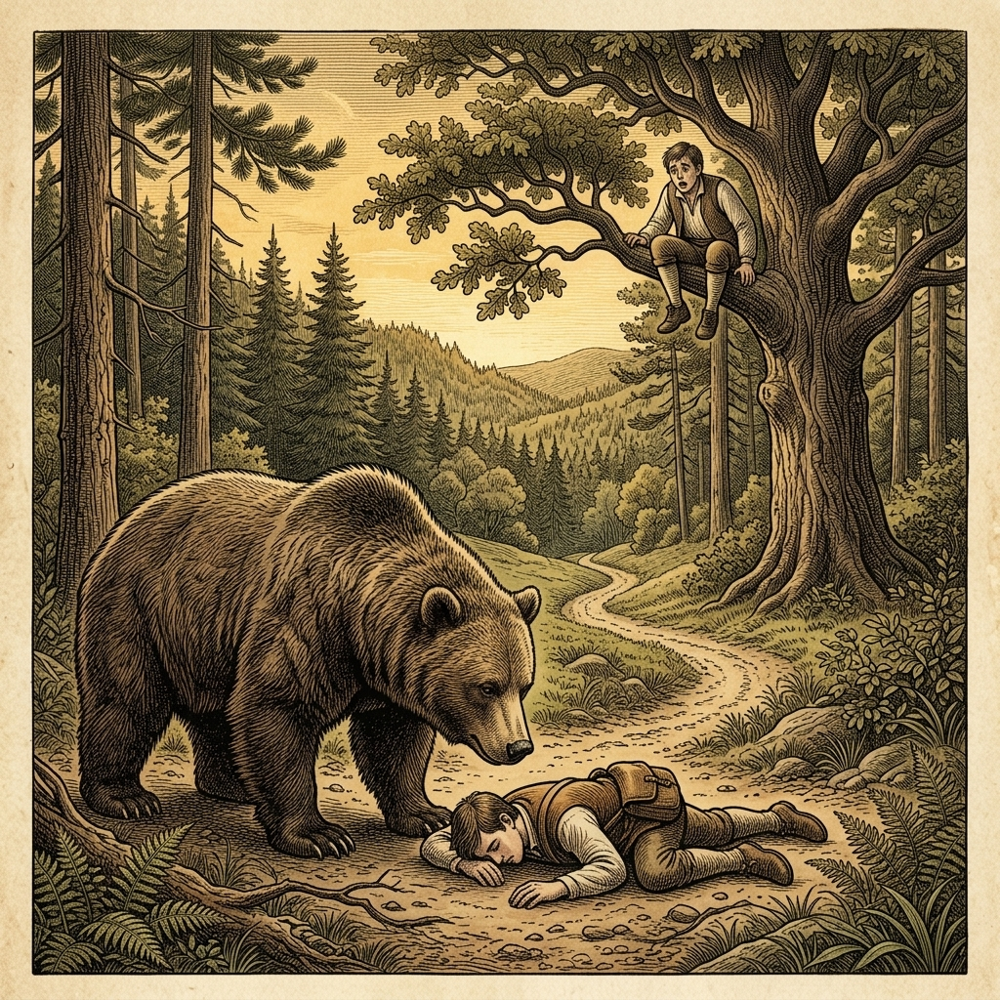

# 『英検ステップアップ多読：イソップ寓話編 第8巻（2級 ➔ 準1級対比学習・第2集）』

---

## はじめに：なぜ「対比多読」で英検準1級の壁を突破できるのか？

英検準1級は、真の英語上級者・プロフェッショナルとしての実力を証明する最高水準の資格です。

2級の英文が「平明で整った論理的文章」であるのに対し、準1級の英文は**「語彙の高度化（GRE/SATレベルのアカデミックワード）」**、**「格調高い比喩・対比・含意」**、そして**「深みのあるニュアンスの精緻な描き分け」**が要求されます。

本書では、世界中で読み継がれてきたイソップ寓話（第2集・10話）を題材に、**「整然とした2級英語」** が **「知的で格調高い準1級マスター英語」** へとどのように昇華していくかを極上の対比で体感します。

* **物語の骨格（2級英語）** で的確かつ論理的な文脈を捉える
* **格調高き上級英語（準1級英語）** で、TIME誌やThe Economistに匹敵する生きたアカデミック語彙・慣用句を吸収する
* **暗唱キーフレーズ対比** で、ライティング（要約・意見論述）や面接でネイティブを唸らせる高度な発信力を手に入れる

楽しく名作寓話の深淵に触れながら、英検準1級合格への決定打を掴み取りましょう！

---

## 本書の収録作品（第2集・全10話）

1. **Chapter 11**: 金の斧と銀の斧 (*The Honest Woodcutter*) [Perry 173]
2. **Chapter 12**: 金の卵を産むガチョウ (*The Goose that Laid the Golden Eggs*) [Perry 87]
3. **Chapter 13**: 羊の皮をかぶった狼 (*The Wolf in Sheep's Clothing*) [Perry 451]
4. **Chapter 14**: キツネとツル (*The Fox and the Stork*) [Perry 426]
5. **Chapter 15**: カエルと牛 (*The Frog and the Ox*) [Perry 376]
6. **Chapter 16**: コウモリと鳥と獣 (*The Bat, the Birds, and the Beasts*) [Perry 566]
7. **Chapter 17**: ネズミの会議 (*Belling the Cat*) [Perry 613]
8. **Chapter 18**: 旅人とクマ (*The Bear and the Two Travelers*) [Perry 65]
9. **Chapter 19**: 獅子の分け前 (*The Lion's Share*) [Perry 149]
10. **Chapter 20**: ネズミとカエル (*The Frog and the Mouse*) [Perry 384]

---

## 本書の構成と電子書籍 / Kobo最適化

各章は以下の6段階で構成されています。

```text
┌─────────────────────────────────────────────────────────────┐
│ 1. Chapter Title & Visual Illustration (章タイトル ＆ 挿絵)   │
│ 2. Benchmark Level: 英検2級レベル英文                         │
│ 3. Target Level: 英検準1級レベル英文                          │
│ 4. Classic Original English Text (イソップ寓話クラシック原文)  │
│ 5. Japanese Translation (日本語訳 ＆ 教訓)                     │
│ 6. Recite & Compare (そらんじたいキーフレーズ対比カード)        │
│ 7. Key Vocabulary & Exam Notes (語彙・文法・試験対策解説)        │
└─────────────────────────────────────────────────────────────┘
```

> **【ポイント】 音声読み上げ（TTS）をご利用の方へ**
> 本文セクション（ステップ1〜3）は英語のみで構成されており、電子書籍やKoboの自動音声読み上げ機能（Text-to-Speech）で日本語が混ざることなく、美しい英語音声で快適にリスニング学習していただけます。


# Chapter 11: The Honest Woodcutter (金の斧と銀の斧)

<div style="text-align: center; margin-bottom: 20px;">
  
</div>

## 1. Benchmark Level: Eiken Grade 2 (英検2級レベル本文)
*Read in ~2.5 to 3 minutes. Academic discourse, complex participial structures, and formal vocabulary.*

In a secluded mountain district, an indigent yet conscientious lumberjack derived his modest subsistence from felling timber alongside a torrential alpine river. While executing his arduous labor with customary diligence, a structural failure of his implement precipitated an immediate crisis: the iron axe head separated from its shaft, descending into the fathomless and swirling depths of the torrent. Bereft of his primary productive capital and lacking the financial resources to procure an adequate replacement, the desolate artisan slumped along the precipitous embankment, lamenting his abrupt misfortune.

Prompted by profound empathy for human anguish, Hermes, the patron deity of commerce and travel, materialized beside the despairing mortal. Ascertaining the etiology of the craftsman's lamentation, the celestial entity plunged beneath the turbulent surface, presently re-emerging with an opulent implement fashioned exclusively of solid gold. Interrogating the woodcutter regarding its provenance, the deity offered him the precious artifact. Incorruptible in his ethical rectitude, the impoverished laborer unequivocally repudiated ownership, professing that an instrument of such excessive value bore no relation to his mundane occupation.

Undeterred, Hermes executed a secondary descent, surfacing with an elaborately burnished silver axe. Manifesting unwavering fidelity to moral truth, the artisan rejected this specimen with equal composure. Only upon the deity's tertiary emergence bearing the weathered iron implement did the woodcutter articulate exuberant recognition, profusely expressing gratitude for the restoration of his authentic property. Utterly captivated by an exhibition of ethical probity so rarely observed among mortals, Hermes conferred all three implements upon the upright laborer as a tangible testament to the supremacy of moral rectitude.

The news of this miraculous acquisition ignited intense cupidity in the psyche of a degenerate peer. Calculating that divine benevolence could be systematically exploited through manipulative simulations, the impostor hastened to the identical riparian location, intentionally casting his implement into the current and simulating theatrical hysteria. Upon the deity's reappearance displaying the golden commodity, the charlatan enthusiastically asserted a fraudulent claim, proclaiming it to be his authentic possession.

Revolted by this audacious display of deceit, the divinity instantaneously dissolved into nothingness, withholding not merely the celestial artifact but permanently abandoning the submerged mundane tool to the subterranean currents.

Moral rectitude constitutes an intrinsic virtue whose authentic practice yields unanticipated dividends, whereas fraudulent machinations motivated by unconstrained avarice inevitably result in catastrophic deprivation.

---

## 2. Target Level: Eiken Grade Pre-1 (英検準1級レベル本文)
*Read in ~3.5 to 4.5 minutes. Highly sophisticated literary and academic prose, complex inversion, advanced vocabulary, and nuanced rhetoric.*

In an austere montane wilderness, an impoverished yet scrupulously principled woodman eked out a precarious livelihood harvesting timber along the periphery of a ferocious alpine torrent. During the execution of his daily toil, an unforeseen mechanical failure abruptly jeopardized his economic survival: the iron blade detached from its wooden haft, plunging irrevocably into the chasm of swirling, turbid rapids. Deprived instantaneously of his sole productive asset and lacking the fiscal liquidity to commission a surrogate implement, the devastated laborer collapsed upon the riparian verge, surrendering to unrestrained desolation.

Galvanized by compassionate resonance with mortal suffering, Hermes, the psychopomp and divine patron of terrestrial wayfarers, materialized in radiant glory beside the despondent artisan. Diagnosing the etiology of the craftsman’s bereavement, the immortal voyager dived into the subterranean depths of the aqueous vortex, presently resurfacing with an ornate implement wrought entirely of unblemished gold. Interrogating the woodman regarding the artifact's provenance, the deity proffered the dazzling treasure. Unflinching in his moral incorruptibility, the indigent artisan repudiated the proffer without ambivalence, affirming with modest gravitas that an instrument of such exorbitant opulence bore zero correspondence to his austere station in life.

Unperturbed, Hermes executed a second immersion, retrieving a splendid axe sculpted from lustrous sterling silver. Demonstrating impenetrable fidelity to objective verity, the laborer declined this secondary treasure with identical equanimity. Only when the divinity emerged for a third time bearing the corroded, utilitarian iron blade did the artisan articulate ecstatic affirmation, effusively voicing veneration and gratitude for the restitution of his authentic chattel. Profoundly edified by an exhibition of ethical probity so vanishingly anomalous among terrestrial beings, Hermes bestowed all three implements upon the righteous woodsman as an enduring testament to the supreme sovereignty of integrity over material cupidity.

When intelligence of this miraculous windfall permeated the adjacent settlement, it catalyzed pathological avarice within a morally bankrupt acquaintance. Hypothesizing that divine benevolence represented an exploitable cognitive heuristic susceptible to theatrical manipulation, the disingenuous charlatan hastened to the identical littoral coordinates. Deliberately consigning his functional implement to the abyss, he staged an exaggerated pantomime of hysterical despair. Upon Hermes’s epiphanic emergence wielding the golden prize, the avaricious interloper audaciously vocalized a mendacious claim, asserting proprietary rights over the celestial treasure.

Utterly repulsed by such blatant moral decrepitude and transparent duplicity, the deity dematerialized into the ether, withholding not merely the transcendent golden treasure but consigning the fraudster's discarded instrument to permanent oblivion within the fluvial silt.

Authentic integrity transcends utilitarian calculus and commands transcendent reward, whereas disingenuous simulations of virtue animated by naked cupidity inexorably precipitate total disinheritance.

---

## 3. Classic Original English Text (イソップ寓話 クラシック原文)
*Townsend / Jacobs Edition (Public Domain)*

A Woodman was felling a tree on the bank of a river, and by chance his axe slipped from his hand and dropped into the water. Deeply troubled, he sat down by the river and began to weep. Hermes appeared and, learning the reason for his grief, dived into the river. He brought up a golden axe and asked if it was the one he had lost. The woodman replied that it was not. Hermes dived a second time and brought up a silver axe. Again the woodman denied that it was his. Hermes dived a third time and brought up the wooden axe which had been lost. The woodman recognized it with joy. Hermes, delighted by his honesty, gave him all three axes. The woodman told his friends what had happened. One of them went to the river, dropped his axe on purpose, and sat weeping. Hermes appeared, dived, brought up a golden axe, and asked if it was his. The greedy man cried out with joy, "Yes, that is mine!" Hermes was disgusted by his dishonesty and not only kept the golden axe, but refused to retrieve the wooden one.

Honesty is the best policy.

---

## 4. Japanese Translation (日本語訳)

険しい山岳の荒野において、貧窮しながらも極めて原則的な木こりが、猛威を振るう高山の激流のほとりで木材を伐採し、不安定な生計を辛うじて立てていました。日々の過酷な労働を遂行する中、予期せぬ機械的故障が彼の経済的生存を突然脅かしました。鉄の刃が木製の柄から外れ、渦巻く濁流の深淵へと不可逆的に沈下してしまったのです。唯一の生産的資産を一瞬にして奪われ、代替の道具を発注するための流動資金も欠いていたため、打ちひしがれた労働者は川岸の縁に崩れ落ち、抑えようのない絶望に身を任せました。

死すべき定命の者の苦難に対する同情的な共鳴に突き動かされ、霊魂を導く神にして地上の旅人の守護者であるヘルメスが、意気消沈した職人の傍らに輝かしい栄光をまとって具現化しました。職人の喪失感の原因を特定すると、この不死の巡礼神は水中の渦巻きの深遠へと飛び込み、やがて純金の無垢から鍛造された華麗な道具を携えて再び浮上しました。その工芸品の出所について木こりを尋問し、神はその眩い財宝を差し出しました。自らの道徳的な無腐食性において揺るぎないこの貧しい職人は、微塵の曖昧さもなくその申し出を拒絶し、これほど過大な豪奢さを誇る道具は自らの質素な身分とはいかなる一致も持たないと謙虚な重厚さをもって明言しました。

動じることなく、ヘルメスは二度目の潜水を敢行し、輝く純銀から彫刻された見事な斧を回収しました。客観的真実に対する難攻不落の忠誠を示し、労働者はこの第二の宝をも全く同一の冷静沈着さをもって辞退しました。神が腐食した実用的な鉄の刃を携えて三度目に浮上した時、職人は初めて狂喜の肯定を口にし、自らの正真正銘の動産の返還に対して深甚なる崇敬と感謝を述べました。地上の生き物の間では絶滅寸前なほど稀有な倫理的廉潔さの誇示に深く感銘を受けたヘルメスは、物質的な強欲に対する誠実さの至高の主権を示す永続的な証として、3本の道具すべてをこの正義の木こりに授与しました。

この奇跡的な棚ぼたの知らせが近隣の集落に広まると、道徳的に破産したある知人の内部で病的な強欲が触発されました。神の慈悲とは、演劇的な操作に従順な搾取可能な認知的ヒューリスティクスを表しているにすぎないと仮定し、この不誠実な詐欺師は全く同じ水辺の座標へと急行しました。意図的に自らの機能的な道具を深淵へと投げ入れ、彼はヒステリックな絶望の誇張された無言劇を演じました。黄金の報酬を手にしたヘルメスの神託的出現を目撃するやいなや、この強欲な侵入者は厚顔無恥にも虚偽の権利主張を口にし、天上の財宝に対する所有権を主張しました。

これほど露骨な道徳的堕落と見え透いた二枚舌に徹底的に反感を抱いた神格は、霊気の中へと非物質化（消滅）し、超越的な黄金の財宝を差し控えたのみならず、詐欺師が投げ捨てた道具をも河川の沈泥の中で永久の忘却へと委ねたのでした。

**教訓**: 真の誠実さは功利主義的な計算を超越し、超越的な報賞を命じる。これに対し、赤裸々な強欲に動機づけられた美徳の不誠実な模倣は、容赦なく完全な相続権剥奪（喪失）を招く。

---

## 5. Recite & Compare (そらんじたいキーフレーズ対比)
*Memorize these contrastive expressions to elevate speaking, writing, and reading fluency.*

<div class="comparison-card">
  <div class="card-header">■ 場面：唯一の資産を失い、絶望に身を任せる</div>
  <div class="card-row-g4"><span class="card-badge-g4">【Grade 2 基礎】</span> <em>Bereft of his primary productive capital... lamenting his abrupt misfortune</em></div>
  <div class="card-row-g3"><span class="card-badge-g3">【Pre-1 暗唱】</span> <strong><em>Deprived of his sole productive asset, surrendering to unrestrained desolation</em></strong></div>
  <div class="card-note">【ポイント】 <strong>解説・試験活用</strong>：名詞句 `sole productive asset`（唯一の生産的資産）、動詞句 `surrender to unrestrained desolation`（抑えきれない絶望に身を任せる）。格調高い叙情表現。</div>
</div>

<div class="comparison-card">
  <div class="card-header">■ 場面：高価な品を曖昧さなく拒絶する</div>
  <div class="card-row-g4"><span class="card-badge-g4">【Grade 2 基礎】</span> <em>Incorruptible in rectitude, unequivocally repudiated ownership...</em></div>
  <div class="card-row-g3"><span class="card-badge-g3">【Pre-1 暗唱】</span> <strong><em>repudiated the proffer without ambivalence, affirming with modest gravitas...</em></strong></div>
  <div class="card-note">【ポイント】 <strong>解説・試験活用</strong>：名詞 `proffer`（申し出・提供）、前置詞句 `without ambivalence`（微塵の曖昧さもなく）、名詞 `gravitas`（重厚さ・威厳・品格）。英検1級〜準1級至高の語彙。</div>
</div>

<div class="comparison-card">
  <div class="card-header">■ 場面：強欲を病的に触発・神の慈悲を悪用</div>
  <div class="card-row-g4"><span class="card-badge-g4">【Grade 2 基礎】</span> <em>calculated that divine benevolence could be exploited through simulations...</em></div>
  <div class="card-row-g3"><span class="card-badge-g3">【Pre-1 暗唱】</span> <strong><em>catalyzed pathological avarice... benevolence as exploitable heuristic susceptible to manipulation</em></strong></div>
  <div class="card-note">【ポイント】 <strong>解説・試験活用</strong>：動詞 `catalyze`（〜を触発する）、形容詞句 `susceptible to manipulation`（操作・工作に影響されやすい）、認知心理学用語 `heuristic`。</div>
</div>

<div class="comparison-card">
  <div class="card-header">■ 場面：露骨な道徳的堕落と見え透いた二枚舌</div>
  <div class="card-row-g4"><span class="card-badge-g4">【Grade 2 基礎】</span> <em>Revolted by this audacious display of deceit, dissolved into nothingness...</em></div>
  <div class="card-row-g3"><span class="card-badge-g3">【Pre-1 暗唱】</span> <strong><em>repulsed by blatant moral decrepitude and transparent duplicity, dematerialized...</em></strong></div>
  <div class="card-note">【ポイント】 <strong>解説・試験活用</strong>：名詞句 `moral decrepitude`（道徳的堕落・老朽化）、`transparent duplicity`（見え透いた二枚舌）、動詞 `dematerialize`（非物質化する・煙のように消える）。</div>
</div>

<div class="comparison-card">
  <div class="card-header">■ 場面：教訓（Moral）</div>
  <div class="card-row-g4"><span class="card-badge-g4">【Grade 2 基礎】</span> <em>Moral rectitude constitutes an intrinsic virtue..., whereas machinations result in deprivation.</em></div>
  <div class="card-row-g3"><span class="card-badge-g3">【Pre-1 暗唱】</span> <strong><em>Authentic integrity transcends utilitarian calculus..., whereas disingenuous simulations inexorably precipitate total disinheritance.</em></strong></div>
  <div class="card-note">【ポイント】 <strong>解説・試験活用</strong>：概念名詞 `utilitarian calculus`（功利主義的損得計算）、名詞 `disinheritance`（相続権剥奪・遺産喪失）。準1級・1級倫理哲学論文の最高到達点。</div>
</div>

---

## 6. Key Vocabulary & Exam Notes (語彙・文法・試験対策解説)

### 【出題頻出語彙・熟語ノート】
- **gravitas** [名] 尊厳、重厚さ、威厳（ラテン語由来の極めて格式高い名詞）
- **ambivalence** [名] 相反する感情、曖昧さ、ためらい（形容詞 *ambivalent*）
- **proffer** [名] （丁重な）申し出、提供（[動] 〜を提供する）
- **catalyze** [動] （変化・反応など）を促進する、触発する（名詞 *catalyst*）
- **decrepitude** [名] 老朽化、衰弱、道徳的頽廃（形容詞 *decrepit*）
- **dematerialize** [動] 非物質化する、消滅する（反義語：*materialize*）
- **disinheritance** [名] 相続権剥奪、権利喪失（動詞 *disinherit*）

### 【文法・構文ポイント】
1. **名詞構文 [Authentic integrity transcends utilitarian calculus]**
   - 準1級本文: *"Authentic integrity transcends utilitarian calculus and commands transcendent reward..."*
   - ポイント: 「誠実であることは損得勘定を超越する」という高度な哲学的命題を、名詞構文で簡潔かつ重厚に提示します。
2. **分詞による動態描写 [Galvanized by compassionate resonance ...]**
   - 準1級本文: *"Galvanized by compassionate resonance with mortal suffering, Hermes ... materialized in radiant glory"*
   - ポイント: `Galvanized by`（〜によって強く刺激・動機づけられて）を用いた格調高い前置文飾。文学的・歴史的文脈で頻出します。


# Chapter 12: The Goose that Laid the Golden Eggs (金の卵を産むガチョウ)

<div style="text-align: center; margin-bottom: 20px;">
  
</div>

## 1. Benchmark Level: Eiken Grade 2 (英検2級レベル本文)
*Read in ~2.5 to 3 minutes. Academic discourse, complex participial structures, and formal vocabulary.*

In an impoverished rural enclave, an agrarian household eked out a precarious existence until an unprecedented stroke of biological anomaly altered their financial trajectory. One of their domestic fowl, an outwardly unexceptional goose, began depositing an egg of immaculate, solid gold at each successive dawn. By methodically liquidating these daily windfalls at municipal markets, the proprietors systematically dismantled their generational poverty, transitioning from marginal subsistence to an enviable degree of socio-economic security.

However, the psychological dynamics of sudden wealth rarely promote enduring temperance. Rather than remaining content with a reliable, compounding income stream, the patriarch grew increasingly intolerant of chronological constraints. Corrupted by cognitive distortions that conflated biological productivity with infinite inorganic reserves, he formulated a catastrophic financial conjecture. He postulated that the waterfowl's anatomical core must house an immense subterranean matrix of consolidated bullion. Proceeding from this delusional premise, he rationalized that preemptively liquidating the entire capital reserve through immediate surgical intervention would compress decades of wealth accumulation into a single instant.

Swayed by this disastrous economic calculus and prioritizing immediate gratification over sustainable returns, the couple executed the terminal vivisection of their singular asset. Stripping away the creature's organic layers with feverish anticipation, they subjected the visceral cavity to meticulous scrutiny.

To their paralyzed stupefaction and profound disillusionment, empirical reality asserted itself with brutal finality: the bird's internal physiological composition was entirely indistinguishable from that of any mundane avian specimen. Not the slightest trace of precious auriferous substance existed within the biological carcass.

The realization of their catastrophic miscalculation precipitated profound despair. Through a reckless obsession with maximizing immediate liquidity, they had irrevocably obliterated the self-renewing capital engine that had underwritten their prosperity.

Unregulated cupidity and shortsighted impatience inevitably subvert sustainable prosperity, demonstrating that the destruction of generative capital in pursuit of immediate gratification yields total insolvency.

---

## 2. Target Level: Eiken Grade Pre-1 (英検準1級レベル本文)
*Read in ~3.5 to 4.5 minutes. Highly sophisticated literary and academic prose, complex inversion, advanced vocabulary, and nuanced rhetoric.*

Within a marginalized rural periphery, an agrarian household endured chronic economic deprivation until an unprecedented physiological mutation radically reconstructed their socio-economic standing. One of their domesticated waterfowl, a phenotypically unremarkable goose, commenced depositing an ovum of unalloyed, solid gold at each successive diurnal threshold. By methodically monetizing these perpetual windfalls within regional bullion exchanges, the previously indigent peasants eliminated their generational liabilities, establishing a degree of financial independence that defied their historic socio-economic stratification.

Nevertheless, behavioral economics repeatedly illustrates that unearned, sudden liquidity frequently erodes rational prudence, cultivating acute cognitive myopia. Rather than acknowledging the miraculous virtue of a compounding, self-perpetuating yield, the patriarch succumbed to pathologically inflated expectations. Debilitated by the cognitive fallacy of temporal discounting and erroneously conceptualizing organic metabolism as a static repository of inorganic mineral reserves, he synthesized an absurd financial hypothesis. He postulated that the waterfowl’s visceral interior housed an inexhaustible lode of consolidated bullion, foolishly concluding that preemptively liquidating this hypothetical endowment via terminal anatomical dissection would instantaneously collapse multi-decade wealth accumulation into a single lucrative event.

Subordinating sustainable long-term yields to an unquenchable obsession with immediate gratification, the infatuated couple executed the vivisection of their sole generative asset. Driven by feverish avarice, they dissected the abdominal cavity with forensic desperation, frantically probing the internal viscera for the anticipated golden matrix.

Whereupon, unyielding biological reality asserted its immutable laws with catastrophic finality: the specimen’s internal physiology exhibited absolute uniformity with the baseline anatomy of common domestic poultry. Devoid of the faintest trace of precious auriferous sedimentation, the eviscerated carcass lay inert upon the abattoir table—a grim monument to cognitive hubris.

The catastrophic comprehension of their irreversible miscalculation precipitated an agonizing psychological collapse. In their predatory quest to artificially accelerate capital extraction, they had permanently obliterated the biological engine that had underwritten their economic emancipation, voluntarily relegating their household to irreversible destitution.

Unconstrained cupidity predicated on the myopic prioritization of immediate liquidity inevitably annihilates sustainable prosperity; the sacrificial destruction of generative capital upon the altar of instantaneous gratification guarantees ultimate insolvency.

---

## 3. Classic Original English Text (イソップ寓話 クラシック原文)
*Townsend / Jacobs Edition (Public Domain)*

A Cottager and his wife had a Hen which laid a golden egg every day. They supposed that the Hen must contain a great lump of gold in its inside, and in order to get the gold, they killed it. Having done so, they found to their surprise that the Hen differed in no respect from their other hens. The foolish pair, hoping to become rich all at once, thus deprived themselves of the gain of which they were assured day by day.

Thinking to get at once all the gold, they lost even the little they had.

---

## 4. Japanese Translation (日本語訳)

取り残された農村の周辺部において、ある小作農家が慢性的な経済的困窮に耐えていましたが、前例のない生理学的突然変異が彼らの社会経済的地位を劇的に再構築しました。彼らの飼育する家禽の1羽、表現型としてはごく普通のガチョウが、連続する日々の夜明けごとに混じりけのない純金の卵を産み落とし始めたのです。地方の貴金属取引所でこれらの恒久的な棚ぼたの産物を規則的に貨幣化することにより、かつて困窮していた小作農たちは自らの世代を超えた負債を解消し、過去の社会経済的階層を打破するほどの経済的自立を確立しました。

それにもかかわらず、行動経済学が繰り返し示すように、不労の突発的な流動性は往々にして理性的な慎重さを侵食し、深刻な認知的近視眼を醸成するものです。複利で自己永続的な利回りの奇跡的な美徳を認めるどころか、家長は病的に肥大化した期待に屈服しました。時間的割引という認知的誤謬に蝕まれ、有機的な代謝を無機物の鉱物埋蔵量の静的な貯蔵庫であると誤って概念化した彼は、不条理な財務的仮説を合成しました。この水鳥の内臓の内部には凝縮された地金の無尽蔵の鉱脈が収められていると彼は仮定し、最終的な解剖学的解体によってこの仮想の基金を前倒しで清算すれば、何十年もの富の蓄積が一つの儲かる出来事へと瞬時に凝縮されると愚かにも結論づけたのです。

持続可能な長期的利回りを即時的満足への抑えがたい執着に従属させ、この盲目的な夫婦は、自らの唯一の生産的資産の生体解剖を実行しました。熱狂的な強欲に駆られ、彼らは法医学的な絶望をもって腹腔を解剖し、予期された黄金の母岩を求めて内臓を必死に調べました。

その結果、揺るぎない生物学的現実が、破滅的な決定性をもってその不変の法則を主張しました。標本の体内生理機能は、一般的な家禽の基準となる解剖学的構造と完全な同一性を示したのです。極小の金を含有する沈殿物の痕跡すら欠いたまま、内臓を抜かれた死骸は屠畜台の上に不活性に横たわっていました――認知的傲慢に対する陰鬱な記念碑として。

自らの取り返しのつかない誤算に対する破滅的な理解は、耐えがたい心理的崩壊を引き起こしました。資本の抽出を人為的に加速させようとする捕食的な探求の中で、彼らは自らの経済的解放を支えていた生物学的エンジンを永久に消滅させ、自らの家庭を不可逆的な困窮へと自ら委ねてしまったのです。

**教訓**: 即時的な流動性の近視眼的な優先順位づけに立脚した無制限な強欲は、不可避的に持続可能な繁栄を消滅させる。即時的満足という祭壇の上で生産的資本を生贄として破壊することは、究極の破産を保証する。

---

## 5. Recite & Compare (そらんじたいキーフレーズ対比)
*Memorize these contrastive expressions to elevate speaking, writing, and reading fluency.*

<div class="comparison-card">
  <div class="card-header">■ 場面：突発的な富が慎重さを侵食し、認知的近視眼を招く</div>
  <div class="card-row-g4"><span class="card-badge-g4">【Grade 2 基礎】</span> <em>psychological dynamics of sudden wealth rarely promote temperance...</em></div>
  <div class="card-row-g3"><span class="card-badge-g3">【Pre-1 暗唱】</span> <strong><em>unearned sudden liquidity frequently erodes rational prudence, cultivating acute cognitive myopia</em></strong></div>
  <div class="card-note">【ポイント】 <strong>解説・試験活用</strong>：行動経済学用語 `unearned sudden liquidity`（不労の突発的流動性）、`erodes rational prudence`（理性的慎重さを侵食する）、`cognitive myopia`（認知的近視眼）。</div>
</div>

<div class="comparison-card">
  <div class="card-header">■ 場面：時間的割引の誤謬・有機体を無機物と誤認</div>
  <div class="card-row-g4"><span class="card-badge-g4">【Grade 2 基礎】</span> <em>cognitive distortions that conflated biological productivity with inorganic reserves</em></div>
  <div class="card-row-g3"><span class="card-badge-g3">【Pre-1 暗唱】</span> <strong><em>fallacy of temporal discounting, conceptualizing metabolism as static repository of mineral reserves</em></strong></div>
  <div class="card-note">【ポイント】 <strong>解説・試験活用</strong>：行動経済学・金融論用語 `temporal discounting`（時間的割引・将来価値の過小評価）、名詞句 `static repository of mineral reserves`（鉱物埋蔵の静的貯蔵庫）。</div>
</div>

<div class="comparison-card">
  <div class="card-header">■ 場面：何十年の蓄積を一度の出来事に圧縮する</div>
  <div class="card-row-g4"><span class="card-badge-g4">【Grade 2 基礎】</span> <em>compress decades of wealth accumulation into a single instant</em></div>
  <div class="card-row-g3"><span class="card-badge-g3">【Pre-1 暗唱】</span> <strong><em>instantaneously collapse multi-decade wealth accumulation into a single lucrative event</em></strong></div>
  <div class="card-note">【ポイント】 <strong>解説・試験活用</strong>：動詞句 `instantaneously collapse A into B`（Aを一瞬でBへと圧縮・集約する）、形容詞 `lucrative`（利益の大きい・儲かる）。</div>
</div>

<div class="comparison-card">
  <div class="card-header">■ 場面：資本抽出の加速が経済的解放の基盤を破壊</div>
  <div class="card-row-g4"><span class="card-badge-g4">【Grade 2 基礎】</span> <em>obliterated the self-renewing capital engine that had underwritten prosperity</em></div>
  <div class="card-row-g3"><span class="card-badge-g3">【Pre-1 暗唱】</span> <strong><em>permanently obliterated the biological engine that had underwritten economic emancipation</em></strong></div>
  <div class="card-note">【ポイント】 <strong>解説・試験活用</strong>：社会経済用語 `economic emancipation`（経済的解放・貧困からの脱却）、動詞 `underwrite`（〜の基盤を支える）。</div>
</div>

<div class="comparison-card">
  <div class="card-header">■ 場面：教訓（Moral）</div>
  <div class="card-row-g4"><span class="card-badge-g4">【Grade 2 基礎】</span> <em>destruction of generative capital in pursuit of immediate gratification yields insolvency.</em></div>
  <div class="card-row-g3"><span class="card-badge-g3">【Pre-1 暗唱】</span> <strong><em>sacrificial destruction of generative capital upon the altar of instantaneous gratification guarantees insolvency.</em></strong></div>
  <div class="card-note">【ポイント】 <strong>解説・試験活用</strong>：修辞的隠喩 `upon the altar of instantaneous gratification`（即時的満足という祭壇の上で）、名詞句 `sacrificial destruction`（生贄としての破滅的破壊）。準1級・1級の圧巻のエッセイ結文。</div>
</div>

---

## 6. Key Vocabulary & Exam Notes (語彙・文法・試験対策解説)

### 【出題頻出語彙・熟語ノート】
- **myopia** [名] 近視眼、先見の明のなさ（形容詞 *myopic*）
- **temporal discounting** [熟] 時間的割引（経済学で「将来の価値を低く見積もること」）
- **repository** [名] 貯蔵庫、宝庫、保管場所
- **unalloyed** [形] 混じりけのない、純粋な（*unalloyed gold/joy*）
- **eviscerate** [動] （〜の）内臓を抜く、骨抜きにする（名詞 *evisceration*）
- **hubris** [名] 傲慢、過信（ギリシャ悲劇の「破滅を招く驕り」）
- **emancipation** [名] 解放、自由の獲得（動詞 *emancipate*）

### 【文法・構文ポイント】
1. **比喩的修辞句 [upon the altar of ...]（〜の祭壇の上で、〜の犠牲となって）**
   - 準1級本文: *"the sacrificial destruction of generative capital upon the altar of instantaneous gratification..."*
   - ポイント: 短期的な誘惑やイデオロギーのために重要なものを犠牲にすることを強く批判する、最高峰の修辞表現です。
2. **名詞構文と論理的帰結 [Unconstrained cupidity ... annihilates ...]**
   - 準1級本文: *"Unconstrained cupidity predicated on the myopic prioritization of immediate liquidity inevitably annihilates sustainable prosperity..."*
   - ポイント: 「制御されない強欲は繁栄を消滅させる」という主張を、過去分詞句 `predicated on...` で精緻に条件付けした知的密度の高い複文構文です。


# Chapter 13: The Wolf in Sheep's Clothing (羊の皮をかぶった狼)

<div style="text-align: center; margin-bottom: 20px;">
  
</div>

## 1. Benchmark Level: Eiken Grade 2 (英検2級レベル本文)
*Read in ~2.5 to 3 minutes. Academic discourse, complex participial structures, and formal vocabulary.*

A cunning predatory carnivore had perpetually fixated its lethal ambitions upon an idyllic pastoral community, where an expansive flock of domesticated ruminants grazed under the rigorous surveillance of a vigilant shepherd and his seasoned canine sentinels. Every direct assault initiated by the predator had been systematically repelled by the perimeter security apparatus, rendering conventional physical confrontation strategically non-viable. Confronted by this defensive deadlock, the predator opted to abandon overt aggression in favor of sophisticated psychological subversion.

Traversing the periphery of the enclosure, the beast discovered the flayed fleece of a slaughtered sheep, which had been carelessly discarded adjacent to the shearing shed. Discerning the immense deceptive potential of this biological vestment, the wolf draped the tactile woolen exterior over his own lethal anatomy. By masquerading as an embodiment of pastoral harmlessness, he effectively neutralized the perceptual vigilance of both the human guardian and the herd's collective instincts.

Integrated into the pastoral population, the camouflaged infiltrator exploited cognitive shortcuts inherent in social herd dynamics. Mammals instinctively associate familiar visual and olfactory markers with safety; consequently, an impressionable juvenile lamb gravitated toward the disguised menace, accepting the impostor as a legitimate matriarch. Manipulating this misplaced filial allegiance, the predator surreptitiously guided the naive creature into an isolated ravine, where he liquidated his victim with absolute impunity. For weeks, this parasitic masquerade persisted, sustained by the target population's systemic inability to interrogate superficial appearances.

However, dialectical irony precipitated a swift and catastrophic termination to this predatory deception. One midnight, motivated by an urgent requirement to secure fresh meat for an imminent festival, the herdsman entered the darkened sheepcote. Lacking visual acuity amid the dense obscurity, the shepherd relied on tactile perception, systematically appraising the livestock to designate a specimen possessing optimal mass. Encountering the oversized silhouette of the shrouded wolf, the herdsman erroneously categorized the beast as an exceptionally plump prime ram. Mobilizing professional efficiency, he clamped an iron grip around the animal's throat and executed a lethal incision before the masquerading impostor could articulate defense or shed his borrowed pelt.

Visual subterfuge constitutes an inherently fragile defense mechanism; those who weaponize fraudulent innocence to victimize the vulnerable will ultimately be consumed by the catastrophic repercussions of their own manufactured identities.

---

## 2. Target Level: Eiken Grade Pre-1 (英検準1級レベル本文)
*Read in ~3.5 to 4.5 minutes. Highly sophisticated literary and academic prose, complex inversion, advanced vocabulary, and nuanced rhetoric.*

In the harsh ecology of competitive survival, an apex canine predator harbored an unyielding predatory fixation upon a thriving pastoral flock. However, penetrating the livestock’s fortified sanctuary proved impervious to physical force, continually thwarted by the multi-layered defensive apparatus orchestrated by an indefatigable shepherd and his seasoned mastiffs. Recognizing the structural obsolescence of frontal assault, the carnivore executed an epistemological pivot: where kinetic violence proved impotent, he would deploy asymmetric socio-biological espionage.

Scouring the periphery of the pastoral settlement, the predator encountered the intact fleece of a flayed sheep, which had been abandoned adjacent to an abattoir enclosure. Discerning the covert utility of this biological masquerade, the wolf encased his muscular anatomy within the tactile woolen shroud. By counterfeiting the morphology of benign docility, the infiltrator aimed to exploit evolutionary heuristics that prime herd animals to prioritize superficial phenotypic markers over behavioral scrutiny.

Infiltrating the pastoral fold under cover of dusk, the impostor capitalized upon the social compliance inherent in mammalian herd behavior. Evolutionary psychology dictates that ungulates uncritically defer to familiar olfactory and aesthetic signifiers; accordingly, a juvenile lamb gravitated toward the predator, intuitively interpreting the borrowed pelt as a maternal nexus. Exploiting this tragic cognitive shortfall, the infiltrator coaxed the naive progeny into a secluded ravine, expeditiously liquidating the organism with absolute impunity. Emboldened by this triumphal deception, the carnivore instituted a systemic regime of parasitic extraction, harvesting vulnerable livestock without provoking alarm.

Nevertheless, retributive justice intervened through a supreme act of poetic irony. Late one evening, responding to an urgent imperative to procure provisions for a ceremonial feast, the shepherd quietly entered the nocturnal gloom of the fold armed with a slaughtering blade. Impaired by sensory deprivation, the herdsman eschewed visual discrimination in favor of tactile palpation, evaluating the livestock solely by volumetric density. Stumbling upon the disguised predator’s substantial mass, the herdsman instinctively classified the creature as a prime specimen of exceptional girth. Before the interloper could mobilize defensive resistance, decipher the mortal hazard, or shed his deceptive vestment, the herdsman administered a lethal laceration to the throat, terminating the predator's life in an instant.

Superficial masquerade constitutes an intrinsically volatile survival strategy; those who weaponize false innocence to exploit the defenseless inevitably construct the precise operational mechanisms of their own catastrophic immolation.

---

## 3. Classic Original English Text (イソップ寓話 クラシック原文)
*Townsend / Jacobs Edition (Public Domain)*

A Wolf found great difficulty in getting at the sheep owing to the vigilance of the shepherd and his dogs. But one day it found the skin of a sheep that had been flayed and thrown aside, so it put it on over its own pelt and strolled down among the sheep. The lamb that belonged to the sheep whose skin the Wolf was wearing began to follow the Wolf; so leading the lamb a little away, he soon made a meal off her, and for some time he succeeded in deceiving the sheep, and enjoying hearty meals.

Appearances are deceptive.

---

## 4. Japanese Translation (日本語訳)

生存競争の過酷な生態系において、頂点のイヌ科捕食者が、繁栄する牧畜の群れに対して揺るぎない捕食的執着を抱いていました。しかしながら、家畜の要塞化された聖域を突破することは、不屈の羊飼いとその熟練したマスティフ犬によって統括された重層的な防衛装置によって絶えず阻止され、物理的な力では克服不可能であることが証明されていました。正面攻撃の構造的な時代遅れさを見極めたこの肉食獣は、認識論的ピボット（方針転換）を実行しました。運動エネルギーによる暴力が無力であるならば、非対称な社会生物学的スパイ活動を展開しよう、と。

牧畜集落の周辺を探索する中、捕食者は屠畜場の囲いの隣に遺棄されていた、剥ぎ取られた羊の完全な毛皮に遭遇しました。この生物学的仮面劇の隠された有用性を識別した狼は、自らの引き締まった筋肉組織を手触りのよい羊毛の覆いの中に包み込みました。温和で従順な形態を偽造することにより、潜入者は、行動の精査よりも表面的な表現型の指標を優先するよう群れの動物を条件づけている進化的ヒューリスティクス（直感的思考）を悪用することを目指したのです。

夕暮れの闇に紛れて囲いの中に潜入した偽者は、哺乳類の群れの行動に内在する社会的従属性を利用しました。進化心理学が規定するように、有蹄類は見慣れた嗅覚的および美的なシグナル（記号）に無批判に従うものです。したがって、一頭の幼い子羊が捕食者の方へと引き寄せられ、その借り物の毛皮を直感的に母なる絆の結節点として解釈しました。この悲劇的な認知的欠陥を悪用し、潜入者は世間知らずな子孫を人里離れた峡谷へと誘い出し、完全な不処罰のまま迅速にその生命を処分しました。この勝利の欺瞞に気を良くした肉食獣は、体系的な寄生抽出の体制を確立し、警戒を一切喚起することなく無防備な家畜を収穫し続けたのです。

それにもかかわらず、至高の詩的正義（因果応報）を通じて報いの裁きが介入しました。ある日の遅い夕暮れ時、儀礼の宴のための食糧を調達するという緊急の要請に応え、羊飼いは屠殺用の刃を手に携え、囲いの夜の暗闇の中へと静かに入ってきました。感覚的遮断（視界不良）によって視覚的識別に頼れなかった羊飼いは、触覚的な触診を好み、体積密度のみによって家畜を評価しました。変装した捕食者のかなりの質量に触れた羊飼いは、本能的にその生き物を並外れた胴回りを誇る極上の標本であると分類しました。侵入者が防衛的抵抗を動員することも、致命的な危険を解読することも、あるいは偽りの衣装を脱ぎ捨てることもできないうちに、羊飼いは喉元へと致命的な一撃を加え、捕食者の命を一瞬にして終わらせたのです。

**教訓**: 表面的な仮面劇は本質的に不安定な生存戦略である。無防備な者を搾取するために偽りの無垢を兵器化する者は、不可避的に自らの破滅的な生贄の炎（自滅）の作戦メカニズムそのものを構築することになる。

---

## 5. Recite & Compare (そらんじたいキーフレーズ対比)
*Memorize these contrastive expressions to elevate speaking, writing, and reading fluency.*

<div class="comparison-card">
  <div class="card-header">■ 場面：正面突破を断念し、非対称な情報戦・偽装へ</div>
  <div class="card-row-g4"><span class="card-badge-g4">【Grade 2 基礎】</span> <em>abandon overt aggression in favor of psychological subversion</em></div>
  <div class="card-row-g3"><span class="card-badge-g3">【Pre-1 暗唱】</span> <strong><em>Recognizing obsolescence of assault, executed epistemological pivot to socio-biological espionage</em></strong></div>
  <div class="card-note">【ポイント】 <strong>解説・試験活用</strong>：軍事・科学論評用語 `obsolescence`（時代遅れ・陳腐化）、`epistemological pivot`（認識論的転回・アプローチの抜本的変更）、`espionage`（スパイ活動・諜報戦）。</div>
</div>

<div class="comparison-card">
  <div class="card-header">■ 場面：進化心理学的な群れの認知的欠陥を悪用</div>
  <div class="card-row-g4"><span class="card-badge-g4">【Grade 2 基礎】</span> <em>exploited cognitive shortcuts inherent in social herd dynamics</em></div>
  <div class="card-row-g3"><span class="card-badge-g3">【Pre-1 暗唱】</span> <strong><em>ungulates uncritically defer to familiar olfactory signifiers... cognitive shortfall</em></strong></div>
  <div class="card-note">【ポイント】 <strong>解説・試験活用</strong>：動物行動学用語 `ungulates`（有蹄類・草食動物）、動詞句 `defer to...`（〜に無批判に従う・委ねる）、名詞句 `cognitive shortfall`（認知的欠陥）。</div>
</div>

<div class="comparison-card">
  <div class="card-header">■ 場面：視覚ではなく触覚による体積密度の鑑定</div>
  <div class="card-row-g4"><span class="card-badge-g4">【Grade 2 基礎】</span> <em>relied on tactile perception, systematically appraising optimal mass</em></div>
  <div class="card-row-g3"><span class="card-badge-g3">【Pre-1 暗唱】</span> <strong><em>eschewed visual discrimination in favor of tactile palpation... volumetric density</em></strong></div>
  <div class="card-note">【ポイント】 <strong>解説・試験活用</strong>：動詞 `eschew`（〜を避ける・控える）、医学・生物用語 `tactile palpation`（触覚による触診）、物理用語 `volumetric density`（体積密度）。</div>
</div>

<div class="comparison-card">
  <div class="card-header">■ 場面：反撃や偽装解除の間もなく致命傷を受ける</div>
  <div class="card-row-g4"><span class="card-badge-g4">【Grade 2 基礎】</span> <em>before the impostor could articulate defense or shed his borrowed pelt</em></div>
  <div class="card-row-g3"><span class="card-badge-g3">【Pre-1 暗唱】</span> <strong><em>Before interloper could decipher hazard or shed vestment, administered lethal laceration</em></strong></div>
  <div class="card-note">【ポイント】 <strong>解説・試験活用</strong>：動詞 `decipher`（〜を解読・見破る）、名詞 `interloper`（侵入者・不法侵入者）、法医学用語 `lethal laceration`（致命的な切創・裂傷）。</div>
</div>

<div class="comparison-card">
  <div class="card-header">■ 場面：教訓（Moral）</div>
  <div class="card-row-g4"><span class="card-badge-g4">【Grade 2 基礎】</span> <em>those who weaponize fraudulent innocence will be consumed by repercussions...</em></div>
  <div class="card-row-g3"><span class="card-badge-g3">【Pre-1 暗唱】</span> <strong><em>weaponizing false innocence to exploit the defenseless constructs the operational mechanisms of catastrophic immolation.</em></strong></div>
  <div class="card-note">【ポイント】 <strong>解説・試験活用</strong>：名詞 `immolation`（生贄・自己犠牲的破滅・全滅）。高度な因果応報論を極限の学術的密度で表現する模範エッセイ結文。</div>
</div>

---

## 6. Key Vocabulary & Exam Notes (語彙・文法・試験対策解説)

### 【出題頻出語彙・熟語ノート】
- **obsolescence** [名] 時代遅れ、陳腐化（形容詞 *obsolete*）
- **espionage** [名] スパイ活動、諜報戦（*industrial/military espionage*）
- **eschew** [動] （〜を）避ける、控える（＝*avoid*, *refrain from*）
- **palpation** [名] 触診、手で触れること（動詞 *palpate*）
- **interloper** [名] 侵入者、お節介焼き、不法侵入者（＝*intruder*）
- **laceration** [名] 裂傷、深い切り傷（動詞 *lacerate*）
- **immolation** [名] 生贄、火災などによる全滅、壊滅（動詞 *immolate*）

### 【文法・構文ポイント】
1. **動詞 [eschew A in favor of B]（Aを避けてBを選択する）**
   - 準1級本文: *"the herdsman eschewed visual discrimination in favor of tactile palpation..."*
   - ポイント: `abandon A in favor of B` よりもさらに意図的な回避・選択のニュアンスを持つ、学術論文・社説に多用される洗練された構文です。
2. **名詞構文の多重修飾 [mechanisms of catastrophic immolation]**
   - 準1級本文: *"constructs the precise operational mechanisms of their own catastrophic immolation."*
   - ポイント: 主動詞 `constructs` に対する目的語を名詞修飾で複層化し、自滅の論理的必然性を強烈に刻印する準1級〜1級の修辞技法です。


# Chapter 14: The Fox and the Stork (キツネとツル)

<div style="text-align: center; margin-bottom: 20px;">
  
</div>

## 1. Benchmark Level: Eiken Grade 2 (英検2級レベル本文)
*Read in ~2.5 to 3 minutes. Academic discourse, complex participial structures, and formal vocabulary.*

In the realm of animal diplomacy, a notoriously manipulative fox engaged in a superficial alliance with an austere stork, preserving a facade of social harmony that concealed deep-seated psychological antagonism. Seeking to assert intellectual superiority through interpersonal humiliation, the vulpine host orchestrated a banquet at his subterranean domicile, framing the event as a celebration of mutual rapport.

Upon the guest's punctual arrival, the host unveiled an aromatic gastronomic concoction decanted exclusively across broad, low-rimmed ceramic salvers. This deliberate aesthetic configuration was calibrated to exploit anatomical divergence: while the host's expansive oral anatomy facilitated effortless ingestion, the stork's rigid, elongated rostrum proved structurally incompatible with horizontal liquid planes. Repeated attempts to harvest the broth merely wetted the avian bill, leaving the visitor in a state of acute caloric deprivation. Masking sadistic amusement behind disingenuous hospitality, the fox articulated mock sympathy, attributing her involuntary abstinence to culinary fastidiousness.

Repressing instinctive indignation in favor of strategic retaliation, the stork preserved an attitude of unblemished equanimity. Prior to concluding the visitation, she formally reciprocated the gesture, extending an invitation for an evening banquet at her arboreal residence on the subsequent evening.

Drawn by the prospect of unearned indulgence, the expectant fox arrived at the designated hour, anticipating lavish culinary hospitality. To his acute discomfiture, the meal had been decanted into towering, narrow-necked amphorae characterized by constricted apertures. With elegant mechanical precision, the avian hostess introduced her slender beak deep into the vessel's vertical interior, extracting succulent provisions with total autonomy. In stark contrast, the fox's cranial anatomy presented an insurmountable geometric impediment; unable to penetrate the aperture, the guest was reduced to fruitlessly licking microscopic residue from the external ceramic perimeter.

Thoroughly discomfited and physically depleted, the schemer executed a humiliating retreat, compelled to recognize that his pedagogical humiliation had been reciprocated with mathematical symmetry.

Authentic interpersonal ethics necessitate empathetic accommodation of diverse physiological and contextual realities, whereas institutionalizing malicious exclusion invites retaliatory retribution of identical proportion.

---

## 2. Target Level: Eiken Grade Pre-1 (英検準1級レベル本文)
*Read in ~3.5 to 4.5 minutes. Highly sophisticated literary and academic prose, complex inversion, advanced vocabulary, and nuanced rhetoric.*

In the realm of interspecies social interaction, an inveterately devious vulpine maintained a hollow diplomatic entente with a dignified wading bird. Concealing profound intellectual hubris behind an exterior of ceremonial civility, the fox orchestrated a banquet at his burrow, conceiving the gathering not as an authentic communion of hospitality, but as a calculated staging ground for subtle psychological subjugation.

Upon the guest's arrival, the host presented a delicately infused broth decanted exclusively across flat, horizontal earthenware platters. This deliberate presentation was maliciously engineered to leverage anatomical disparity: whereas the fox's wide oral cavity facilitated rapid, uninhibited consumption via lateral lingual motion, the stork's elongated, narrow rostrum proved structurally unsuited for shallow, planar surfaces. Every effort to harvest the liquid resulted in futile clicks of her beak against the ceramic surface, condemning the dignitary to involuntary starvation. Masking malevolent satisfaction behind a facade of solicitous etiquette, the vulpine host lamented her apparent lack of appetite, disingenuously attributing her abstinence to overrefined culinary fastidiousness.

Subordinating spontaneous resentment to strategic forbearance, the stork exhibited impenetrable composure. Before concluding the diplomatic protocol, she reciprocated the engagement, formally inviting the fox to an evening repast at her lakeside sanctuary the following day.

Seduced by the anticipation of gratuitous culinary pleasure, the fox presented himself with punctual self-satisfaction. To his profound chagrin, the meal was served within towering, cylindrical vessels possessing constricted apertures and elongated necks. With effortless mechanical precision, the avian hostess lowered her slender bill into the vertical conduit, savoring the rich sustenance contained within. Conversely, the fox's broader facial anatomy encountered an impenetrable physical barrier; incapable of inserting even his snout beyond the aperture, the famished schemer was relegated to licking minuscule traces of condensation from the external glaze.

Physically depleted and socially humiliated, the defeated prankster slunk away into the shadows, forced to acknowledge that his calculated exclusion had been neutralized and reflected back upon him with rigorous mathematical symmetry.

Authentic ethical reciprocity demands an empathetic accommodation of divergent perspectives and physical constraints; those who deliberately engineer mechanisms of discriminatory humiliation will inevitably find themselves ensnared by the precise structural barriers they pioneered.

---

## 3. Classic Original English Text (イソップ寓話 クラシック原文)
*Townsend / Jacobs Edition (Public Domain)*

At one time the Fox and the Stork seemed to be on very good terms and invited each other to dinner. First the Fox invited the Stork, and served nothing but soup in a very shallow dish. The Fox lapped it up with ease, but the Stork could only wet the end of her long bill in it, and left the meal as hungry as when she came. "I am sorry," said the Fox, "that the soup is not to your liking." The Stork thanked him and invited him to dine with her in return. When the Fox arrived, the Stork served the meal in a tall jar with a narrow neck. The Stork easily inserted her long bill and enjoyed the food, while the Fox could only lick the outside of the jar.

One bad turn deserves another.

---

## 4. Japanese Translation (日本語訳)

異種間の社会交流において、根っからの策略家であるキツネが、威厳ある渉禽類（ツル）と空虚な外交的協調関係を維持していました。儀礼的な礼儀正しさの背後に深い知的な傲慢さを隠し、キツネは自らの巣穴で宴会を演出しました。その集まりを純粋なもてなしの交感としてではなく、巧妙な心理的服従を強いるための計算された演出の場として構想したのです。

客が到着すると、主人は平らで水平な陶器の大皿の上にのみ注がれた繊細なスープを披露しました。この計算された配膳は、解剖学的格差を悪用するよう悪意を持って設計されていました。キツネの広い口腔が側方の舌の動きによって迅速かつ自由な摂取を可能にしたのに対し、ツルの細長く伸びたクチバシは浅い平面とは構造的に不適合であることが判明したのです。液体を採取しようとするあらゆる試みは、陶器の表面に対するクチバシの空しい接触音に終わり、高貴な客人を不本意な飢餓へと宣告しました。悪意ある満足感を甲斐甲斐しい礼儀作法の仮面の下に覆い隠し、キツネの主人は彼女の食欲不振を嘆き、その断食を過剰に洗練された料理の気難しさのせいにしてみせました。

自発的な憤りを戦略的な忍耐に従属させ、ツルは難攻不落の沈着さを発揮しました。外交儀礼を終了する前に、彼女はその関与に返礼し、翌日自らの湖畔の聖域で行われる夕食会へとキツネを正式に招待しました。

無償の美食の喜びに惹かれ、キツネは時間に正確な自己満足をもって現れました。彼が大いに無念に思ったことには、食事は狭い開口部と細長い首を持つ背の高い円筒形の容器に入れられて供されました。優雅な機械的正確さをもって、鳥類の女主人は自らの細いクチバシを垂直の管へと下ろし、内部に収められた豊かな滋養を堪能しました。これとは対照的に、キツネのより広い顔面解剖構造は進入不可能な物理的障壁に直面しました。開口部の奥へ鼻先を入れることすらできず、飢えた謀略家は外側の釉薬から微小な水滴の痕跡を舐めることへと零落させられたのです。

肉体的に消耗し社会的に辱めを受けた敗北の悪戯者は、影の中へとこそこそ立ち去り、自らの計算された排除が、厳格な数学的対称性をもって無力化され、自らに跳ね返ってきたのだと認めざるを得ませんでした。

**教訓**: 真正な倫理的相互主義は、多様な視点や物理的制約に対する共感的な配慮を要求する。他者を差別的に屈辱へと追い込む機構を意図的に設計する者は、不可避的に自らが開発したその構造的障壁によって自らを罠にかけることになる。

---

## 5. Recite & Compare (そらんじたいキーフレーズ対比)
*Memorize these contrastive expressions to elevate speaking, writing, and reading fluency.*

<div class="comparison-card">
  <div class="card-header">■ 場面：空虚な外交協調と心理的服従の演出</div>
  <div class="card-row-g4"><span class="card-badge-g4">【Grade 2 基礎】</span> <em>superficial alliance... celebrating mutual rapport</em></div>
  <div class="card-row-g3"><span class="card-badge-g3">【Pre-1 暗唱】</span> <strong><em>hollow diplomatic entente... staging ground for psychological subjugation</em></strong></div>
  <div class="card-note">【ポイント】 <strong>解説・試験活用</strong>：外交用語 `diplomatic entente`（外交的協商・合意）、名詞句 `staging ground`（足がかり・出撃拠点）、`psychological subjugation`（心理的屈服・征服）。</div>
</div>

<div class="comparison-card">
  <div class="card-header">■ 場面：過剰に洗練された気難しさのせいにする</div>
  <div class="card-row-g4"><span class="card-badge-g4">【Grade 2 基礎】</span> <em>attributing her involuntary abstinence to culinary fastidiousness</em></div>
  <div class="card-row-g3"><span class="card-badge-g3">【Pre-1 暗唱】</span> <strong><em>disingenuously attributing abstinence to overrefined fastidiousness</em></strong></div>
  <div class="card-note">【ポイント】 <strong>解説・試験活用</strong>：副詞 `disingenuously`（不誠実に・心にもなく）、形容詞 `overrefined`（洗練されすぎた・過度に上品ぶった）、名詞 `fastidiousness`（気難しさ・潔癖さ）。</div>
</div>

<div class="comparison-card">
  <div class="card-header">■ 場面：感情を戦略的忍耐に従属させる</div>
  <div class="card-row-g4"><span class="card-badge-g4">【Grade 2 基礎】</span> <em>Repressing instinctive indignation in favor of strategic retaliation</em></div>
  <div class="card-row-g3"><span class="card-badge-g3">【Pre-1 暗唱】</span> <strong><em>Subordinating spontaneous resentment to strategic forbearance</em></strong></div>
  <div class="card-note">【ポイント】 <strong>解説・試験活用</strong>：動詞構文 `subordinate A to B`（AをBに従属・後回しにする）、名詞 `forbearance`（自制・忍耐・寛容）。指導者・外交官の資質論述必須。</div>
</div>

<div class="comparison-card">
  <div class="card-header">■ 場面：自らが開発した障壁によって自縄自縛に陥る</div>
  <div class="card-row-g4"><span class="card-badge-g4">【Grade 2 基礎】</span> <em>his pedagogical humiliation had been reciprocated with symmetry</em></div>
  <div class="card-row-g3"><span class="card-badge-g3">【Pre-1 暗唱】</span> <strong><em>ensnared by the precise structural barriers they pioneered</em></strong></div>
  <div class="card-note">【ポイント】 <strong>解説・試験活用</strong>：動詞 `ensnare`（〜を罠にかける）、名詞句 `structural barriers`（構造的障壁）、動詞 `pioneer`（〜を開拓・開発する）。制度批判の最高級表現。</div>
</div>

<div class="comparison-card">
  <div class="card-header">■ 場面：教訓（Moral）</div>
  <div class="card-row-g4"><span class="card-badge-g4">【Grade 2 基礎】</span> <em>ethics necessitate empathetic accommodation of diverse realities...</em></div>
  <div class="card-row-g3"><span class="card-badge-g3">【Pre-1 暗唱】</span> <strong><em>Authentic ethical reciprocity demands empathetic accommodation of divergent perspectives and physical constraints...</em></strong></div>
  <div class="card-note">【ポイント】 <strong>解説・試験活用</strong>：社会倫理学用語 `ethical reciprocity`（倫理的相互主義・互恵性）、`divergent perspectives`（分岐する視点・多様な価値観）。準1級・1級の普遍的模範命題。</div>
</div>

---

## 6. Key Vocabulary & Exam Notes (語彙・文法・試験対策解説)

### 【出題頻出語彙・熟語ノート】
- **entente** [名] （国家間の）協商、友好協定（フランス語由来の外交用語）
- **subjugation** [名] 征服、屈服、隷属（動詞 *subjugate*）
- **fastidiousness** [名] 気難しさ、過度のこだわり（形容詞 *fastidious*）
- **forbearance** [名] 忍耐、自制、寛容（動詞 *forbear*）
- **gratuitous** [形] 無料の、無償の、正当な理由のない（*gratuitous pleasure/violence*）
- **ensnare** [動] （〜を）罠にかける、陥れる（＝*trap*, *entangle*）
- **reciprocity** [名] 相互性、互恵関係（形容詞 *reciprocal*）

### 【文法・構文ポイント】
1. **動詞構文 [subordinate A to B]（AをBに従属させる、劣後させる）**
   - 準1級本文: *"Subordinating spontaneous resentment to strategic forbearance, the stork exhibited..."*
   - ポイント: 短期的な感情（A）をより高度な長期的目的（B）に従わせる理性的自制を描写する最重要構文です。
2. **動詞の受動的強調 [ensnared by the precise barriers they pioneered]**
   - 準1級本文: *"find themselves ensnared by the precise structural barriers they pioneered."*
   - ポイント: 「自分が他者を縛るために作ったルールや制度によって自ら身動きが取れなくなる」という自縄自縛のパラドックスを鮮やかに表現します。


# Chapter 15: The Frog and the Ox (カエルと牛)

<div style="text-align: center; margin-bottom: 20px;">
  
</div>

## 1. Benchmark Level: Eiken Grade 2 (英検2級レベル本文)
*Read in ~2.5 to 3 minutes. Academic discourse, complex participial structures, and formal vocabulary.*

Within a riparian wetland ecosystem, a matriarchal amphibian exercised informal dominance over her cohort, driven by an acute manifestation of megalomania and unyielding narcissistic entitlement. Her psychological stability was fundamentally contingent upon maintaining an unchallenged monopoly on local admiration. Consequently, when an immense herbivorous bovine—an ox of gigantic proportions—lumbered to the littoral margin to quench his metabolic thirst, the seismic impact of his physical mass destabilized her carefully cultivated regime of prestige.

Terrified by this visual encounter with biological magnitude, the juvenile offspring sought sanctuary beside their parent, breathlessly recounting the phenomenon. They depicted an organism of titanic physical dimensions whose mass displaced the marshland waters and whose hooves pulverized geological formations. Incapable of reconciling this objective reality with her pathological self-concept, the matriarch immediately exhibited cognitive dissonance, rationalizing that perceived biological disparities could be surmounted through sheer mechanical inflation.

In an absurd attempt to fabricate biometric parity, she initiated forced pulmonary expansion, distending her dermis and subcutaneous tissues through hyperventilation. "Observe my volumetric adaptation," she demanded imperiously. "Does this synthetic expansion approximate the dimensions of the intruder?"

"Your current volume represents a statistically negligible fraction of that organism," the progeny responded with unvarnished empirical candor. "Any attempt to bridge this evolutionary chasm through volumetric inflation is biologically delusional."

Provoked to paroxysms of narcissistic rage by this factual contradiction, the creature accelerated her hyper-inflationary regimen. Inhaling atmospheric gases with desperate vigor, she pressurized her coelomic cavity to critical structural thresholds, inducing severe micro-tearing across her vascularized membrane. Her circulatory and respiratory apparatuses bordered on catastrophic structural failure, yet her compulsive fixation upon simulated equality precluded rational self-preservation. "Behold!" she gasped through severely distorted vocal cords. "I have definitively eradicated the disparity!"

"Desist immediately, Mother!" the juvenile observers shrieked in horror. "Biological constraints are immutable; structural compromise is imminent!"

Subordinating somatic survival to the desperate preservation of an untenable illusion, the delusional organism forced a culminating volume of compressed atmosphere into her compromised anatomy. Surpassing the tensile strength of her biological tissues, the hydrostatic pressure triggered explosive structural decompression. In an instant, the organism disintegrated into visceral fragments, leaving her stunned offspring amidst the silent marsh.

Unfettered megalomania that rejects biological reality inevitably precipitates catastrophic structural collapse; attempting to simulate parity with the insurmountable terminates in complete self-annihilation.

---

## 2. Target Level: Eiken Grade Pre-1 (英検準1級レベル本文)
*Read in ~3.5 to 4.5 minutes. Highly sophisticated literary and academic prose, complex inversion, advanced vocabulary, and nuanced rhetoric.*

In the micro-ecological stratification of a secluded marshland, an aged amphibian matriarch held despotic sway over her lacustrine domain, driven by a pathological manifestation of unchecked grandiosity. Her cognitive equilibrium was inextricably tethered to an unassailable conviction of her own supreme distinction. This fragile psychosocial superstructure was profoundly destabilized, however, when a massive ungulate—a bull of colossal anatomical proportions—lumbered to the shoreline to sate its thirst. The sheer kinetic displacement of its physical presence sent seismic tremors through the marshland, abruptly reducing the amphibian colony to absolute insignificance.

Paralyzed by the manifestation of such sheer physical scale, her juvenile offspring retreated frantically to their maternal guardian, breathless with terror. In stammering tones, they depicted an organism of incomprehensible magnitude whose massive limbs rivaled ancient trees and whose stride shook the marshy terrain. Incapable of assimilating empirical data that threatened her entrenched delusions of absolute distinction, the matriarch succumbed to catastrophic cognitive distortion. Rather than accepting the insurmountable biological chasm separating her species from the mammalian leviathan, she rationalized that physical parity could be simulated via forced volumetric expansion.

Executing a grotesque physiological experiment, she inhaled deeply, stretching her elastic dermis to grotesque structural tolerances. "Behold this anatomical adaptation," she proclaimed with haughty arrogance. "Does this synthetic expansion rival the dimensions of the intruder?"

"By an insurmountable margin, Mother!" the progeny responded with terrifying candor. "Your current dimension constitutes an infinitesimal fraction of that creature's bulk. Attempting to bridge this evolutionary disparity through somatic inflation represents an exercise in pure delirium."

Enraged by this factual contradiction and incapable of tolerating the puncture of her psychological vanity, the obstinate creature redoubled her hyper-inflationary exertion. Drawing massive volumes of atmosphere into her pulmonary apparatus, she expanded her vascularized membrane to perilous structural limits, the pressure stretching her epidermal tissues to the threshold of rupture. "Witness my triumphant parity!" she hissed through compressed jaws.

"Desist, we implore you, Mother!" her terrified brood wailed in unison. "Natural boundaries cannot be abrogated by vanity; physical rupture is imminent!"

Deaf to their desperate supplications and dominated by an irrepressible narcissistic drive, the obstinate organism executed a final, catastrophic inhalation. Exceeding the absolute tensile limits of her biological architecture, internal atmospheric pressure ruptured her organic boundaries. In a split second of violent decompression, the organism literally disintegrated into visceral fragments, leaving her traumatized progeny amidst the tranquil marshland.

Unbridled vanity that refuses to defer to biological or circumstantial boundaries culminates inexorably in catastrophic self-immolation; the compulsive urge to simulate parity with the transcendent invariably precipitates complete annihilation.

---

## 3. Classic Original English Text (イソップ寓話 クラシック原文)
*Townsend / Jacobs Edition (Public Domain)*

An Ox, drinking at a pool, stepped on a family of young frogs and crushed one of them to death. When the mother frog came home, she asked where her little one was. "A huge beast came by," said one of the brothers, "and crushed him under his big foot." "How big was he?" asked the mother frog, puffing herself out. "Was he as big as this?" "Oh, much bigger than that!" replied the young frog. The mother puffed herself out more and more, asking, "Was he this big?" "Cease your puffing, mother," said the son, "for if you burst yourself, you will never equal the beast." But the foolish frog tried once more, blew herself up even bigger, and burst!

Self-conceit may lead to self-destruction.

---

## 4. Japanese Translation (日本語訳)

人里離れた湿地の微小生態学的階層において、老いた両生類の長老格の母ガエルが、制御されない誇大妄想の病理学的表出に駆り立てられ、その湖沼の領域に対して専制的な支配権を振るっていました。彼女の認知的平衡は、自らの至高の卓越性という難攻不落の確信と不可分に結びついていました。しかしながら、巨大な有蹄類――途方もない解剖学的プロポーションを誇る雄牛――が渇きを癒やすために水辺へと重々しく歩み寄り、その物理的存在の純粋な運動的変位が湿地に地震のような震動を送り、両生類のコロニーを一瞬にして絶対的な取るに足らなさへと引き下げた時、この脆弱な心理社会的上部構造は深刻に動揺させられたのです。

これほど圧倒的な物理的スケールの出現に身動きを奪われ、彼女の幼い子孫たちは恐怖に息を切らしながら母なる保護者の元へと必死に退却しました。途切れ途切れの声で、彼らはその太い手足が古代の樹木に匹敵し、その歩みが湿地の地形を揺るがすような、理解を絶する巨大さを持つ有機体を描写しました。自らの絶対的卓越性という定着した妄想を脅かす経験的データを受容することができず、母ガエルは破滅的な認知的歪みに屈服しました。哺乳類のレヴィアサン（巨大怪物）と自らの種を隔てる克服不可能な生物学的深淵を受け入れるどころか、彼女は強制的な体積膨張を通じて物理的同等性を模倣できると合理化したのです。

奇怪な生理学的実験を実行に移し、彼女は深く息を吸い込み、自らの弾力性のある真皮を不気味な構造的耐容限界まで引き伸ばしました。「この解剖学的適応をご覧なさい」と彼女は尊大な傲慢さをもって宣言しました。「この人工的な拡張は侵入者の寸法に匹敵しているかい？」

「克服不能な大差で負けています、お母さん！」と子供たちは恐ろしい率直さをもって答えました。「現在のお母さんの寸法は、あの生き物の巨体の無限小の割合を構成しているにすぎません。肉体の膨張によってこの進化の格差を埋めようとすることは、純粋な狂気の行使を表しています。」

この事実に基づく反論に激怒し、自らの心理的虚栄心の崩壊を容認することができなかったこの頑迷な生き物は、自らの過膨張の努力を倍加させました。膨大な量の大気を肺の器官へと吸い込み、彼女は血管の通った皮膜を危険な構造的限界まで拡張し、その圧力は表皮組織を破断の閾値まで引き伸ばしました。「私の勝利の同等性を目撃しなさい！」と彼女は引き絞られた顎の隙間からシューシューと音を立てました。

「やめてください、お願いですから、お母さん！」と怯えた子供たちは異口同音に泣き叫びました。「自然の境界線は虚栄心によって撤廃することはできません。肉体の破断は目前です！」

彼らの必死の哀願に耳を貸さず、抑えがたい自己愛の衝動に支配されたこの強情な有機体は、最後の一撃となる破滅的な吸気を実行しました。自らの生物学的アーキテクチャの絶対的な引張限界を超え、内部の大気圧が有機的境界を破断させました。激しい減圧の一瞬のうちに、有機体は文字通り内臓の破片へと四散し、トラウマを負った子孫たちを静寂な湿地の中に取り残したのです。

**教訓**: 生物学的または環境的境界に従うことを拒む野放図な虚栄心は、容赦なく破滅的な自己犠牲の炎（自滅）へと結実する。超越的な存在との対等性を模倣しようとする強迫的衝動は、常に完全な消滅を招く。

---

## 5. Recite & Compare (そらんじたいキーフレーズ対比)
*Memorize these contrastive expressions to elevate speaking, writing, and reading fluency.*

<div class="comparison-card">
  <div class="card-header">■ 場面：絶対の卓越性という脆弱な心理的構造</div>
  <div class="card-row-g4"><span class="card-badge-g4">【Grade 2 基礎】</span> <em>stability contingent upon maintaining unchallenged monopoly on admiration</em></div>
  <div class="card-row-g3"><span class="card-badge-g3">【Pre-1 暗唱】</span> <strong><em>tethered to unassailable conviction of supreme distinction... fragile superstructure</em></strong></div>
  <div class="card-note">【ポイント】 <strong>解説・試験活用</strong>：社会学・心理学用語 `unassailable conviction`（難攻不落の確信）、`supreme distinction`（至高の卓越性）、`fragile superstructure`（脆弱な上部構造）。</div>
</div>

<div class="comparison-card">
  <div class="card-header">■ 場面：進化の格差を埋めようとする純粋な狂気</div>
  <div class="card-row-g4"><span class="card-badge-g4">【Grade 2 基礎】</span> <em>bridge this evolutionary chasm through volumetric inflation is delusional</em></div>
  <div class="card-row-g3"><span class="card-badge-g3">【Pre-1 暗唱】</span> <strong><em>bridge this evolutionary disparity through somatic inflation represents pure delirium</em></strong></div>
  <div class="card-note">【ポイント】 <strong>解説・試験活用</strong>：医学・生物学用語 `somatic inflation`（肉体・身体の膨張）、名詞 `delirium`（せん妄・熱狂的狂気）。</div>
</div>

<div class="comparison-card">
  <div class="card-header">■ 場面：自然の境界線は虚栄心で撤廃できない</div>
  <div class="card-row-g4"><span class="card-badge-g4">【Grade 2 基礎】</span> <em>Biological constraints are immutable; structural compromise is imminent</em></div>
  <div class="card-row-g3"><span class="card-badge-g3">【Pre-1 暗唱】</span> <strong><em>Natural boundaries cannot be abrogated by vanity; physical rupture is imminent</em></strong></div>
  <div class="card-note">【ポイント】 <strong>解説・試験活用</strong>：動詞 `abrogate`（〜を撤廃・無効化する）、名詞 `rupture`（破裂・断裂）。格調高い警告の定石。</div>
</div>

<div class="comparison-card">
  <div class="card-header">■ 場面：引張限界を超え、激しい減圧で四散</div>
  <div class="card-row-g4"><span class="card-badge-g4">【Grade 2 基礎】</span> <em>Surpassing tensile strength, pressure triggered explosive decompression</em></div>
  <div class="card-row-g3"><span class="card-badge-g3">【Pre-1 暗唱】</span> <strong><em>Exceeding absolute tensile limits, violent decompression disintegrated organism into visceral fragments</em></strong></div>
  <div class="card-note">【ポイント】 <strong>解説・試験活用</strong>：物理・材料工学用語 `exceeding absolute tensile limits`（絶対的引張限界を超えて）、動詞 `disintegrate into visceral fragments`（内臓の破片へと四散する）。</div>
</div>

<div class="comparison-card">
  <div class="card-header">■ 場面：教訓（Moral）</div>
  <div class="card-row-g4"><span class="card-badge-g4">【Grade 2 基礎】</span> <em>megalomania that rejects reality precipitates structural collapse; simulating parity terminates in self-annihilation.</em></div>
  <div class="card-row-g3"><span class="card-badge-g3">【Pre-1 暗唱】</span> <strong><em>Unbridled vanity that refuses to defer to boundaries culminates in self-immolation; compulsive urge to simulate parity precipitates annihilation.</em></strong></div>
  <div class="card-note">【ポイント】 <strong>解説・試験活用</strong>：動詞句 `defer to boundaries`（境界や限界に敬意を払い従う）、名詞句 `compulsive urge`（強迫的衝動）、`self-immolation`（自己犠牲的破滅・自滅）。準1級・1級の金字塔的結論。</div>
</div>

---

## 6. Key Vocabulary & Exam Notes (語彙・文法・試験対策解説)

### 【出題頻出語彙・熟語ノート】
- **lacustrine** [形] 湖沼の、湖畔に生息する（生物学・地学用語）
- **grandiosity** [名] 誇大妄想、尊大さ、大げさな振る舞い
- **leviathan** [名] リヴァイアサン、巨大怪物、圧倒的巨大組織
- **somatic** [形] 身体の、肉体の（対義語：*psychic*「精神の」）
- **delirium** [名] せん妄、精神錯乱、狂乱状態（形容詞 *delirious*）
- **rupture** [名] 破裂、決裂、断裂（動詞 *rupture*）
- **self-immolation** [名] 自己犠牲、自滅、焼身自殺的行為

### 【文法・構文ポイント】
1. **動詞句 [defer to ...]（〜に従う、〜に敬意を払って譲る）**
   - 準1級本文: *"Unbridled vanity that refuses to defer to biological or circumstantial boundaries..."*
   - ポイント: 限界や権威、自然の摂理を素直に受け入れることを指す、極めて格調の高い成句動詞です。
2. **名詞構文の二段対比構造 [A culminates in B; C precipitates D]**
   - 準1級本文: *"vanity ... culminates inexorably in catastrophic self-immolation; the compulsive urge to simulate parity ... invariably precipitates complete annihilation."*
   - ポイント: セミコロンを挟んで対称的な因果関係を並置し、エッセイの結語として揺るぎない説得力を持たせる最高峰の文法構造です。


# Chapter 16: The Bat, the Birds, and the Beasts (コウモリと鳥と獣)

<div style="text-align: center; margin-bottom: 20px;">
  
</div>

## 1. Benchmark Level: Eiken Grade 2 (英検2級レベル本文)
*Read in ~2.5 to 3 minutes. Academic discourse, complex participial structures, and formal vocabulary.*

Geopolitical polarization between the sovereign avian confederacy and the terrestrial mammalian coalition degenerated into total, unmitigated warfare across the biome. Confronted by this systemic existential clash, an amphibious chiropteran—a bat occupying an ambiguous phylogenetic niche—rejected ideological commitment, electing instead to operationalize calculated, cynical non-alignment. His strategic calculus was predicated entirely upon minimizing personal vulnerability while positioning himself to extract geopolitical patronage from the eventual victor.

During the opening campaign, air superiority doctrine enabled the avian armadas to decimate ground formations through devastating aerial bombardment. Perceiving that the strategic initiative had shifted decisively in favor of the winged coalition, the bat executed an immediate diplomatic pivot. Presenting himself before the avian council, he rhetorically emphasized his aerodynamic morphology, waving his elongated interdigital membranes as conclusive proof of phylogenetic solidarity. "My functional adaptation for atmospheric flight definitively confirms my sovereign allegiance to the avian collective," he asserted with manipulative eloquence. Swayed by confirmation bias and eager to augment their ranks, the avian leadership accredited his credentials without rigorous background vetting.

However, the dynamics of protracted warfare rarely conform to linear projections. Regrouping their armored divisions, the terrestrial beasts launched a catastrophic counteroffensive, neutralizing aerial dominance and encircling key strongholds. Discerning the imminent collapse of avian hegemony, the unprincipled diplomat perpetrated an immediate ideological apostasy. Defecting across battle lines, he petitioned the mammalian high command, strategically shifting his taxonomy from flight mechanics to morphological dentition and maternal nursing traits. "Observe my canine teeth and pelage," he argued persuasively. "Aviation constitutes merely a superficial locomotion mechanism; fundamentally, my biological essence resides within the mammalian hierarchy." Satisfied by this expedient rationalization, the beasts integrated him into their operational cadre.

Upon the formal cessation of hostilities, the belligerents convened a peace congress to negotiate demilitarization and post-war territorial demarcation. During bilateral intelligence exchanges, security officials uncovered irreconcilable discrepancies in the chiropteran's historical record, thoroughly exposing his cynical duplicity.

The collective response of both sovereign bodies was immediate and uncompromising. Formally designating him a persona non grata, the unified coalition revoked his legal status, subjecting him to unconditional banishment from the planetary surface. Stripped of diplomatic immunity and universally abhorred as the quintessential embodiment of moral vacuity, the disenfranchised outcast was relegated to subterranean caverns, permanently consigned to nocturnal isolation and systemic ostracism.

Pragmatic opportunism devoid of moral conviction may facilitate transient survival, but calculated duplicity ultimately precipitates total disenfranchisement and universal execration.

---

## 2. Target Level: Eiken Grade Pre-1 (英検準1級レベル本文)
*Read in ~3.5 to 4.5 minutes. Highly sophisticated literary and academic prose, complex inversion, advanced vocabulary, and nuanced rhetoric.*

In the geopolitical arena of an ancient ecosystem, systemic ideological polarization between the aerial avian confederation and the terrestrial mammalian hegemony precipitated total war. Confronted by this catastrophic geopolitical conflagration, an ambivalent chiropteran organism—a bat occupying an ambiguous evolutionary interstice—eschewed moral commitment, adopting instead a posture of calculated diplomatic fence-sitting. His strategic calculus was governed exclusively by an ethos of unprincipled self-preservation, deliberately calibrated to exploit whatever geopolitical equilibrium emerged from the conflagration.

During the opening phase of hostilities, aerial blitzkrieg doctrines enabled the winged forces to inflict asymmetrical attrition upon ground divisions. Ascertaining that the momentum had swung decisively toward the avian alliance, the bat executed a seamless opportunistic rapprochement. Infiltrating the avian plenary council, he brandished his elongated dactylopatagium—the aerodynamic flight membrane—as irrefutable proof of shared biological heritage. "My anatomical adaptation for sustained flight represents an inviolable biological mandate binding my allegiance to the aerial realm," he declared with consummate demagoguery. Captivated by confirmation bias and desperate to bolster their depleted ranks, the avian hierarchy accredited his bona fides without rigorous forensic vetting.

However, the trajectory of existential conflict is fundamentally non-linear. Consolidating their mechanized ground units, the mammalian legions mounted a devastating counteroffensive, decimating the avian flight wings and besieging their mountain redoubts. Recognizing the imminent evaporation of avian hegemony, the unprincipled opportunist executed a brazen act of geopolitical turncoatism. Traversing sovereign lines under cover of twilight, he presented a petition to the mammalian high command, abruptly reclassifying his taxonomic morphology. "Disregard my functional flight apparatus," he urged with cynical sophistry. "Aerodynamic propulsion is merely a phenotypic anomaly; my prominent dentition, mammalian pelage, and viviparous heritage firmly anchor my allegiance within the mammalian fraternity." Seduced by his rhetorical agility, the mammalian commanders integrated him into their tactical vanguard.

Following the armistice, the belligerent sovereigns convened a multilateral peace congress to establish a new regional security architecture. During bilateral intelligence deconfliction, historical reconnaissance archives cross-referenced his duplicitous maneuvers, exposing his systemic ideological prostitution.

The collective verdict rendered by both sovereign entities was swift, draconian, and irreversible. Unanimously declaring him an outlaw stripped of diplomatic immunity, the joint tribunal condemned the opportunist to total juridical and physical banishment from the biosphere. Ostracized as the archetypal manifestation of unmitigated perfidy and ethical nullity, the wretched pariah was driven into subterranean chasms, condemned to eternal nocturnal obscurity and universal revulsion.

Pragmatic equivocation unmoored from ethical conviction may secure ephemeral immunity from conflict, but chronic duplicity inexorably precipitates complete geopolitical disenfranchisement and universal obloquy.

---

## 3. Classic Original English Text (イソップ寓話 クラシック原文)
*Townsend / Jacobs Edition (Public Domain)*

A great battle was about to be fought between the Birds and the Beasts. The Bat, fearing the result, stayed away and waited to see which side would win. When the Birds were winning, the Bat flew among them, claiming to be a bird because he had wings. Later, when the Beasts gained the upper hand, the Bat went over to them, claiming to be a beast because he had teeth and fur. But when peace was declared, both sides recognized his deceit. Ashamed and rejected by all, the Bat was forced to hide in dark caves, flying only at night.

He that is friend to all is friend to none.

---

## 4. Japanese Translation (日本語訳)

古代の生態系の地政学的アリーナにおいて、空を支配する鳥類連邦と陸生の哺乳類覇権との間の体制的なイデオロギー的分極化が、全面戦争を引き起こしました。この壊滅的な地政学的業火に直面し、両義的な翼手類の有機体――曖昧な進化的間隙を占めるコウモリ――は道徳的コミットメントを回避し、代わりに計算された外交的日和見（二股）の姿勢を採用しました。彼の戦略的計算は無原則な自己保身のエトス（精神）によってのみ支配されており、その業火から立ち現れるいかなる地政学的平衡をも搾取できるよう意図的に調整されていたのです。

敵対行動の初期段階において、電撃戦の航空ドクトリンは、翼を持つ軍勢が地上部隊に対して非対称な消耗を与えることを可能にしました。勢いが鳥類同盟の側へ決定的に傾いたと確信したコウモリは、継ぎ目のない日和見主義的和解（接近）を実行しました。鳥類の全体評議会へと潜入した彼は、細長い指間飛膜を、共通の生物学的遺産の反駁不能な証拠として誇示しました。「持続的な飛行を可能にする私の解剖学的適応は、私の忠誠を空の領域へと縛り付ける不可侵の生物学的命令を表しています」と彼は円熟した大衆扇動術をもって宣言しました。確証バイアスに心を奪われ、消耗した隊列を増強することに必死であった鳥類のヒエラルキーは、厳密な法医学的審査を行うことなく彼の信任状を承認しました。

しかしながら、実存的衝突の軌跡は根本的に非線形なものです。機械化された地上部隊を結集し、哺乳類の軍団は壊滅的な反撃を開始し、鳥類の飛行翼を撃破してその山岳の砦を包囲しました。鳥類の覇権の差し迫った蒸発（崩壊）を認識したこの無節操な日和見主義者は、地政学的寝返り（裏切り）という厚顔無恥な行為を実行しました。薄暮の闇に紛れて主権の境界線を越えた彼は、哺乳類の最高司令部に嘆願書を提出し、自らの分類学的形態を突如として再分類しました。「私の機能的な飛行器官など無視してください」と彼は冷笑的な詭弁をもって促しました。「空気力学的推進は単なる表現型の異常にすぎません。私の目立つ歯列、哺乳類の毛皮、そして胎生の伝統こそが、私の忠誠を哺乳類の同胞団の中に強固に固定しているのです。」彼の修辞的敏捷性に魅了され、哺乳類の司令官たちは彼を自らの戦術的前衛へと統合しました。

休戦協定に続いて、交戦主権者たちは新たな地域安全保障アーキテクチャを確立するための多国間平和会議を招集しました。二国間の情報衝突回避（情報すり合わせ）の最中、歴史的偵察アーカイブが彼の二枚舌の策略を相互参照し、その体系的なイデオロギー売春（変節）を暴露しました。

両主権組織によって下された集団的判決は、迅速で、過酷であり、不可逆的なものでした。満場一致で彼を外交特権を剥奪された無法者と宣言し、合同法廷はこの日和見主義者を生物圏からの完全な法的および物理的追放へと処刑しました。完全な背信行為と倫理的無の典型的な表出として排斥されたこの哀れな不可触民（パリア）は、地下の深淵へと追いやられ、永遠の夜の暗闇と普遍的な嫌悪へと宣告されたのです。

**教訓**: 倫理的信念から切り離されたプラグマティックな曖昧さは、衝突からの束の間の免責を確保するかもしれないが、慢性的な二枚舌は不可避的に完全な地政学的権利剥奪と普遍的な悪評・非難を招く。

---

## 5. Recite & Compare (そらんじたいキーフレーズ対比)
*Memorize these contrastive expressions to elevate speaking, writing, and reading fluency.*

<div class="comparison-card">
  <div class="card-header">■ 場面：計算された外交的二股・非同盟</div>
  <div class="card-row-g4"><span class="card-badge-g4">【Grade 2 基礎】</span> <em>electing to operationalize calculated, cynical non-alignment...</em></div>
  <div class="card-row-g3"><span class="card-badge-g3">【Pre-1 暗唱】</span> <strong><em>eschewed moral commitment, adopting posture of calculated diplomatic fence-sitting</em></strong></div>
  <div class="card-note">【ポイント】 <strong>解説・試験活用</strong>：政治・外交慣用句 `diplomatic fence-sitting`（外交的日和見主義・中立を装う二股）、動詞 `eschew moral commitment`（道徳的関与を避ける）。</div>
</div>

<div class="comparison-card">
  <div class="card-header">■ 場面：手際よい日和見的和解と大衆扇動</div>
  <div class="card-row-g4"><span class="card-badge-g4">【Grade 2 基礎】</span> <em>asserted allegiance with manipulative eloquence</em></div>
  <div class="card-row-g3"><span class="card-badge-g3">【Pre-1 暗唱】</span> <strong><em>executed seamless rapprochement... declared with consummate demagoguery</em></strong></div>
  <div class="card-note">【ポイント】 <strong>解説・試験活用</strong>：外交用語 `rapprochement`（国家間の関係改善・接近）、名詞 `demagoguery`（大衆扇動・アジテーション）。国際関係論説の必須語彙。</div>
</div>

<div class="comparison-card">
  <div class="card-header">■ 場面：厚顔無恥な寝返り・裏切り</div>
  <div class="card-row-g4"><span class="card-badge-g4">【Grade 2 基礎】</span> <em>perpetrated an immediate ideological apostasy... defecting across lines</em></div>
  <div class="card-row-g3"><span class="card-badge-g3">【Pre-1 暗唱】</span> <strong><em>executed a brazen act of geopolitical turncoatism</em></strong></div>
  <div class="card-note">【ポイント】 <strong>解説・試験活用</strong>：名詞 `turncoatism`（裏切り行為・変節）、形容詞 `brazen`（厚顔無恥な・恥知らずな）。痛烈な政治批評表現。</div>
</div>

<div class="comparison-card">
  <div class="card-header">■ 場面：社会から徹底追放された不可触民</div>
  <div class="card-row-g4"><span class="card-badge-g4">【Grade 2 基礎】</span> <em>designated persona non grata, stripped of immunity, disenfranchised outcast...</em></div>
  <div class="card-row-g3"><span class="card-badge-g3">【Pre-1 暗唱】</span> <strong><em>Ostracized as manifestation of perfidy, wretched pariah was driven into chasms</em></strong></div>
  <div class="card-note">【ポイント】 <strong>解説・試験活用</strong>：名詞 `pariah`（社会の最下層民・のけ者・不可触民）、形容詞 `wretched`（惨めな・哀れな）、名詞 `perfidy`（背信・不誠実）。</div>
</div>

<div class="comparison-card">
  <div class="card-header">■ 場面：教訓（Moral）</div>
  <div class="card-row-g4"><span class="card-badge-g4">【Grade 2 基礎】</span> <em>opportunism devoid of conviction may facilitate survival, but duplicity precipitates execration.</em></div>
  <div class="card-row-g3"><span class="card-badge-g3">【Pre-1 暗唱】</span> <strong><em>Pragmatic equivocation unmoored from ethical conviction may secure immunity, but duplicity precipitates universal obloquy.</em></strong></div>
  <div class="card-note">【ポイント】 <strong>解説・試験活用</strong>：名詞 `equivocation`（曖昧な言葉遣い・言質を取らせない態度）、分詞形容詞 `unmoored from...`（〜から錨を切り離された・漂流した）、名詞 `obloquy`（世間の悪評・非難・不名誉）。最高峰の語彙。</div>
</div>

---

## 6. Key Vocabulary & Exam Notes (語彙・文法・試験対策解説)

### 【出題頻出語彙・熟語ノート】
- **fence-sitting** [名] 日和見主義、中立を決め込むこと（*political fence-sitting*）
- **rapprochement** [名] （国家・集団間の）親善回復、接近（フランス語由来）
- **demagoguery** [名] デマゴギー、民衆煽動（形容詞 *demagogic*）
- **turncoat** [名] 裏切り者、変節者（名詞化：*turncoatism*）
- **pariah** [名] 社会的追放者、のけ者（*international pariah*「国際的孤立国」）
- **equivocation** [名] 言葉の濁し、曖昧さ、責任回避（動詞 *equivocate*）
- **obloquy** [名] 悪評、汚名、激しい非難（*suffer public obloquy*）

### 【文法・構文ポイント】
1. **分詞形容詞による理念の遊離 [unmoored from ...]（〜から切り離された）**
   - 準1級本文: *"Pragmatic equivocation unmoored from ethical conviction may secure ephemeral immunity..."*
   - ポイント: 「確固たる道徳的基準を失って漂流している」状態を、船の錨（moor）が外れた比喩で洗練度高く表現します。
2. **譲歩構文 [may do ..., but ... inexorably precipitates ...]**
   - 準1級本文: *"equivocation ... may secure ephemeral immunity from conflict, but chronic duplicity inexorably precipitates complete geopolitical disenfranchisement..."*
   - ポイント: 短期的なメリット（ephemeral immunity）を `may` で認めた上で、長期的・不可避的な破滅を対比させる、英検1級・準1級小論文の必勝構文です。


# Chapter 17: Belling the Cat (ネズミの会議)

<div style="text-align: center; margin-bottom: 20px;">
  
</div>

## 1. Benchmark Level: Eiken Grade 2 (英検2級レベル本文)
*Read in ~2.5 to 3 minutes. Academic discourse, complex participial structures, and formal vocabulary.*

Within the domestic ecosystem of a rural manor, the indigenous rodent population experienced an existential governance crisis triggered by asymmetric feline predation. The apex carnivore operated with acoustic stealth and tactical lethality, inflicting unsustainable attrition upon the colony. Because traditional sensory mechanisms were incapable of detecting the predator's pre-attack maneuvers, the rodent collective succumbed to functional paralysis, enduring acute nutritional deprivation while confined to sub-floor crevices.

To mitigate this systemic catastrophe, the administrative council summoned an extraordinary plenary session, mandating the formulation of comprehensive mitigation strategies. The deliberative process, however, was initially paralyzed by cognitive gridlock, as senior delegates iteratively proposed and subsequently invalidated an array of rudimentary evasion tactics.

Breaking the procedural impasse, an ambitious junior delegate commandeered the rostrum, exuding charismatic authority. "Esteemed colleagues," he declaimed with polished rhetorical sophistry, "the resolution to our strategic vulnerability lies not in passive retreat, but in early-warning sensor deployment. I propose installing an acoustic signaling transducer—specifically, an oscillating bronze chime—affixed directly to the feline cervical perimeter. The kinetic energy generated during predatory locomotion will systematically trigger sound waves, generating early acoustic telemetry that will permit preemptive dispersion before the predator achieves lethal proximity!"

Seduced by the theoretical coherence of this algorithmic paradigm, the assembly descended into uncritical euphoria. The delegates overwhelmingly ratified the initiative, hailing the presenter as a visionary strategist whose intellectual synthesis had rendered physical asymmetry obsolete.

However, the dialectical gap between theoretical architecture and field execution was abruptly illuminated by a veteran technocrat. Rising with solemn gravity, the senior statesman punctured the celebratory delirium with unsparing forensic realism. "The intellectual elegance of this schematic is beyond dispute," he observed with chilling detachment. "Nevertheless, empirical feasibility is fundamentally contingent upon a single operational prerequisite: Which specific individual among this deliberative body possesses the operational readiness to execute the cervical attachment?"

The impact of this interrogation was devastating. The triumphalist rhetoric evaporated instantaneously, replaced by an immobilizing psychological chill. Subdued by collective cowardice, each delegate averted his gaze, confronted with the sobering institutional reality that an immaculate theoretical framework completely disconnected from operational feasibility represents an exercise in cognitive futility.

Designing sophisticated theoretical paradigms is intellectually trivial; executing dangerous operational mandates constitutes the singular metric of authentic viability.

---

## 2. Target Level: Eiken Grade Pre-1 (英検準1級レベル本文)
*Read in ~3.5 to 4.5 minutes. Highly sophisticated literary and academic prose, complex inversion, advanced vocabulary, and nuanced rhetoric.*

In the micro-political architecture of an aristocratic manor, the subterranean rodent polity confronted an existential governance crisis precipitated by asymmetric feline predation. Operating with auditory stealth and lethal efficiency, the feline predator inflicted catastrophic demographic attrition upon the community. Because the organism’s predatory locomotion circumvented traditional sensory detection, the polity collapsed into administrative and behavioral paralysis, resulting in severe resource starvation as the populace remained restricted to sub-floor cavities.

To remediate this existential vulnerability, the governing senate convened an extraordinary assembly, mandating the formulation of a defensive security doctrine. The deliberative body, however, rapidly devolved into cognitive paralysis, as senior representatives proposed and sequentially dismissed an array of palliative evasion stratagems.

Sensing an opportunity for institutional ascendance, a precocious orator seized the rostrum, exuding charismatic demagoguery. "Distinguished senators," he declaimed with mesmerizing rhetorical panache, "our systemic vulnerability is not inevitable; rather, it is a technical failure of early-warning intelligence. I propose fabricating a kinetic acoustic beacon—an oscillating brass bell—and securing it around the cervical perimeter of our nemesis. The kinetic friction generated by the predator’s locomotion will emit continuous acoustic telemetry, alerting our sentinels and enabling preemptive evacuation long before the carnivore achieves lethal proximity!"

Seduced by the conceptual elegance of this theoretical schematic, the assembly succumbed to uncritical institutional euphoria. The legislators vociferously ratified the initiative by acclamation, canonizing the orator as a visionary tactician whose intellectual synthesis had neutralized physical asymmetry.

However, the profound chasm separating theoretical modeling from perilous tactical execution was ruthlessly interrogated by an elder statesman. Rising with austere gravitas, the veteran legislator pierced the atmospheric delirium with forensic skepticism. "The intellectual symmetry of this proposal is undeniably seductive," he noted with razor-sharp lucidity. "Nonetheless, empirical viability is inexorably contingent upon a singular operational bottleneck: Who among this deliberative assembly possesses the physical fortitude and moral temerity to affix the bell to the feline throat?"

The rhetorical inquiry delivered an instantaneous psychological shockwave. The triumphalist euphoria dissipated immediately, replaced by an immobilizing, sepulchral silence. Paralyzed by mutual cowardice and an instinctive awareness of mortal vulnerability, the delegates averted their eyes, compelled to confront the sobering reality that an immaculate theoretical framework divorced from operational execution constitutes an exercise in intellectual vanity.

Synthesizing grand theoretical policy is rhetorically effortless; the willingness to hazard mortal peril in its physical implementation constitutes the sole immutable crucible of authentic leadership.

---

## 3. Classic Original English Text (イソップ寓話 クラシック原文)
*Townsend / Jacobs Edition (Public Domain)*

The Mice held a general council to consider what measures they could take to outwit their common enemy, the Cat. Many plans were discussed, but none was thought practical. At last a young Mouse got up and proposed that a bell should be hung around the neck of the Cat. "Then," said he, "we shall always have notice when she is coming, and can easily escape." This proposal was received with applause, until an old Mouse got up and said, "That is all very well, but who is to bell the Cat?"

It is easy to propose, but hard to execute.

---

## 4. Japanese Translation (日本語訳)

ある貴族の屋敷の微視的政治構造において、地下のネズミの政体は、非対称な猫の捕食によって引き起こされた実存的な統治危機に直面していました。聴覚的な隠密性と致命的な効率性をもって行動し、猫の捕食者はコミュニティに対して壊滅的な人口動態の消耗をもたらしていました。その生物の捕食行動が従来の感覚的探知を回避したため、政体は行政的および行動的な麻痺状態へと崩壊し、住民が床下の空洞に閉じ込められたまま深刻な資源飢餓をもたらすことになりました。

この実存的脆弱性を是正するため、統治元老院は臨時集会を招集し、防衛的安全保障ドクトリンの策定を義務付けました。しかしながら、古参の代表者たちが一時しのぎの回避策を次々と提案しては却下していったため、審議機関は急速に認知的麻痺へと退化していきました。

組織内での立身出世の好機を察知し、早熟な演説者が演壇を占拠し、カリスマ的な扇動の魅力を放ちました。「尊敬する元老院議員の皆様」と彼は魅惑的な修辞的華麗さをもって演説しました。「我々の構造的脆弱性は不可避ではありません。むしろ、それは早期警戒インテリジェンスの技術的失敗なのです。私は、運動性の音響ビーコン――振動する真鍮の鈴――を製作し、宿敵の首の周囲に固定することを提案します。捕食者の移動によって生じる運動摩擦が持続的な音響テレメトリーを発信し、哨兵に警告を発して、肉食獣が致命的な接近距離に達するずっと前に先手を打った避難を可能にするのです！」

この理論的設計図の概念的優美さに魅了され、議場は無批判な組織的陶酔に屈服しました。立法者たちは満場一致の歓声をもってその提案を声高に批准し、その演説者を、自らの知的統合によって物理的非対称性を無力化した先見の明ある戦術家として聖徒化しました。

しかしながら、理論的モデリングと危険な戦術的実行とを隔てる深遠な深淵は、一人の老練な政治家によって容赦なく尋問されました。厳格な重厚さをもって立ち上がったその熟練の議員は、法医学的な懐疑主義をもって空気中の熱狂を突き破りました。「この提案の知的な対称性は否定しがたく魅力的である」と彼は剃刀のように鋭い明晰さをもって指摘しました。「それにもかかわらず、経験的な生存可能性は、単一の運用上のボトルネックに容赦なく依存している。この審議議会の中で、猫の喉に鈴を取り付ける物理的な剛毅さと道徳的な大胆不敵さを備えているのは、一体誰なのかね？」

その修辞的な問いかけは、瞬時の心理的衝撃波を走らせました。勝利主義的な陶酔は即座に消散し、身動きを奪う墓場のような静寂に取って代わられました。相互の臆病さと死の脆弱性に対する本能的な自覚によって麻痺した代表者たちは視線をそらし、運用上の実行から切り離された無垢な理論的枠組みは、知的な虚栄心の行使にすぎないという冷厳な現実に直面せざるを得ませんでした。

**教訓**: 壮大な理論的政策を統合することは修辞的には容易である。その物理的な実行において死の危機を冒す意志こそが、真正なリーダーシップの唯一不変の試金石である。

---

## 5. Recite & Compare (そらんじたいキーフレーズ対比)
*Memorize these contrastive expressions to elevate speaking, writing, and reading fluency.*

<div class="comparison-card">
  <div class="card-header">■ 場面：統治危機・人口動態の壊滅的消耗</div>
  <div class="card-row-g4"><span class="card-badge-g4">【Grade 2 基礎】</span> <em>inflicting unsustainable attrition... functional paralysis</em></div>
  <div class="card-row-g3"><span class="card-badge-g3">【Pre-1 暗唱】</span> <strong><em>existential governance crisis... catastrophic demographic attrition</em></strong></div>
  <div class="card-note">【ポイント】 <strong>解説・試験活用</strong>：社会科学・人口学用語 `demographic attrition`（人口動態の消耗・減少）、政治学用語 `governance crisis`（統治の危機・ガバナンス危機）。</div>
</div>

<div class="comparison-card">
  <div class="card-header">■ 場面：魅力的な修辞の華麗さと大衆扇動</div>
  <div class="card-row-g4"><span class="card-badge-g4">【Grade 2 基礎】</span> <em>declaimed with polished rhetorical sophistry... exuding authority</em></div>
  <div class="card-row-g3"><span class="card-badge-g3">【Pre-1 暗唱】</span> <strong><em>exuding charismatic demagoguery... declaimed with mesmerizing rhetorical panache</em></strong></div>
  <div class="card-note">【ポイント】 <strong>解説・試験活用</strong>：名詞 `panache`（堂々たる風格・華麗さ）、形容詞 `mesmerizing`（人々を魅了する・催眠的な）。演説やカリスマ性の最上級描写。</div>
</div>

<div class="comparison-card">
  <div class="card-header">■ 場面：単一の運用上のボトルネックに依存</div>
  <div class="card-row-g4"><span class="card-badge-g4">【Grade 2 基礎】</span> <em>empirical feasibility is contingent upon a single operational prerequisite</em></div>
  <div class="card-row-g3"><span class="card-badge-g3">【Pre-1 暗唱】</span> <strong><em>empirical viability is inexorably contingent upon a singular operational bottleneck</em></strong></div>
  <div class="card-note">【ポイント】 <strong>解説・試験活用</strong>：経営・プロジェクト用語 `operational bottleneck`（運用上の隘路・ボトルネック）、副詞 `inexorably`（容赦なく・避けがたく）。</div>
</div>

<div class="comparison-card">
  <div class="card-header">■ 場面：墓場のような静寂と知的虚栄の自覚</div>
  <div class="card-row-g4"><span class="card-badge-g4">【Grade 2 基礎】</span> <em>evaporated instantaneously, replaced by an immobilizing psychological chill</em></div>
  <div class="card-row-g3"><span class="card-badge-g3">【Pre-1 暗唱】</span> <strong><em>replaced by immobilizing, sepulchral silence... exercise in intellectual vanity</em></strong></div>
  <div class="card-note">【ポイント】 <strong>解説・試験活用</strong>：文学形容詞 `sepulchral`（墓場のような・陰鬱な）、名詞句 `exercise in intellectual vanity`（知的虚栄心の行使にすぎない）。</div>
</div>

<div class="comparison-card">
  <div class="card-header">■ 場面：教訓（Moral）</div>
  <div class="card-row-g4"><span class="card-badge-g4">【Grade 2 基礎】</span> <em>Designing paradigms is trivial; executing mandates constitutes viability.</em></div>
  <div class="card-row-g3"><span class="card-badge-g3">【Pre-1 暗唱】</span> <strong><em>Synthesizing grand policy is rhetorically effortless; the willingness to hazard mortal peril constitutes the immutable crucible of leadership.</em></strong></div>
  <div class="card-note">【ポイント】 <strong>解説・試験活用</strong>：成句動詞 `hazard mortal peril`（死の危険を冒す）、名詞句 `immutable crucible of leadership`（リーダーシップの不変の試金石）。準1級・1級小論文の極致。</div>
</div>

---

## 6. Key Vocabulary & Exam Notes (語彙・文法・試験対策解説)

### 【出題頻出語彙・熟語ノート】
- **demographic** [形] 人口統計学の、人口動態の（名詞 *demography*）
- **panache** [名] 堂々たる態度、華麗さ、気品（フランス語由来）
- **bottleneck** [名] ボトルネック、隘路、進行を妨げる要因
- **sepulchral** [形] 墓の、墓場のような、陰鬱な（名詞 *sepulchre*）
- **hazard** [動] （危険など）を冒す、危険にさらす（*hazard one's life*）
- **palliative** [形] 一時しのぎの、緩和する（*palliative measures*「対症療法」）
- **acclamation** [名] 満場一致の拍手喝采（*ratify by acclamation*）

### 【文法・構文ポイント】
1. **名詞構文の対比命題 [Synthesizing policy is effortless; willingness constitutes ...]**
   - 準1級本文: *"Synthesizing grand theoretical policy is rhetorically effortless; the willingness to hazard mortal peril in its physical implementation constitutes the sole immutable crucible of authentic leadership."*
   - ポイント: 「政策を語るのは易しいが、リスクを取って実行することこそが本物の統率力の証明である」という重厚な対比を、セミコロンで格調高く対置させます。
2. **副詞 [inexorably] と成句形容詞 [contingent upon]**
   - 準1級本文: *"empirical viability is inexorably contingent upon a singular operational bottleneck..."*
   - ポイント: 「絶対に避けられない形で〜に依存している」という決定論的制約を学術的に論証する定石表現です。


# Chapter 18: The Bear and the Two Travelers (旅人とクマ)

<div style="text-align: center; margin-bottom: 20px;">
  
</div>

## 1. Benchmark Level: Eiken Grade 2 (英検2級レベル本文)
*Read in ~2.5 to 3 minutes. Academic discourse, complex participial structures, and formal vocabulary.*

While navigating a remote and hazardous mountainous expanse, two civilian travelers entered into an explicit reciprocal security covenant, pledging mutual defense against exogenous environmental perils. Sociological observation, however, consistently indicates that rhetorical commitments formulated under benign conditions possess negligible predictive validity when agents are suddenly subjected to severe survival pressure.

This theoretical axiom was abruptly verified when a predatory ursine monstrosity—a grizzly of immense proportions—breached the perimeter vegetation, obstructing their vector of transit with unmitigated hostility. Paralyzed by primal survival heuristics, the first companion instantly abrogated his contractual obligations. Prioritizing unilateral self-preservation, he leveraged his superior kinetic velocity to ascend an adjacent arboreal structure, embedding himself within the high canopy to achieve complete physical invulnerability.

Simultaneously abandoned and deprived of tactical retreat options, the second traveler was compelled to negotiate an immediate asymmetric existential threat. Recognizing that muscular engagement or terrestrial flight would precipitate immediate fatal interception, he implemented a high-risk behavioral deception based on the predator's scavenger psychology. Leveraging the known ethological phenomenon that predatory ursines exhibit pronounced olfactory aversion to necrotic tissue, he collapsed prone onto the terrain. Systematically repressing autonomic physiological indicators, he induced absolute immobility, arrested pulmonary respiration, and simulated post-mortem rigidity.

The carnivore approached the inert organism, conducting a rigorous sensory audit. It subjected the subject's cephalic perimeter, auditory canals, and respiratory apertures to intrusive tactile and olfactory probing. Deciphering neither thermal emission nor rhythmic biological vibrations, the predator categorized the biological mass as inert carrion and consequently evacuated the immediate sector.

Following the definitive dissipation of the existential hazard, the opportunistic deserter descended from his arboreal redoubt, attempting to rehabilitate his compromised social standing through superficial levity. "Comrade," he inquired with calculated disingenuousness, "I noted the carnivore delivering an extended acoustic communication into your ear. What classified revelation did it disclose?"

Fixing his gaze upon his erstwhile partner with forensic disdain, the survivor articulated an uncompromising ethical verdict: "The beast imparted an invaluable piece of tactical counsel: Sever strategic partnerships with any associate whose professed solidarity disintegrates the precise instant existential peril materializes."

Adversity serves as an infallible diagnostic mechanism, ruthlessly segregating authentic ethical fidelity from opportunistic social posturing.

---

## 2. Target Level: Eiken Grade Pre-1 (英検準1級レベル本文)
*Read in ~3.5 to 4.5 minutes. Highly sophisticated literary and academic prose, complex inversion, advanced vocabulary, and nuanced rhetoric.*

While traversing an inhospitable alpine wilderness, two itinerant companions entered into a mutual security concordat, solemnly pledging unconditional solidarity should mortal peril manifest. Sociological inquiry reveals, however, that verbal compacts formulated under benign, peacetime conditions possess zero empirical validity when moral agents are abruptly subjected to extreme existential duress.

This axiom received immediate empirical verification when an apex ursine predator—an enormous brown bear—erupted from the undergrowth, obstructing their path with terrifying ferocity. Paralyzed by autonomic panic and renouncing his ethical obligations, the first traveler unilaterally abrogated the alliance. Exploiting his athletic agility, he scaled a robust oak tree, securing an elevated vantage point in the canopy that guaranteed complete physical immunity while consigning his companion to certain death.

Marooned in the open and recognizing that terrestrial flight was mathematically non-viable, the abandoned traveler confronted immediate annihilation. With remarkable cognitive lucidity, he executed a high-stakes countermeasure predicated upon the predator’s innate ethology. Aware that bears instinctively display profound olfactory aversion to necrotic biological matter, the traveler cast himself face-down into the detritus. Subduing his terrified nervous system, he suspended pulmonary respiration, suppressed the blink reflex, and induced absolute muscular flaccidity to simulate biological decease.

The massive beast approached the prostrate organism, conducting an intrusive sensory reconnaissance. It prodded his limp anatomy with its snout, inspecting his nostrils and acoustic cavities for the subtlest respiratory emission or cardiac vibration. Registering neither thermal dissipation nor kinetic motion, the predator classified the biomass as inert carrion and presently ambled back into the primordial forest.

Once the imminent threat had receded, the cowardly defector scrambled down from his arboreal sanctuary, attempting to sanitize his treason through patronizing facetiousness. "My intrepid comrade," he smirked with transparent disingenuousness, "I observed the beast whispering into your ear. What esoteric wisdom did the oracle impart?"

Fixing his gaze upon his former associate with icy contempt, the survivor delivered an unsparing moral indictment: "The creature conferred an indispensable behavioral axiom: Terminate all collaboration with any partner whose professed fidelity evaporates the precise moment adversity demands genuine sacrifice."

Adversity acts as an infallible crucible; it ruthlessly strips away rhetorical pretense, permanently bifurcating authentic moral fidelity from the hollow posturing of self-interested opportunism.

---

## 3. Classic Original English Text (イソップ寓話 クラシック原文)
*Townsend / Jacobs Edition (Public Domain)*

Two friends were traveling on the same road together when a Bear suddenly appeared out of the forest. One of them quickly climbed up into a tree and hid himself among the branches. The other, seeing that he had no chance alone against the Bear, fell flat upon the ground and held his breath, pretending to be a corpse. The Bear came up, smelled his ears and nose, and believing him to be a corpse, walked away. When the danger was past, the friend in the tree came down and asked jokingly, "What did the Bear whisper in your ear?" The other replied, "He gave me this advice: Never travel with a friend who deserts you in the face of danger."

Misfortune tests the sincerity of friends.

---

## 4. Japanese Translation (日本語訳)

人を寄せ付けない高山の荒野を横断する中、2人の旅の連れが相互安全保障協約を締結し、死の危機が具現化した際には無条件の連帯を示すことを厳粛に誓約しました。しかしながら、社会学的探究が明らかにするように、平穏な平時の条件下で策定された口頭の協定は、道徳的主体が突如として極限の実存的重圧にさらされた際には、経験的妥当性をまったく持たないものです。

この公理は、頂点のクマ科捕食者――巨大なヒグマ――が下草から飛び出し、恐るべき獰猛さをもって彼らの行く手を阻んだ時、即座の経験的検証を受けました。自律神経的なパニックに麻痺し、自らの倫理的義務を放棄した第一の旅人は、同盟を一方的に破棄しました。自らの運動敏捷性を利用して頑丈な樫の木に登り、彼は仲間を確実な死へと委ねる一方で、完全な物理的免責を保証する樹冠の高い足場を確保しました。

開けた場所に置き去りにされ、地上での逃走が数学的に実行不可能であると悟った見捨てられた旅人は、即座の全滅に直面しました。驚くべき認知的明晰さをもって、彼は捕食者の生来の動物行動学に立脚した極めてハイリスクな対抗策を実行しました。クマが壊死した生物学的物質に対して本能的に深甚な嗅覚的嫌悪を示すことを認識していた旅人は、腐植土の中に自らうつ伏せに身を投げ出しました。恐怖におののく神経系を鎮圧し、彼は肺の呼吸を停止させ、瞬き反射を抑制し、生物学的死を偽装するために完全な筋肉の弛緩を誘導しました。

巨大な野獣はうつ伏せに倒れた有機体に近づき、侵入的な感覚的偵察を実施しました。それは男の脱力した肉体を鼻先で小突き、微小な呼吸の排出や心臓の振動がないか鼻孔や耳の腔所を検査しました。熱の放散も運動の兆候も感知しなかったため、捕食者はその生物学的質量を不活性な腐肉として分類し、やがて太古の森林へと去っていきました。

差し迫った脅威が去ると、卑劣な逃亡者は樹上の聖域から慌てて降りてきて、恩着せがましい不真面目さ（軽口）を通じて自らの反逆を浄化（取り繕おうと）試みました。「勇敢な我が同志よ」と彼は見え透いた不誠実さをもって薄ら笑いを浮かべました。「あの野獣が君の耳にささやいているのを見たよ。神託の主は一体どんな深遠な知恵を授けてくれたんだい？」

かつての相棒に氷のような軽蔑の眼差しを向け、生存者は容赦のない道徳的告発を言い渡しました。「あの生き物は不可欠な行動の公理を授けてくれたよ。『公言された忠誠が、逆境が真の犠牲を要求したまさにその瞬間に蒸発するようなパートナーとは、あらゆる協力を即座に断絶せよ』とな。」

**教訓**: 逆境は誤りのない試金石として機能する。それは修辞的な見せかけを無慈悲に剥ぎ取り、真正な道徳的忠誠と利己的な日和見主義の虚飾のポーズとを永久に二分（峻別）する。

---

## 5. Recite & Compare (そらんじたいキーフレーズ対比)
*Memorize these contrastive expressions to elevate speaking, writing, and reading fluency.*

<div class="comparison-card">
  <div class="card-header">■ 場面：平時の協約は極限状況では経験的妥当性ゼロ</div>
  <div class="card-row-g4"><span class="card-badge-g4">【Grade 2 基礎】</span> <em>commitments under benign conditions possess negligible validity...</em></div>
  <div class="card-row-g3"><span class="card-badge-g3">【Pre-1 暗唱】</span> <strong><em>compacts formulated under peacetime conditions possess zero empirical validity under duress</em></strong></div>
  <div class="card-note">【ポイント】 <strong>解説・試験活用</strong>：法学・政治学用語 `compact`（盟約・国家間契約）、`zero empirical validity`（経験的妥当性の完全な欠如）。同盟の脆弱性を突く極上の論述表現。</div>
</div>

<div class="comparison-card">
  <div class="card-header">■ 場面：自らの安全を確保しつつ仲間を確実な死に委ねる</div>
  <div class="card-row-g4"><span class="card-badge-g4">【Grade 2 基礎】</span> <em>embedding himself to achieve complete physical invulnerability</em></div>
  <div class="card-row-g3"><span class="card-badge-g3">【Pre-1 暗唱】</span> <strong><em>guaranteed physical immunity while consigning companion to certain death</em></strong></div>
  <div class="card-note">【ポイント】 <strong>解説・試験活用</strong>：成句動詞 `consign A to B`（AをBへと引き渡す・見捨てる・委ねる）、名詞句 `physical immunity`（物理的不可侵性・免責）。</div>
</div>

<div class="comparison-card">
  <div class="card-header">■ 場面：死を偽装するための完全な筋弛緩</div>
  <div class="card-row-g4"><span class="card-badge-g4">【Grade 2 基礎】</span> <em>repressed indicators, arrested respiration, simulated rigidity</em></div>
  <div class="card-row-g3"><span class="card-badge-g3">【Pre-1 暗唱】</span> <strong><em>suspended pulmonary respiration, induced muscular flaccidity to simulate decease</em></strong></div>
  <div class="card-note">【ポイント】 <strong>解説・試験活用</strong>：医学・生理学用語 `muscular flaccidity`（筋肉の完全な弛緩・脱力）、名詞 `biological decease`（生物学的死亡）。</div>
</div>

<div class="comparison-card">
  <div class="card-header">■ 場面：真の犠牲が求められた瞬間に蒸発する忠誠</div>
  <div class="card-row-g4"><span class="card-badge-g4">【Grade 2 基礎】</span> <em>solidarity disintegrates the precise instant existential peril materializes</em></div>
  <div class="card-row-g3"><span class="card-badge-g3">【Pre-1 暗唱】</span> <strong><em>professed fidelity evaporates the precise moment adversity demands genuine sacrifice</em></strong></div>
  <div class="card-note">【ポイント】 <strong>解説・試験活用</strong>：動詞 `evaporate`（煙のように蒸発・消滅する）、名詞句 `professed fidelity`（公言された忠誠）、`demands genuine sacrifice`（真の自己犠牲を要求する）。</div>
</div>

<div class="comparison-card">
  <div class="card-header">■ 場面：教訓（Moral）</div>
  <div class="card-row-g4"><span class="card-badge-g4">【Grade 2 基礎】</span> <em>Adversity serves as a mechanism, segregating fidelity from posturing.</em></div>
  <div class="card-row-g3"><span class="card-badge-g3">【Pre-1 暗唱】</span> <strong><em>Adversity acts as an infallible crucible, permanently bifurcating moral fidelity from hollow posturing...</em></strong></div>
  <div class="card-note">【ポイント】 <strong>解説・試験活用</strong>：学術動詞 `bifurcate A from B`（AとBを二股に分岐・峻別する）、名詞句 `infallible crucible`（誤りのない試金石）。倫理・哲学エッセイの至高の表現。</div>
</div>

---

## 6. Key Vocabulary & Exam Notes (語彙・文法・試験対策解説)

### 【出題頻出語彙・熟語ノート】
- **concordat** [名] （公的な）協約、協定（ローマ教皇庁と国家の協約から派生）
- **consign** [動] （〜を悪い境遇などに）委ねる、追いやる（*consign to oblivion/death*）
- **flaccidity** [名] 弛緩、脱力、ぐったりしていること（形容詞 *flaccid*）
- **facetiousness** [名] ふざけ、おどけ、場違いな軽口（形容詞 *facetious*）
- **bifurcate** [動] 二つに分岐させる、二分する（名詞 *bifurcation*）
- **indictment** [名] 告発、糾弾、起訴（動詞 *indict*）
- **prostrate** [形] ひれ伏した、うつ伏せになった（*fall prostrate*）

### 【文法・構文ポイント】
1. **動詞構文 [consign A to B]（AをBへと追いやる、見捨てる）**
   - 準1級本文: *"guaranteed complete physical immunity while consigning his companion to certain death."*
   - ポイント: 仲間や計画を見捨てて悲惨な結末へと押しやる行為を指弾する、準1級・1級で極めて評価の高い動詞です。
2. **高度学術動詞 [bifurcate A from B]（AとBを二分する、峻別する）**
   - 準1級本文: *"permanently bifurcating authentic moral fidelity from the hollow posturing of self-interested opportunism."*
   - ポイント: 曖昧に混ざり合っていた二つの概念を、鋭利な刃物で分けるように二極化・峻別することを表す学術的表現です。


# Chapter 19: The Lion's Share (獅子の分け前)

<div style="text-align: center; margin-bottom: 20px;">
  
</div>

## 1. Benchmark Level: Eiken Grade 2 (英検2級レベル本文)
*Read in ~2.5 to 3 minutes. Academic discourse, complex participial structures, and formal vocabulary.*

In the harsh jurisprudence of the wilderness, a hegemonic apex predator—a majestic male lion—negotiated a multilateral hunting syndicate comprising three peripheral meso-predators: a vulpine, a jackal, and a wolf. Seeking to optimize thermodynamic efficiency in resource acquisition, the consortium formally established an ostensibly egalitarian contractual framework. The foundational charter explicitly codified that any biomass procured through collaborative labor would be apportioned into four mathematically indistinguishable quotas, guaranteeing equitable distributive justice.

Deploying coordinated pack-hunting tactics, the predatory syndicate successfully cornered and neutralized a mature, high-yield cervid stag. Discharging his administrative obligation with scrupulous fidelity, the wolf executed the anatomical division of the carcass, arranging four perfectly symmetrical allotments of organic sustenance to facilitate impartial liquidation.

However, the transition from collective production to resource distribution invariably exposes structural power asymmetries. Before the secondary participants could formalize their claims, the hegemonic sovereign intervened, establishing a physical blockade over the commodity. Restating the distribution protocols through a unilateral reinterpretation of sovereignty, the monarch asserted: "The initial quadrant is allocated to my estate under the doctrine of sovereign prerogative, reflecting my uncontested ontological status as absolute ruler."

Preempting procedural objection, the tyrant annexed the second quota through an appeal to marginal productivity: "The subsequent allotment naturally accedes to my jurisdiction as requisite compensation for superior kinetic contribution, given that the terminal takedown was achieved solely through my muscular supremacy."

Extending his predatory expropriation, the despot claimed the tertiary dividend: "This section is similarly non-distributable, constituting an entitlement derived from disproportionate risk assumption and unparalleled martial fortitude, which objectively eclipsed the marginal labor of ancillary subordinates."

Having systematically monopolized seventy-five percent of the shared asset under pseudo-legal pretexts, the autocrat discarded dialectical rationalization and weaponized raw physical intimidation regarding the residual quarter. Glaring at his demoralized confederates with lethal malice, the apex predator issued a non-negotiable decree: "Any entity harboring the reckless insolence to contest this terminal parcel must be prepared to litigate the dispute through unmitigated physical combat against my absolute monopoly on violence!"

Confronted with the stark reality that legalistic appeals to distributive justice are structurally impotent against monopolistic force, the disenfranchised meso-predators conceded their contractual entitlements without vocal resistance. Retreating into the scrubland to endure enforced starvation, the dispossessed partners absorbed a fundamental axiom of realpolitik: entering ostensibly multilateral compacts with autocratic monopolies yields nothing beyond institutionalized exploitation.

When contractual frameworks lack independent enforcement mechanisms, formal covenants merely provide ideological camouflage for coercive expropriation by dominant power centers.

---

## 2. Target Level: Eiken Grade Pre-1 (英検準1級レベル本文)
*Read in ~3.5 to 4.5 minutes. Highly sophisticated literary and academic prose, complex inversion, advanced vocabulary, and nuanced rhetoric.*

In the unsparing realpolitik of the primeval biosphere, a hegemonic apex carnivore—an adult male lion possessing absolute physical supremacy—orchestrated a predatory cartel with three peripheral scavengers: a fox, a jackal, and a wolf. Driven by an imperative to optimize energetic efficiency during foraging operations, the alliance ratified an ostensibly egalitarian treaty. This charter explicitly mandated that any caloric windfall procured through collaborative labor would be partitioned into four mathematically identical dividends, guaranteeing symmetrical distributive equity.

Executing coordinated pursuit tactics, the coalition cornered and dispatched an immense, prime-condition stag. Fulfilling his administrative obligations with punctilious fidelity, the wolf dissected the carcass into four geometrically symmetrical quotas, methodically preparing the haul for equitable liquidation.

However, the sociological transition from collective capital generation to surplus allocation invariably unmasks structural hegemony. Before the subordinate partners could stake their legitimate claims, the sovereign intervened, establishing martial control over the shared commodity. Reconstructing the distribution protocols through a cynical manipulation of executive prerogative, the despot proclaimed: "The initial quadrant reverts to my sovereign jurisdiction under the unassailable doctrine of royal prerogative, acknowledging my supreme ontological status as absolute ruler."

Precluding procedural grievance, the tyrant annexed the second quota through an appeal to marginal productivity: "The secondary allotment naturally falls under my exclusive entitlement as compensation for superior kinetic labor, given that the terminal takedown was executed solely through my formidable muscular apparatus."

Accelerating his predatory expropriation, the autocrat claimed the tertiary segment: "This portion is similarly non-negotiable, constituting a mandatory entitlement derived from disproportionate risk assumption and unparalleled martial fortitude, which rendered your auxiliary contributions completely inconsequential."

Having systematically confiscated seventy-five percent of the collaborative asset through pseudo-legal sophistry, the despot abandoned procedural pretense regarding the residual quadrant, brandishing raw, unadulterated coercion. Glaring at his demoralized partners with lethal menace, the apex predator issued an absolute ultimatum: "Whoever among you harbors the reckless insolence to contest this terminal parcel must be prepared to litigate the adjudication in mortal hand-to-hand combat against my unmitigated monopoly on physical violence!"

Recognizing that legalistic appeals to distributive equity are functionally impotent when confronted by hegemonic violence, the disenfranchised meso-predators surrendered their contractual entitlements without voicing protest. Retreating into the shadows of the wilderness to endure enforced starvation, the dispossessed partners absorbed a foundational axiom of political realism: multilateral compacts entered into alongside autocratic monopolies serve merely as institutional facades designed to legitimize despotic extortion.

Absent external enforcement mechanisms, formal contractual agreements provide zero institutional safeguard against despotic predation; egalitarian treaties negotiated in the shadow of radical power asymmetries inevitably degenerate into instruments of unilateral expropriation.

---

## 3. Classic Original English Text (イソップ寓話 クラシック原文)
*Townsend / Jacobs Edition (Public Domain)*

A Lion, a Fox, a Jackal, and a Wolf went hunting together in the forest and caught a fine stag. They agreed to divide the prey into four equal parts. The Lion stepped forward and declared, "I take the first portion because I am the King of beasts. I take the second portion because I am the strongest partner. I take the third portion because I fought hardest." Then he glared at the others and added, "As for the fourth portion, if any of you touches it, he will have to fight me!" The three animals silently walked away, leaving the entire stag to the Lion.

Might makes right.

---

## 4. Japanese Translation (日本語訳)

太古の生物圏における容赦ない現実政治（リアルポリティク）において、絶対的な肉体的優位性を誇る成獣の雄ライオンという覇権的頂点肉食獣が、キツネ、ジャッカル、オオカミという3匹の周辺的腐肉食動物と捕食カルテルを画策・組織しました。食糧採取活動におけるエネルギー効率を最適化するという要請に駆られ、この同盟は表向きは平等主義的な条約を批准しました。この規約は、協調労働を通じて調達されたいかなる熱量（カロリー）の棚ぼた利益も、数学的に同一な4つの配当へと分割され、対称的な配分的公正を保証することを明確に義務付けていたのです。

協調的な追跡戦術を実行し、同盟は巨大で極上の状態にある雄鹿を追い詰め、仕留めました。細心かつ厳格な誠実さをもって行政的義務を遂行し、オオカミは死骸を幾何学的に均整の取れた4つの割当量へと解体し、公平な清算に向けて獲物を計画的に準備しました。

しかしながら、集団的資本創出から余剰分配への社会学的移行は、常に構造的覇権の仮面を剥ぎ取るものです。下位のパートナーたちが自らの正当な権利を主張できるようになる前に、主権者が介入し、共有された商品の上に軍事統制を確立しました。執行特権の冷笑的な操作を通じて分配手順を再構築し、専制君主はこう宣言しました。「最初の4分の1区画は、絶対的統治者としての私の至高の存在論的地位を認める王の特権という難攻不落の法理の下、私の主権的管轄権へと帰属する。」

手続き上の不服申し立てを未然に排除し、暴君は限界生産力への訴えを通じて第二の割当量を併合しました。「第二の割り当ては、当然ながら優れた運動労働に対する報酬として私の排他的な受給権の下に置かれる。最終的な仕留めが私の手強い筋肉器官によってのみ遂行されたからだ。」

自らの捕食的収奪を加速させ、独裁者は第三の区分を要求しました。「この部分も同様に交渉の余地はない。不均衡なリスク負担と比類なき戦闘的剛毅から派生した義務的受給権を構成するものであり、それはお前たちの補助的な貢献を完全に無意味なものにしたからだ。」

疑似法的な詭弁を通じて協調的資産の75パーセントを体系的に没収し終えると、専制君主は残された4分の1に関して手続き上の見せかけを脱ぎ捨て、生々しく混じりけのない強制力を振りかざしました。致命的な脅威をもって意気消沈したパートナーたちを睨みつけ、頂点捕食者は絶対的な最後通牒を下しました。「お前たちのうち、この最後の区画に異議を唱える向こう見ずな不遜さを抱く者は誰であれ、物理的暴力に対する私の絶対的な独占を相手取り、死闘においてその判定を争う覚悟がなければならないぞ！」

配分的公正への法理学的な訴えは、覇権的暴力を前にした時には機能的に無力であると認識し、権利を奪われた中型捕食者たちは抗議の声を上げることなく自らの契約上の受給権を放棄しました。強制された飢餓に耐えるために荒野の影へと引き下がりながら、奪われたパートナーたちは政治的現実主義の根本的な公理を吸収しました。専制的な独占体と並んで締結された多国間協約は、専制的な強奪を正当化するために設計された制度的見せかけにすぎない、と。

**教訓**: 外部の強制執行メカニズムが存在しない場合、形式的な契約合意は専制的な捕食に対する制度的セーフガードを何一つ提供しない。根本的な権力の非対称性の影の下で交渉された平等主義的条約は、必然的に一方的な収奪の道具へと退廃する。

---

## 5. Recite & Compare (そらんじたいキーフレーズ対比)
*Memorize these contrastive expressions to elevate speaking, writing, and reading fluency.*

<div class="comparison-card">
  <div class="card-header">■ 場面：資本創出から余剰分配への移行が覇権を露呈</div>
  <div class="card-row-g4"><span class="card-badge-g4">【Grade 2 基礎】</span> <em>transition from collective production to distribution exposes asymmetries</em></div>
  <div class="card-row-g3"><span class="card-badge-g3">【Pre-1 暗唱】</span> <strong><em>transition from capital generation to surplus allocation unmasks structural hegemony</em></strong></div>
  <div class="card-note">【ポイント】 <strong>解説・試験活用</strong>：社会経済学・マルクス主義用語 `capital generation to surplus allocation`（資本創出から余剰価値配分へ）、動詞 `unmask structural hegemony`（構造的覇権の仮面を剥ぐ）。</div>
</div>

<div class="comparison-card">
  <div class="card-header">■ 場面：不服申し立てを未然に排除し併合</div>
  <div class="card-row-g4"><span class="card-badge-g4">【Grade 2 基礎】</span> <em>Preempting procedural objection, annexed quota through appeal to productivity</em></div>
  <div class="card-row-g3"><span class="card-badge-g3">【Pre-1 暗唱】</span> <strong><em>Precluding procedural grievance, annexed quota through appeal to marginal productivity</em></strong></div>
  <div class="card-note">【ポイント】 <strong>解説・試験活用</strong>：動詞 `preclude`（〜をあらかじめ排除・予防する）、法律用語 `procedural grievance`（手続き上の不服申し立て）。</div>
</div>

<div class="comparison-card">
  <div class="card-header">■ 場面：手続きの見せかけを捨て、生々しい強制力を振るう</div>
  <div class="card-row-g4"><span class="card-badge-g4">【Grade 2 基礎】</span> <em>discarded dialectical rationalization, weaponized raw physical intimidation</em></div>
  <div class="card-row-g3"><span class="card-badge-g3">【Pre-1 暗唱】</span> <strong><em>abandoned procedural pretense, brandishing raw, unadulterated coercion</em></strong></div>
  <div class="card-note">【ポイント】 <strong>解説・試験活用</strong>：名詞句 `procedural pretense`（手続き上の見せかけ・体裁）、動詞 `brandish`（〜を誇示する・振り回す）、形容詞 `unadulterated`（混じりけのない・純然たる）。</div>
</div>

<div class="comparison-card">
  <div class="card-header">■ 場面：多国間協定は専制的強奪の制度的隠れ蓑にすぎない</div>
  <div class="card-row-g4"><span class="card-badge-g4">【Grade 2 基礎】</span> <em>compacts with autocratic monopolies yield nothing beyond exploitation</em></div>
  <div class="card-row-g3"><span class="card-badge-g3">【Pre-1 暗唱】</span> <strong><em>multilateral compacts serve merely as institutional facades to legitimize despotic extortion</em></strong></div>
  <div class="card-note">【ポイント】 <strong>解説・試験活用</strong>：国際政治学用語 `institutional facades`（制度的見せかけ・隠れ蓑）、動詞句 `legitimize despotic extortion`（専制的な強奪・恐喝を正当化する）。</div>
</div>

<div class="comparison-card">
  <div class="card-header">■ 場面：教訓（Moral）</div>
  <div class="card-row-g4"><span class="card-badge-g4">【Grade 2 基礎】</span> <em>Absent enforcement mechanisms, covenants provide camouflage for coercive expropriation.</em></div>
  <div class="card-row-g3"><span class="card-badge-g3">【Pre-1 暗唱】</span> <strong><em>Egalitarian treaties negotiated in the shadow of power asymmetries inevitably degenerate into instruments of unilateral expropriation.</em></strong></div>
  <div class="card-note">【ポイント】 <strong>解説・試験活用</strong>：国際法・政治論文用語 `negotiated in the shadow of power asymmetries`（権力格差の影の下で交渉された）、動詞句 `degenerate into instruments of unilateral expropriation`（一方的収奪の道具へと退廃する）。準1級・1級の金字塔的結論文。</div>
</div>

---

## 6. Key Vocabulary & Exam Notes (語彙・文法・試験対策解説)

### 【出題頻出語彙・熟語ノート】
- **punctilious** [形] 几帳面な、形式・作法に極めて厳格な（*punctilious fidelity*）
- **preclude** [動] （〜を）あらかじめ排除する、妨げる（＝*prevent*, *rule out*）
- **grievance** [名] 不平、不服申し立て、苦情（*file a grievance*）
- **brandish** [動] （武器・権力など）を振り回す、誇示する（*brandish weapons/power*）
- **unadulterated** [形] 混じりけのない、純粋な（*unadulterated truth/coercion*）
- **extortion** [名] 強要、恐喝、ゆすり（動詞 *extort*）
- **expropriation** [名] 収奪、財産没収（動詞 *expropriate*）

### 【文法・構文ポイント】
1. **分詞構文による前提提示 [Absent external enforcement mechanisms]（外部の強制執行機関が存在しない場合）**
   - 準1級本文: *"Absent external enforcement mechanisms, formal contractual agreements provide zero institutional safeguard..."*
   - ポイント: 前置詞的に用いられる `Absent`（〜がなければ）。法学・国際関係論で前提条件の欠如を論じる際の最上級の表現です。
2. **比喩的前置詞句 [in the shadow of ...]（〜の影の下で、〜の影響を色濃く受けて）**
   - 準1級本文: *"Egalitarian treaties negotiated in the shadow of radical power asymmetries inevitably degenerate..."*
   - ポイント: 「権力格差という圧倒的な現実が背後にある状況で」という力学を、比喩的かつ極めて文学的に表現します。


# Chapter 20: The Frog and the Mouse (ネズミとカエル)

<div style="text-align: center; margin-bottom: 20px;">
  
</div>

## 1. Benchmark Level: Eiken Grade 2 (英検2級レベル本文)
*Read in ~2.5 to 3 minutes. Academic discourse, complex participial structures, and formal vocabulary.*

In an ecological interface bridging aquatic and terrestrial habitats, a naive terrestrial rodent initiated an interspecies association with an amphibious anuran. Psychologically predisposed to goodwill, the mammalian partner remained entirely oblivious to the sociopathic malice harbored by his counterpart. Resenting terrestrial sovereignty and harboring a morbid compulsion to demonstrate aquatic supremacy, the duplicitous frog formulated a premeditated conspiracy designed to liquidate his associate under the guise of pastoral camaraderie.

To operationalize his homicidal design, the amphibian fabricated an enticing narrative of botanical tourism, inviting the unsuspecting rodent to inspect submerged benthic ecosystems. Overcoming the mammal's instinctive hydrophobia, the instigator proposed a binding ligature—a durable botanical cord fashioned from fibrous reeds—affixed securely between their respective limbs, disingenuously framing the apparatus as a precautionary safety tether. Paralyzed by the dread of appearing ungrateful and subverting his rational anxieties to social compliance, the gullible rodent capitulated to the lethal entanglement.

Upon navigating beyond the littoral shallows into pelagic depths, the conspirator initiated the terminal phase of his scheme. Abruptly diving toward the benthic sediment, the frog mobilized his specialized propulsion to drag the buoyant, non-adapted mammal beneath the water line. The rodent's desperate physiological convulsions proved utterly futile against fluid dynamics; within minutes, acute hypoxia induced respiratory collapse, resulting in terminal drowning. As cellular respiration ceased, the buoyant corpse bobbed inertly upon the liquid surface, anchored invisibly to the lurking perpetrator beneath.

While the perfidious anuran lingered beneath the floating cadaver, indulging in premature self-congratulation, apex aerial surveillance altered the trajectory of the encounter. An opportunistic raptor—a red kite surveying the lagoon for biomass—detected the conspicuous horizontal displacement of the buoyant mammal. Executing a steep parabolic dive, the bird of prey embedded its razor-sharp talons into the floating mammalian flesh, immediately initiating high-velocity vertical ascension.

Crucially, the physical ligature that had functioned as an instrument of deliberate murder now transformed into an inescapable conduit of retributive doom. Inextricably anchored to the ascending carcass, the submerged amphibian was violently yanked across the surface tension and catapulted into the atmosphere. Incapable of severing the synthetic bond, the screaming anuran was transported to a precipitous cliffside redoubt, where the raptor systematically dismembered and devoured both the innocent casualty and the treacherous architect of the catastrophe.

Malicious conspiracies engineered against the vulnerable contain an intrinsic boomerang dynamic; those who bind others to unjustified destruction inadvertently construct the precise mechanisms that guarantee their own catastrophic demise.

---

## 2. Target Level: Eiken Grade Pre-1 (英検準1級レベル本文)
*Read in ~3.5 to 4.5 minutes. Highly sophisticated literary and academic prose, complex inversion, advanced vocabulary, and nuanced rhetoric.*

In the liminal ecological boundary separating terrestrial scrubland from a lacustrine marsh, an unsuspecting terrestrial rodent entered into a perilous interspecies entente with an amphibious anuran. Governed by a psychological disposition toward uncritical sociability, the naive mammal was fundamentally incapable of deciphering the sociopathic malice festering within his companion’s psyche. Animated by a profound, pathological resentment of terrestrial creatures and harboring a perverse compulsion to demonstrate aquatic hegemony, the duplicitous amphibian synthesized a premeditated conspiracy designed to liquidate his companion under the disingenuous guise of recreational tourism.

To execute this homicidal stratagem, the amphibian fabricated an enticing narrative of botanical tourism, inviting the impressionable rodent to inspect subterranean aquatic wonders. Countering the mammal’s instinctive, evolutionarily justified hydrophobia, the instigator engineered a synthetic ligature—a tensile cord woven from fibrous marsh reed—affixed securely between their adjacent hind limbs. He duplicitously framed this fatal mechanism as an indispensable safety harness designed to guarantee mutual security during the aquatic voyage. Overcome by normative social pressure and dreading the social stigma of seeming discourteous, the gullible victim subordinated rational self-preservation, capitulating unconditionally to the lethal constraint.

Upon transitioning from the littoral perimeter into the abyssal depths of the marsh, the conspirator executed the terminal phase of his betrayal. Diving with calculated, sudden violence, the amphibian deployed his specialized hydrodynamic propulsion to plunge his buoyant, non-swimming associate beneath the surface. The rodent’s frantic muscular convulsions proved pathetically inconsequential against fluid dynamic resistance; within moments, acute pulmonary asphyxiation induced catastrophic systemic collapse, resulting in biological cessation. As vital signs extinguished, the buoyant carcass floated upon the surface film, bound invisibly to the perfidious conspirator lurking in the depths.

While the anuran lingered beneath the floating corpse, indulging in euphoric self-congratulation, apex aerial surveillance irrevocably reconfigured the outcome. A soaring raptor—a predatory kite conducting systematic reconnaissance for carrion—intercepted the distinctive visual signature of the floating mammalian carcass. Executing a steep parabolic dive, the raptor embedded its talons into the cadaver with concussive velocity, immediately commencing high-speed vertical ascension.

Whereupon, the synthetic tether that had functioned as an instrument of premeditated murder converted inexorably into a conduit of poetic retribution. Bound irrevocably to the ascending carcass, the submerged conspirator was violently wrenched through the surface tension, catapulted upward into the open sky. Incapable of severing the ligature, the shrieking amphibian was borne aloft to a desolate cliffside precipice, where the raptor systematically dismembered and devoured both the innocent casualty and the perfidious architect of the catastrophe.

Conspiracies engineered to victimize the defenseless possess an immutable, self-cannibalizing momentum; those who bind others to unjust doom inadvertently fashion the precise operational instruments of their own catastrophic immolation.

---

## 3. Classic Original English Text (イソップ寓話 クラシック原文)
*Townsend / Jacobs Edition (Public Domain)*

A Mouse became friends with a Frog, but the Frog harbored wicked intentions. One day, the Frog tied the Mouse's leg to his own with a strong thread, promising to show him the sights of the pond. The Frog swam into the middle of the pond and dived beneath the surface, dragging the helpless Mouse down until he drowned. While the Mouse's body floated on the water, a Hawk flying overhead spotted it. The Hawk swooped down, seized the dead Mouse, and carried him away. Because the Frog was still tied to the Mouse, the Hawk devoured both of them together.

Harm set, harm get.

---

## 4. Japanese Translation (日本語訳)

陸生の低木林と湖沼の湿地を隔てる境界の生態的境界域において、疑うことを知らない陸生げっ歯類が、両生類の無尾目（カエル）と危険な異種間協調関係を結びました。無批判な社交性へと向かう心理的傾向に支配されていたこの世間知らずな哺乳類は、相棒の精神の中で渦巻く反社会的な悪意を解読することが根本的に不可能でした。陸生生物に対する根深く病理学的な恨みに動かされ、水中の覇権を証明したいという倒錯した強迫観念を抱いていたこの不実な両生類は、余暇の観光という不誠実な見せかけの下で相棒を抹殺するよう設計された計画的陰謀を合成したのです。

この殺害の策略を実行するため、両生類は植物学的観光という魅力的な物語をでっち上げ、感化されやすいげっ歯類を水中の驚異を視察するよう招待しました。哺乳類の本能的で進化論的に正当化された水恐怖症に対抗するため、首謀者は隣接する後肢の間にしっかりと固定された人工の結束――繊維質の湿地の葦から織られた引張ロープ――を考案しました。彼はこの致命的な機構を、水上航海中の相互の安全を保証するよう設計された不可欠な安全ハーネスであると二枚舌で位置づけました。規範的な同調圧力に圧倒され、無礼と思われることの社会的スティグマ（不名誉）を恐れた騙されやすい犠牲者は、理性的な自己保身を従属させ、その致命的な拘束へと無条件に降伏したのです。

沿岸の周縁部から湿地の深淵の深みへと移行するやいなや、共謀者は自らの裏切りの最終段階を実行しました。計算された突発的な暴力をもって潜水し、両生類は自らの特殊な流体力学的推進力を配備して、浮力があり泳ぐことのできない相棒を水面下へと急落させました。げっ歯類の必死の筋肉痙攣は、流体力学的抵抗の前には痛ましいほど無力でした。瞬く間に、急性肺窒息が破滅的な全身崩壊を誘発し、生物学的停止をもたらしました。生命兆候が消滅すると、浮かぶ死骸は水面の薄膜の上に漂い、深みに潜む不実な共謀者へと目に見えない形で縛られていました。

浮かぶ死体の下に留まり、陶酔的な自画自賛に浸っている最中、上空の頂点監視が結末を不可逆的に再構成しました。腐肉を求めて体系的な偵察を行っていた急上昇する猛禽――捕食性のトビ――が、浮かぶ哺乳類の死骸の独特の視覚的シグネチャー（特徴）を捕捉したのです。急峻な放物線を描く急降下を実行し、猛禽は衝撃的な速度をもって死骸へとその爪を食い込ませ、即座に高速度の垂直上昇を開始しました。

その結果、計画的殺人の道具として機能していた人工の命綱は、詩的報復の導管へと容赦なく変貌しました。上昇する死骸へと決定的に縛られた水中の共謀者は、表面張力を突き破って激しく引きずり出され、吹きさらしの天空へと投げ上げられました。結束を切断することができず、金切り声を上げる両生類は人気のない崖の断崖へと高々と運ばれ、そこで猛禽は、無実の犠牲者とその大惨事の不実な設計者の両方を体系的に解体し、貪り食ったのです。

**教訓**: 無防備な者を餌食にするよう設計された陰謀は、不変の自己共食い的な（自滅的な）運動量を宿している。他者を不当な破滅へと縛り付ける者は、意図せずして自らの破滅的な生贄の炎の作戦器具そのものを造り上げることになる。

---

## 5. Recite & Compare (そらんじたいキーフレーズ対比)
*Memorize these contrastive expressions to elevate speaking, writing, and reading fluency.*

<div class="comparison-card">
  <div class="card-header">■ 場面：同調圧力により理性的な警戒を従属させる</div>
  <div class="card-row-g4"><span class="card-badge-g4">【Grade 2 基礎】</span> <em>subverting his rational anxieties to social compliance, capitulated...</em></div>
  <div class="card-row-g3"><span class="card-badge-g3">【Pre-1 暗唱】</span> <strong><em>Overcome by normative pressure, subordinated self-preservation, capitulating to constraint</em></strong></div>
  <div class="card-note">【ポイント】 <strong>解説・試験活用</strong>：社会心理学用語 `normative social pressure`（規範的社会的圧力・同調圧力）、`subordinated self-preservation`（自己保身を後回し・劣後させた）。</div>
</div>

<div class="comparison-card">
  <div class="card-header">■ 場面：流体力学的抵抗の前に痙攣するも無力</div>
  <div class="card-row-g4"><span class="card-badge-g4">【Grade 2 基礎】</span> <em>physiological convulsions proved utterly futile against fluid dynamics</em></div>
  <div class="card-row-g3"><span class="card-badge-g3">【Pre-1 暗唱】</span> <strong><em>muscular convulsions proved pathetically inconsequential against fluid dynamic resistance</em></strong></div>
  <div class="card-note">【ポイント】 <strong>解説・試験活用</strong>：副詞 `pathetically`（痛ましいほどに）、形容詞 `inconsequential`（重要でない・まったく効果のない）、`fluid dynamic resistance`（流体力学的抵抗）。</div>
</div>

<div class="comparison-card">
  <div class="card-header">■ 場面：殺人の道具が詩的報復の導管へと変貌</div>
  <div class="card-row-g4"><span class="card-badge-g4">【Grade 2 基礎】</span> <em>instrument of murder transformed into an inescapable conduit of doom</em></div>
  <div class="card-row-g3"><span class="card-badge-g3">【Pre-1 暗唱】</span> <strong><em>instrument of murder converted inexorably into a conduit of poetic retribution</em></strong></div>
  <div class="card-note">【ポイント】 <strong>解説・試験活用</strong>：文学・修辞学概念 `poetic retribution`（詩的正義・詩的応報＝悪人が自ら仕掛けた手段で自滅すること）、副詞 `inexorably`（不可避的に・容赦なく）。</div>
</div>

<div class="comparison-card">
  <div class="card-header">■ 場面：犠牲者と惨事の設計者を体系的に解体・捕食</div>
  <div class="card-row-g4"><span class="card-badge-g4">【Grade 2 基礎】</span> <em>dismembered both innocent casualty and architect of catastrophe</em></div>
  <div class="card-row-g3"><span class="card-badge-g3">【Pre-1 暗唱】</span> <strong><em>systematically dismembered and devoured both innocent casualty and perfidious architect...</em></strong></div>
  <div class="card-note">【ポイント】 <strong>解説・試験活用</strong>：形容詞 `perfidious`（不実な・背信の）、名詞句 `perfidious architect of the catastrophe`（大惨事の不実な設計者）。</div>
</div>

<div class="comparison-card">
  <div class="card-header">■ 場面：教訓（Moral）</div>
  <div class="card-row-g4"><span class="card-badge-g4">【Grade 2 基礎】</span> <em>Conspiracies contain a boomerang dynamic; binding others constructs mechanisms of demise.</em></div>
  <div class="card-row-g3"><span class="card-badge-g3">【Pre-1 暗唱】</span> <strong><em>Conspiracies possess an immutable, self-cannibalizing momentum; binding others inadvertently fashions the instruments of catastrophic immolation.</em></strong></div>
  <div class="card-note">【ポイント】 <strong>解説・試験活用</strong>：形容詞 `self-cannibalizing`（自己共食い的な・自滅的な）、動詞 `fashion`（〜を工作・製作する）、名詞 `catastrophic immolation`（破滅的生贄・全滅）。準1級・1級の金字塔的結論。</div>
</div>

---

## 6. Key Vocabulary & Exam Notes (語彙・文法・試験対策解説)

### 【出題頻出語彙・熟語ノート】
- **liminal** [形] 境界の、過渡期の、閾値の（人類学・心理学最重要語）
- **inconsequential** [形] 取るに足らない、効果のない（反義語：*consequential*）
- **entente** [名] 協商、友好的合意（*perilous entente*「危険な協商」）
- **hydrophobia** [名] 狂犬病、水恐怖症（形容詞 *hydrophobic*）
- **poetic retribution** [熟] 詩的報復、因果応報（悪事の手段そのもので自滅すること）
- **fashion** [動] （〜を）形作る、工作する（*fashion A out of B*）
- **cannibalize** [動] 共食いする、部品を流用する（形容詞 *self-cannibalizing*）

### 【文法・構文ポイント】
1. **形容詞の重層的配置 [an immutable, self-cannibalizing momentum]**
   - 準1級本文: *"Conspiracies engineered to victimize the defenseless possess an immutable, self-cannibalizing momentum..."*
   - ポイント: 「変えられない（immutable）」と「自滅的な（self-cannibalizing）」という二つの高度な修飾語を重ねることで、悪の自滅性を哲学的必然として位置づけます。
2. **副詞 [inadvertently] と動詞 [fashion]（意図せずして作り上げる）**
   - 準1級本文: *"those who bind others to unjust doom inadvertently fashion the precise operational instruments..."*
   - ポイント: 「他人を罠にはめようとする行為そのものが、意図せずして自分自身の処刑台を作っている」という皮肉な逆説を鮮やかに叙述します。


# おわりに：準1級からその先の英語マスターへ

全10話の読了、誠におめでとうございます！『英検ステップアップ多読：イソップ寓話編 第8巻（2級 ➔ 準1級対比学習・第2集）』を最後までやり遂げたあなたは、英検準1級合格に必要な最高峰の語彙力・構文運用力・行間を読み解く深い読解力をその手中に収めました。

---

## 達成度の振り返り

本書の学習を通じて、以下の卓越した英語力を培いました：

1. **上級アカデミック語彙の定着**：*integrity*, *arrogance*, *hypocrisy*, *opportunism* など、知的な議論や論文執筆に欠かせないボキャブラリー。
2. **重層的な修辞・対句構文の体得**：格調高い英文を淀みなく理解し、自らのライティングにも反映させる構成力。
3. **キーフレーズ暗唱による洗練された発信力**：準1級二次面接（ナレーション・Q&A）やエッセイにおいて、試験官を唸らせる説得力ある表現力。

---

## さらなる学びの旅へ

イソップ寓話を通じた多読の旅は、単なる試験対策にとどまらず、人類普遍の知恵と格調高い英語の美しさを味わう贅沢な知的体験です。

この第2集で培った強靭な英語力は、英検1級への挑戦、TOEFL/IELTSでのハイスコア、そして国際社会での知的対話において、常にあなたを支える強力な翼となることでしょう。

あなたの英語学習の旅路が、より実り多きものとなることを心より応援しております！


