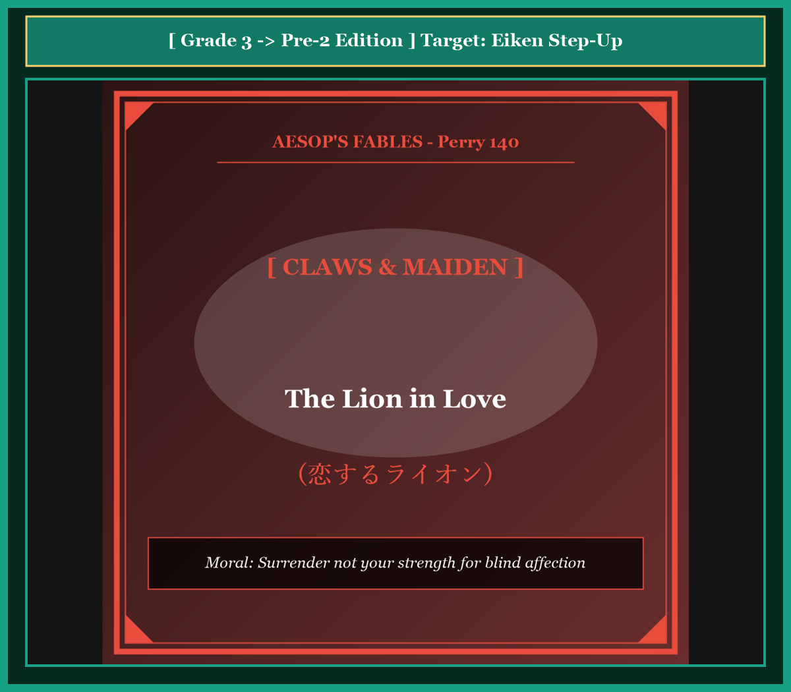
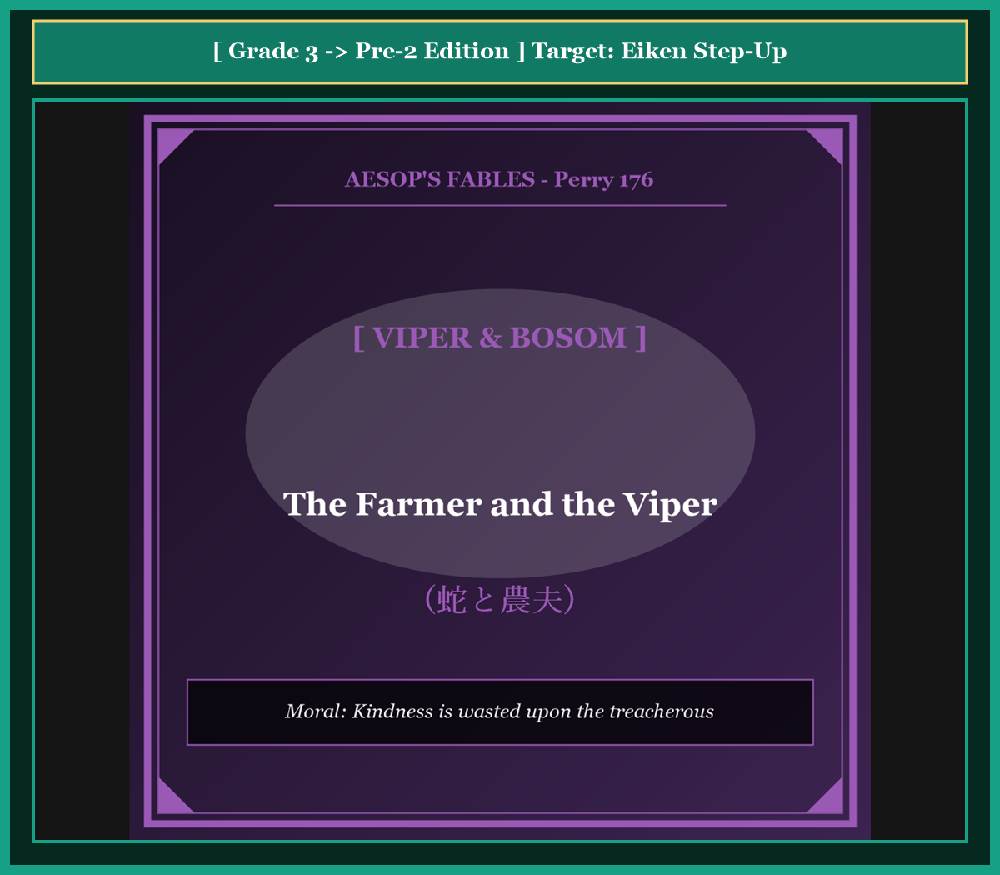
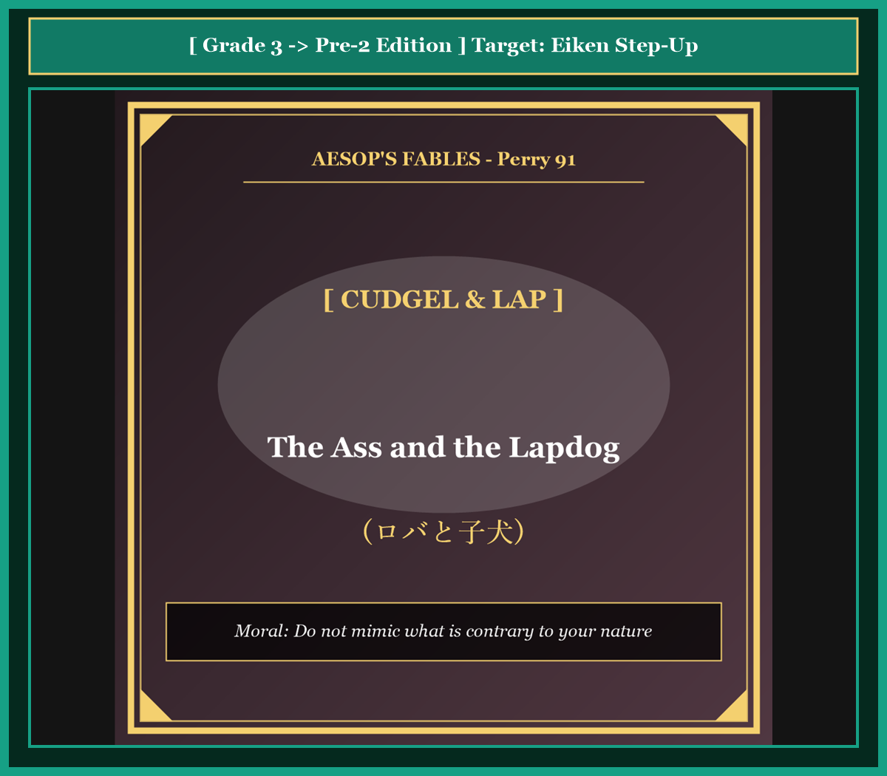

# 『英検ステップアップ多読：イソップ寓話編 第14巻（3級 ➔ 準2級対比学習・第4集）』

---

## はじめに：なぜ「対比多読」で英検準2級の壁を突破できるのか？

英検準2級の合格を目指す学習者にとって、最大の障壁は**「英文の抽象度の高まり」**と**「ライティング（英作文）での論理的な語彙・構文力」**です。

3級までは直感的な日常会話フレーズで太刀打ちできましたが、準2級からは理由や因果関係を論理的に表現する力（*therefore*, *in order to*, *as a result*, 分詞構文, 関係詞節の拡張）が求められます。

本書では、イソップ寓話（第4集・10話）を題材に、**「知っている3級英語」** が **「合格レベルの準2級英語」** へとどのように深まっていくかを対比学習します。

* **馴染みのあるストーリー（3級）** で文脈を完全に把握する
* **洗練された高度表現（準2級）** で論理的な構文・高級な語彙を吸収する
* **暗唱キーフレーズ対比** でライティング・面接で即効性のある表現力を身につける

楽しく寓話を読みながら、英検準2級合格に直結する本物の英語力を手に入れましょう！

---

## 本書の収録作品（第4集・全10話）

1. **Chapter 31**: オオカミとツル (*The Wolf and the Crane*) [Perry 156]
2. **Chapter 32**: 樫の木と葦 (*The Oak and the Reed*) [Perry 70]
3. **Chapter 33**: 馬とロバ (*The Horse and the Donkey*) [Perry 181]
4. **Chapter 34**: 農夫とその息子たち（束ねた棒） (*The Bundle of Sticks*) [Perry 53]
5. **Chapter 35**: 隠された財産（ブドウ畑の宝） (*The Farmer and His Sons*) [Perry 42]
6. **Chapter 36**: カエルたちの王様選び (*The Frogs Desiring a King*) [Perry 44]
7. **Chapter 37**: 猿と漁師 (*The Monkey and the Fishermen*) [Perry 203]
8. **Chapter 38**: 恋するライオン (*The Lion in Love*) [Perry 140]
9. **Chapter 39**: 蛇と農夫 (*The Farmer and the Viper*) [Perry 176]
10. **Chapter 40**: ロバと子犬 (*The Ass and the Lapdog*) [Perry 91]

---

## 本書の構成と電子書籍 / Kobo最適化

各章は以下の構成で統一されています。

```text
┌─────────────────────────────────────────────────────────────┐
│ 1. Chapter Title & Visual Illustration (章タイトル ＆ 挿絵)   │
│ 2. Benchmark Level: 英検3級レベル英文                         │
│ 3. Target Level: 英検準2級レベル英文                         │
│ 4. Classic Original English Text (イソップ寓話クラシック原文)  │
│ 5. Japanese Translation (日本語訳 ＆ 教訓)                     │
│ 6. Recite & Compare (そらんじたいキーフレーズ対比カード)        │
│ 7. Key Vocabulary & Exam Notes (語彙・文法・試験対策解説)        │
└─────────────────────────────────────────────────────────────┘
```

> **【ポイント】 音声読み上げ（TTS）をご利用の方へ**
> 本文セクション（ステップ1〜3）は英語のみで構成されており、電子書籍やKoboの自動音声読み上げ機能（Text-to-Speech）で日本語が混ざることなく、美しい英語音声で快適にリスニング学習していただけます。


# Chapter 31: The Wolf and the Crane (オオカミとツル)

<!-- 電子書籍 Page Break & Image Header -->
<div style="text-align: center; margin-bottom: 20px;">
  
</div>

<div style="page-break-before: always;"></div>

## 1. Benchmark Level: Eiken Grade 3 (英検3級レベル本文)
*Read in ~1.5 to 2 minutes. Baseline vocabulary and basic syntax.*

A greedy wolf was devouring an animal in a hurry, and a sharp bone became firmly lodged in his throat.

Because he could neither eat nor breathe comfortably, the wolf suffered intense pain. Desperate for relief, he wandered through the woods, begging every creature he met for assistance. He promised that he would provide a handsome reward to anyone who could remove the bone.

Most animals immediately refused because they were terrified of his fierce nature. However, a crane with a remarkably long neck was persuaded by his tempting offer. Taking pity on the suffering beast, she agreed to perform the dangerous task.

The wolf lay on his side and opened his terrible jaws as wide as possible. The crane courageously inserted her long beak into his mouth and skillfully extracted the bone. 

When the pain ceased, the wolf stood up and prepared to leave. The crane promptly stepped forward and reminded him of his promise. "Sir, you promised a reward for saving your life. Where is it?"

The wolf chuckled unkindly and bared his sharp teeth. "Ungrateful creature! You were allowed to withdraw your head from my jaws without harm. Is that not sufficient reward from a hungry wolf?"

The crane learned that serving a wicked creature brings no gratitude.

---
<div style="page-break-before: always;"></div>

## 2. Target Level: Eiken Grade Pre-2 (英検準2級レベル本文)
*Read in ~2 to 2.5 minutes. Richer idioms, subordinate clauses, and logical transitions.*

A notoriously voracious wolf, while ravenously consuming his prey in reckless haste, inadvertently swallowed a jagged bone fragment that lodged itself obstinately within his esophagus.

Incapacitated by excruciating pain and struggling desperately to draw breath, the agonized beast traversed the forest, appealing frantically to every creature he encountered. In an effort to secure immediate medical intervention, he pledged an extravagant recompense to whoever succeeded in extricating the obstruction.

Predictably, the woodland inhabitants shrank back in terror, instinctively recognizing the perils of approaching such a ruthless carnivore. Nevertheless, an unsuspecting crane, equipped with an extraordinarily elongated beak and neck, fell victim to the alluring prospect of wealth. Overcoming her inherent apprehension, she volunteered to undertake the perilous operation.

Instructing the patient to recline and part his cavernous jaws to their absolute limit, the crane cautiously navigated her slender head into the predator's throat. With surgical precision, she grasped the offending splinter and dislodged it from the swollen tissue.

Having experienced instant relief, the unprincipled wolf shook his fur and callously turned his back upon his savior. Undaunted, the crane pursued him and demanded fulfillment of the contractual promise.

"How insolent can you be?" sneered the wolf, displaying his formidable weaponry with menacing arrogance. "Consider yourself extraordinarily fortunate that your head was permitted to emerge intact from the jaws of a lethal predator. To demand a further reward for merely preserving your own existence is nothing short of madness."

Too late, the disillusioned crane realized that doing a favor for an incorrigible villain never yields genuine appreciation.

---
<div style="page-break-before: always;"></div>

## 3. Classic Original English Text (イソップ寓話クラシック原文)
*Perry 156: Translated by George Fyler Townsend (1867)*

A Wolf had got a bone stuck in his throat, and in the greatest agony ran up and down, beseeching every animal he met to relieve him, at the same time hinting at a very handsome reward to the one who should succeed. 

A Crane, moved by his entreaties and promises of reward, ventured her long neck down the Wolf's throat, and drew out the bone. 

She then modestly asked for the promised reward. 

To this, the Wolf, grinning and showing his teeth, replied: "Be content with what you have got, my friend. Is it not a sufficient reward for you that you have had your head inside a Wolf's mouth, and have brought it out again safe and sound?"

---
<div style="page-break-before: always;"></div>

## 4. Japanese Translation & Moral (日本語訳と教訓)

### 【日本語全訳：英検準2級レベル本文】
飽くなき大食漢として悪名高いオオカミが、無謀な急ぎ足で獲物をがつがつ平らげていた際、誤ってギザギザした骨の破片を飲み込んでしまい、それが食道の奥深くに頑固に引っかかってしまいました。

耐えがたい激痛で身動きが取れなくなり、必死に息を吸い込もうともがきながら、苦悩する獣は森を駆け巡り、出会うあらゆる生き物に狂乱状態で助けを求めました。一刻も早い外科的治療を確保するため、オオカミは異物を取り除くことに成功した者には誰にでも、途方もない報酬を与えると約束しました。

案の定、森の住人たちは恐怖のあまり後ずさりしました。これほど冷酷な肉食獣に近づくことの危険性を本能的に察知したからです。それにもかかわらず、並外れて長い嘴（くちばし）と首を持つ疑うことを知らないツルが、富という魅力的な見通しの罠に落ちてしまいました。生まれつきの不安を押し殺し、彼女はその命がけの手術を引き受けることを買って出ました。

患者に横たわり、洞窟のような大顎（おおあご）を限界まで開けるよう指示すると、ツルは自らの細い頭を捕食者の喉の中へと用心深く進めました。外科医のような精密さで、彼女は障害となっていた骨片をくわえ、腫れ上がった組織からそれを取り外しました。

即座に安堵を得た不謹慎なオオカミは、毛皮を震わせ、命の恩人に対して平然と背を向けました。臆することなく、ツルはオオカミを追いかけ、契約上の約束を果たすよう要求しました。

「何と無礼な奴だ」とオオカミは嘲笑し、威嚇的な傲慢さをもって恐るべき凶器のような牙を誇示しました。「致命的な捕食者の顎から、自分の頭が無傷で抜け出すことを許されただけでも、並外れて幸運だったと考えるべきなのだ。単に自らの生存を保ったことに対して更なる報酬を要求するなど、狂気の沙汰以外の何物でもないぞ。」

幻滅したツルは、救いようのない悪党に恩恵を施しても、決して真の感謝を生むことはないのだと悟るのが遅すぎたのでした。

### 【教訓（Moral）】
**Expect no reward from the wicked.**  
（悪人に対する奉仕から報酬を期待してはならない。悪しき者の手から無傷で生還できたこと自体が、得られる唯一にして最大の利益である。）

---
<div style="page-break-before: always;"></div>

## 5. Recite & Compare: そらんじたいキーフレーズ対比カード

<div class="comparison-card">
  <div class="card-header">フレーズ 1：骨が喉に深く刺さる</div>
  <div class="card-row-g3-base"><span class="card-badge-g3-base">3級</span>A sharp bone became firmly lodged in his throat.</div>
  <div class="card-row-pre2"><span class="card-badge-pre2">準2級</span>A jagged bone fragment lodged itself obstinately within his esophagus.</div>
  <div class="card-note"><strong>解説：</strong>「sharp bone」を「jagged bone fragment（ギザギザした骨の破片）」に、「throat」を解剖学的語彙の「esophagus（食道）」に高め、副詞「obstinately（頑固に・頑として）」で描写を深化させています。</div>
</div>

<div class="comparison-card">
  <div class="card-header">フレーズ 2：破格の報酬を約束する</div>
  <div class="card-row-g3-base"><span class="card-badge-g3-base">3級</span>He promised that he would provide a handsome reward to anyone.</div>
  <div class="card-row-pre2"><span class="card-badge-pre2">準2級</span>He pledged an extravagant recompense to whoever succeeded in extricating the obstruction.</div>
  <div class="card-note"><strong>解説：</strong>動詞「pledge（固く誓約する）」、名詞「extravagant recompense（途方もない報酬・埋め合わせ）」、複合関係代名詞「whoever（〜する人は誰でも）」を用いた極めて格調高い構文です。</div>
</div>

<div class="comparison-card">
  <div class="card-header">フレーズ 3：危険な役目を引き受ける</div>
  <div class="card-row-g3-base"><span class="card-badge-g3-base">3級</span>Taking pity on the suffering beast, she agreed to perform the dangerous task.</div>
  <div class="card-row-pre2"><span class="card-badge-pre2">準2級</span>Overcoming her inherent apprehension, she volunteered to undertake the perilous operation.</div>
  <div class="card-note"><strong>解説：</strong>「inherent apprehension（生まれつきの不安・恐れ）」を乗り越えて「undertake the perilous operation（危険な手術・作戦を引き受ける）」という、準2級頻出の抽象名詞を使いこなしています。</div>
</div>

<div class="comparison-card">
  <div class="card-header">フレーズ 4：無傷で脱出したこと自体が報酬</div>
  <div class="card-row-g3-base"><span class="card-badge-g3-base">3級</span>You were allowed to withdraw your head from my jaws without harm.</div>
  <div class="card-row-pre2"><span class="card-badge-pre2">準2級</span>Consider yourself extraordinarily fortunate that your head was permitted to emerge intact.</div>
  <div class="card-note"><strong>解説：</strong>第5文型命令文「Consider yourself fortunate that ~（〜ということを幸運に思うがよい）」と形容詞「intact（無傷の）」が組み合わさった論理的で威圧的な表現です。</div>
</div>

---
<div style="page-break-before: always;"></div>

## 6. Key Vocabulary & Exam Notes (英検準2級 重要語彙・文法・面接対策)

### 1. 英検準2級 必須ボキャブラリー
* **voracious** [形] 貪欲な、旺盛な食欲の
* **inadvertently** [副] うっかり、不注意に（*accidentally* の高級語）
* **obstinately** [副] 頑固に、執拗に
* **pledge** [動] 固く約束する、誓約する
* **extravagant** [形] 法外な、浪費する、並外れた
* **perilous** [形] 非常に危険な（*dangerous* より文学的）
* **intact** [形] 無傷の、元のままの
* **insolent** [形] 横柄な、無礼な

### 2. 文法・構文のチェックポイント
* **whoever (複合関係代名詞)**:
  * *He pledged an extravagant recompense to whoever succeeded...*（成功した者には誰にでも、法外な報酬を約束した）
  * *anyone who* を1語で置き換える準2級最重要構文の一つです。
* **nothing short of ~**: 「まさに〜にほかならない、〜そのものである」
  * *...is nothing short of madness.*（狂気の沙汰にほかならない。）
  * 強い断定や強調を表す際に英字ニュースや評論文で頻出します。

### 3. スピーキング（面接）＆ライティング活用ヒント
面接での「契約や約束の重要性」、あるいは「リスク管理」を述べる際に威力を発揮します：
* *We must be cautious when negotiating with individuals who have a history of dishonesty.*（不誠実な経歴を持つ人物と交渉する際には、慎重にならなければならない。）
* *Protecting our own safety should always take priority over the temptation of unreasonable rewards.*（理不尽な報酬の誘惑よりも、自らの安全を守ることを常に優先すべきである。）


# Chapter 32: The Oak and the Reed (樫の木と葦)

<!-- 電子書籍 Page Break & Image Header -->
<div style="text-align: center; margin-bottom: 20px;">
  
</div>

<div style="page-break-before: always;"></div>

## 1. Benchmark Level: Eiken Grade 3 (英検3級レベル本文)
*Read in ~1.5 to 2 minutes. Baseline vocabulary and basic syntax.*

A magnificent oak tree, whose trunk was exceptionally thick and strong, grew along the bank of a quiet stream. Beside him in the water grew slender reeds that swayed gently with the water.

Filled with pride, the oak frequently mocked his slender neighbors. "How unfortunate you are," he boasted. "Even the lightest breath of air causes you to tremble and bow your heads to the earth. Look at my enormous branches! I fear no tempest, for my roots are anchored deeply in the soil."

The reeds listened patiently without displaying any anger. Eventually, a slender reed responded, "Your pity is misplaced, dear oak. You resist the gale with stubborn defiance, whereas we yield obediently to every gust. Because we bow, we survive without being broken."

The oak tree scoffed at this explanation, confident that his brute strength would protect him forever.

Shortly afterward, a ferocious hurricane swept across the valley with unprecedented fury. As the tempest raged, the flexible reeds bowed low until they almost touched the water, allowing the gale to pass harmlessly over them.

In contrast, the mighty oak stood rigid and resisted the storm with all his might. The tremendous force of the wind battered his heavy crown until his stubborn roots were torn from the earth. With a thunderous roar, the giant tree collapsed into the river.

After the storm subsided, the humble reeds rose erect once more, intact and unharmed.

---
<div style="page-break-before: always;"></div>

## 2. Target Level: Eiken Grade Pre-2 (英検準2級レベル本文)
*Read in ~2 to 2.5 minutes. Richer idioms, subordinate clauses, and logical transitions.*

Towering majestically above the embankment of a tranquil waterway, a colossal oak had reigned supreme over the landscape for generations. Beneath his sprawling canopy, clustered fragile reeds that fluttered passively in response to the river's undulating currents.

Intoxicated by his own formidable stature, the arrogant oak constantly derided the apparent vulnerability of his neighbors. "What a pathetic existence nature has inflicted upon you," he sneered pompously. "The most imperceptible breeze compels you to prostrate yourselves in humiliation. Behold my unshakable mass! While you shudder in constant dread, I stand invincible, defying the harshest elements with absolute indifference."

Refusing to be provoked by his contemptuous remarks, the unassuming reeds maintained their composure. At length, their spokesperson replied calmly: "Do not waste your condescending pity upon us, mighty neighbor. You confront the atmospheric turbulence with unyielding rigidity, whereas we adapt flexibly to its fluctuations. By harmonizing with the tempest rather than combating it, we endure unscathed."

The obstinate tree dismissed this philosophical wisdom as mere rationalization for cowardice, steadfastly convinced of his own permanent supremacy.

Before long, a catastrophic cyclonic storm descended upon the province with devastating ferocity. The atmosphere transformed into a maelstrom of gale-force gusts and pelting rain. Exhibiting supreme flexibility, the agile reeds flattened themselves against the liquid surface, accommodating the atmospheric violence and letting the blast expend its energy harmlessly.

Conversely, the monumental oak stubbornly pitted his immense physical bulk against the full momentum of the gale. Because his unbending timber possessed zero elasticity, the immense aerial pressure exerted catastrophic strain upon his foundational roots. Ultimately, with a deafening splinter of fractured wood, the monarch of the forest was violently uprooted and hurled headlong into the surging torrent.

When tranquility was restored at dawn, the supple reeds uncurled gracefully, standing proud in the morning sunshine while their arrogant oppressor floated lifelessly downstream.

---
<div style="page-break-before: always;"></div>

## 3. Classic Original English Text (イソップ寓話クラシック原文)
*Perry 70: Translated by George Fyler Townsend (1867)*

A very large Oak was uprooted by the wind and thrown across a stream. It fell among some Reeds, which it thus addressed: 

"I wonder how you, who are so light and weak, are not entirely crushed by these strong winds."

They replied: "You fight and contend with the wind, and consequently you are destroyed; while we on the contrary bend before the least breath of air, and therefore remain unbroken, and escape."

---
<div style="page-break-before: always;"></div>

## 4. Japanese Translation & Moral (日本語訳と教訓)

### 【日本語全訳：英検準2級レベル本文】
穏やかな水路の土手の上に威風堂々とそびえ立つ巨大な樫の木は、何世代にもわたってその景観の頂点に君臨していました。その大きく広がる樹冠の真下には、川の波打つ流れに身を任せて従順に揺れる、繊細な葦の群れが生えていました。

自らの圧倒的な体格に酔いしれた傲慢な樫の木は、隣人たちの明白な脆弱さを絶えず嘲笑していました。「自然はお前たちに何と哀れな存在を課したことか」と樫は尊大に冷笑しました。「目に見えないほどの微風でさえ、お前たちを屈辱の中にひれ伏させる。見よ、私の揺るぎない巨体を！ お前たちが絶え間ない恐怖に身を震わせる一方で、私は無敵のまま仁王立ちし、絶対的な冷淡さをもって最も過酷な自然の猛威をものともしないのだ。」

その軽蔑に満ちた言葉に煽られることを拒み、慎み深い葦たちは冷静さを保ちました。やがて、その代表が静かに答えました。「力強い隣人よ、私たちに恩着せがましい同情を無駄遣いなさるな。あなたは不屈の硬直さをもって大気の荒波に立ち向かいますが、私たちはその変動に柔軟に適応するのです。嵐と戦うのではなく調和することによって、私たちは傷一つ負わずに耐え抜くのです。」

頑迷な大木はこの哲学的な知恵を、臆病さに対する単なる言い訳にすぎないと一蹴し、自らの永久の優位性を頑なに確信していました。

まもなくして、壊滅的なサイクロンが猛威を振るってその地方を襲いました。大気は暴風と打ちつける豪雨の渦へと一変しました。極上の柔軟性を発揮し、しなやかな葦は水面に身を沿わせるように平らになり、大気の暴力を受け流して暴風のエネルギーを無害に消散させました。

それとは反対に、堂々たる樫の木は、暴風の全力の勢いに対して自らの巨大な肉体を頑固にぶつけ合いました。その曲がらない木材にはまったく柔軟性がなかったため、莫大な風圧がその土台となる根に致命的な負荷をかけました。ついに、木材がへし折れる耳をつんざくような破壊音とともに、森の君主は激しく根こそぎ引き抜かれ、荒れ狂う激流の中へと真っ逆さまに投げ出されました。

夜明けに平穏が戻ったとき、しなやかな葦たちは優雅に身を起こし、朝の陽光の中で誇らしげに立ち上がっていました。その一方で、傲慢な圧制者は死骸となって川下へと流されていったのでした。

### 【教訓（Moral）】
**Better to bend than break.**  
（折れるよりも曲がるほうが勝る。硬直した尊大なプライドは破滅をもたらすが、柔軟な適応力と謙虚さは最も過酷な試練を生き抜く真の強さである。）

---
<div style="page-break-before: always;"></div>

## 5. Recite & Compare: そらんじたいキーフレーズ対比カード

<div class="comparison-card">
  <div class="card-header">フレーズ 1：威風堂々とそびえ立つ大樹</div>
  <div class="card-row-g3-base"><span class="card-badge-g3-base">3級</span>A magnificent oak tree grew along the bank of a quiet stream.</div>
  <div class="card-row-pre2"><span class="card-badge-pre2">準2級</span>Towering majestically above the embankment, a colossal oak had reigned supreme for generations.</div>
  <div class="card-note"><strong>解説：</strong>分詞構文「Towering majestically（威風堂々とそびえ立ち）」と動詞「reign supreme（最高位に君臨する）」により、荘厳な大木の存在感を劇的に描写しています。</div>
</div>

<div class="comparison-card">
  <div class="card-header">フレーズ 2：戦うのではなく調和して生き残る</div>
  <div class="card-row-g3-base"><span class="card-badge-g3-base">3級</span>Because we bow, we survive without being broken.</div>
  <div class="card-row-pre2"><span class="card-badge-pre2">準2級</span>By harmonizing with the tempest rather than combating it, we endure unscathed.</div>
  <div class="card-note"><strong>解説：</strong>「By doing ~ rather than doing ...（…するのではなく〜することによって）」という対比構文に、「endure unscathed（傷一つ負わずに耐え抜く）」という高度な語彙を組み合わせています。</div>
</div>

<div class="comparison-card">
  <div class="card-header">フレーズ 3：暴風のエネルギーを無害にやり過ごす</div>
  <div class="card-row-g3-base"><span class="card-badge-g3-base">3級</span>The flexible reeds bowed low, allowing the gale to pass harmlessly over them.</div>
  <div class="card-row-pre2"><span class="card-badge-pre2">準2級</span>The agile reeds flattened themselves, accommodating the violence and letting the blast expend its energy.</div>
  <div class="card-note"><strong>解説：</strong>動詞「accommodate（適応する・受け入れる）」と使役構文「letting the blast expend its energy（突風がエネルギーを使い果たすに任せて）」が、合気道のような柔軟な強さを表現しています。</div>
</div>

<div class="comparison-card">
  <div class="card-header">フレーズ 4：根こそぎ吹き飛ばされる結末</div>
  <div class="card-row-g3-base"><span class="card-badge-g3-base">3級</span>His stubborn roots were torn from the earth, and the giant tree collapsed.</div>
  <div class="card-row-pre2"><span class="card-badge-pre2">準2級</span>The monarch of the forest was violently uprooted and hurled headlong into the surging torrent.</div>
  <div class="card-note"><strong>解説：</strong>「was uprooted（根こそぎ引き抜かれた）」と副詞「headlong（真っ逆さまに）」、名詞「surging torrent（荒れ狂う激流）」の連続が破滅の迫力を生み出しています。</div>
</div>

---
<div style="page-break-before: always;"></div>

## 6. Key Vocabulary & Exam Notes (英検準2級 重要語彙・文法・面接対策)

### 1. 英検準2級 必須ボキャブラリー
* **colossal** [形] 巨大な、途方もない（*huge* の最上位語）
* **prostrate** [動] ひれ伏す、平伏させる
* **unyielding** [形] 断固とした、屈服しない、しなりのない
* **unscathed** [形] 痛手を受けない、無傷の（*unharmed* の洗練語）
* **steadfastly** [副] 頑として、断固として
* **accommodate** [動] 収容する、適応させる、便宜を図る
* **strain** [名] 重圧、過度の緊張、負担
* **torrent** [名] 激流、連発（*a torrent of rain* で「豪雨」）

### 2. 文法・構文のチェックポイント
* **rather than ~**: 「〜するよりはむしろ、〜ではなくて」
  * *By harmonizing with the tempest rather than combating it...*
  * 英検準2級のライティングで「消極的な選択肢を否定し、積極的な選択肢を主張する」際の必須構文です。
* **Zero / No + 名詞**:
  * *Because his unbending timber possessed zero elasticity...*
  * 抽象名詞の欠如を論理的に強調する表現手法です。

### 3. スピーキング（面接）＆ライティング活用ヒント
「環境の変化への適応」や「リーダーシップのあり方」について述べる際に有効です：
* *Stubborn leaders who refuse to adapt often cause organizational failure.*（適応を拒む頑固なリーダーは、しばしば組織的な破綻を引き起こす。）
* *Flexibility in communication helps us resolve conflicts peacefully.*（コミュニケーションにおける柔軟性は、対立を平和的に解決するのに役立つ。）


# Chapter 33: The Horse and the Donkey (馬とロバ)

<!-- 電子書籍 Page Break & Image Header -->
<div style="text-align: center; margin-bottom: 20px;">
  
</div>

<div style="page-break-before: always;"></div>

## 1. Benchmark Level: Eiken Grade 3 (英検3級レベル本文)
*Read in ~1.5 to 2 minutes. Baseline vocabulary and basic syntax.*

A wealthy merchant set out on a journey toward a bustling city, accompanied by his spirited horse and a patient donkey. Although they were both working animals, their duties were divided unfairly. The donkey was burdened with enormous packs, whereas the horse pranced gracefully, carrying only lightweight saddlebags.

As the afternoon sun beat down mercilessly upon the dusty mountain path, the donkey began to falter under his crushing load. Feeling his strength draining away rapidly, he turned to his companion and pleaded earnestly.

"My dear friend," the donkey gasped, "if you care for my life in the slightest degree, please relieve me of a small portion of this burden. If you take even a fraction of my load, I might manage to reach our destination safely."

However, the haughty horse snorted with disdain and refused coldly. "Mind your own business! Burden-bearing is the proper lot of a donkey, whereas a noble steed like me was bred for honor, not hard labor."

Unable to endure the relentless weight any longer, the donkey stumbled and dropped dead in the dust.

Confronted with this sudden misfortune, the merchant had no choice but to transfer the entire cargo onto the horse's back. To make matters worse, he flayed the dead donkey and laid the heavy hide atop the already staggering heap.

Groaning under the unbearable mass, the miserable horse wept bitter tears of regret. "Alas, what a terrible penalty I must pay for my selfishness! Because I refused to share a minor fraction of the burden, I am now forced to carry the whole load, along with the skin of my fallen companion."

---
<div style="page-break-before: always;"></div>

## 2. Target Level: Eiken Grade Pre-2 (英検準2級レベル本文)
*Read in ~2 to 2.5 minutes. Richer idioms, subordinate clauses, and logical transitions.*

An affluent trader embarked upon an arduous commercial expedition across rugged terrain, driving ahead of him an aristocratic stallion and an uncomplaining pack-ass. Despite their shared mission, the allocation of their cargo was outrageously inequitable. The unfortunate ass was virtually smothered beneath mountainous sacks of merchandise, while the pampered steed trotted unencumbered, adorned with little more than ornamental trappings and elegant harness.

As oppressive noon heat radiated relentlessly from the rocky defile, the donkey's physical reserves deteriorated rapidly. Staggering under the monstrous equilibrium of his burden, his knees buckled, and his vision blurred. Driven by an instinctive premonition of death, he appealed desperately to the solidarity of his fellow beast.

"I implore you, comrade," the panting creature murmured in agony, "if you possess the slightest shred of fraternal compassion, assume a trivial fraction of my consignment. A negligible transfer of weight would preserve my life and enable both of us to complete this crossing."

Instead of responding with empathy, the conceited horse recoiled with haughty indignation. "How dare a beast of burden propose such an indignity?" he sneered dismissively. "Heavy haulage is your biological destiny, whereas my purpose is to display elegance and preserve my owner's prestige. Suffer your fate without soliciting my involvement."

Deprived of mercy and pushed beyond the threshold of biological endurance, the donkey collapsed in a heap of dust and perished instantaneously from total cardiac arrest.

Faced with the catastrophic loss of his primary transport animal, the pragmatic merchant acted with ruthless efficiency. Having unfastened the immense bundles from the carcass, he hoisted the entire volume onto the back of the protesting stallion. Furthermore, recognizing the commercial value of leather, he flayed the deceased beast on the spot and draped the massive, blood-stained hide over the pinnacle of the cargo.

Crushed under the monumental tonnage, his spinal column bending perilously under the sudden onslaught, the agonized horse groaned in profound despair: "Woe to my foolish vanity! Had I consented to shoulder an insignificant fraction of my companion's toil, he would still be walking beside me. By repudiating mutual aid, I have inherited the entirety of his doom."

---
<div style="page-break-before: always;"></div>

## 3. Classic Original English Text (イソップ寓話クラシック原文)
*Perry 181: Translated by George Fyler Townsend (1867)*

A Man who had a Horse and a Donkey took the road with them. The Donkey, who was exhausted with fatigue and the heat of the day, said to the Horse: 

"Take a little of my load, if you have any regard for my life." 

The Horse refused, bidding him to mind his own business. 

The Donkey fell dead under his burden. The master then took the whole of the burden from the dead Donkey, and laid it on the Horse, together with the skin of the Donkey. 

The Horse, groaning under his load, exclaimed: "Woe is me! What a wretched creature I am! I would not help the Donkey with a little of his load, and now I have to carry the whole of it, together with his skin into the bargain."

---
<div style="page-break-before: always;"></div>

## 4. Japanese Translation & Moral (日本語訳と教訓)

### 【日本語全訳：英検準2級レベル本文】
裕福な商人が、気品ある種馬と文句を言わない荷担ぎロバを駆り立てながら、険しい地形を横断する過酷な商業遠征に出発しました。同じ使命を担っているにもかかわらず、積載荷物の配分は言語道断なほど不公平でした。不幸なロバが山積みの商品袋の下で窒息寸前になっていた一方で、甘やかされた名馬は装飾的な馬具や優雅な手綱以外はほとんど身につけず、邪魔されることなく闊歩していました。

うだるような真昼の熱気が岩だらけの狭い道から容赦なく放射されるにつれ、ロバの体力は急速に衰えていきました。重荷のすさまじい均衡の下でよろめき、膝は折れ曲がり、視界はかすみました。死の本能的な予感に突き動かされ、ロバは仲間の動物としての連帯感に必死に訴えかけました。

「お願いです、友よ」とあえぎ声を上げるロバは苦悶のうちにつぶやきました。「もしあなたに兄弟のような哀れみの心がほんのわずかでもあるなら、私の積荷のほんの一部を引き受けてください。ほんの些細な重量の移動だけで私の命は救われ、私たち双方がこの峠越えを完了できるのです。」

共感をもって応じるどころか、自惚れた馬は傲慢な憤りをもって後ずさりしました。「荷担ぎ獣の分際で、よくもそのような屈辱を提案できたものだな」と馬は軽蔑して一蹴しました。「重い荷物を運ぶことこそがお前の生物学的宿命であり、私の目的は優雅さを誇示し、主人の威厳を保つことなのだ。私を巻き込もうとせず、己の運命に耐えるがよい。」

慈悲を拒まれ、生物学的耐久力の限界を超えて追い詰められたロバは、埃の山の中に崩れ落ち、完全な心停止によって即死しました。

主要な輸送動物の壊滅的な損失に直面した現実主義の商人は、冷酷なまでの手際良さで行動しました。死骸から巨大な荷物を解くと、商人はその全量を、抵抗する種馬の背へと持ち上げました。さらに、革の商業的価値を考慮した商人は、その場で息絶えたロバの皮を剥ぎ、その重く血に染まった皮を荷物の頂上へと覆い被せました。

途方もない重量の下で押しつぶされ、突然の猛攻によって背骨が危険なほどにしなる中、苦悶する馬は深い絶望のうちにうめきました。「ああ、私の愚かな自惚れに災いあれ！ もし私が仲間の労働のほんのわずかな一部を肩代わりすることに同意してさえいれば、彼は今でも私の隣を歩いていたはずなのだ。相互扶助を拒絶したことによって、私は彼の破滅のすべてをそっくり引き継ぐことになってしまった。」

### 【教訓（Moral）】
**Help others lest their burden fall on you.**  
（他者の困窮を助けよ。さもなくば、その全負担が己に降りかかることになる。身勝手に連帯を拒絶する者は、他者の苦難のすべてを己ひとりで背負う報いを受ける。）

---
<div style="page-break-before: always;"></div>

## 5. Recite & Compare: そらんじたいキーフレーズ対比カード

<div class="comparison-card">
  <div class="card-header">フレーズ 1：不公平すぎる荷物の配分</div>
  <div class="card-row-g3-base"><span class="card-badge-g3-base">3級</span>Their duties were divided unfairly. The donkey carried enormous packs.</div>
  <div class="card-row-pre2"><span class="card-badge-pre2">準2級</span>The allocation of their cargo was outrageously inequitable.</div>
  <div class="card-note"><strong>解説：</strong>「allocation（割り当て・配分）」や「outrageously inequitable（法外なほど不公平な）」という格調高い抽象名詞・形容詞で、不条理な状況を論理的に表現しています。</div>
</div>

<div class="comparison-card">
  <div class="card-header">フレーズ 2：助け合いの連帯への懇願</div>
  <div class="card-row-g3-base"><span class="card-badge-g3-base">3級</span>Please relieve me of a small portion of this burden.</div>
  <div class="card-row-pre2"><span class="card-badge-pre2">準2級</span>If you possess the slightest shred of fraternal compassion, assume a trivial fraction of my consignment.</div>
  <div class="card-note"><strong>解説：</strong>「a shred of compassion（一片の慈悲）」や動詞「assume（引き受ける・担う）」を用いた重厚な嘆願の構文です。</div>
</div>

<div class="comparison-card">
  <div class="card-header">フレーズ 3：限界を超えて力尽きる</div>
  <div class="card-row-g3-base"><span class="card-badge-g3-base">3級</span>Unable to endure the weight, the donkey dropped dead in the dust.</div>
  <div class="card-row-pre2"><span class="card-badge-pre2">準2級</span>Pushed beyond the threshold of biological endurance, the donkey collapsed and perished.</div>
  <div class="card-note"><strong>解説：</strong>「beyond the threshold of ~（〜の閾値・限界を超えて）」という学術的・客観的な表現で、不可避な死の瞬間を描いています。</div>
</div>

<div class="comparison-card">
  <div class="card-header">フレーズ 4：仮定法過去完了による後悔の叫び</div>
  <div class="card-row-g3-base"><span class="card-badge-g3-base">3級</span>Because I refused to share the burden, I must now carry everything.</div>
  <div class="card-row-pre2"><span class="card-badge-pre2">準2級</span>Had I consented to shoulder an insignificant fraction of his toil, he would still be walking beside me.</div>
  <div class="card-note"><strong>解説：</strong>英検準2級・2級の重要文法である「仮定法過去完了の倒置（Had I consented = If I had consented）」を用いた、格調高き反省の言葉です。</div>
</div>

---
<div style="page-break-before: always;"></div>

## 6. Key Vocabulary & Exam Notes (英検準2級 重要語彙・文法・面接対策)

### 1. 英検準2級 必須ボキャブラリー
* **arduous** [形] 骨の折れる、困難を極める
* **inequitable** [形] 不公平な、不当な
* **unencumbered** [形] 邪魔物のない、身軽な
* **implore** [動] 哀願する、切願する（*plead* の強調語）
* **negligible** [形] 無視できるほどの、ごくわずかな
* **threshold** [名] 敷居、境界線、限界点
* **pragmatic** [形] 実用的な、現実的な
* **repudiate** [動] 拒否する、拒絶する

### 2. 文法・構文のチェックポイント
* **Had + S + 過去分詞 (仮定法過去完了の倒置)**:
  * *Had I consented to shoulder an insignificant fraction...*（もし私がほんの一部を肩代わりすることに同意してさえいれば……）
  * *If* を省略した倒置構文であり、英検準2級長文の文意把握や要約で頻出します。
* **beyond the threshold of ~**: 「〜の限界を超えて」
  * 物理的・精神的な耐久力の限界を論述する際の重要イディオムです。

### 3. スピーキング（面接）＆ライティング活用ヒント
「共生社会」や「職場での協力関係」を論じる際に最適です：
* *Ignoring colleagues who are overloaded with work ultimately damages the whole team.*（過重労働を抱える同僚を放置することは、最終的にチーム全体に損害をもたらす。）
* *Mutual assistance is a practical strategy for survival, not merely an idealistic moral.*（相互扶助は単なる理想論の道徳ではなく、生き残るための実践的な戦略である。）


# Chapter 34: The Bundle of Sticks (農夫とその息子たち)

<!-- 電子書籍 Page Break & Image Header -->
<div style="text-align: center; margin-bottom: 20px;">
  
</div>

<div style="page-break-before: always;"></div>

## 1. Benchmark Level: Eiken Grade 3 (英検3級レベル本文)
*Read in ~1.5 to 2 minutes. Baseline vocabulary and basic syntax.*

An elderly farmer had several sons who were constantly engaged in bitter disputes with one another. No matter how earnestly their father urged them to live in harmony, his wise counsel was completely ignored.

Realizing that his health was declining, the father was deeply troubled by the thought of leaving his divided family behind. He recognized that as long as his sons continued to quarrel, they would remain vulnerable to their dishonest neighbors. Therefore, he decided to teach them an unforgettable practical lesson.

Gathering his sons together, he ordered a servant to bring a bundle of sticks that were tied firmly with rope. Handing the bundle to his eldest son, the farmer said, "I challenge you to break this entire bundle in half."

The eldest son strained with all his might, but the bundle resisted his efforts completely. One by one, the other brothers attempted the feat, yet not a single stick was damaged. Eventually, they gave up and declared that no mortal man possessed enough strength to succeed.

The father then untied the knot and distributed the sticks individually among his sons. "Now, break them," he commanded calmly. Without the slightest difficulty, each son snapped his individual stick in an instant.

The old man looked at them earnestly and explained, "My sons, this bundle represents your future. As long as you remain united by brotherly affection, no enemy in the world can overpower you. But if you allow jealousy and discord to divide you, you will be broken as effortlessly as these brittle sticks."

---
<div style="page-break-before: always;"></div>

## 2. Target Level: Eiken Grade Pre-2 (英検準2級レベル本文)
*Read in ~2 to 2.5 minutes. Richer idioms, subordinate clauses, and logical transitions.*

A venerable patriarch, who had accumulated vast agricultural estates through a lifetime of diligent perseverance, was perpetually distressed by the chronic animosity that alienated his sons. Despite his repeated appeals for domestic concord, the young men remained enslaved by petty rivalries, constantly squabbling over inheritances and prestige.

Aware that his mortality was approaching and observing that verbal admonitions were entirely futile, the shrewd patriarch resolved to stage an indelible physical demonstration. He understood that an abstract lecture on solidarity would evaporate from their memories, whereas an irrefutable optical proof might penetrate their hardened hearts.

Convening his quarrelsome heirs in the courtyard, he instructed an attendant to present a compact fascicle of sturdy wooden rods, bound together by reinforced hempen cords. Presenting the collective mass to his firstborn, the father issued a direct ultimatum: "Test your athletic prowess by fracturing this composite cylinder across your knee."

Exerting maximum muscular leverage, the young man strained until veins bulged upon his forehead; nonetheless, the resilient collective withstood his assault without yielding a fraction of an inch. Emboldened by competitive instinct, each successive sibling accepted the wager, yet the tightly compacted bundle defied every exertion. Humiliated, the brothers collectively conceded defeat, asserting that overcoming such concentrated resistance was physically unattainable.

Unraveling the binding with deliberate composure, the patriarch handed a detached rod to each offspring. "Now," he remarked with quiet authority, "replicate the trial." Instantly, sharp detonations echoed through the courtyard as each brittle rod was snapped clean in two with effortless facility.

Surveying their astonished expressions, the patriarch delivered his parting testament: "Behold your destiny inscribed within this wood. So long as you consolidate your resources and present an unbroken front to the external world, no adversary can undermine your sovereignty. Conversely, the moment you succumb to internal factionalism, your collective fortitude will dissolve, leaving each of you to be shattered as casually as these isolated twigs."

---
<div style="page-break-before: always;"></div>

## 3. Classic Original English Text (イソップ寓話クラシック原文)
*Perry 53: Translated by George Fyler Townsend (1867)*

An old man had many sons, who were often falling out with one another. When the father had failed to reconcile them by any of his words, he thought he would try whether he could not make an impression upon them by means of an act. 

So he called his sons together, and bade them bring him a bundle of sticks. The young men did as they were bid. The father took the bundle, and giving it to each of them in turn, told him to try if he could not break it in pieces. But not one of them could. 

The father then untied the bundle, and gave each a single stick, which each easily snapped in two. 

"My sons," said he, "if you are of one mind, and unite to assist each other, you will be as this bundle of sticks, unbroken by all the attempts of your enemies; but if you divide among yourselves, you will be broken as easily as are these sticks."

---
<div style="page-break-before: always;"></div>

## 4. Japanese Translation & Moral (日本語訳と教訓)

### 【日本語全訳：英検準2級レベル本文】
生涯にわたる勤勉な忍耐によって広大な農地を築き上げた高潔な家長は、息子たちを互いに疎遠にさせている慢性的な敵対心に絶えず心を痛めていました。家庭内の和合を求める父の度重なる訴えにもかかわらず、若者たちはつまらない対抗意識にとらわれ続け、遺産や名声を巡って絶え間なく争っていました。

自らの死期が近づいていることを悟り、言葉による訓戒がまったく無意味であることを見て取った抜け目のない家長は、決して消えることのない物理的な実演を行うことを決意しました。団結に関する抽象的な説教は彼らの記憶からたちまち蒸発してしまうが、反論の余地のない目に見える証拠であれば、彼らの頑なな心に突き刺さるかもしれないと理解したからです。

中庭に口論好きの後継者たちを呼び集めると、家長は従者に命じて、頑丈な麻縄でしっかりと束ねられた丈夫な木の棒のコンパクトな束を差し出させました。その複合体を長男に手渡し、父親は直接の挑戦状を突きつけました。「この複合円筒をお前の膝で真っ二つに折って、その腕力を試してみせよ。」

最大の筋力によるテコの力をかけ、額に血管が浮き出るほど長男は力を振り絞りました。しかしながら、しなやかな集合体は彼の一撃に耐え、一寸たりとも曲がることはありませんでした。競争本能に駆り立てられた他の兄弟たちも次々と挑みましたが、硬く束ねられた束はいかなる力にも屈しませんでした。屈辱感を味わった兄弟たちは、これほど凝縮された抵抗を打ち負かすことなど肉体的に不可能であると口を揃えて敗北を認めました。

落ち着き払った態度で縄をほどくと、家長は切り離された一本ずつの棒をそれぞれの息子に手渡しました。「では」と父親は静かな威厳をもって言いました。「もう一度試してみなさい。」刹那、乾いた破裂音が中庭に響き渡り、それぞれの脆い棒は何の苦労もなく真っ二つにへし折られました。

彼らの驚愕した表情を見渡しながら、家長は自らの遺訓を告げました。「この木に刻まれたお前たちの運命を見るがよい。お前たちが資力を結集し、外部の世界に対して強固な統一戦線を敷いている限り、いかなる敵もその主権を揺るがすことはできない。反対に、お前たちが内部の派閥争いに屈した瞬間、お前たちの集団としての剛勇は消え去り、いまの孤立した小枝のように、いともたやすく粉々に打ち砕かれてしまうのだ。」

### 【教訓（Moral）】
**Union gives strength.**  
（団結は力なり。内的結束は無敵の防壁となるが、内紛と分裂はどれほど強大な勢力をも瓦解へと導く。）

---
<div style="page-break-before: always;"></div>

## 5. Recite & Compare: そらんじたいキーフレーズ対比カード

<div class="comparison-card">
  <div class="card-header">フレーズ 1：兄弟間の慢性的な争い</div>
  <div class="card-row-g3-base"><span class="card-badge-g3-base">3級</span>His sons were constantly engaged in bitter disputes with one another.</div>
  <div class="card-row-pre2"><span class="card-badge-pre2">準2級</span>He was perpetually distressed by the chronic animosity that alienated his sons.</div>
  <div class="card-note"><strong>解説：</strong>「perpetually distressed（絶え間なく苦悩している）」や「chronic animosity（慢性的な敵意）」といったアカデミックな抽象語彙で、家庭内の精神的亀裂を深く分析しています。</div>
</div>

<div class="comparison-card">
  <div class="card-header">フレーズ 2：言葉ではなく実演で教える</div>
  <div class="card-row-g3-base"><span class="card-badge-g3-base">3級</span>He decided to teach them an unforgettable practical lesson.</div>
  <div class="card-row-pre2"><span class="card-badge-pre2">準2級</span>Observing that verbal admonitions were futile, he resolved to stage an indelible physical demonstration.</div>
  <div class="card-note"><strong>解説：</strong>「verbal admonitions were futile（言葉の訓戒は無駄である）」と「stage an indelible physical demonstration（消えない物理的実演を行う）」の対比が、教育の知恵を際立たせています。</div>
</div>

<div class="comparison-card">
  <div class="card-header">フレーズ 3：外部に対して統一戦線を張る</div>
  <div class="card-row-g3-base"><span class="card-badge-g3-base">3級</span>As long as you remain united, no enemy can overpower you.</div>
  <div class="card-row-pre2"><span class="card-badge-pre2">準2級</span>So long as you consolidate your resources and present an unbroken front, no adversary can undermine your sovereignty.</div>
  <div class="card-note"><strong>解説：</strong>「consolidate resources（資産・資源を結集する）」や「present an unbroken front（隙のない統一戦線を張る）」というビジネスや政治でも使える極めてハイレベルな表現です。</div>
</div>

<div class="comparison-card">
  <div class="card-header">フレーズ 4：内部対立による瓦解</div>
  <div class="card-row-g3-base"><span class="card-badge-g3-base">3級</span>If you allow discord to divide you, you will be broken as effortlessly as these sticks.</div>
  <div class="card-row-pre2"><span class="card-badge-pre2">準2級</span>The moment you succumb to internal factionalism, your collective fortitude will dissolve.</div>
  <div class="card-note"><strong>解説：</strong>接続詞句「The moment S + V（〜した瞬間に）」と「succumb to internal factionalism（内部の派閥争いに屈する）」により、崩壊の必然性を厳密に論証しています。</div>
</div>

---
<div style="page-break-before: always;"></div>

## 6. Key Vocabulary & Exam Notes (英検準2級 重要語彙・文法・面接対策)

### 1. 英検準2級 必須ボキャブラリー
* **patriarch** [名] 家長、長老、創始者
* **perseverance** [名] 忍耐、不屈の努力
* **animosity** [名] 敵意、憎悪（*hostility* の同義語）
* **futile** [形] 役に立たない、無駄な
* **solidarity** [名] 連帯、結束
* **consolidate** [動] 強化する、統合する、固める
* **adversary** [名] 敵、対抗者（*enemy* より格調高い語）
* **succumb** [動] 屈服する、負ける（*succumb to ~*）

### 2. 文法・構文のチェックポイント
* **so long as**: 「〜である限りは（条件）」
  * *So long as you consolidate your resources...*
  * *as long as* と同様の条件接続詞で、やや形式張った格調高い文章で用いられます。
* **the moment + S + V**: 「〜するやいなや、〜した瞬間に」
  * 時を表す接続詞として機能し、即座の因果関係を示す際に便利です。

### 3. スピーキング（面接）＆ライティング活用ヒント
「組織運営」や「国際協力」を論じる際のエッセンスとして極めて有益です：
* *Internal division makes an organization vulnerable to competitive pressure.*（内部対立は組織を競争圧力に対して脆弱にする。）
* *To achieve ambitious goals, members must consolidate their diverse skills into a unified effort.*（野心的な目標を達成するためには、メンバーは多様なスキルを統一された取り組みへと結集しなければならない。）


# Chapter 35: The Farmer and His Sons (隠された財産)

<!-- 電子書籍 Page Break & Image Header -->
<div style="text-align: center; margin-bottom: 20px;">
  
</div>

<div style="page-break-before: always;"></div>

## 1. Benchmark Level: Eiken Grade 3 (英検3級レベル本文)
*Read in ~1.5 to 2 minutes. Baseline vocabulary and basic syntax.*

A hardworking farmer, who had spent his entire life tending his vineyard with devotion, was blessed with three able-bodied sons. Unfortunately, the young men were excessively idle and showed no interest in agriculture, preferring to live carefree lives.

When the farmer realized that his days were numbered, he was anxious about the future of his beloved land. He knew that without industrious labor, his sons would soon fall into poverty. Therefore, he devised an ingenious plan to teach them the value of honest toil.

Summoning the boys to his bedside, he confided in them with his final breath. "My children, all my wealth lies buried somewhere beneath the vines. If you search diligently, you will unearth a great fortune."

Following their father's demise, the sons were seized by greed. Eager to discover the hidden gold, they took up spades and pickaxes and began to dig the vineyard methodically. Not an inch of soil was left untouched. They excavated around every root and turned over every clod of earth, from early morning until dusk.

Although they searched relentlessly for months, they discovered neither jewels nor chests of coin. Frustrated and exhausted, they concluded that their father's promise was merely a delusion.

However, because the earth had been cultivated so thoroughly, the vines flourished as never before. When autumn arrived, the vineyard yielded an unprecedented abundance of rich, luscious grapes. The harvest was sold at the market for a handsome profit.

At last, the enlightened sons realized their father's true intention: diligent industry is the only genuine gold mine on earth.

---
<div style="page-break-before: always;"></div>

## 2. Target Level: Eiken Grade Pre-2 (英検準2級レベル本文)
*Read in ~2 to 2.5 minutes. Richer idioms, subordinate clauses, and logical transitions.*

An enterprising viticulturist, whose prosperous vineyard was the fruit of lifelong dedication, was cursed with three offspring who demonstrated a deplorable aversion to manual labor. Possessing neither vocational discipline nor fiscal prudence, the indolent youths squandered their days in frivolous dissipation, relying complacently upon their father's accumulated wealth.

Recognizing the imminent termination of his earthly existence, the aging cultivator was consumed by paternal apprehension. He foresaw with absolute clarity that upon his departure, his sons would dissipate their inheritance and descend into destitution. Determined to eradicate their chronic sloth, he engineered a psychological stratagem calculated to transform their fundamental habits.

Convening his sons as his strength ebbed, the dying farmer imparted a momentous revelation. "My sons," he whispered conspiratorially, "my physical estate is modest, yet a colossal treasure lies concealed within our vineyard. Search diligently, sparing no exertion, and you shall unearth riches beyond your wildest imaginations."

Immediately following the funeral rites, the sons, electrified by avarice, mobilized for an exhaustive excavation. Equipping themselves with mattocks and shovels, they embarked upon a systematic overhaul of the entire plantation. They pulverized the compacted topsoil, aerated every subterranean layer, and meticulously excavated the perimeter of every single root system. From dawn until dusk, sweat poured in torrents as they overturned acre after acre.

Despite months of grueling physical exertion, their quest proved financially barren; not a solitary silver coin or buried urn rewarded their toil. Embittered by disappointment, they cursed their father's deception, convinced that his dying testament had been the delirious hallucination of a fading mind.

Nevertheless, an astonishing ecological transformation had been initiated. Because the plantation had undergone such rigorous aeration and pulverization, the root systems absorbed moisture and nutrients with unprecedented efficiency. When harvest season culminated, the vineyard groaned under a spectacular abundance of succulent clusters.

The subsequent vintage commanded extraordinary prices on the commercial market, generating a windfall that vastly surpassed any imagined hoard of gold.

Confronted with the overwhelming proceeds of their involuntary toil, the enlightened brothers comprehended the profound pedagogical genius of their deceased parent: sustainable wealth is never extracted passively from the earth, but is generated through the transformative power of disciplined industry.

---
<div style="page-break-before: always;"></div>

## 3. Classic Original English Text (イソップ寓話クラシック原文)
*Perry 42: Translated by George Fyler Townsend (1867)*

An old Farmer, when he was on the point of death, wishing to impart to his sons the secret of how to acquire wealth, called them to him and said: 

"My sons, I am now departing out of this life, but all that I have to leave you is to be found in the vineyard; dig there, and you will find it." 

The sons, as soon as their father was dead, set to work with all their might, and dug up every corner of the vineyard, expecting to find some hidden treasure. 

They found no gold, but the vines, through this thorough turning up of the ground, yielded a greater vintage than had ever been seen before, and made them wealthy men.

---
<div style="page-break-before: always;"></div>

## 4. Japanese Translation & Moral (日本語訳と教訓)

### 【日本語全訳：英検準2級レベル本文】
自らの繁栄したブドウ園が生涯にわたる献身の賜物であったある進取果敢なブドウ栽培家は、肉体労働に対する嘆かわしい嫌悪を示す3人の息子たちに恵まれない悩みを抱えていました。職業的な規律も金銭的な慎重さも持ち合わせていなかった怠惰な若者たちは、父親が築き上げた富に甘え、軽薄な放蕩の中に日々の時間を浪費していました。

自らの地上の生の終わりが迫っていることを悟り、年老いた栽培家は父親としての深い懸念に苛まれました。自分が世を去れば、息子たちが遺産を食いつぶし、たちまち困窮へと転落することを彼は完璧な明晰さをもって予見していました。彼らの慢性的な怠惰を根絶することを決意した農夫は、彼らの根本的な習慣を変革するよう綿密に計算された心理的計略を立案しました。

体力が衰えゆく中で息子たちを呼び集め、死にゆく農夫は重大な秘密を打ち明けました。「我が息子たちよ」と彼は秘密めかしてささやきました。「私の目に見える遺産はささやかなものだが、我らのブドウ園の中には莫大な財宝が隠されている。いかなる労力も惜しまず熱心に探せば、お前たちは最も突飛な想像をも超える富を掘り当てるだろう。」

葬儀が終わるやいなや、強欲に心を躍らせた息子たちは徹底的な発掘作業へと繰り出しました。つるはしとシャベルを手にし、彼らは農園全体の組織的な大改造に着手しました。彼らは固く引き締まった表土を細かく砕き、あらゆる地下層に空気を通し、一本一本の根の周囲を几帳面に掘り起こしました。夜明けから日暮れまで、何エーカーもの土地をひっくり返す中で、汗は滝のように流れ落ちました。

何ヶ月にも及ぶ過酷な肉体労働にもかかわらず、彼らの探索は金銭的にはまったくの空振りに終わりました。銀貨一枚も、埋もれた壺一つも、その労苦に報いることはありませんでした。失望に打ちひしがれた息子たちは、父の死に際の遺言は衰弱した精神のうわごとにすぎなかったのだと確信し、その欺瞞を呪いました。

しかしながら、驚くべき生態学的変化が始まっていました。農園がこれほど過酷な通気と土壌破砕を施されたため、根系は前例のない効率で水分と養分を吸収したのです。収穫期が頂点を迎えたとき、ブドウ園はみずみずしい果実の壮大な豊作の下でうめき声を上げました。

その後のブドウの出来栄えは商業市場で破格の高値を呼び、想像上の黄金の隠し場所をはるかに凌駕する臨時収入を生み出しました。

思いがけない労働がもたらした圧倒的な収益を前にして、真実を悟った兄弟たちは、亡き父の深遠な教育的天才を理解しました。持続可能な富とは、大地から受動的に掘り出されるものではなく、規律ある勤勉の変革力によってこそ生み出されるものなのだと。

### 【教訓（Moral）】
**Diligent labor is the truest treasure.**  
（勤勉な労働こそが真の財産である。棚ぼたの富は一時的にすぎないが、流した汗によって培われた生産力と技術こそが、永続する真の富を生み出す。）

---
<div style="page-break-before: always;"></div>

## 5. Recite & Compare: そらんじたいキーフレーズ対比カード

<div class="comparison-card">
  <div class="card-header">フレーズ 1：怠惰で放蕩な若者たち</div>
  <div class="card-row-g3-base"><span class="card-badge-g3-base">3級</span>The young men were excessively idle, preferring to live carefree lives.</div>
  <div class="card-row-pre2"><span class="card-badge-pre2">準2級</span>The indolent youths squandered their days in frivolous dissipation, relying complacently upon their father's wealth.</div>
  <div class="card-note"><strong>解説：</strong>「squander（浪費する）」、「frivolous dissipation（軽薄な放蕩）」、「rely complacently upon（〜に安易に依存する）」など、準2級最重要レベルの語彙を連鎖させています。</div>
</div>

<div class="comparison-card">
  <div class="card-header">フレーズ 2：農地の組織的・徹底的な掘り起こし</div>
  <div class="card-row-g3-base"><span class="card-badge-g3-base">3級</span>They began to dig the vineyard methodically. Not an inch of soil was left untouched.</div>
  <div class="card-row-pre2"><span class="card-badge-pre2">準2級</span>They embarked upon a systematic overhaul, pulverizing the topsoil and aerating every subterranean layer.</div>
  <div class="card-note"><strong>解説：</strong>「embark upon（〜に着手する）」と技術的表現「pulverizing the topsoil and aerating every subterranean layer（表土を粉砕し地下層に通気する）」により、農業の科学的効果を精密に説明しています。</div>
</div>

<div class="comparison-card">
  <div class="card-header">フレーズ 3：前例のない収穫の歓喜</div>
  <div class="card-row-g3-base"><span class="card-badge-g3-base">3級</span>The harvest was sold at the market for a handsome profit.</div>
  <div class="card-row-pre2"><span class="card-badge-pre2">準2級</span>The vintage commanded extraordinary prices, generating a windfall that vastly surpassed any imagined hoard of gold.</div>
  <div class="card-note"><strong>解説：</strong>「command extraordinary prices（破格の高値を呼ぶ）」や「generate a windfall（巨額の臨時収入をもたらす）」という経済・市場に関する高度な語彙を活用しています。</div>
</div>

<div class="comparison-card">
  <div class="card-header">フレーズ 4：真の富の本質への悟り</div>
  <div class="card-row-g3-base"><span class="card-badge-g3-base">3級</span>Diligent industry is the only genuine gold mine on earth.</div>
  <div class="card-row-pre2"><span class="card-badge-pre2">準2級</span>Sustainable wealth is never extracted passively, but is generated through the transformative power of disciplined industry.</div>
  <div class="card-note"><strong>解説：</strong>対比構文「not A, but B」の洗練形である「is never extracted passively, but is generated through ~」を用いて、倫理的教訓を格調高く総括しています。</div>
</div>

---
<div style="page-break-before: always;"></div>

## 6. Key Vocabulary & Exam Notes (英検準2級 重要語彙・文法・面接対策)

### 1. 英検準2級 必須ボキャブラリー
* **enterprising** [形] 進取の気性に富んだ、事業意欲のある
* **aversion** [名] 強い嫌悪、反感（*aversion to ~*）
* **prudence** [名] 慎重さ、分別、倹約
* **dissipate** [動] 散じる、浪費する、消散させる
* **stratagem** [名] 計略、策略
* **systematic** [形] 体系的な、組織的な
* **windfall** [名] 予期せぬ幸運、棚ぼたの利益
* **pedagogical** [形] 教育的な、教授法の

### 2. 文法・構文のチェックポイント
* **embark upon / on ~**: 「〜に乗り出す、〜に着手する」
  * 新しい事業や冒険、大掛かりな計画を始める際の定番表現です。
* **not A, but B (相関構文)**:
  * *Sustainable wealth is never extracted passively, but is generated through...*
  * ライティングの結論部で対比を際立たせて読者を説得する最高峰の構文です。

### 3. スピーキング（面接）＆ライティング活用ヒント
「労働の価値」や「経済的自立」を述べる際に最適です：
* *True financial independence comes from cultivating marketable skills, not relying on inheritances.*（真の経済的自立は、遺産に頼ることではなく、市場価値のあるスキルを磨くことから生まれる。）
* *Hard work often yields unexpected secondary benefits that exceed our initial expectations.*（懸命な労働は、しばしば当初の期待を超える予期せぬ二次的恩恵をもたらす。）


# Chapter 36: The Frogs Desiring a King (カエルたちの王様選び)

<!-- 電子書籍 Page Break & Image Header -->
<div style="text-align: center; margin-bottom: 20px;">
  
</div>

<div style="page-break-before: always;"></div>

## 1. Benchmark Level: Eiken Grade 3 (英検3級レベル本文)
*Read in ~1.5 to 2 minutes. Baseline vocabulary and basic syntax.*

A community of frogs lived peacefully in a spacious marsh, enjoying an easy and unrestricted existence. They were permitted to leap among the reeds and croak at their leisure, completely unburdened by laws or government.

Nevertheless, the discontented frogs gradually grew weary of their tranquil lifestyle. Believing that their society lacked dignity and discipline, they sent a petition to Jupiter, the sovereign of the gods, pleading for a powerful monarch to reign over them.

Amused by their foolishness, Jupiter tossed an enormous log directly into the center of the pool.

When the massive timber struck the water, it produced a terrifying splash that reverberated across the entire marsh. Panicked by the commotion, the frogs plunged into the murky depths and concealed themselves beneath the slime.

As time elapsed, however, the marsh returned to stillness. A daring frog cautiously surfaced and observed that the new monarch remained motionless. Encouraged by his discovery, the entire colony emerged. Within a few days, having recognized that the log was entirely harmless, the disrespectful frogs began to leap onto the monarch's back and treat him with open mockery.

Dissatisfied with a ruler who lacked authority, they sent another urgent appeal to Jupiter, demanding a vigorous leader who could command respect.

Irritated by their senseless ingratitude, Jupiter resolved to teach them a bitter lesson. He dispatched a long-legged stork to the marsh. Unlike the peaceful log, this savage tyrant immediately seized the terrified frogs with his sharp beak, gobbling them up by the dozens.

In their despair, the surviving frogs sent a messenger to beg for mercy. But Jupiter answered sternly, "You were not content with liberty, nor were you satisfied with a gentle ruler. Bear your punishment, for you brought this calamity upon yourselves."

---
<div style="page-break-before: always;"></div>

## 2. Target Level: Eiken Grade Pre-2 (英検準2級レベル本文)
*Read in ~2 to 2.5 minutes. Richer idioms, subordinate clauses, and logical transitions.*

Inhabiting an expansive wetland ecosystem, an amphibious populace thrived in an idyllic state of anarchic bliss. Exempt from statutory taxation, administrative bureaucracy, and coercive legislation, they basked upon lily pads and vocalized their contentment without constraint.

Regrettably, perpetual liberty engendered psychological malaise rather than profound gratitude. Misinterpreting their unconstrained autonomy as chaotic backwardness, the frogs succumbed to delusions of grandeur. Convinced that their commonwealth required the pomp of centralized sovereignty to elevate its social prestige, they dispatched an embassy to the celestial realm, imploring Jupiter to install a supreme potentate.

Entertained by their sheer naivety, the supreme deity hurled a colossal baulk of timber straight from the heavens into the heart of the mire.

The descent of the monumental projectile generated a cataclysmic percussion. Giant swells washed over the embankments, accompanied by deafening aquatic echoes that induced hysterical panic throughout the community. Terror-stricken by this dramatic manifestation of divine majesty, the populace dived into the subterranean mud, trembling in reverent awe.

However, as the turbulence dissolved into glassy equilibrium, the perceived monarch exhibited an embarrassing inertia. An audacious scout gingerly protruded his snout above the duckweed and noted that the sovereign had neither shifted position nor uttered a proclamation. Within forty-eight hours, familiarity had bred utter contempt; audacious amphibians clambered upon the inert sovereign, basking insolently upon his damp bark.

Indignant at having been saddled with an impotent idol incapable of enforcing compliance, the faction dispatched a vehement ultimatum to Olympus, insisting upon an energetic sovereign possessing the charisma and muscle to govern rigorously.

Exasperated beyond tolerance by their incurable ingratitude, Jupiter revoked his benevolence and unleashed an authentic predator: a predatory water-stork.

The transformation was horrific. The carnivorous avian monarch stalked through the shallows with murderous efficiency, snapping up fleeing citizens with his spear-like mandible and swallowing whole families without a pause. In a panic of unprecedented magnitude, the decimated populace dispatched a clandestine envoy under cover of darkness to plead for emancipation.

From the heights of Mount Olympus, the deity's condemnation echoed with chilling finality: "When blessed with unconstrained freedom, you demanded governance. When granted a gentle sovereign whose passivity preserved your lives, you mocked him. Endure the ravages of the tyrant you clamored for, for those who disdain peaceful liberty deserve the chains of their own creation."

---
<div style="page-break-before: always;"></div>

## 3. Classic Original English Text (イソップ寓話クラシック原文)
*Perry 44: Translated by George Fyler Townsend (1867)*

The Frogs, grieved at having no established ruler, sent ambassadors to Jupiter for a King. 

He, perceiving their simplicity, cast down a huge log into the lake. The Frogs were terrified at first by the splash made by it, and hid themselves in the depths of the pool. 

At last, seeing that it continued motionless, they swam down to it, and treated it with such contempt that they leaped upon it, and squatted on it. 

After some time they began to think that a King of this sort was quite beneath them, and sent a second deputation to Jupiter to pray that he would send them another King. 

He, displeased at their complaints, sent a Stork to rule over them, who at once began to catch the Frogs and eat them. 

Then they repented uselessly of their foolishness.

---
<div style="page-break-before: always;"></div>

## 4. Japanese Translation & Moral (日本語訳と教訓)

### 【日本語全訳：英検準2級レベル本文】
広大な湿地生態系に生息する両生類の住人たちは、無政府状態の牧歌的な至福の中で繁栄していました。法定の課税や行政の官僚制、強権的な法規制を免除され、彼らはスイレンの葉の上で日光浴を楽しみ、何の束縛もなく満足の声を響かせていました。

遺憾ながら、永続する自由は深い感謝ではなく、精神的な倦怠感を生み出してしまいました。自らの制約のない自治を無秩序な後退と誤解したカエルたちは、誇大妄想に屈してしまいました。自分たちの共同体がその社会的威信を高めるためには中央集権的な主権の華やかさが必要であると思い込んだ彼らは、天上界に使節を派遣し、至高の君主を任命するようユピテルに嘆願しました。

その純真極まる愚かさを面白がった最高神は、天から泥沼の中心へと、巨大な角材をまっすぐに投げ落としました。

記念碑的な飛翔体の落下は、天地を揺るがすような衝撃音を巻き起こしました。巨大なうねりが土手を洗い、耳をつんざくような水音の反響が群れ全体に狂乱のパニックを引き起こしました。神聖なる威厳のこの劇的な顕現に恐怖で縮み上がった住人たちは地下の泥の中へと潜り込み、敬虔な畏怖のうちに震えていました。

しかしながら、荒波が静まり返った鏡のような均衡へと戻るにつれて、認識されていた君主はきまりの悪いほどの無気力さを露呈しました。大胆な偵察役が一匹、用心深くウキクサの上へと鼻先を突き出し、君主が身動き一つせず、いかなる布告も発していないことに気づきました。48時間のうちに、慣れは完全な軽蔑へと変わりました。図々しい両生類たちは不活発な君主の背によじ登り、その湿った樹皮の上で不敬にも日光浴を始めたのです。

服従を強制することのできない無力な偶像を押し付けられたことに憤慨した派閥は、厳格な統治を行えるカリスマ性と腕力を備えた精力的な君主を要求し、オリンポスへ向けて激しい最後通牒を送りつけました。

その不治の恩知らずに堪忍袋の緒が切れたユピテルは自らの慈悲を取り消し、本物の捕食者である貪欲なコウノトリを解き放ちました。

その変貌は凄惨を極めました。肉食の鳥類君主は殺戮的な効率性をもって浅瀬を大股で闊歩し、槍のような嘴で逃げ惑う住民を捕らえては、間髪入れずに一家まるごと飲み込んでいきました。前例のない規模のパニックの中、激減した住民たちは暗闇に紛れて秘密の使者を送り、解放を懇願しました。

オリンポス山の高みから、神の宣告が冷徹な決定打となって響き渡りました。「無制限の自由に恵まれていたとき、お前たちは統治を求めた。その受動性によってお前たちの命を保ってくれた穏やかな君主を与えられたとき、お前たちは彼を侮辱した。お前たち自身が熱望した暴君の蹂躙に耐えるがよい。平和な自由を蔑む者は、自らが創り出した鎖に繋がれるに値するのだから。」

### 【教訓（Moral）】
**Let well enough alone.**  
（現状の平穏に甘んぜよ。無用な不満からより強力な権力を望む者は、耐えがたい圧政と自滅の鎖を自ら招き寄せることになる。）

---
<div style="page-break-before: always;"></div>

## 5. Recite & Compare: そらんじたいキーフレーズ対比カード

<div class="comparison-card">
  <div class="card-header">フレーズ 1：自由な無秩序状態の描写</div>
  <div class="card-row-g3-base"><span class="card-badge-g3-base">3級</span>They lived completely unburdened by laws or government.</div>
  <div class="card-row-pre2"><span class="card-badge-pre2">準2級</span>An amphibious populace thrived in an idyllic state of anarchic bliss, exempt from coercive legislation.</div>
  <div class="card-note"><strong>解説：</strong>「idyllic state of anarchic bliss（無政府状態の牧歌的至福）」や「exempt from coercive legislation（強権的立法の免除）」という政治哲学的な語彙で統治なき自由を精密に定義しています。</div>
</div>

<div class="comparison-card">
  <div class="card-header">フレーズ 2：慣れが生んだ完全な軽蔑</div>
  <div class="card-row-g3-base"><span class="card-badge-g3-base">3級</span>They began to treat him with open mockery.</div>
  <div class="card-row-pre2"><span class="card-badge-pre2">準2級</span>Familiarity had bred utter contempt; audacious amphibians clambered upon the inert sovereign.</div>
  <div class="card-note"><strong>解説：</strong>英語の古典的格言「Familiarity breeds contempt（親しみすぎると軽蔑を生む）」を巧みに引用し、丸太を侮るカエルたちの増長を鮮やかに描いています。</div>
</div>

<div class="comparison-card">
  <div class="card-header">フレーズ 3：本物の捕食者の解き放ち</div>
  <div class="card-row-g3-base"><span class="card-badge-g3-base">3級</span>Jupiter resolved to teach them a lesson and dispatched a stork.</div>
  <div class="card-row-pre2"><span class="card-badge-pre2">準2級</span>Jupiter revoked his benevolence and unleashed an authentic predator upon the community.</div>
  <div class="card-note"><strong>解説：</strong>「revoke benevolence（慈悲を取り消す）」と「unleash an authentic predator（本物の捕食者を解き放つ）」という迫真の対比構文です。</div>
</div>

<div class="comparison-card">
  <div class="card-header">フレーズ 4：自ら望んだ暴君の罰を受けよ</div>
  <div class="card-row-g3-base"><span class="card-badge-g3-base">3級</span>Bear your punishment, for you brought this calamity upon yourselves.</div>
  <div class="card-row-pre2"><span class="card-badge-pre2">準2級</span>Those who disdain peaceful liberty deserve the chains of their own creation.</div>
  <div class="card-note"><strong>解説：</strong>「Those who do ~ deserve ...（〜する者は…に値する）」という格調高い主語構文に「the chains of their own creation（自ら創り出した鎖）」という強烈なメタファーを組み込んでいます。</div>
</div>

---
<div style="page-break-before: always;"></div>

## 6. Key Vocabulary & Exam Notes (英検準2級 重要語彙・文法・面接対策)

### 1. 英検準2級 必須ボキャブラリー
* **populace** [名] 大衆、全住民（*people* より公的な語）
* **exempt** [形] 免除された（*exempt from ~*）
* **sovereignty** [名] 主権、統治権
* **inertia** [名] 慣性、無気力、不活発
* **contempt** [名] 軽蔑、侮辱（*look down on* の名詞形）
* **inert** [形] 不活性の、自力で動けない
* **mandible** [名] くちばし、下顎
* **disdain** [動] 軽蔑する、見下す

### 2. 文法・構文のチェックポイント
* **exempt from ~**: 「〜を免除された」
  * 税金、義務、規則などを免れている状態を示す重要形容詞です。
* **Those who + 動詞**: 「〜する人々」
  * 一般論や普遍的真理を述べる際のエッセイの定番構文です。

### 3. スピーキング（面接）＆ライティング活用ヒント
「民主主義の価値」や「平和への感謝」を論述する際に役立ちます：
* *People often take political stability for granted until they lose it.*（人々は政治的安定を失うまで、それを当然のものと考えがちである。）
* *Demanding drastic changes without foresight can result in worse leadership.*（先見の明のない抜本的変化の要求は、より悪い指導者をもたらす結果になりかねない。）


# Chapter 37: The Monkey and the Fishermen (猿と漁師)

<!-- 電子書籍 Page Break & Image Header -->
<div style="text-align: center; margin-bottom: 20px;">
  
</div>

<div style="page-break-before: always;"></div>

## 1. Benchmark Level: Eiken Grade 3 (英検3級レベル本文)
*Read in ~1.5 to 2 minutes. Baseline vocabulary and basic syntax.*

An inquisitive monkey, who perched upon the high boughs of a tree beside a flowing river, observed several fishermen casting their nets into the water.

He watched with fascinated eyes as the men skillfully flung the broad mesh and retrieved abundant catches of glistening fish. Because monkeys are natural mimics, he foolishly assumed that the art of fishing required no special practice or intelligence. "What an effortless craft," the conceited creature whispered to himself. "I can perform that task with equal skill."

At midday, the fishermen laid their wet nets along the grassy shore and retired to a neighboring cottage to have their meal.

Seizing this favorable opportunity, the monkey descended swiftly from his perch. He approached the equipment and resolved to display his supposed talent. He lifted the heavy cords and attempted to duplicate the exact motions he had observed.

However, lacking experience and coordination, he became completely confused by the intricate cords. As he swung the bulky mesh clumsily, the net enveloped his own head and limbs instead of spreading across the water.

The more violently the monkey struggled to free himself, the more tightly the wet knots bound his body. Stumbling blindly along the slippery bank, he fell into the rushing current.

Weighted down by the heavy mesh, the drowning monkey sighed in bitter remorse. "Alas, I am rightly punished for my absurd conceit! Without possessing the slightest skill, why did I meddle in a craft that belonged entirely to experienced men?"

---
<div style="page-break-before: always;"></div>

## 2. Target Level: Eiken Grade Pre-2 (英検準2級レベル本文)
*Read in ~2 to 2.5 minutes. Richer idioms, subordinate clauses, and logical transitions.*

Stationed conspicuously upon an elevated branch overlooking a meandering river, an excessively inquisitive primate scrutinized the methodical maneuvers of professional fishermen operating along the shoreline.

With rapt fascination, he tracked the synchronized choreography of the fishermen as they cast their weighted nets across the eddying waters, dragging ashore copious yields of shimmering river-carp. Being innately predisposed toward unthinking mimicry, the ape arrived at the superficial conclusion that technical mastery was merely an illusion. "How trivial an endeavor," mused the self-deluded creature. "If mere humans can execute such operations with routine nonchalance, an animal of my superior agility can duplicate the feat instantaneously."

During the noon intermission, the laborers deposited their damp gear upon the sandy embankment and withdrew to a riverside shelter to partake of refreshment.

Capitalizing promptly upon their absence, the audacious primate descended from his vantage point. Propelled by vanity and reckless curiosity, he resolved to demonstrate his innate genius. He seized the voluminous webbing, gripped the leaden perimeter, and attempted to replicate the expansive, circular trajectory he had witnessed from afar.

Inevitably, deficient in physical momentum and technical comprehension, his execution proved disastrously flawed. Instead of unfolding into a wide parabolic arc across the surface of the river, the cumbersome folds collapsed inward, entirely encasing his torso, skull, and appendages in a suffocating web.

Panicking as his equilibrium disintegrated, the ape thrashed hysterically; yet each frantic convulsion merely tightened the constricting meshes around his throat and limbs. Disoriented and blind, he lost his footing upon the slick clay and plummeted directly into the deep, turbulent river.

Submerged beneath the surface and dragged inexorably toward the riverbed by the waterlogged cordage, the suffocating creature faced the terminal consequence of his presumption. In his final conscious moments, he lamented his fatal folly: "I am the architect of my own doom! Destitute of the most rudimentary competence, what catastrophic arrogance possessed me to trespass upon the specialized domain of trained artisans?"

---
<div style="page-break-before: always;"></div>

## 3. Classic Original English Text (イソップ寓話クラシック原文)
*Perry 203: Translated by George Fyler Townsend (1867)*

A Monkey, seated on a lofty tree, saw some Fishermen casting their nets into a river, and narrowly watched their proceedings. 

The Fishermen after a while gave up fishing, and on going home to dinner, left their nets upon the bank. 

The Monkey, who is the most imitative of animals, descended from the treetop, and endeavoured to do as they had done. Having handled the net, he threw it from him; but it became entangled around him, and he rolled into the river. 

Being in the act of drowning, he said to himself: "This is a just reward for my foolishness; for what business had I, who knew nothing of the matter, to try and fish with nets?"

---
<div style="page-break-before: always;"></div>

## 4. Japanese Translation & Moral (日本語訳と教訓)

### 【日本語全訳：英検準2級レベル本文】
蛇行する川を見下ろす高い枝の上に目立つように陣取っていたひどく詮索好きな類人猿が、岸辺で作業するプロの漁師たちの几帳面な動きを注視していました。

渦巻く水面を横切って重りのついた網を投げ、きらめく川ゴイの豊潤な獲物を岸へと引き上げる漁師たちの息の合った所作を、猿は奪われた視線で追跡していました。生まれつき無分別な模倣に走りやすい性質であったため、この猿は、技術的な熟練など単なる幻想にすぎないという皮相な結論に達してしまいました。「何とるに足らない仕事だろう」と自惚れた生き物は物思いに耽りました。「単なる人間にあれほど当たり前の無造作さで作業をこなせるのなら、より優れた敏捷性を備えた私のような動物であれば、その離れ業を一瞬にして再現できるはずだ。」

正午の休憩時間中、作業員たちは湿った道具を砂の土手に置き、軽食をとるために川沿いの避難所へと引き上げました。

彼らの不在をすかさず利用して、大胆不敵な類人猿は自らの見晴らし台から降りてきました。虚栄心と無謀な好奇心に突き動かされ、彼は自らの生まれ持った天才性を実証しようと決意しました。彼は膨大な網地を掴み、鉛のついた周囲を握り締め、遠くから目撃していた大きく広がる円形の軌道を再現しようと試みました。

必然的に、物理的な勢いも技術的な理解も欠いていたため、彼の実行は破滅的なまでに欠陥だらけでした。網は川の表面を横切る広い放物線の弧を描いて広がるどころか、その扱いにくい折り目が内側へと崩れ落ち、彼の胴体、頭骨、四肢を息苦しい網の目の中にすっぽりと閉じ込めてしまいました。

体の平衡が崩壊するにつれてパニックに陥った猿は、狂乱してのたうち回りました。しかし、必死の痙攣は、喉や手足に巻きつく拘束性の網目をいっそう強く締めつけるだけでした。方向感覚を失い視界を遮られた彼は、滑りやすい粘土の上で足元をすくわれ、深くて荒れ狂う急流の中へと真っ逆さまに転落しました。

水中に沈み、水を吸った網の重みによって容赦なく川底へと引きずり込まれながら、窒息しゆく生き物は己の思い上がりが招いた致命的な結末に直面しました。意識の最後の瞬間、彼は自らの致命的な愚行を嘆きました。「私は自らの破滅の設計者なのだ！ 最も基本的な能力すら欠如していながら、いかなる破滅的な傲慢さに取り憑かれて、訓練された職人たちの専門領域へと不法侵入してしまったのだろうか。」

### 【教訓（Moral）】
**Do not meddle with what you do not understand.**  
（自らが理解していない職能や専門領域に軽々しく介入してはならない。表面的な模倣によってプロの技術を甘く見る者は、自ら仕掛けた罠によって命を落とす。）

---
<div style="page-break-before: always;"></div>

## 5. Recite & Compare: そらんじたいキーフレーズ対比カード

<div class="comparison-card">
  <div class="card-header">フレーズ 1：技術の真価を見誤る浅はかさ</div>
  <div class="card-row-g3-base"><span class="card-badge-g3-base">3級</span>He foolishly assumed that the art of fishing required no special practice.</div>
  <div class="card-row-pre2"><span class="card-badge-pre2">準2級</span>He arrived at the superficial conclusion that technical mastery was merely an illusion.</div>
  <div class="card-note"><strong>解説：</strong>「superficial conclusion（皮相な・浅はかな結論）」や「technical mastery was merely an illusion（技術的熟練は単なる幻想にすぎない）」という概念的な論述表現です。</div>
</div>

<div class="comparison-card">
  <div class="card-header">フレーズ 2：他者の不在をすかさず利用する</div>
  <div class="card-row-g3-base"><span class="card-badge-g3-base">3級</span>Seizing this favorable opportunity, the monkey descended swiftly.</div>
  <div class="card-row-pre2"><span class="card-badge-pre2">準2級</span>Capitalizing promptly upon their absence, the audacious primate descended from his vantage point.</div>
  <div class="card-note"><strong>解説：</strong>動詞「capitalize upon ~（〜を最大限に利用する）」と、名詞「vantage point（見晴らしの良い場所・有利な地点）」により、狡猾な行動のニュアンスを高めています。</div>
</div>

<div class="comparison-card">
  <div class="card-header">フレーズ 3：広がるどころか自分に絡みつく網</div>
  <div class="card-row-g3-base"><span class="card-badge-g3-base">3級</span>The net enveloped his own head and limbs instead of spreading across the water.</div>
  <div class="card-row-pre2"><span class="card-badge-pre2">準2級</span>Instead of unfolding into a wide parabolic arc, the cumbersome folds collapsed inward, entirely encasing his torso.</div>
  <div class="card-note"><strong>解説：</strong>「unfolding into a wide parabolic arc（広い放物線を描いて広がる）」という幾何学的・物理的描写と、「encasing his torso（胴体をすっぽり覆う）」という対照が鮮烈です。</div>
</div>

<div class="comparison-card">
  <div class="card-header">フレーズ 4：専門領域への不遜な侵入への自責</div>
  <div class="card-row-g3-base"><span class="card-badge-g3-base">3級</span>Why did I meddle in a craft that belonged entirely to experienced men?</div>
  <div class="card-row-pre2"><span class="card-badge-pre2">準2級</span>What catastrophic arrogance possessed me to trespass upon the specialized domain of trained artisans?</div>
  <div class="card-note"><strong>解説：</strong>「What arrogance possessed me to do?（何の傲慢さに取り憑かれて〜したのか）」という感情豊かな修辞疑問文と、「trespass upon the specialized domain（専門領域に不法侵入する）」という鋭利な批判語法です。</div>
</div>

---
<div style="page-break-before: always;"></div>

## 6. Key Vocabulary & Exam Notes (英検準2級 重要語彙・文法・面接対策)

### 1. 英検準2級 必須ボキャブラリー
* **meandering** [形] 曲がりくねった、蛇行する
* **scrutinize** [動] 綿密に調べる、注視する
* **synchronized** [形] 同期した、息の合った
* **superficial** [形] 表面的な、皮相な、浅薄な
* **capitalize on / upon** [熟語] 〜を利用する、〜に乗じる
* **cumbersome** [形] 厄介な、かさばる、扱いにくい
* **convulsion** [名] 痙攣、激しい動揺
* **trespass** [動] 侵入する、不法侵害する（*trespass upon ~*）

### 2. 文法・構文のチェックポイント
* **capitalize upon ~**: 「〜をうまく利用する」
  * 機会や相手の隙を利用して行動を起こす際の必須句動詞です。
* **predisposed to / toward ~**: 「〜の傾向がある、〜しやすい素質がある」
  * 先天的な性質や傾向を論理的に説明する重要表現です。

### 3. スピーキング（面接）＆ライティング活用ヒント
「専門スキルの習得」や「プロフェッショナリズムへの敬意」を論述する際に役立ちます：
* *Mastering a professional craft requires rigorous discipline that cannot be replicated overnight.*（専門職の技術を極めるには、一朝一夕には模倣できない厳しい修練が必要である。）
* *Amateurs should avoid reckless experimentation in high-risk domains.*（アマチュアは、高リスクな専門分野において無謀な実験を行うことを避けるべきである。）


# Chapter 38: The Lion in Love (恋するライオン)

<!-- 電子書籍 Page Break & Image Header -->
<div style="text-align: center; margin-bottom: 20px;">
  
</div>

<div style="page-break-before: always;"></div>

## 1. Benchmark Level: Eiken Grade 3 (英検3級レベル本文)
*Read in ~1.5 to 2 minutes. Baseline vocabulary and basic syntax.*

A formidable lion, whose roar struck terror into the hearts of all forest creatures, fell desperately in love with the daughter of a humble woodcutter.

Overcome by his intense passion, the king of beasts visited the humble cottage and demanded the maiden's hand in marriage. The poor father was confronted with an agonized dilemma: he dared not decline the demand of such a ferocious predator, yet he could not bear the thought of surrendering his cherished child to a savage beast.

Exercising his wits, the shrewd woodcutter formulated a cunning scheme to neutralize the threat.

"My lord," he answered with apparent humility, "my family would be deeply flattered by such an alliance. However, my tender daughter is exceedingly sensitive. She faints with dread whenever she beholds your formidable fangs, and she trembles at the sight of your razor-sharp claws. If you truly wish to win her affection, you must consent to having your teeth extracted and your claws removed."

Blinded by infatuation, the foolish monarch did not pause to consider the consequences. He readily consented to the humiliating surgery, allowing his primary weapons to be completely stripped away.

When the mutilation was accomplished, the toothless and clawless lion returned triumphantly to the cottage to claim his bride.

Observing that the once-terrible beast was now entirely disarmed and helpless, the woodcutter seized a stout cudgel. Without the slightest fear, he fell upon the defenseless lion, beating him soundly until the miserable creature fled in disgrace back into the wilderness.

---
<div style="page-break-before: always;"></div>

## 2. Target Level: Eiken Grade Pre-2 (英検準2級レベル本文)
*Read in ~2 to 2.5 minutes. Richer idioms, subordinate clauses, and logical transitions.*

An apex predator whose territorial dominance was universally acknowledged across the wilderness, a majestic lion became hopelessly captivated by the enchanting beauty of a forester's daughter.

Subjugated by an irrational and all-consuming infatuation, the monarch of carnivores compromised his regal dignity. He stalked boldly to the forester's rustic habitation and formally demanded the maiden's hand in matrimonial union. Paralyzed with dread, the humble parent found himself trapped within a lethal dilemma: an overt rejection would inevitably provoke a catastrophic massacre, whereas compliance meant sentencing his adored daughter to a gruesome existence beside a savage carnivore.

Compelled to navigate this existential crisis through sheer intellectual cunning, the pragmatic woodsman devised an ingenious psychological trap.

"Noble sovereign," the father declared with consummate deference, "our modest lineage is profoundly elevated by your magnanimous proposal. Nevertheless, my delicate daughter suffers from profound nervous susceptibility. She experiences debilitating hysteria whenever your lethal fangs are displayed, and the razor-honed contours of your claws plunge her into convulsions of terror. If your majesty aspires to consummate this romantic alliance, you must first eliminate these intimidating impediments: submit to the extraction of your dental weaponry and the amputation of your formidable talons."

So completely had erotic delusion eclipsed the predator's rational faculties that he perceived neither deceit nor strategic hazard in this bizarre ultimatum. Without consulting his survival instincts, he hastened to a veterinary surgeon and willingly submitted to the comprehensive dismemberment of his natural defenses.

Having undergone this radical demilitarization, the mutilated sovereign returned to the cottage, serenely confident that his romantic conquest was imminent.

However, the power dynamics had shifted irrevocably. Recognizing that the once-invincible terror of the forest was now utterly toothless, clawless, and incapable of inflicting harm, the forester shed all pretense of subservience. Brandishing a heavy oak cudgel, the rustic charged the defenseless suitor with furious indignation, administering a merciless thrashing that drove the disgraced, battered ex-tyrant howling into permanent exile.

---
<div style="page-break-before: always;"></div>

## 3. Classic Original English Text (イソップ寓話クラシック原文)
*Perry 140: Translated by George Fyler Townsend (1867)*

A Lion demanded the daughter of a woodcutter in marriage. 

The Father, unwilling to grant, and yet afraid to refuse his request, hit upon this expedient to rid himself of his importunities. 

He told the Lion that he was very willing to make him his son-in-law, but that he could not do so unless he would consent to have his teeth drawn and his claws trimmed, as the young girl was terribly afraid of both. 

The Lion was so madly in love that he was easily prevailed upon to consent. 

When he had done this, and came again to the woodman, the latter, no longer having any fear of him, set upon him with a club and drove him away.

---
<div style="page-break-before: always;"></div>

## 4. Japanese Translation & Moral (日本語訳と教訓)

### 【日本語全訳：英検準2級レベル本文】
その縄張りの支配権が荒野全体で誰もが認めるところであった頂点捕食者の堂々たるライオンが、ある森林官の娘の妖艶な美しさに絶望的なまでに心を奪われてしまいました。

理性を失わせるほどの激しい熱情に屈服した肉食獣の君主は、王者の威厳をかなぐり捨てました。彼は大胆にも森林官の素朴な住まいへと大股で歩み寄り、婚姻の契りを結ぶため正式に乙女の求婚を迫りました。恐怖で体がすくんだ哀れな父親は、自らが致命的なジレンマに閉じ込められていることに気づきました。あからさまな拒絶は不可避的に壊滅的な大虐殺を引き起こす一方で、要求に従うことは最愛の娘を凶暴な肉食獣の傍らで送る凄惨な生活へと宣告することを意味していたからです。

純然たる知略によってこの生存の危機を乗り切ることを余儀なくされた実際的な木こりは、独創的な心理的罠を考案しました。

「気高き主権者よ」と父親は極上の敬意を装って宣言しました。「私たちの慎ましい家柄は、あなたの寛大な申し出によってこの上なく高められます。それにもかかわらず、私の繊細な娘は極度の神経過敏に苦しんでおります。あなたの致命的な牙が露出するたびに娘は衰弱性のヒステリーを起こし、カミソリで研ぎ澄まされたような爪の輪郭は娘を恐怖の痙攣へと突き落とします。もし陛下がこの求婚の成就を望まれるのであれば、まずこれらの威圧的な障害を取り除かねばなりません。牙の抜歯と恐るべき鉤爪の切除にご同意いただくことです。」

色情の狂気が捕食者の合理的知性を完全に覆い隠していたため、彼はこの奇妙な最後通牒の中に欺瞞も戦略的危険も察知しませんでした。自らの生存本能に相談することもなく、彼は獣医師のもとへと急ぎ、自らの生来の防御手段の徹底的な武装解除に自ら進んで服したのです。

この徹底的な非軍事化を経た後、身体を削がれた君主は小屋へと戻り、自らの恋愛の征服が目前に迫っていることを確信して微笑みました。

しかしながら、力関係は決定的に逆転していました。かつて森の無敵の恐怖であった獣がいまや完全に歯を失い、爪を剥がれ、いかなる危害も加えられなくなっていることを見抜いた森林官は、従順な装いをすべて脱ぎ捨てました。太い樫のこん棒を振りかざし、農夫は猛烈な怒りをもって無防備な求婚者に突進し、恥辱にまみれ傷だらけとなった元暴君が遠吠えを上げながら永久の追放へと逃げ帰るまで、容赦のない乱打を浴びせかけたのでした。

### 【教訓（Moral）】
**Surrender not your strength for blind affection.**  
（盲目的な愛情のために己の力と防御力を自ら放棄してはならない。己の武器を捨て去った瞬間、かつて恐れられた者も最弱の餌食へと転落する。）

---
<div style="page-break-before: always;"></div>

## 5. Recite & Compare: そらんじたいキーフレーズ対比カード

<div class="comparison-card">
  <div class="card-header">フレーズ 1：頂点捕食者が恋に狂う</div>
  <div class="card-row-g3-base"><span class="card-badge-g3-base">3級</span>A formidable lion fell desperately in love with a woodcutter's daughter.</div>
  <div class="card-row-pre2"><span class="card-badge-pre2">準2級</span>An apex predator, a majestic lion became hopelessly captivated by the enchanting beauty of a forester's daughter.</div>
  <div class="card-note"><strong>解説：</strong>「apex predator（生態系の頂点捕食者）」や「hopelessly captivated by ~（〜に絶望的なまでに魅了された）」など、生物学的・心理学的高級語彙を用いています。</div>
</div>

<div class="comparison-card">
  <div class="card-header">フレーズ 2：断ることも従うこともできない苦境</div>
  <div class="card-row-g3-base"><span class="card-badge-g3-base">3級</span>He dared not decline the demand, yet he could not bear surrendering his child.</div>
  <div class="card-row-pre2"><span class="card-badge-pre2">準2級</span>An overt rejection would provoke a massacre, whereas compliance meant sentencing his child to a gruesome existence.</div>
  <div class="card-note"><strong>解説：</strong>「overt rejection（明白な拒絶）」と「compliance（応諾・従順）」を主語に据え、双方の帰結を「whereas」で対比させた高度な論理構文です。</div>
</div>

<div class="comparison-card">
  <div class="card-header">フレーズ 3：愛に目が眩んで武器を捨てる</div>
  <div class="card-row-g3-base"><span class="card-badge-g3-base">3級</span>Blinded by infatuation, he allowed his weapons to be stripped away.</div>
  <div class="card-row-pre2"><span class="card-badge-pre2">準2級</span>He willingly submitted to the comprehensive dismemberment of his natural defenses.</div>
  <div class="card-note"><strong>解説：</strong>「submit to ~（〜に服従する・甘受する）」に「comprehensive dismemberment of natural defenses（天賦の防御力の徹底的解体）」という軍事・戦略的メタファーを重ねています。</div>
</div>

<div class="comparison-card">
  <div class="card-header">フレーズ 4：力関係の不可逆的な逆転</div>
  <div class="card-row-g3-base"><span class="card-badge-g3-base">3級</span>Observing that the beast was entirely disarmed, the woodcutter fell upon him.</div>
  <div class="card-row-pre2"><span class="card-badge-pre2">準2級</span>The power dynamics had shifted irrevocably; recognizing the suitor was toothless and clawless, the forester shed all pretense of subservience.</div>
  <div class="card-note"><strong>解説：</strong>「The power dynamics had shifted irrevocably（権力力学は不可逆的に変化していた）」や「shed all pretense of subservience（従順の装いを脱ぎ捨てる）」という極めて知的な表現です。</div>
</div>

---
<div style="page-break-before: always;"></div>

## 6. Key Vocabulary & Exam Notes (英検準2級 重要語彙・文法・面接対策)

### 1. 英検準2級 必須ボキャブラリー
* **captivate** [動] 魅了する、心を奪う
* **matrimonial** [形] 婚姻の、結婚の
* **compliance** [名] 応諾、服従、法令順守
* **gruesome** [形] 身の毛のよだつ、凄惨な
* **impediment** [名] 障害、妨げ（*obstacle* の同義語）
* **amputation** [名] 切断（手術）
* **subservience** [名] 盲従、卑屈なへつらい
* **irrevocably** [副] 取り返しがつかないほど、決定的に

### 2. 文法・構文のチェックポイント
* **shed all pretense of ~**: 「〜のふりを完全に脱ぎ捨てる、化けの皮を剥ぐ」
  * 人物の豹変や本性の露呈を描写する際の名フレーズです。
* **submit to + 名詞**: 「〜に屈服する、〜に甘んじて従う」
  * 受動的・強制的な従属関係を表す重要成句です。

### 3. スピーキング（面接）＆ライティング活用ヒント
「冷静な自己防衛」や「感情的判断への警戒」を論述する際に活用できます：
* *Sacrificing one's fundamental security to please others is an extremely dangerous strategy.*（他者を喜ばせるために自らの根本的安全を犠牲にすることは、極めて危険な戦略である。）
* *Emotional attachments must not blind us to basic risks and asymmetrical power relationships.*（感情的な執着によって、基本的なリスクや非対称な力関係を見失ってはならない。）


# Chapter 39: The Farmer and the Viper (蛇と農夫)

<!-- 電子書籍 Page Break & Image Header -->
<div style="text-align: center; margin-bottom: 20px;">
  
</div>

<div style="page-break-before: always;"></div>

## 1. Benchmark Level: Eiken Grade 3 (英検3級レベル本文)
*Read in ~1.5 to 2 minutes. Baseline vocabulary and basic syntax.*

On a bitterly cold winter morning, a benevolent farmer was traversing his frost-bitten fields on his way home from work.

Near a barren hedge, he stumbled upon a venomous viper that lay rigid and motionless upon the snow. The reptile was numbed by the severe frost and was hovering on the very brink of death.

Moved by compassionate sympathy, the warm-hearted countryman could not bear to abandon the helpless creature to such a cruel fate. "If I leave this serpent in the snow, it will surely perish," he murmured softly.

Taking the frozen viper into his gentle hands, he carefully placed it inside his bosom, beneath his thick wool coat, so that the radiant heat of his chest might restore its vitality.

As the farmer continued his journey, the reviving warmth gradually dissolved the chill within the viper's veins. Sensation returned to its stiff muscles, and its dormant venom became active once more.

However, no sooner had the ungrateful reptile recovered its strength than its inherently treacherous instincts awakened. Instead of feeling indebted to its savior, the vicious viper plunged its deadly fangs directly into the farmer's heart.

Overcome by excruciating agony, the mortally wounded man sank to the ground, realizing that the fatal toxin was circulating swiftly through his blood.

With his dying breath, the grieving farmer whispered a final warning to the world: "Woe is me! I deserve this tragic fate, for I took pity on an ungrateful villain whose innate nature cannot be altered by kindness."

---
<div style="page-break-before: always;"></div>

## 2. Target Level: Eiken Grade Pre-2 (英検準2級レベル本文)
*Read in ~2 to 2.5 minutes. Richer idioms, subordinate clauses, and logical transitions.*

Amidst the bleak desolation of a sub-zero winter dawn, a philanthropic husbandman was navigating his snow-draped acreage, wrapped securely against the piercing arctic winds.

While inspecting a boundary hedgerow, his attention was arrested by the sight of an adult viper, whose coiled silhouette lay petrified and encrusted in frost upon the frozen soil. The organism's vital functions were suspended in profound hypothermia; it hovered imperceptibly upon the razor's edge dividing suspended animation from biological expiration.

Governed by uncritical altruism rather than pragmatic discretion, the tender-hearted laborer felt an overwhelming pang of sorrow. "To abandon even the most loathsome creature to such a merciless frost violates my moral conscience," he reasoned naively.

Reaching down with bare palms, he cradled the stiffened reptile and deposited it securely within the innermost recesses of his woolen tunic, pressing its frigid scales directly against the subcutaneous warmth of his own chest.

As the pedestrian plodded homeward, the thermal transference took effect. The benevolent heat emitted by the man's cardiovascular system gradually thawed the viper's coagulated blood. Dormant neural pathways reconnected, its muscular elasticity was reconstituted, and the concentrated neurotoxin stored within its venom glands regained its lethal fluid potency.

Tragically, physical resuscitation did not inspire moral reformation; rather, it merely resurrected the animal's primordial malice. No sooner had its sensory organs registered full consciousness than its reflexive predatory hostility engaged. Oblivious to ethical indebtedness, the serpent struck with lightning velocity, sinking its hypodermic fangs deep into the pulmonary tissue of the very chest that had harbored it.

Injected with a massive dose of hemotoxin, the stricken savior experienced instantaneous respiratory paralysis and dropped convulsively into the snowdrift.

Watching the unrepentant serpent slither unconcernedly away into the briars, the expiring martyr gasped his final epiphany: "I suffer the inescapable retribution of reckless sentimentality. He who resurrects a deadly foe out of misguided benevolence signs his own death warrant, foolishly expecting nobility from a creature biologically programmed for treachery."

---
<div style="page-break-before: always;"></div>

## 3. Classic Original English Text (イソップ寓話クラシック原文)
*Perry 176: Translated by George Fyler Townsend (1867)*

A Farmer found in the winter time a Viper stiff and frozen with cold. He had compassion on it, and taking it up, placed it in his bosom. 

The Viper was revived by the warmth, and having recovered its natural instincts, bit its benefactor, inflicting on him a mortal wound. 

The Farmer, as he was dying, exclaimed: "I have only got what I deserved, for taking compassion on an evil beast."

---
<div style="page-break-before: always;"></div>

## 4. Japanese Translation & Moral (日本語訳と教訓)

### 【日本語全訳：英検準2級レベル本文】
氷点下の冬の夜明けの荒涼たる寒々しさの中、ある慈善的な農夫が、身を刺すような極北の寒風からしっかりと身を包みながら、雪に覆われた自らの農地を歩いていました。

境界の生け垣を点検している最中、彼の注意は一匹の成体の毒蛇の姿によって引き止められました。そのとぐろを巻いた輪郭は、凍てついた土の上で霜に覆われ石のように硬直していました。その生物の生命機能は重度の低体温症によって停止しており、仮死状態と生物学的死とを分かつカミソリの刃の上をかすかに漂っていました。

現実的な分別ではなく無批判な利他主義に突き動かされたその心優しい労働者は、圧倒的な悲哀の痛みを覚えました。「これほど忌まわしい生き物であっても、これほど無慈悲な凍てつきに見捨てることは、自らの道徳的良心に反する」と彼は素朴に判断しました。

素手を差し伸べると、彼は硬直した爬虫類を抱き上げ、自らのウールの衣服の最も奥深くへと安全に納め、その冷え切った鱗を自分の胸の皮下の温もりに直接押し当てました。

歩行者が家路を急ぐにつれて、熱の移動が効果を現し始めました。男の循環器系から放射される慈愛に満ちた熱が、毒蛇の凝固した血液を徐々に溶かしていったのです。休眠していた神経伝達路が再び繋がり、筋肉の弾力性が回復し、毒腺に蓄えられた濃縮神経毒はその致死的な液体の効力を取り戻しました。

悲劇的なことに、肉体的な蘇生は道徳的な更生を促すことはありませんでした。それどころか、それは単に動物の原初の悪意を蘇生させたにすぎませんでした。その感覚器官が完全な意識を取り戻すやいなや、その反射的な捕食敵意が作動しました。倫理的な恩義など微塵も顧みず、蛇は電光石火の速度で襲いかかり、自らを保護してくれたまさにその胸の肺組織深くに、皮下注射器のような牙を突き刺しました。

大量の血液毒を注入された被災した救済者は、瞬時に呼吸麻痺に襲われ、雪だまりの中に痙攣しながら倒れ込みました。

後悔の色も見せず野ばらの藪へと平然と滑り去っていく蛇を見つめながら、息絶えゆく殉教者は最後の悟りをつぶやきました。「私は無謀な感傷主義の逃れられない報いを受けているのだ。見当違いの善意から命取りの敵を蘇生させる者は、自らの死刑執行令状に署名しているようなものである。裏切りのために生物学的にプログラムされた生き物に対して気高さを期待するなど、愚劣の極みであった。」

### 【教訓（Moral）】
**Kindness is wasted upon the treacherous.**  
（邪悪な本性を持つ者への慈悲は、自らの命を奪う凶器となる。悪の本質は親切によって矯正されることはなく、危険な存在に無防備な同情を寄せる者は、自ら墓穴を掘ることになる。）

---
<div style="page-break-before: always;"></div>

## 5. Recite & Compare: そらんじたいキーフレーズ対比カード

<div class="comparison-card">
  <div class="card-header">フレーズ 1：死の淵をさまよう仮死状態</div>
  <div class="card-row-g3-base"><span class="card-badge-g3-base">3級</span>The reptile was hovering on the very brink of death.</div>
  <div class="card-row-pre2"><span class="card-badge-pre2">準2級</span>It hovered imperceptibly upon the razor's edge dividing suspended animation from biological expiration.</div>
  <div class="card-note"><strong>解説：</strong>「upon the razor's edge（カミソリの刃の上で＝極めて危うい境界で）」や「suspended animation（仮死状態）」という高度な医学・生物学的比喩で生死の狭間を表現しています。</div>
</div>

<div class="comparison-card">
  <div class="card-header">フレーズ 2：分別なき利他主義による救助</div>
  <div class="card-row-g3-base"><span class="card-badge-g3-base">3級</span>Moved by sympathy, he could not bear to abandon the helpless creature.</div>
  <div class="card-row-pre2"><span class="card-badge-pre2">準2級</span>Governed by uncritical altruism rather than pragmatic discretion, he felt an overwhelming pang of sorrow.</div>
  <div class="card-note"><strong>解説：</strong>「uncritical altruism（無批判な利他主義）」と「pragmatic discretion（現実的な分別・慎重さ）」という抽象名詞の対比が、行為の倫理的欠陥を浮き彫りにします。</div>
</div>

<div class="comparison-card">
  <div class="card-header">フレーズ 3：肉体の蘇生と道徳の欠如</div>
  <div class="card-row-g3-base"><span class="card-badge-g3-base">3級</span>No sooner had it recovered its strength than its treacherous instincts awakened.</div>
  <div class="card-row-pre2"><span class="card-badge-pre2">準2級</span>Physical resuscitation did not inspire moral reformation; rather, it merely resurrected primordial malice.</div>
  <div class="card-note"><strong>解説：</strong>セミコロンと「rather」で接続した二部構成の対句。「resuscitation（蘇生）」と「reformation（更生・改善）」の韻を踏んだ知的な構文です。</div>
</div>

<div class="comparison-card">
  <div class="card-header">フレーズ 4：見当違いの善意への厳しい教訓</div>
  <div class="card-row-g3-base"><span class="card-badge-g3-base">3級</span>I took pity on a villain whose innate nature cannot be altered by kindness.</div>
  <div class="card-row-pre2"><span class="card-badge-pre2">準2級</span>He who resurrects a deadly foe out of misguided benevolence signs his own death warrant.</div>
  <div class="card-note"><strong>解説：</strong>「He who does ~（〜する者は誰でも）」という格調高い主語構文に、「sign one's own death warrant（自らの死刑令状に署名する＝自殺行為を犯す）」という鮮烈な慣用句を用いています。</div>
</div>

---
<div style="page-break-before: always;"></div>

## 6. Key Vocabulary & Exam Notes (英検準2級 重要語彙・文法・面接対策)

### 1. 英検準2級 必須ボキャブラリー
* **desolation** [名] 荒涼、寂寥、孤立
* **altruism** [名] 利他主義、愛他心（*selfishness* の対義語）
* **discretion** [名] 思慮分別、慎重さ
* **resuscitation** [名] 蘇生、息を吹き返すこと
* **malice** [名] 悪意、敵意（*spite* の同義語）
* **oblivious** [形] 気づかない、顧みない（*oblivious to ~*）
* **retribution** [名] 報い、天罰、応報
* **benevolence** [名] 慈悲、善意、博愛

### 2. 文法・構文のチェックポイント
* **He who + 動詞 (関係代名詞の古典用法)**:
  * *He who resurrects a deadly foe...*（命取りの敵を蘇生させる者は……）
  * 聖書や古典英文、格言で好んで使われる「〜する者は誰でも」を意味する表現です。
* **sign one's own death warrant**: 「自滅への道を突き進む、自殺行為に等しいことをする」
  * 致命的な失策や誤謬を強く批判・警告する定型成句です。

### 3. スピーキング（面接）＆ライティング活用ヒント
「支援のあり方」や「安全保障・リスク判断」を論じる際に応用できます：
* *Aid must be distributed with pragmatic discretion to prevent it from empowering hostile actors.*（敵対的勢力を強化することを防ぐため、支援は現実的な分別をもって配分されなければならない。）
* *Compassion without critical judgment often creates unintended and dangerous consequences.*（批判的判断を伴わない同情は、しばしば予期せぬ危険な結果を生み出す。）


# Chapter 40: The Ass and the Lapdog (ロバと子犬)

<!-- 電子書籍 Page Break & Image Header -->
<div style="text-align: center; margin-bottom: 20px;">
  
</div>

<div style="page-break-before: always;"></div>

## 1. Benchmark Level: Eiken Grade 3 (英検3級レベル本文)
*Read in ~1.5 to 2 minutes. Baseline vocabulary and basic syntax.*

A country gentleman owned both a sturdy donkey and a pampered lapdog.

The donkey was subjected to constant toil from dawn till dusk. He was required to haul heavy sacks of grain to the mill and drag heavy timber from the distant woods. At night, he was confined to a dreary stable, nourished with nothing better than dry chaff and stale water.

In sharp contrast, the pet dog enjoyed an utterly carefree life of luxury. Whenever the master returned home, the playful dog would frisk about his feet, wagging his tail enthusiastically and jumping into his lap. Delighted by these affectionate gestures, the master would caress the animal fondly and reward him with choice morsels from the dining table.

Observing this partiality from afar, the envious donkey grew resentful of his lowly station. "How unjust my destiny is!" he grumbled to himself. "Although I exhaust myself through endless drudgery, I receive neither praise nor comfort. Meanwhile, this idle puppy is showered with affection simply because he frisks and fawns. Surely, if I adopt the same charming manners, our master will cherish me with equal devotion."

Acting upon this absurd logic, the donkey slipped out of his paddock the following afternoon and trotted boldly into the parlor.

Bellowing a deafening bray of welcome, the clumsy beast charged toward the armchair where his master sat. With immense clumsy enthusiasm, he reared up on his hind legs and planted his heavy, muddy hooves squarely upon his master's chest, attempting to lick the terrified gentleman's cheeks.

The master, nearly crushed under the overwhelming weight, shrieked in horror. Tables were overturned, fine porcelain was shattered into fragments, and complete chaos engulfed the room.

Alerted by the desperate cries, the household servants burst through the door, armed with stout clubs. Without hesitation, they fell upon the intruder and administered a severe thrashing until the battered creature was dragged back to his stall.

Nursing his sore ribs, the humiliated donkey reflected upon his folly: "I have earned this bitter punishment. Nature intended me to carry heavy burdens with patient dignity, not to mimic the playful antics of a spoiled lapdog."

---
<div style="page-break-before: always;"></div>

## 2. Target Level: Eiken Grade Pre-2 (英検準2級レベル本文)
*Read in ~2 to 2.5 minutes. Richer idioms, subordinate clauses, and logical transitions.*

A prosperous landed proprietor maintained two distinct domestic animals within his rural manor: a robust, hardworking ass and an exquisitely pampered Maltese lapdog.

The beast of burden was subjected to an unrelenting regime of rigorous manual labor. Day after day, he trudged back and forth transporting agricultural produce, grinding corn at the rotary mill, and dragging felled timber across steep inclines. Upon completing his arduous schedule, he was unceremoniously relegated to a drafty stall, subsisting upon coarse forage and stagnant water.

Conversely, the canine companion occupied a privileged domestic niche characterized by decadent luxury and unconditional indulgence. Whenever the proprietor concluded his administrative duties, the diminutive creature would gambol vivaciously across the parquet floor, wagging his tail with frantic adoration and leaping effortlessly onto his patron's lap. Charmed by these demonstrative flatteries, the master would fondle the pet's silken coat and bestow succulent delicacies directly from the banquet table.

Brooding upon this blatant disparity from the confines of his enclosure, the donkey succumbed to acute professional jealousy. "By what perverse standard of equity does this discrepancy exist?" he rationalized bitterly. "While I perform exhausting functional labor indispensable to this estate, I am treated with cold neglect. Meanwhile, that parasitical quadraped earns adoration solely through theatrical displays of servile affection. If adulation and pampering are distributed merely on the basis of demonstrative enthusiasm, I shall systematically duplicate his repertoire and claim my rightful portion of domestic luxury."

Operating under this preposterous premise, the misguided beast managed to unlatch his enclosure gate the following evening and navigated stealthily toward the manor's illuminated drawing room.

Bursting through the double doors, the massive creature emitted an ear-splitting cacophony of triumphant brays. Perceiving his owner reclining comfortably beside the hearth, the mammoth intruder galloped across the Persian rug with terrifying momentum. Rearing up on his hind legs with catastrophic benevolence, he deposited both gigantic, manure-encrusted fore-hooves squarely upon the patriarch's clavicles, attempting to lavish the gentleman's horrified visage with affectionate rasps of his sandpaper-coarse tongue.

Trapped beneath three hundred kilograms of uncoordinated livestock, the suffocating master emitted frantic shrieks of mortal terror. Side tables were violently smashed, antique chandeliers trembled from the vibrations, and priceless porcelain dinnerware was pulverized into dust.

Galvanized by the homeowner's desperate screams, the estate laborers stormed the drawing room wielded formidable bludgeons and pitchforks. Recognizing an apparent assassination attempt by an insubordinate animal, they mercilessly assaulted the bewildered creature, raining a torrential barrage of blows upon his flanks until the crippled trespasser was dragged back into his stable.

Nursing his shattered ribs amidst the straw, the disillusioned ass contemplated the catastrophic flaw in his behavioral mimicry: "I have brought this merciless retribution upon my own head. Providence engineered my anatomy to endure rigorous toil with Stoic resignation; attempting to counterfeit the effeminate servility of a favored lapdog is a grotesque perversion that courts instant destruction."

---
<div style="page-break-before: always;"></div>

## 3. Classic Original English Text (イソップ寓話クラシック原文)
*Perry 91: Translated by George Fyler Townsend (1867)*

A Man had a Donkey and a Maltese Lapdog, a very great beauty. The Donkey was conditioned only to carry burdens, but the Dog had every advantage. 

The Donkey, seeing how much the Dog was petted, determined to try if he could not win his Master's favor by imitating him. 

One day, having broken his halter, he ran into his Master's house, and began to gambol about in the room, breaking the furniture. 

He then ran up to his Master, and put his fore-feet upon his shoulders, and licked his face with his tongue, just as he had seen the Dog do. 

The Master cried out with fear, and the servants running in with sticks, beat the Donkey till he was nearly dead, and then turned him out into his stable. 

The Donkey, groaning with his bruises, said: "What a fool I was to imitate a Lapdog, when I was only born to carry burdens!"

---
<div style="page-break-before: always;"></div>

## 4. Japanese Translation & Moral (日本語訳と教訓)

### 【日本語全訳：英検準2級レベル本文】
ある裕福な土地所有者が、その田舎の屋敷の中で2頭の際立って異なる使役・愛玩動物を飼育していました。たくましく勤勉なロバと、極上の贅沢に甘やかされたマルチーズの子犬です。

この荷担ぎ獣は、過酷な肉体労働の容赦ない日課にさらされていました。日ごとに、彼は農作物を運び、回転式の粉挽き器でトウモロコシを挽き、伐採された材木を険しい急斜面を引きずりながら行ったり来たりして重い足取りで歩いていました。過酷なスケジュールを終えると、彼は隙間風の入る馬小屋へとぞんざいに追いやられ、粗末な飼料と濁った水だけで生き延びていました。

これとは対照的に、犬の相棒は退廃的な贅沢と無条件の甘やかしを特徴とする、特権的な家庭内の地位を占めていました。主人が管理業務を終えるたびに、その小さな生き物は寄木細工の床の上を活発に跳ね回り、熱烈な崇拝を込めて激しく尾を振り、主人の膝の上へと難なく飛び乗りました。これらのあからさまなお世辞に魅了された主人は、ペットの絹のような毛並みを撫で、食卓から直接、極上のごちそうを与えるのでした。

囲いの中からこの露骨な格差について思い悩んでいたロバは、激しい仕事上の嫉妬に屈してしまいました。「いかなる歪んだ公平性の基準によって、このような不条理な格差が存在するのか」とロバは苦々しく自問しました。「私はこの農園に不可欠な過酷で実用的な労働をこなしているというのに、冷淡な放置をもって扱われている。その一方で、あの寄生的な四足獣は、奴隷的な愛嬌の芝居がかった誇示を通じてのみ称賛を獲得している。もし称賛と寵愛が単に感情表現の熱意に基づいて配分されるのであれば、私は組織的に彼の行動様式を複製し、家庭内の贅沢における私の正当な分け前を主張してみせよう。」

この荒唐無稽な前提に基づいて行動し、見当違いな獣は翌晩、囲いの門の掛け金を外すことに成功し、明かりの灯った屋敷の客間へと忍び寄りました。

両開きのドアを破って突入すると、巨大な生き物は勝利を誇る耳をつんざくような鳴き声の不協和音を響かせました。炉の傍らに心地よさそうにもたれかかっている主人を見止めたその巨大な侵入者は、恐るべき運動量をもってペルシャ絨毯を横切ってギャロップしました。破滅的な親愛の情を抱いて後ろ足で立ち上がり、巨大で泥と糞にまみれた前蹄の双方を主人の鎖骨の上にまともに載せ、紙やすりのようにざらざらした舌で怯える紳士の顔面を舐め回そうと試みました。

300キログラムの統制の取れていない家畜の下に閉じ込められた窒息寸前の主人は、死の恐怖に狂乱して悲鳴を上げました。サイドテーブルは激しく粉砕され、アンティークのシャンデリアは振動で揺れ、高価な磁器の食器類は粉々に砕け散りました。

主人の絶望的な叫び声に煽られ、農園の作業員たちは重い棍棒や熊手を振りかざして客間へと雪崩れ込みました。反抗的な動物によるあからさまな暗殺未遂と認識した彼らは、当惑する生き物に容赦のない暴行を加え、不法侵入した満身創痍のロバが馬小屋へと引きずり戻されるまで、その脇腹に雨あられの打撃を浴びせかけたのでした。

わらの中で砕かれた肋骨の痛みに耐えながら、幻滅したロバは自らの行動模倣における破滅的な欠陥を深く省みました。「私はこの容赦ない報いを自らの頭上に招いてしまったのだ。天はストイックな諦念をもって過酷な労苦に耐えるよう私の身体構造を設計されたのであり、寵愛された小犬の軟弱な追従を偽造しようとすることは、即座の破滅を招き寄せる奇怪な逸脱にすぎないのだ。」

### 【教訓（Moral）】
**Do not mimic what is contrary to your nature.**  
（己の生来の適性や本分に反する他者の振る舞いを軽率に真似てはならない。自らの特性を見失った不器用な追従や無理なおべっかは、敬意を得るどころか手酷い制裁と破滅を招く。）

---
<div style="page-break-before: always;"></div>

## 5. Recite & Compare: そらんじたいキーフレーズ対比カード

<div class="comparison-card">
  <div class="card-header">フレーズ 1：待遇の露骨な格差への憤り</div>
  <div class="card-row-g3-base"><span class="card-badge-g3-base">3級</span>The envious donkey grew resentful of his lowly station.</div>
  <div class="card-row-pre2"><span class="card-badge-pre2">準2級</span>Brooding upon this blatant disparity, the donkey succumbed to acute professional jealousy.</div>
  <div class="card-note"><strong>解説：</strong>「blatant disparity（明白で露骨な格差）」や「acute professional jealousy（鋭い職業的嫉妬）」という成句により、社会風刺的なトーンを確立しています。</div>
</div>

<div class="comparison-card">
  <div class="card-header">フレーズ 2：不条理な前提に基づく決意</div>
  <div class="card-row-g3-base"><span class="card-badge-g3-base">3級</span>Acting upon this absurd logic, the donkey entered the parlor.</div>
  <div class="card-row-pre2"><span class="card-badge-pre2">準2級</span>Operating under this preposterous premise, the misguided beast navigated stealthily toward the drawing room.</div>
  <div class="card-note"><strong>解説：</strong>「Operating under a preposterous premise（荒唐無稽な前提のもとで行動して）」という格調高い表現は、論理的誤謬を批判する際のハイレベル構文です。</div>
</div>

<div class="comparison-card">
  <div class="card-header">フレーズ 3：親愛のつもりの大惨事</div>
  <div class="card-row-g3-base"><span class="card-badge-g3-base">3級</span>With immense clumsy enthusiasm, he put his heavy hooves upon his master's chest.</div>
  <div class="card-row-pre2"><span class="card-badge-pre2">準2級</span>Rearing up on his hind legs with catastrophic benevolence, he deposited both manure-encrusted hooves squarely upon the patriarch's clavicles.</div>
  <div class="card-note"><strong>解説：</strong>「catastrophic benevolence（破滅的な善意・好意）」というオクシモロン（撞着語法）と、解剖学用語「clavicles（鎖骨）」を用いたブラックユーモアあふれる名文です。</div>
</div>

<div class="comparison-card">
  <div class="card-header">フレーズ 4：天分を偽造することの危険</div>
  <div class="card-row-g3-base"><span class="card-badge-g3-base">3級</span>Nature intended me to carry heavy burdens with patient dignity.</div>
  <div class="card-row-pre2"><span class="card-badge-pre2">準2級</span>Attempting to counterfeit the servility of a favored lapdog is a grotesque perversion that courts instant destruction.</div>
  <div class="card-note"><strong>解説：</strong>動詞「counterfeit（偽造する・見せかける）」や「court destruction（自ら破滅を招き寄せる）」という準2級・2級必須の成句で教訓を締めくくっています。</div>
</div>

---
<div style="page-break-before: always;"></div>

## 6. Key Vocabulary & Exam Notes (英検準2級 重要語彙・文法・面接対策)

### 1. 英検準2級 必須ボキャブラリー
* **proprietor** [名] 所有者、地主、経営者
* **regime** [名] 制度、管理体制、日課
* **disparity** [名] 格差、不均衡（*difference* の高度語）
* **preposterous** [形] 荒唐無稽な、不合理な（*absurd* の同義語）
* **premise** [名] 前提、根拠
* **galvanize** [動] 活気づける、刺激して〜させる
* **counterfeit** [動] 偽造する / [形] 偽の
* **court** [動] （破滅や危険を）招く、誘い寄せる

### 2. 文法・構文のチェックポイント
* **operate under the premise that ~**: 「〜という前提のもとで行動する」
  * 意思決定や推論の根拠を論述する際の重要表現です。
* **court disaster / destruction**: 「災難・破滅を自ら招く」
  * 軽率な行動の結末を警告する格調高いコロケーションです。

### 3. スピーキング（面接）＆ライティング活用ヒント
「自己分析」や「他人の真似をすることの限界」を論述する際に役立ちます：
* *Success requires understanding our own unique strengths rather than imitating superficial trends.*（成功には、表面的な流行を真似るのではなく、自分自身の固有の強みを理解することが必要である。）
* *Inappropriate behavior that contradicts one's professional role often leads to catastrophic loss of trust.*（自らの専門的役割に矛盾する不適切な振る舞いは、しばしば破滅的な信頼の失墜を招く。）


# おわりに：準2級突破から2級への飛翔

お疲れ様でした！『英検ステップアップ多読：イソップ寓話編 第14巻（3級 ➔ 準2級対比学習・第4集）』の全10話を読了されたあなたは、英語の基本構造を完全にマスターし、英検準2級合格に必要な論理的読解力と語彙力を獲得しました。

---

## 達成度の振り返り

本書の学習を通じて、以下の重要スキルが強固に定着しました：

1. **論理的な複文・接続構文**：*however*, *therefore*, *in order that*, 分詞構文などを自然に読み解き、使いこなす力。
2. **抽象語彙と熟語の拡充**：高校レベルの重要動詞・形容詞、社会生活や教訓に関わる豊かな表現のインプット。
3. **キーフレーズ暗唱の実践**：対比カードで音読・暗唱したフレーズは、二次面接の応答力や自由英作文の説得力を飛躍的に引き上げます。

---

## 次のステップへのご案内

大学入試・共通テストレベル、そして社会で通用する本格的な英語力を目指す方には、**『第15巻（準2級 ➔ 2級対比学習・第4集）』**への挑戦を強くお勧めします！

* **第15巻（準2級 ➔ 2級対比学習）**: 社会的・学術的な英文テーマに対応し、洗練された評論文・エッセイ英語を完全攻略するハイレベル決定版！

継続は力なり。さらなる高みを目指して、次巻で一緒に歩みを進めましょう！


