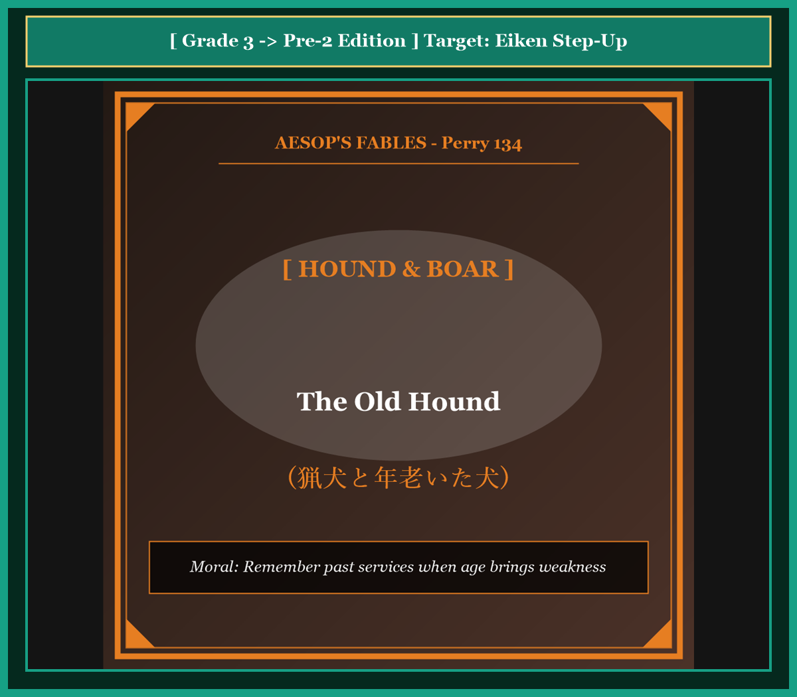
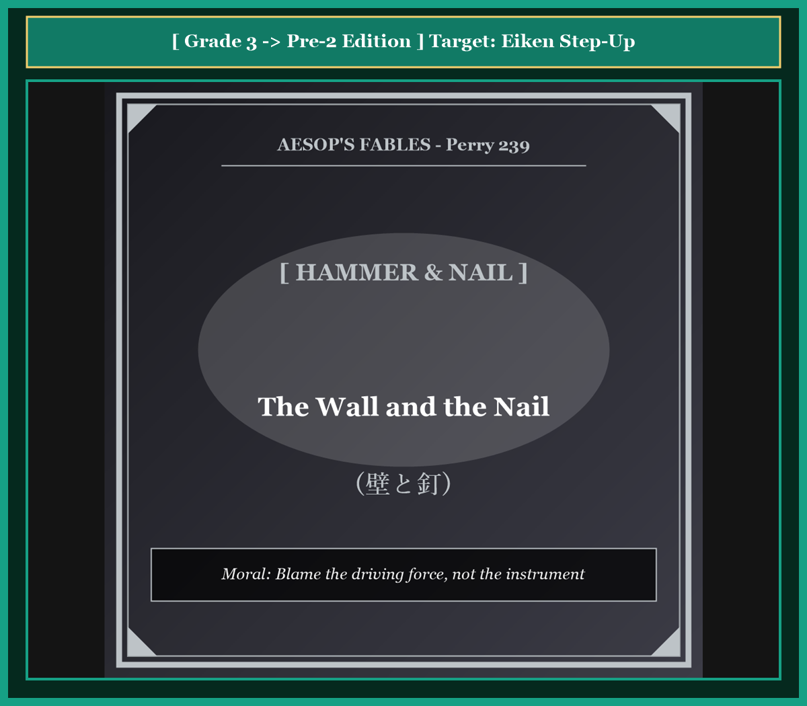
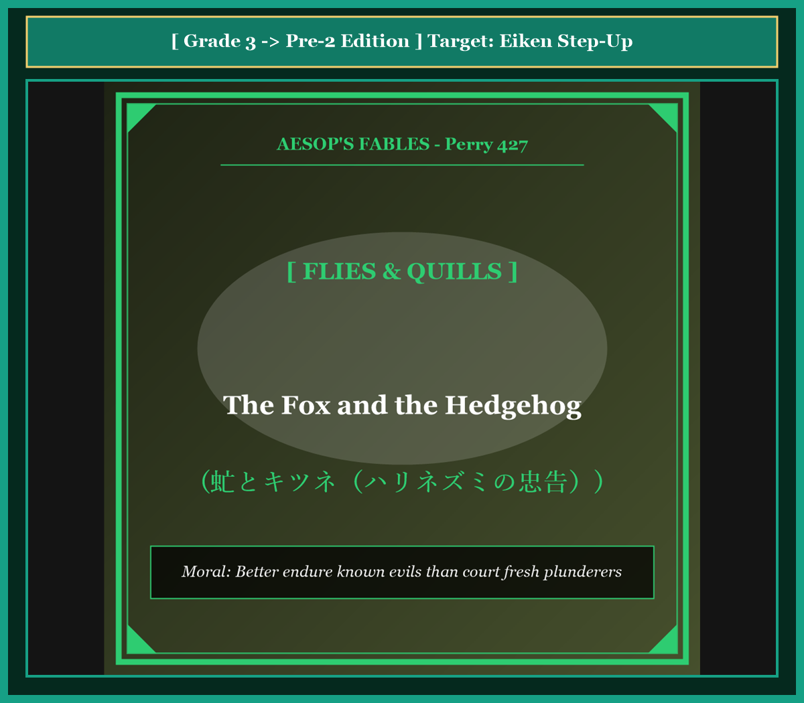
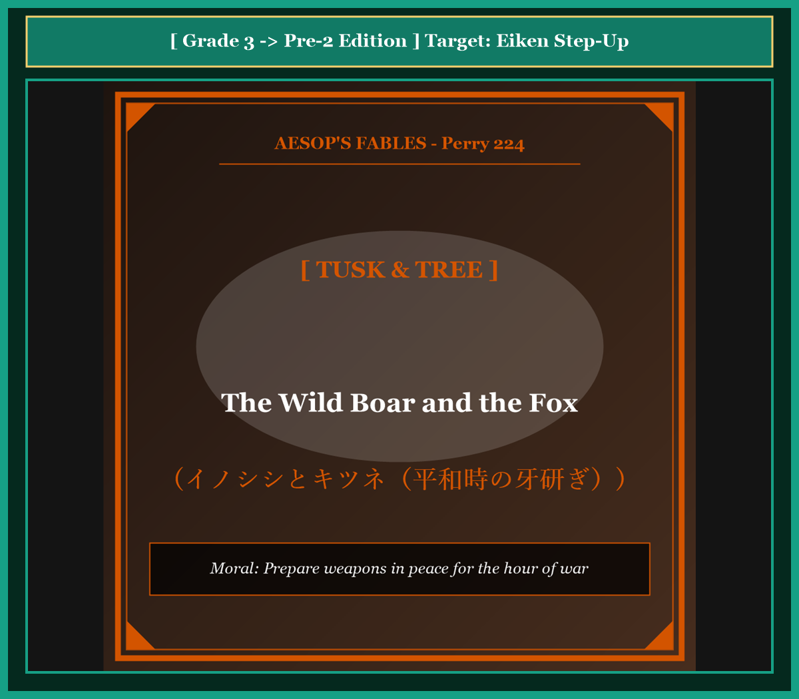
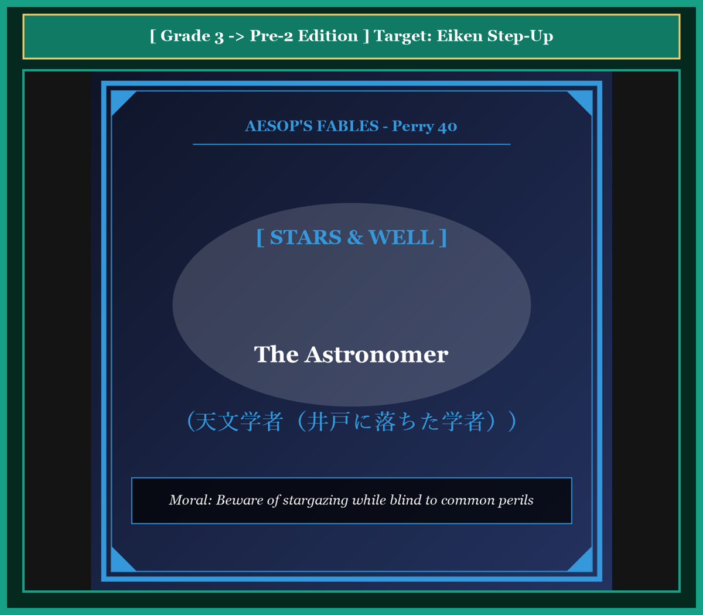
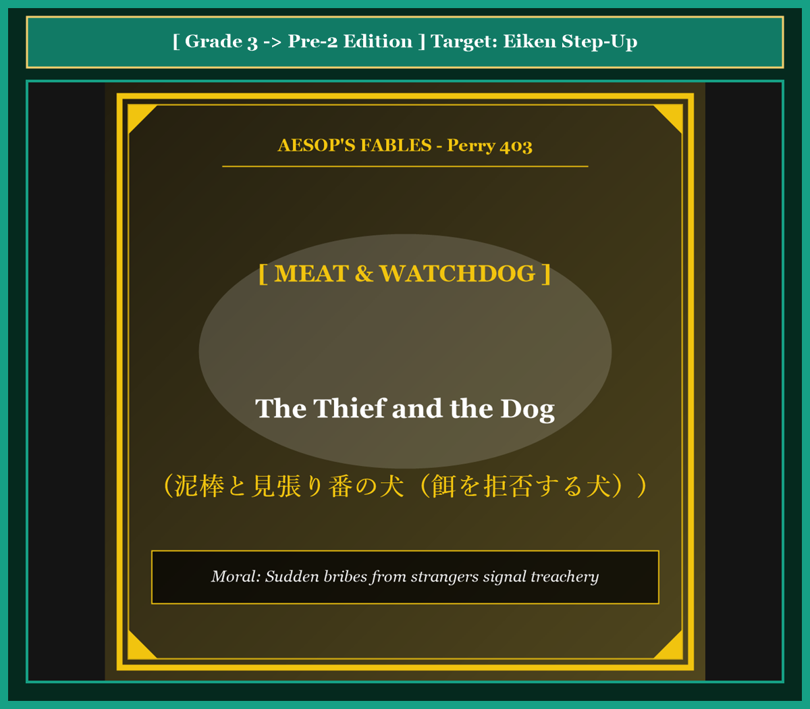
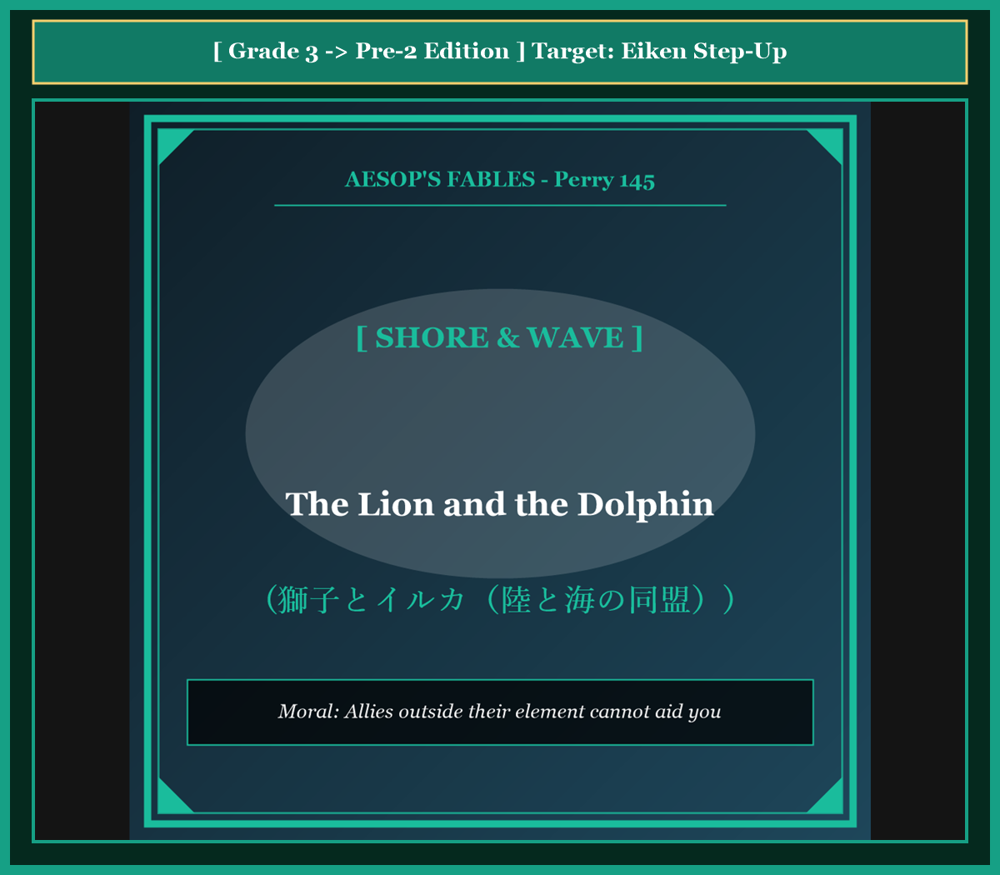
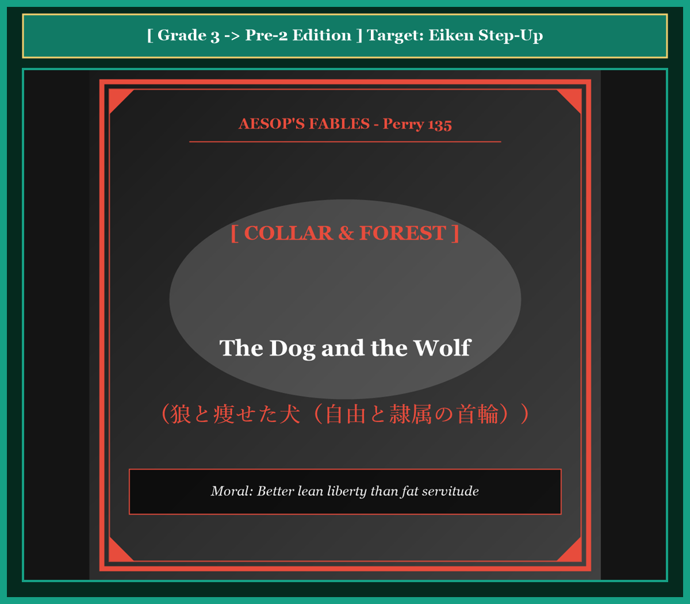
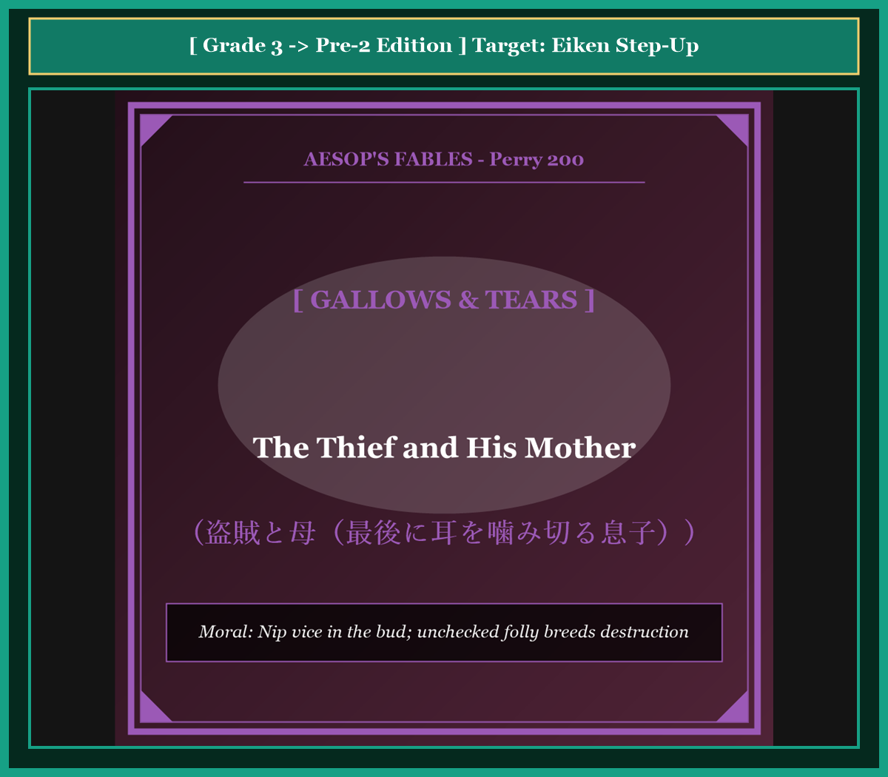
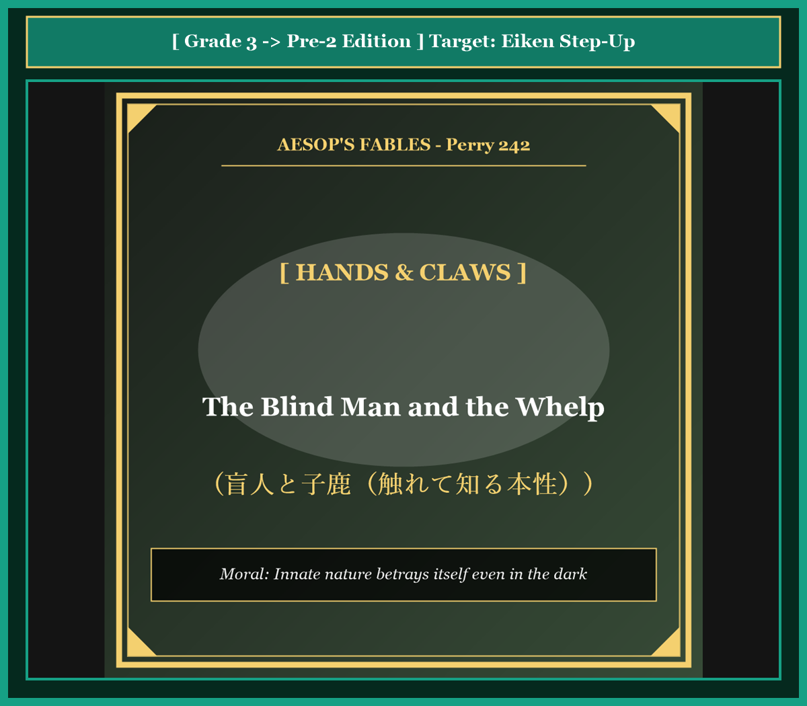

# 『英検ステップアップ多読：イソップ寓話編 第18巻（3級 ➔ 準2級対比学習・第5集）』

---

## はじめに：なぜ「対比多読」で英検準2級の壁を突破できるのか？

英検準2級の合格を目指す学習者にとって、最大の障壁は**「英文の抽象度の高まり」**と**「ライティング（英作文）での論理的な語彙・構文力」**です。

3級までは直感的な日常会話フレーズで太刀打ちできましたが、準2級からは理由や因果関係を論理的に表現する力（*therefore*, *in order to*, *as a result*, 分詞構文, 関係詞節の拡張）が求められます。

本書では、イソップ寓話（第5集・10話）を題材に、**「知っている3級英語」** が **「合格レベルの準2級英語」** へとどのように深まっていくかを対比学習します。

* **馴染みのあるストーリー（3級）** で文脈を完全に把握する
* **洗練された高度表現（準2級）** で論理的な構文・高級な語彙を吸収する
* **暗唱キーフレーズ対比** でライティング・面接で即効性のある表現力を身につける

楽しく寓話を読みながら、英検準2級合格に直結する本物の英語力を手に入れましょう！

---

## 本書の収録作品（第5集・全10話）

1. **Chapter 41**: 猟犬と年老いた犬 (*The Old Hound*) [Perry 134]
2. **Chapter 42**: 壁と釘 (*The Wall and the Nail*) [Perry 239]
3. **Chapter 43**: 虻とキツネ（ハリネズミの忠告） (*The Fox and the Hedgehog*) [Perry 427]
4. **Chapter 44**: イノシシとキツネ（平和時の牙研ぎ） (*The Wild Boar and the Fox*) [Perry 224]
5. **Chapter 45**: 天文学者（井戸に落ちた学者） (*The Astronomer*) [Perry 40]
6. **Chapter 46**: 泥棒と見張り番の犬（餌を拒否する犬） (*The Thief and the Dog*) [Perry 403]
7. **Chapter 47**: 獅子とイルカ（陸と海の同盟） (*The Lion and the Dolphin*) [Perry 145]
8. **Chapter 48**: 狼と痩せた犬（自由と隷属の首輪） (*The Dog and the Wolf*) [Perry 135]
9. **Chapter 49**: 盗賊と母（最後に耳を噛み切る息子） (*The Thief and His Mother*) [Perry 200]
10. **Chapter 50**: 盲人と子鹿（触れて知る本性） (*The Blind Man and the Whelp*) [Perry 242]

---

## 本書の構成と電子書籍 / Kobo最適化

各章は以下の構成で統一されています。

```text
┌─────────────────────────────────────────────────────────────┐
│ 1. Chapter Title & Visual Illustration (章タイトル ＆ 挿絵)   │
│ 2. Benchmark Level: 英検3級レベル英文                         │
│ 3. Target Level: 英検準2級レベル英文                         │
│ 4. Classic Original English Text (イソップ寓話クラシック原文)  │
│ 5. Japanese Translation (日本語訳 ＆ 教訓)                     │
│ 6. Recite & Compare (そらんじたいキーフレーズ対比カード)        │
│ 7. Key Vocabulary & Exam Notes (語彙・文法・試験対策解説)        │
└─────────────────────────────────────────────────────────────┘
```

> **【ポイント】 音声読み上げ（TTS）をご利用の方へ**
> 本文セクション（ステップ1〜3）は英語のみで構成されており、電子書籍やKoboの自動音声読み上げ機能（Text-to-Speech）で日本語が混ざることなく、美しい英語音声で快適にリスニング学習していただけます。


# Chapter 41: The Old Hound (猟犬と年老いた犬)

<!-- 電子書籍 Page Break & Image Header -->
<div style="text-align: center; margin-bottom: 20px;">
  
</div>

<div style="page-break-before: always;"></div>

## 1. Benchmark Level: Eiken Grade 3 (英検3級レベル本文)
*Read in ~1.5 to 2 minutes. Baseline vocabulary and basic syntax.*

A hunter kept a courageous hound that had served him loyally for many years. In his youth, the hound was famous for his incredible speed and powerful jaws, and he never allowed any wild beast to escape.

However, as time went by, the faithful hound grew old and infirm. His limbs lost their youthful agility, and his teeth became blunt and loose. Even though he could no longer run as fast as before, his spirit remained as brave as ever, and he still accompanied his master on every hunt.

One morning, the hunter encountered a ferocious wild boar in the dense forest. The hunter signaled his dog to attack, and the old hound dashed forward without hesitation. With great determination, he seized the monstrous beast by the ear.

The hound struggled desperately to hold the thrashing beast until his master arrived. Unfortunately, his decayed teeth gave way, and the boar broke free and vanished into the thick undergrowth.

When the hunter arrived and discovered that his quarry had escaped, he flew into a violent rage. Instead of showing gratitude for the dog's courage, he raised his heavy stick and began to strike the defenseless animal.

The bruised hound looked up at his master with sorrowful eyes and spoke gently: "Do not strike me, master, for it is not my courage that has failed, but only my physical strength. You should remember the countless victories of my youth rather than despise me for the natural infirmities of my old age."

---
<div style="page-break-before: always;"></div>

## 2. Target Level: Eiken Grade Pre-2 (英検準2級レベル本文)
*Read in ~2 to 2.5 minutes. Advanced vocabulary, complex sentences, and logical rhetoric.*

Throughout his long hunting career, a seasoned woodsman relied upon an exceptional hunting hound that had rendered invaluable service across countless dangerous expeditions. During the prime of his youth, the canine was celebrated for his astonishing endurance and relentless tenacity, regularly overpowering formidable predators that terrorized the region.

Inevitably, the relentless passage of time undermined the veteran's biological vitality. His once muscular limbs grew stiffened with arthritis, his sensory perception deteriorated, and his formidable dental armaments became blunt and fragile. Despite these undeniable physical limitations, the faithful companion refused to retire from active duty, continuing to follow his master into the wilderness with unyielding devotion.

One autumn morning, while exploring a treacherous mountain valley, the pair surprised an enormous wild boar. Recognizing the immediate threat, the hunter dispatched his faithful hound to intercept the raging beast. Displaying remarkable valor that defied his physical decay, the veteran launched himself at the adversary, successfully clamping his jaws around the boar's leathery ear.

A violent struggle ensued, with the mammoth beast thrashing furiously to shake off its assailant. The hound resisted with every ounce of remaining willpower, desperately attempting to immobilize the prey until the hunter could deliver a decisive shot. Tragically, his brittle teeth fractured under the immense strain, allowing the enraged boar to tear itself free and disappear into the dense brambles.

Confronted with the loss of such a valuable prize, the hunter succumbed to irrational fury. Oblivious to the animal's conspicuous bravery, the man raised his iron-tipped staff and administered a merciless beating upon the exhausted veteran.

Enduring the blows with dignified sorrow, the battered hound delivered a poignant rebuke: "Master, why do you punish an ally whose devotion remains untarnished? My spirit is as resolute as in the days of my triumphs, but my aging anatomy can no longer execute the commands of my heart. It is unjust to condemn me for the inevitable decay of nature while completely erasing the memory of my lifelong dedication."

---
<div style="page-break-before: always;"></div>

## 3. Classic Original English Text (イソップ寓話クラシック原文)
*Perry 134: Translated by George Fyler Townsend (1867)*

A Hound who in the days of his youth and strength had never yielded to any beast of the forest, encountered in his old age a boar in the chace. 

He seized him boldly by the ear, but could not retain his hold because of the decay of his teeth, so that the boar escaped. 

His master, quickly coming up, was very much disappointed, and fiercely abused the dog. 

The Hound looked up and said: "It was not my fault, master, my spirit was as good as ever, but I could not help my infirmities. I rather deserve to be praised for what I have been, than to be scolded for what I am."

---
<div style="page-break-before: always;"></div>

## 4. Japanese Translation & Moral (日本語訳と教訓)

### 【日本語全訳：英検準2級レベル本文】
その長い狩猟生活を通じて、ある熟練の山人は、数え切れないほどの危険な遠征において計り知れない貢献を果たしてきた卓越した猟犬に全幅の信頼を置いていました。若かりし全盛期において、その猟犬は驚異的な持久力と執拗な粘り強さで称賛され、その地域を脅かす手強い捕食者たちを幾度となくねじ伏せていました。

しかし不可避なことに、容赦ない歳月の流れがこの老犬の生物学的な生命力を蝕んでいきました。かつて筋肉質だった四肢は関節炎で強張り、感覚の鋭さは衰え、かつて恐れられた頑丈な歯はすり減り脆くなっていました。これら否定しがたい肉体的な限界にもかかわらず、忠実な相棒は現役の任務から退くことを拒み、揺るぎない献身をもって主人に従い荒野へと足を運び続けていました。

ある秋の朝、険しい山谷を探索中、彼らは巨大なイノシシと鉢合わせしました。眼前の脅威を認識した猟師は、暴れ狂う野獣を阻止するために忠実な猟犬を出動させました。自らの肉体の衰えを否定するかのような驚くべき武勇を発揮し、老犬は敵に向かって突進し、イノシシの硬い耳を自らの顎で首尾よく挟み込みました。

激しい格闘が続き、巨大な野獣は襲撃者を振り落とそうと激しく暴れ回りました。猟犬は残された気力の最後の一滴まで振り絞って抵抗し、主人が決定的な一撃を放てるまで獲物を押さえ込もうと必死に努めました。しかし悲劇的なことに、その脆くなった歯は凄まじい負荷に耐えきれず折れてしまい、激昂したイノシシは身を引きちぎって深い茨の茂みの中へと逃走してしまったのです。

これほど貴重な獲物を逃したことに直面した猟師は、不条理な激怒に屈服しました。老犬の明白な勇敢さなど目に入らず、男は鉄の先端がついた杖を振り上げ、疲れ果てた老犬に容赦のない殴打を加えました。

威厳ある悲しみをもってその打撃に耐えながら、打ちのめされた老犬は痛切な戒めを口にしました。「ご主人様、献身の心がまったく色褪せていない仲間を、なぜそのように罰するのですか？ 私の精神は栄光の日々と何ら変わらず不屈ですが、老いた肉体はもはや心の命令を実行できないのです。自然の不可避な衰えを理由に私を断罪する一方で、生涯にわたる献身の記憶を完全に抹消することは、あまりにも不当ではありませんか。」

### 【教訓（Moral）】
**Respect past loyalty when old age brings weakness.**  
（年老いて衰えた者を切り捨てるのではなく、かつて捧げてくれた献身と功績に敬意を払いなさい。現在の能力低下だけを責め立て、過去の貢献を忘れ去る態度は、人間としての最も恥ずべき忘恩である。）

---
<div style="page-break-before: always;"></div>

## 5. Recite & Compare: そらんじたいキーフレーズ対比カード

<div class="comparison-card">
  <div class="card-header">フレーズ 1：若き日の比類なき持久力と粘り強さ</div>
  <div class="card-row-g3-base"><span class="card-badge-g3-base">3級</span>In his youth, the hound was famous for his incredible speed and powerful jaws.</div>
  <div class="card-row-pre2"><span class="card-badge-pre2">準2級</span>During the prime of his youth, the canine was celebrated for his astonishing endurance and relentless tenacity.</div>
  <div class="card-note"><strong>解説：</strong>「in the prime of one's youth（若さの全盛期に）」「relentless tenacity（執拗な粘り強さ）」という準2級頻出の知的な表現です。</div>
</div>

<div class="comparison-card">
  <div class="card-header">フレーズ 2：肉体の衰えを否定するかのような武勇</div>
  <div class="card-row-g3-base"><span class="card-badge-g3-base">3級</span>The old hound dashed forward without hesitation and seized the beast by the ear.</div>
  <div class="card-row-pre2"><span class="card-badge-pre2">準2級</span>Displaying remarkable valor that defied his physical decay, the veteran launched himself at the adversary.</div>
  <div class="card-note"><strong>解説：</strong>分詞構文「Displaying remarkable valor...」と動詞「defy（〜を拒絶する、ものともしない）」の組み合わせです。</div>
</div>

<div class="comparison-card">
  <div class="card-header">フレーズ 3：凄まじい負荷に耐えきれず折れた歯</div>
  <div class="card-row-g3-base"><span class="card-badge-g3-base">3級</span>Unfortunately, his decayed teeth gave way, and the boar broke free.</div>
  <div class="card-row-pre2"><span class="card-badge-pre2">準2級</span>Tragically, his brittle teeth fractured under the immense strain, allowing the boar to tear itself free.</div>
  <div class="card-note"><strong>解説：</strong>「brittle teeth（脆い歯）」「under immense strain（凄まじい緊張・負荷の下で）」という科学的・客観的描写です。</div>
</div>

<div class="comparison-card">
  <div class="card-header">フレーズ 4：衰えを断罪しながら長年の貢献を抹消する不当さ</div>
  <div class="card-row-g3-base"><span class="card-badge-g3-base">3級</span>Remember the victories of my youth rather than despise me for my old age.</div>
  <div class="card-row-pre2"><span class="card-badge-pre2">準2級</span>It is unjust to condemn me for inevitable decay while completely erasing the memory of my lifelong dedication.</div>
  <div class="card-note"><strong>解説：</strong>形式主語構文「It is unjust to do ~ while -ing」を用いた、倫理的説得力に満ちた抗議です。</div>
</div>

---
<div style="page-break-before: always;"></div>

## 6. Key Vocabulary & Exam Notes (英検準2級 重要語彙・文法・面接対策)

### 1. 英検準2級 必須ボキャブラリー
* **seasoned** [形] 経験豊かな、熟練の（*a seasoned woodsman*）
* **tenacity** [名] 粘り強さ、不屈の執念
* **deteriorate** [動] 悪化する、衰退する
* **valor** [名] 武勇、勇敢さ
* **brittle** [形] もろい、砕けやすい
* **strain** [名] 緊張、過度の負担（*under immense strain*）
* **poignant** [形] 痛切な、心を打つ
* **rebuke** [名] 叱責、戒め [動] 〜を戒める

### 2. 文法・構文のチェックポイント
* **defy + 名詞**:
  * 「〜をものともしない、〜に公然と逆らう」。期待や物理的制約を覆す行動を描写する頻出動詞です。
* **It is unjust to do A while doing B**:
  * 「Bする一方でAすることは不当である」。ライティングやディベートで矛盾や不公正を批判する最重要構文です。

### 3. スピーキング（面接）＆ライティング活用ヒント
「定年延長・シニア雇用の尊重」「過去の実績に対する評価制度」を論じる際のフレーズ：
* *Organizations that disregard the contributions of veteran employees often suffer from a loss of institutional wisdom.*（ベテラン従業員の貢献を軽視する組織は、組織的知恵の喪失に苦しむことが多い。）
* *Compensation systems must balance current productivity with recognition of past loyalty.*（評価報酬制度は、現在の生産性と過去の忠誠への評価とのバランスをとらなければならない。）


# Chapter 42: The Wall and the Nail (壁と釘)

<!-- 電子書籍 Page Break & Image Header -->
<div style="text-align: center; margin-bottom: 20px;">
  
</div>

<div style="page-break-before: always;"></div>

## 1. Benchmark Level: Eiken Grade 3 (英検3級レベル本文)
*Read in ~1.5 to 2 minutes. Baseline vocabulary and basic syntax.*

Inside a newly renovated cottage, a smooth plaster wall stood proud and undisturbed. For a long time, nothing disturbed its pristine surface, and it enjoyed complete tranquility.

However, one morning, a homeowner decided to hang a heavy mirror. Armed with a sharp steel nail and an iron hammer, the man approached the wall and positioned the metal point against the smooth plaster.

With several forceful blows, the heavy hammer drove the sharp nail deep into the masonry. As the metal pierced the plaster, fine cracks spread across the white surface, causing the wall acute distress.

Unable to endure the pain, the wall cried out indignantly: "Why are you tearing through my body so mercilessly? I have always treated you with kindness and done you no harm! Why do you wound me so cruelly?"

The vibrating nail, suffering under the repeated impacts of the hammer, groaned in response: "Do not direct your anger at me, friend. I have no personal malice against you, nor do I pierce you of my own free will. Blame the heavy hammer that strikes my head from behind with irresistible force!"

---
<div style="page-break-before: always;"></div>

## 2. Target Level: Eiken Grade Pre-2 (英検準2級レベル本文)
*Read in ~2 to 2.5 minutes. Advanced vocabulary, complex sentences, and logical rhetoric.*

Within the interior of an architecturally refined residence, an immaculate partition wall maintained its flawless aesthetic dignity. Constructed from reinforced lime plaster and finely sanded gypsum, its smooth surface had endured for seasons without suffering the slightest blemish, symbolizing structural stability and domestic serenity.

This harmonious equilibrium was abruptly shattered when an artisan arrived to install an ornate bronze installation. Equipped with a forged iron nail and a substantial steel mallet, the craftsman selected a central coordinate upon the wall and positioned the tempered metal spike against the delicate finish.

Without hesitation, the workman delivered a series of concussive blows. Driven by the mechanical kinetic energy of the mallet, the sharp nail penetrated the outer plaster and bored deep into the underlying brickwork. The structural violence fractured the surrounding mortar, sending spiderweb fissures radiating across the pristine surface and generating immense internal tension.

Convulsing under this traumatic intrusion, the wall lamented its grievance with profound indignation: "Why do you subject my harmless structure to such brutal mutilation? Throughout my existence, I have sheltered you from wind and tempest without inflicting the slightest injury upon you. How can you justify lacerating my flesh with such callous indifference?"

Resonating with acoustic vibration and groaning beneath the continuous barrage of blows, the embedded nail offered a logical defense: "Cease directing your righteous indignation toward an innocent proxy. I possess zero autonomous agency, nor do I derive satisfaction from violating your integrity. I am merely a passive instrument compelled by physical necessity; direct your accusations toward the heavy hammer that impacts my crown with relentless kinetic momentum from behind."

---
<div style="page-break-before: always;"></div>

## 3. Classic Original English Text (イソップ寓話クラシック原文)
*Perry 239: Translated by George Fyler Townsend (1867)*

A Wall, violently driven with a Nail, exclaimed: "Why do you tear me down, who have done you no injury?" 

The Nail replied: "It is not I who am to blame, but he who with great violence drives me on behind."

---
<div style="page-break-before: always;"></div>

## 4. Japanese Translation & Moral (日本語訳と教訓)

### 【日本語全訳：英検準2級レベル本文】
建築学的に洗練された邸宅の内部で、汚れ一つない仕切り壁が、その傷一つない美的な威厳を維持していました。補強された石灰漆喰と緻密に研磨された石膏で造られたその滑らかな表面は、微細な傷一つ負うことなく何基もの季節を生き延びており、構造的な安定と家庭の平穏の象徴となっていました。

この調和のとれた均衡は、ある職人が装飾的な青銅の調度品を取り付けにやってきた時、唐突に粉砕されました。鍛造された鉄の釘と頑丈な鋼鉄の木槌を手にした職人は、壁の中央の座標を定め、焼き入れされた金属のスパイクを繊細な表面にあてがいました。

ためらうことなく、職人は一連の衝撃的な打撃を打ち下ろしました。木槌の機械的な運動エネルギーに駆動され、鋭い釘は外側の漆喰を貫通し、下地のレンガ構造の深部へと潜り込みました。その構造的な暴力は周囲のモルタルを破断させ、汚れなき表面全体に蜘蛛の巣状の亀裂を放射状に走らせ、莫大な内部張力を生み出しました。

この外傷的な侵入に激しく身を震わせながら、壁は深い怒りをもってその不当な苦痛を訴えました。「なぜお前は、何の罪もない私の構造物にこれほど残酷な損傷を加えるのか？ 私はこれまでの存在を通じて、風や嵐からお前を守り、お前に何一つの危害も加えてこなかった。それなのにどうして、これほど冷酷な無関心をもって私の肉体を引き裂くことを正当化できるというのか？」

音響的な振動に震え、絶え間ない打撃の嵐の下でうめき声を上げながら、打ち込まれた釘は論理的な弁明を返しました。「正義の怒りを無実の代理人（手先）に向けるのをやめよ。私には自律的な行動主体（意志）などまったくなく、お前の完全性を侵すことに快感など覚えているわけでもない。私は物理的な必然性によって強いられている受動的な道具にすぎないのだ。背後から容赦のない運動量をもって私の頭を打ち据えている、重い金槌こそを糾弾せよ。」

### 【教訓（Moral）】
**Blame the driving power, not the helpless instrument.**  
（被害をもたらした無力な道具を責めるのではなく、背後でその力を振るっている真の元凶を見据えなさい。不当な圧力や上位の権力によって動かされている手先の実行者だけを非難しても、被害の根本原因を見誤ることになる。）

---
<div style="page-break-before: always;"></div>

## 5. Recite & Compare: そらんじたいキーフレーズ対比カード

<div class="comparison-card">
  <div class="card-header">フレーズ 1：傷一つない美しい壁面の威厳</div>
  <div class="card-row-g3-base"><span class="card-badge-g3-base">3級</span>Inside a cottage, a smooth plaster wall enjoyed complete tranquility.</div>
  <div class="card-row-pre2"><span class="card-badge-pre2">準2級</span>An immaculate partition wall maintained its flawless aesthetic dignity.</div>
  <div class="card-note"><strong>解説：</strong>「immaculate（非の打ち所がない、汚れのない）」「aesthetic dignity（美的な尊厳・威厳）」を用いた格調高い表現です。</div>
</div>

<div class="comparison-card">
  <div class="card-header">フレーズ 2：構造的な暴力と蜘蛛の巣状の亀裂</div>
  <div class="card-row-g3-base"><span class="card-badge-g3-base">3級</span>Fine cracks spread across the white surface, causing the wall acute distress.</div>
  <div class="card-row-pre2"><span class="card-badge-pre2">準2級</span>The structural violence sent spiderweb fissures radiating across the pristine surface.</div>
  <div class="card-note"><strong>解説：</strong>「structural violence（構造的暴力）」「spiderweb fissures（蜘蛛の巣状の亀裂）」という知的な語彙の対比です。</div>
</div>

<div class="comparison-card">
  <div class="card-header">フレーズ 3：自律的な意志を持たない無実の代理人</div>
  <div class="card-row-g3-base"><span class="card-badge-g3-base">3級</span>Do not direct your anger at me. I have no malice against you.</div>
  <div class="card-row-pre2"><span class="card-badge-pre2">準2級</span>Cease directing your indignation toward an innocent proxy; I possess zero autonomous agency.</div>
  <div class="card-note"><strong>解説：</strong>哲学・組織論用語の「proxy（代理人）」「autonomous agency（自律的主体性・行動意志）」を用いた論理的抗弁です。</div>
</div>

<div class="comparison-card">
  <div class="card-header">フレーズ 4：運動量をもって打ち据える背後の金槌を糾弾せよ</div>
  <div class="card-row-g3-base"><span class="card-badge-g3-base">3級</span>Blame the heavy hammer that strikes my head from behind with irresistible force!</div>
  <div class="card-row-pre2"><span class="card-badge-pre2">準2級</span>Direct your accusations toward the heavy hammer that impacts my crown with relentless kinetic momentum.</div>
  <div class="card-note"><strong>解説：</strong>物理学的概念「kinetic momentum（運動量）」を用いて、不可避の圧力を鮮やかに描写しています。</div>
</div>

---
<div style="page-break-before: always;"></div>

## 6. Key Vocabulary & Exam Notes (英検準2級 重要語彙・文法・面接対策)

### 1. 英検準2級 必須ボキャブラリー
* **immaculate** [形] 汚れのない、欠点のない
* **concussive** [形] 衝撃的な、激しい振動を伴う
* **fissure** [名] 亀裂、割れ目
* **mutilation** [名] 切断、損傷、毀損
* **indifference** [名] 無関心、冷淡さ（*callous indifference*）
* **proxy** [名] 代理人、代理物
* **agency** [名] 主体性、作用力（*autonomous agency*）
* **momentum** [名] 運動量、勢い、推進力

### 2. 文法・構文のチェックポイント
* **direct A toward B**:
  * 「A（怒りや非難）をBに向ける」。感情や攻撃の矛先を表現する頻出成句です。
* **send + O + 現在分詞**:
  * 「Oを〜な状態に突入させる、放射させる」。*send fissures radiating* で亀裂が一気に広がる様をダイナミックに描きます。

### 3. スピーキング（面接）＆ライティング活用ヒント
「責任の所在」「システム・制度の根本改革」を論じる際のフレーズ：
* *Holding frontline workers accountable without reforming flawed corporate directives solves nothing.*（欠陥のある企業指示を是正せず前線の従業員のみに責任を負わせても、何一つ解決しない。）
* *In legal ethics, liability must attach to the principal who commands an action, not merely the agent who executes it.*（法倫理において、責任は単にそれを実行した代理人だけでなく、指示を下した本人（本人格）に帰属しなければならない。）


# Chapter 43: The Fox and the Hedgehog (虻とキツネ)

<!-- 電子書籍 Page Break & Image Header -->
<div style="text-align: center; margin-bottom: 20px;">
  
</div>

<div style="page-break-before: always;"></div>

## 1. Benchmark Level: Eiken Grade 3 (英検3級レベル本文)
*Read in ~1.5 to 2 minutes. Baseline vocabulary and basic syntax.*

While attempting to cross a rapid river, an unfortunate fox was swept away by the fierce current and washed into a steep, muddy ravine. Bruised and exhausted from the ordeal, the fox lay completely helpless on the bank, unable to climb back up.

Before long, a swarm of blood-sucking horseflies discovered the defenseless animal. They descended upon his wounds in vast numbers and began to torment him mercilessly. Because the fox was too weak to flick his tail or shake his fur, he had to endure their painful bites in silence.

Presently, a benevolent hedgehog came wandering past the ravine. Seeing the fox in such acute misery, the hedgehog felt deep sympathy and offered his assistance.

"Good neighbor," whispered the hedgehog, "you are suffering terribly from this plague of pests. If you wish, I can easily deploy my sharp quills and drive these tormentors away."

"I beg you, do not disturb them!" the fox exclaimed with great urgency.

The bewildered hedgehog asked: "Why on earth would you refuse my help when these creatures are torturing you?"

"Because," the fox explained prudently, "these flies are already gorged on my blood, so they sting only lightly. If you chase them away, a new swarm of famished flies will take their place and drain the few drops of life that remain within me."

---
<div style="page-break-before: always;"></div>

## 2. Target Level: Eiken Grade Pre-2 (英検準2級レベル本文)
*Read in ~2 to 2.5 minutes. Advanced vocabulary, complex sentences, and logical rhetoric.*

Negotiating the treacherous currents of a swollen mountain river, an unlucky fox lost his footing and was violently propelled downstream. Deposited into an inaccessible rocky canyon, the bruised predator lay physically incapacitated, his energy completely depleted from battling the turbulent torrent.

Taking opportunistic advantage of his immobilized state, a dense colony of blood-sucking parasites descended upon his body. Fastening themselves upon every exposed patch of tender skin, the ravenous insects engaged in unremitting hematological extraction. Deprived of the muscular strength necessary to dislodge them, the fox was subjected to agonizing, prolonged torment.

At that juncture, a well-meaning hedgehog navigated the perimeter of the gorge. Horrified by the grotesque spectacle of his fellow creature being drained alive, the spiny mammal immediately volunteered an intervention: "Comrade, your plight is intolerable. Grant me permission to approach, and I shall systematically brush away this parasitic swarm utilizing the defensive armor of my quills."

"I implore you, refrain from any intervention!" the fox gasped in desperate protestation.

Incredulous at this apparent irrationality, the hedgehog demanded an explanation: "How can you conceivably justify enduring this excruciating affliction when deliverance is freely offered?"

"Your compassion is commendable, yet your proposal betrays a dangerous political shortsightedness," the fox articulated weakly. "These present parasites have already satiated their appetites; their current consumption is negligible, and their stings are relatively benign. Should you disperse them, their vacancy will inevitably attract a famished, desperate horde of fresh predators that will ruthlessly extract every residual drop of vitality from my veins."

---
<div style="page-break-before: always;"></div>

## 3. Classic Original English Text (イソップ寓話クラシック原文)
*Perry 427: Translated by George Fyler Townsend (1867)*

A Fox swimming across a rapid river was carried by the force of the current into a deep ravine, where he lay for a long time unable to get out, and sorely tormented by a swarm of horseflies that fastened on him. 

A Hedgehog wandering by, took pity on him, and asked if he should drive away the flies that were sucking his blood. 

The Fox replied: "Do not, I pray you, brush away these flies." 

"Why not?" asked the Hedgehog. 

"Because," replied the Fox, "these flies are now full of blood and bite me but little; but if you drive them away, others, who are hungry, will come and drink up all the blood I have left."

---
<div style="page-break-before: always;"></div>

## 4. Japanese Translation & Moral (日本語訳と教訓)

### 【日本語全訳：英検準2級レベル本文】
水かさを増した山川の危険な急流を渡ろうとしていた不運なキツネが足を踏み外し、激しく下流へと押し流されてしまいました。侵入困難な岩の峡谷へと打ち上げられたこの傷だらけの捕食者は、荒れ狂う奔流と戦ったことでエネルギーを完全に消耗し、肉体的に身動きが取れなくなっていました。

彼が身動きできない状態を都合よく利用し、血を吸う寄生虫（アブ）の密集したコロニーがその体に群がり落ちてきました。柔らかい皮膚が露出したあらゆる箇所に張り付き、その貪欲な昆虫たちは容赦のない吸血活動に従事しました。それらを払い落とすために必要な筋力を奪われていたキツネは、激痛に満ちた長期にわたる拷問にさらされることになりました。

その時、善意に満ちたハリネズミが峡谷の縁を通りかかりました。仲間の生き物が生きながら血を吸い取られている奇怪な光景に愕然としたその棘のある哺乳類は、即座に介入を申し出ました。「友よ、あなたの苦境は耐え難いものです。近づく許可をください。私の針の防衛兵装を利用して、この寄生虫の群れを組織的に払い落としてあげましょう。」

「お願いだから、いかなる介入も差し控えてくれ！」とキツネは必死の抗議の声を絞り出しました。

この一見不合理な反応を信じられず、ハリネズミは説明を求めました。「救済が無償で差し出されているというのに、この耐え難い苦痛を耐え忍ぶことを一体どうやって正当化できるというのですか？」

「あなたの慈悲は称賛に値するが、あなたの提案は危険な政治的近視眼（浅知恵）を露呈している」とキツネは弱々しく説きました。「現在のこの寄生虫たちは、すでに食欲を満たしている。彼らの現在の消費量は無視できるほど微々たるものであり、その刺し傷も比較的穏やかなものだ。もしあなたが彼らを追い散らしてしまえば、その空いた席は、私の血管から残された最後の一滴の生命力まで冷酷に絞り尽くす、飢餓に苦しむ新たな捕食者の大群を不可避的に呼び寄せることになるのだ。」

### 【教訓（Moral）】
**Better endure known evils than court fresh plunderers.**  
（すでに行き渡った既知の害悪を耐え忍ぶほうが、飢えた新たな略奪者を呼び寄せるよりもはるかに賢明である。性急に体制や役人を入れ替えても、より強欲な新たな搾取者がやってくれば、残された富をすべて奪い去られることになる。）

---
<div style="page-break-before: always;"></div>

## 5. Recite & Compare: そらんじたいキーフレーズ対比カード

<div class="comparison-card">
  <div class="card-header">フレーズ 1：動けない状態を好機と捉えて群がる寄生虫</div>
  <div class="card-row-g3-base"><span class="card-badge-g3-base">3級</span>A swarm of horseflies discovered the animal and tormented him mercilessly.</div>
  <div class="card-row-pre2"><span class="card-badge-pre2">準2級</span>Taking opportunistic advantage of his immobilized state, a dense colony of parasites descended upon him.</div>
  <div class="card-note"><strong>解説：</strong>「opportunistic advantage（ご都合主義的な好機利用）」「immobilized state（身動きできない状態）」を用いた精緻な表現です。</div>
</div>

<div class="comparison-card">
  <div class="card-header">フレーズ 2：善意の介入の申し出とその拒絶</div>
  <div class="card-row-g3-base"><span class="card-badge-g3-base">3級</span>If you wish, I can easily deploy my sharp quills and drive these tormentors away.</div>
  <div class="card-row-pre2"><span class="card-badge-pre2">準2級</span>I shall brush away this parasitic swarm utilizing my quills. — I implore you, refrain from intervention!</div>
  <div class="card-note"><strong>解説：</strong>「implore someone to do ~（人に〜するよう懇願する）」「refrain from ~（〜を控える）」という重要語彙の対比です。</div>
</div>

<div class="comparison-card">
  <div class="card-header">フレーズ 3：満腹した現在の搾取者は微々たるもの</div>
  <div class="card-row-g3-base"><span class="card-badge-g3-base">3級</span>These flies are already gorged on my blood, so they sting only lightly.</div>
  <div class="card-row-pre2"><span class="card-badge-pre2">準2級</span>These parasites have satiated their appetites; their consumption is negligible and relatively benign.</div>
  <div class="card-note"><strong>解説：</strong>「satiate one's appetite（食欲を満たす）」「negligible（無視できるほど僅かな）」「benign（良性の、無害な）」という学術的語彙です。</div>
</div>

<div class="comparison-card">
  <div class="card-header">フレーズ 4：空席が飢えた新たな略奪者を招く</div>
  <div class="card-row-g3-base"><span class="card-badge-g3-base">3級</span>A new swarm of famished flies will take their place and drain the few drops that remain.</div>
  <div class="card-row-pre2"><span class="card-badge-pre2">準2級</span>Their vacancy will inevitably attract a famished horde of fresh predators that will ruthlessly extract every drop.</div>
  <div class="card-note"><strong>解説：</strong>「vacancy（空席・欠員）」「inevitably attract ~（不可避的に〜を引き寄せる）」という社会科学的な洞察構文です。</div>
</div>

---
<div style="page-break-before: always;"></div>

## 6. Key Vocabulary & Exam Notes (英検準2級 重要語彙・文法・面接対策)

### 1. 英検準2級 必須ボキャブラリー
* **opportunistic** [形] 日和見的な、好機を利用した
* **incapacitated** [形] 身動きが取れない、無力化された
* **satiate** [動] 〜を十分に満足させる、満腹にさせる
* **negligible** [形] 無視してよい、ごくわずかな
* **benign** [形] 良性の、無害な、穏やかな
* **incredulous** [形] 信じられない様子の、疑い深い
* **excruciating** [形] 耐え難い、激痛の
* **plunderer** [名] 略奪者、搾取者

### 2. 文法・構文のチェックポイント
* **refrain from + 動名詞**:
  * 「〜するのを控える、差し控える」。公的な要請や自制を表す極めてフォーマルな熟語です。
* **take opportunistic advantage of ~**:
  * 「〜の弱み・機会を抜け目なく利用する」。国際関係やビジネスの論評で頻出します。

### 3. スピーキング（面接）＆ライティング活用ヒント
「性急な官僚・役員交代のリスク」「汚職撲滅政策の現実的配慮」を論じる際のフレーズ：
* *Abruptly replacing an entire bureaucracy often empowers new corrupt factions who extract resources more aggressively.*（官僚組織全体を唐突に刷新することは、より攻撃的に資源を搾取する新たな汚職派閥に力を与える結果になりがちである。）
* *In institutional reform, policymakers must ensure that eradicating existing inefficiencies does not create a vacuum for worse corruption.*（制度改革において、政策立案者は既存の非効率の撲滅がより深刻な腐敗のための空白を生み出さないよう配慮しなければならない。）


# Chapter 44: The Wild Boar and the Fox (イノシシとキツネ)

<!-- 電子書籍 Page Break & Image Header -->
<div style="text-align: center; margin-bottom: 20px;">
  
</div>

<div style="page-break-before: always;"></div>

## 1. Benchmark Level: Eiken Grade 3 (英検3級レベル本文)
*Read in ~1.5 to 2 minutes. Baseline vocabulary and basic syntax.*

On a calm summer morning, a massive wild boar stood beside an ancient oak tree in a quiet clearing. The surrounding woods were serene, and not a single predator was in sight.

Despite the peaceful atmosphere, the boar was diligently whetting his formidable tusks against the tree's sturdy trunk. He ground each curved tooth methodically, ensuring that their points were razor-sharp and ready for combat.

A witty fox happened to stroll by and noticed the boar's intensive labor. Finding the behavior peculiar, the fox tilted his head and mocked the serious beast.

"My dear friend," chuckled the fox, "why are you exhausting yourself on such a lovely day? There is neither a hunter's arrow nor a barking hound within miles of this meadow. What is the point of sharpening your weapons when there is no enemy to fight?"

The boar paused momentarily and delivered a wise reply: "I do not sharpen my tusks out of paranoia, but out of foresight. When an adversary ambushes me in the dark woods, I will have no leisure to prepare my weapons. It is too late to sharpen one's tusks when the battle has already begun."

---
<div style="page-break-before: always;"></div>

## 2. Target Level: Eiken Grade Pre-2 (英検準2級レベル本文)
*Read in ~2 to 2.5 minutes. Advanced vocabulary, complex sentences, and logical rhetoric.*

In a secluded forest sanctuary bathed in warm sunshine, an imposing wild boar occupied a grassy knoll beneath a centuries-old oak. The ambient conditions indicated total tranquility; songbirds chirped harmoniously, and the gentle breeze carried zero scent of predatory danger or human intrusion.

Notwithstanding this idyllic setting, the formidable beast was engaged in an austere program of military preparedness. Leaning his massive bulk against the rough bark, he rhythmically sharpened his protruding ivory tusks. With meticulous precision, he honed their razor edges against the hard wood, determined to maintain his primary biological deterrent in a state of peak operational readiness.

A cynical fox wandered into the clearing and observed this deliberate conditioning with condescending amusement. Convinced that the boar was indulging in pointless anxiety, the fox approached with a sarcastic sneer.

"Pardon my curiosity, distinguished warrior," the fox jeered playfully, "but why squander your vital reserves during an interval of unconditional peace? No hounds patrol these valleys, nor does any hunter conceal himself behind these thickets. Is it not the height of absurdity to sharpen defensive armaments when no active menace threatens your security?"

Without losing his rhythmic cadence, the boar cast a discerning glance toward his critic and articulated a profound strategic maxim: "My diligence is governed not by irrational apprehension, but by calculated prudence. When a lethal crisis materializes, the luxury of preparation evaporates instantaneously. In the sudden crucible of combat, one must deploy existing armaments; to initiate preparation amid battle guarantees catastrophe."

---
<div style="page-break-before: always;"></div>

## 3. Classic Original English Text (イソップ寓話クラシック原文)
*Perry 224: Translated by George Fyler Townsend (1867)*

A Wild Boar stood under a tree and rubbed his tusks against the trunk. 

A Fox passing by asked him why he thus whetted his teeth when there was no danger in sight from either hunter or hound. 

"I do it advisedly," said the Boar; "for it would never do to have to sharpen my weapons just at the time I ought to be using them to defend myself."

---
<div style="page-break-before: always;"></div>

## 4. Japanese Translation & Moral (日本語訳と教訓)

### 【日本語全訳：英検準2級レベル本文】
温かな陽光が降り注ぐ人里離れた森の聖域で、堂々たるイノシシが樹齢数百年の樫の木の下の草の茂る丘に陣取っていました。周囲の環境は完全な平穏を示していました。小鳥たちは調和よくさえずり、そよ風は捕食者の危険や人間の侵入の匂いを微塵も運んでいませんでした。

この牧歌的な情景にもかかわらず、その手強い野獣は軍事的な即応態勢の厳格な訓練に従事していました。粗い樹皮にその巨体を預け、彼は突き出た象牙のような牙をリズミカルに研ぎ澄ましていました。細心の注意を払い、彼は自らの生物学的な抑止兵器を最高峰の作戦即応状態に維持することを期して、硬い木肌にそのカミソリの刃先を入念に研ぎ磨いていたのです。

皮肉屋のキツネが空き地へと歩み寄り、見下すような面白がり方をもってこの意図的な鍛錬を観察しました。イノシシが無駄な不安に耽っていると確信したキツネは、皮肉な薄笑いを浮かべながら近づいてきました。

「私の好奇心をお許し願いたい、歴戦の勇士よ」とキツネはおどけて嘲笑しました。「しかし、無条件の平和の合間に、なぜそれほど貴重な生命力を浪費しているのですか？ この谷に猟犬は巡回しておらず、この藪の陰に身を潜めている猟師もおりません。現実に迫る脅威が安全を脅かしてもいないのに、防衛兵装を研ぎ澄ますなど不条理の極みではありませんか？」

そのリズミカルな調子を崩すことなく、イノシシはその批評家へと鋭い視線を投げかけ、深遠な戦略的格言を口にしました。「私の不断の努力は、理不尽な不安によって支配されているのではなく、計算された深慮（プラグマティズム）に基づいているのだ。致死的な危機が具体化した時、準備という贅沢は瞬時に消滅する。戦闘という突発的な過酷な試練の中では、すでに手元にある兵装を展開しなければならない。戦いの真っ只中に準備を始めることなど、自滅を保証するに等しいのだ。」

### 【教訓（Moral）】
**Prepare weapons in peace for the hour of war.**  
（平和な時こそ有事に備えて武器を研いでおきなさい。危機が目前に迫ってから準備を始めても手遅れであり、平時の地道な備えこそが、いざという時に身を守る最大の盾となる。）

---
<div style="page-break-before: always;"></div>

## 5. Recite & Compare: そらんじたいキーフレーズ対比カード

<div class="comparison-card">
  <div class="card-header">フレーズ 1：牧歌的な平和の中でも怠らない軍備の即応態勢</div>
  <div class="card-row-g3-base"><span class="card-badge-g3-base">3級</span>Despite the peaceful atmosphere, the boar was diligently whetting his formidable tusks.</div>
  <div class="card-row-pre2"><span class="card-badge-pre2">準2級</span>Notwithstanding this idyllic setting, the beast was engaged in an austere program of military preparedness.</div>
  <div class="card-note"><strong>解説：</strong>「Notwithstanding ~（〜にもかかわらず）」「austere program of military preparedness（厳格な軍備即応計画）」の高度な表現です。</div>
</div>

<div class="comparison-card">
  <div class="card-header">フレーズ 2：平和の合間に活力を浪費しているという嘲笑</div>
  <div class="card-row-g3-base"><span class="card-badge-g3-base">3級</span>Why are you exhausting yourself on such a lovely day?</div>
  <div class="card-row-pre2"><span class="card-badge-pre2">準2級</span>Why squander your vital reserves during an interval of unconditional peace?</div>
  <div class="card-note"><strong>解説：</strong>「squander ~（〜を浪費する）」「interval of unconditional peace（無条件の平和の合間）」という知的な批判表現です。</div>
</div>

<div class="comparison-card">
  <div class="card-header">フレーズ 3：不条理な恐怖ではなく計算された深慮</div>
  <div class="card-row-g3-base"><span class="card-badge-g3-base">3級</span>I do not sharpen my tusks out of paranoia, but out of foresight.</div>
  <div class="card-row-pre2"><span class="card-badge-pre2">準2級</span>My diligence is governed not by irrational apprehension, but by calculated prudence.</div>
  <div class="card-note"><strong>解説：</strong>「governed not by A, but by B」「calculated prudence（計算された深慮）」という政治学・戦略論のトーンです。</div>
</div>

<div class="comparison-card">
  <div class="card-header">フレーズ 4：危機の最中に準備を始めるのは破滅への道</div>
  <div class="card-row-g3-base"><span class="card-badge-g3-base">3級</span>It is too late to sharpen one's tusks when the battle has already begun.</div>
  <div class="card-row-pre2"><span class="card-badge-pre2">準2級</span>The luxury of preparation evaporates instantaneously; to initiate preparation amid battle guarantees catastrophe.</div>
  <div class="card-note"><strong>解説：</strong>「evaporate instantaneously（瞬時に蒸発・消滅する）」「guarantee catastrophe（破滅を保証する）」という力強い警告構文です。</div>
</div>

---
<div style="page-break-before: always;"></div>

## 6. Key Vocabulary & Exam Notes (英検準2級 重要語彙・文法・面接対策)

### 1. 英検準2級 必須ボキャブラリー
* **idyllic** [形] 牧歌的な、のどかな
* **preparedness** [名] （有事や災害への）即応態勢、覚悟
* **deterrent** [名] 抑止力、抑止物
* **condescending** [形] 見下すような、恩着せがましい
* **squander** [動] （時間や資金を）浪費する、無駄遣いする
* **prudence** [名] 深慮、慎重さ、分別
* **crucible** [名] 過酷な試練、るつぼ
* **catastrophe** [名] 破滅、大惨事

### 2. 文法・構文のチェックポイント
* **Notwithstanding + 名詞**:
  * 「〜にもかかわらず」。*despite* や *in spite of* の極めて格調高い同義語で、エッセイの冒頭で多用されます。
* **to do ~ guarantees catastrophe**:
  * 不定詞の主語構文。「〜することは惨劇を保証する（確実にもたらす）」という断定的な論理展開です。

### 3. スピーキング（面接）＆ライティング活用ヒント
「国防・抑止力の維持」「ITセキュリティやインフラの平時投資」を論じる際のフレーズ：
* *Maintaining robust cyber defenses during periods of apparent peace prevents catastrophic infrastructure sabotage.*（一見平和な時期に強固なサイバー防壁を維持することは、壊滅的なインフラ破壊工作を予防する。）
* *Prudent nations invest in emergency reserves before geopolitical crises materialize.*（賢明な国家は、地政学的危機が具現化する前に緊急備蓄へと投資する。）


# Chapter 45: The Astronomer (天文学者)

<!-- 電子書籍 Page Break & Image Header -->
<div style="text-align: center; margin-bottom: 20px;">
  
</div>

<div style="page-break-before: always;"></div>

## 1. Benchmark Level: Eiken Grade 3 (英検3級レベル本文)
*Read in ~1.5 to 2 minutes. Baseline vocabulary and basic syntax.*

In a prosperous ancient city, there lived an eccentric astronomer who dedicated his entire life to the study of the heavens. Every evening, he would venture into the countryside to observe the constellations, recording the movements of celestial bodies with passionate devotion.

One evening, captivated by an unusually brilliant alignment of stars, the philosopher wandered far beyond the city gates. With his chin pointed upward and his eyes glued to the starry vault above, he became completely lost in sublime contemplation, entirely oblivious to his physical surroundings.

Unbeknownst to the scholar, an abandoned water well lay directly in his path. Because the rim of the pit was level with the grass, it constituted an invisible hazard in the darkness. Absorbed in astronomical calculations, the man took one careless stride forward and plunged headlong into the subterranean abyss.

The astronomer hit the icy water with a deafening splash. Trapped in the pitch-black well with soaked robes and painful bruises, he shrieked frantically for assistance, his voice echoing up the circular shaft.

Hearing the desperate commotion, a sensible farmer rushed toward the opening with a lantern. Upon discovering that the town's most celebrated intellectual was shivering at the bottom of the pit, the farmer lowered a rescue rope, but could not resist offering a piece of practical advice.

"My esteemed philosopher," chuckled the rescuer, "while you strain your eyes to decipher the secrets of the distant heavens, how on earth do you manage to overlook the common dangers beneath your feet?"

---
<div style="page-break-before: always;"></div>

## 2. Target Level: Eiken Grade Pre-2 (英検準2級レベル本文)
*Read in ~2 to 2.5 minutes. Advanced vocabulary, complex sentences, and logical rhetoric.*

In an ancient Hellenic metropolis, an intellectual sage devoted his waking existence exclusively to speculative astrophysics. Dismissing terrestrial affairs as vulgar and inconsequential, he concentrated his intellectual faculties upon calculating planetary orbits and formulating cosmological hypotheses. Every evening, he ventured unaccompanied into the countryside, entirely preoccupied with charting stellar trajectories across the nocturnal sky.

On a moonless night characterized by extraordinary atmospheric clarity, the scholar wandered into an uncultivated pasture. Enchanted by a rare planetary conjunction, he tilted his head backward at an acute angle, fixing his optical focus upon the zenith. Immersed in profound philosophical euphoria, his consciousness was entirely disengaged from terrestrial sensory data; he moved as if navigating an incorporeal dreamscape.

Tragically, this absolute cognitive detachment proved hazardous. An ancient subterranean cistern, long neglected by local agriculturalists and completely concealed by overgrown vegetation, lay directly aligned with his vector of movement. Because the aperture lacked any protective parapet, it represented an invisible lethal trap. Advancing blindly with his gaze anchored to the Milky Way, the intellectual took a fatal step into empty space and plummeted vertically into the dark subterranean reservoir.

The catastrophic impact with the frigid water shattered his romantic reverie. Submerged in darkness, suffering severe contusions and struggling against hypothermia, the helpless philosopher articulated frantic vociferations for emergency extraction.

Attracted by the resonance of distress echoing from the earth, an unpretentious peasant approached the chasm equipped with a rescue rope. Shining his lantern into the depths and identifying the distinguished theorist trembling amidst the stagnant muck, the rustic orchestrated his extraction while articulating a devastating epistemological critique.

"Distinguished master," the peasant remarked with dry irony, "you expend boundless intellectual capital attempting to decipher the grand mysteries of celestial spheres millions of miles away, yet you remain pathetically incompetent at navigating the elementary hazards of the very earth upon which you tread."

---
<div style="page-break-before: always;"></div>

## 3. Classic Original English Text (イソップ寓話クラシック原文)
*Perry 40: Translated by George Fyler Townsend (1867)*

An Astronomer used to go out at night to observe the stars. 

One evening, as he wandered through the suburbs with his whole attention fixed on the sky, he fell unawares into a deep well. 

While he lamented and bewailed his sores and bruises, and cried loudly for help, a neighbor ran to the well, and learning what had happened said: 

"Hark ye, old fellow, why, in striving to pry into what is in heaven, do you not manage to see what is on earth?"

---
<div style="page-break-before: always;"></div>

## 4. Japanese Translation & Moral (日本語訳と教訓)

### 【日本語全訳：英検準2級レベル本文】
ある古代ギリシャの大都市において、ある知的な賢者が、自らの目覚めているすべての時間を思弁的な天体物理学の研究のみに捧げていました。地上の俗事を卑俗で取るに足らないものとして退け、彼は自らの知的能力を惑星の軌道計算と宇宙論的仮説の構築に集中させていました。毎晩のように彼は一人で田舎へと足を運び、夜空の恒星の軌跡を作図することだけに完全に没頭していました。

類まれな大気の透明度を誇る月なき夜、この学者は耕作されていない野原へと迷い込みました。珍しい惑星の直列（合）に魅了された彼は、頭を鋭角に後ろへと反らし、視覚の焦点を天頂へと固定しました。深遠な哲学的多幸感に浸り、彼の意識は地上の感覚データから完全に切り離されていました。彼はまるで実体のない夢の世界を航行しているかのように歩を進めていたのです。

悲劇的なことに、この絶対的な認知の乖離（現実遊離）は命取りとなりました。地元の農業従事者たちに長年放置され、生い茂る草木に完全に覆い隠された古代の地下貯水槽（古井戸）が、彼の進行ベクトルの真正面に位置していたのです。その開口部には防護用の手すりや覆いが一切なかったため、それは目に見えない致死的な罠となっていました。天の川に視線を固定したまま盲目的に前進したこの知識人は、虚空の中へと致命的な一歩を踏み出し、暗い地下の貯水槽へと垂直に急降下したのです。

氷のように冷たい水との壊滅的な激突が、彼のロマンチックな夢想を一瞬で粉砕しました。暗闇の中に沈み、激しい打撲傷に苦しみ、低体温症と戦いながら、この無力な哲学者は緊急救助を求めて狂乱の悲鳴を上げました。

大地から反響してくる遭難の音に引き寄せられ、ある飾り気のない農民が救助ロープを携えてその深淵へと近づいてきました。カンテラを深みへと照らし、よどんだ汚泥の中で震えている名高い理論学者を特定した農夫は、彼を引き上げながら、痛烈な認識論的批判を口にしました。

「偉大なる大先生」と農民は辛辣な皮肉を込めて言いました。「何百万マイルも彼方にある天球の壮大な謎を解読しようと無限の知的所有資源を浪費する一方で、自分が踏みしめているまさにその大地の初歩的な危険を回避することには、なぜこれほど情けないほど無能でいられるのですかな。」

### 【教訓（Moral）】
**Beware of stargazing while blind to common perils.**  
（遠大な空論や理想ばかりを見上げて、足元の身近な危険や現実から目をそらしてはならない。高邁な目標に熱中するあまり初歩的な現実管理をおろそかにする者は、不意の落とし穴に落ちて身を滅ぼすことになる。）

---
<div style="page-break-before: always;"></div>

## 5. Recite & Compare: そらんじたいキーフレーズ対比カード

<div class="comparison-card">
  <div class="card-header">フレーズ 1：地上の現実から切り離された絶対的没頭</div>
  <div class="card-row-g3-base"><span class="card-badge-g3-base">3級</span>Lost in sublime contemplation, he was entirely oblivious to his surroundings.</div>
  <div class="card-row-pre2"><span class="card-badge-pre2">準2級</span>Immersed in philosophical euphoria, his consciousness was entirely disengaged from terrestrial sensory data.</div>
  <div class="card-note"><strong>解説：</strong>「philosophical euphoria（哲学的高揚感）」「disengaged from terrestrial data（地上の情報から切り離された）」という学術的文体です。</div>
</div>

<div class="comparison-card">
  <div class="card-header">フレーズ 2：天の川に目を奪われたまま虚空へ転落</div>
  <div class="card-row-g3-base"><span class="card-badge-g3-base">3級</span>Absorbed in calculations, the man took one careless stride and plunged headlong into the abyss.</div>
  <div class="card-row-pre2"><span class="card-badge-pre2">準2級</span>With his gaze anchored to the Milky Way, the intellectual took a fatal step into empty space and plummeted vertically.</div>
  <div class="card-note"><strong>解説：</strong>「gaze anchored to ~（〜に視線が繋ぎ止められた）」「plummet vertically（垂直に急降下する）」という高度な描写です。</div>
</div>

<div class="comparison-card">
  <div class="card-header">フレーズ 3：冷水との激突が甘い夢想を粉砕</div>
  <div class="card-row-g3-base"><span class="card-badge-g3-base">3級</span>The astronomer hit the icy water with a deafening splash.</div>
  <div class="card-row-pre2"><span class="card-badge-pre2">準2級</span>The catastrophic impact with the frigid water shattered his romantic reverie.</div>
  <div class="card-note"><strong>解説：</strong>名詞「reverie（空想、白昼夢）」を用い、理性の覚醒をドラマチックに表現しています。</div>
</div>

<div class="comparison-card">
  <div class="card-header">フレーズ 4：宇宙の謎を解く学者が足元の危険には無能</div>
  <div class="card-row-g3-base"><span class="card-badge-g3-base">3級</span>While you decipher the heavens, how do you manage to overlook the dangers beneath your feet?</div>
  <div class="card-row-pre2"><span class="card-badge-pre2">準2級</span>You expend boundless capital deciphering celestial spheres, yet remain pathetically incompetent at navigating elementary hazards.</div>
  <div class="card-note"><strong>解説：</strong>「expend capital（資本・知力を投入する）」「pathetically incompetent at ~（〜において哀れなほど無能である）」という切れ味鋭い対比です。</div>
</div>

---
<div style="page-break-before: always;"></div>

## 6. Key Vocabulary & Exam Notes (英検準2級 重要語彙・文法・面接対策)

### 1. 英検準2級 必須ボキャブラリー
* **speculative** [形] 思弁的な、推測に基づく
* **inconsequential** [形] 重要でない、取るに足らない
* **conjunction** [名] （惑星の）合、直列、結合
* **incorporeal** [形] 実体のない、非物質的な
* **cistern** [名] 貯水池、地下水槽、井戸
* **reverie** [名] 幻想、空想、白昼夢
* **contusion** [名] 打撲傷、挫傷
* **incompetent** [形] 無能な、適性を欠く（*incompetent at -ing*）

### 2. 文法・構文のチェックポイント
* **be disengaged from + 名詞**:
  * 「〜から切り離されている、遊離している」。現実逃避やシステムの分離を説明する重要表現です。
* **pathetically incompetent at ~**:
  * 「〜に関して哀れなほど無能である」。批判的な論評やエッセイで際立つ語彙コンビネーションです。

### 3. スピーキング（面接）＆ライティング活用ヒント
「基礎的ガバナンスと壮大な戦略ビジョンの不均衡」を論じる際のフレーズ：
* *Corporate leadership must not pursue grand speculative mergers while neglecting fundamental balance-sheet liabilities.*（経営陣は、根本的なバランスシートの負債を放置しながら壮大で思弁的な合併を追求してはならない。）
* *Visionary policies are worthless if governments fail to execute basic public-service delivery.*（政府が基本的な公共サービスの提供を実行できないなら、先見的な政策など何の価値もない。）


# Chapter 46: The Thief and the Dog (泥棒と見張り番の犬)

<!-- 電子書籍 Page Break & Image Header -->
<div style="text-align: center; margin-bottom: 20px;">
  
</div>

<div style="page-break-before: always;"></div>

## 1. Benchmark Level: Eiken Grade 3 (英検3級レベル本文)
*Read in ~1.5 to 2 minutes. Baseline vocabulary and basic syntax.*

A vigilant watchdog guarded a spacious country estate. The dog took immense pride in his duty, never slumbering while his master's family slept soundly inside the dark residence.

In the dead of night, a cunning burglar sneaked over the garden wall, intending to plunder the family's valuables. However, as soon as the intruder's boots touched the gravel path, the alert hound detected the subtle vibration and emitted a thunderous series of warnings.

Panic-stricken that the clamor would arouse the household, the burglar swiftly retrieved a succulent cut of roasted meat from his knapsack. He tossed the savory bribe toward the hound, hoping to silence the creature's frantic barks.

"Hush, noble beast," the thief coaxed in a hushed tone. "Accept this delicious feast and permit me to pass unhindered."

The steadfast hound backed away from the treat and glared at the stranger with fierce indignation.

"At first," growled the dog, "I was merely suspicious of your stealthy movements in the shadows. But now that you attempt to bribe me into betraying my master's trust, I am thoroughly convinced of your villainy! I will not cease barking until the entire household is awake and you are delivered to justice!"

---
<div style="page-break-before: always;"></div>

## 2. Target Level: Eiken Grade Pre-2 (英検準2級レベル本文)
*Read in ~2 to 2.5 minutes. Advanced vocabulary, complex sentences, and logical rhetoric.*

Assigned to safeguard a prominent agricultural estate, a disciplined canine sentinel maintained an uncompromising nocturnal vigil. Imbued with deep psychological loyalty to his patron, the guardian surveyed the outer perimeter with unwavering attention, refusing to succumb to fatigue while the inhabitants slept in peaceful security.

Under cover of an overcast midnight, a professional burglar breached the estate's stone enclosure, calculating that a clandestine infiltration would yield a substantial harvest of silver and gold. However, the trespasser severely underestimated the sentinel's acute sensory apparatus. The instant the intruder navigated the perimeter shrubbery, the canine registered the auditory anomaly and unleashed a barrage of deep, reverberating barks that shattered the nocturnal silence.

Alarmed that this acoustic escalation would prematurely alert the armed household, the intruder executed a calculated countermeasure. Reaching into his satchel, he extracted a generous portion of freshly roasted mutton, infused with tempting aromas. He flung the gastronomic inducement directly before the hound, attempting to purchase the animal's complicity through instant gratification.

"Subside, faithful guardian," the criminal whispered coaxingly. "Indulge in this feast and turn a blind eye to my transient presence."

Far from succumbing to the temptation, the incorruptible sentinel retreated several paces, viewing the offering with unmitigated revulsion.

"Initially," the canine articulated with menacing resolve, "I interpreted your nocturnal intrusion merely as the suspicious trespass of an opportunistic wanderer. However, your desperate attempt to subvert my fiduciary allegiance with an illicit bribe constitutes absolute confirmation of your criminal designs! Rather than silencing me, your corrupt offering demonstrates that the master's entire fortune is in jeopardy. I shall amplify my alarms until the garrison is mobilized and your treason is violently suppressed!"

---
<div style="page-break-before: always;"></div>

## 3. Classic Original English Text (イソップ寓話クラシック原文)
*Perry 403: Translated by George Fyler Townsend (1867)*

A Thief coming to rob a house would have fed the Dog who barked at him, that he might not awaken the family. He tossed him a crust of bread. 

The Dog said: "I had indeed some suspicion that you were a rogue; but since you try to bribe me with a crust of bread, I am sure of it; and I will not cease barking until I have roused the whole house."

---
<div style="page-break-before: always;"></div>

## 4. Japanese Translation & Moral (日本語訳と教訓)

### 【日本語全訳：英検準2級レベル本文】
名高い大農園領地を警護する任務を帯びた、規律正しい番犬の見張りが、妥協のない夜間の不寝番を維持していました。自らの主人に対する深い心理的忠誠心を胸に宿し、その護衛官は居住者たちが平穏な安全の中で眠っている間、疲労に屈することを断固として拒み、揺るぎない集中力をもって外郭の境界を監視していました。

雲の垂れ込める深夜の闇に紛れて、プロの泥棒が領地の石壁を突破しました。秘密裏の潜入が金銀の莫大な収穫をもたらすと計算したのです。しかし、その侵入者は番犬の鋭敏な感覚器官を著しく過小評価していました。侵入者が外縁の低木をすり抜けた瞬間、犬はその音響的異常を検知し、夜の静寂を粉砕する重厚で轟くような吠え声の連打を解き放ちました。

この音響的なエスカレーション（騒動）が武装した一家を時期尚早に警戒させてしまうことを恐れた侵入者は、計算された対抗策を実行しました。背負い袋に手を突っ込み、彼は食欲をそそる芳香を放つ焼きたてのマトン肉の惜しみない切り身を取り出しました。彼は瞬間的な快楽によって犬の共謀（黙認）を買い取ろうと企て、その美食の誘惑を番犬の真正面へと放り投げたのです。

「静まれ、忠実な見張り番よ」と犯罪者はなだめるように囁きました。「このご馳走を平らげ、私の束の間の通過を見て見ぬ振りをしてくれ。」

誘惑に屈するどころか、清廉潔白な番犬は数歩後退し、その供物を完全な嫌悪感をもって見つめました。

「当初は」と犬は威嚇的な決意をもって告げました。「お前の深夜の侵入を、単なる日和見的な浮浪者の不審な立ち入り程度に解釈していた。しかし、不正な賄賂によって私の受託者としての忠誠（主人の信頼）を覆そうとするお前の必死の試みこそが、お前の犯罪的意図の絶対的な証明となったのだ！ お前の腐敗した供物は、私を黙らせるどころか、主人の財産全体が危機に瀕していることを明白に証明したのだ。守備隊が動員され、お前の反逆が力強く制圧されるまで、私は警報の音量をさらに増幅させ続けるぞ！」

### 【教訓（Moral）】
**Sudden bribes from strangers signal treachery.**  
（見知らぬ者からの唐突な施しや甘い誘惑には、必ず裏の悪意と罠が潜んでいる。職務や忠誠を放棄させるための賄賂に決して乗ってはならず、不自然な好意こそ最大の警戒シグナルと心得よ。）

---
<div style="page-break-before: always;"></div>

## 5. Recite & Compare: そらんじたいキーフレーズ対比カード

<div class="comparison-card">
  <div class="card-header">フレーズ 1：妥協のない夜間の警護と不寝番</div>
  <div class="card-row-g3-base"><span class="card-badge-g3-base">3級</span>The dog took pride in his duty, never slumbering while the family slept.</div>
  <div class="card-row-pre2"><span class="card-badge-pre2">準2級</span>A disciplined canine sentinel maintained an uncompromising nocturnal vigil with unwavering attention.</div>
  <div class="card-note"><strong>解説：</strong>「sentinel（見張り、哨兵）」「nocturnal vigil（夜間の不寝番・警戒）」という格調高い語彙です。</div>
</div>

<div class="comparison-card">
  <div class="card-header">フレーズ 2：即時の快楽で共謀を買収しようとする企て</div>
  <div class="card-row-g3-base"><span class="card-badge-g3-base">3級</span>He tossed the savory bribe toward the hound, hoping to silence his frantic barks.</div>
  <div class="card-row-pre2"><span class="card-badge-pre2">準2級</span>He flung the gastronomic inducement, attempting to purchase complicity through instant gratification.</div>
  <div class="card-note"><strong>解説：</strong>社会心理学・法学用語「complicity（共謀、黙認）」「instant gratification（即時の満足）」を用いた洗練された表現です。</div>
</div>

<div class="comparison-card">
  <div class="card-header">フレーズ 3：賄賂こそが犯罪意図の絶対的証明</div>
  <div class="card-row-g3-base"><span class="card-badge-g3-base">3級</span>Now that you attempt to bribe me, I am convinced of your villainy!</div>
  <div class="card-row-pre2"><span class="card-badge-pre2">準2級</span>Your attempt to subvert my allegiance with an illicit bribe constitutes absolute confirmation of your criminal designs.</div>
  <div class="card-note"><strong>解説：</strong>「subvert my allegiance（忠誠を覆す・転覆させる）」「constitutes absolute confirmation（絶対的証明を構成する）」という法廷的・論理的構文です。</div>
</div>

<div class="comparison-card">
  <div class="card-header">フレーズ 4：黙るどころか警報を増幅させる決意</div>
  <div class="card-row-g3-base"><span class="card-badge-g3-base">3級</span>I will not cease barking until the household is awake and you are delivered to justice!</div>
  <div class="card-row-pre2"><span class="card-badge-pre2">準2級</span>Rather than silencing me, your corrupt offering demonstrates danger; I shall amplify my alarms until you are suppressed!</div>
  <div class="card-note"><strong>解説：</strong>「Rather than doing A, ... demonstrates danger」「amplify my alarms（警報を増幅させる）」という強い意志の対比です。</div>
</div>

---
<div style="page-break-before: always;"></div>

## 6. Key Vocabulary & Exam Notes (英検準2級 重要語彙・文法・面接対策)

### 1. 英検準2級 必須ボキャブラリー
* **sentinel** [名] 歩哨、見張り番
* **uncompromising** [形] 妥協のない、断固とした
* **vigil** [名] 不寝番、徹夜の警戒（*maintain a vigil*）
* **clandestine** [形] 秘密の、内密の（*clandestine infiltration*）
* **anomaly** [名] 異常、変則
* **inducement** [名] 誘因、勧誘物、賄賂
* **complicity** [名] 共謀、加担、黙認
* **subvert** [動] 〜を転覆させる、覆す、堕落させる

### 2. 文法・構文のチェックポイント
* **turn a blind eye to ~**:
  * 「〜を見て見ぬ振りをする、黙認する」。日常会話から政治・外交論説まで頻出の重要成句です。
* **constitute + 名詞**:
  * 「〜を構成する、〜に相当する」。*be* 動詞のフォーマル版として、公式な定義や判断を下す際に不可欠です。

### 3. スピーキング（面接）＆ライティング活用ヒント
「コンプライアンス」「不正防止システム」を論じる際のフレーズ：
* *Whistleblower protections must be fortified so that employees report attempted bribes rather than succumbing to complicity.*（従業員が共謀に屈することなく買収の試みを報告できるよう、内部告発者保護を強化しなければならない。）
* *In corporate governance, sudden unearned incentives often signal clandestine conflicts of interest.*（コーポレートガバナンスにおいて、根拠のない唐突な優遇措置は潜在的な利益相反をシグナルすることが多い。）


# Chapter 47: The Lion and the Dolphin (獅子とイルカ)

<!-- 電子書籍 Page Break & Image Header -->
<div style="text-align: center; margin-bottom: 20px;">
  
</div>

<div style="page-break-before: always;"></div>

## 1. Benchmark Level: Eiken Grade 3 (英検3級レベル本文)
*Read in ~1.5 to 2 minutes. Baseline vocabulary and basic syntax.*

While wandering along a sandy coastline, a majestic lion observed a dolphin leaping gracefully from the rolling azure waves. Recognizing the creature's nobility, the monarch of the land conceived an ambitious diplomatic proposal.

Approaching the water's edge, the lion addressed the sea creature: "Noble sovereign, you hold dominion over the vast ocean, just as I reign supreme over the terrestrial beasts. It is only fitting that the two most magnificent rulers on earth form a sacred alliance to defend one another against all adversaries."

Flattered by the royal proposal, the dolphin readily consented, and the two monarchs sealed their mutual pact with solemn oaths.

Not long afterward, the lion engaged in a mortal struggle against a ferocious wild bull right beside the surf. The bull fought with tremendous ferocity, driving his sharp horns toward the lion's throat. Finding himself overwhelmed, the lion turned toward the ocean and roared desperately for reinforcements.

The dolphin was deeply eager to honor his commitment. He dashed through the waves toward the shore with all his speed. However, as soon as his fins struck the sandy beach, he was immobilized by gravity. Despite his best efforts, he could not cross the barrier of sand to assist his beleaguered ally.

After the bull finally withdrew, the battered lion limped toward the surf and accused the dolphin of treachery: "You pledged eternal brotherhood, yet you abandoned me in my hour of greatest peril!"

The dolphin responded with dignified sorrow: "Direct your reproach toward Nature, not toward me. While she crowned me sovereign of the ocean deep, she denied me the physical capacity to set foot upon the earth."

---
<div style="page-break-before: always;"></div>

## 2. Target Level: Eiken Grade Pre-2 (英検準2級レベル本文)
*Read in ~2 to 2.5 minutes. Advanced vocabulary, complex sentences, and logical rhetoric.*

Patrolling the boundary separating the terrestrial wilderness from the maritime domain, an imperial lion paused upon a rocky promontory, observing an adult dolphin breach the azure waters with effortless elegance. The autocrat of the savanna was captivated by the mammal's oceanic supremacy, immediately extrapolating that a bilateral diplomatic confederation between their respective realms would consolidate absolute geopolitical hegemony.

Descending to the coastal shallows, the monarch enunciated an articulate proposition: "Peerless sovereign of the tides, you command uncontested jurisdiction across the pelagic depths, just as my acoustic roar commands universal deference throughout the continents. Nature clearly intended for the apex sovereigns of land and sea to establish an unbreakable mutual-defense coalition, guaranteeing reciprocal assistance whenever our sovereign integrity is jeopardized."

Enchanted by this prestigious geopolitical alignment, the dolphin unreservedly ratified the treaty, and the cross-biome alliance was formally established.

The practical efficacy of this diplomatic compact was swiftly subjected to an existential test. An unruly wild bull, possessing formidable horns and immense kinetic momentum, challenged the lion's territorial sovereignty along the coastal dunes. A brutal engagement commenced; the carnivore found himself outmaneuvered and pinned against the crashing surf by the herbivore's relentless battering. Confronted with imminent physical destruction, the beleaguered monarch vocalized desperate acoustic signals, imploring his maritime ally to intervene.

The dolphin was galvanized by honor and fully resolved to discharge his treaty obligations. Mobilizing maximum hydrodynamic propulsion, he accelerated toward the epicenter of combat. However, the moment his aerodynamic form crossed the marine threshold, environmental physics asserted their immutable laws. Stranded upon the shallow sandbanks, his pectoral fins floundered uselessly, utterly incapable of generating terrestrial locomotion.

When the exhausted bull finally abandoned the theater of conflict, the bloodied lion crawled to the shoreline, his frustration erupting in bitter diplomatic recrimination: "You solemnized a sacred defensive confederation, yet when existential peril threatened my life, you observed my agony with treasonous neutrality!"

The oceanic sovereign articulated an impassioned epistemological rebuttal: "Censure the immutable constraints of biology, rather than indicting my integrity. Mother Nature elevated me to the trophic summit of the maritime biosphere, yet categorically denied me the physiological mechanisms to operate beyond the aquatic medium."

---
<div style="page-break-before: always;"></div>

## 3. Classic Original English Text (イソップ寓話クラシック原文)
*Perry 145: Translated by George Fyler Townsend (1867)*

A Lion, roaming on the seashore, saw a Dolphin lift up its head out of the water, and suggested that they should form a mutual alliance, saying that they were the two best fit to be friends, since one was the king of beasts and the other was the king of the fishes. 

The Dolphin gladly consented. 

Not long after, the Lion had a fierce battle with a wild Bull, and called on the Dolphin to help him. 

The Dolphin, though quite willing, was unable to come to the shore, so the Lion accused him of being a traitor. 

The Dolphin said: "Do not blame me, but blame Nature, who made me king of the sea, but gave me no power on the land."

---
<div style="page-break-before: always;"></div>

## 4. Japanese Translation & Moral (日本語訳と教訓)

### 【日本語全訳：英検準2級レベル本文】
陸の荒野と海洋の領域を隔てる境界線を巡回していた帝王ライオンが、岩がちの岬の上に立ち止まり、青い波間をエフォートレス（力みなく）優雅に跳び出す成体のイルカを目撃しました。サバンナの独裁者であるライオンは、この哺乳類の海洋における至高の存在感に心を奪われ、互いの領域間における二国間の外交的連邦を結べば、絶対的な地政学的覇権を強化できると瞬時に推論したのです。

海岸の浅瀬へと降りてきた君主は、明快な言葉で提案を述べました。「比類なき潮の主権者よ、私の咆哮が大陸全土で普遍的な敬意を強制しているのと同様に、あなたも遠洋の深淵にわたって争う者のない管轄権を握っている。陸と海の頂点に立つ主権者が強固な相互防衛連合を樹立し、自らの主権的尊厳が危険に晒された時には常に相互支援を行うことこそ、大自然が意図した運命であることは明白だ。」

この名誉ある地政学的連携に魅了されたイルカは、条約を無条件に批准し、生態系（バイオーム）を超えた同盟が公式に成立しました。

この外交協定の実質的な効力は、間もなく実存的な試練にさらされることになりました。手強い角と莫大な運動エネルギーを持つ1頭の乱暴な野牛が、海岸の砂丘沿いでライオンの領土主権に挑んできたのです。過酷な戦闘が始まりました。肉食獣ライオンは相手の巧みな機動に圧倒され、草食獣の容赦のない突進によって砕波の打ち寄せる波打ち際へと追い詰められました。目前に迫る肉体的破滅に直面した窮地の君主は、海上の同盟者に介入を懇願し、必死の音響シグナル（咆哮）を上げました。

イルカは名誉の念に奮起し、条約上の義務を完全に果たそうと決意しました。最大の流体力学的推進力を動員し、彼は戦闘の中心地へと向かって加速しました。しかし、その流線型の身体が海洋の境界線を越えたその瞬間、環境物理学がその不変の法則を主張したのです。浅い砂州に乗り上げた彼の胸ビレは無力にバタつくだけで、地上での歩行・移動を生み出す能力を完全に欠いていました。

疲弊した野牛がついに戦闘の舞台から立ち去った後、血まみれになったライオンは波打ち際へと這い寄り、その欲求不満は苦い外交的非難となって爆発しました。「神聖な防衛連邦を厳粛に結んでおきながら、実存的危機が私の命を脅かしたまさにその時、お前は裏切りの不干渉（中立）をもって私の苦悶を傍観していたのか！」

海洋の主権者は、情熱的な認識論的反論を口にしました。「私の誠実さを告発するのではなく、生物学の不変の制約こそを糾弾せよ。母なる大自然は私を海洋生物圏の栄養段階の頂点へと引き上げてくださったが、水生媒介（海）の外側で行動するための生理学的メカニズムを断固として拒絶されたのだ。」

### 【教訓（Moral）】
**Allies outside their element cannot aid you.**  
（活動領域（領分）がまったく異なる者と同盟を結んでも、いざという危機に互いを救うことはできない。同盟や提携を結ぶ際は、相手の善意や名声だけでなく、自らの領域で実質的な支援を実行できる能力があるかを冷静に見極めなければならない。）

---
<div style="page-break-before: always;"></div>

## 5. Recite & Compare: そらんじたいキーフレーズ対比カード

<div class="comparison-card">
  <div class="card-header">フレーズ 1：バイオームを超えた地政学的連邦の構想</div>
  <div class="card-row-g3-base"><span class="card-badge-g3-base">3級</span>It is fitting that the rulers form an alliance to defend one another.</div>
  <div class="card-row-pre2"><span class="card-badge-pre2">準2級</span>A bilateral diplomatic confederation between realms would consolidate absolute geopolitical hegemony.</div>
  <div class="card-note"><strong>解説：</strong>「bilateral diplomatic confederation（二国間外交連邦）」「geopolitical hegemony（地政学的覇権）」という国際関係論の高度表現です。</div>
</div>

<div class="comparison-card">
  <div class="card-header">フレーズ 2：流体力学的推進力から砂州での無力化へ</div>
  <div class="card-row-g3-base"><span class="card-badge-g3-base">3級</span>As soon as his fins struck the sand, he was immobilized by gravity.</div>
  <div class="card-row-pre2"><span class="card-badge-pre2">準2級</span>Stranded upon shallow sandbanks, his pectoral fins floundered uselessly, incapable of terrestrial locomotion.</div>
  <div class="card-note"><strong>解説：</strong>「stranded upon sandbanks（砂州に乗り上げた）」「terrestrial locomotion（陸上歩行・移動力）」という動物学・物理学的記述です。</div>
</div>

<div class="comparison-card">
  <div class="card-header">フレーズ 3：実存の危機における裏切りの傍観という非難</div>
  <div class="card-row-g3-base"><span class="card-badge-g3-base">3級</span>You pledged eternal brotherhood, yet you abandoned me in my greatest peril!</div>
  <div class="card-row-pre2"><span class="card-badge-pre2">準2級</span>When existential peril threatened my life, you observed my agony with treasonous neutrality!</div>
  <div class="card-note"><strong>解説：</strong>「existential peril（実存的危機＝生存に関わる危機）」「treasonous neutrality（反逆的な中立・不作為）」の強烈な告発です。</div>
</div>

<div class="comparison-card">
  <div class="card-header">フレーズ 4：誠実さではなく生物学の不変の制約を糾弾せよ</div>
  <div class="card-row-g3-base"><span class="card-badge-g3-base">3級</span>Direct your reproach toward Nature, who gave me no power on the land.</div>
  <div class="card-row-pre2"><span class="card-badge-pre2">準2級</span>Censure the immutable constraints of biology, rather than indicting my integrity.</div>
  <div class="card-note"><strong>解説：</strong>「censure（非難・問責する）」「immutable constraints（不変の制約）」「indict one's integrity（誠実さを起訴・告発する）」の対比です。</div>
</div>

---
<div style="page-break-before: always;"></div>

## 6. Key Vocabulary & Exam Notes (英検準2級 重要語彙・文法・面接対策)

### 1. 英検準2級 必須ボキャブラリー
* **promontory** [名] 岬、突角
* **confederation** [名] 連邦、同盟、連合
* **hegemony** [名] 覇権、主導権
* **pelagic** [形] 遠洋の、外洋の
* **immutable** [形] 不変の、変更できない
* **locomotion** [名] 移動、運動力（*terrestrial locomotion*）
* **censure** [動] 〜を厳しく非難する [名] 問責、非難
* **indict** [動] 〜を起訴する、告発する

### 2. 文法・構文のチェックポイント
* **incapable of + 名詞 [動名詞]**:
  * 「〜する能力がない、〜できない」。*unable to do* よりも恒久的・本質的な不能状態を客観的に表現します。
* **censure A rather than do B**:
  * 「BするよりもむしろAを非難せよ」。論理の矛先を正す際のフォーマルな命令表現です。

### 3. スピーキング（面接）＆ライティング活用ヒント
「非現実的な国際協力」「機能不全に陥る組織間連携」を論じる際のフレーズ：
* *International military pacts are ineffective if signatories lack naval power to enforce blockades.*（調印国が海上封鎖を実施する海軍力を欠いている場合、国際軍事協定は無効力である。）
* *Before entering cross-industry joint ventures, corporations must verify that operational synergies are feasible.*（異業種間の合弁事業に参入する前に、企業は業務上のシナジーが実行可能であるかを検証しなければならない。）


# Chapter 48: The Dog and the Wolf (狼と痩せた犬)

<!-- 電子書籍 Page Break & Image Header -->
<div style="text-align: center; margin-bottom: 20px;">
  
</div>

<div style="page-break-before: always;"></div>

## 1. Benchmark Level: Eiken Grade 3 (英検3級レベル本文)
*Read in ~1.5 to 2 minutes. Baseline vocabulary and basic syntax.*

During the depth of a freezing winter, an emaciated wolf was prowling through the outskirts of a rural village, shivering from the arctic wind and nearly perishing from starvation.

By chance, the wolf crossed paths with a well-fed mastiff. The domestic hound possessed a sleek, glossy coat and robust musculature, radiating the unmistakable glow of prosperity and contentment.

"Good evening, cousin," the famished wolf murmured respectfully. "I cannot help admiring your magnificent condition. While I struggle every day to find a single scrap of meat in the frozen woods, you thrive in absolute abundance."

The mastiff wagged his tail pleasantly. "You can easily enjoy the same comfortable life if you abandon your wild roaming. If you enter my master's service, your only obligation will be to guard the homestead at night and bark at suspicious strangers. In exchange, the household will shower you with succulent scraps, roasted fowl, and warm bedding."

Tempted by the prospect of an effortless existence, the wolf eagerly accompanied the dog toward the estate. However, as they trotted beneath the moonlight, the wolf noticed a strange ring around the dog's neck, where the glossy fur was worn down to the raw flesh.

"What is that curious blemish on your throat?" inquired the wolf with sudden suspicion.

"Oh, it is a trifling matter," the dog dismissed casually. "It is merely the chafe of the leather collar to which my master fastens an iron chain during the daytime, so that I do not disturb the household."

The wolf halted in his tracks, horrified by the revelation. "You mean you are not permitted to run wherever you please?"

"Not during the day," the dog admitted, "but what does that matter when the banquet is so plentiful?"

"It matters everything!" declared the wolf proudly. "Enjoy your pampered feast, my friend, but I shall return to the wilderness. I would infinitely prefer to starve in glorious liberty than grow fat as a subjugated slave."

---
<div style="page-break-before: always;"></div>

## 2. Target Level: Eiken Grade Pre-2 (英検準2級レベル本文)
*Read in ~2 to 2.5 minutes. Advanced vocabulary, complex sentences, and logical rhetoric.*

Navigating the desolate periphery of an agrarian settlement during the nadir of an arctic winter, a skeletal wolf was reduced to the metaphysical frontier of biological survival. Consumed by visceral hunger, shivering under sub-zero blizzards, and unable to secure prey amidst the frozen timber, the famished carnivore confronted imminent starvation.

At this desperate juncture, the predator encountered a monumental domestic mastiff traversing a plowed field. The canine specimen presented a vivid study in physical opulence: his pelt was lustrous and dense, his subcutaneous fat layers were abundantly insulated, and his gait resonated with the relaxed confidence of continuous material security.

"Greetings, kinsman," the famished predator intoned with solemn reverence. "I observe your extraordinary anatomical condition with profound astonishment. While my existence is an unrelenting struggle against environmental adversity and chronic malnutrition, your physiology exemplifies supreme nutritional prosperity."

The indulged hound articulated a patronizing invitation: "Your misery is entirely self-inflicted, resulting from an obsolete attachment to sovereign autonomy. You could permanently eradicate your hardships by entering the service of my landed proprietor. Your institutional responsibilities would be exceptionally modest: repelling nocturnal trespassers and flattering the household with obsequious demonstrations of affection. In compensation, the dining hall will allocate lavish culinary surpluses—roasted cuts of venison, enriched grain porridge, and comfortable indoor quarters."

Seduced by this alluring paradigm of material security divorced from existential struggle, the wolf eagerly accompanied his guide toward the illuminated manor. However, as the nocturnal radiance illuminated the mastiff's cervical contour, the wild beast detected an anomalous anatomical feature: a circumferential ring around the neck where the dense coat was completely eroded, revealing calloused, discolored epidermis.

"What catastrophic traumatic ordeal generated that hideous furrow encircling your throat?" the wolf interrogated, his predatory instincts instantly alerted.

"A negligible inconvenience beneath notice," the hound laughed dismissively. "It is merely the physical indentation produced by the reinforced iron collar to which my overseers tether me during diurnal hours, ensuring I do not harass visitors or wander without authorization."

The wild creature arrested his stride instantaneously, seized by existential revulsion. "Do you frankly confess that your physical mobility is unilaterally curtailed at the sovereign whim of another entity?"

"Diurnally, yes," the canine conceded with tranquil indifference, "yet what relevance does abstract mobility retain when one's caloric intake is unconditionally guaranteed?"

"It constitutes the absolute demarcation between existence and annihilation!" the wolf proclaimed with fierce philosophical conviction. "Preserve your gilded banquet and your luxurious degradation, domesticated cousin. I would choose to perish amid the freezing winds of untamed autonomy rather than fatten my anatomy within the humiliating confinement of golden servitude."

---
<div style="page-break-before: always;"></div>

## 3. Classic Original English Text (イソップ寓話クラシック原文)
*Perry 135: Translated by George Fyler Townsend (1867)*

A gaunt Wolf was almost dead with hunger when he met a House-dog, who happened to be passing by. 

"Where do you get all this food to make you so fat and sleek?" said the Wolf. 

"I guard the house at night," replied the Dog, "and drive away thieves." 

"I should like that," said the Wolf, "for it is hard work to find food in the woods." 

"Then come with me," said the Dog. 

As they were jogging along together, the Wolf noticed a mark on the Dog's neck, and asked what made it. 

"Oh, nothing," replied the Dog, "it is only the collar by which I am tied up at night." 

"Then good-bye to you," said the Wolf, "for I would rather starve free, than be a fat slave."

---
<div style="page-break-before: always;"></div>

## 4. Japanese Translation & Moral (日本語訳と教訓)

### 【日本語全訳：英検準2級レベル本文】
極北の冬のどん底において農耕集落の荒涼とした外縁部を彷徨っていた、骨と皮ばかりの狼は、生物学的生存の極限の境界線へと追い詰められていました。内臓を抉るような飢餓に苛まれ、氷点下の吹雪に震え、凍てついた森林の中で獲物を確保することもできず、飢えた肉食獣は目前に迫る餓死に直面していました。

この絶望的な局面で、この捕食者は耕された畑を横切る巨大な飼い犬（マスティフ）と遭遇しました。その犬の標本は、肉体的な豊かさの見事な実例を呈していました。その毛皮は光沢に満ちて密集し、皮下脂肪層は豊富に断熱され、その歩様は継続的な物質的安全がもたらすゆったりとした自信を漂わせていました。

「ご挨拶申し上げます、同胞よ」と飢えた捕食者は厳粛な敬意をもって呟きました。「あなたの並外れた肉体状態に、私は深い驚嘆を禁じ得ません。私の生存が環境の過酷さと慢性的栄養失調に対する容赦のない闘争である一方で、あなたの肉体は最高の栄養的繁栄を体現していますね。」

甘やかされた番犬は、見下すような親切さをもって誘いかけました。「あなたの惨めさは、自律的主権に対する時代遅れの執着から生じた、完全に自業自得のものです。私の土地所有者の主人のもとで仕えることによって、あなたはその過酷さを永久に撲滅することができますよ。あなたの組織的責任は極めてささやかなものです。夜間の侵入者を撃退し、愛嬌を振りまいて一家にへつらうことだけです。その報酬として、食堂は贅沢な料理の余剰物（鹿肉のロースト、栄養豊富な穀物の粥、そして快適な室内の寝床）をあなたに割り当ててくれます。」

実存的な生存闘争から切り離された物質的安全というこの魅力的なパラダイム（枠組み）に誘惑され、狼は喜んで道案内役の犬について明かりの灯る邸宅へと向かいました。しかし、夜の月明かりが番犬の首の輪郭を照らし出した時、この野生の獣は異様な解剖学的特徴を察知しました。首の周りの密集した毛皮が完全に擦り切れ、角質化し変色した表皮が剥き出しになった円形の環でした。

「お前の喉を取り巻いているその恐ろしい溝は、一体いかなる壊滅的な外傷的試練が生み出したものなのだ？」と、捕食者としての本能を瞬時に警戒させながら狼は問い質しました。

「気にするにも値しない、些細な不便さですよ」と犬は受け流して笑いました。「日中の間、私が来客を威嚇したり無断で歩き回ったりしないよう、監視人たちが私を繋ぎ止めておく補強された鉄の首輪が作った、単なる物理的なへこみにすぎません。」

野生の生き物は、実存的な嫌悪感に捕らわれて瞬時に歩みを止めました。「お前は、自らの物理的移動の自由が、他者の主権的な気まぐれによって一方的に制限されていることを、悪びれもせず白状するというのか？」

「昼の間はね」と犬は平然とした無関心さで認めました。「しかし、カロリー摂取が無条件に保証されている時、抽象的な移動の自由など一体何の意味を持つというのです？」

「それこそが存在と破滅を分かつ絶対的な境界線なのだ！」と狼は猛烈な哲学的確信をもって宣言しました。「お前の金ぴかの饗宴と贅沢な堕落は、お前自身で守るがいい、飼い慣らされた従兄弟殿。私は、黄金の隷属という屈辱的な幽閉の中で肉体を肥え太らせるくらいなら、飼い慣らされぬ自律の凍てつく風の中で息絶えるほうを選ぶ！」

### 【教訓（Moral）】
**Better lean liberty than fat servitude.**  
（飽食の首輪に繋がれた奴隷として生きるより、たとえ飢えようとも自由の荒野を生きるほうが尊い。どれほど贅沢な物質的豊かさや安楽を提供されようとも、自由と尊厳を差し出す対価として見合うものなど存在しない。）

---
<div style="page-break-before: always;"></div>

## 5. Recite & Compare: そらんじたいキーフレーズ対比カード

<div class="comparison-card">
  <div class="card-header">フレーズ 1：環境闘争と継続的物質的豊かさの対比</div>
  <div class="card-row-g3-base"><span class="card-badge-g3-base">3級</span>While I struggle to find meat in frozen woods, you thrive in absolute abundance.</div>
  <div class="card-row-pre2"><span class="card-badge-pre2">準2級</span>While my life is an unrelenting struggle against adversity, your physiology exemplifies supreme nutritional prosperity.</div>
  <div class="card-note"><strong>解説：</strong>「unrelenting struggle against adversity（過酷な環境に対する容赦のない闘争）」「nutritional prosperity（栄養的繁栄）」の対比です。</div>
</div>

<div class="comparison-card">
  <div class="card-header">フレーズ 2：首輪によって皮膚まで擦り切れた溝</div>
  <div class="card-row-g3-base"><span class="card-badge-g3-base">3級</span>The fur around the dog's neck was worn down to the raw flesh.</div>
  <div class="card-row-pre2"><span class="card-badge-pre2">準2級</span>A circumferential ring where the dense coat was completely eroded, revealing calloused epidermis.</div>
  <div class="card-note"><strong>解説：</strong>「circumferential ring（円周状の輪）」「eroded（削られた・侵食された）」「calloused epidermis（角質化した表皮）」という客観描写です。</div>
</div>

<div class="comparison-card">
  <div class="card-header">フレーズ 3：他者の気まぐれで行動の自由が制限される事実</div>
  <div class="card-row-g3-base"><span class="card-badge-g3-base">3級</span>You mean you are not permitted to run wherever you please?</div>
  <div class="card-row-pre2"><span class="card-badge-pre2">準2級</span>Do you confess that your physical mobility is unilaterally curtailed at the sovereign whim of another?</div>
  <div class="card-note"><strong>解説：</strong>「unilaterally curtailed（一方的に削減・制限された）」「at the whim of ~（〜の気まぐれで）」という知的な政治哲学表現です。</div>
</div>

<div class="comparison-card">
  <div class="card-header">フレーズ 4：黄金の隷属での肥満より自由の風の中の死を選ぶ</div>
  <div class="card-row-g3-base"><span class="card-badge-g3-base">3級</span>I would infinitely prefer to starve in glorious liberty than grow fat as a subjugated slave.</div>
  <div class="card-row-pre2"><span class="card-badge-pre2">準2級</span>I would choose to perish amid the freezing winds of untamed autonomy rather than fatten within golden servitude.</div>
  <div class="card-note"><strong>解説：</strong>「untamed autonomy（飼い慣らされぬ自律・独立）」「golden servitude（黄金の隷属）」という鮮烈なレトリックです。</div>
</div>

---
<div style="page-break-before: always;"></div>

## 6. Key Vocabulary & Exam Notes (英検準2級 重要語彙・文法・面接対策)

### 1. 英検準2級 必須ボキャブラリー
* **periphery** [名] 周辺部、外縁
* **opulence** [名] 豊かさ、富裕、贅沢
* **patronizing** [形] 恩着せがましい、見下すような
* **obsequious** [形] こびへつらう、卑屈な
* **circumferential** [形] 円周の、周囲を取り巻く
* **curtail** [動] 〜を切り詰める、削減・制限する
* **whim** [名] 気まぐれ、思いつき（*at the whim of ~*）
* **servitude** [名] 隷属、奴隷状態（*golden servitude*）

### 2. 文法・構文のチェックポイント
* **at the whim of + 名詞**:
  * 「〜の気まぐれで、〜の意のままに」。権力関係の非対称性や理不尽な拘束を指摘する頻出成句です。
* **choose to do A rather than do B**:
  * 「BするよりもむしろAすることを選択する」。価値観の決断を断固として示す重要構文です。

### 3. スピーキング（面接）＆ライティング活用ヒント
「国家の主権と外国からの経済援助」「個人のプライバシーと利便性のトレードオフ」を論じる際のフレーズ：
* *Citizens must not surrender fundamental privacy rights in exchange for convenience offered by digital platforms.*（市民は、デジタルプラットフォームが提供する利便性と引き換えに、基本的プライバシー権を差し出してはならない。）
* *National sovereignty should not be compromised to secure short-term international financial assistance.*（短期的な国際金融支援を確保するために、国家主権を侵害されてはならない。）


# Chapter 49: The Thief and His Mother (盗賊と母)

<!-- 電子書籍 Page Break & Image Header -->
<div style="text-align: center; margin-bottom: 20px;">
  
</div>

<div style="page-break-before: always;"></div>

## 1. Benchmark Level: Eiken Grade 3 (英検3級レベル本文)
*Read in ~1.5 to 2 minutes. Baseline vocabulary and basic syntax.*

In a modest village, a young boy attended the local school. One afternoon, he stole a textbook belonging to one of his classmates and carried it home in secret.

Instead of reprimanding the child for his dishonesty, his foolish mother praised his cunning and rewarded him with sweets. Delighted by her approval, the boy soon stole a neighbor's woolen cloak, and once again, his mother celebrated his petty theft rather than punishing him.

As the years passed, the boy matured into an incorrigible criminal. Encouraged by his mother's lifelong indulgence, he graduated from petty thievery to armed robbery, breaking into wealthy estates to steal jewels and gold. Eventually, his luck ran out, and he was apprehended in the act by the royal constables.

Found guilty of heinous crimes, the thief was condemned to be executed on the public gallows. A massive crowd gathered to witness the grim spectacle, among whom was his mother, weeping copiously and beating her chest in sorrow.

Observing his mother among the spectators, the condemned man requested permission to whisper a final farewell into her ear. The guards granted the request, and the grieving woman rushed forward to embrace her doomed child.

However, the moment her ear came within reach, the thief clamped his teeth onto her earlobe and bit it clean off.

As the horrified woman shrieked in agony, the son declared before the shocked onlookers: "Do not pity this woman! If she had disciplined me when I brought home that stolen schoolbook in my childhood, I would have grown into an honest citizen instead of standing upon this scaffold today."

---
<div style="page-break-before: always;"></div>

## 2. Target Level: Eiken Grade Pre-2 (英検準2級レベル本文)
*Read in ~2 to 2.5 minutes. Advanced vocabulary, complex sentences, and logical rhetoric.*

Within a provincial community, an impressionable schoolboy committed his initial infraction against civil morality by pilfering an illuminated manuscript from a peer's satchel. Expecting stern retribution upon returning home, the delinquent was astonished when his maternal guardian, blinded by uncritical affection, actively commended his dexterity and bestowed celebratory delicacies upon him.

This fatal validation corrupted the adolescent's developing moral compass. Interpreting maternal praise as ethical sanction, the youth systematically escalated his criminal enterprises, graduating from purloining apparel to staging sophisticated nocturnal burglaries. His matriarch consistently shielded his misdeeds from communal scrutiny, celebrating his illicit plunder while systematically suffocating any nascent pangs of conscience.

Inevitably, this trajectory of unchecked deviance culminated in catastrophe. Having transitioned into a notorious highwayman, the felon was apprehended during a violent armed robbery. Judicial magistrates convicted him of capital felonies, sentencing him to public strangulation on the municipal gallows.

On the appointed dawn of execution, an immense multitude assembled to observe the administration of penal justice. Trailing the procession was the wretched mother, wailing hysterically, tearing her garments, and vocalizing theatrical lamentations regarding her tragic destiny.

Arriving at the scaffold, the condemned criminal requested a final confidential petition: permission to articulate an intimate farewell into his mother's ear. Conceding this customary mercy, the executioners escorted the distraught woman to the platform. Weeping uncontrollably, she pressed her visage against her son's manacled shoulder.

Without warning, the felon seized her earlobe between his jaws and severed the cartilage with savage ferocity.

As the mangled matriarch collapsed in blood and agony, the criminal addressed the stunned magistrates with searing analytical clarity: "Direct your moral outrage toward this corrupt accomplice, not toward my desperate retribution. Had this woman administered corrective chastisement when I presented that stolen primer in my youth, my ethical integrity would have been preserved, and I would not be ascending the stairs of this disgraceful scaffold today."

---
<div style="page-break-before: always;"></div>

## 3. Classic Original English Text (イソップ寓話クラシック原文)
*Perry 200: Translated by George Fyler Townsend (1867)*

A Boy stole a lesson-book of one of his schoolfellows and took it home to his Mother. 

She not only abstained from beating him, but encouraged him. 

He next stole a cloak and brought it to her, and she yet more highly praised him. 

The Boy, growing to be a man, began to steal things of much greater value. At last he was caught in the very act, and having his hands bound behind him, was led away to the place of public execution. 

His Mother followed in the crowd and bewailed her bad luck. The Thief said he desired to say something to his Mother in her ear, and when she came close to him, he quickly seized her ear with his teeth and bit it off. 

The Mother upbraided him as an unnatural child, whereon he replied: "Ah! if you had beaten me when I first stole and brought to you that lesson-book, I should not have come to this, nor have been thus led to a disgraceful death."

---
<div style="page-break-before: always;"></div>

## 4. Japanese Translation & Moral (日本語訳と教訓)

### 【日本語全訳：英検準2級レベル本文】
ある地方の共同体において、感受性の強い学童が、同級生の鞄から彩飾写本（教科書）を盗み出すことによって、市民道徳に対する最初の違反を犯しました。帰宅後に厳しい処罰を受けることを予想していた非行少年は、盲目的な愛情に目が眩んだ母親が、罰するどころかその手際の良さを積極的に褒め称え、祝いのご馳走を彼に与えたことに驚嘆しました。

この致命的な承認が、少年の発達途上にあった道徳の羅針盤を腐敗させました。母親の称賛を倫理的許可と解釈した青年は、組織的に自らの犯罪活動をエスカレートさせ、衣服の万引きから洗練された夜間侵入強盗へと進んでいきました。母親は共同体の監視から息子の悪行を一貫して庇い立てし、良心の痛痒の初期の兆しを組織的に窒息させながら、息子の不法な略奪品を祝い続けたのです。

不可避なことに、この歯止めの利かない逸脱の軌跡は破滅へと行き着きました。悪名高い追い剥ぎへと変貌していたこの重罪犯は、暴力的な武装強盗の最中に逮捕されました。裁判官たちは彼に死刑に値する重罪の有罪判決を下し、市の絞首台での公開絞首刑を宣告しました。

処刑の指定された夜明け、刑事司法の執行を見届けるために莫大な群衆が集まりました。行列の最後尾に付き従っていたのは、狂乱状態で叫び、衣服を引き裂き、自らの悲劇的な運命について劇的な嘆きを口にする哀れな母親でした。

絞首台に到着した死刑囚は、最後の内密な請願を求めました。母親の耳元で親密な別れを告げる許可でした。この慣例的な慈悲を認めた死刑執行人たちは、取り乱した母親を処刑台へと導きました。抑えきれずに泣き崩れながら、母親はその顔を息子の手錠をかけられた肩へと押し当てました。

事前の警告もなく、重罪犯はその耳たぶを両顎で挟み込み、野蛮な獰猛さをもって軟骨を噛みちぎりました。

引き裂かれた母親が血と激痛の中に倒れ込む中、犯罪者は激しい怒りと分析的な明快さをもって、呆然とする裁判官たちに語りかけました。「道徳的な憤怒は、私の必死の報復にではなく、この腐敗した共犯者（母）へと向けられるべきだ。私が幼少期に盗んだ教科書を差し出した時、もしこの女が是正のための懲戒を与えてくれていたなら、私の倫理的誠実さは保たれ、今日この不名誉な絞首台の階段を登るような真似は決してしていなかったはずなのだ。」

### 【教訓（Moral）】
**Nip vice in the bud; unchecked folly breeds destruction.**  
（悪の芽は小さなうちに摘み取らなければならない。子供の初期の過ちを甘やかし、叱責と躾を怠る親の盲愛こそが、やがて取り返しのつかない破滅と大罪を育てる真の共犯者である。）

---
<div style="page-break-before: always;"></div>

## 5. Recite & Compare: そらんじたいキーフレーズ対比カード

<div class="comparison-card">
  <div class="card-header">フレーズ 1：道徳の羅針盤を狂わせた親の致命的な承認</div>
  <div class="card-row-g3-base"><span class="card-badge-g3-base">3級</span>His mother praised his cunning and rewarded him with sweets.</div>
  <div class="card-row-pre2"><span class="card-badge-pre2">準2級</span>This fatal validation corrupted the adolescent's developing moral compass.</div>
  <div class="card-note"><strong>解説：</strong>「fatal validation（致命的な承認・肯定）」「moral compass（道徳的指針）」という教育学・心理学用語の応用です。</div>
</div>

<div class="comparison-card">
  <div class="card-header">フレーズ 2：歯止めの利かない逸脱の軌跡が破滅へ</div>
  <div class="card-row-g3-base"><span class="card-badge-g3-base">3級</span>As years passed, the boy matured into an incorrigible criminal.</div>
  <div class="card-row-pre2"><span class="card-badge-pre2">準2級</span>Inevitably, this trajectory of unchecked deviance culminated in catastrophe.</div>
  <div class="card-note"><strong>解説：</strong>「trajectory of unchecked deviance（野放しの逸脱の軌道）」「culminated in catastrophe（破滅へと帰着した）」という格調高い表現です。</div>
</div>

<div class="comparison-card">
  <div class="card-header">フレーズ 3：耳元への別れを装った野蛮な耳の切断</div>
  <div class="card-row-g3-base"><span class="card-badge-g3-base">3級</span>The thief clamped his teeth onto her earlobe and bit it clean off.</div>
  <div class="card-row-pre2"><span class="card-badge-pre2">準2級</span>The felon seized her earlobe between his jaws and severed the cartilage with savage ferocity.</div>
  <div class="card-note"><strong>解説：</strong>「sever the cartilage（軟骨を切断する）」「savage ferocity（野蛮な獰猛さ）」という生々しく衝撃的な動詞句です。</div>
</div>

<div class="comparison-card">
  <div class="card-header">フレーズ 4：最初の盗みを懲戒してくれていたなら誠実でいられた</div>
  <div class="card-row-g3-base"><span class="card-badge-g3-base">3級</span>If she had disciplined me in my childhood, I would have grown into an honest citizen.</div>
  <div class="card-row-pre2"><span class="card-badge-pre2">準2級</span>Had she administered corrective chastisement in my youth, my ethical integrity would have been preserved.</div>
  <div class="card-note"><strong>解説：</strong>仮定法過去完了の倒置構文「Had S + p.p., S + would have p.p.」を用いた最高峰の修辞表現です。</div>
</div>

---
<div style="page-break-before: always;"></div>

## 6. Key Vocabulary & Exam Notes (英検準2級 重要語彙・文法・面接対策)

### 1. 英検準2級 必須ボキャブラリー
* **infraction** [名] 違反行為、反則
* **dexterity** [名] 器用さ、手際の良さ
* **deviance** [名] 逸脱、異常な行動
* **culminate** [動] ついに（〜に）達する、結果に帰着する（*culminate in ~*）
* **highwayman** [名] 追いはぎ、路上強盗
* **cartilage** [名] 軟骨
* **chastisement** [名] 懲戒、叱責、体罰
* **integrity** [名] 誠実さ、高潔さ、品性（*ethical integrity*）

### 2. 文法・構文のチェックポイント
* **Had + S + 過去分詞, S + would have + 過去分詞**:
  * *If* を省略した仮定法過去完了の倒置構文。準2級〜2級の長文読解やライティングで絶大な説得力を持ちます。
* **culminate in + 名詞**:
  * 「ついに〜という結果に終わる、頂点に達する」。プロセスの劇的な結末を表現する頻出動詞です。

### 3. スピーキング（面接）＆ライティング活用ヒント
「非行少年の早期介入」「親の教育責任と法規制」を論じる際のフレーズ：
* *Early educational intervention prevents initial infractions from escalating into entrenched criminal habits.*（早期の教育的介入は、最初の違反が定着した犯罪的習慣へとエスカレートするのを防ぐ。）
* *Parents who willfully validate delinquent behavior should share civil liability for damages caused.*（非行を故意に肯定・擁護する親は、生じた損害に対する民事責任を共有すべきである。）


# Chapter 50: The Blind Man and the Whelp (盲人と子狼)

<!-- 電子書籍 Page Break & Image Header -->
<div style="text-align: center; margin-bottom: 20px;">
  
</div>

<div style="page-break-before: always;"></div>

## 1. Benchmark Level: Eiken Grade 3 (英検3級レベル本文)
*Read in ~1.5 to 2 minutes. Baseline vocabulary and basic syntax.*

In an ancient rural hamlet, there resided an elderly blind man who possessed an extraordinary sense of touch. Deprived of physical sight since childhood, he had developed an uncanny ability to identify any living creature simply by stroking its contours with his sensitive fingertips.

One afternoon, a group of mischievous young hunters captured a newly born predator in the surrounding hills. It was the young cub of a ferocious wolf. Curious to test whether the old man's famous intuition was genuine or merely a myth, they placed the squirming whelp onto the blind man's lap.

"Esteemed elder," the youths challenged him playfully, "distinguish this specimen using only the touch of your palms."

The blind man closed his eyes and began his delicate examination. His experienced fingers traced the animal's sharp snout, the restless tension in its lean limbs, and the concealed curves of its predatory talons. As his hand brushed near its mouth, the infant creature snapped instinctively with razor-sharp milk teeth.

After pondering in silence for several moments, the venerable man gently set the beast aside and delivered his verdict.

"Whether this creature is the offspring of a wolf or the cub of a fox, I cannot state with absolute certainty," the old man declared calmly. "However, one fundamental truth is unmistakable: this animal possesses an innate predatory instinct, and it should never be admitted into a sheepfold under any circumstances."

---
<div style="page-break-before: always;"></div>

## 2. Target Level: Eiken Grade Pre-2 (英検準2級レベル本文)
*Read in ~2 to 2.5 minutes. Advanced vocabulary, complex sentences, and logical rhetoric.*

In an isolated pastoral settlement, an elderly sage lived in perpetual darkness, having been afflicted with total optical blindness in early adolescence. Deprived of visual stimuli, his nervous system had compensated by heightening his tactile sensitivity to an almost supernatural degree. By methodically manipulating his sensitive fingers across an organism's anatomical surface, the patriarch could instantly classify virtually any domestic or wild creature with astonishing precision.

Seeking to amuse themselves while challenging the elder's celebrated sensory faculty, a band of youthful huntsmen captured an infant carnivore nestled within an alpine den: a recently whelped wolf cub. Concealing the creature within a wool blanket, the youths visited the elder's cottage and deposited the squirming bundle into his hands, eager to witness his diagnostic methodology.

"Venerable master," the hunters announced irreverently, "determine the taxonomic classification of this mysterious specimen relying solely upon tactile sensation."

Unperturbed by their mocking skepticism, the blind sage commenced an exhaustive tactile autopsy. His calloused fingertips navigated the creature's cranial geometry, registering the predatory contour of its elongated snout, the muscular density underlying its velvet pelt, and the retractable talons embedded within its paws. When his thumb grazed the infant's jaw, the cub reflexively snapped its jaws, exhibiting the ferocious innate aggression characteristic of apex predators.

Having completed his empirical assessment, the sage set the writhing infant upon the table and formulated his deductive conclusion.

"Regarding its precise taxonomic lineage—whether this organism represents the progeny of an alpine wolf or the whelp of a predatory fox—my tactile diagnosis admits slight ambiguity," the patriarch pronounced with serene authority. "Nevertheless, its essential behavioral disposition is undeniably evident: this creature is biologically calibrated for unprovoked violence, and to admit it into an enclosure of defenseless sheep constitutes an act of suicidal negligence."

---
<div style="page-break-before: always;"></div>

## 3. Classic Original English Text (イソップ寓話クラシック原文)
*Perry 242: Translated by George Fyler Townsend (1867)*

A Blind Man was accustomed to distinguish different animals by touching them with his hands. 

The whelp of a Wolf was once brought to him, that he might feel it and say what it was. 

He felt it all over, and being in doubt, said: "I know not whether it be the child of a wolf or the child of a fox, but one thing I know well, that it is not a fit beast to be admitted into a sheepfold."

---
<div style="page-break-before: always;"></div>

## 4. Japanese Translation & Moral (日本語訳と教訓)

### 【日本語全訳：英検準2級レベル本文】
隔絶された牧歌的な集落において、ある老賢者が、青年期初期に完全な視覚的失明に見舞われて以来、永久の暗闇の中で暮らしていました。視覚的刺激を奪われていたため、彼の神経系はその代償として触覚の感度をほとんど超自然的な水準にまで高めていました。生物の解剖学的な表面に沿って繊細な指を系統的に滑らせることで、この長老は驚異的な精度をもって、事実上あらゆる家畜や野生動物を即座に分類することができたのです。

老人の名高い感覚能力に挑んで面白半分に楽しもうと企てた若い猟師たちのグループが、高山の巣穴の中にいた幼い肉食獣（生まれたばかりの子狼）を捕獲しました。毛布の中にその獣を隠し、若者たちは老人の山小屋を訪れ、その診断手法を見届けようと、身をよじる包みを老人の両手へと手渡しました。

「尊敬すべき大先生」と猟師たちは不遜に告げました。「触覚の感触だけに頼って、この正体不明の標本の分類学的な正体を特定してみてください。」

彼らの嘲笑的な懐疑心にも動じることなく、盲目の賢者は徹底的な触覚による検診を開始しました。タコのできた指先がその生き物の頭蓋骨の幾何学（輪郭）を辿り、細長い鼻先の捕食者特有の輪郭、ベルベットのような毛皮の下にある筋肉の密度、そして肉球の中に埋め込まれた伸縮性の鉤爪を感知していきました。親指が幼獣の顎にかすめた時、子狼は反射的に顎を鳴らして噛みつき、頂点捕食者に特徴的な獰猛な先天的攻撃性を露わにしました。

自らの実証的な査定を終えた賢者は、もがく幼獣をテーブルの上に静かに置き、演繹的な結論を述べました。

「その厳密な分類学的血統に関して言えば――この生物が高山オオカミの末裔なのか、それとも捕食性のキツネの子なのかについては――私の触覚診断にもわずかな曖昧さが残る」と長老は穏やかな権威をもって言い渡しました。「それにもかかわらず、その本質的な行動性向は否定しがたいほど明白だ。この生物は理由なき暴力へと生物学的に較正されており、無防備な羊たちの囲い地の中にこれを足を踏み入れさせることは、自殺的な過失（職務怠慢）にほかならない。」

### 【教訓（Moral）】
**Innate nature betrays itself even in the dark.**  
（生来の本質や悪性は、どれほど幼く小さくとも、触れれば隠すことができない。表面的な外見や色合いを誤魔化すことはできても、内に宿る本能的な危険性を見抜く洞察力を持たねばならない。）

---
<div style="page-break-before: always;"></div>

## 5. Recite & Compare: そらんじたいキーフレーズ対比カード

<div class="comparison-card">
  <div class="card-header">フレーズ 1：失明の代償として極限まで高まった触覚</div>
  <div class="card-row-g3-base"><span class="card-badge-g3-base">3級</span>He developed an uncanny ability to identify creatures simply by stroking their contours.</div>
  <div class="card-row-pre2"><span class="card-badge-pre2">準2級</span>His nervous system compensated by heightening tactile sensitivity to an almost supernatural degree.</div>
  <div class="card-note"><strong>解説：</strong>「nervous system compensated（神経系が補償・適応した）」「tactile sensitivity（触覚の感度）」という医学・生物学的アプローチです。</div>
</div>

<div class="comparison-card">
  <div class="card-header">フレーズ 2：頭蓋骨と筋肉の密度を辿る精密な触診</div>
  <div class="card-row-g3-base"><span class="card-badge-g3-base">3級</span>His experienced fingers traced the sharp snout and the tension in its lean limbs.</div>
  <div class="card-row-pre2"><span class="card-badge-pre2">準2級</span>His fingertips navigated the cranial geometry, registering the muscular density beneath its pelt.</div>
  <div class="card-note"><strong>解説：</strong>「cranial geometry（頭蓋骨の幾何学的形状）」「muscular density（筋肉密度）」という客観性の高い術語です。</div>
</div>

<div class="comparison-card">
  <div class="card-header">フレーズ 3：血統の細部には曖昧さが残るという診断</div>
  <div class="card-row-g3-base"><span class="card-badge-g3-base">3級</span>Whether this creature is a wolf or a fox, I cannot state with absolute certainty.</div>
  <div class="card-row-pre2"><span class="card-badge-pre2">準2級</span>Whether this organism represents the progeny of a wolf or a fox, my diagnosis admits slight ambiguity.</div>
  <div class="card-note"><strong>解説：</strong>「progeny（子孫、末裔）」「admits slight ambiguity（わずかな曖昧さを許容する）」という極めて知的な表現です。</div>
</div>

<div class="comparison-card">
  <div class="card-header">フレーズ 4：羊の囲いに入れることは自殺的過失</div>
  <div class="card-row-g3-base"><span class="card-badge-g3-base">3級</span>This animal possesses a predatory instinct and should never be admitted into a sheepfold.</div>
  <div class="card-row-pre2"><span class="card-badge-pre2">準2級</span>This creature is biologically calibrated for violence; to admit it into an enclosure constitutes suicidal negligence.</div>
  <div class="card-note"><strong>解説：</strong>「biologically calibrated for ~（生物学的に〜向けに較正されている）」「suicidal negligence（自殺的過失）」という法学的・リスク管理論の最高表現です。</div>
</div>

---
<div style="page-break-before: always;"></div>

## 6. Key Vocabulary & Exam Notes (英検準2級 重要語彙・文法・面接対策)

### 1. 英検準2級 必須ボキャブラリー
* **tactile** [形] 触覚の、触感による
* **compensate** [動] 埋め合わせる、補償する（*compensate for ~*）
* **taxonomic** [形] 分類学的な（*taxonomic classification*）
* **cranial** [形] 頭蓋骨の、頭部の
* **progeny** [名] 子孫、後継者（集合的に単複同形）
* **disposition** [名] 気質、性質、性向（*behavioral disposition*）
* **calibrated** [形] 較正された、調整された
* **negligence** [名] 怠慢、過失（*suicidal negligence*）

### 2. 文法・構文のチェックポイント
* **admit of [admits] + 名詞**:
  * 「（余地・可能性を）認める、許容する」。*admits slight ambiguity* で「わずかな曖昧さの余地がある」を表します。
* **to do ~ constitutes suicidal negligence**:
  * 不定詞主語構文。「〜することは自殺的過失に相当する」という強い法的・倫理的警告文です。

### 3. スピーキング（面接）＆ライティング活用ヒント
「組織採用における本質のスクリーニング」「セキュリティ管理における甘い判断への警鐘」を論じる際のフレーズ：
* *Granting privileged data access to unverified external contractors constitutes reckless administrative negligence.*（検証されていない外部委託先に特権データアクセスを付与することは、無謀な管理的過失に相当する。）
* *Superficial charm should never overshadow objective indicators of untrustworthy character during recruitment.*（採用選考において、表面的な愛想の良さが不誠実な人格の客観的指標を覆い隠してはならない。）


# おわりに：準2級突破から2級への飛翔

お疲れ様でした！『英検ステップアップ多読：イソップ寓話編 第18巻（3級 ➔ 準2級対比学習・第5集）』の全10話を読了されたあなたは、英語の基本構造を完全にマスターし、英検準2級合格に必要な論理的読解力と語彙力を獲得しました。

---

## 達成度の振り返り

本書の学習を通じて、以下の重要スキルが強固に定着しました：

1. **論理的な複文・接続構文**：*however*, *therefore*, *in order that*, 分詞構文などを自然に読み解き、使いこなす力。
2. **抽象語彙と熟語の拡充**：高校レベルの重要動詞・形容詞、社会生活や教訓に関わる豊かな表現のインプット。
3. **キーフレーズ暗唱の実践**：対比カードで音読・暗唱したフレーズは、二次面接の応答力や自由英作文の説得力を飛躍的に引き上げます。

---

## 次のステップへのご案内

大学入試・共通テストレベル、そして社会で通用する本格的な英語力を目指す方には、**『第19巻（準2級 ➔ 2級対比学習・第5集）』**への挑戦を強くお勧めします！

* **第19巻（準2級 ➔ 2級対比学習）**: 社会的・学術的な英文テーマに対応し、洗練された評論文・エッセイ英語を完全攻略するハイレベル決定版！

継続は力なり。さらなる高みを目指して、次巻で一緒に歩みを進めましょう！


